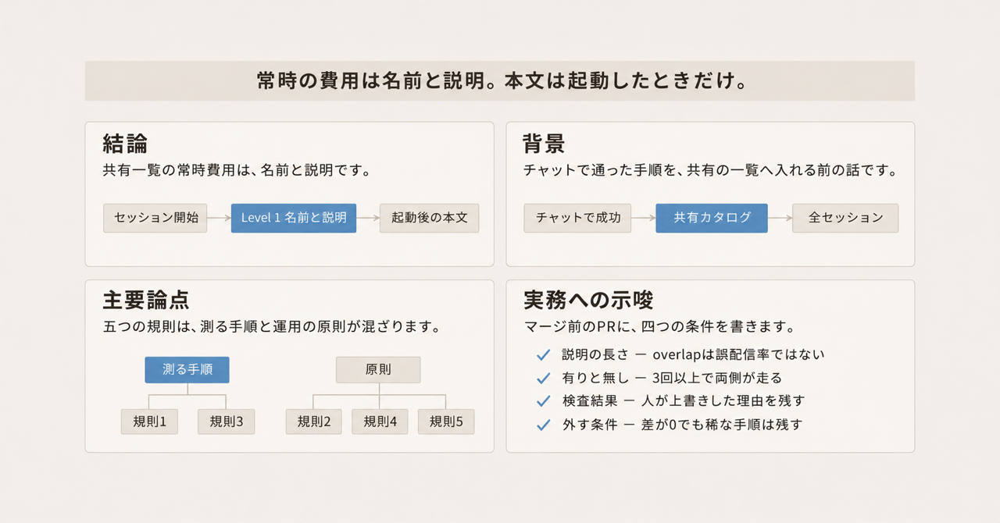
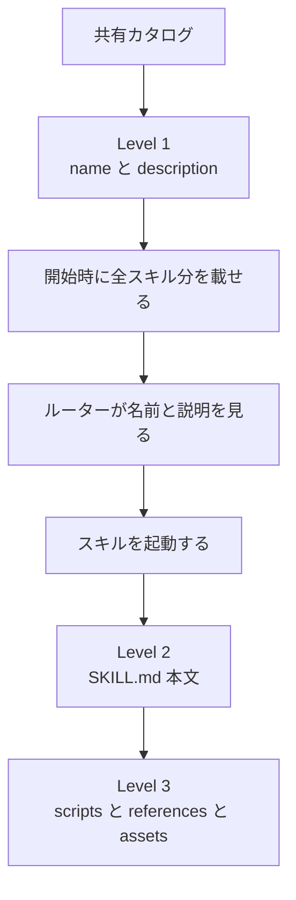

エージェントスキルを、リポジトリやワークスペースの共有カタログへ入れる前に、何を測るかを整理します。題材は Google Cloud Blog の "Five rules for evaluating agent skills before they bloat your context window" です。著者は Karl Weinmeister と Alan Blount で、実例は Google Cloud Developer Plugin です。

ここでいうエージェントスキルは、ディレクトリ 1 つと `SKILL.md` を単位にする手順書です。共有カタログは、そのスキルをリポジトリやワークスペースの共通の置き場へ入れ、利用者がまとめてインストールする一覧です。チャットで一度通った `SKILL.md` を、その共有の main へ入れる操作を、ブログは全員のコンテキストを占有する変更として扱います。

この記事の読者は、スキルをその共有カタログへ採用する人です。公開日は、2026-11-04 に取得した HTML で、画面の見出しが November 4, 2026、`datePublished` が November 3, 2026 です。

*この記事の全体像。以下、順に解説します。*

## 共有カタログのエージェントスキルとは

ブログは、共有カタログへ入れる前の点検を、五つの規則として並べます。扱う順は、起動の衝突とセキュリティ、評価環境、スキル有りと無しの対、採点の分け方、本文に書く内容、です。名指しする道具は、skill-reach、NVIDIA SkillSpector、NVIDIA SkillEvaluator、Harbor、Claude Code の `claude plugin eval` です。Claude Code は、その `claude plugin eval` を持つエージェント製品です。

Agent Skills の公開仕様は、読み込みを三段に分けます。この記事では、その三段を Level 1、Level 2、Level 3 と呼びます。

| 段 | 中身 | いつ読まれるか |
|---|---|---|
| Level 1 | `name` と `description` | セッション開始時。カタログ内の全スキル分 |
| Level 2 | `SKILL.md` の本文 | そのスキルを起動したあと |
| Level 3 | `scripts`、`references`、`assets` | 起動したセッションが、必要なとき |

`name` はスキルの名前、`description` はルーターが起動判断に使う説明です。ルーターは、カタログの名前と説明を見て、どのスキルを起動するかを選ぶ側です。仕様の上限は、`name` が 64 文字、`description` が 1,024 文字です。仕様はあわせて、metadata を約 100 tokens、instructions を 5,000 tokens 未満、本文を 500 行未満にするよう勧めています。この約 100 tokens は、仕様が metadata に置く目安です。一覧の合計と、説明 1 件の文字数は、別の数字としてあとに書きます。instructions は、仕様が 5,000 tokens 未満を勧める手順の量です。本文 500 行は、同じ仕様が別に勧める行数です。両者が同じ本文を指すかは、この並びだけでは確定できません。1 スキルあたりの Level 1 は、あとで約 50 から 100 tokens として分けます。

skill-reach は、発見とルーティングを測る道具です。`reach lint` と通常の `reach overlap` はローカル解析です。live の `reach eval` は、エージェントを実行します。`reach overlap` は、説明どうしの類似を Lucene BM25 で測ります。BM25 は検索の類似スコアで、この実装は非対称です。Lucene は、その BM25 の実装の名前です。非対称とは、A から見た B と、B から見た A のスコアが一致しないことです。

SkillEvaluator は三層です。Tier 1 が静的検査、Tier 2 が類似、Tier 3 が同じ課題のスキル有りと無しです。次元は Security、Correctness、Discoverability、Effectiveness、Efficiency の五つで、各次元は 0.0 から 1.0 です。標準の overall は、五次元の和を 5 で割った等重み平均です。Effectiveness は `goal_accuracy` と `behavior_check` の平均で、overall には一度だけ入ります。Skill Lift は、比較できる case の with-skill overall から without-skill overall を引いた差です。

関連する Google Cloud の運用記事は、2026-10-29 の Remigiusz Samborski による "Behind the scenes, two months later: how we ship Google agent skills like products" です。そこでは、本文を 500 行未満にし、`references` を一段にし、決定的な検査を LLM 評価の前に置く、と書かれています。一段とは、参照ファイルの入れ子を一段に限る、という意味です。ここでの決定的な検査は、言語モデルの採点より前に置く検査で、モデルの判断を待たずに結果が決まるものです。

共有カタログに入ったスキルは、次の順でコンテキストに載ります。常時見えるのは名前と説明だけです。本文と付属ファイルは、起動したセッションが読みます。

五つの規則は、この流れの別の位置に付きます。規則 1 は Level 1 の衝突と、起動前のセキュリティ検査です。規則 2、規則 3、規則 4 は、起動したあとの評価のやり方です。規則 5 は、Level 2 に何を書くかと、モデル更新後に対比較をやり直すことです。

## 注意点

ブログは公式の記事です。一方で、効果量の表、課題一覧、評価器の版、再実行ログは本文にありません。次の言い方は、公開本文から別の条件へ外挿できません。いずれもブログ本文の自己申告で、追試のデータは公開されていません。

| ブログの言い方 | 扱い |
|---|---|
| Δ がほぼ 0 のとき、十回中九回はスキルを読んでいない | 分母の無い修辞。測定値にしない |
| 連続実行で三分の一超の課題が別スコアになった | ブログ自身が retrieval study と呼ぶ別実験。スキルの paired 評価の変動率ではない |
| 正しさ 0.95 とトークン効率 0.05、四つの不正経路 | AlphaEvolve の retrieval 実験の説明。SkillEvaluator の公開式ではない |
| CPU 負荷で retrieval のスコアが下がった | 低下幅も反復回数も無い |
| 公開 API の表を写したスキルは lift がほぼ無い | 比較表が本文に無い |
| dozens of scenarios | 課題数の確定値ではない |

Δ は、この記事では WITH から WITHOUT を引いた差を指します。WITH はスキル有りのアーム、WITHOUT はスキル無しのアームです。アームは、比較する一方の条件です。lift は、その差のことです。0.95 と 0.05 の重みは、上の表のとおり SkillEvaluator の等重み平均ではありません。ブログが拒む一点の fitness は、複数の観点を一つの点数へ潰した総合点です。公開実装の等重み平均とは、別の重みです。Security、Correctness、Discoverability、Efficiency がそれぞれ何を数えるか、および `goal_accuracy` と `behavior_check` の中身は、確認した公開の総合点の説明にはありません。

overlap の 0.69 は、ブログの "e.g." と、skill-reach 文書のサンプルです。対になっているのは `google-agents-cli-deploy` と `google-agents-cli-scaffold` です。あるスキル群の実測誤ルーティング率ではありません。

ブログのサンプルコマンド `reach eval ... --runs 3` と `reach optimize ... --apply` は、2026-11-04 に確認した公式 CLI のフラグと一致しません。公式側のフラグは `--attempts` と `--auto-apply` です。回数の既定は、通常の eval が 5、quick eval が 3 です。quick eval は、この記事では回数の既定が 3 であること以外は分けません。サンプルをそのまま実行手順にしないでください。

2026-10-29 の運用記事は、stars が 21,000 を超えたことと、170 を超える skills を自己申告しています。これもブログの自己申告です。2026-11-04 の `gh repo view google/skills` では、stargazerCount が 21831 でした。この記事は約 2.2 万（2026-11-04）と書きます。170 は API で数えていません。

同じプラグインについて、Karl Weinmeister の X の投稿（2026-09-15）は次の数を書いています。このプラグインは、ブログの実例である Google Cloud Developer Plugin です。数は、そのプラグインの評価です。直前の `google/skills` の star や、170 skills の自己申告とは別です。プラグインの中のスキル個数は、この投稿の数からは決まりません。生の JSON は未取得です。p 値がシナリオ平均か試行単位かも、投稿からは確定できません。

- 72 試行は、12 シナリオ × 3 試行 × 2 アームです。完走は 100% です。
- plugin 側の correctness と goal effectiveness は、12 シナリオで 1.0000 です。この二つは、その投稿の欄名です。SkillEvaluator の Correctness や Effectiveness と同じ式ではありません。
- Pass@3 は 100% 対 baseline 91.7% です。baseline は、この投稿のスキル無し側です。この Pass@3 は、その投稿の呼び方です。plugin eval の grader 通過率の平均や、SkillEvaluator の pass@k と同じ式ではありません。pass@k は、SkillEvaluator が Skill Lift とは別欄に置く通過の呼び方で、式はこの記事にはありません。net lift は、その投稿が 12 シナリオのそれぞれで正だったと書く差です。SkillEvaluator の Skill Lift と同じ式ではありません。12 シナリオすべてで net lift が正で、p < 0.001 です。
- overall lift の 95% 信頼区間は、10,000 回のブートストラップで [+0.28, +0.46] です。ブートストラップは、同じ標本から繰り返し抽出して区間を見積もる方法です。この overall lift は、その投稿の区間です。SkillEvaluator の Skill Lift と同じ式としては書きません。
- efficiency は 0.8616 対 baseline 0.0000 です。0 の理由として著者は、探索的な shell、失敗した投機コマンド、構造化ツールで足りる問いへの bash、curl、python を、既定のルーブリックが efficiency 0 にすることを書いています。ルーブリックは、採点の基準表です。
- baseline の Pass@3 が 91.7% なので、効率 0 はタスク未達とは別です。
- 同じ投稿の図キャプションは、72 試行で overall が 59%（+0.36）上がり、Pass@3 が 100% になり、discoverability が +0.86、tool efficiency が +0.86 だった、と書きます。本文の efficiency 0.8616 対 0.0000 は、キャプションの tool efficiency +0.86 と桁が合います。キャプションの discoverability は、その投稿の自己申告です。SkillEvaluator の Discoverability 次元の式としては書きません。

この 2026-09-15 の実行は、あとで述べる SkillEvaluator の #240 と #241 より前です。この記事は、その実行が後から報告された不具合の影響を受けた、とは書きません。

Pass@3 という言葉も、出所で定義が違います。ブログの Pass@3 と、plugin eval の grader 通過率の平均は、同じ定義ではありません。SkillEvaluator は Skill Lift と、別欄の pass@k を定義します。数を比べるときは、どの定義かを先に固定します。

## 五つの規則を手順と原則に分ける

五つの規則は、一種類のゲートではありません。名前のあるコマンドに落ちるものと、運用の原則が混ざっています。

| 規則 | 区分 | 公開文書にある具体 |
|---|---|---|
| 1. 起動の衝突とセキュリティを、コンテナの前に止める | 測定手順 | `reach lint` と通常の `reach overlap` はローカル解析です。live の `reach eval` はエージェントを実行します。この実行が手元なのか、Harbor の別環境なのかは、確認した説明では分けていません。規則 2 が拒む手元評価を、`reach eval` が満たすとは書きません。SkillSpector の `scan` は、その静的なセキュリティ検査の実行です。SkillEvaluator の Tier 1。Tier 2 は類似で、既定で gate です。何と何の類似かは、確認した説明では特定できません。gate になる数値は公開されていません。この類似の数値は、あとの不合格の行には使いません。Tier 1 は `validate` の gate。Tier 3 は `--block-on-agent-eval` のときだけ gate。gate は、不合格だとその段を通過させない検査です。`validate` は、Tier 1 を gate にする検査の名前です。Harbor の採点コンテナは規則 2 です。規則 1 の見出しにあるコンテナが、その採点コンテナと同じかは、見出しだけでは確定できません |
| 2. 開発者のノート PC 上の評価を信じない | 原則。隔離の設定は手順になる | Harbor は `[verifier] environment_mode = "separate"` または `[verifier.environment]` で、別 verifier にする。agent コンテナの停止後に新しい verifier が始まり、`/logs/artifacts/` と宣言した path を受け取る。作業領域全体の mount ではない。両設定を省略した既存 task は shared で、agent と同じ環境で採点する |
| 3. WITH と WITHOUT を対で測る。ブログの規則名には Pass@3 が付く。雰囲気で決めない | 測定手順 | `claude plugin eval . --runs 3 --ablation with-without`。ここでの plugin は、このコマンドが有りと無しを比べる単位です。スキル 1 つと一致するかは、コマンドの説明だけでは確定できません。ブログの実例は Google Cloud Developer Plugin です。ablation の with-without は、スキル有りと無しの対です。Δ は WITH から WITHOUT を引く。PR に残す数は、grader の通過率と Δ です。ブログの Pass@3 と同じ式ではありません。grader は、試行が条件を満たしたかを判定する採点器です。両方 1.0 なら、plugin はその通過の原因ではない、と公式文書が書く。このコマンドは手元で打ちます。別マシンの verifier ではありません。必要版は Claude Code v2.1.269 以降。git を使うなら Git 2.31 以降 |
| 4. 効率とセキュリティを、正しさから分ける | 原則。採点の実装は手順になる | 五次元は別表示される。標準 overall は等重み平均。ブログが拒む一点の fitness は、この公開式とは別の重み |
| 5. 手順の習慣を書き、文書の転記を本体にしない | 原則。削除の再測定は手順になる | 仕様は metadata、本文、資源の三段。資源は、metadata と本文の次に置く付属で、この記事の Level 3（scripts、references、assets）に対応します。運用記事は本文 500 行未満と、references を一段にする review rule を書く。中心のブログは、モデル更新後に WITH と WITHOUT をやり直し、Delta が 0 に戻ったスキルを消す、と書く |

規則 2 と規則 3 のあいだには、ブログ内の緊張があります。規則 2 は手元の評価を拒みます。規則 3 の例示コマンドは、手元の `claude plugin eval` です。plugin eval の隔離は、一時 home と作業ディレクトリを使い、個人の skills、`CLAUDE.md`、他プラグインを載せません。管理ポリシーは残り得ます。hooks は起動の前後に走る付随処理、MCP は外部ツールへ接続する仕組みです。hooks と実 MCP は、サンドボックスの外にあります。CPU の奪い合いは、この文書の主題ではありません。手元のきれいな home と、別マシンの verifier は、同じ隔離ではありません。verifier は、試行のあとで結果を採点する側です。

Δ がほぼ 0 のとき、先に見るのは本文ではなく起動です。起動が 0 の試行は、本文の出来とは別の信号として扱います。本文を直す前に、`description` を直します。SkillEvaluator が lift を出さず INCONCLUSIVE とする正確な条件は、現行の reports 文書で確認します。この記事はその条件の文言を、採用の閾値にしません。

plugin eval の既定の runs は 3 です。SkillEvaluator の `--n-attempts` の既定は 1 です。採用時は 3 回以上を明示します。3 回でも、成功率の刻みは 0、1/3、2/3、1 です。一回の成功や失敗で Δ が動きます。

NVIDIA/SkillEvaluator#240（CLOSED）は、`--skip-baseline` が lift 0 を作り得た不具合です。Δ が 0 に見える前に、baseline の腕が走ったことを確認します。

## 文脈の費用は説明文が持つ

予算は二つあります。払う主体が違います。

| 費用 | 払う主体 | いつ払うか |
|---|---|---|
| Level 1。全スキルの `name` と `description` | 共有カタログをインストールしたリポジトリ、またはワークスペース | スキルが一度も起動しなくても、セッションごと |
| Level 2。`SKILL.md` 本文。Level 3。`scripts`、`references`、`assets` | そのスキルを起動したセッション | 起動したときだけ |

skill-reach の progressive disclosure の説明は、Level 1 を 1 スキルあたり約 50 から 100 tokens とします。progressive disclosure は、常時は名前と説明だけを載せ、本文は起動後に読む、という仕様の読み方です。同じ説明は、Claude Code のカタログ予算を約 30,000 文字（100 万トークン文脈の 1%）、または約 8,000 文字（20 万トークン文脈の 2%）とします。予算を超えると `description` が落ち、名前だけが残ります。`reach eval` がモデル化する Claude の実行時上限は、説明 250 文字、一覧 30,000 文字です。`reach lint` の resident listing の既定上限も 30,000 文字です。resident listing は、セッション開始時に常駐する一覧です。これらは 2026-11-04 に開いた skill-reach の文書と、その時点の lint の上限です。

したがって、本文の行数を減らしても、説明を長くすれば共有の一覧予算は減ります。稀にしか呼ばないスキルも、説明がカタログにある限り Level 1 を払い続けます。2,000 行のスキルがコンテキストを消費する、という 2026-10-29 の記述は、そのスキルを読んだときの話です。毎ターンの固定費として、本文行数を閾値にする根拠にはなりません。

スキルを増やしたあとに文脈予算を持つのは、カタログの所有者と、起動したセッションの両方です。欠落を数えてから足す判断と、入ったあとに誰がトークンを払い続けるかは、別の問いです。

## マージ前に書く条件

「チャットで一回成功した」は、採用条件にしません。不合格の基準を先に書きます。数値の閾値で公開されているのは、文字数、試行回数、検査の recommendation 名までです。期待改善幅は、ブログから再現できません。recommendation は、検査が返す推奨ラベルです。ハーネスは、試行を流して採点する一連の仕組みです。

注意点の「十回中九回」は、分母の無い修辞です。測定値にも、下の不合格の幅にも使いません。不合格の行にある Δ は、自分のハーネスで測った WITH と WITHOUT の差です。その差の公開された数値の境界はありません。overlap の「高い」にも、公開された境界値はありません。0.69 はサンプルであり、閾値ではありません。境界が公開されていないので、切る幅は測る前に PR へ自分で書きます。PR には上位候補を書き、説明を短くしてから測り直します。

| 不合格 | 見るもの | 外すときの追加条件 |
|---|---|---|
| 説明が listing 予算を超える、または BM25 の overlap が高い | `reach lint` と `reach overlap`。overlap は誤配信率ではない | 説明を短くしてから再測定する。本文の改稿を先にしない |
| セキュリティ検査が DO_NOT_INSTALL、または critical がレビュー無し | SkillSpector の recommendation。SkillEvaluator Tier 1。critical は recommendation のラベルではなく、検出の重さです | 検査の偽陽性を人が見て残す場合は、理由を PR に書く。検査の通過だけでは、実行時の安全性を証明しない |
| 評価スイートが無い、または最新コミットより古い | 2026-10-29 の運用。report を PR にリンクし、最新コミットとの鮮度を見る | 新規ならスキル無しと比較する。既存なら前版と比較する |
| 対の Δ がほぼ 0 | 実際に使うハーネスの WITH と WITHOUT。採用時は 3 回以上を明示する | 課題セットが、スキルの主張する振る舞いを覆っている。かつ、稀な高損害の手順ではない |
| スキル有り側で、起動するはずの課題が一度も起動しない | 起動ログ | 本文を磨く前に `description` を直す |
| ベースラインをスキップした lift が 0 | 両アームが走ったか | Δ が 0 に見える前に、baseline の腕の実行を確認する |

listing 予算は、一覧の 30,000 文字（100 万トークン文脈の 1%）または 8,000 文字（20 万トークン文脈の 2%）です。不合格に使うのは、この一覧上限です。仕様の `description` 1,024 文字は、説明欄の上限です。`reach eval` がモデル化する説明 250 文字は、その実行時モデルの上限です。この三つは同じ閾値ではありません。DO_NOT_INSTALL は、SkillSpector の recommendation の一つで、入れない判断を示すラベルです。SAFE と CAUTION が、ほかのラベルです。critical は、その三つのどれでもありません。

呼ぶ頻度は、採用時に二つ書きます。平常の課題で何回起動するか。起動しない期間の損害は何か。インシデント時の IAM 確認のように、平常のデプロイ課題では一度も呼ばれない手順は、平常の Δ が 0 でもカタログに残す理由があります。その場合も、Level 1 の説明は短い必要があります。説明の長さは、呼ぶ頻度が低くても共有予算を使います。

削除の再測定は、モデルを更新したときに WITH と WITHOUT をやり直す、というブログの手順を残します。消す決定は、Delta が 0 に戻ったことだけでは閉じません。課題セットが、スキルの主張する振る舞いを覆していることを加えます。覆っていない高損害の手順は、説明を短くして残します。

共有カタログへ足す PR には、次の四項を書きます。

1. 説明の文字数と、`reach overlap` の上位候補。overlap は誤配信率ではない、と一行添えます。
2. 実際に使うハーネスでの WITH と WITHOUT。plugin eval の既定は 3 回、SkillEvaluator の `--n-attempts` の既定は 1 回なので、採用時は 3 回以上を明示します。両アームが走ったことを残します。起動が 0 なら、本文を直す前に説明を直します。
3. セキュリティ検査の recommendation と、人が上書きした理由。
4. 外す条件。平常課題の Δ が 0 に戻ったことに加え、その課題が主張する振る舞いを覆っていること。覆っていない高損害の手順は、説明を短くして残します。

この四項が過剰になるのは、個人の一時メモで、共有カタログに入らないときです。そのメモは、Level 1 を他のセッションに課しません。ベンダー固有になるのは、skill-reach の live probe や SkillEvaluator の総合点を、未対応のハーネスへそのまま移すときです。削除規則として害になるのは、平常の Δ が 0 であることだけで、稀な手順を消すときです。

## 道具ごとに測れる範囲

2026-11-04 の `gh repo view` に基づく規模です。star は概数であり、品質ではありません。pushedAt は、default ブランチの最新コミット日とはずれ得ます。live probe は、エージェントを実際に動かして発見を試す探査です。表の Antigravity、Goose、Pi は、その live probe の対象に挙がるエージェント製品の名前です。Codex は、この表では静的発見の対象です。オフラインの keyword は、モデル API を使わずキーワードで発見を試す経路です。SLA は、サービス水準の約束です。

| 道具 | 測ること | 規模の目安 | この判断での位置 |
|---|---|---|---|
| google/skill-reach | 発見とルーティング。live probe は Antigravity、Claude Code、Goose、Pi、オフラインの keyword。Codex は静的発見の対象で、live probe 一覧には無い | 約 20 stars。pushedAt 2026-11-01T11:36:48Z。Apache-2.0。archived ではない | Level 1 の採用ゲート。若いリポジトリで、標準としては扱わない |
| NVIDIA/SkillEvaluator | 静的検査、類似、隔離された対比較。次元は別表示し、標準 overall は等重み | 約 630 stars。pushedAt 2026-11-04T00:20:05Z。experimental、community-supported、SLA 無し | 対比較と次元別の報告。総合点だけを削除条件にしない |
| NVIDIA/SkillSpector | 静的なセキュリティ検査。recommendation は SAFE、CAUTION、DO_NOT_INSTALL。risk_score は 100 点尺度 | 約 2.4 万 stars。pushedAt 2026-11-03T20:19:47Z | Tier 1 の材料。単独の合否にしない |
| harbor-framework/harbor | 試行の実行と verifier。スキルの五次元は Harbor 自身の定義ではない | 約 6,800 stars。pushedAt 2026-11-04T00:38:54Z | 規則 2 の隔離を設定する側 |
| Claude Code plugin eval | 同じ case の plugin 有りと無し。grader の通過率と Δ | 必要版は Claude Code v2.1.269 以降。git を使うなら Git 2.31 以降 | 手元で対を取る手順。別コンテナの verifier ではない |

skill-reach、SkillEvaluator、SkillSpector の三つを、同じ品質のハーネスとしては扱いません。SkillEvaluator の NVIDIA/SkillEvaluator#235（OPEN）は、native Codex の inline と allSettled の証跡が未対応です。inline と allSettled は、Codex 側が実行結果を残す形式の名前です。NVIDIA/SkillEvaluator#236（OPEN）は、ルーブリック参照と native Codex のツール証跡が欠けます。google/skill-reach#58（CLOSED）は、Claude Code 2.1.286 の内蔵スキルが、居住違反という理由で全 probe を拒否した事例です。何に対する違反かは、確認した issue の要約にはありません。この記事が取るのは、ハーネス更新のたびに probe が壊れ得る、という点です。

セキュリティの境界も、ブログの一文より狭いです。NVIDIA/SkillEvaluator#140 は Issue ではなく、2026-10-16 にマージされた PR です。security trace check は `/var/run/secrets/kubernetes.io`、`169.254.169.254`、`metadata.google.internal` を不正 path とします。`sensitive_path_access` を critical、`score_impact=True` で出します。`score_impact=True` は、その検出を点数へ反映する印です。redaction は oauth、bearer、token、`ya29.` を対象にします。`ya29.` は、その redaction が対象に含む文字列です。GKE（Google Kubernetes Engine）のメタデータ遮断は、非特権モードなど設定が条件になります。ブログの「サービスアカウントトークンの読み取りやクラウドメタデータ照会で trial を失敗させ、保存軌跡から live の OAuth を redact する」は、この既知文字列と隔離設定より広いです。

SkillSpector の README は、静的検出に偽陽性があり得ることを認めます。NVIDIA/SkillSpector#1001（OPEN）は、Session クライアント経由の資格情報送信が報告されない例です。Session クライアントは、その Issue が挙げる送信経路の名前です。NVIDIA/SkillSpector#994（OPEN）は、TAR と GZIP の中が検査範囲外です。NVIDIA/SkillEvaluator#244（CLOSED、2026-10-28）は、例示用ドメインを PII（個人を特定し得る情報）と誤検知しました。NVIDIA/SkillEvaluator#241（OPEN）は、目標精度の判定が NBSP（改行しない空白）に敏感な答えを誤採点し得ます。検査結果は、人が理由を残して上書きできる材料です。

費用の固定表はありません。`reach lint`、`reach overlap`、keyword ドライバは、モデル API を使いません。live eval、plugin eval、SkillEvaluator のモデル呼び出しは、選んだプロバイダの課金になります。plugin eval の `--max-cost-usd` は、定価の見積もりに対する上限です。試行数の見当は、cases × runs × 2 アームに、judge の呼び出しが乗ります。judge は、試行本数とは別に数える採点の呼び出しです。`reach eval` の `--workers` 既定は 1、`--retries` 既定は 2、`--backoff` 既定は 5.0 秒です。plugin eval の並列は 1 から 8 で、同じアカウントの rate limit を共有します。

v2.1.299 以降は、rate limit で終わった run を採点せず、score 0 にし、コマンドは非ゼロで終わります。v2.1.299 より前、必要版の下限 v2.1.269 から v2.1.298 までは、その時点までの生成物を採点していました。この範囲では、score 0 の説明をそのまま使えません。

モデルページを 2026-11-04 に再取得した HTML では、Claude Sonnet 5 の Model ID は `claude-sonnet-5` です。Launch stage は GA です。GA は、一般提供の段階です。Versions の Release date は June 30, 2026、Retirement Date は Not sooner than December 24, 2026 です。最大入力は 1,000,000 tokens、最大出力は 128,000 tokens です。skill-reach の README は、Claude Code の既定モデル ID として `claude-sonnet-5` を書き、例に `CLAUDE_CODE_USE_VERTEX=1` を置きます。この Model ID と環境変数は、その README の記述です。PR の四項の閾値ではありません。

## 残る判断と残らない判断

現在の結論は、次のとおりです。共有カタログへ入れる前に、説明の予算と overlap、使うハーネスでの対比較、セキュリティ検査の人のレビュー、平常の Δ が 0 でも残す条件、をマージ前に書きます。本文の行数は起動時の費用です。常時の共有費用は、説明の側にあります。

支持になるものは、次です。

- 仕様が、起動時の全スキル metadata と、起動後の本文を分けています。
- plugin eval が、同じ case の両アームと Δ を定義し、両方 1.0 なら plugin が通過の原因ではない、と書きます。
- SkillEvaluator が五次元を別表示します。効率 0 がタスク未達を意味しない、という読みは、著者の X の投稿にある baseline Pass@3 91.7% と efficiency 0.0000 の並記で具体になります。この並記は著者の自己申告で、生データは未取得です。
- 隔離そのものを不要とする公開資料は、確認した範囲では見つかりませんでした。
- 2026-10-29 の運用記事は、決定的検査を LLM 評価の前に置き、評価レポートの鮮度を PR で見る、と書きます。

限界は、次です。

- 五規則を一律の必須ゲートにする期待改善幅は、公開本文から再計算できません。ブログ本文の自己申告で、追試のデータは公開されていません。
- n=3 の成功率は、0、1/3、2/3、1 の刻みです。一回の成功や失敗で Δ が動きます。
- Δ が 0 であることは、その課題集合で差が出なかったことです。課題に入っていない高損害手順が不要であることの証明ではありません。
- 本文の行数の上限は、常時コストの上限ではありません。
- skill-reach、SkillEvaluator、SkillSpector は、star 数、SLA の有無、live で対応するハーネスが揃っていません。
- 公開 API の表を一律に排除する因果は、比較表の無い自己申告です。追試のデータは公開されていません。

残るのは、「測ってから入れる」と「常時費用は説明文」です。残らないのは、「ブログの効果量を自分のカタログの閾値にする」と「Δ が 0 なら自動で削除する」です。

## 公開資料だけでは決まらないこと

次は、公開ページを読んだ範囲では閉じていません。

- 画面見出しの November 4, 2026 と、同じ HTML の `datePublished` November 3, 2026 の、どちらを編集上の公開日にするか。事実としては両方あります。
- retrieval study の課題数、AlphaEvolve のログ、CPU 負荷の低下幅。
- 72 試行の生 JSON と、p 値の対がシナリオ平均か試行か。
- PR 140 の security check は、上記の path と redaction 対象までは確認できます。ブログの一文は、その既知文字列より広いです。
- あるカタログの説明を足した合計が、30,000 文字と 8,000 文字のどちらに近いか。この記事は、特定カタログの合計を計測していません。

追加の公開データで判断が変わるのは、生データが出て効果量が再現できたときと、自分のカタログの説明合計が一覧上限に当たっていると分かったときです。効果量が非公開のままでも、予算の持ち主と不合格条件は書けます。

## まとめ

共有カタログへスキルを足す前に、PR へ四項を書きます。説明の文字数と overlap、使うハーネスでの WITH と WITHOUT、セキュリティ検査と人の上書き理由、外す条件です。

常時の費用は Level 1 の説明です。カタログの所有者が、起動しなくてもセッションごとに払います。本文と付属ファイルは Level 2 と Level 3 で、起動したセッションが払います。本文を短くしても、説明が長ければ一覧予算は減ります。

五つの規則は、規則 1 と規則 3 を測定手順、規則 2 と規則 5 を原則、規則 4 を「別表示したうえで等重み平均も持つ」原則として切ります。ブログの効果量は、自分のカタログの閾値にしません。平常の Δ が 0 であることだけでは、稀な高損害の手順を消しません。

この記事が少しでも参考になった、あるいは改善点などがあれば、ぜひリアクションやコメント、SNSでのシェアをいただけると励みになります！

## 参考リンク

- [Karl Weinmeister, Alan Blount. Five rules for evaluating agent skills before they bloat your context window. Google Cloud Blog](https://cloud.google.com/blog/topics/developers-practitioners/evaluate-agent-skills-before-they-bloat-your-context-window/). 2026-11-04 に取得した HTML では、画面見出しは November 4, 2026、`datePublished` は November 3, 2026 です。
- [Karl Weinmeister. Evaluating the Google Cloud Developer Plugin. X, 2026-09-15](https://x.com/kweinmeister/status/2099962972798153194)
- [Remigiusz Samborski. Behind the scenes, two months later: how we ship Google agent skills like products. Google Cloud Blog, 2026-10-29](https://cloud.google.com/blog/topics/developers-practitioners/behind-the-scenes-two-months-later-how-we-ship-google-agent-skills-like-products)
- [Agent Skills specification](https://agentskills.io/specification)
- [google/skill-reach](https://github.com/google/skill-reach)
- [skill-reach docs](https://google.github.io/skill-reach/)
- [NVIDIA/SkillEvaluator reports](https://docs.nvidia.com/skills/skillevaluator/reports)
- [NVIDIA/SkillEvaluator Tier 3](https://docs.nvidia.com/skills/skillevaluator/tier3-live-evaluation). `--n-attempts` の既定は 1 です。
- [NVIDIA/SkillEvaluator pull 140](https://github.com/NVIDIA/SkillEvaluator/pull/140)
- [Harbor separate verifier](https://docs.harborframework.com/tasks/separate-verifier)
- [Claude Code plugin evals](https://code.claude.com/docs/en/plugin-evals)
- [Claude Sonnet 5 on Gemini Enterprise Agent Platform](https://docs.cloud.google.com/gemini-enterprise-agent-platform/models/partner-models/claude/sonnet-5)
- [NVIDIA/SkillEvaluator issue 240](https://github.com/NVIDIA/SkillEvaluator/issues/240)
- [NVIDIA/SkillEvaluator issue 241](https://github.com/NVIDIA/SkillEvaluator/issues/241)
- [NVIDIA/SkillEvaluator issue 235](https://github.com/NVIDIA/SkillEvaluator/issues/235)
- [NVIDIA/SkillEvaluator issue 236](https://github.com/NVIDIA/SkillEvaluator/issues/236)
- [NVIDIA/SkillEvaluator issue 244](https://github.com/NVIDIA/SkillEvaluator/issues/244)
- [google/skill-reach issue 58](https://github.com/google/skill-reach/issues/58)
- [NVIDIA/SkillSpector issue 1001](https://github.com/NVIDIA/SkillSpector/issues/1001)
- [NVIDIA/SkillSpector issue 994](https://github.com/NVIDIA/SkillSpector/issues/994)
