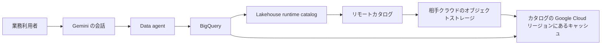

2026年10月16日の Google Cloud Blog は、borderless Lakehouse を Gemini のエージェント利用へつなぐ機能を発表しました。この記事では、その発表を公式ドキュメントの手順、名前、上限、提供段階に沿って整理します。読後に判断できるのは、会話からどの表まで届くか、読んだブロックがどのリージョンに残るか、本番の提供段階をどのページで見るか、の3点です。

数値と提供段階は、2026年10月17日までに公開されていたブログ本文と公式ドキュメントの文言に対応します。

*この記事の全体像。以下、順に解説します。*

## Borderless Lakehouse とは

2026年10月16日付の記事の著者は、Gaurav Saxena（Director, Product Management）と Ahmet Altay（Director, Engineering）です。

[Bringing the borderless Lakehouse into the agentic era with innovations for Gemini](https://cloud.google.com/blog/products/data-analytics/borderless-lakehouse-integrates-with-gemini/) は、実験的なチャットボットから自律エージェントへ移るときの詰まりを、複数のクラウド、SaaS、オンプレミスに散らばったデータへ到達し、その上で推論できるかに置いています。Gemini をその入口にする、と書いています。

Borderless Lakehouse は、2026年4月20日に BigLake から改名したデータ基盤です。API、クライアント、CLI、IAM の名前は BigLake のまま残ります。実行時のカタログは、以前の BigLake metastore で、いまは Lakehouse runtime catalog と呼びます。リモート側は Apache Iceberg の REST catalog を想定します。

Gemini から Databricks Unity Catalog または Snowflake Horizon への接続を、Lakehouse のカタログ連合で設定する機能は、記事自身が Currently in preview と書いています。

### メタデータの発見

メタデータの発見は、リモートの Iceberg REST catalog へ接続して行います。発見の時点で行うのは、リモートカタログからのメタデータ取得です。認証は、Secret Manager に置いた秘密か、Google を IdP（Identity Provider）とする OIDC（OpenID Connect）です。出典は [About cross-cloud data access](https://docs.cloud.google.com/lakehouse/docs/about-cross-cloud-data-access)（Last updated 2026-10-15）です。

同ページがセットアップ先として列挙するカタログは5つです。

| カタログ | 置き場所 |
|---|---|
| Databricks Unity Catalog | AWS または Google Cloud |
| AWS Glue | AWS |
| Snowflake Horizon Catalog | AWS または Google Cloud |
| Workday Data Lake | AWS または Google Cloud |
| SAP Business Data Cloud | AWS、Azure、または Google Cloud。Delta Sharing |

同じページの構成説明は、SaaS 側に Salesforce Data Cloud、Workday Data Lake、SAP Business Data Cloud を挙げます。

### クエリの名前と権限

クエリのテーブル名は4部です。`project.federated_catalog.namespace.table` です。クエリのロール例は `roles/bigquery.dataViewer`、`roles/bigquery.jobUser`、`roles/biglake.viewer` です。出典は [Use the borderless Lakehouse](https://docs.cloud.google.com/lakehouse/docs/use-borderless-lakehouse)（公開表記 2026-08-19）です。

カタログ作成の案内として確認できたのは、Google Cloud コンソールまたは `gcloud` です。会話分析の到達先として、同じ利用ページは Databricks Unity、AWS Glue、SAP、Salesforce を書いています。

### キャッシュと専用線

読んだデータブロックは、カタログを作った Google Cloud リージョンのキャッシュに data-at-rest として残ります。同じブロックの再読はそのキャッシュを使います。ドキュメントの例では、EU の Amazon S3 と `us-east4` の BigQuery を組むと、キャッシュは `us-east4` に置かれます。

転送は Dedicated Cross-Cloud Interconnect または Partner Interconnect を使えます。公開インターネットと比べ、転送コストを大きく減らし、遅延を予測しやすくする、と Lakehouse のドキュメントは書いています。

Cross-Cloud Interconnect の相手クラウドは AWS、Microsoft Azure、OCI、Alibaba Cloud です。ポート容量は、AWS と OCI が 10 Gbps、100 Gbps、400 Gbps です。Azure と Alibaba が 10 Gbps、100 Gbps です。Dedicated の費用は、両クラウドのポートと attachment に加え、Google Cloud から出る data transfer out です。プロビジョニングの比較表は 1 から 4 週間と書いています。出典は [Cross-Cloud Interconnect の概要](https://docs.cloud.google.com/network-connectivity/docs/interconnect/concepts/cci-overview)（Last updated 2026-10-13）です。

Cloud Storage 上の Lakehouse テーブル向け credential vending は、IAM をテーブル単位で扱います。トークンはそのテーブルのパスに限定されます。クエリが書き込みを要しないときは read-only まで落とします。出典は [Credential vending](https://docs.cloud.google.com/lakehouse/docs/credential-vending)（Last updated 2026-10-15）です。

### 会話から届く表

BigQuery の conversational analytics は、data agent の knowledge source に borderless Lakehouse のテーブルを接続できます。エージェントは、明示して選んだ knowledge source だけを読みます。1エージェントあたりの上限は 100 です。操作は読み取りに限られ、書き込み、DML、remote functions は対象外です。VPC Service Controls を尊重します。会話履歴の共有範囲は本人です。出典は [Conversational analytics](https://docs.cloud.google.com/bigquery/docs/conversational-analytics) です。

### カタログの上限

連合カタログのクォータ（Cross-cloud data access の節は Pre-GA）は、次のとおりです。出典は [Quotas](https://docs.cloud.google.com/lakehouse/docs/quotas)（Last updated 2026-10-15）です。

| 対象 | 上限 |
|---|---|
| カタログあたりの namespace | 100 |
| namespace あたりの table | 300 |
| カタログあたりの table | 10,000 |
| namespace filter | 16 |
| 発見スキャンが1つの Cloud Storage バケットで扱う Iceberg テーブル | 1,000 |
| テーブル変更 | 1日 1,500。表の注記では DML と streaming はこの日次件数の対象外 |
| メタデータ更新 | 10秒あたり 5 回 |

### ブログが generally available と並べた項目

10月16日の記事が now generally available と並べた項目は、次のとおりです。

- AWS と Azure 向けの Cross-Cloud Interconnect と cross-cloud caching
- BigQuery の Apache Iceberg V3
- BigQuery と Managed Service for Apache Spark の Iceberg テーブルにおける read-write interoperability
- AWS Glue、Databricks Unity Catalog、Snowflake Horizon Catalog との bi-directional caching（Lakehouse runtime federation）
- Knowledge Catalog 統合
- Salesforce、SAP、Workday の zero-copy と、Confluent Tableflow
- Lakehouse console と Dataflow による Databricks Delta Lake 資産の同期

### データの流れ

業務利用者の会話は Gemini に入り、Data agent が BigQuery を通じて Lakehouse runtime catalog を見ます。runtime catalog はリモートカタログのメタデータを持ち、実データは相手クラウドのオブジェクトストレージにあります。読んだブロックは、カタログを置いた Google Cloud リージョンのキャッシュへ写ります。

キャッシュは、再読を Google Cloud 側で済ませるための複製です。正本は相手クラウドのオブジェクトストレージに残ります。エージェントが参照できる表は、連合したカタログと、そのエージェントに明示した knowledge source の内側です。

## 注意点

提供段階は、ブログの generally available と、同週のドキュメントが一致しません。買い手は、ブログの一覧だけで本番サポートを前提にできません。

### ドキュメントが Preview と書く範囲

[About cross-cloud data access](https://docs.cloud.google.com/lakehouse/docs/about-cross-cloud-data-access)（Last updated 2026-10-15）のページ先頭は Preview / Pre-GA です。サポート先は biglake-help@google.com と書かれています。[Lakehouse basics](https://docs.cloud.google.com/lakehouse/docs/lakehouse-basics)（Last updated 2026-10-15）も cross-cloud connections を Preview と書きます。[Iceberg V3 binary deletion vectors](https://docs.cloud.google.com/lakehouse/docs/use-iceberg-v3-binary-deletion-vectors)（Last updated 2026-10-15）も Preview です。クォータページの Cross-cloud data access 節も Pre-GA です。

リリースノートの検索では、Lakehouse caching と Iceberg V3 の binary deletion vectors は Preview のままでした。2026-10-14 の Hive catalog endpoint と、Dataproc Metastore からの metadata migration は、検索結果では GA と出ています。この2件は検索結果であり、リリースノートのページ全体の条件まではここには書きません。

Confluent Tableflow をブログは generally available と書きます。リリースノート検索では Confluent と Tableflow の文字列は見つかりませんでした。文字列が無かったことから、Tableflow が GA ではない、とは読みません。

SAP BDC については、2026-07-20 の統合を GA とする報告があります。該当リリースノート本文の条件まではここには書きません。zero-copy の箇条書き全体を Preview とは扱いません。

Iceberg V3 は、BigQuery からの write に非対応で、BigQuery では read のみです。新しい V3 型（Variant、Geography、nanosecond timestamp、default values、unknown）と row lineage は非対応です。作成と書き込みの例は Spark、Flink、Trino です。推奨 Spark は 3.5 以上で、例示ランタイムは `iceberg-spark-runtime-3.5_2.12:1.10.1` です。Iceberg V2 の read-write を GA と書くドキュメントページは、公開ページとしては見つかっていません。V3 の Preview から、Iceberg の読み書き全体が Preview だとは読みません。

### コピーが残る箇所

「データを動かさない」は、発見時にファイルをコピーしない、という文まではドキュメントと一致します。その後のキャッシュは、選んだ Google Cloud リージョンに data-at-rest の複製を残します。キャッシュの鍵は Google が持つ鍵で、CMEK（顧客管理の暗号鍵）は使えません。組織ポリシー `constraints/gcp.restrictNonCmekServices` がテーブルに効くと、そのクエリのキャッシュは無効になります。クエリ自体は続行する、とドキュメントは書きます。

Delta Lake の取り込みページは、Cloud Storage 上の Delta を Dataflow で Lakehouse の Iceberg テーブルへ写し、「The existing data is copied over」と書きます。制限に「Amazon S3 isn't supported」があります。出典は [Import Delta Lake tables](https://docs.cloud.google.com/lakehouse/docs/import-delta-lake-tables)（Last updated 2026-10-15）です。ブログの「Databricks Delta Lake をコンソールと Dataflow で同期」を、Amazon S3 上の Databricks テーブルをその場で参照する機能と読むと、このページとは違います。

### 帯域、性能、顧客事例

帯域の自己記述もドキュメントと幅が違います。ブログは connection あたり 10 Gbps または 100 Gbps と書き、「eliminating variable egress fees」と書きます。Cross-Cloud Interconnect の概要は AWS に 400 Gbps があり、Dedicated では Google Cloud から出る data transfer out を払います。固定ポート料金はアカウントチーム経由の選択肢です。Lakehouse 側の文書は「significantly reduces」「a significant portion」であり、egress の消去とは書いていません。

性能の自己記述には測定条件がありません。ブログは、エージェントの context window は typically hundreds of kilobytes、MCP は context window と payload のため megabyte scale、Lakehouse は petabytes をローカル格納と同程度の性能で扱える、と書きます。別紙のベンチマーク CSV や条件表は見つかっていません。これらの大きさはベンダーの自己記述です。

顧客の定量も同様です。Etsy についてブログは、three petabytes を統合し、pipeline queries を 60% 速くした、と書きます。リンク先は `https://cloud.google.com/customers/etsy-lakehouse` です。この記事の数値はブログの文であり、顧客ページの内訳は根拠にしていません。「Customer use of Apache Iceberg has more than tripled since the beginning of 2025」は、分母、母集団、計測方法が本文にありません。

ブログの結合例はストレージ名を "Amazon Azure Data Lake Storage" と書いています。Amazon と Azure が一つの固有名詞になっています。

### 問題設定より狭い到達範囲

オンプレミスは問題設定の文にはあります。cross-cloud ページのカタログ列挙には、オンプレミスのテーブルコネクタはありません。Dedicated Interconnect は網の接続であり、テーブルを読むコネクタではありません。[Building a cross-cloud open data lakehouse](https://codelabs.developers.google.com/next26/multicloud-lakehouse) の Key concepts は on-premises と書きます。手順が繋ぐのは AlloyDB、AWS S3 またはその模擬としての Cloud Storage、Cloud Storage のイベントログです。

Salesforce は構成説明と、会話分析の到達先には出ます。専用のセットアップ手順の公式 URL は見つかっていません。

Gemini の画面から federated catalog を作る手順は見つかっていません。確認できた作成手順はコンソールと `gcloud` です。ブログの Gemini からの設定を、カタログ作成の操作手順と同一視する根拠は取れていません。

bi-directional caching という語を定義する公式ページは見つかっていません。確認できた動作は、メタデータの連合と、読んだブロックのリージョン内キャッシュです。

列の制御について、credential vending のページは Cloud Storage 上のテーブルをテーブル単位と書きます。リモートの Databricks や Snowflake の連合カタログに列レベルを掛ける記述は見つかっていません。2026年7月30日の日本語導入記事も、ガバナンスをテーブルレベルのアクセス制御と credential vending と書きます。出典は [Borderless Lakehouse の紹介](https://cloud.google.com/blog/ja/products/data-analytics/introducing-the-borderless-lakehouse) です。

Azure が一般のカタログ提供元として並ぶのは、cross-cloud のカタログ列挙では SAP BDC のホスト先です。

### 会話 API の上限と、選択の意味

会話 API の既知の上限（ページは Preview、Last updated 2026-10-13）は、次のとおりです。出典は [Known limitations](https://docs.cloud.google.com/gemini/docs/conversational-analytics-api/known-limitations) です。

| 対象 | 上限 |
|---|---|
| BigQuery のクエリ | 500 GB of bytes processed まで |
| Looker | クエリあたり最大 5,000 行 |
| AlloyDB、Cloud SQL、Spanner | 1,000 行 |
| Python 推論 | `O(100k)` 行まで |
| 出力 | 最大 8,192 tokens |
| `DataResult` | 最大 3,000,000 bytes。行単位に切る |
| 認証エラー | 再試行しない |
| それ以外の失敗 | リクエストあたり最大 3 回まで修正クエリを再試行する |
| レート（project） | 全体 30 QPS（1,800 QPM） |
| レート（user） | 10 QPS（600 QPM） |
| chat | project あたり 30 QPM、user あたり 30 QPM |
| chat 1 リクエスト | quota 8 単位として数える |

同じ known limitations は、AlloyDB、Cloud SQL for MySQL、Cloud SQL for PostgreSQL、Spanner に限って、table selection はセキュリティ設定ではない、と書きます。`table1` と `table2` だけと指定しても、実行ユーザーが同じデータベースの `table3` を見られるなら `table3` が返りえます。この文を BigQuery と Lakehouse の knowledge source 選択へ広げると、conversational analytics の「明示した knowledge source だけ」と衝突します。BigQuery 経路に同じ例外を書いたページは見つかっていません。

### プロンプト、料金、入口

conversational analytics は、製品改善のため anonymized prompt data の分析を既定で有効にしています。基盤モデルの学習には使わない、と書きます。2026年11月23日より前のオプトアウトは、Resource Manager の ID とオプトアウトフォームです。2026年11月23日以降は、組織ポリシー `constraints/gcp.disablePromptAnalytics` を適用します。

料金ページは、計算料金が BigQuery と Managed Spark に従う、と書きます。クロスクラウドクエリやキャッシュに固有の公開単価は見つかっていません。出典は [Lakehouse pricing](https://cloud.google.com/products/lakehouse/pricing) です。Codelab は、片付けをすぐ行う前提でラボ費用を under $5 USD と書きます。本番の単価ではありません。

10月16日記事の日本語版 URL は見つかっていません。公式 Colab ノートブックも見つかっていません。実行可能な入口として確認できたのは、上記 Codelab と、Iceberg V3 ページの Spark SQL 例です。

独立した障害事例、規制処分、セキュリティ研究者の記事は見つかっていません。公開の脆弱性データベースを BigLake で検索した範囲の該当件数は 0 でした。これは脆弱性が無いことではありません。

## 到達が止まるときの症状

ドキュメントが書いている失敗の形は、次の3つです。クロスクラウド専用のエラーコード一覧ページは見つかっていません。

Snowflake のメタデータ更新が Code 16（`UNAUTHENTICATED`）になることがあります。秘密は生の PAT（Personal Access Token）ではなく、`client_secret` と `scope` を持つ JSON です。出典は [Troubleshoot cross-cloud data access](https://docs.cloud.google.com/lakehouse/docs/troubleshoot-cross-cloud-data-access) です。

マルチリージョンカタログへのクエリが `NOT_FOUND` になることがあります。出典は [Troubleshooting](https://docs.cloud.google.com/lakehouse/docs/troubleshooting) です。

Databricks 側で表が空、または見つからないことがあります。`EXTERNAL USE SCHEMA`、External data access、外部ロケーションが要ります。出典は [Troubleshoot borderless Lakehouse for Databricks](https://docs.cloud.google.com/lakehouse/docs/troubleshoot-borderless-lakehouse-databricks) です。

## エージェントに渡す前に決める4つの境界

10月16日ブログの導入文は、clouds、SaaS、on-premises に散らばったデータへの accessing and reasoning を critical bottleneck と書いています。この問題設定は、公式の問題設定として引用できます。散在データへの到達が、現場で唯一の詰まりである、という測定ではありません。

製品側の答えは、カタログ連合と、リージョン内キャッシュと、明示した knowledge source です。仕組みのドキュメントは Preview であり、到達範囲はカタログ、クォータ、権限、knowledge source の内側に限られます。エージェントにツールを足す前に、次の4つを決めます。

1. 連合してよいカタログ、namespace、表を決めます。ドキュメント上の枠は、カタログあたり namespace 100、namespace あたり table 300、カタログあたり table 10,000、namespace filter 16 です。名前は `project.federated_catalog.namespace.table` で固定します。
2. Data agent が使ってよい knowledge source を決めます。上限は 100 です。BigQuery の conversational analytics は、明示したものと、呼び出しユーザーの権限の内側を読む、と書きます。到達できない表を、プロンプトの言い換えで埋める前提にはしません。この文は AlloyDB、Cloud SQL for MySQL、Cloud SQL for PostgreSQL、Spanner の table selection には広げません。あちらは公式が、選択をセキュリティ設定ではない、と書いています。
3. キャッシュを置いてよい Google Cloud リージョンを決めます。リモートの正本が残っても、読んだブロックの複製がそのリージョンに残ります。CMEK はキャッシュに使えません。Delta のコンソール取り込みはコピーであり、ソースの Amazon S3 は非対応です。
4. 会話プロンプトの分析を決めます。既定は有効です。2026年11月23日より前に止めるならフォーム、同日以降は組織ポリシー `constraints/gcp.disablePromptAnalytics` です。

提供段階の契約は、10月16日ブログの GA 一覧ではなく、各ドキュメントの launch stage を見ます。cross-cloud data access、caching、Iceberg V3 は、2026-10-15 時点のページでは Preview です。

オンプレミスと、列挙に無い SaaS は、問題設定の文には入っていても、カタログ列挙の到達範囲とは別です。専用の手順ページが見つかっていないものは、接続済みと扱いません。

[Build a multicloud open data lakehouse for agentic AI](https://docs.cloud.google.com/wiki/agentic-ai-build-multicloud-open-data-lakehouse)（last reviewed 2026-10-14）は、エージェントの身元、human-in-the-loop、BigQuery MCP を勧めます。これは設計の案内であり、エージェントが境界の外を読めないことの実証ではありません。

Snowflake の Cortex Agents は「Most tools run entirely inside Snowflake」と書きます。データアクセスは既存の Snowflake ロールと権限によります。外部の例は web search と MCP です。Google への連合を拒否する文ではありません。出典は [Cortex Agents](https://docs.snowflake.com/en/user-guide/snowflake-cortex/cortex-agents)（取得日 2026-10-17。ページ日付は取っていません）です。

Databricks の 2026年9月29日記事の公開要旨は、管理テーブルのデータを顧客のクラウドストレージに置き、Databricks の管理ストレージへ移さない、という内容です。本文全体は未確認です。Google へ連合するな、という文は、この要旨にはありません。出典は [Your data. Your storage. Your rules.](https://www.databricks.com/blog/your-data-your-storage-your-rules-2026-guide-storing-unity-catalog-managed-tables) です。

ここでは確定していないため、本番のサポート段階、レジデンシー、列の制御は、この4境界の決定で止めます。未確定のまま進めない項目は、次のとおりです。

- 10月16日より後に、cross-cloud data access と Iceberg V3 のドキュメントが GA へ更新されたか。Hive catalog endpoint、Dataproc Metastore からの metadata migration、SAP BDC、Tableflow は、リリースノートのページ全体の再読が残っています。
- Gemini の画面から federated catalog を作る手順が、ドキュメント未掲載のまま出荷されているか。
- リモート連合カタログに、行または列の制御を公式機能として掛けられるか。
- Iceberg V2 の read-write interoperability を GA と書くページがあるか。
- クロスクラウドクエリとキャッシュの公開単価。
- 10月16日記事の日本語版があるか。
- Etsy の 3 petabytes と 60% を、顧客事例ページの本文で確認できるか。

これらは、問題設定を公式文として使う判断を止めません。

逆転条件は、cross-cloud data access と Iceberg V3 の公式ページが GA に更新され、キャッシュの CMEK と、リモート連合の列制御と、オンプレミスのテーブルコネクタが同じページ群に書かれたときです。そのときは、Preview を理由にした保留を外します。4つの境界を先に決める判断は残ります。

直近の確認は3つです。

1. 使うカタログのドキュメントページで、Preview か GA かを、ブログではなくページ先頭で見ます。
2. キャッシュのリージョンと、CMEK 必須の組織ポリシーが衝突しないかを見ます。衝突するとキャッシュは無効になり、クエリは走ります。
3. Data agent に載せる knowledge source の一覧を、表名まで書き、100 件の上限と、会話分析の 500 GB of bytes processed に収まるかを見ます。

## まとめ

Borderless Lakehouse は、BigLake から改名した実行基盤の上で、リモートの Iceberg REST catalog にメタデータを取りにいき、読んだブロックをカタログの Google Cloud リージョンへキャッシュします。Gemini の Data agent は、明示した knowledge source の内側だけを読みます。

ブログが generally available と並べた一覧と、2026-10-15 のドキュメントの Preview は一致しません。発見時にファイルをコピーしないことと、キャッシュや Delta 取り込みが複製を残すことは、別の事実です。オンプレミスと、手順ページの無い SaaS は、問題設定に書かれていても接続済みではありません。

エージェントへ渡す前に、連合する表、knowledge source、キャッシュのリージョン、プロンプト分析の4つを表名とリージョンまで書きます。提供段階は、ブログの一覧ではなく、各ドキュメントの先頭で見ます。

この記事が少しでも参考になった、あるいは改善点などがあれば、ぜひリアクションやコメント、SNSでのシェアをいただけると励みになります！

## 参考リンク

- [Bringing the borderless Lakehouse into the agentic era with innovations for Gemini](https://cloud.google.com/blog/products/data-analytics/borderless-lakehouse-integrates-with-gemini/)（Google Cloud Blog、2026-10-16）
- [Borderless Lakehouse の紹介](https://cloud.google.com/blog/ja/products/data-analytics/introducing-the-borderless-lakehouse)（Google Cloud Blog 日本語、2026-07-30）
- [About cross-cloud data access](https://docs.cloud.google.com/lakehouse/docs/about-cross-cloud-data-access)（Last updated 2026-10-15）
- [Lakehouse basics](https://docs.cloud.google.com/lakehouse/docs/lakehouse-basics)（Last updated 2026-10-15）
- [Use the borderless Lakehouse](https://docs.cloud.google.com/lakehouse/docs/use-borderless-lakehouse)（公開表記 2026-08-19）
- [Quotas](https://docs.cloud.google.com/lakehouse/docs/quotas)（Last updated 2026-10-15）
- [Credential vending](https://docs.cloud.google.com/lakehouse/docs/credential-vending)（Last updated 2026-10-15）
- [Import Delta Lake tables](https://docs.cloud.google.com/lakehouse/docs/import-delta-lake-tables)（Last updated 2026-10-15）
- [Use Iceberg V3 binary deletion vectors](https://docs.cloud.google.com/lakehouse/docs/use-iceberg-v3-binary-deletion-vectors)（Last updated 2026-10-15）
- [Conversational analytics](https://docs.cloud.google.com/bigquery/docs/conversational-analytics)
- [Conversational Analytics API known limitations](https://docs.cloud.google.com/gemini/docs/conversational-analytics-api/known-limitations)（Last updated 2026-10-13）
- [Cross-Cloud Interconnect overview](https://docs.cloud.google.com/network-connectivity/docs/interconnect/concepts/cci-overview)（Last updated 2026-10-13）
- [Troubleshoot cross-cloud data access](https://docs.cloud.google.com/lakehouse/docs/troubleshoot-cross-cloud-data-access)
- [Troubleshooting](https://docs.cloud.google.com/lakehouse/docs/troubleshooting)
- [Troubleshoot borderless Lakehouse for Databricks](https://docs.cloud.google.com/lakehouse/docs/troubleshoot-borderless-lakehouse-databricks)
- [Build a multicloud open data lakehouse for agentic AI](https://docs.cloud.google.com/wiki/agentic-ai-build-multicloud-open-data-lakehouse)（last reviewed 2026-10-14）
- [Building a cross-cloud open data lakehouse](https://codelabs.developers.google.com/next26/multicloud-lakehouse)
- [Lakehouse pricing](https://cloud.google.com/products/lakehouse/pricing)
- [Cortex Agents](https://docs.snowflake.com/en/user-guide/snowflake-cortex/cortex-agents)
- [Your data. Your storage. Your rules.](https://www.databricks.com/blog/your-data-your-storage-your-rules-2026-guide-storing-unity-catalog-managed-tables)（2026-09-29。本文全体は未確認）
