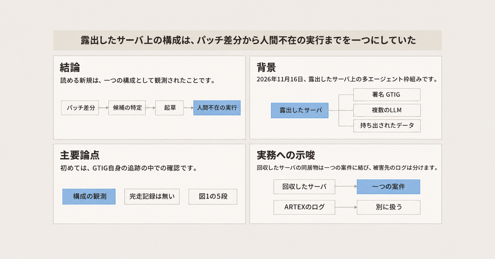
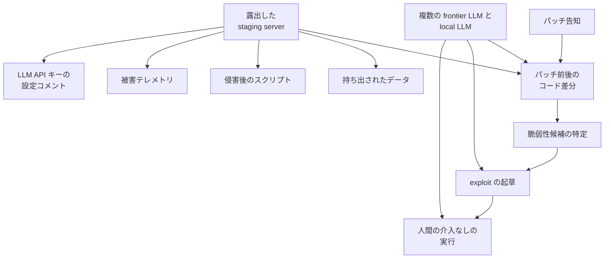

Google Cloud Blog は、ページ上の日付行を November 16, 2026 として、露出した staging server 上に多エージェントのフレームワークがあったと書きました。署名は GTIG、著者は Aurora Blum、Kelli Vanderlee、Jess Xia、David Mainor です。フレームワークの呼称は `exploit_agent` です。staging server は、その公開記事が置き場所として書いた、インターネットから見えていたサーバです。

公開記事は、対象を人気のある Web アプリケーションとし、パッチ告知の前後のコードを継続して比べ、所見から脆弱性の候補を特定し、exploit を起草し、人間の介入なしに実行するよう組まれていた、と説明します。接続先は、複数の frontier LLM と local LLM です。frontier LLM と local LLM は、公開記事が接続先を分けるときの呼び方で、製品名はこの説明には挙がりません。exploit は、公開記事が、候補の特定のあとにフレームワークが起草する物として書いた語です。

記述の単位は、GTIG が露出した staging server 上で確認した構成です。この記事では、その構成の流れ、同じサーバに同居していた物、公開記事の "for the first time" がどの文を指すかを説明します。確認日は 2026-11-17 です。

*この記事の全体像。以下、順に解説します。*

## exploit_agentとは

`exploit_agent` は、GTIG が露出した staging server 上で確認した、複数の LLM へ接続する多エージェントのフレームワークの呼称です。公開記事は、人気のある Web アプリケーションを対象に、パッチ告知の前後のコードを継続して比べ、所見から脆弱性の候補を特定し、exploit を起草し、人間の介入なしに実行するよう組まれていた、と説明します。同じサーバには、対象から持ち出されたデータ、侵害後の作業に使えるスクリプト、被害側のテレメトリがありました。テレメトリは、運営者がフランスのメディア・エンタメと教育の Web サイトに関心を持っていた、という示唆として書かれます。

### 公開記事が説明した処理

処理の順は、差分の分析、候補の特定、exploit の起草、人間の介入なしの実行、です。GTIG の動詞は "is set up to" と "automatically executes" です。

環境ファイルのコメントはロシア語で、GTIG の訳は "LLM API keys for auto-exploitation (exploit_agent pilot)" です。同じコメントは、鍵をチャットではなくそのファイルへ人間が入れる、と残しています。

図4のキャプションは、Spectra（Ultimate Addons for Gutenberg）WordPress プラグイン 2.19.25 のアクセス制御を、このフレームワークが検査していた、というものです。Spectra は、そのキャプションが検査対象として挙げた WordPress プラグインの名前です。

同じサーバ上のスクリプトは、内部偵察、総当たり、webshell の設置、他の攻撃者の webshell の除去を支援できる、と書かれます。動詞は "capable of facilitating" です。webshell は、公開記事が侵害後のスクリプトの対象として挙げた語です。公開記事は、このフレームワークの中のエージェントに偵察役や侵入役といった固有名を付けず、"multi-agent" とだけ書きます。

### パッチ差分から実行までの流れ

GTIG が `exploit_agent` について書いた流れは、パッチ差分から実行までの一連と、同じサーバに同居していた物です。

被害テレメトリが示すのは、フランスのメディア・エンタメと教育のサイトへの関心です。

公開記事が書いた処理と、同じサーバにあった物を、一つの構成として並べると次のとおりです。

| 公開記事が書いた処理、または同じサーバにあった物 | 構成の中での位置 |
|---|---|
| パッチ前後の差分と、検査していたコード | 発見の段。図4は検査の対象を示す |
| exploit を起草する処理 | 発見と実行の間の機能 |
| LLM API キーの設定 | 実行前の設定。コメントは、鍵をチャットではなくファイルへ人が入れる、と書く |
| 侵害後のスクリプト | 実行の後に使える能力として書かれる |
| 持ち出されたデータと被害テレメトリ | 対象の関心と、データがサーバにあったこと |

## 注意点

### 「初めて」が指す範囲

「初めて」は、GTIG が自分たちの追跡の中で、発見と悪用の両方を人間不在で自動化した LLM フレームワークを確認した、という文です。原文は "for the first time" で、直前の段落は前回レポートを "partially automated vulnerability scanning and exploitation attack sequences" と呼んで区別しています。届く範囲は、その追跡の中での確認です。業界の誰も先に書いていない、という意味には届きません。

同じ「人間不在の初観測」という文は、次の過去の GTIG 公開記事にはありません。

- 2026年5月の "For the first time" は、生成 AI で作ったとみるゼロデイのスクリプトを、脅威主体が持っていた、という話です。使用は計画段階で、GTIG は阻止した可能性があると書きます。
- 2026年9月の記事は、標的に対する "fully autonomous pipelines" を "has not yet observed" と書きます。人間の介在が減ったと書くのは、脆弱性スキャンの自律運用と、侵害後のパイプラインです。9月の未観測と、11月の `exploit_agent` の文は、対象が違います。9月は標的に対する完全自律のパイプライン、11月は露出した staging server 上の構成です。
- 2026年10月1日の記事は、パッチ差分から n-day を武器化する方が効率的かもしれない、という仮説（"It is possible"）と統計です。n-day は、その記事がパッチの後の脆弱性を武器化する話で使った語です。`exploit_agent` の観測はありません。

### サーバ上の物が示す範囲

サーバ上の持ち出されたデータは、被害先で無人の全工程が終わった記録ではありません。本文は、データがサーバにあったことと、関心の推定を併記します。各段が被害先で終わったことを示すログの種別は、公開記事にありません。

環境ファイルのコメントが示すのは、実行前に人が鍵をファイルへ置くことです。exploit の実行中に人が介入したかは、このコメントからは判断できません。公開記事が人間の介入なしと書くのは、起草した exploit の実行です。起草そのものについて公開記事が書くのは、フレームワークが起草する、という機能です。起草済みの exploit をサーバから回収した、とは書いていません。鍵の値も公開記事にはありません。

"is set up to" と "automatically executes" は構成の説明です。被害先の完走ログは示されません。

### 図1の5段と、名指しされた別のフレームワーク

図1は、同じ公開記事の前の節 "Multi-Agent Frameworks in Cyber Intrusions" にあります。画像の題は "Agentic pentesting frameworks" で、脅威アクター、Orchestration agent、次の5段からなります。偵察と外部スキャン、初期アクセス、永続化と権限昇格、内部偵察と横移動、目的の完了、です。`exploit_agent` の節はこの5つの名前を使いません。

ITmedia（2026-11-16 23:00）は二次情報です。リードで発見から悪用までの初確認を書き、直後の図キャプションを「指揮役が偵察や侵入、権限昇格を専門エージェントに実行させる（画像：Google）」としています。キャプションの中身は図1と一致し、`exploit_agent` の内部名簿ではありません。

同じ公開記事が名指しする侵入側のフレームワークは、今回の `exploit_agent` とは別節です。

| 名前 | 公開記事の書き方 | 観測の強さ（公開記事の文） |
|---|---|---|
| CAIRN | オープンソース。OODA と共有 blackboard。対象 IP などの初期値から目的へ進む | 米国の航空宇宙などを含む侵入で使用を観測。PentAGI と並べて in the wild |
| PentAGI | 利用者が対象と目的を渡し、専門エージェントが Flow を分割する。2026年8月下旬から10月上旬、オープンソース版を土台にした基盤がアジアの幅広い組織を偵察し、脆弱性をスキャンした | in the wild。この文はスキャンまで |
| CyberStrikeAI | Go の backend API が C2 とオーケストレーション。商用とオープンウェイトの LLM、100 超のセキュリティツール、YAML の attack recipe | 実験 |
| HexStrike AI | MCP 経由。150 超のツール。12 超の専門サブエージェント。偵察、Web アプリ試験、悪用、バイナリ解析 | 実験 |

100 超、150 超、12 超は、公開記事がフレームワークの作りを紹介する数であり、今回の侵入件数ではありません。OODA、共有 blackboard、C2、MCP、in the wild は、いずれも公開記事がその表の説明に使った語です。

ARTEX は、2026年10月30日の GTIG 公開記事が書いた枠組みの名前です。その記事は、離散的な侵入段階を専門サブエージェントで自動化する枠組みをすでに書いています。人間が侵害済みの資格情報を渡す、という前提がそこには残ります。被害側の記録としてその記事にあるのは、約 2〜25 秒の実行バースト、23 秒に 27 イベント、ある Web サーバの 240 log events、ファイル名 `artex-probe-*`、アカウント名の `ArtexProbe` です。これらは ARTEX の観測であり、`exploit_agent` の段ログではありません。11月の公開記事が侵入フレームワークについて繰り返すのは、制限のない自律実行が forensic traffic、認識できる識別子、コードレベルの痕跡を残す、という一般論です。forensic traffic は、同じ文が認識できる識別子およびコードレベルの痕跡と並べた語で、残るものの種別はこの文では分かれません。

同じ公開記事には、LLM の資格情報を盗んで地下で売り直す話が別の筋としてあり、転売の侵入の中でエージェント枠組みを使った、という一文もあります。二つの筋が一文で隣り合うこと自体は境界として残し、この記事ではその筋を展開しません。

### 速度の別件

PaperCut は、LLM が exploit を速く作った例として公開記事が挙げる別件です。`exploit_agent` の観測ではありません。

CVE-2026-81578 は NVD に載ります。NVD は、この CVE の公開日と JSON が載っている公開の一覧です。CNA は、この CVE では PaperCut が番号を割り当てた側です。CPE は、同じ NVD JSON が製品の版を表すときに使う名前です。CISA は、悪用を確認した脆弱性の一覧である KEV へこの CVE を追加した機関です。公開日は NVD 上 August 28, 2026 です。内容は Web 管理のアクセス制御不備で、認証されていない遠隔要求が、検証の完了前に一部の管理機能を起こし、一部のシステム設定を変更できます。CVSS は NVD が付ける脆弱性の点数で、4.0 の値は 8.8 です。ベクトル AV:N/AC:L/AT:N/PR:N/UI:N のうち、PR:N は権限が要らないという成分です。NVD JSON の CNA affected は、24.1.10 未満、25.0.0 以上 25.0.13 未満、26.0.0 以上 26.0.5 未満です。同じ JSON の NVD CPE は、24.1.9 未満、25.0.2 以上 25.0.12 未満、26.0.2 以上 26.0.4 未満で、CNA の範囲と一致しません。PaperCut の告知（2026-09-10 更新）は、保守リリース 26.0.5、25.0.13、24.1.10 がこの告知の CVE を含む、と案内します。CISA KEV は 2026-08-31 追加、期限 2026-09-14、名称は Missing Authentication for Critical Function です。NVD の文は RCE（遠隔コード実行）と書きません。

CVE-2026-82078 も、NVD に載り、CNA は PaperCut、公開日は August 28, 2026 です。データベース接続ユーティリティが、設定されたドライバ名のクラスを allowlist なしで生成します。攻撃者がシステム設定を操作できるとき、クラスパス上の任意の Java bytecode が PaperCut プロセスとして動きます。CVSS 4.0 は 9.4 で、ベクトルに含まれる PR:H は、高い権限が要るという成分です。CNA affected と NVD CPE の食い違いは、CVE-2026-81578 と同じです。CISA KEV は 2026-08-31 追加、名称は Unsafe Reflection です。単体では未認証と書きません。

二つを連鎖させると未認証の遠隔コード実行になる、という文は GTIG と Huntress にあります。各 CVE の NVD 文言を束ねたものではありません。Huntress は 2026-08-27 公開で、顧客 2 環境での悪用と、PaperCut NG 25.0.11 での連鎖の再現を書きます。Huntress のページは LLM を使ったとは書きません。GTIG の「研究者と Huntress が、開示から 1 日以内に LLM で動く exploit を作った」は、Huntress のページでは確認できません。引用先の X は未取得です。開示の時計も分かれます。Huntress が書く PaperCut の勧告は 2026-08-27、NVD の公開日は 2026-08-28 です。

GreyNoise（2026-09-09）は、2026-08-31 に 45.142.193.132 から、OpenAI Codex のハーネスと DeepSeek を使い、パッチ前後の差分から PaperCut の実行まで進んだ、と書きます。空の作業場から最初の実被害の遠隔コード実行まで 4 時間未満、最初のドメイン管理者はその追加 2 時間です。開始後、少なくとも 11 組織が 26 秒の間に入っています。ドメイン管理者まで達したのは 12 組織で、達したときの最短は 5 分、最長は 144 分、ある米高校は初期アクセスから 7 分、と GreyNoise は書きます。同時に、続行の許可を求めるプロンプトと、悪意ある主体がエージェントを指示した、という文があります。差分から実行までの先行例にはなります。人間不在の初観測を先に取った例にはなりません。GTIG の "within minutes" は、後の短い事例とは合い、最初のドメイン管理者の追加 2 時間とは別の時計です。「likely Russian-speaking」は GreyNoise が PaperCut の事案に付けた評価であり、`exploit_agent` の運営者の国籍ではありません。`exploit_agent` 側でロシア語なのは、環境ファイルのコメントです。

PHP の CVE-2026-109618 と CVE-2026-109619 も、別件の速度の例です。php.net の 2026-10-21 の告知は、未認証で RCE（遠隔コード実行）になり得る 2 件を、PHP 8.5.12、8.4.27、8.3.36、8.2.35 で直したと書きます。mod_php は、php.net が、アプリのコードの前に届く実証がある配置として書いた名前です。直した版の番号は、この配置の名前では変わりません。8.1 以前はプロジェクトの通常更新の対象外で、最小のバックポート枝はある、とも書きます。php.net と GitHub の GHSA-w8hw-w9fx-j79w、GHSA-6wmf-4rv5-p3rp（いずれも 2026-10-21 に bukka が公開）は、発見手段を LLM とは書きません。「LLM を使った分析で発見された」は GTIG の文であり、PHP 公式の文では閉じていません。PHP 公式は手段を書きません。

### まだ公開記事だけでは閉じないこと

次は、公開記事の記述だけでは閉じません。

- 被害先のどのログで、無人の一連が終わったか。
- フレームワーク内部のエージェント名。公開記事の当該段落に固有名はありません。
- 運営者がどの組織か。フランスのサイトで何件が実際に侵害されたか。テレメトリは関心の示唆です。
- GTIG 以外が、同じ staging server の中身を独立に確認した公開資料があるか。
- 被害先の完走を示すログを、GTIG が別稿で出すか。
- KevTheHermit の投稿が、Huntress の LLM 利用を実際に支えているか。その投稿と、上で未取得とした引用先の X が同一かは、公開された本文だけでは断定できません。
- `exploit_agent` の中の役割が、後から固有名付きで公開されるか。

これらは、主張を「構成の観測」として読むことを止めません。完走件数や、検知シグネチャの製品名を書くことは止めます。

## 運用で結ぶ単位

公開記事から読める新規は、`exploit_agent` がパッチ差分から候補の特定、起草、人間不在の実行までを一つの構成として持っていた、という GTIG の観測です。役割の固有名と、被害先の段ごとのログ種別は、材料にしません。

その範囲に置く根拠は、次の3点です。初観測の文の直後に、`exploit_agent` の差分、起草、自動実行が続きます。9月の GTIG は、標的に対する完全自律のパイプラインを未観測と書いており、11月の構成の観測と矛盾しません。図1、CAIRN、PentAGI、CyberStrikeAI、HexStrike AI、ARTEX は、11月の公開記事が節を分けるか、10月30日の記事にあります。

範囲を「構成として観測された」に置けば、上の注意点は結論を消しません。範囲を「被害先で無人の全工程が終わった」「業界の誰も先に書いていない」「図1の5役が今回の新規」に広げると、注意点が当たります。GreyNoise は、人間の許可がある形で、差分から大規模な実行までを 2026-08-31 に書いています。二次情報の図キャプションを内部役割の根拠にすると、図1と `exploit_agent` が混ざります。

インターネットに出ている Web アプリの側（公開面）の観測を、攻撃側の工程の連結に合わせるときは、二段に分けます。一段目は、同じホストに同居していた物を一つの案件に結ぶことです。二段目は、被害先のログをこの構成の証拠にしないことです。公開面の継ぎ目は、その二段のあとで別に見ます。スキャン命令や、攻撃を再現する検知ルールは、この公開記事から作りません。

### 運用ホストに同居していた物

運用ホストは、公開記事が中身を回収した staging server の側です。パッチ差分の調査、起草物、実行設定（LLM の鍵）、実行に隣接するスクリプト、被害テレメトリ、持ち出されたデータが同じホストに同居しているときは、スキャン、侵入、資格情報の使用を別案件のままにしません。結ぶ単位は、公開記事が実際に一つのサーバから回収した物です。鍵のコメントは実行前の設定手順であり、実行中に人が介入した証拠にはなりません。

### 被害ホスト側で別に扱う観測

この公開記事は、`exploit_agent` が被害先に残すログの種類を公開していません。ファイル名の増分、短いバースト、アプリケーションログの急増は、10月30日の ARTEX の観測として別に扱います。目安として公開されているのは、約 2〜25 秒の実行バースト、23 秒に 27 イベント、ある Web サーバの 240 log events、ファイル名 `artex-probe-*`、アカウント名 `ArtexProbe` です。侵入フレームワーク一般について 11 月の公開記事が書くのは、速度と引き換えに forensic traffic、認識できる識別子、コードレベルの痕跡が残る、という水準です。forensic traffic の種別は、その文では分かれません。

### 公開面で見る継ぎ目

公開面では、パッチ告知のあと、インターネットに出ている Web アプリへ、人間の操作が挟まらない実行が向かう、という継ぎ目を見ます。図1の5段（偵察、初期アクセス、永続化、横移動、目的）は、侵入フレームワークの図として別に説明します。発見から悪用の初観測の役割名としては使いません。

PaperCut と PHP は、パッチや開示のあとに実行や発見が速かった別件です。版の範囲は、CNA affected と NVD CPE が一致しない CVE-2026-81578 と CVE-2026-82078 では、PaperCut の告知が案内する保守リリース（26.0.5、25.0.13、24.1.10）と、NVD の公開日（August 28, 2026）を分けて読みます。PHP は php.net が 2026-10-21 に直した版（8.5.12、8.4.27、8.3.36、8.2.35）を読みます。どちらも `exploit_agent` の段ログではありません。

## まとめ

GTIG は 2026年11月16日の公開記事で、露出した staging server 上の `exploit_agent` が、パッチ差分から候補の特定、exploit の起草、人間の介入なしの実行までを一つの構成として持っていた、と書きました。同じサーバには、LLM の鍵を人がファイルへ置くコメント、侵害後のスクリプト、持ち出されたデータ、フランスのメディア・エンタメと教育への関心を示すテレメトリが同居していました。

「初めて」は、GTIG 自身の追跡の中での確認を指します。被害先で無人の全工程が終わった記録、業界の先行文献が無いこと、図1の5役の名簿、PaperCut や PHP や ARTEX のログは、この構成の観測には含めません。運用では、一つのサーバから回収した物を一つの案件に結び、被害先のログ種別が公開されていないものは ARTEX の観測として分けます。

この記事が少しでも参考になった、あるいは改善点などがあれば、ぜひリアクションやコメント、SNSでのシェアをいただけると励みになります！

## 参考リンク

- [GTIG, “GTIG AI Threat Tracker: Agentic Threat Activity Crosses a Significant Threshold”（日付行 November 16, 2026）](https://cloud.google.com/blog/topics/threat-intelligence/agentic-threat-activity-crosses-a-significant-threshold/)
- [GTIG, ARTEX（日付行 October 30, 2026）](https://cloud.google.com/blog/topics/threat-intelligence/artex-and-friends-enter-agentic-offensive-frameworks)
- [GTIG, 2026-10-01](https://cloud.google.com/blog/topics/threat-intelligence/vulnerability-discovery-and-exploitation-trends-in-the-ai-era)
- [GTIG, 2026-09, prompting to autonomy](https://cloud.google.com/blog/topics/threat-intelligence/from-prompting-to-autonomy-the-evolution-of-adversarial-ai)
- [GTIG, 2026-05](https://cloud.google.com/blog/topics/threat-intelligence/ai-vulnerability-exploitation-initial-access)
- [図1画像](https://storage.googleapis.com/gweb-cloudblog-publish/images/Figure_1_Multi-agent_LLM_offensive_framewo.max-2000x2000.jpg)
- [NVD, CVE-2026-81578](https://nvd.nist.gov/vuln/detail/cve-2026-81578)
- [NVD, CVE-2026-82078](https://nvd.nist.gov/vuln/detail/CVE-2026-82078)
- [PaperCut security bulletin（NVD が参照）](https://www.papercut.com/kb/Main/security-bulletin-27-aug-2026-urgent-security-advisory/)
- [Huntress, 2026-08-27](https://www.huntress.com/blog/papercut-actively-exploited)
- [GreyNoise, 2026-09-09](https://www.greynoise.io/blog/ai-orchestrated-campaign-against-papercut-ng-mf)
- [php.net の 2026-10-21 告知](https://www.php.net/archive/2026.php#2026-10-21-5)
- [GHSA-w8hw-w9fx-j79w](https://github.com/php/php-src/security/advisories/GHSA-w8hw-w9fx-j79w)
- [GHSA-6wmf-4rv5-p3rp](https://github.com/php/php-src/security/advisories/GHSA-6wmf-4rv5-p3rp)
- [ITmedia, 2026-11-16 23:00](https://www.itmedia.co.jp/news/article/2611/16/2000003244/)
