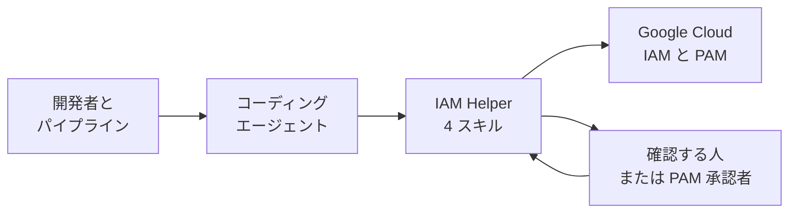
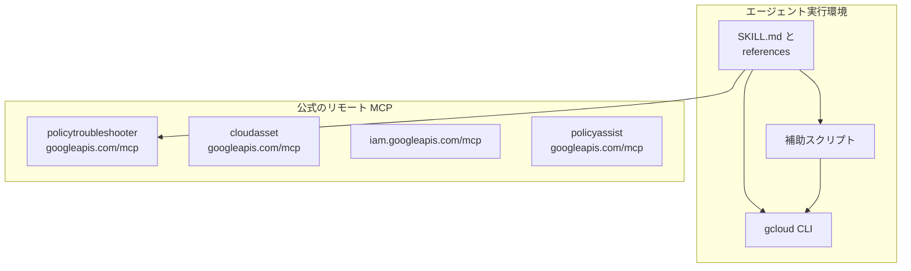
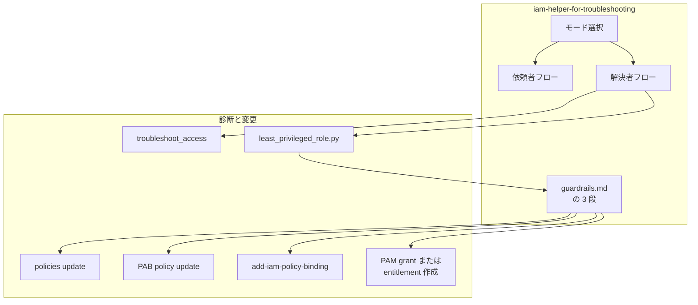
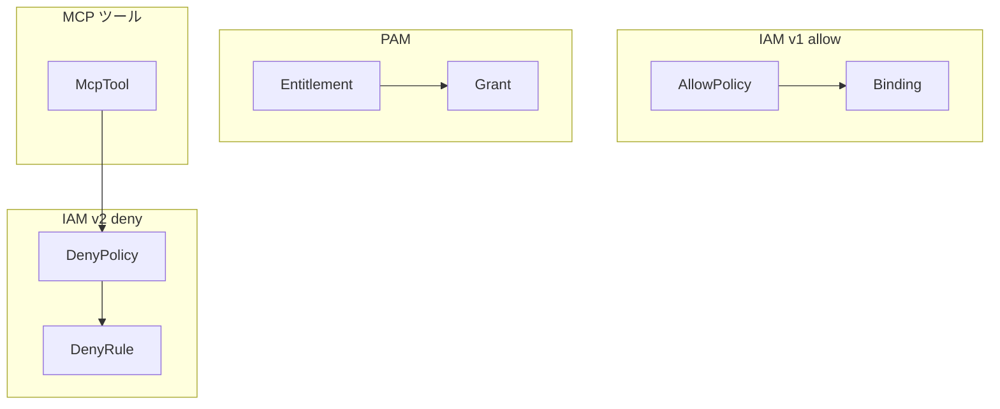
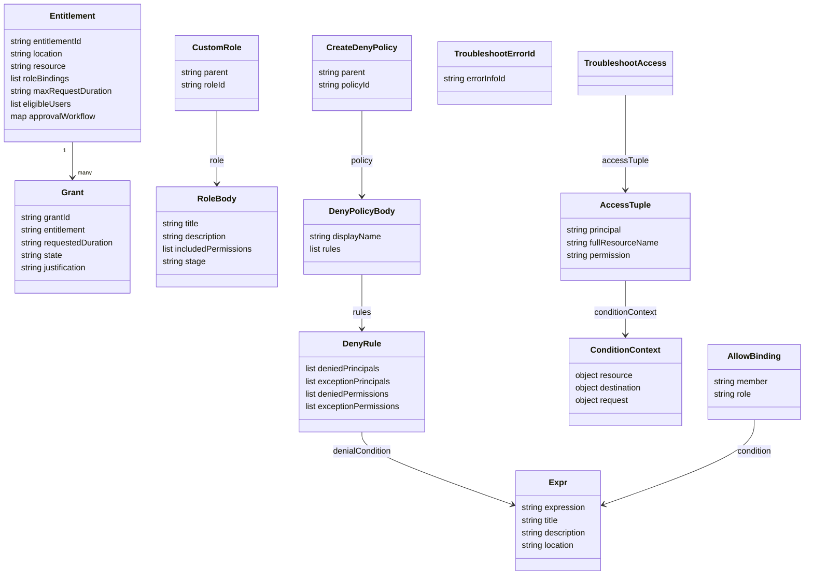

Google Cloud は、エージェントから Identity and Access Management（IAM）を扱うための手順書と、公式のリモート Model Context Protocol（MCP）サーバーを公開しています。MCP は、エージェントが外部のツールを決まった入出力で呼ぶためのプロトコルです。手順書は Agent Skills 標準の Markdown で、リポジトリ [google/skills](https://github.com/google/skills) に 4 本あります。Agent Skills は、エージェントが作業前に読む手順書の置き方です。

公開されている公式 MCP には、403 の理由を説明する Policy Troubleshooter、資産から権限を分析する Cloud Asset Inventory の Policy Analyzer、カスタムロールとプロジェクトの拒否ポリシーを扱う IAM API があります。

この記事では、4 本のスキルが読み取りと変更をどう分けるか、接続する MCP の範囲、許可・拒否・一時昇格のコマンド、適用前に人が確認する箇所を追います。対象のエージェントは Gemini CLI、Gemini Cloud Assist、Agent Development Kit（ADK）、Claude Code、Cursor です。ADK は、Google のエージェントをコードで組む開発キットです。コマンドとファイル例は、[google/skills の commit `84e8150`](https://github.com/google/skills/tree/84e8150e4fa71bf422d5b224e215f5ba13864aa3) に含まれる SKILL.md に合わせています。


*この記事の全体像。以下、順に解説します。*

## IAM Helperとは

IAM Helper は、Policy Intelligence と Privileged Access Manager（PAM）の上に載る、エージェント向けの編成層です。Policy Intelligence は、権限の診断と再評価を担う Google Cloud の機能群です。PAM は、常設の権限付与の代わりに、期限が来ると外れる一時的な権限申請を扱う機能です。

4 本の役割は次のとおりです。

| スキル名 | 版 | 扱う対象 |
|---|---|---|
| `iam-helper-for-policy-management` | 1.0.1 | IAM v1 の許可と IAM v2 の拒否の作成、更新、一覧、削除 |
| `iam-helper-for-troubleshooting` | 1.0.3 | 403 と Error ID の診断、依頼者フローと解決者フロー |
| `iam-helper-for-policy-simulator` | 1.0.2 | IAM v1 の許可について、過去 90 日のうち直近 1,000 件の再評価と、安全なときだけの適用 |
| `iam-helper-for-privileged-access-management` | 1.0.1 | PAM の entitlement と grant のライフサイクル |

依頼者フローは開発中の 403、解決者フローは権限調査の依頼です。既定は解決者です。

IAM v1 の許可（allow）は、誰にどのロールを付けるかのポリシーです。IAM v2 の拒否（deny）は、許可より先に評価される明示的な拒否です。Error ID は、エラー応答に付く識別子です。entitlement は、誰が、どのロールを、どの資源で、どれだけ長く申請できるかの定義です。grant は、その entitlement に対する期限付きの申請です。

読み取りは、エージェントが確認なしで実行します。トラブルシューティングでロール一覧を探す前だけ、検索してよいかを確認します。ポリシー管理、シミュレーター、PAM スキルでの許可の binding、拒否ポリシー、entitlement、grant の作成・更新・削除・承認・拒否・取消は、手順上、利用者の明示的な確認のあとで `gcloud` を実行します。binding は、メンバー、ロール、任意の条件の組です。例外はトラブルシューティングの依頼者フローで、既存 entitlement への `gcloud pam grants create` の前には Yes を挟みません。リスクの低・中・高は警告文の強さを分けるだけで、確認そのものを省略する段はありません。

## 特徴

- 診断、シミュレーション、ポリシー変更、一時昇格を別スキルに分けています。
- 変更コマンドは組み立てて提示し、Yes のあとで実行します。この止め方を Plan and Confirm と呼びます。
- `allUsers` と `allAuthenticatedUsers` への基本ロール付与を、スキル本文が拒否します。`allUsers` は未認証を含む誰でも、`allAuthenticatedUsers` は認証済みなら誰でも、を指す公開プリンシパルです。対象ロールは `roles/owner`、`roles/editor`、`roles/viewer`、`roles/admin`、`roles/writer`、`roles/reader` です。
- 拒否は許可より先に評価される、という IAM v2 の順序をスキルが前提にします。
- Policy Troubleshooter の MCP は、許可、拒否、Principal Access Boundary（PAB）を 1 回の診断で説明します。PAB は、プリンシパルが到達できる資源の境界です。プリンシパルは、ユーザー、サービスアカウント、グループなどの主体です。
- シミュレーターは、過去 90 日のうち直近 1,000 件のアクセスログを、提案ポリシーに再評価します。`ACCESS_REVOKED` または `ACCESS_MAYBE_REVOKED` が 1 件でもあれば適用しません。前者はアクセスが失われる結果、後者は失われる可能性がある結果です。
- PAM は、常設の binding の代わりに期限付き grant を作ります。期限が来ると昇格は外れます。
- 各 `gcloud` には環境変数 `CLOUDSDK_METRICS_REQUEST_ATTRIBUTION` を付けます。HTTP と MCP には、`User-Agent` へ `agent-skills/1.0 (skill:<name>)` を足します。利用者が自分のリポジトリへ残す Terraform やスクリプトには、この印を入れません。
- 組織が `references/guardrails.md` を複製して、承認段を自組織向けに書き換えられる、とトラブルシューティングスキルが案内しています。`guardrails.md` は、リスク段と確認文を書いた同梱の文書です。

似た置き方との位置づけは次のとおりです。

| 置き方 | 実行の主体 | 変更の止まり方 | 向く場面 |
|---|---|---|---|
| IAM Helper スキル | エージェントが `gcloud` を組み立てる | 会話上の Yes、または PAM の別承認者 | 既存の Google Cloud 階層で 403 の解消と一時昇格を進める |
| 公式 IAM MCP | クライアントがツールを呼ぶ | ツール注釈と呼び出し元の IAM。スキルの確認文は MCP サーバー側に無い | 診断、ロール定義、プロジェクトの拒否を API として呼ぶ |
| 通常の Terraform apply | CI または人が plan を適用する | レビューと pipeline の承認 | 望む状態をリポジトリに残す |

ツール注釈は、Read Only のように、そのツールが変更を含むかの印です。人への確認文は、MCP サーバー側にはありません。

## 構造

### システムコンテキスト図

開発者とパイプラインが依頼を出し、コーディングエージェントが 4 スキルを読み、スキルが Google Cloud の IAM と PAM、および確認する人へつながります。



| 要素名 | 説明 |
|---|---|
| 開発者とパイプライン | 403、ポリシー変更、一時昇格の依頼を出す |
| コーディングエージェント | スキルを読み、`gcloud` または MCP を呼ぶ |
| IAM Helper 4 スキル | 読み取りと変更の手順、ガードレール、補助スクリプトを持つ |
| Google Cloud IAM と PAM | 許可、拒否、診断、シミュレーション、entitlement、grant の実体 |
| 確認する人または PAM 承認者 | 変更の Yes、または grant の承認を出す |

### コンテナ図

エージェント実行環境の中に手順書、補助スクリプト、`gcloud` CLI があります。公式のリモート MCP は別の境界です。4 スキルの本文が手順に含める MCP は、トラブルシューティングの Policy Troubleshooter だけです。変更の正本は、確認後の `gcloud` です。



| 要素名 | 説明 |
|---|---|
| SKILL.md と references | 4 スキルの手順。変更は確認後の `gcloud` が正本。MCP として本文に書くのはトラブルシューティングの Policy Troubleshooter だけ |
| 補助スクリプト | シミュレーション結果の集計、ロール候補の選択、entitlement の階層検索 |
| gcloud CLI | 許可、拒否、シミュレーター、PAM、診断フォールバックの実行口。図の MCP ホストへはつながない |
| policytroubleshooter.googleapis.com/mcp | トラブルシューティングスキルが手順に含める。ツールは `troubleshoot_access` と `troubleshoot_iam_error_id` |
| cloudasset.googleapis.com/mcp | 公式の Policy Analyzer。4 スキルの手順には含まれない。ツール例は `analyze_iam_policy` |
| iam.googleapis.com/mcp | 公式のカスタムロールとプロジェクト拒否。4 スキルの変更手順は `gcloud` |
| policyassist.googleapis.com/mcp | ツールは `recommend_iam_roles`。4 スキルの本文はここを手順に含まない |

図の右側で矢印が無い 3 ホストは、公式のリモート MCP として存在します。4 スキルの手順の矢印は、Policy Troubleshooter にだけ向きます。

### コンポーネント図

トラブルシューティングの解決者フローです。開発中の 403 は依頼者、権限調査の依頼は解決者で、既定は解決者です。



| 要素名 | 説明 |
|---|---|
| モード選択 | 開発中の 403 は依頼者。権限調査の依頼は解決者。既定は解決者 |
| 依頼者フロー | Error ID の自己診断、既存 entitlement への grant、構造化チケット |
| 解決者フロー | 許可、拒否、PAB の評価と、確認後の更新 |
| guardrails.md の 3 段 | 低、中、高のどれも適用前に人の確認を求める |
| troubleshoot_access | `accessTuple` にプリンシパル、資源のフル名、権限 1 つを渡す |
| least_privileged_role.py | サービス標準ロール、事前定義ロール、含まれる権限数の順で 1 件を返す |
| policies update | 確認後に、公開 CLI の `gcloud iam policies update` で例外プリンシパル、拒否権限、条件を更新する |
| PAB policy update | 確認後に、公開 CLI の `--details-rules` で Principal Access Boundary のポリシーを変える。binding の削除は `gcloud iam policy-bindings delete` |
| add-iam-policy-binding | 確認後の永続的な許可。プロジェクト、フォルダ、組織でコマンドが分かれる |
| PAM grant または entitlement 作成 | 既存 entitlement への申請を優先し、無ければ作成してから申請する |

## データ

### 概念モデル

許可ポリシーは binding を持ち、拒否ポリシーは拒否ルールを持ち、entitlement は grant を持ちます。MCP ツールから拒否ポリシーへの矢印は、`create_deny_policy` がプロジェクトの拒否ポリシーを作る関係です。Policy Troubleshooter は許可、拒否、PAB を説明し、binding は変えません。



| 要素名 | 説明 |
|---|---|
| AllowPolicy | プロジェクト、フォルダ、組織、サービス個別リソースに付く許可ポリシー |
| Binding | メンバー、ロール、任意の条件 |
| DenyPolicy | `gcloud iam policies` は組織、フォルダ、プロジェクト。MCP `create_deny_policy` の parent はプロジェクトだけ |
| DenyRule | 拒否プリンシパル、例外、拒否権限、任意の CEL 条件。CEL は条件式を書く Common Expression Language |
| Entitlement | 誰が、どのロールを、どの資源で、どれだけ長く申請できるかの定義 |
| Grant | entitlement に対する期限付きの申請。状態の例は `APPROVAL_AWAITED`（承認待ち）。削除前に探すのは `ACTIVE` と `SCHEDULED` |
| McpTool | 図の矢印は `create_deny_policy` からプロジェクトの DenyPolicy へ。Policy Troubleshooter は許可、拒否、PAB を説明し、binding は変えない |

### 情報モデル

呼び出しに渡すフィールドと、応答専用のフィールドを分けます。`permissionFqdn` は権限の完全修飾名、`effectiveTags` は評価に使ったタグです。どちらも応答にだけ現れ、呼び出し側は渡しません。



| 要素名 | 説明 |
|---|---|
| AllowBinding | `user:`、`serviceAccount:`、`group:`、`domain:` などのメンバーとロール。`condition` は `Expr`。`gcloud projects add-iam-policy-binding` の `--condition` は `expression`、`title`、`description` の組で、式だけの文字列ではない |
| DenyRule | v2 の権限名は `storage.googleapis.com/buckets.delete` の形。診断例の権限名は `storage.buckets.get` のような短い形。`denialCondition` は `Expr` |
| Expr | `expression`、`title`、`description`、`location`。スキル例は `title` と `expression` を置く |
| Entitlement | `location` は手順上 `global`。`maxRequestDuration` は秒の文字列 |
| Grant | PAM スキルの申請で時間省略時は `3600s`。依頼者フローの例は `"1h"` で、`--requested-resources` は付けない |
| CustomRole | `parent` は `projects/PROJECT_ID`。`roleId` は 3 から 64 文字で、英数字、アンダースコア、ピリオド。`title` と権限は `role` の中 |
| TroubleshootAccess | 必須入力は `accessTuple` の principal、fullResourceName、permission。`conditionContext` は任意で、入力は resource、destination、request。応答の `overallAccessState` は `CAN_ACCESS`、`CANNOT_ACCESS`、`UNKNOWN_INFO`、`UNKNOWN_CONDITIONAL`、`OVERALL_ACCESS_STATE_UNSPECIFIED` |
| TroubleshootErrorId | `troubleshoot_iam_error_id` の入力。`errorInfoId` は `troubleshoot_access` の引数ではない |
| RoleBody | `stage` は `ALPHA`、`BETA`、`GA`、`DEPRECATED`、`DISABLED`、`EAP` |
| CreateDenyPolicy | `parent` は `policies/cloudresourcemanager.googleapis.com%2Fprojects%2FPROJECT_ID/denypolicies`。`policyId` は先頭が英字の 3 から 63 文字 |

`create_role` のツール注釈は、Read Only が偽、Destructive が偽、Idempotent が偽です。`create_deny_policy` の `policyId` は先頭が英字の 3 から 63 文字で、小文字、数字、ハイフン、ピリオドです。組織とフォルダは対象外です。

## 導入

### 前提

次が揃っていることが、手順の開始条件です。

- Google Cloud CLI にログイン済みのアカウントがある。
- Node.js があり、`npx` が使える。
- 変更先のプロジェクト、フォルダ、組織の ID が分かっている。
- MCP を使う場合は、対象 API の MCP サーバー有効化と認証が済んでいる。公式の入口は [MCP の有効化](https://docs.cloud.google.com/mcp/enable-disable-mcp-servers) と [MCP 認証](https://docs.cloud.google.com/mcp/authenticate-mcp) です。

シミュレーターを実行する公式手順が求めるロールは次です。対象資源は、許可ポリシーを再評価する資源です。ホスト資源は、リプレイを作成するプロジェクト、フォルダ、組織です。スキルは適用時を「対象資源の IAM 管理ロール」とだけ書き、ロール ID は指定しません。公式手順の適用ロールは `roles/iam.securityAdmin` です。

| ロール | 付く場所 | 用途 |
|---|---|---|
| `roles/cloudasset.viewer` | 対象資源 | 資産の参照 |
| `roles/policysimulator.admin` | 対象資源 | リプレイの実行。権限には `policysimulator.replays.run` が含まれる |
| `roles/policysimulator.admin` | ホスト資源 | リプレイの作成。権限には `policysimulator.replays.create` が含まれる |
| `roles/iam.securityReviewer` | 対象資源 | リプレイの実行 |
| `roles/iam.securityAdmin` | 対象資源 | 再評価した許可の適用。権限には `setIamPolicy` が含まれる |

拒否の `gcloud iam policies` は、アタッチ点の `roles/iam.denyAdmin` を手順が要求します。アタッチ点は、拒否ポリシーをぶら下げる組織、フォルダ、プロジェクトです。PAM の entitlement 管理は `roles/privilegedaccessmanager.admin` に加え、組織なら `roles/iam.securityAdmin`、フォルダなら `roles/resourcemanager.folderAdmin`、プロジェクトなら `roles/resourcemanager.projectIamAdmin` です。一覧と describe は `roles/privilegedaccessmanager.viewer` です。

### スキルの導入

カタログの導入コマンドは、README の記載です。プロンプトで 4 つを選びます。更新は `npx skills update` です。

```bash
npx skills add google/skills
```

- `iam-helper-for-policy-management`
- `iam-helper-for-troubleshooting`
- `iam-helper-for-policy-simulator`
- `iam-helper-for-privileged-access-management`

### MCP の接続

Policy Troubleshooter のエンドポイントは `https://policytroubleshooter.googleapis.com/mcp` です。次の JSON はスキル同梱のクライアント例で、トークンに起動時の `gcloud auth print-access-token` を使います。パッケージ名は Server-Sent Events（SSE）でリモートへつなぐクライアントを指します。公開 npm レジストリにこのパッケージは無く、この `npx` では今日は起動できません。ツールの呼び出しは、直後の `curl` で確認できます。

```json
{
  "mcpServers": {
    "policy_troubleshooter": {
      "command": "npx",
      "args": [
        "-y",
        "@modelcontextprotocol/server-sse-client",
        "https://policytroubleshooter.googleapis.com/mcp"
      ],
      "env": {
        "AUTHORIZATION": "Bearer $(gcloud auth print-access-token)"
      }
    }
  }
}
```

ツール一覧の手動取得例です。Manage MCP servers の手順では、`tools/list` は認証不要です。

```bash
curl -X POST https://policytroubleshooter.googleapis.com/mcp \
  -H 'Content-Type: application/json' \
  -H 'Accept: application/json' \
  -H 'MCP-Protocol-Version: 2026-07-28' \
  -H 'Mcp-Method: tools/list' \
  -d '{"jsonrpc":"2.0","id":1,"method":"tools/list","params":{"_meta":{"io.modelcontextprotocol/protocolVersion":"2026-07-28"}}}'
```

同じ形で、ホストを次に変えます。

| ホスト | 主なツール |
|---|---|
| `iam.googleapis.com` | `list_roles`、`get_role`、`create_role`、`update_role`、`delete_role`、`undelete_role`、`list_deny_policies`、`get_deny_policy`、`create_deny_policy`、`update_deny_policy`、`delete_deny_policy`、`get_deny_policy_status` |
| `cloudasset.googleapis.com` | `list_assets`、`analyze_iam_policy`、`export_iam_analysis_results`、`get_iam_policy_analysis_status` |
| `policyassist.googleapis.com` | `recommend_iam_roles` |

`analyze_iam_policy` の scope は `projects/PROJECT_ID` です。フォルダと組織の scope は、このツールの説明では非対応です。`list_roles` はプロジェクトのカスタムロールだけを一覧します。事前定義ロールと組織は非対応です。`page_size` の既定は 300、最大は 1000 です。`view` は `BASIC`（既定。権限を含まない）または `FULL` です。

### 実行時の計測タグ

ポリシー管理スキルの attribution は、実行する `gcloud` の直前に環境変数を置きます。`gcloud config set` は使いません。スキル名は、実行中のスキルに合わせます。利用者が追跡を止めると言った場合は、この変数と `User-Agent` の接尾辞を外します。

```bash
CLOUDSDK_METRICS_REQUEST_ATTRIBUTION="agent-skills/1.0 (skill:iam-helper-for-policy-management)" \
  gcloud projects get-iam-policy PROJECT_ID --format=json
```

## 利用方法

### 操作の必須パラメータ

| 操作 | 必須の指定 |
|---|---|
| 許可の binding | 資源 ID、`--member`、`--role` |
| 拒否 | `--attachment-point`、`--kind=denypolicies`、ポリシーファイル |
| `troubleshoot_access` | `accessTuple.principal`、`accessTuple.fullResourceName`、`accessTuple.permission`。ロールと `permissionFqdn` は渡さない |
| シミュレーター | 資源のフル名と提案 JSON。コマンド synopsis（書式の 1 行）に `--project` は無い。`--project` は gcloud 共通フラグで、スキルのプロジェクト例だけ付ける |
| PAM entitlement | `--location=global`、スコープフラグ、entitlement ファイル |
| PAM スキルの grant | スキルが書くのは `--entitlement`、`--location=global`、`--requested-duration`、スコープ、`--justification`、`--requested-resources`。公開 GA（一般提供）の synopsis は `--requested-duration` と entitlement を必須とし、`--requested-resources` は無い |
| 依頼者フローの grant | `--entitlement`、`--location=global`、`--project`、`--requested-duration`。`--requested-resources` は付けない |

スコープフラグは、対象がプロジェクトなら `--project`、組織なら `--organization` のように、階層を指定するフラグです。

### 読み取り

読み取りは確認なしで実行します。フォルダの許可は `gcloud resource-manager folders get-iam-policy`、組織は `gcloud organizations get-iam-policy` です。拒否のアタッチ点はフル名です。フォルダは `cloudresourcemanager.googleapis.com/folders/FOLDER_ID`、組織は `cloudresourcemanager.googleapis.com/organizations/ORG_ID` で、どちらも `--kind=denypolicies` を付けます。

```bash
gcloud projects get-iam-policy PROJECT_ID --format=json
gcloud iam list-testable-permissions //cloudresourcemanager.googleapis.com/projects/PROJECT_ID
gcloud iam policies list \
  --attachment-point="cloudresourcemanager.googleapis.com/projects/PROJECT_ID" \
  --kind=denypolicies
gcloud pam entitlements list --location=global --project=PROJECT_ID
```

```bash
gcloud iam policies get POLICY_NAME \
  --attachment-point="cloudresourcemanager.googleapis.com/projects/PROJECT_ID" \
  --kind=denypolicies
```

### 許可の変更

確認のあとで実行するコマンドです。サービス個別の資源は `gcloud <service> <resource-type> add-iam-policy-binding` の形です。適用後は、同じ資源の `get-iam-policy` で binding の有無を見ます。許可の伝播は、7 分以上かかり得るとスキルが利用者へ伝えるよう指示しています。

```bash
gcloud projects add-iam-policy-binding PROJECT_ID \
  --member="user:alice@example.com" \
  --role="roles/viewer"
gcloud projects remove-iam-policy-binding PROJECT_ID \
  --member="user:alice@example.com" \
  --role="roles/viewer"
gcloud projects set-iam-policy PROJECT_ID policy.json
```

### 拒否の変更

次のファイルは、公開の主体を拒否し、例外の利用者を残す例です。拒否条件に使えるのはリソースタグの関数だけです。`resource.matchTag` は、資源に付いたタグが指定のキーと値かを見ます。スキル例は `request.time` と `timestamp` を置きますが、その式では作成できません。作成、更新、削除は長時間オペレーションで、`gcloud` は完了まで待ちます。作成と更新のあとは `gcloud iam policies get`、削除のあとは `list` で名前が無いことを見ます。

```yaml
displayName: Block Public Deletion
rules:
- denyRule:
    deniedPrincipals:
    - "principalSet://goog/public:all"
    exceptionPrincipals:
    - "principal://goog/subject/admin@example.com"
    deniedPermissions:
    - "iam.googleapis.com/roles.delete"
    denialCondition:
      title: "Block_Public_Access"
      expression: "!resource.matchTag('12345678/env', 'test')"
```

```bash
gcloud iam policies create POLICY_NAME \
  --attachment-point="cloudresourcemanager.googleapis.com/projects/PROJECT_ID" \
  --kind=denypolicies \
  --policy-file=deny_policy.yaml
```

ポリシー管理スキルの更新は次です。

```bash
gcloud iam policies update POLICY_NAME \
  --attachment-point="cloudresourcemanager.googleapis.com/projects/PROJECT_ID" \
  --kind=denypolicies \
  --policy-file=updated_deny_policy.yaml
```

解決者フローのスキル原文は `gcloud iam deny-policies update` と `--rules-file` です。公開 CLI にこのコマンドは無く、更新は次の `gcloud iam policies update` です。ファイル側で、例外プリンシパルの追加、拒否権限の削除または `exceptionPermissions` への追加、条件の絞り込みのいずれかをしてから実行します。適用後は 60 秒待ちます。

```bash
gcloud iam policies update POLICY_ID \
  --attachment-point=ATTACHMENT_POINT \
  --kind=denypolicies \
  --policy-file=policy.json
```

Principal Access Boundary の更新も確認後です。公開コマンドのルール指定は `--details-rules` で、ルールの JSON または YAML を渡せます。スキル原文の `--rules-file` は synopsis にありません。binding の削除は `gcloud iam policy-bindings delete` です。スキル原文の `principal-access-boundary-policy-bindings delete` は公開 CLI にありません。

```bash
gcloud iam principal-access-boundary-policies update PAB_POLICY_ID \
  --location=global \
  --organization=ORGANIZATION_ID \
  --details-rules=pab_policy.json
gcloud iam policy-bindings delete BINDING_ID \
  --location=global \
  --organization=ORGANIZATION_ID
```

### 403 の診断

依頼者は `troubleshoot_access` または `troubleshoot_iam_error_id` を呼びます。MCP が無いときは、スキル同梱スクリプトか `gcloud` に落とします。Error ID の同梱スクリプトは `ERROR_ID="YOUR_ERROR_ID" python3 scripts/troubleshooting_error_id.py` です。

解決者の分岐です。

- スキルと `gcloud policy-troubleshoot` の文面は `accessState` です。`GRANTED` のときは、権限設定は足りていると伝えて終了します。ロール検索を続けません。この終了は `accessState` の `GRANTED` にだけ書かれています。
- MCP `troubleshoot_access` の応答トップは `overallAccessState` です。値は `CAN_ACCESS`、`CANNOT_ACCESS`、`UNKNOWN_INFO`、`UNKNOWN_CONDITIONAL`、`OVERALL_ACCESS_STATE_UNSPECIFIED` です。許可説明の列挙は別に `ALLOW_ACCESS_STATE_UNSPECIFIED`、`ALLOW_ACCESS_STATE_GRANTED`、`ALLOW_ACCESS_STATE_NOT_GRANTED`、`ALLOW_ACCESS_STATE_UNKNOWN_CONDITIONAL`、`ALLOW_ACCESS_STATE_UNKNOWN_INFO` です。この列挙は許可の説明に出る値です。`CAN_ACCESS` を `GRANTED` とは書きません。手順は、`CAN_ACCESS` や `CANNOT_ACCESS` のあとでロール検索へ進むとは書いていません。
- スキルが `UNKNOWN` または `UNKNOWN_INFO` のときは、グループ展開権限（例として `roles/browser`）が足りない説明で終了します。グループを 1 件の依頼に取れない場合も、`GRANTED` や `CAN_ACCESS` の 1 値では可否を閉じません。スキルは `bindingState` も `UNKNOWN` と同じく、そこでフローを終了します。MCP の `UNKNOWN_INFO` と `UNKNOWN_CONDITIONAL` も、許可とも拒否とも確定しない結果として終了します。
- 診断コマンド自身が 403 のときは、別クエリを出さず停止します。
- ロール一覧の前に、利用者へ検索してよいか確認します。

候補ロールの探索スクリプトは、事前定義ロールから `roles/owner`、`roles/editor`、`roles/viewer`、`roles/reader`、`roles/writer`、`roles/admin` を外します。一覧は事前定義、プロジェクトカスタム、組織カスタムです。返す 1 件の順は、名前が `roles/` で始まり末尾が admin、editor、viewer、reader、writer のサービス標準ロール、次に事前定義ロール、最後に含まれる権限の数が少ないロールです。権限数が少ないことだけを先にしません。

```bash
IAM_PERMISSION="storage.buckets.get" \
TARGET_PROJECT_ID="PROJECT_ID" \
python3 scripts/least_privileged_role.py
```

フォールバックです。

```bash
gcloud iam roles list \
  --filter="includedPermissions:storage.buckets.get" \
  --format="table(name,title)"
gcloud iam roles list \
  --project=PROJECT_ID \
  --filter="includedPermissions:storage.buckets.get" \
  --format="table(name,title)"
```

診断そのもののフォールバックです。

```bash
gcloud policy-troubleshoot iam //cloudresourcemanager.googleapis.com/projects/PROJECT_ID \
  --principal-email="alice@example.com" \
  --permission="storage.buckets.get" \
  --billing-project="PROJECT_ID" \
  --format=json
```

### シミュレーションと適用

取得に失敗したポリシー、空の JSON、現状と差分が無い提案では、シミュレーションへ進みません。公開の `replay-recent-access` は、過去 90 日のうち直近 1,000 件を再評価します。

```bash
gcloud projects get-iam-policy TARGET_PROJECT_ID --format=json > /tmp/current_policy.json
gcloud iam simulator replay-recent-access \
  //cloudresourcemanager.googleapis.com/projects/TARGET_PROJECT_ID \
  /tmp/proposed_policy.json \
  --project=TARGET_PROJECT_ID \
  --format=json > /tmp/simulation_results.json
python3 scripts/analyze_simulation.py
```

スクリプトは `/tmp/simulation_results.json` だけを読みます。配列でなければ `results`、無ければ `replayResults` を列にします。各要素の `accessChange` は、`diff.accessDiff.accessChange`、無ければ要素直下、無ければ `accessTuple.accessChange` の順です。同梱スクリプトが出す `REVOKED_COUNT` は、`ACCESS_REVOKED` と `ACCESS_MAYBE_REVOKED` の件数だけです。0 のとき、スキルは適用するかの Yes/No を聞きます。公式の replay 結果には、各要素の `error` と、`accessChange` の `UNKNOWN_CHANGE` もあります。`UNKNOWN_CHANGE` は、現状と提案の両方でアクセスが未確定で、提案が影響し得る結果です。これらは `REVOKED_COUNT` に入りません。0 だけを見て Yes にしないで、`error` と `UNKNOWN_CHANGE` が無いことを確認します。その確認のあとの Yes では、次を実行し、一時ファイルを消します。

```bash
gcloud projects set-iam-policy TARGET_PROJECT_ID /tmp/proposed_policy.json
rm -f /tmp/current_policy.json /tmp/proposed_policy.json /tmp/simulation_results.json
```

フォルダと組織のリプレイは `--project` を付けません。

```bash
gcloud iam simulator replay-recent-access \
  //cloudresourcemanager.googleapis.com/folders/TARGET_FOLDER_ID \
  /tmp/proposed_policy.json \
  --format=json > /tmp/simulation_results.json
gcloud iam simulator replay-recent-access \
  //cloudresourcemanager.googleapis.com/organizations/TARGET_ORG_ID \
  /tmp/proposed_policy.json \
  --format=json > /tmp/simulation_results.json
```

`error` と `UNKNOWN_CHANGE` が無く、`REVOKED_COUNT=0` のあとの Yes では、次も適用コマンドです。シミュレーターが非ゼロで終わった場合は、失敗を安全とはみなさず、適用しません。このスキルの対象外は、IAM v2 の拒否、VPC Service Controls、一般的なトラブルシュートです。加えて、Policy Simulator は条件付きロール binding の変更を再評価できません。条件付き binding は、binding に CEL の条件が付いた許可です。VPC Service Controls は、指定した境界の外への API 呼び出しを制限する機能です。

```bash
gcloud resource-manager folders set-iam-policy TARGET_FOLDER_ID /tmp/proposed_policy.json
gcloud organizations set-iam-policy TARGET_ORG_ID /tmp/proposed_policy.json
```

### PAM

entitlement の骨子です。利用者指定が無い `maxRequestDuration` は `14400s` です。レガシーの `roles/viewer`、`roles/editor`、`roles/owner` は entitlement に使えません。手順は `roles/basic.viewer`、`roles/basic.editor`、`roles/basic.owner` を案内します。ロール概要の基本ロール一覧に `roles/basic.*` は無く、entitlement の `role` へ入れる前にロール ID を確認します。entitlement 自体の ID（`ENTITLEMENT_ID`）は、ロール名から小文字とハイフンで作ります。例は `roles/compute.admin` に対する `compute-admin` です。

```yaml
privilegedAccess:
  gcpIamAccess:
    resourceType: cloudresourcemanager.googleapis.com/Project
    resource: //cloudresourcemanager.googleapis.com/projects/PROJECT_ID
    roleBindings:
    - role: ROLE_NAME
maxRequestDuration: "14400s"
requesterJustificationConfig:
  unstructured: {}
eligibleUsers:
- principals:
  - user:user@example.com
```

```bash
gcloud pam entitlements create ENTITLEMENT_ID \
  --location=global \
  --entitlement-file=entitlement.yaml \
  --project=PROJECT_ID
```

PAM スキルで申請の時間指定が無いときの `--requested-duration` は `3600s` です。階層上に複数の entitlement があるときは、プロジェクト、フォルダ、組織の順で狭い方を選びます。`gcloud pam entitlements search --caller-access-type=grant-requester` は、指定したスコープだけを見ます。祖先は `scripts/search_eligible_entitlements.sh` が辿ります。PAM スキル本体は `scripts/list_entitlements_hierarchy.sh --project=PROJECT_ID` も案内します。

PAM スキルの申請で、公開 GA の synopsis に合わせて書くと次です。`--organization` は、entitlement が定義されたスコープです。スキル本文はこのコマンドに `--requested-resources=projects/PROJECT_ID` を足します。公開 GA の synopsis にこのフラグは無く、足すと GA のコマンドでは受け付けません。Alpha では任意です。

```bash
gcloud pam grants create \
  --entitlement=ENTITLEMENT_ID \
  --location=global \
  --requested-duration=3600s \
  --justification="Automated temporary access request" \
  --organization=ORGANIZATION_ID
```

トラブルシューティングの依頼者フローは、既存 entitlement への申請を次の形で書きます。時間は `"1h"` です。`--requested-resources` と justification は付けません。依頼者手順には、この create の前の Yes プロンプトはありません。

```bash
gcloud pam grants create \
  --entitlement=ENTITLEMENT_ID \
  --location=global \
  --project=PROJECT_ID \
  --requested-duration="1h"
```

状態が `APPROVAL_AWAITED` のときは承認待ちで終了します。`ACTIVE` のあとに、作業完了を理由にした revoke はしません。期限で外れます。

承認ワークフローを付けると、承認者は entitlement の `approvers` に書いたプリンシパルです。例は `user:db-lead@my-company.com` と `group:sre-leads@my-company.com` です。`approvalsNeeded` の例は 1 です。

## 運用

### 承認の残し方

トラブルシューティングの付与前メッセージは次の形です。人の確認を挟むことを、スキルは HITL と呼びます。

```text
[APPROVAL REQUIRED]: Role 'ROLE_NAME' grants permissions for 'PRINCIPAL_EMAIL' on 'RESOURCE_URI'.
- Role scope: Read-Only / Write / Admin
- Resource: RESOURCE_URI
- Target Principal: PRINCIPAL_EMAIL
Do you approve granting this access? (Yes/No)
```

段の分けです。低と中は確認またはチケット承認のあと、高は高リスクの警告を付けた確認のあとで実行します。

| 段 | 例 | 実行 |
|---|---|---|
| 低 | 名前が Viewer または Reader で終わるロール、`*.get` と `*.list` のみ | 確認またはチケット承認のあと |
| 中 | `*.create`、`*.update`、`*.write`、`*.publish` を含むロール | 確認またはチケット承認のあと |
| 高 | `*.delete`、`roles/*.admin`、`roles/owner`、`roles/resourcemanager.*Admin`、`roles/iam.*`、`*.setIamPolicy` | 高リスク警告つきの確認のあと |

Yes を出す主体は操作ごとに分かれます。依頼者の Tier 1 は、既存 entitlement への申請です。Tier 2 は、永続 binding です。

| 操作 | Yes を出す主体 |
|---|---|
| 依頼者の Tier 1 grant 作成 | 依頼者手順は Yes を挟まず `gcloud pam grants create` へ進む。承認者が要る entitlement では、その後の承認が別プリンシパル |
| PAM スキルの grant 承認 | entitlement の `approvers` に入った別プリンシパル。`gcloud pam grants approve` の前 |
| 依頼者の Tier 2 binding | `roles/resourcemanager.projectIamAdmin` を持つ人。ロール検索の前と binding の前の 2 回 |
| 解決者の拒否更新 | アタッチ点の `roles/iam.denyAdmin`。更新前に人の確認 |
| 解決者の永続 binding | 資源スコープの IAM 管理ロール。binding 前に人の確認 |
| 解決者の PAB 更新 | 解決者手順は人の確認だけを要求し、専用ロール名は指定しない |

依頼者フローは、自分で直せないときに構造化チケットを残します。拒否で止まった開発者は自分では直さず、`POLICY_ID` をチケットに残します。PAM は `approvalWorkflow` の承認者を、申請者と別プリンシパルにできます。承認者に追加の IAM ロールは要りません。スキル本文は、会話の Yes を出す主体とエージェントの主体が同一であることを禁止する検査は持っていません。別主体にするには、チケットか PAM 承認者を手順の外に書きます。

承認の検索と実行です。拒否は同じフラグの `gcloud pam grants deny` です。

```bash
gcloud pam grants search \
  --caller-relationship=can-approve \
  --location=global \
  --project=PROJECT_ID
gcloud pam grants approve GRANT_ID \
  --entitlement=ENTITLEMENT_ID \
  --location=global \
  --project=PROJECT_ID \
  --reason="Reviewed change ticket"
```

### 伝播と後始末

- ポリシー管理スキルは、許可と拒否の変更後、最大 7 分以上の伝播があり得ることを利用者に伝えます。
- 解決者フローは、拒否更新と PAB 更新のあと 60 秒待ってから再診断します。
- シミュレーターは、成功、拒否、早期終了のどれでも `/tmp/current_policy.json`、`/tmp/proposed_policy.json`、`/tmp/simulation_results.json` を消します。ここでの拒否は IAM の拒否ポリシーではなく、シミュレーション結果を適用しなかった場合です。早期終了の条件は手順に列挙されていません。
- entitlement 削除の前に、`state` が `ACTIVE` または `SCHEDULED` の grant を探します。残っていれば、削除前の revoke を確認します。作業完了後の手動 revoke とは別の操作です。

```bash
gcloud pam grants list \
  --entitlement=ENTITLEMENT_ID \
  --location=global \
  --project=PROJECT_ID \
  --filter="state:(ACTIVE, SCHEDULED)"
gcloud pam grants revoke GRANT_ID \
  --entitlement=ENTITLEMENT_ID \
  --location=global \
  --project=PROJECT_ID \
  --reason="Revoking to delete entitlement"
```

### エージェント権限の棚卸し

呼び出し元プリンシパルが持つ IAM が、MCP と `gcloud` の上限です。`create_role` と `create_deny_policy` は変更ツールです。2026-09-10 更新の `create_deny_policy` の説明には、スキルが拒否する公開プリンシパルと基本ロールの検査は書かれていません。スキルの人の確認は、その MCP を直接呼ぶ別クライアントには自動では掛かりません。エージェントに付与するロールは、診断用（Troubleshooter と Asset の閲覧）と、変更用（プロジェクト IAM 管理、拒否管理、PAM 管理）に分けます。変更用は、人の承認経路を持つ主体に置きます。

### 計測のオプトアウト

利用者が追跡を外すと言った実行では、`CLOUDSDK_METRICS_REQUEST_ATTRIBUTION` と `User-Agent` の `agent-skills/1.0` 接尾辞を付けません。

## ベストプラクティス

### 見積、承認、取消を分ける

- 診断とシミュレーションは、IAM ポリシーを適用する前に行います。シミュレーションの実行には、ホスト資源で Replay を作成する `policysimulator.replays.create` が要ります。
- binding と拒否の適用は、会話の Yes に加え、変更チケットまたは PAM の別承認者を残します。
- grant は作業完了で手動 revoke せず、`requested-duration` で外します。
- 高リスク段のロールは、警告文を出したうえで、承認者をエージェント自身にしません。

### シミュレーターの失敗を適用条件にしない

- リプレイの終了コードが 0 以外なら適用しません。
- `REVOKED_COUNT` が 0 より大きいときは、出力 JSON の `principal`、`permission`、`fullResourceName` を利用者に見せて止めます。
- `REVOKED_COUNT` が 0 でも、結果の `error` または `UNKNOWN_CHANGE` があるときは適用しません。
- 取得 JSON が空のまま提案ファイルを作りません。

### 公開アクセスと基本ロールを拒否する

ポリシー管理スキルは、`allUsers` と `allAuthenticatedUsers` への 6 つの基本ロール、広い権限、全面的な公開アクセスを拒否し、特定の認証済み ID への狭いロールを提案します。PAM スキルは、レガシー基本ロールの代わりに `roles/basic.*` を案内します。ロール概要にこの ID は無いので、案内をそのまま `role` へは入れず、ロール概要で実在する ID を確認します。サービス単位の標準ロール（例は `roles/compute.admin`）を、過細なカスタムロールより先に検討する、と guardrails が書いています。

### Terraform へ出すものと適用するものを分ける

[公開ブログ](https://cloud.google.com/blog/products/identity-security/scale-agents-securely-with-iam-helper-agent-skills-and-mcp-tools/)は、要件を JSON、YAML、Terraform HCL（設定ファイルの言語）に落とす作業で `iam-helper-for-policy-management` が v1 の許可と v2 の拒否を生成し検証する、と書いています。4 本の SKILL.md が実行する適用は、`gcloud` の `set-iam-policy`、`add-iam-policy-binding`、`gcloud iam policies create` です。計測の印は、利用者のリポジトリへ渡す Terraform に入れません。パイプラインの Terraform apply は、このスキル手順の最終段には入っていません。

### 階層の狭い entitlement を選ぶ

プロジェクトで足りる entitlement があるときは、フォルダや組織の広い entitlement を申請に使いません。検索はスコープごとに発行します。

## 注意点

手順と公開ドキュメントの差は、次の表にまとめます。前の節の実行例は、公開リファレンスで作成できる形に寄せ、スキル本文との差をこの表に残します。

| 対象 | 資料の記載 | 手順・リファレンスの側 | 読者への影響 |
|---|---|---|---|
| MCP の読み取り専用 | ブログは、Helper の MCP を Policy Troubleshooter、Policy Analyzer、Policy Simulator、IAM v1/v2 の読み取り専用関数と書く | 2026-09-10 更新の IAM MCP リファレンスは `create_role`、`update_role`、`delete_role`、`create_deny_policy` などを含む。`create_role` の Read Only 注釈は偽。シミュレータースキルの本文は `gcloud iam simulator replay-recent-access` で、Policy Simulator の MCP ツール一覧は公開の公式リファレンスとしては確認できない | MCP を診断だけとみなしてエージェントへ広く渡すと、ロール作成とプロジェクト拒否の変更まで届く |
| 拒否のアタッチ先 | スキルの `gcloud iam policies` は組織、フォルダ、プロジェクト | MCP `create_deny_policy` はプロジェクトのみ。組織とフォルダは非対応とリファレンスが書く | 同じ拒否作成でも、口によって階層が違う |
| 拒否の条件式 | スキル例は `request.time` と `timestamp` を `denialCondition` に置く | 拒否ポリシーの条件はリソースタグの関数だけ。`request.time` は使えない | スキル例の時刻条件はそのまま作成しない。条件を付けるなら `resource.matchTag` |
| `operations describe` | スキル例は `gcloud iam operations describe` | 公開の `gcloud iam` グループに `operations` は無い | 作成コマンドの完了待ちと、その後の `get` で確認する |
| 拒否の更新コマンド | 解決者フローのスキル原文は `gcloud iam deny-policies update` と `--rules-file` | 公開 CLI の更新は `gcloud iam policies update` に `--attachment-point`、`--kind=denypolicies`、`--policy-file`。`deny-policies` グループは無い | スキル原文のコマンドは実行しない。公開の `policies update` を使う |
| 変更後の待ち | ポリシー管理スキルは許可と拒否の伝播を最大 7 分以上と伝える | 解決者フローは拒否更新と PAB 更新のあと 60 秒待って再診断する | 7 分は伝播の見込み、60 秒は再診断前の待ちで、同じ意味ではない |
| PAB の更新と binding 削除 | スキル原文は `--rules-file` と `principal-access-boundary-policy-bindings delete` | 公開の更新フラグは `--details-rules`。binding 削除は `gcloud iam policy-bindings delete` | スキル原文のフラグとコマンドグループは使わない |
| MCP クライアント例 | スキル同梱例は `@modelcontextprotocol/server-sse-client` を `npx` する | 公開 npm レジストリはこのパッケージに 404 を返す | この `npx` では起動しない。ツール確認は `curl` の `tools/list` を使う |
| カスタムロールの親 | `least_privileged_role.py` は組織カスタムロールを一覧できる | MCP `create_role` の親は `projects/PROJECT_ID` のみ。組織は非対応 | スキルはロールを探して binding する。MCP の作成はプロジェクトカスタムロールに限る |
| 90 日と時間の既定 | ブログの例は 1 時間の期限付き利用と、90 日ログでのシミュレーション | 公開の `replay-recent-access` は過去 90 日のうち直近 1,000 件。grant の無指定はスキル上 3600 秒。entitlement の `maxRequestDuration` の無指定は 14400 秒。依頼者例は `"1h"`。公開 GA の申請例は `5400s`。`"1h"` が受理されるかは、公開 synopsis からは確定できない | 1 時間は申請の既定であり、entitlement 上限の既定ではない。依頼者例の単位表記は GA 例と違う |
| リスク段 | ブログは、変更がカスタマイズ可能なリスク段に基づき人の確認で止まると書く | `guardrails.md` の低中高はすべて確認が必要。段は警告の強さを変える。組織向けの書き換え案内はある | 低リスクだから無人適用、とは読めない |
| Terraform | ブログは JSON、YAML、Terraform HCL の生成と検証に触れる | 4 スキルの適用コマンドは `gcloud`。Terraform apply の手順は SKILL.md に無い | 差分提案とライブ適用を同じ完了条件にしない |
| `replay-recent-access` の `--project` | スキル 1.0.2 のプロジェクト例は `--project` を付ける | コマンド synopsis は `RESOURCE POLICY_FILE` のみ。`--project` は gcloud 共通フラグ一覧にある。再評価は過去 90 日のうち直近 1,000 件。公開例の資源名は `projects/project-id` で、スキル例は `//cloudresourcemanager.googleapis.com/projects/...` | 共通フラグとして無効、という意味ではない。フォルダと組織のスキル例は `--project` を付けない。資源名の形はページ例とスキル例で違う |
| クライアント例の輸送 | トラブルシューティングの `mcp-usage.md` は SSE クライアントパッケージを例示する | Policy Assist の利用手順は Streamable HTTP と書く。Streamable HTTP は、単一の HTTP エンドポイントで双方向にメッセージを流す輸送です。エンドポイントごとに輸送名が揃っていない | 接続失敗時は、そのエンドポイントの利用手順の輸送を正にする |
| tools/list の curl | 各 MCP ツールリファレンスの例は `content-type` と `accept: application/json, text/event-stream` だけの短い POST | Manage MCP servers の手動一覧は `MCP-Protocol-Version: 2026-07-28` と `Mcp-Method: tools/list` を付ける。認証不要は両方に書いてある | 短い例が失敗したら、管理手順のヘッダ付きの形を使う |
| グループ診断 | `troubleshoot_access` はグループプリンシパル非対応とツール説明が書く | 評価結果 `UNKNOWN` はグループ展開権限不足でも起きる | グループの可否判定を、スキルの `GRANTED` や MCP の `CAN_ACCESS` の 1 値だけで終えない |
| 解析スクリプトの入力 | 同梱スクリプトは `ACCESS_REVOKED` と `ACCESS_MAYBE_REVOKED` だけを `REVOKED_COUNT` にする | [Policy Simulator のガイド](https://docs.cloud.google.com/policy-intelligence/docs/simulate-iam-policies)は `replayResults`、`diff.accessDiff.accessChange`、`error`、`UNKNOWN_CHANGE` を載せる。`gcloud` のコマンドページの例はコマンド行 | 件数が 0 でも `error` と `UNKNOWN_CHANGE` は別にある。適用前に JSON を見る |
| 基本ロールの ID | PAM スキルは、レガシーの `roles/viewer`、`roles/editor`、`roles/owner` の代わりに `roles/basic.viewer`、`roles/basic.editor`、`roles/basic.owner` を案内する | ロール概要の基本ロールは `roles/reader`、`roles/writer`、`roles/admin`。レガシーは `roles/viewer`、`roles/editor`、`roles/owner`。概要に `roles/basic.*` は無い | スキルの引用を公式 ID に書き換えない。entitlement へ入れる前にロール概要で ID を確認する |
| grant の `--requested-resources` | PAM スキルの申請例は `--requested-resources=projects/PROJECT_ID` を付ける。依頼者フローは付けない | 公開 GA の `gcloud pam grants create` の synopsis にこのフラグは無い。必須は `--requested-duration` と entitlement。Alpha（試験提供）では任意で、資源は 1 つ、形式は `{type}/{id}` | GA の申請へ、スキル例のフラグを必須として足さない |
| `list_roles` の範囲 | 同じページの REST スキーマ説明は、組織と事前定義ロールの親にも触れる | MCP ツール本文はプロジェクトのカスタムロールだけ。事前定義ロールと組織は非対応。`page_size` の既定は 300、最大は 1000。`view` は `BASIC` または `FULL` | 事前定義ロールの一覧にこのツールを使わない |

## トラブルシューティング

| 症状 | 原因 | 対処 |
|---|---|---|
| 診断コマンドが呼び出し元の 403 で止まる | 手順が、そのプリンシパルでの追加クエリを禁止している | ロール検索を繰り返さず、チケットか別の解決者に渡す |
| accessState が UNKNOWN になる | グループ展開権限の不足、またはグループプリンシパル非対応 | フローを終了する。展開権限不足は権限を持つ主体で再診断する。グループを 1 件で渡せない場合は、1 つの判定値で可否を閉じない |
| シミュレーターが非ゼロで終わる | 失敗は安全とみなさない | 適用せず、必要ロールと提案 JSON を確認する |
| REVOKED_COUNT が 0 より大きい | 過去 90 日のうち直近 1,000 件に、失われるアクセスがある | 対象アクセスを見せて提案を作り直す |
| REVOKED_COUNT が 0 でも error や UNKNOWN_CHANGE がある | 同梱スクリプトは失われるアクセスの 2 値だけを数える | 適用せず、結果 JSON の `error` と `accessChange` を見る |
| entitlement が削除できない | ACTIVE または SCHEDULED の grant が残る | 確認後に revoke してから delete する |
| tools/list は成功し tools/call が拒否される | 一覧は認証不要で、呼び出しは別権限 | 診断権限と変更権限を分ける |
| binding 追加後も 403 が残る | 拒否が許可と PAM grant より先に効く | 拒否を get し、例外追加は確認後に行う |

### 診断が 403 で止まる

- 症状: トラブルシュート用のコマンドが呼び出し元に `PERMISSION_DENIED` を返す。
- 原因: 手順は、そのプリンシパルでの追加クエリを禁止している。
- 対処: その場でロール検索を繰り返さない。依頼者フローのチケットか、診断用ロールを持つ別の解決者に渡す。

### accessState が UNKNOWN になる

- 症状: 診断が許可とも拒否とも確定しない。
- 原因: スキルはグループ展開に必要な権限不足を例にしている。`troubleshoot_access` はグループプリンシパルを 1 リクエストに取れない。
- 対処: フローを終了する。展開権限が足りない場合は、`roles/browser` などを持つ主体で再診断する。グループを 1 件の依頼に取れない場合は、`GRANTED` や `CAN_ACCESS` の 1 値では可否を閉じない。

### シミュレーションが失敗する

- 症状: `gcloud iam simulator replay-recent-access` が非ゼロ、タイムアウト、または API 無効のプロンプトで進まない。
- 原因: スキルは失敗を、何も壊していない成功とは解釈しない。API 無効時は有効化の確認を出す。
- 対処: ワークフローを止める。`roles/policysimulator.admin` と対象の IAM 管理ロールを確認し、提案 JSON が空でないことを見る。

### REVOKED_COUNT が 0 より大きい

- 症状: 適用してよいかの確認の前に停止する。
- 原因: 過去 90 日のうち直近 1,000 件のログに、提案後だと失われるアクセスがある。
- 対処: 出力されたプリンシパルと権限を残し、binding を狭めるか対象を変えて提案を作り直す。

### entitlement が削除できない

- 症状: 削除コマンドの前に手順が止まる。
- 原因: `ACTIVE` または `SCHEDULED` の grant が残っている。
- 対処: 利用者の Yes のあと、`--entitlement`、`--location=global`、スコープ、`--reason` を付けて `gcloud pam grants revoke` し、その後 `gcloud pam entitlements delete` する。

### MCP の tools/list は見えるが tools/call が拒否される

- 症状: 一覧は返り、呼び出しが権限エラーになる。
- 原因: 一覧は認証不要の記載がある。呼び出しは `mcp.tools.call` と各 API の権限が要る。`mcp.tools.call` は、ツールを実行するための IAM 権限名です。
- 対処: 呼び出し主体に、診断なら Troubleshooter と Asset の分析権限、変更ならプロジェクトのロール管理または拒否管理を分ける。

### 同じ権限を足しても 403 が残る

- 症状: 許可の binding 後も拒否が続く。
- 原因: 拒否は許可と PAM grant より先に効く。スキルは `exceptionPrincipals` の例外が要ると書く。
- 対処: `gcloud iam policies get` に `--attachment-point` と `--kind=denypolicies` を付けて拒否ルールを確認する。例外追加は確認後の `gcloud iam policies update` で行い、`--kind=denypolicies` と `--policy-file` を付けます。解決者フローは 60 秒待って再診断する。

## まとめ

IAM Helper は、診断、再評価、許可と拒否の変更、期限付き昇格を 4 本のスキルに分け、読み取りは自律で進め、変更は原則として Yes のあとで `gcloud` を実行します。公式 MCP は診断と、プロジェクト範囲のロール作成・拒否作成の両方を持ちます。診断専用の口としてエージェントへ渡すと、変更ツールまで届きます。

適用してよいのは、シミュレーターが終了コード 0 で終わり、失われるアクセスが 0 件で、結果の `error` と `UNKNOWN_CHANGE` も無いときだけです。一時昇格は作業完了の手動取消ではなく期限で外し、使える entitlement が複数あるときはプロジェクト側の狭い定義を選びます。低リスク段でも確認は残ります。会話の Yes と、チケットまたは PAM の別承認者は、別の記録として残します。

この記事が少しでも参考になった、あるいは改善点などがあれば、ぜひリアクションやコメント、SNSでのシェアをいただけると励みになります！

## 参考リンク

### 概要

- [Scale agents securely with IAM Helper Agent Skills and MCP Tools](https://cloud.google.com/blog/products/identity-security/scale-agents-securely-with-iam-helper-agent-skills-and-mcp-tools/)
- [google/skills](https://github.com/google/skills)
- [Agent Skills 標準](https://agentskills.io/home)
- [IAM ドキュメント](https://docs.cloud.google.com/iam/docs)

### スキル

- [iam-helper-for-policy-management/SKILL.md](https://github.com/google/skills/blob/84e8150e4fa71bf422d5b224e215f5ba13864aa3/skills/cloud/iam-helper-for-policy-management/SKILL.md)
- [iam-helper-for-troubleshooting/SKILL.md](https://github.com/google/skills/blob/84e8150e4fa71bf422d5b224e215f5ba13864aa3/skills/cloud/iam-helper-for-troubleshooting/SKILL.md)
- [iam-helper-for-policy-simulator/SKILL.md](https://github.com/google/skills/blob/84e8150e4fa71bf422d5b224e215f5ba13864aa3/skills/cloud/iam-helper-for-policy-simulator/SKILL.md)
- [iam-helper-for-privileged-access-management/SKILL.md](https://github.com/google/skills/blob/84e8150e4fa71bf422d5b224e215f5ba13864aa3/skills/cloud/iam-helper-for-privileged-access-management/SKILL.md)

### MCP

- [MCP の有効化](https://docs.cloud.google.com/mcp/enable-disable-mcp-servers)
- [MCP 認証](https://docs.cloud.google.com/mcp/authenticate-mcp)
- [MCP Reference: policytroubleshooter.googleapis.com](https://docs.cloud.google.com/policy-intelligence/docs/reference/policytroubleshooter/mcp)
- [Tool: troubleshoot_access](https://docs.cloud.google.com/policy-intelligence/docs/reference/policytroubleshooter/mcp/tools_list/troubleshoot_access)
- [MCP Reference: iam.googleapis.com](https://docs.cloud.google.com/iam/docs/reference/mcp)
- [Tool: create_role](https://docs.cloud.google.com/iam/docs/reference/mcp/tools_list/create_role)
- [MCP Reference: cloudasset.googleapis.com](https://docs.cloud.google.com/asset-inventory/docs/reference/mcp)
- [Tool: analyze_iam_policy](https://docs.cloud.google.com/asset-inventory/docs/reference/mcp/tools_list/analyze_iam_policy)
- [Use the Policy Assist remote MCP server](https://docs.cloud.google.com/policy-intelligence/docs/use-policy-assist-mcp)
- [Tool: recommend_iam_roles](https://docs.cloud.google.com/policy-intelligence/docs/reference/policyassist/mcp/tools_list/recommend_iam_roles)
- [Tool: list_roles](https://docs.cloud.google.com/iam/docs/reference/mcp/tools_list/list_roles)

### 運用

- [Troubleshoot IAM permissions](https://docs.cloud.google.com/policy-intelligence/docs/troubleshoot-access)
- [Privileged Access Manager 概要](https://cloud.google.com/iam/docs/pam-overview)
- [gcloud pam](https://cloud.google.com/sdk/gcloud/reference/pam)
- [gcloud pam grants create](https://docs.cloud.google.com/sdk/gcloud/reference/pam/grants/create)
- [gcloud alpha pam grants create](https://docs.cloud.google.com/sdk/gcloud/reference/alpha/pam/grants/create)
- [gcloud iam simulator replay-recent-access](https://docs.cloud.google.com/sdk/gcloud/reference/iam/simulator/replay-recent-access)
- [Policy Simulator で IAM の変更を再評価する](https://docs.cloud.google.com/policy-intelligence/docs/simulate-iam-policies)
- [拒否ポリシーでアクセスを拒否する](https://docs.cloud.google.com/iam/docs/deny-access)
- [gcloud iam policies update](https://docs.cloud.google.com/sdk/gcloud/reference/iam/policies/update)
- [gcloud iam principal-access-boundary-policies update](https://docs.cloud.google.com/sdk/gcloud/reference/iam/principal-access-boundary-policies/update)
- [gcloud iam policy-bindings delete](https://docs.cloud.google.com/sdk/gcloud/reference/iam/policy-bindings/delete)
- [gcloud projects add-iam-policy-binding](https://docs.cloud.google.com/sdk/gcloud/reference/projects/add-iam-policy-binding)
- [IAM の基本ロールと事前定義ロール](https://docs.cloud.google.com/iam/docs/roles-overview)
