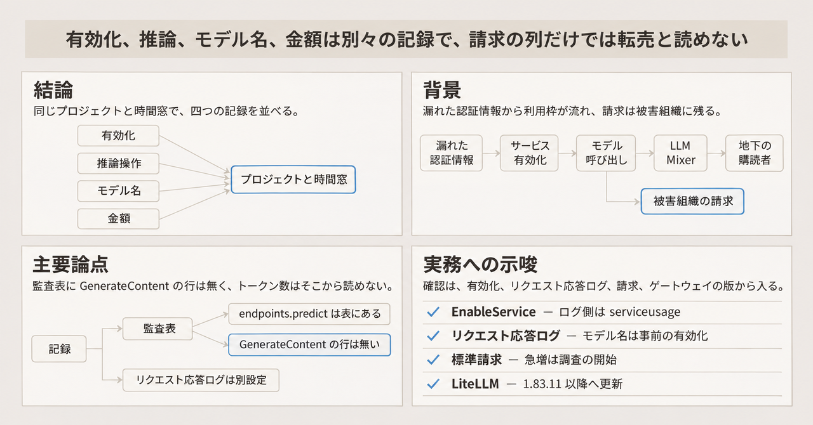
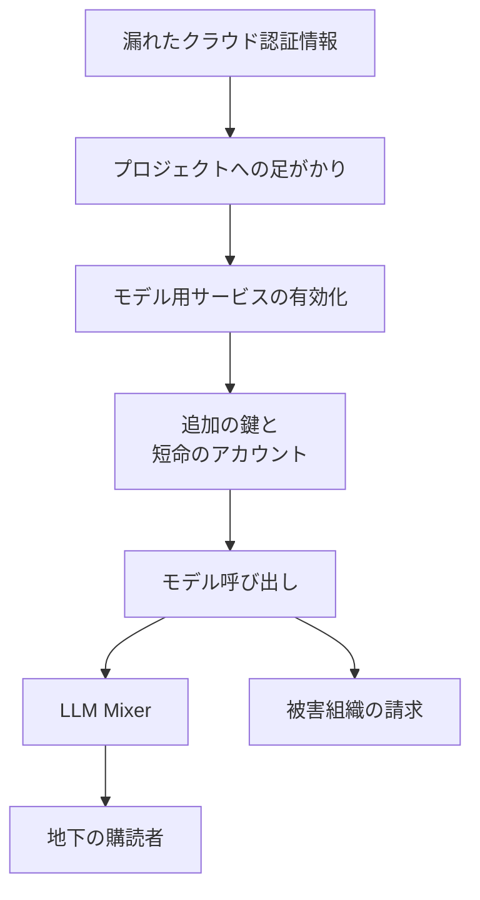
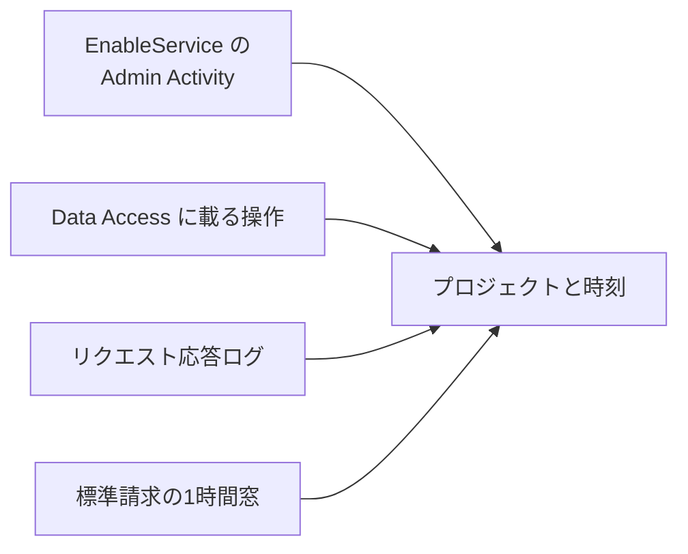

Google Threat Intelligence Group（GTIG）と Mandiant は、2026年11月3日のブログで、企業の大規模言語モデルへの到達を奪い、その利用枠を収益化する手口を LLMJacking と呼んで報告しています。初期の足がかりは、公開されたモデルの入口よりも、漏れたクラウドの認証情報であることが多い、と同ブログは書いています。この記事では、その流れが Google Cloud の監査ログ、リクエスト応答ログ、請求エクスポートのどこに対応するかを整理します。金額の記述は、Mandiant が対応したインシデントの観察です。

*この記事の全体像。以下、順に解説します。*

## LLMJackingとは

LLMJacking は、企業の大規模言語モデルへの到達を奪い、その利用枠を収益化する手口の呼称です。再販の中継を、ブログは LLM Mixer と呼びます。LLM Mixer は、被害組織のモデル呼び出しを購読者へ割り当て、利用量を測り、呼び出し元を隠す中継です。呼び出しの請求は、被害側のクラウド契約に残ります。

ブログの著者は、Christopher Romano、Codi Starks、Garrett Mahoney、John Wolfram、Josh Murchie、K Singh、Mathew Potaczek、Mike Lombardi、Rik Dolfing です。対象になった地域として、北米、南米、アジア太平洋を挙げています。業種として、金融、小売、テクノロジー、運輸を挙げています。名前を付けたクラスタの例は UNC6993 です。UNC6993 は、ブログが一つのまとまりとして名前を挙げた活動の例です。

初期アクセスの例は、次のとおりです。

- サービスアカウント鍵
- GitHub の Personal Access Token（個人用のアクセストークン）
- IAM 資格情報
- セッションのトークン
- 公開リポジトリに置かれた、大規模言語モデルの API キー

ブログはこれらを、別の例として並べています。あとの確認で名前が出るのは、サービスアカウント鍵の作成と、サービスアカウントの作成です。

モデル用サービスを有効にしたあとには、追加の API キー、短命のサービスアカウント、GPU 付きの計算資源、ゲートウェイを使います。ゲートウェイは、ブログがそのあとに使うソフトウェアの呼び方です。例は new-api、gcli2api、LiteLLM です。引用した記述は、この三つの名と LLM Mixer の関係、および `new-api` と `newapi.pro` の関係を、同じものとしては書いていません。ペルソナ名の例は `D1337-KAIROS` です。中継の名前の例は `ai-relay` です。ネットワーク指標は `jet-night.com` と `newapi.pro` です。指標の集合は、VirusTotal の登録ユーザー向けコレクションにあります。

ブログが挙げるハードニングは、秘密の集中管理、最小権限、ソースコードの秘密スキャン、予算とクォータ、開発と本番での鍵の分割、少量リクエストの監視、ゲートウェイのパッチです。Google Cloud では `aiplatform.googleapis.com` の Cloud Audit Logs を見る、とブログは書いています。Cloud Audit Logs は、管理操作とデータアクセスを残す Google Cloud の監査ログです。サービス有効化として挙げるメソッドは `google.api.serviceusage.v1.ServiceUsage.EnableService` です。

ブログが描く流れは、盗んだ認証情報から、被害組織の請求までが一連になっています。

Google Cloud 側でこの流れに対応する記録は、一つのログ製品には揃っていません。有効化は Service Usage の Admin Activity です。Service Usage は、API の有効化を扱うサービスです。Admin Activity は、設定変更のような管理操作の監査ログです。カタログに載る推論操作は、Agent Platform の Data Access です。ここでのカタログは、監査ページが載せる操作の一覧です。Agent Platform は、Gemini Enterprise Agent Platform の監査ページがサービス名 `aiplatform.googleapis.com` を使う呼び方です。Data Access は、データの読み書きを残す監査ログの区分です。モデル名と API メソッドのサンプルは、別設定のリクエスト応答ログです。金額と使用量は、請求エクスポートの時間窓の行に出ます。

## 注意点

### 金額

ブログの金額は、Mandiant が対応したインシデントの観察です。独立した会計監査の数字としては読んでいません。分母は、インシデント全体ではなく、ブログが「一部」と書いた範囲です。

- Introduction は、一部のインシデントで、資源消費に伴う不正な請求が1日で 100,000 USD を超えた、と書いています。
- 一部の組織では、アクセスを切る前の累積が 100 万 USD に達した、とも書いています。
- UNC6993 は、追加の API キーと関連サービスの有効化のあと、請求が 100,000 USD を超えて積み上がった、と LLM Abuse の節は書いています。
- 別の主体は、8時間未満に 500,000 回を超える LLM の API 呼び出しを行い、トークン費用のほぼ 100 万ドルを被害組織へ回した、とも書いています。
- Jet Night は、ブログが無制限プラン約 60 USD/月として挙げた比較対象です。ネットワーク指標の `jet-night.com` と綴りは同じです。フロンティア枠は、その比較で GTIG が一般的なコンシューマ向けの月額として 100 から 250 USD と置いた側です。この比較は GTIG の評価です。

### Cloud Audit Logs とリクエスト応答ログ

「Cloud Audit Logs の Data Access を開けば、Gemini の generateContent がトークン数つきで残る」は、2026年11月3日時点の公式カタログからは言えません。Gemini は、この主張と、リクエスト応答ログのサンプルが使うモデルの呼び方です。ここで行の有無を見た監査表のメソッド名は、`google.cloud.aiplatform.v1.PredictionService.GenerateContent` と `StreamGenerateContent` です。リクエスト応答ログのページがサンプルとして挙げる名前は、`generateContent` と `streamGenerateContent` です。この二つの呼び方が同じメソッドだと、引用したページは書いていません。Agent Platform の監査ページは、サービス名を `aiplatform.googleapis.com` とし、Data Access は明示的に有効化するまで書かれない、と書いています。DATA_READ の表（読み取り操作の一覧）には `endpoints.predict`、`endpoints.rawPredict`、`endpoints.explain` などがあります。同表に `google.cloud.aiplatform.v1.PredictionService.GenerateContent` と `StreamGenerateContent` の行は、2026年11月3日時点で見当たりませんでした。表に行が無いことは、そのメソッドがどの構成でも記録されない、という意味にはなりません。高ボリュームのメソッドがログを出さない一般的な理由は、Cloud Audit Logs の説明にあります。その文は GenerateContent を名指ししていません。

近い名前は、別のサービスにあります。Business AI Code（`businessaicode.googleapis.com`）の監査表は、`PredictionService.GenerateContent` を Data Access として載せています。これは Agent Platform の推論ログではありません。

トークン数の専用列が監査ログに無い、と公式が明言した記述は、引用した監査ページの範囲にはありませんでした。見つかったのは、別のオプトインであるリクエスト応答ログです。そのページは、Gemini の `generateContent` と `streamGenerateContent` のサンプルを BigQuery に保存できる、と書いています。スキーマには `request_id`、`model`、`api_method`、`full_request`、`full_response` があります。トークン数の専用列は、そのスキーマ表にはありません。JSON の中に利用量が入るかは、このページだけでは確定できません。サンプリング率 1 のとき全件、とページは書いています。既定の説明は、サンプルを記録できる、です。

Agent Platform の GenerateContent が、カタログ表以外の経路で監査ログに出るかは、引用したページでは確定していません。`full_request` と `full_response` の JSON にトークン数が安定して入るかも、同じです。

### 請求エクスポートの粒度

標準の請求エクスポートは、`usage_start_time` を1時間の利用窓の開始、と定義しています。全サービスの利用と費用は、1時間粒度で表示する、とも書いています。標準エクスポートに、resource レベルの費用は含まれません。詳細エクスポートが Gemini のリクエスト単位になるとは、案内文からは言えません。詳細エクスポートの resource が、Gemini ではエンドポイントやモデルまで落ちるかも、案内文の範囲では確定していません。

引用した標準請求と詳細請求の案内は、Gemini のどの `sku.description` が推論トークンに対応するかを特定していません。SKU は、請求行を分ける課金項目で、`sku.id` と `sku.description` として出ます。100万トークンあたりの単価は、この記事では公式料金表を根拠にしていません。

同じ1時間に、正規のバッチ推論と不正利用があれば、金額と使用量（`usage.amount`）だけでは分かれません。Data Access は、侵害の前に有効化していない期間を、後から埋めることはできません。

予算アラートの最初の通知は、メール、または Pub/Sub で、数時間かかる場合があります。Pub/Sub は、その通知の送り先として、予算のページがメールと並べて挙げるものです。利用が請求へ載るまでの遅れも、予算のページは書いています。詳細エクスポートの費用明細は、通常は1日以内に出ますが、24時間を超えることもあります。最大5日は、エクスポートを初めて有効にし、EU または US のマルチリージョンを選んだときの初期バックフィルについてです。すべての請求遅延が5日、という意味ではありません。

### サービス有効化のログ

`EnableService` は、ブログの言うメソッド名で、公式にもあります。ログのサービス名は `serviceusage.googleapis.com` であり、`aiplatform.googleapis.com` ではありません。種別は Admin Activity で、既定で有効であり、無効にはできません。

### LiteLLM の CVE-2026-40217

CVE-2026-40217 の説明は、ブログとベンダーの advisory で揃っていません。ブログは、LiteLLM の `/key/regenerate` にある user ID の付け替えで、検証済みの Virtual Key を PROXY_ADMIN のマスター資格情報へ上げた、と書いています。PROXY_ADMIN は、ブログがそのマスター資格情報に使う呼称です。Virtual Key は、LiteLLM のその記述に出てくる鍵です。Google Cloud の API キーとは、引用した文は結びつけていません。GitHub Advisory [GHSA-wxxx-gvqv-xp7p](https://github.com/advisories/GHSA-wxxx-gvqv-xp7p) は、同じ CVE を `POST /guardrails/test_custom_code` のサンドボックス脱出としています。既定構成では、proxy-admin の資格情報が要ります。proxy-admin は、advisory が既定で要るとする管理側の資格情報の名前です。PROXY_ADMIN と proxy-admin が同じ資格情報だと、二つの文書は書いていません。プロセスは、既定の Docker イメージでは root で動く、と advisory は書いています。影響範囲は pip の `>= 1.81.8, < 1.83.10` です。修正済み版の欄は 1.83.10 です。本文は Fixed in 1.83.11 で、手製のサンドボックスを RestrictedPython に置き換えた、と書いています。参照にはタグ `v1.83.10-stable` もあります。1.83.10 だけを修正済みとは読みません。

[X41-2026-001](https://www.x41-dsec.de/lab/advisories/x41-2026-001-litellm/)（公開 2026年4月8日）は、同じ `/guardrails/test_custom_code` を扱っています。公開時点の CVE は TBD、CVSS は 8.7 です。識別は 2026年2月13日です。実在と影響条件は、GitHub Advisory を一次とします。NVD の CVE 本文は、この記事の根拠にしていません。重複 advisory [GHSA-3926-2jvf-fg29](https://github.com/advisories/GHSA-3926-2jvf-fg29) は、2026年5月11日に撤回され、上記の GHSA を指しています。GHSA-wxxx-gvqv-xp7p のページ表示上の公開は、2026年5月7日です。

### AWS と Azure の操作名

AWS の `bedrock.amazonaws.com` や、Azure の `Microsoft.CognitiveServices` の操作名は、ブログが検知候補として挙げたものです。各社の現行 API リファレンスとの一致は、この記事では確認していません。モデル呼び出しに必要な IAM ロールの最小セット、SLA、モデルの廃止日も、引用したページの範囲では定まっていません。

## 影響範囲はプロジェクトと時間窓で切る

影響範囲には、どのプロジェクトの、どの時間窓で、どのサービスと SKU がどれだけ使われたか、を入れます。モデル名と API メソッドが要るなら、事前に有効化したリクエスト応答ログを、同じプロジェクトと時間で並べます。転売であることは、請求の列名からは読めません。外部の Mixer と、被害側の利用増を合わせて推定します。合わせる Mixer 側の項目名は、引用した記述にはありません。

この切り分けを支える記録は、次のとおりです。

- ブログは、侵害時点で LLM のサービスが無効だった複数の事案を書いています。有効化を、重大なイベントとして扱う理由になります。
- `EnableService` は、Admin Activity として公式に残ります。事後に、有効化の有無を見る入口になります。
- API キーの公式ページは、他人がその鍵を持つと、プロジェクトのクォータで呼び出せ、課金プロジェクトでは追加料金になり得る、と書いています。
- リクエスト応答ログは `model` と `api_method` を持ちます。ブログが言う「どのモデルを呼んだか」に対応する公式の記録です。
- 標準請求は、`billing_account_id`、`project.id`、`service.description`、`sku.id`、`sku.description`、`usage.amount`、`usage.pricing_unit`、`cost` を、時間窓で持ちます。

金額の急増は、調査の開始条件にとどめます。同じ1時間の正規利用と混ぜば、列の値だけでは分かれないためです。

## 鍵とゲートウェイで先に狭める範囲

学習用と本番推論用の鍵をプロジェクトで分けるのは、漏れた鍵の到達を狭くする制御として読めます。公式が、そのままの設定名で書いているわけではありません。公式が書くのは、テストは API キー、本番は Application Default Credentials、鍵をソースに入れない、API restriction はサービス単位、です。Application Default Credentials は、実行環境に紐づく既定の認証情報で、API キーの公式ページが本番向けに挙げています。API restriction は、呼べる Google Cloud の API をサービス単位で指定します。モデル単位の制限は、そのページでは確認できません。

ブログが書く Granular API Key Scopes は、モデルのエンドポイント、開発と本番、利用上限で鍵を分ける、という Mandiant の推奨です。公式の設定名ではありません。広い権限のサービスアカウント鍵と、短命アカウントの作り捨てが残る間は、プロジェクト分割だけでは閉じません。クラウド API 経由のクォータ増枠は、ブログが観察しています。増枠リクエストは、Google Cloud の承認が要ります。

LiteLLM を使うなら、CVE-2026-40217 は、guardrail のカスタムコード試験エンドポイントとして扱います。既定では、proxy-admin の資格情報が前提です。アップグレード先は、advisory 本文の 1.83.11 以降を採ります。欄の 1.83.10 と参照タグが食い違うため、1.83.10 だけを修正完了にしません。ブログの `/key/regenerate` の記述は、この CVE の公式説明とは別件として追います。

## 確認の順序

検知では、届く範囲と費用の負担に加えて、いくら推論したかを見ます。その値は、単一のログからは取れません。次の四つを、プロジェクトと時間窓で並べます。

1. Service Usage の Admin Activity で `EnableService` を見ます。ログを出す側のサービス名は `serviceusage.googleapis.com` です。有効化された側のサービス名の値は、引用した記述では特定していません。
2. 鍵の作成と IAM の変更を、既定で残る管理ログで見ます。ブログが挙げる Google Cloud の規則名には、サービスアカウント鍵の作成と、サービスアカウントの作成があります。
3. モデル名とメソッドが必要なら、リクエスト応答ログを事前に有効化します。プロンプト本文が `full_request` に入り得るので、保存先と保持期間を別途決めます。
4. 標準請求を、`billing_account_id`、`project.id`、`service.description`、`sku.description`、`usage.amount` で時間集計します。急増は、調査の開始条件にとどめます。

自分のプロジェクトで先に見る順序は、次のとおりです。

1. Data Access が `aiplatform.googleapis.com` に対して有効かを、侵害前の設定として確認します。
2. リクエスト応答ログのサンプリング率と、BigQuery の保持を決めます。トークン数が JSON 内にあるかは、自環境の1行で確認します。
3. 請求エクスポートが既に有効かを見ます。無効なら、初期バックフィルの条件（リージョンと最大5日）を読んでから有効化します。
4. 予算は数時間遅れ得る前提で、クォータとサービス有効化のアラートを先に置きます。
5. LiteLLM の版が `1.81.8` 以上かつ `1.83.11` 未満なら、proxy-admin の露出と、`1.83.11` 以降への更新を先に見ます。`1.83.10` は修正欄に載りますが、advisory 本文の Fixed in 1.83.11 と食い違います。

## まとめ

LLMJacking は、漏れたクラウドの認証情報からモデル用サービスを有効化し、追加の鍵と中継を通して利用枠を購読者へ流す手口です。請求は被害組織に残ります。Google Cloud では、有効化、推論操作、モデル名、金額が別々の記録に分かれます。影響範囲は、プロジェクトと時間窓を揃えた四つで切ります。トークン数は Data Access の表からは読めず、転売かどうかは請求の列名からは読めません。LiteLLM の CVE-2026-40217 は、ブログの `/key/regenerate` ではなく、guardrail の試験エンドポイントとして扱い、1.83.11 以降へ更新します。

この記事が少しでも参考になった、あるいは改善点などがあれば、ぜひリアクションやコメント、SNSでのシェアをいただけると励みになります！

## 参考リンク

- [GTIG / Mandiant. The Rise of LLMJacking（2026-11-03）](https://cloud.google.com/blog/topics/threat-intelligence/llmjacking-monetizing-compromised-cloud-models/)
- [Agent Platform audit logs](https://docs.cloud.google.com/gemini-enterprise-agent-platform/machine-learning/general/audit-logging)
- [Request-response logging](https://docs.cloud.google.com/gemini-enterprise-agent-platform/models/capabilities/request-response-logging)
- [Service Usage audit logging](https://docs.cloud.google.com/service-usage/docs/audit-logging)
- [Configure Data Access audit logs](https://docs.cloud.google.com/logging/docs/audit/configure-data-access)
- [Standard usage cost export](https://docs.cloud.google.com/billing/docs/how-to/export-data-bigquery-tables/standard-usage)
- [Detailed usage cost export](https://docs.cloud.google.com/billing/docs/how-to/export-data-bigquery-tables/detailed-usage)
- [Budgets](https://docs.cloud.google.com/billing/docs/how-to/budgets)
- [Generative AI quotas](https://docs.cloud.google.com/gemini-enterprise-agent-platform/models/quotas)
- [Agent Platform quotas](https://docs.cloud.google.com/gemini-enterprise-agent-platform/machine-learning/quotas)
- [Standard PayGo](https://docs.cloud.google.com/gemini-enterprise-agent-platform/models/standard-paygo)
- [API keys](https://docs.cloud.google.com/gemini-enterprise-agent-platform/models/start/api-keys)
- [API key restrictions](https://docs.cloud.google.com/api-keys/docs/add-restrictions-api-keys)
- [Cloud Quotas API](https://docs.cloud.google.com/docs/quotas/api-overview)
- [Business AI Code audit logging](https://docs.cloud.google.com/gemini/docs/codeassist/business-audit-logging)
- [GHSA-wxxx-gvqv-xp7p](https://github.com/advisories/GHSA-wxxx-gvqv-xp7p)
- [GHSA-3926-2jvf-fg29（撤回済みの重複）](https://github.com/advisories/GHSA-3926-2jvf-fg29)
- [X41-2026-001](https://www.x41-dsec.de/lab/advisories/x41-2026-001-litellm/)
