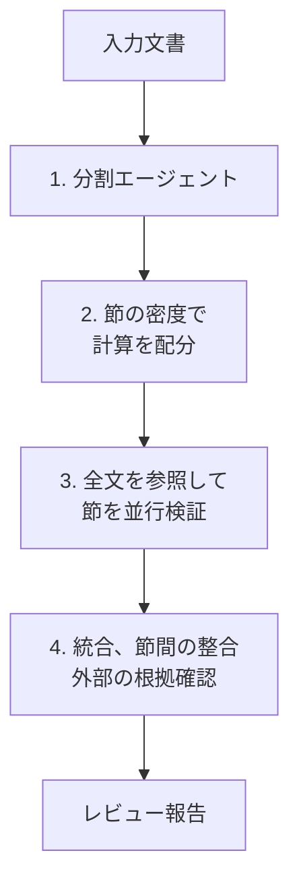

2026年10月14日、Google Research は技術文書を節に分けて点検する Deep Review を一般公開しました。この記事では、[公開ブログ](https://research.google/blog/analyzing-technical-documents-with-deep-review/)、前身の論文、製品ページの文言から、処理の流れ、入力、保存、報告の受け取り方を整理します。読後に選べるのは、設計文書の未記載前提をどの欄へ問うか、本文と図表の不一致をどの入力で見るか、改善提案を仕様のどこへ戻すか、の3点です。

数値と画面文言は、公開ブログ、PAT 論文、会議ブログ、2026年10月17日に取得した製品ページに対応します。ログイン後の操作画面は含みません。

*この記事の全体像。以下、順に解説します。*

## Deep Reviewとは

Deep Review は、Google Research が 2026年10月14日に一般公開したエージェントです。文書を論理的な節に分割します。密度の高い節には、多くの計算を割り当てます。各節は、全文が見える状態で並行して調べます。最後に、節同士の整合と外部の根拠を確認して、報告を返します。

公開ブログは、コンピュータ科学の論文向けに始まったこの点検を、設計文書、プレゼン、法務、財務を含む知識文書へ広げる、と説明しています。週2回までは追加料金なしで使えます。それ以上は、利用者自身の Gemini API キーで利用上限を上げます。

### 点検の中身

点検の中身は、論理の一貫性、数式、改善提案、主張の根拠確認、既存研究との比較です。

設計文書の例は、書かれていないアーキテクチャ上の前提、境界条件、具体的な改善提案です。プレゼンの例は、スライドの遷移が論理的か、箇条書きの要点が図表と一致するかです。法務と財務の例は、条項と表の内部整合、曖昧な用語、下流への影響、根拠との照合です。

### 4段の処理

公開ブログと PAT 論文が共通して書く処理は、次の4段です。

分割エージェントは、節を重複させてよいです。入力の全体は覆います。次に、節の情報密度で計算予算を変えます。密な証明は、導入や関連研究より多く計算します。その後、担当節に推論を集中させつつ全文を参照するエージェントが、並行して調べます。最後の統合エージェントは、節間の整合を見ます。必要なら論理チェックをやり直します。外部の検索やツールで根拠を確認します。

分割の例としてブログが挙げるのは、Introduction、experiments、methodology です。計算配分の例は、証明に多く、導入や関連研究に少ない、です。統合段は、節ごとの報告をまとめ、節をまたぐ矛盾を見て、外部情報で幻覚を抑える、と書いています。

報告を受け取ったあとに人が行う作業は、この4段の外にあります。公開ブログは、認知負荷の高い点検を機械が担い、上位の判断は人に残す、と書いています。

### 入力とサイズ

公開ブログの入力形式は、当初 PDF とプレーンテキストです。複数ファイルは今後対応する、とブログは書いています。製品の FAQ 文言は「PDFs, text, Google Docs, and Google Slides」です。ファイル選択の受付拡張子は `.pdf` `.txt` `.md` `.markdown` `.tex` `.docx` `.pptx` `.html` `.htm` です。クライアントには `driveSource` と `https://www.googleapis.com/auth/drive.file` の分岐があります。

ファイルサイズが 20,971,520 バイトを超えると、クライアントが拒否します。表示文は「File exceeds the 20MB size limit. Please choose a smaller PDF.」です。20,971,520 バイトは 20×1024×1024 です。

### 努力レベル、モデル、料金

努力レベルは4つあります。画面文言は、次のとおりです。

| レベル | 画面の説明 |
|---|---|
| Low | 下書き向けの単発チェック |
| Medium | 速度と深さのバランス |
| High | 会議水準のマルチエージェント検証 |
| Extra High | 理論と実証が複雑な文書向けの多段評価 |

追加料金なしの画面文言は「Enjoy 2 free reviews per week on us with 4 Argon on Medium.」です。週の枠を使い切ると、HTTP 429 相当で「Attach a Gemini API key」と出します。高負荷時は HTTP 503 相当です。追加料金なしの枠を既に使っていれば、API キーを付けるよう案内します。

料金の画面 FAQ は、Deep Review 自体の追加料金はなく、Gemini API の公開料金だけを払う、と書いています。40ページの文書の目安は、Low の 3.8 Flash で約 $3.00 から、4 Argon の Extra High で $20 まで、です。実額は文書で変わり、目安にすぎない、とも書いています。

製品ページの初期 HTML（2026年10月17日取得）に並ぶモデル ID は `gemini-4-argon`、`gemini-3.8-flash`、`gemini-3.1-pro-preview`、`gemini-3.5-flash-lite` です。並びの直後の選択 ID は `gemini-4-argon` です。

### 保存と外部検索

公開ブログの保存条件は、アップロード文書を学習、微調整、Google モデルの改善に使わず、画面表示のために1年保存する、です。製品サイドバーは、許可なくモデル学習には使わない、表示のため最大1年保存し、その後削除する、と書いています。FAQ は、将来の参照のために保存し他目的には使わない、と書いた直後に、研究チームが Deep Review の改善に使う許可をオプトインできる、と書いています。

FAQ は、関連研究を探すためにウェブ検索をすることがある、と書いています。文書自体は private だと書いています。

### 前身の Paper Assistant Tool

前身は Paper Assistant Tool（PAT）です。公開ブログは、STOC、ICML、NeurIPS、ICLR で著者が任意に使った 16,000 原稿超の事前フィードバックのあと、Deep Review として一般公開した、と書いています。製品 FAQ は、同じ中核エンジンが STOC、ICML、NeurIPS、ICLR、AISTATS で 15,000 論文超を見た、と書いています。会議プログラムのフィードバックは正式査読から切り離されます。査読者には渡りません。

[Antigravity の Teamwork](https://antigravity.google/docs/teamwork/) の `/teamwork-preview` には、Document Review という実行パスがあります。論文、RFC、設計文書の多角的な批判と統合を行います。有料プランで使えます。公開ブログは、このパターンを Deep Review に着想を得たものとして紹介しています。

## 注意点

公開ブログの設計文書とプレゼンは、使い方の例です。設計資料での検出率、件数、偽陽性率は、ブログにも論文にもありません。論文の測定対象は、撤回や正誤表に至った数学と計算機科学の論文のうち、数式と証明の誤りに絞った 26 論文、29 誤りです。

### 89.7%の母集団とモデル

論文 Table 2 は、著者らの論理同値グレーダです。本文は、SPOT 論文の厳密なキーワード採点とは直接比較できない、と書いています。グレードは著者の一人が監査しています。

| 方法 | 検出精度 |
|---|---:|
| Original SPOT SOTA（Son et al., 2025） | 21.1% |
| Gemini 3.1 Pro の zero-shot | 55.2% |
| PAT（Gemini 3.1 Pro） | 89.7% |

抄録は「zero-shot recall に対して 34% improvement」と書いています。表の差は 55.2% から 89.7% で、34.5 ポイントです。89.7 を 55.2 で割って 1 を引いた相対比ではありません。

この PAT は、STOC と ICML のパイロットで使った advanced Gemini 2.5 Deep Think とも、公開時に追加した Gemini 4 Argon とも、論文上は別物です。公開ブログは、Argon の追加で PAT より能力が上がった、と書いています。上がり幅の表はありません。追加料金なしの画面文言は、Medium の 4 Argon です。会議パイロットがどの努力レベルに相当するかは、書いていません。

画面の High は conference-level、Extra High は theoretical and empirical documents です。設計資料とは書いていません。4段の分割例は、論文の節名です。

### 著者調査の数字が割れる箇所

論文 Table 3 と、[ICML ブログ](https://blog.icml.cc/2026/03/30/retrospective-on-pat-x-icml-2026-ai-paper-assistant-program/)（2026年3月30日）は、同じラベルでも母集団が違います。

| 項目 | 論文 | ICML ブログ |
|---|---|---|
| 回答数 | ICML n=733、STOC n=124 | 869 |
| 再使用 | ICML 92.1%、STOC 97% | 92.1% |
| Very or Mostly helpful | ICML 90.7%、STOC 92.7% | 73.3%。全く役立たないは 1.6% |
| 理論の重大ギャップ | ICML 35.4%、STOC 11.6% | 理論を含む論文の著者の 35.4%。修正に1時間超 |
| 新しい実験 | ICML 31% | 実験結果がある論文の著者の 31% |
| 明瞭さ | ICML 87.0%、STOC 85.1% | 87.3% |

論文本文は「ICML 回答者の 31% が全く新しい実験を走らせた」と一般化しています。ICML ブログの分母は、実験結果がある論文の著者です。35.4% も、ブログでは理論を含む論文の著者です。

「指摘が mostly or all grounded」は論文表だけにあります。STOC は 55.8%、ICML は 64.8% です。ICML ブログはこの設問を出していません。これは、指摘を一件ずつ検証した割合ではありません。

[ICLR の告知](https://blog.iclr.cc/2026/09/10/making-googles-paper-assistant-tool-pat-available-to-iclr-submitters/)（2026年9月10日）は、STOC について「94% が helpful、85% が明瞭さ改善」と書いています。論文表の STOC は、Very or Mostly helpful が 92.7%、明瞭さが 85.1% です。設問文が同じとは限りません。同じ告知は、NeurIPS で回答者の 54.4% が performance の改善を報告した、と NeurIPS ブログを指して書いています。[2026年4月21日の NeurIPS 告知](https://blog.neurips.cc/2026/04/21/neurips-supports-authors-with-googles-paper-assistant-tool-pat/)の本文には、54.4 がありません。振り返り記事の URL は、2026年10月17日の公開検索では特定できませんでした。

ICLR 著者の 58% が全く新しい実験を走らせた、という数字は、論文共著者 Vahab Mirrokni の X 投稿（2026年10月15日）にあります。調査の人数と設問文は、投稿にありません。ICLR の告知ページにもありません。

実績の件数も揃いません。公開ブログは 16,000 超で、対象は STOC、ICML、NeurIPS、ICLR です。製品 FAQ は 15,000 超で、AISTATS を含みます。

### 会議の投稿数

論文 Table 1 の3会議合計は、2023年が 23,838、2024年が 32,628、2025年が 45,354、2026年が 73,883 です。2026年の NeurIPS 29,703 と合計 73,883 は推定です。注釈は、2024年から2025年の成長率を2025年に掛けた値だ、と書いています。著者は、真値はより高い、と書いています。公開ブログは「今年 74,000 超」「2025年約 45,000、2024年約 32,000、2023年約 23,000」と丸めています。図の代替テキストは「2023年 24,000 から 2026年 75,000」です。

### 図表が残る条件

プレーンテキストには、画像としての図表はありません。テキストで書いた表は残ります。会議 PAT の ICLR と NeurIPS の FAQ は、大きい PDF では高解像度の画像や plot が剥がれ、テキストだけで走るか、失敗する、と書いています。推奨は 20MB 以下です。理想は 10MB 未満です。ICML の振り返りは、大きい PDF がモデル失敗の主な端だった、と書いています。公開製品のクライアントも、20,971,520 バイト超を拒否します。

それ以下の PDF、PPTX、Google スライドで、画像としての図表が検証に残るかは、公開ブログ、会議 FAQ、製品クライアントのサイズ制限からは確認できません。表示の 20MB は、十進の 20,000,000 バイトではなく 20×1024×1024 です。

### 正しい証明を誤りとする残課題

論文 3.2 は、パイロットで多く報告された課題を3つ書いています。日付のハルシネーションと知識カットオフ、PDF のパース、正しい証明や議論を誤りと主張すること、です。最初の2つは、検索とパーサで対処した、と書いています。再測定の表はありません。3つ目は LLM 系の残課題で、対処中だと書いています。件数はありません。PAT の precision の表もありません。

論文は、Role 1（著者の道具）が明白な欠陥を隠し、原稿を表面的に強く見せ、人間の査読を難しくしうる、と書いています。著者がレビューエージェントを敵対的に騙すリスクも、結論で未解決として挙げています。

### 入力、保存、料金の文言差

入力形式は、一次ソースの間で一致しません。ブログは PDF とプレーンテキストです。FAQ は Google Docs と Google Slides を含みます。ファイル受付は docx、pptx、md、tex、html を含みます。複数ファイルは、ブログが今後対応と書いています。2026年10月17日時点の製品ページ同梱スクリプトには、その文言はありませんでした。設計資料とスライドを1回で突き合わせる機能は、告知時点では今後対応です。

保存の文言は3つあります。ブログは、モデル改善に使わず1年保存する、と書いています。サイドバーは、許可なく学習に使わず、最大1年で削除する、と書いています。FAQ は、他目的に使わない、と書いたうえで、Deep Review の改善へのオプトインを置いています。会議 PAT は、フィードバックの配信とプログラム終了のあと 7 日以内に削除する予定です。障害時に著者承認がある場合だけ、職員が見る、と ICLR と NeurIPS の告知が書いています。公開ブログの1年保存の段落は、この職員制限を再掲していません。

約 $3.00 と $20 は、製品 FAQ の40ページの目安です。公開ブログにはありません。固定料金ではありません。[Gemini API の deep-review ドキュメント](https://ai.google.dev/gemini-api/docs/deep-review)は、2026年10月17日に HTTP 404 でした。クライアントは `https://deepreview.googleapis.com/v1/documents` を、Drive 起点かつパスが `/deepreview` で終わる場合に参照します。公開ドキュメントの定位置は、この 404 以外には見つかっていません。週2回を超えたときの上限数値も、公開資料にはありません。

Antigravity の文書は、Document Review を Deep Review の4段パイプラインそのものだとは書いていません。

2026年10月17日の NVD キーワード検索では、この製品の CVE は返りませんでした。返った項目は別製品です。検索結果が無いことは、脆弱性が無いことの証明ではありません。GitHub の Issue 検索でも、この製品の不具合報告は上位に出ませんでした。

## 設計レビューの報告を3種に分ける

設計レビューで Deep Review を使うなら、報告を次の3種に分けてから、人が採否します。

1. 未記載の前提です。本文が、書いていない条件に依存しています。これは問いです。答えを機械の文で埋めません。未決の問いか、チームがすでに決めていたことの記録かを、人が選びます。
2. 本文と図表の不一致です。主張と図が食い違います。どちらが誤りの候補かを、人が見ます。画像としてしか残らない図は、プレーンテキストや、画像が落ちた PDF では照合できません。テキストとして残った表は、抽出された本文があれば照合できます。
3. 改善提案です。まだ決めていないことを、新しく足す案です。既に黙って実装した挙動の復元とは、別の欄に置きます。ICML の「新しい実験を走らせた」は、この種に近いです。文書に既にあった前提の発見ではありません。

書き戻す欄は、指摘ごとに人が選びます。未決の問いは、未決の欄へ置きます。既決の挙動は、決定の欄へ置きます。図表の食い違いは、欠陥候補の欄へ置きます。3種を1つの「仕様の修正」に混ぜません。改善提案を、既に決めていた前提として仕様へ書くと、未決の空白と既決の挙動が混ざります。

公開ブログは、設計文書の未記載のアーキテクチャ前提と、プレゼンの要点と図表の一致を、同じ節の例として明示しています。4段の最後は、節間の整合と外部の根拠確認です。離れた節の食い違いを見る、とブログと論文の両方が書いています。[CNET Japan](https://japan.cnet.com/article/35253606/)（2026年10月16日）の「未記載の前提」と「要点とグラフ」は、このブログの例の要約です。

会議プログラムは、フィードバックを正式査読に渡しません。指摘の採否が人に残る運用は、PAT の公開実績側にあります。フィードバックは大部分または全て根拠に基づく、と答えた著者は、STOC で 55.8%、ICML で 64.8% にとどまります。正しい証明を誤りと言う失敗を未解決と書くことと合わせると、採否を人に残す理由になります。

精度の引用は、PAT の数式と証明の部分集合にとどめます。26 論文、29 誤り、Gemini 3.1 Pro、独自グレーダ、89.7% です。設計資料の検出率としては引用しません。

逆転条件は、次の場合です。公開製品そのもので、設計文書の未記載前提と図表不一致の検出率と偽陽性率が、著者以外の評価で、論文向けの 89.7% と同じ母集団定義で出た場合です。そのときは、設計レビューの精度として引用してよいです。それまでは、例示にとどめます。

## 未公開の仕様を出す前に確認すること

未公開の仕様をアップロードする前に、保存条件は画面の3文言を並べて確認します。会議に出した原稿の7日削除は、公開製品の条件ではありません。機密の仕様で、改善へのオプトインと1年保存を受け入れられない場合は、この製品へ出しません。

週2回まで追加料金なし、は公開ブログと製品画面の両方にあります。40ページで約 $3.00 から $20 は、製品 FAQ の目安です。追加料金の有無を、ブログだけで判断しません。

公開資料だけでは、次がまだ決まりません。

- 追加料金なしの Medium が、会議パイロットの計算予算と同じか。
- Google Docs と Google Slides を Drive 経由で実行したとき、図表が検証に残るか。20,971,520 バイト未満の PDF と PPTX でも同じか。
- オプトインの初期値と、「Deep Review の改善」がモデル学習を含むか。
- 外部検索のクエリに、未公開文書の文が含まれるか。
- Deep Review API の公開仕様が、404 だったドキュメント以外のどこにあるか。週2回を超えたときの上限数値。
- NeurIPS の 54.4% の元表。ICLR の 58% の調査票。論文表と ICML ブログで helpful が 90.7% と 73.3% に割れる理由。
- 公開製品での偽陽性率と、設計文書での独立評価。

これらは、仕様の欄へ自動で書き戻すことを止めます。採否を人がする、という運用自体は止めません。

## まとめ

Deep Review は、文書を分割し、密度で計算を配り、全文を見ながら節を並行して調べ、節間の整合と外部の根拠を確認して報告を返すエージェントです。設計文書では、未記載のアーキテクチャ前提と、要点と図表の一致が、公開ブログの例です。

報告は、未記載の前提、本文と図表の不一致、改善提案の3種に分けます。書き戻す欄は人が選びます。89.7% は、別モデルの PAT が 26 論文 29 誤りの数式と証明を独自グレーダで再現した値です。設計資料の検出率としては使いません。

未公開の仕様を出す前には、1年保存、学習に使わない、改善へのオプトイン、の3文言を画面で並べます。会議原稿の7日削除は、公開製品の条件ではありません。

この記事が少しでも参考になった、あるいは改善点などがあれば、ぜひリアクションやコメント、SNSでのシェアをいただけると励みになります！

## 参考リンク

- Google Research, "Analyzing technical documents with Deep Review", 2026-10-14. https://research.google/blog/analyzing-technical-documents-with-deep-review/
- Jayaram et al., "Towards Automating Scientific Review with Google's Paper Assistant Tool", arXiv:2606.28277v1, 2026-06-26. https://arxiv.org/html/2606.28277v1
- ICML Blog, "Retrospective on PAT x ICML 2026 AI Paper Assistant Program", 2026-03-30. https://blog.icml.cc/2026/03/30/retrospective-on-pat-x-icml-2026-ai-paper-assistant-program/
- NeurIPS Blog, "NeurIPS Supports Authors with Google’s Paper Assistant Tool (PAT)", 2026-04-21. https://blog.neurips.cc/2026/04/21/neurips-supports-authors-with-googles-paper-assistant-tool-pat/
- ICLR Blog, "Making Google’s Paper Assistant Tool (PAT) available to ICLR submitters", 2026-09-10. https://blog.iclr.cc/2026/09/10/making-googles-paper-assistant-tool-pat-available-to-iclr-submitters/
- Google Antigravity Docs, "Teamwork agent teams". https://antigravity.google/docs/teamwork/
- Deep Review 製品ページ. https://research.google/deepreview/
- CNET Japan, "論文の矛盾を見つけるAI「Deep Review」、Googleが公開　週2回まで無料", 2026-10-16. https://japan.cnet.com/article/35253606/
- Son et al., SPOT, arXiv:2505.11855。PAT 論文が引用。表の 21.1% は PAT 論文 Table 2 の転記。
