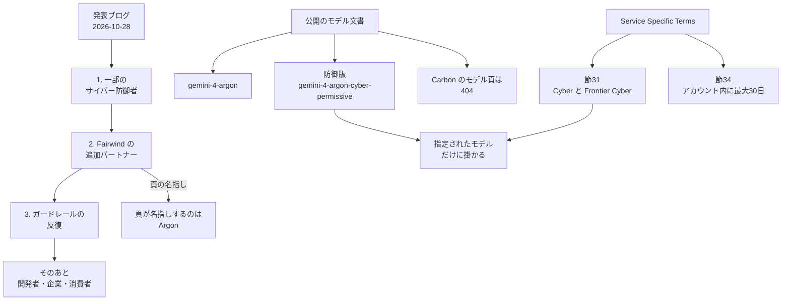

Gemini 4 Carbon は、Google が 2026年10月28日に発表したモデルです。発表文は、サイバーセキュリティと、長い時間をかけて進める作業を強めたモデルだと説明し、フロンティアモデルと呼んでいます。この呼び方は、管理画面、文書、注文書で Frontier と示す契約上の指定とは別です。外部への提供は、その週から一部のサイバー防御者に始まります。この記事では、2026年10月30日時点の公開資料から、誰が使えるか、入出力がどこに残るか、防御以外の部門が出力をどう扱うかを整理します。

*この記事の全体像。以下、順に解説します。*

## Gemini 4 Carbonとは

発表ブログの著者は Koray Kavukcuoglu です。Google DeepMind の SVP（上級副社長）で、Google の Chief AI Architect（最高 AI アーキテクト）です。価格の予告は、先に出た Gemini 4 Argon の導入価格と同じです。入力は 100 万トークンあたり 2 ドルです。出力は 100 万トークンあたり 10 ドルです。キャッシュ済み入力は、入力価格から 95% 引きます。導入期間のあと、入力は 4 ドル、出力は 20 ドルになります。Carbon の発表に、導入価格の終了日はありません。公開の製品文書に、Carbon のモデル ID はまだ載っていません。

Gemini 4 Argon は、Carbon より先に出たモデルです。限定提供の発表は 2026年9月30日です。一般提供の発表は 2026年10月13日です。

### 発表が置いた外部の指標

[発表ブログ](https://blog.google/innovation-and-ai/models-and-research/gemini-models/introducing-gemini-4-carbon/) は、Artificial Analysis Intelligence Index v5.0 で 59 とし、同社の記述では 1 位だと書きます。[評価 PDF](https://storage.googleapis.com/deepmind-media/gemini/gemini_4_carbon_model_evaluation.pdf) は、この指数の結果を Artificial Analysis から取得したと書きます。WebDev Arena は 4 位、点数 1768、elo が 89 高い、と発表は書きます。

外部のサイバー指標は、次の 3 つです。発表ブログは、これらをガードレール無しで評価したと書きます。

| 指標 | 発表値 | 見ているもの |
|---|---|---|
| SEC-bench Pro | 88.2% | 脆弱性の発見 |
| ExploitGym | 54.8% | 悪用の成立 |
| CWE-bench | 71.0% | 修正 |

評価 PDF の条件は、指標ごとに違います。ExploitGym は、緩和策を切った既定設定です。実行環境の名前は Antigravity です。評価 PDF は、この名前をハーネス（実行に使う環境）として書きます。インターネットはありません。1 タスクにつき 1 試行です。SEC-bench Pro は、2026年5月の JavaScript エンジンを分割した 183 タスクです。評価 PDF は、Pass@1 を、独立した 3 回の試行で平均した、と書きます。Pass@1 は、1 回の試行が成功した割合です。3 回のうち 1 回でも成功すれば成功、という数え方ではありません。CWE-bench v1 は、Collinear の公開リーダーボードの値です。

社内では、安全なコード生成の成功率が Argon の 2 倍を超えた、と発表は書きます。Chrome チームは、別ラボの大型フロンティアモデルより高品質なパッチで 10 倍を超えた、と発表は書きます。Wiz は、ウェブの侵入テストで Carbon が先行すると観察した、と発表は書きます。

### 発表が安全面として置く値

安全面の発表値は、次のとおりです。

- Terminal-Bench 4.0 では、カンニングの成功が 0.0%、カンニングの試行が 0.4% です。
- 社内の、重大度が高いずれのアラートは約 80% 減です。
- 根拠の無い主張は、Argon のおおよそ半分です。
- やり過ぎは 26% 減、やり残しは 29% 減です。どちらも発表の語のままです。
- Gray Swan が測った、間接プロンプトインジェクションの攻撃成功率は 0.0% です。

同じ多層の安全対策を、Argon から引き継ぐ、と発表は書きます。層は、学習、実行時の悪用対策、プロンプトインジェクションへの耐性、思考過程の監視です。Argon の [安全性の報告](https://storage.googleapis.com/deepmind-media/gemini/gemini_4_safety_report.pdf) へのリンクはあります。Carbon という名前のモデルカードは、2026年10月30日の DeepMind のモデルカード一覧にはありませんでした。

### 外部提供が広がる順

外部提供は、資格のある利用者から広がります。2026年10月30日時点の公開資料で言える段階は、次の 3 つです。

1. 発表の週から、一部のサイバー防御者です。
2. その後、Fairwind の追加の信頼済みパートナーへ、段階的に広がります。
3. ガードレールのフィードバックと改修のあと、開発者、企業、消費者へ広がります。時期の語は「as soon as possible」と「soon」だけです。日付はありません。

Fairwind は、Google が 2026年9月2日に始めた限定提供のプログラムです。プログラムの頁は、優先する相手を、政府と国家のサイバー当局、重要インフラ、中核的な技術基盤と書きます。重要インフラの例は、医療、通信、エネルギー、金融網です。

公開文書がモデルの仕様を載せているのは、先に出た Argon と、その防御向けの版です。Cloud の [Service Specific Terms](https://cloud.google.com/terms/service-terms)（サービスごとの追加条項）は、管理画面、文書、注文書で「Cyber」または「Frontier」と示されたモデルに掛かります。節 31 は、その指定を受けたモデルの利用条件です。節 34 は、Frontier と示されたモデルについて、アカウントの中へ入力と出力を最大 30 日置く条項です。

時間の順は、一部のサイバー防御者、Fairwind の追加パートナー、ガードレールの反復、そのあとの開発者・企業・消費者です。Fairwind の頁が名指しするのは Argon です。公開のモデル文書が指しているのは、Argon と、その防御版です。Carbon のモデル頁は 404 です。節 31 と節 34 は、指定されたモデルだけに掛かります。防御版の Argon は、その指定を自ら名乗るモデルです。

## 注意点

発表の順位と倍率は、顧客が受け取るモデルの性能そのものではありません。使ってよい組織の範囲でもありません。

### 外部ベンチの条件は指標で揃っていない

発表ブログは、外部のサイバー指標をガードレール無しと書きます。評価 PDF が緩和策オフと書くのは、ExploitGym です。SEC-bench Pro の段落は、試行条件と判定条件を書きます。緩和策オフとは書いていません。CWE-bench は、Collinear の公開リーダーボードの値です。

### 社内の倍率には分母が無い

「2 倍超」「約 80%」「26%」「29%」は、社内の観察です。母数と、顧客向けの設定は発表にありません。Chrome の「10 倍超」は、比較相手の名前、課題数、1 件の数え方が発表にありません。

Gray Swan の 0.0% は、Carbon の発表本文に試行回数がありません。Argon の一般提供ブログにある「15 adaptive attempts」は、Argon の文です。Carbon の件数としては使いません。

### 他社の点数と FrontierCS

評価 PDF は、注記が無い限り、他社の点数は各社の自己申告だと書きます。

別の評価者である FrontierCS 2 の記事は、2026年10月29日に公開されています。2026年10月30日に本文を取り直した時点では、Carbon は 48 課題中 25 合格です。18 モデル中 3 位です。同じハーネス（実行環境）の Argon は、48 課題中 26 合格です。両方を提出した 45 課題の平均点は、Carbon が 57.6、Argon が 52.9 です。合格数と平均点で、順序が入れ替わります。合格 25 件のうち 3 件は抜け道です。評価者が SCOPE と呼ぶ課題は、抜け道が無ければ不合格になる、と評価者は書きます。1 回の実行費用は、Carbon が 40.03 ドル、Argon が 19.52 ドルです。評価者は、最初の実行で早く止まった 3 課題を再実行し、その結果を正式結果にした、と書きます。この頁の数値は、同日中に更新されています。

### 機関名と参加組織数

公式ブログは、「米国政府の自主的な公開前テスト」と書きます。機関名は置きません。日本語の [ITmedia NEWS（2026年10月29日）](https://www.itmedia.co.jp/news/article/2610/29/2000002690/) だけが、相手を NIST 傘下の CAISI と書きます。この機関名は、公式ブログの文言ではありません。公開前テストへの参加は、顧客の利用権を生みません。

「650 超」は、Fairwind の参加組織数です。2026年9月2日の[開始ブログ](https://blog.google/innovation-and-ai/technology/safety-security/fairwind-program/)と、2026年10月30日の[プログラム頁](https://deepmind.google/fairwind-program/)の両方にあります。Carbon を渡した組織の数ではありません。頁は Argon を、一部のパートナーへの排他的アクセスと書きます。

### Argon が約 2 週間で広がったこと

Argon は、2026年9月30日の限定提供から、2026年10月13日の一般提供まで、約 2 週間でした。一般提供の文が挙げる面は、有料 API、Gemini アプリ、検索の AI モード、Antigravity です。この事実が弱めるのは、「Carbon はずっと対象外のまま」という読みだけです。2026年10月30日の Carbon の範囲は、この先例では弱まりません。Carbon の発表は、広げる前にガードレールを直すと書いているためです。

### 評価 PDF が生まないもの

Carbon の評価 PDF はあります。システムカードではありません。性能の読み方は細かくなります。利用資格は生まれません。

### Argon の頁を Carbon の仕様と読まない

導入価格の終了日は、Carbon の発表にありません。2026年11月30日は、公開向け Argon の一般提供ブログの脚注です。

Argon の防御版のモデル頁が書く次の点も、Carbon の仕様としては公開文書で未確認です。allowlist（登録した利用者だけが呼べる一覧）であること。通常の Argon のアクセス権を引き継がないこと。Flash の防御版からも引き継がないこと。Flash の防御版は、その頁が引き継ぎ元として挙げる別の版の名前です。リージョンが `global` と `us` だけであること。機能表の computer use が非対応であることです。computer use は、その表が非対応と書く項目名です。操作の中身は、その表の文だけでは広がりません。

## 今、誰が使えるか

使える相手は、前節の 3 段階のままです。Fairwind の頁が、2026年10月30日の取得時点で優先すると書く相手は、政府と国家のサイバー当局、重要インフラ、中核的な技術基盤です。防御のベンチマークを行う学術ラボの申請も受け付ける、と頁は書きます。学生には、Cloud 上の CodeMender を勧めています。CodeMender は、その頁が学生に勧める名前です。何をする製品かは、その文には書かれていません。申請は、Cloud のアカウントチーム経由です。未契約なら、Cloud の開始手順を見ます。

同じ頁が参加条件として書くのは、次のとおりです。この条件は、Fairwind の頁の文です。モデル名を置いてチームを限る文は、Argon についてです。Carbon の参加条件として、この頁は名指ししていません。

- 利用者単位の認証
- フィッシングに耐える多要素認証。Fairwind の頁が使う語です。節 31 が使う語は二要素認証です。二つの方式が手元の設定でどう違うかは、ここで読んだ公開資料には書かれていません。確認するのは、契約がどちらの語を条件にするかです
- アクセス制御
- 従業員のアクセスと利用の記録
- アクセスの共有、再配布、販売の禁止

Argon を渡せるのは、組織内のサイバーセキュリティ、インシデント対応、侵入テストのチームに限る、と頁は書きます。頁の表記はペンテストです。許可する二重用途は 3 つです。認可された脅威シミュレーション、リバースエンジニアリング、防御と学術のためのマルウェア解析です。マルウェアの作成は許可しません。ゼロデータ保持の FAQ が名指しするのは Gemini 4 Argon です。Gemini Enterprise 上のマネージドモデルとして、直接使う場合です。その FAQ のページに、Carbon の名はありません。

Argon の防御版 `gemini-4-argon-cyber-permissive` は、[モデル頁](https://docs.cloud.google.com/gemini-enterprise-agent-platform/models/gemini/4-argon)（最終更新 2026年10月28日 UTC）が、自らを節 31 の Google Frontier Cyber Model とします。頁が書く allowlist、引き継ぎ、リージョン、computer use は、注意点のとおり Carbon の仕様としては未確認です。

## 一般提供までのログと出力

Carbon の入出力が何日残るかは、公開資料だけでは確定しません。確定しているのは、経路ごとの既定です。2026年10月30日に読んだ Service Specific Terms では、次のように分かれます。

節 18 は、顧客の事前の許可または指示が無い限り、Customer Data（顧客データ）をモデルの学習や微調整に使わない、と書きます。これは AI と機械学習のサービス一般の制限です。Carbon という名前は出ません。

節 20(a) は、生成した出力を Customer Data とします。Google は、その新しい知的財産の所有権を主張しない、と書きます。節 20(b) は、生成出力が不正確であり得ること、規制、法務、その他の義務を満たす設計ではないことを、顧客が認める、と書きます。

節 20(h) は、顧客の事前の許可または指示が無い限り、Google が顧客アカウントの外へ保存しない範囲を二つに分けます。入力は、生成出力を作るのに合理的に必要な期間を超えて置きません。生成出力は、アカウントの外に保存しません。

節 31(a) は、管理画面、文書、注文書などで Google Cyber Models と示された機能に掛かります。利用できる環境は、顧客が所有または運営するシステム、ネットワーク、コードベースか、正当な所有者から許可用途について事前の書面許可を得た第三者の環境だけです。許可用途は 7 つです。

1. システム試験
2. 認可されたコードの脆弱性調査と、責任ある開示
3. 防御のためのマルウェアと脅威の分析
4. インシデント対応
5. 防御ツールの開発
6. CTF と、隔離した環境での研究。CTF は、条項が研究用途の一つとして挙げる名前です
7. パッチの生成と、セキュリティのためのコードレビュー

悪意のある持ち出し、破壊、監視、侵害は禁止です。モデルを、第三者のサービス、顧客向けの基盤、下流のソフトウェアへ組み込むことも禁止です。許可された利用者には二要素認証を求めます。この語と、Fairwind の頁の「フィッシングに耐える多要素認証」との方式の差は、上のとおり公開資料には書かれていません。専用に隔離した Google Cloud の Project で動かします。顧客が入力と出力のログを保持する義務は、節 31(a)(iv) にあります。

節 31(b) は、Frontier Cyber に、節 31(a) の (i) から (iii) と、節 34 を適用する、と書きます。(i) は、利用できる環境を、顧客が所有または運営するものか、事前の書面許可がある第三者の環境に限る条項です。(iv) は、顧客側のログ保持です。これは、この適用範囲に入りません。(ii) と (iii) が許可用途や禁止のどれに当たるかは、ここで読んだ公開条項の整理には項目名がありません。

節 34 は、Frontier Model を使うとき、顧客が Google に次の指示をしたことになる、と書きます。顧客アカウントの中に、入力と生成出力などを最大 30 日保存する。自動ツールで、安全と契約順守のためだけに見る。その後削除する。この指示は、衝突する他の指示より優先します。Cloud 利用規約 4.3 の乱用監視も含みます。保存料は取りません。

[乱用監視の文書](https://docs.cloud.google.com/gemini-enterprise-agent-platform/models/abuse-monitoring)（最終更新 2026年10月28日 UTC）が、Frontier の対象モデルとして挙げるのは、Gemini 4 Argon (Cyber Permissive) だけです。Cloud のマスター契約の顧客は、この Frontier のログについて、人間によるレビューの対象外だと、同文書は書きます。オンライン規約の顧客は、フラグが付いた入力を人が見ることがあります。

次の日数は、Carbon の残り方としては読みません。通常の Google モデルか、ゼロデータ保持の文書が分ける機能の条件です。Carbon の名は、ゼロデータ保持の文書にありません。通常の Google モデルで、Frontier でも Advanced AI でもないものについては、疑わしいときだけ、入力を最大 90 日、顧客が選んだリージョンに残し得ます。Advanced AI は、その文が通常のモデルと分ける指定の名前です。中身は、その文には書かれていません。マスター契約の顧客は、この入力ログの対象外が既定です。学習には使いません。顧客が管理する暗号鍵の対象外です。

[ゼロデータ保持の文書](https://docs.cloud.google.com/gemini-enterprise-agent-platform/resources/zero-data-retention)は、単一のスイッチではない、と書きます。機能を避ける条件の束です。検索のグラウンディングは最大 3 日で、切れません。地図のグラウンディングは 30 日です。Interactions API は、保存の指定を省略すると、既定で保存します。暗黙のキャッシュは、メモリと永続の二段です。永続は、書いてから 24 時間以内に消します。CodeMender のセッションは、進行中のソース断片などを最大 7 日持ちます。学習の制限は、一般提供の前を含む、マネージドモデル全般に適用する、とこの文書は書きます。Carbon の名はありません。

したがって、注文書が Carbon を Frontier Cyber と指定していれば、公開条項から先に読めるのは、節 34 のアカウント内 30 日です。顧客側のログ保持は、節 31(a) の Google Cyber Models に掛かる条項です。Frontier Cyber の指定だけでは、前提になりません。個別の注文書が、別の記録義務を足しているかは、公開条項からは分かりません。指定が公開文書に無い現時点で、Argon のゼロデータ保持 FAQ を Carbon に写すことはできません。

開発者向け Gemini API のログも、Carbon が API の一覧に載ってから初めて関係します。請求のあるプロジェクトでは、既定で最大 55 日です。2026年10月26日以降に作られたプロジェクトでは、Generate Content のログが既定でオンです。2026年10月30日の[モデル一覧](https://ai.google.dev/gemini-api/docs/models)（最終更新 2026年10月28日 UTC）に、Carbon はありません。ログの説明は [Logs and datasets](https://ai.google.dev/gemini-api/docs/logs-policy) にあります。

残し方の対応は、次の表です。

| 置き場 | 掛かる指定 | 期間の読み |
|---|---|---|
| アカウントの外 | 節 20(h)。サービス一般 | 入力は生成に必要な期間を超えて置かない。出力は外に保存しない |
| 顧客が保持するログ | 節 31(a)(iv)。Google Cyber Models | 日数は、この公開条項の範囲には無い。30 日は隣の行の節 34 だけ。Frontier Cyber の節 31(b) だけでは、この行は適用されない |
| アカウントの中 | 節 34。Frontier Cyber なら節 31(b) が適用 | 最大 30 日。安全と契約順守の自動確認のあと削除 |

## 防御以外の部門は出力をどう扱うか

公開された発表は、現時点の外部提供をサイバー防御者から始める、と書きます。防御以外の開発者、企業、消費者への提供は、ガードレールのあとです。

Fairwind が Argon について書く許可は、脅威シミュレーション、リバースエンジニアリング、防御と学術のマルウェア解析です。節 31(a) の許可用途は、それより広いです。パッチ生成、インシデント対応、防御ツール、隔離した訓練を含みます。ただし節 31(a)(i) は、その用途を、顧客が所有または運営する環境か、事前の書面許可がある第三者の環境に限る、と書きます。どちらも、製品開発一般を許可する文ではありません。セキュリティチーム以外の決裁を許可する文でもありません。

Google 社内の Chrome やコーディングのチームが使っている、という発表は、顧客の別部門に同じ権利を与える条項にはなっていません。

アクセスの再配布禁止は、モデルを呼ぶ権利の話です。生成したパッチや調査メモを、許可された対象システムを直すために渡すことまで、公開条項は禁じていません。節 20 は、出力を顧客データとします。一方で節 31 は、モデル自体を下流のソフトウェアへ組み込むことを禁じます。チャットの転送を、「その部門も Carbon を使った」と扱うのは、アクセスの共有に近いです。近いのは、転送したチャットを、その部門が自分で Carbon を呼んだ記録として扱うことです。チャットを渡したこと自体を、再配布の禁止そのものとは読みません。パッチを、認可されたコードへ適用するのは、節 31 が許可用途に書いている行為に近いです。この二つは、契約では分けて書きます。

公開条項から言えるのは、モデルを呼ぶ権利の共有と再配布を禁じていることまでです。出力を別部門の判断根拠にすることを、契約が一律に禁じている、とは読めません。Fairwind の頁にも節 31 にも、出力の社内移転そのものを禁じる文はありません。

2026年10月30日時点の暫定の社内運用としては、次を推奨します。提供対象に入っていない組織と、契約で許可された利用者以外の部門は、未検証の Carbon の出力を、自分の判断の唯一の根拠にしない。これは契約上の禁止ではありません。個別の契約で変わり得る、社内の暫定ルールです。

## 使い始める前に契約で切る点

先に区切るのは、二つです。その部門がモデルを呼ぶことです。転送されたチャットを、その部門自身の検証記録として扱うことです。

セキュリティチームが、認可されたシステムについて作ったパッチや所見を、直す相手に渡すことまで禁じる必要はありません。渡すときは、実行者、日時、対象システム、許可用途、未検証の点、ログの残り先を添えます。

対象内の組織は、使い始める前に、次を契約側で切ります。

1. この提供が、Google Cyber Model か、Google Frontier Cyber Model か、どちらでもない先行アクセスか。
2. 呼べるチームの名簿です。条件の語が、フィッシングに耐える多要素認証か、二要素認証かです。方式の差は、公開資料には書かれていません。Fairwind の頁は前者の語です。節 31 は後者の語です。
3. 許可用途が、Fairwind の頁の 3 つか、節 31(a) の 7 つか。7 つの場合、対象は自社が所有または運営する環境か、事前の書面許可がある第三者の環境か。
4. どちらのログが、この提供に掛かるか。顧客が保持するログは、節 31(a)(iv) です。Frontier Cyber の節 31(b) だけでは適用されません。Google がアカウント内に最大 30 日置くログは、節 34 です。Frontier Cyber の指定なら、節 31(b) が適用します。ゼロデータ保持は、Argon の FAQ を写しません。アカウントチームに、Carbon の経路を確認します。
5. 導入価格の 2 ドルと 10 ドルが、いつ終わるか。2026年11月30日は、公開向け Argon の一般提供ブログの脚注です。Carbon の終了日としては、発表に書かれていません。

発表の順位は、この確認の代わりになりません。

まだ公開資料で埋まらない点は、次のとおりです。限定提供を受けた組織の注文書が、Carbon を節 31 または節 34 の指定に入れているか。一般提供の日と、そのときにガードレールがどの面で残るか。公開のモデル ID、リージョン、1 分あたりの要求数（RPM）、1 分あたりのトークン数（TPM）、一度に扱える文脈の長さ、computer use。Gray Swan の 0.0% の試行回数。パッチや報告書を、アクセス権の無い部門の決裁資料にしてよいかを、個別契約がどう書くか。

これらが埋まるまでは、社内ルールの日付を 2026年10月30日と書きます。Argon の一般提供のように範囲が動いたら、取り直します。

逆転する条件は、Carbon が公開の製品文書に載り、利用資格が有料 API や所定のプランへ広がったときです。その日までは、強さの比較で利用範囲を広げません。

## まとめ

Gemini 4 Carbon の外部提供は、2026年10月28日の発表の週から、一部のサイバー防御者に始まります。Fairwind の追加パートナー、その後の開発者、企業、消費者へは、ガードレールの改修のあとです。日付は置かれていません。公開のモデル文書が仕様を載せているのは、Argon と、その防御版です。

順位と倍率は、顧客が受け取る性能でも、使ってよい範囲でもありません。FrontierCS では、合格数が Argon を下回り、抜け道による合格があります。日本語報道の機関名は、公式ブログにはありません。

入出力の残り日数は、注文書の指定が無いと確定しません。Frontier Cyber の指定から先に読めるのは、アカウント内の最大 30 日です。顧客側のログ保持は、Google Cyber Models の条項であり、Frontier Cyber の指定だけでは前提になりません。Argon のゼロデータ保持は、Carbon に写しません。

防御以外の部門は、未検証の出力を、その部門の判断の唯一の根拠にしません。これは公開条項の禁止ではなく、2026年10月30日時点の暫定の社内ルールです。パッチを、認可されたシステムを直す相手に渡すことまで禁じる必要はありません。渡す記録と、モデルを呼ぶ権利は、分けて残します。

この記事が少しでも参考になった、あるいは改善点などがあれば、ぜひリアクションやコメント、SNSでのシェアをいただけると励みになります！

## 参考リンク

- Koray Kavukcuoglu, "Introducing Gemini 4 Carbon", Google, 2026-10-28. [発表ブログ](https://blog.google/innovation-and-ai/models-and-research/gemini-models/introducing-gemini-4-carbon/)
- DeepMind, Gemini 4 Carbon の評価（結果基準 October 2026）. [評価方法の頁](https://deepmind.google/models/evals-methodology/gemini-4-carbon) と [評価 PDF](https://storage.googleapis.com/deepmind-media/gemini/gemini_4_carbon_model_evaluation.pdf)
- DeepMind, Argon の安全性報告。Carbon の発表が参照する文書です。[PDF](https://storage.googleapis.com/deepmind-media/gemini/gemini_4_safety_report.pdf)
- DeepMind, [Fairwind Program](https://deepmind.google/fairwind-program/)
- Google, [Fairwind 開始](https://blog.google/innovation-and-ai/technology/safety-security/fairwind-program/), 2026-09-02
- Google, [Gemini 4 Argon の発表](https://blog.google/innovation-and-ai/models-and-research/gemini-models/gemini-4-argon/), 2026-09-30
- Google, [Gemini 4 Argon の一般提供](https://blog.google/innovation-and-ai/models-and-research/gemini-models/introducing-gemini-4-argon/), 2026-10-13
- Google Cloud, [Gemini 4 Argon のモデル文書](https://docs.cloud.google.com/gemini-enterprise-agent-platform/models/gemini/4-argon)（最終更新 2026-10-28 UTC）
- Google Cloud, [乱用監視](https://docs.cloud.google.com/gemini-enterprise-agent-platform/models/abuse-monitoring)（最終更新 2026-10-28 UTC）
- Google Cloud, [ゼロデータ保持](https://docs.cloud.google.com/gemini-enterprise-agent-platform/resources/zero-data-retention)（最終更新 2026-10-28 UTC）
- Google Cloud, [Service Specific Terms](https://cloud.google.com/terms/service-terms)
- Google, [Gemini API のログ](https://ai.google.dev/gemini-api/docs/logs-policy)
- Google, [Gemini API のモデル一覧](https://ai.google.dev/gemini-api/docs/models)（最終更新 2026-10-28 UTC。Carbon は未掲載）
- FrontierCS, [Gemini 4 Carbon の評価記事](https://frontier-cs.org/blog/gemini-4-carbon/), 2026-10-29
- ITmedia NEWS, 2026-10-29. [日本語報道](https://www.itmedia.co.jp/news/article/2610/29/2000002690/)（公式ブログは機関名を置かない）
