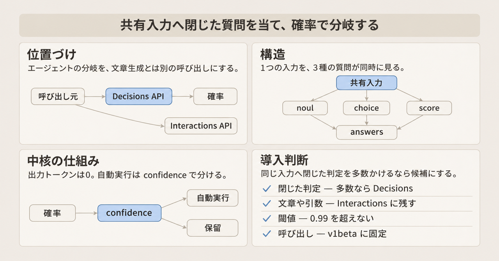
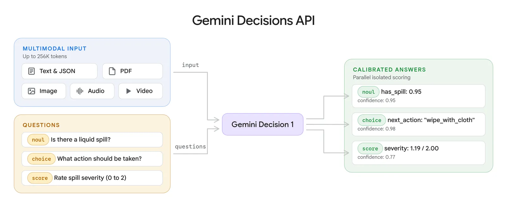
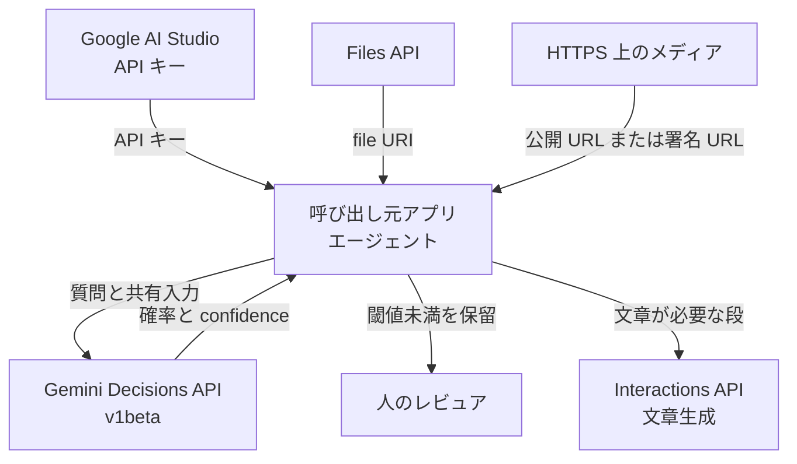
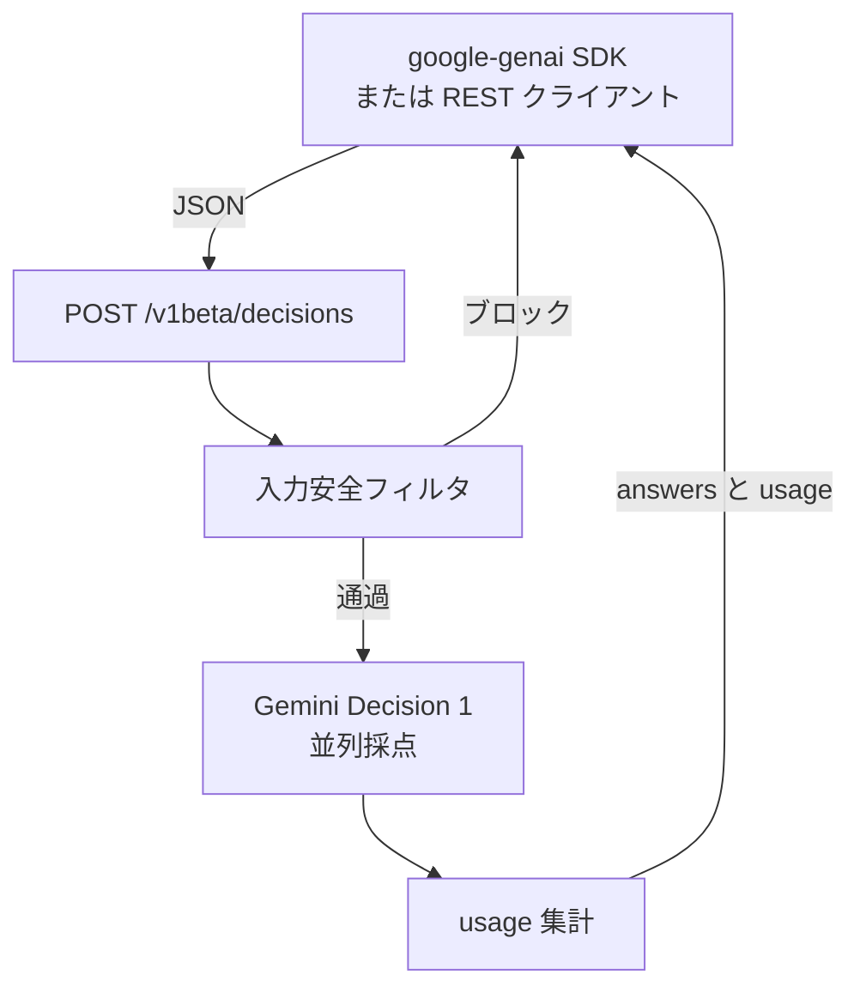
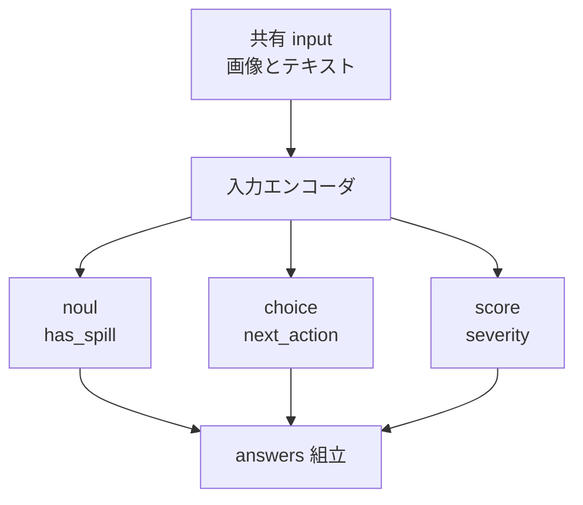
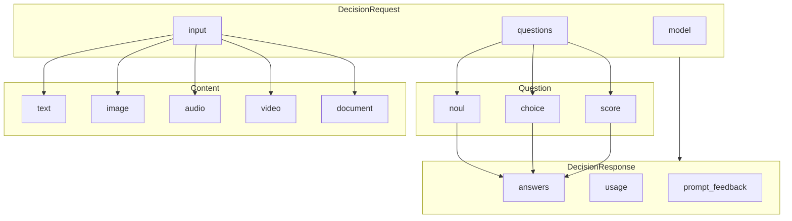
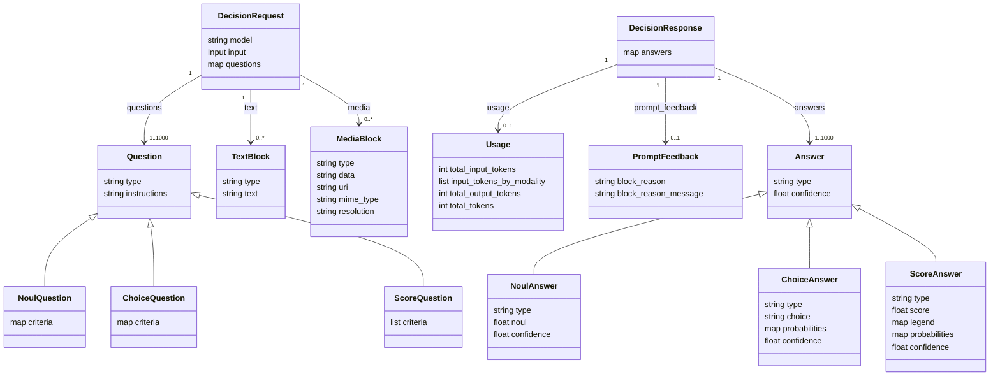
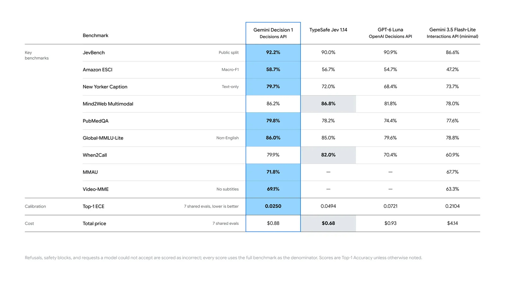

Gemini Decisions API は、文章をトークン列として生成する代わりに、共有入力へ閉じた質問を当て、校正済みの確率を返す Gemini Developer API のエンドポイントです。校正済みはガイドがこの確率につける呼び方で、0.01 から 0.99 の区間とも、実測の頻度との対応とも、公開ガイドは結びつけて書いていません。モデル ID は `gemini-decision-1` です。この記事では、2026-11-12 時点の公開ガイドに沿って、質問の 3 型、リクエストと応答の形、SDK と REST の呼び出し、閾値と料金、レート制限、公開資料の読み分けをまとめます。


*この記事の全体像。以下、順に解説します。*

## Gemini Decisions APIとは

Google DeepMind は 2026-11-11 に Gemini Decisions API を公開しました。呼び出しは `POST https://generativelanguage.googleapis.com/v1beta/decisions` です。

入力はテキスト、画像、音声、動画、PDF を 1 つの `input` に束ねます。その入力に対して、1 リクエストあたり 1 件から 1,000 件の質問を同時に評価します。質問の型は 3 つです。`noul` は yes/no で、yes の確率を返します。`choice` は単一選択で、選択肢ごとの確率を返します。`score` は順序付きルーブリックで、レベル添字の期待値を返します。質問同士は互いの内容を見ません。

位置づけは、エージェントの分岐です。ツール選択、ポリシー確認、モデルやキューへの振り分け、候補の採点を、生成 API とは別の呼び出しに切り出します。生成が必要な要約、抽出、引数付きツール呼び出しは、文章生成を担う Interactions API に残します。



## 特徴

出力トークンは常に 0 です。課金対象は入力トークンだけです。有料枠の入力単価は、テキスト、画像、動画、音声、PDF を通して 100 万トークンあたり 0.10 米ドルです。

共有 `input` は質問数にかかわらず 1 リクエストで 1 回だけ数えます。質問を足すと、その質問の instructions、criteria、formatting のトークンが増えます。formatting は料金ページの語です。Decisions ガイドの複数質問の説明は、追加分を instructions と criteria とだけ書きます。コンテキスト窓は、共有入力と全質問を合わせて 262,144 トークンです。

`noul` は yes の確率を 0.01 以上 0.99 以下で返します。`choice` は選択肢の確率を合計 1 に正規化します。`score` はレベル添字の期待値です。`confidence` は 0 以上 1 以下で、勝ち筋の確率そのものです。`noul` では `max(noul, 1 - noul)` です。`choice` と `score` では最大確率です。

モデルは質問キーを見ません。質問文は `instructions` に全文を書きます。

モデルページが対応外と明記する機能は次のとおりです。

- テキスト生成
- 構造化出力
- 関数呼び出し
- 思考トークンの出力
- キャッシュ
- Batch API
- Flex
- Priority
- Live API
- 検索グラウンディング
- Google Maps によるグラウンディング
- コード実行
- ファイル検索
- URL context
- 画像生成
- 音声生成
- コンピュータ操作

この一覧の URL context は、後述するメディアの HTTPS `uri` とは別の機能です。ファイル検索は、大きいメディアを URI にする Files API とは別の機能です。

公開面は Gemini Developer API の `v1beta` です。2026 年 11 月以降の Google Gen AI SDK は既定で `v1` を呼びます。Decisions のクイックスタートは `api_version` を `v1beta` に固定します。

他製品との費用や精度の並びは、起動ブログの図にあります。数値の読み分けは後述の注意点に置きます。

向く作業は、同じ入力へ多数の閉じた判定を当て、確率で分岐する場面です。

| 場面 | 向く API |
|---|---|
| ツール、キュー、モデル、エージェントへの振り分け | Decisions API |
| 多数のポリシー条文を 1 入力へ同時に当てる | Decisions API |
| 候補を固定ルーブリックで並べる | Decisions API |
| 要約、説明、JSON 抽出、引数付きツール呼び出し | Interactions API |

## 構造

呼び出し元は質問マップを組み、返った確率に自前の閾値を適用します。API は確率と `confidence` を返し、文章が必要な段は Interactions API へ残します。

### システムコンテキスト図



| 要素名 | 説明 |
|---|---|
| 呼び出し元アプリ | 質問マップを組み、返った確率に自前の閾値を適用する |
| 人のレビュア | API の戻り先ではない。アプリが保留した案件を受け取る |
| Gemini Decisions API | `gemini-decision-1` で閉じた質問を評価する |
| Google AI Studio | API キーと、ガイドが案内する試作用の無償枠の入口 |
| Files API | 大きいメディアを URI にして入力へ渡す |
| HTTPS 上のメディア | 公開 URL または署名 URL。1 URL あたり 15 MB まで |
| Interactions API | 文章、抽出、ツール引数が必要な段 |

### コンテナ図

リクエストは SDK または REST から `POST /v1beta/decisions` に入ります。入力安全フィルタを通過したときだけ、Gemini Decision 1 が共有入力を 1 回エンコードし、質問を並列に採点します。ブロック時は `answers` の代わりにエラーが SDK へ戻ります。



| 要素名 | 説明 |
|---|---|
| google-genai SDK | Python と JavaScript。ガイドは 3.2 以降を要件にする |
| POST /v1beta/decisions | ホストは `generativelanguage.googleapis.com` |
| 入力安全フィルタ | ブロック時は `answers` の代わりにエラーを返す |
| Gemini Decision 1 | 共有入力を 1 回エンコードし、質問を並列に採点する |
| usage 集計 | モダリティ別の入力トークンと、0 の出力トークン |

### コンポーネント図

休憩室の写真とメモを、こぼれているか、次の掃除行動は何か、ひどさはどの程度か、の 3 問で採点する流れです。全質問が同じエンコード結果を見ます。質問の結果は互いに渡りません。



| 要素名 | 説明 |
|---|---|
| 共有 input | 全質問が同じエンコード結果を見る |
| 入力エンコーダ | テキスト、画像、音声、動画、PDF を 1 本の入力表現にする |
| noul | yes の確率と confidence を返す。他の質問の結果は見ない |
| choice | 選択肢キーを UTF-8 バイト順に並べてから採点する |
| score | レベル 0 からの添字について期待値を返す |
| answers 組立 | リクエストの質問キーをそのまま応答キーにする |

## データ

1 回の評価は `model`、`input`、`questions` を持つ DecisionRequest です。質問は `noul`、`choice`、`score` のいずれかです。入力の中身は、Interactions API と同じブロックのうち、テキストとメディアと PDF です。応答は質問キーごとの Answer と、入力トークンおよび常に 0 の出力トークンを持つ usage です。

### 概念モデル



| 要素名 | 説明 |
|---|---|
| DecisionRequest | `model`、`input`、`questions` を持つ 1 回の評価 |
| noul | yes/no。criteria は任意で、true と false の説明を持てる |
| choice | 2 個から 255 個の選択肢。criteria は必須のマップ |
| score | 2 個から 255 個の順序レベル。criteria は低い方から高い方への配列 |
| Content | Interactions API と同じブロックのうち、テキストとメディアと PDF |
| answers | 質問キーごとの Answer |
| usage | 入力トークンと、常に 0 の出力トークン |
| prompt_feedback | Python SDK の応答型が持つ任意フィールド。ブロック理由を載せる |

### 情報モデル

`questions` のキーは 1 文字から 64 文字で、正規表現は `[A-Za-z0-9_-]+` です。`model` の値は `gemini-decision-1` です。



| 要素名 | 説明 |
|---|---|
| DecisionRequest.model | 値は `gemini-decision-1` |
| DecisionResponse | `answers` を持つ。`usage` と `prompt_feedback` は応答側 |
| questions のキー | 1 文字から 64 文字。`[A-Za-z0-9_-]+` |
| NoulQuestion.criteria | `true_description` と `false_description`。省略できる |
| ChoiceQuestion.criteria | 選択肢 ID から説明へのマップ。説明は空文字を許す |
| ScoreQuestion.criteria | 非空の説明配列。添字は 0 から。実務の推奨は 2 から 10 レベル |
| MediaBlock.type | `image`、`audio`、`video`、`document`。PDF は `document` |
| MediaBlock.resolution | 画像と動画の視覚的な詳細とトークン費用を調整する `low`、`medium`、`high`、`ultra_high`。`ultra_high` は画像のみ。Decision 1 の各値が何トークンになるかは Decisions ガイドに無く、Gemini 3 と Gemini 4 の表では見積もらない |
| NoulAnswer.noul | 校正済みの P(true)。閉区間は 0.01 から 0.99 |
| ChoiceAnswer.choice | 最大確率の選択肢 ID。同率はアルファベット順で先のキー |
| ScoreAnswer.score | `sum(k * probability_k)`。レベルの間の実数になり得る |
| Usage | 動画フレームと PDF ページ画像は image トークンとして数える |
| PromptFeedback.block_reason | SDK の列挙は `safety`、`other`、`blocklist`、`prohibited_content`、`image_safety` |

## 構築方法

Python の `google-genai` も JavaScript の `@google/genai` も、ガイドは 3.2 以降を要件にします。クライアントは API バージョンを `v1beta` にします。2026 年 11 月のメジャーリリース以降、SDK の既定は `v1` です。コードで指定したバージョンは、環境変数 `GOOGLE_GENAI_API_VERSION` より優先されます。

### SDK の導入

```bash
pip install -U google-genai
```

```bash
npm install @google/genai@latest
```

### API バージョンの指定

REST のパス自体が `/v1beta/decisions` です。Python の Decisions ガイドと API versions ガイドは、どちらも `http_options` で `v1beta` を渡します。JavaScript の Decisions ガイドは、コンストラクタ直下の `apiVersion` を渡します。

```python
from google import genai

client = genai.Client(http_options={"api_version": "v1beta"})
```

```javascript
import { GoogleGenAI } from "@google/genai";

const ai = new GoogleGenAI({ apiVersion: "v1beta" });

const result = await ai.decisions.create({
  model: "gemini-decision-1",
  input: "The blue mug I ordered on Monday arrived cracked on Wednesday.",
  questions: {
    is_damaged: {
      type: "noul",
      instructions: "Did the item arrive damaged?",
    },
  },
});
```

API versions ガイドの JavaScript は、コンストラクタ引数を `httpOptions` に包みます。JavaScript SDK の changelog は、直下の `apiVersion` と `httpOptions.apiVersion` の両方を認めています。

```javascript
import { GoogleGenAI } from "@google/genai";

const ai = new GoogleGenAI({ httpOptions: { apiVersion: "v1beta" } });
```

### API キー

REST はヘッダ `x-goog-api-key` にキーを載せます。ガイドのシェル例は変数 `GEMINI_API_KEY` を参照します。キーの発行入口は Google AI Studio の API keys です。レート制限はキー単位ではなくプロジェクト単位です。日次枠のリセットは太平洋時間の深夜 0 時です。

```bash
curl -X POST "https://generativelanguage.googleapis.com/v1beta/decisions" \
  -H "x-goog-api-key: $GEMINI_API_KEY" \
  -H "Content-Type: application/json" \
  -d '{
    "model": "gemini-decision-1",
    "input": "The blue mug I ordered on Monday arrived cracked on Wednesday.",
    "questions": {
      "is_damaged": {
        "type": "noul",
        "instructions": "Did the item arrive damaged?"
      }
    }
  }'
```

### 疎通確認

最小の成功応答は `answers` と `usage` です。`total_output_tokens` は 0 です。ガイドの例示値は、`noul` が 0.99、`confidence` が 0.99、入力トークンが 100 です。例示値は入力文に対する実測保証ではありません。

```json
{
  "answers": {
    "is_damaged": { "type": "noul", "noul": 0.99, "confidence": 0.99 }
  },
  "usage": {
    "total_input_tokens": 100,
    "input_tokens_by_modality": [{ "modality": "text", "tokens": 100 }],
    "total_output_tokens": 0,
    "total_tokens": 100
  }
}
```

## 利用方法

`model`、`input`、`questions` は必須です。各質問は `type` と `instructions` を持ちます。`criteria` は `choice` と `score` では必須、`noul` では任意です。

### 必須パラメータ

| フィールド | 必須 | 内容 |
|---|---|---|
| model | はい | `gemini-decision-1` |
| input | はい | 文字列、Content、または Content の配列。空は不可 |
| questions | はい | 1 件から 1,000 件のマップ |
| type | はい | `noul`、`choice`、`score` |
| instructions | はい | 文字列、TextContent、または TextContent の配列。テキストのみ。質問キーはモデルに渡らない |
| criteria | choice と score ははい。noul は任意 | 選択肢マップ、または低から高へのレベル配列 |

上限は次のとおりです。

| 上限 | 値 |
|---|---|
| 質問数 | 1 から 1,000。窓 262,144 トークンも同時に適用する |
| choice の選択肢 | 2 から 255。キーは 1 から 128 文字、512 UTF-8 バイトまで |
| score のレベル | 2 から 255 の非空文字列。推奨は 2 から 10 |
| 質問キー | 1 から 64 文字。`[A-Za-z0-9_-]+` |
| JSON の入れ子 | 100 |
| inline | 1 リクエスト 100 MB。PDF は 50 MB |
| 外部 HTTPS | 1 URL あたり 15 MB |

入力ブロックの対応形式は次のとおりです。

| ブロック | 主なフィールド | MIME |
|---|---|---|
| text | text | なし |
| image | data または uri、mime_type、任意の resolution | image/png、image/jpeg、image/webp、image/heic、image/heif、image/gif、image/bmp、image/tiff |
| audio | data または uri、mime_type | audio/wav、audio/mp3、audio/mpeg、audio/aiff、audio/aac、audio/ogg、audio/flac、audio/m4a、audio/opus、audio/webm、audio/l16、audio/alaw、audio/mulaw |
| video | data または uri、mime_type、任意の resolution | video/mp4、video/mpeg、video/mov、video/avi、video/webm、video/wmv、video/x-flv、video/3gpp |
| document | data または uri、mime_type | application/pdf |

YouTube URL と `gs://` は Decisions API の対象外です。会話履歴、thought、tool-call、tool-result ブロックは入力に使えません。複数ターンはテキストへ直列化します。隣接する text ブロックは、`input` と `instructions` の両方で区切りなしに連結されます。空白や改行は呼び出し側が入れます。

### noul

戻り値は `type`、`noul`、`confidence` です。no の確率は `1 - noul` です。確率は 0.01 から 0.99 に収まります。0.99 より大きいことを実行条件にすると、その条件は一度も真になりません。criteria を付けると、yes と no の意味を質問文の外で固定できます。

```bash
curl -X POST "https://generativelanguage.googleapis.com/v1beta/decisions" \
  -H "x-goog-api-key: $GEMINI_API_KEY" \
  -H "Content-Type: application/json" \
  -d '{
    "model": "gemini-decision-1",
    "input": "Customer returned the sweater because they preferred green over blue.",
    "questions": {
      "is_defect": {
        "type": "noul",
        "instructions": "Is the customer reporting a product defect?",
        "criteria": {
          "true_description": "The product itself is broken or faulty.",
          "false_description": "Preference, sizing, shipping, or pricing complaint."
        }
      }
    }
  }'
```

ガイドが添える応答例は `{"type":"noul","noul":0.03,"confidence":0.97}` です。このとき confidence は `max(0.03, 0.97)` と一致します。

### choice

選択肢は 2 個から 255 個です。キーは 1 文字から 128 文字、UTF-8 で 512 バイトまでです。キーの内部にある ASCII 空白は許せます。先頭と末尾の空白、制御文字、非 ASCII 空白は拒否されます。評価前にキーを UTF-8 バイト順でソートします。JSON に書いた順序は位置になりません。確率の同率は、アルファベット順で先のキーが `choice` になります。どの選択肢も入力に合わないときも、確率は選択肢全体へ分配されます。

```python
from google import genai

client = genai.Client(http_options={"api_version": "v1beta"})

result = client.decisions.create(
    model="gemini-decision-1",
    input="I was charged twice for my order.",
    questions={
        "department": {
            "type": "choice",
            "instructions": "Which department should handle this request?",
            "criteria": {
                "billing": "Payments, invoices, and refunds.",
                "technical": "Problems using the product.",
                "shipping": "Delivery and tracking.",
                "other": "Anything outside these categories.",
            },
        },
    },
)

answer = result.answers["department"]
print(answer.choice, answer.confidence, answer.probabilities)
```

### score

レベル説明は低い方から高い方へ並べます。添字は 0 からです。`score` は添字の期待値です。同じ期待値でも分布は異なり得るため、`probabilities` と `confidence` を同時に見ます。離散レベルが必要なときは、最大確率の添字を選び、`legend` で説明へ戻します。レベル数が違う尺度を比べるときは、最大添字で割って 0 から 1 に揃えます。添字が 0、1、2 と等差なので、1、10、100、1000 のような指数尺度を説明文の意味として期待値に載せると歪みます。

```python
from google import genai

client = genai.Client(http_options={"api_version": "v1beta"})

result = client.decisions.create(
    model="gemini-decision-1",
    input="Export fails in Safari but works in Chrome.",
    questions={
        "severity": {
            "type": "score",
            "instructions": "How severe is this issue for the user?",
            "criteria": [
                "Cosmetic: appearance only, no lost functionality.",
                "Workaround available: a task fails, but another way works.",
                "Fully blocked: a task fails with no workaround.",
            ],
        },
    },
)

answer = result.answers["severity"]
level = max(answer.probabilities, key=answer.probabilities.get)
print(answer.score, answer.confidence, answer.legend[level])
```

`legend` は添字からレベル説明へ戻すマップです。ガイドの score 応答例は、次の JSON のように `legend` を含みます。

ガイドの例では `score` が 1.12、レベル 1 の確率が 0.83、`confidence` が 0.83 です。期待値はレベルの間にあり、confidence は最大確率と一致します。

```json
{
  "type": "score",
  "score": 1.12,
  "legend": {
    "0": "Cosmetic: appearance only, no lost functionality.",
    "1": "Workaround available: a task fails, but another way works.",
    "2": "Fully blocked: a task fails with no workaround."
  },
  "probabilities": { "0": 0.03, "1": 0.83, "2": 0.15 },
  "confidence": 0.83
}
```

`noul` だけが 0.01 から 0.99 に収まります。`choice` と `score` の `probabilities` は合計 1 の閉区間 0 から 1 です。ガイドの応答例で 0 が出るのは `churn_risk` の score で、`"0": 0.0` と `"3": 0.99`、`confidence` は 0.99 です。掲載されている choice の例に 0 はありません。0.01 未満を不正値として捨てると、正規な score を落とします。

### 複数質問

1 リクエストの中で `noul`、`choice`、`score` を混ぜられます。質問の追加と削除は、他の質問の答えを変えません。一方の結果に依存する判断は、2 回目のリクエストにするか、両方を聞いてからコードで捨てます。質問文のバッククォートは、文字列化した JSON のフィールド名を指すガイドの書き方です。次の例では `message`、`tier`、`order` をそう書いています。

```python
import json
from google import genai

client = genai.Client(http_options={"api_version": "v1beta"})

order = {"order": {"id": "8821", "item": "headphones", "price_usd": 240}, "tier": "Gold"}
message = {"message": "Audio cuts out on the left earcup. Fix it today or I cancel my membership."}

result = client.decisions.create(
    model="gemini-decision-1",
    input=[
        {"type": "text", "text": json.dumps(order) + "\n"},
        {"type": "text", "text": json.dumps(message)},
    ],
    questions={
        "is_defect": {
            "type": "noul",
            "instructions": "Does `message` describe a hardware defect?",
        },
        "next_action": {
            "type": "choice",
            "instructions": "What is the right resolution given `tier` and `order`?",
            "criteria": {
                "instant_refund": "Refund without return. Low value or clear fault.",
                "replacement_shipment": "Ship a replacement. Customer returns the original.",
                "troubleshooting_flow": "The issue may be fixable by the customer.",
                "human_escalation": "",
            },
        },
        "churn_risk": {
            "type": "score",
            "instructions": "How likely is the customer to churn if the issue is not resolved now?",
            "criteria": [
                "No churn signal",
                "Mild frustration",
                "Mentions alternatives",
                "Threatens to cancel",
            ],
        },
    },
)

answers = result.answers
if answers["is_defect"].noul > 0.9 and answers["next_action"].confidence > 0.6:
    action = answers["next_action"].choice
else:
    action = "human_escalation"
print(action, answers["churn_risk"].score)
```

ガイドの応答例は、欠陥確率 0.94、次アクションの choice が `human_escalation`、confidence 0.76、解約リスクの期待値 2.99 です。0.94 は 0.9 より大きく、0.76 は 0.6 より大きいので if が真になり、採用されるのはモデルが返した `human_escalation` です。else の差し戻しではありません。この choice が `instant_refund` でも、同じ条件ならそのまま実行されます。0.9 と 0.6 はガイドの例であり、業務の閾値ではありません。

### マルチモーダル入力

画像の `resolution` は `low`、`medium`、`high`、`ultra_high` です。動画は `ultra_high` を取りません。音声と PDF は resolution を使いません。MIME は実体と一致させます。`application/octet-stream` は拒否されます。JSON オブジェクトは文字列化して text ブロックにします。質問文では、その JSON のフィールドをキーパスで参照します。キーパスはフィールド名のことで、ガイドの例はバッククォートで囲みます。複数質問の `message`、`tier`、`order` がそれです。

```python
import base64
from google import genai

client = genai.Client(http_options={"api_version": "v1beta"})

with open("earcup.jpg", "rb") as handle:
    image_b64 = base64.b64encode(handle.read()).decode("utf-8")

result = client.decisions.create(
    model="gemini-decision-1",
    input=[
        {"type": "text", "text": "Customer photo for return request #8821."},
        {
            "type": "image",
            "data": image_b64,
            "mime_type": "image/jpeg",
            "resolution": "low",
        },
    ],
    questions={
        "visible_damage": {
            "type": "noul",
            "instructions": "Does the photo show physical damage to the device? Ignore the packaging.",
        },
    },
)

print(result.answers["visible_damage"].noul)
```

```bash
curl -X POST "https://generativelanguage.googleapis.com/v1beta/decisions" \
  -H "x-goog-api-key: $GEMINI_API_KEY" \
  -H "Content-Type: application/json" \
  -d '{
    "model": "gemini-decision-1",
    "input": [
      {
        "type": "audio",
        "uri": "https://storage.googleapis.com/generativeai-downloads/data/Apollo-11_Day-01-Highlights-10s.mp3",
        "mime_type": "audio/mp3"
      }
    ],
    "questions": {
      "mentions_launch": {
        "type": "noul",
        "instructions": "Is the speaker talking about spaceflight or a rocket launch?"
      }
    }
  }'
```

Files API はプロジェクトあたり 20 GB、1 ファイル 2 GB、保管 48 時間です。利用者が上げたファイルのダウンロードはできません。保管料は Gemini API が使える地域で無償です。

## 運用

行動の選択にはトップの値を使い、自動実行の可否には `confidence` を使います。確率は実行権限そのものではありません。

### 閾値と保留

ガイドのルーティング例は、`confidence` が 0.7 以上なら `choice` を採用し、未満なら `human_review` へ送る形です。0.7 は例です。閾値は自前のラベル付きトラフィックで決めます。偽陽性と偽陰性の損失は業務ごとに違います。

`noul` の confidence は `max(noul, 1 - noul)` なので、0.50 未満にも 0.99 超にもなりません。1.0 や 0.995 を自動実行の条件にすると、その条件は一度も通りません。

ガイドは `confidence` が 0.7 未満なら `human_review` とする例を置いています。次のコードは API の既定ではなく、ガイドが payouts のような高リスクに人または第二の検査を残すと書くのを受けた自前ポリシーです。即時払戻しと代替品の発送を保留します。入力例の `price_usd` の 240 は、前の複数質問の入力例の金額です。次のコードの保留条件には入っていません。偽陽性の払戻しと偽陰性のチケットが釣り合うかは、ガイドの計算ではなく業務側の損失です。0.9 と 0.7 は仮の値です。

```python
HOLD = {"instant_refund", "replacement_shipment"}
choice = answers["next_action"]
if choice.choice in HOLD or choice.confidence < 0.7 or answers["is_defect"].noul < 0.9:
    action = "human_review"
else:
    action = choice.choice
```

権限変更も、確率がどれほど高くても人または第二の検査を残します。

### トークンと料金

有料枠の入力は 100 万トークンあたり 0.10 米ドルです。出力価格の欄は「0 出力トークンのため対象外」です。コンテキストキャッシュの価格欄は Not available です。無償枠の入力は Free of charge です。同じ表で、無償枠は製品改善への利用が Yes、有料枠は No です。根拠リンクは Gemini API の terms です。

起動ブログは、出力トークン課金、可変の思考トークン課金、音声の文字起こしと OCR の別料金は無いと書きます。料金表が直接示すのは、出力欄が 0 出力トークンのため対象外であることと、入力単価がモダリティ共通であることです。ブログが書く Flash-Lite との費用倍率は、後述の注意点で図の合計と分けて読みます。

```python
usage = result.usage
print(usage.total_input_tokens, usage.total_output_tokens)
```

### レート制限

Gemini Decision の対話レートは、Batch API ではない通常のリクエストの上限です。Batch API は非対応です。RPM は 1 分あたりのリクエスト数、TPM は 1 分あたりのトークン数、RPD は 1 日あたりのリクエスト数です。

| 利用枠 | RPM | TPM | RPD |
|---|---:|---:|---|
| Free | 200 | 50,000 | 10,000 |
| Tier 1 | 1,500 | 1,000,000 | 50,000 |
| Tier 2 | 5,000 | 4,000,000 | Unlimited |
| Tier 3 | 15,000 | 10,000,000 | Unlimited |

どのプロジェクトが Free から Tier 3 のどの段に入るかは、転記した Gemini Decision の節には書いてありません。RPM、TPM、RPD のどれか 1 つを超えるとレート制限エラーになります。RPD は太平洋時間の深夜 0 時に戻ります。Priority と Flex は、モデルページが非対応です。Priority 用の別表を Decision に適用しません。

Gemini Decision の節にあるのは RPM、TPM、RPD です。支出上限は Rate limits の共通節で、直近 10 分あたり Free は対象外、Tier 1 は 10 米ドル、Tier 2 と Tier 3 は 200 米ドルです。超過コードは `429 RESOURCE_EXHAUSTED` です。この表は Decision 専用の支出表ではありません。Decision の呼び出しにこの共通節の支出上限が掛かるかは、Decision の節からは確認できません。

### 安全性ブロック

入力の安全フィルタが止めたリクエストは、`answers` を返さず HTTP 400 です。ガイドが示す `error.code` は `safety`、`prohibited_content`、`blocklist`、`image_safety`、`content_blocked` です。質問ごとの部分回答はガイドにありません。質問の中にメディアは置けません。

```json
{
  "error": {
    "code": "safety",
    "message": "Request blocked due to safety violations (harmful content). Please modify your input and retry."
  }
}
```

### 入力の寿命と再送

キャッシュが無いため、リクエストをまたいで同じ入力を再送すると、そのたびに全入力トークンを数えます。Files API のオブジェクトは 48 時間で消えます。長いバッチを日をまたいで繰り返すときは、アップロードからやり直します。

質問を 100 件に増やしてもレイテンシがほぼ平坦、という記述は起動ブログの本文にあります。条件は、マルチモーダル入力、16K トークンまでのコンテキスト、モデル計算の中央値が 50 から 100 ミリ秒、エンドツーエンドが 150 から 250 ミリ秒、質問数は 1 から 100 です。上限の 1,000 問と 262,144 トークンへこの平坦さを延長する記述は、API ガイドにありません。

```python
billed = result.usage.total_input_tokens
# 同じ input を次のリクエストへ再送すると、キャッシュ割引は付かない
print(billed)
```

## ベストプラクティス

1 問は 1 つの判断にします。独立した確認は同じリクエストの別質問へ分け、結合はコードで行います。

### 質問の切り方

明示的な criteria がある複雑なルーブリックは、1 問にまとめることもガイドが許しています。質問キーはモデルに見えません。`instructions` に完全な質問文を書きます。肯定形で聞き、否定はコード側で `1 - noul` にします。ガイドの例は「Is the tier Gold?」です。数、日付、期間の比較はコードで行い、比較の結果か、その結果につけた名前だけを入力へ渡します。質問に関係しないフィールドは入力から外します。無関係な本文は精度を下げるとガイドが書いています。

### 選択肢キー

どれにも当てはまらない入力に備えます。手段は、confidence の閾値、別の `noul` による範囲確認、説明付きの受け皿選択肢です。評価前の UTF-8 ソートは採点時の位置を決め、同率のときの先勝ちとは別です。ガイドは、その位置が確率の数値を変えるとは書いていません。`none_of_the_above` は最後を思わせる名前ですが、ソートでは `shipping` や `technical` より前に並びます。ガイドが `other` を推奨するのは、名前が位置を意味しないからです。選択肢 ID だけで意味が通るときは、説明を空文字にできます。空文字は「この選択肢が無い」ではありません。

### ルーブリック

隣り合うレベルは文章で区別します。尺度は線形にします。自動処理に期待値だけを使うと、両端に確率が割れた入力と、中央に集中した入力が同じ数値になります。離散行動は最大確率のレベルを使います。レベル数の違うルーブリックを同じ閾値で比べるときは、最大添字で正規化します。

### 高リスク操作

利用者由来の本文は、自分に有利な分類を主張できます。criteria を明示し、敵対例で試します。払戻しのような高リスク行動は、人または第二の検査を残します。ツール実行の許可は、`choice` のトップや `noul` の 0.99 だけでは渡しません。業務ごとの閾値、保留、差し戻しをアプリ側に持ちます。

起動ブログは、Gemini Notebook のモデル振り分け、Stitch のワイヤーフレーム、CC の絵文字選択、Search の MCP ツール向け安全層を社内利用例に挙げています。遅延が最大 40% 下がる、という Notebook の記述はブログ本文の事例であり、API の SLO ではありません。

## 注意点

公開ブログ、API ガイド、料金ページ、SDK の型は、同じ事実を同じ言い方では書いていません。読み分けは次のとおりです。

| 対象 | 資料の記載 | 実態 | 読者への影響 |
|---|---|---|---|
| ベンチマークの勝ち | ブログ本文は「スイート全体をリードし、校正誤差が最低」と書く | 同記事の図では 9 本の精度行のうち青（1 位）は 7 本。Mind2Web Multimodal は Jev 1.14 の 86.8% が Decision 1 の 86.2% より高く、When2Call は 82.0% が 79.9% より高い。Top-1 ECE は 0.0250 で 4 列の最小 | 「全項目 1 位」と書くと図とずれます。校正誤差の最小は図と一致します |
| 費用倍率 | ブログ本文は Flash-Lite の Interactions API より nearly 5 倍安いと書く | 図の 7 共有評価の合計は Decision 1 が 0.88 米ドル、Flash-Lite が 4.14 米ドル、Jev 列が 0.68 米ドル。4.14 / 0.88 は約 4.7。料金表の単価は入力 0.10 米ドルで、倍率そのものは載らない | 5 倍をトークン単価の恒等式にしない。Jev 列は Decision 1 より安い |
| レイテンシの平坦さ | ブログは 1 から 100 問、16K トークンまでほぼ平坦と書く。API ガイドの How it works も数値なしで latency stays nearly flat と書く | API ガイドの上限は 1,000 問と 262,144 トークン。ミリ秒の範囲はブログにあり、ガイドには無い | 上限いっぱいの SLO として転記しない |
| 安全エラーのコード | ガイドの `error.code` に `content_blocked` がある | Python SDK の `BlockReason` は `safety`、`other`、`blocklist`、`prohibited_content`、`image_safety`。`content_blocked` は無く、`other` がある。応答型は任意の `prompt_feedback` も持つ | HTTP 400 の JSON と SDK のフィードバック型を 1 つの列挙へ潰さない |
| JavaScript の版指定 | Decisions ガイドは `new GoogleGenAI({ apiVersion: "v1beta" })` | API versions ガイドは `new GoogleGenAI({ httpOptions: { apiVersion: "v1beta" } })`。JavaScript SDK の changelog は両方を認める | ページの表記は違います。どちらかを不正な形として置換する必要はありません |
| バージョン機能表 | API versions は「全モデルが v1 と v1beta の両方」と注記する | 機能表に Decisions API の行は無い。v1beta のみ、という制限文は Decisions ガイドの Limitations にある。モデルページはクイックスタートが `v1beta` である | `v1` のパスへ `/decisions` を生やせるとは読まない |
| メディアトークン | media resolution ページに画像 280 などの表がある。同じページは、個別項目の resolution は Gemini 4 と Gemini 3 だけが対応と書く | その表の見出しは Gemini 4 と Gemini 3。Decisions ガイドは Decision 1 の画像と動画に `low`、`medium`、`high`、画像のみ `ultra_high` を付ける。Decision 1 のトークン数は Decisions ガイドに無い | 解像度を上げたときのトークンを Gemini 3/4 の表で見積もらない。フィールドの有無は Decisions ガイドを正とする |
| 製品名のゆれ | ブログの Search 事例は "Decision API" と単数で 1 回書く | エンドポイント、モデルページ、見出しは Decisions API | ログや権限名の検索は複数形を正にする |
| Cloud への提供 | ブログは Google Cloud の Gemini へ coming soon と書き、フォームを置く | ガイドの Limitations は Gemini Developer API の v1beta のみ | Vertex AI のエンドポイントは 2026-11-12 時点の公開ガイドには無い |
| 質問トークンの内訳 | 料金ページは、質問ごとに instructions、criteria、formatting のトークンが増えると書く | Decisions ガイドの複数質問の説明は、追加分を instructions と criteria だけと書く | formatting は料金ページの語として読む。ガイドの文だけで formatting が無いと断定しない |
| PDF のモダリティ | 料金ページの一般注記は、PDF を image 単価で課金し、応答の `promptTokensDetails` では `DOCUMENT` に出ると書く | Decisions ガイドの `usage` は、動画フレームと PDF ページ画像を image トークンとして数える。応答フィールドは `input_tokens_by_modality` | `promptTokensDetails` を Decisions の応答キーにしない。件数の内訳は `input_tokens_by_modality` を正とする |
| 入力から除くブロック | 入力スキーマは tool-call、tool-result、thought を不可と書く | Limitations は会話履歴、thought、tool-call を挙げ、tool-result を書かない | 呼び出しでは 4 種とも渡さない。どちらか一方のリストだけを完全な除外集合にしない |
| score 例の丸め | ガイドは確率 0.03、0.83、0.15 と score 1.12、confidence 0.83 を載せる | 掲載値の和は 1.01。添字の期待値を同じ桁で計算すると 1.13 | 式は `sum(k * p_k)` のまま。この JSON は小数 2 桁の掲載例であり、再計算と 0.01 ずれる |
| 図の脚注 | 図の脚注は、拒否、安全ブロック、モデルが受け取れなかった要求を不正解にする | 分母はベンチマーク全件。特記のない点数は Top-1 Accuracy。Amazon ESCI は Macro-F1。New Yorker Caption は text-only。Video-MME は字幕なし。Global-MMLU-Lite は非英語 | 部分正解や受け付けた件だけの精度と混ぜない |
| サンプルアプリの ID | ブログのリンクは `apps/bundled/doorstep-parcels-qa` などの bundled パス | モデルページとガイド末尾は UUID 付きの `apps/bdca3fee-...` 形式 | どちらか一方が 404 でも、もう一方の公式リンクを先に開く |

図から読み取った精度は次のとおりです。単位は図の表記のままです。Top-1 ECE は校正誤差で、図は低い方を良いとしています。

| ベンチマーク | 注記 | Decision 1 | TypeSafe Jev 1.14 | GPT-6 Luna（OpenAI Decisions API） | Gemini 3.5 Flash-Lite（Interactions API, minimal） |
|---|---|---:|---:|---:|---:|
| JevBench | Public split | 92.2% | 90.0% | 90.9% | 86.6% |
| Amazon ESCI | Macro-F1 | 58.7% | 56.7% | 54.7% | 47.2% |
| New Yorker Caption | Text-only | 79.7% | 72.0% | 68.4% | 73.7% |
| Mind2Web Multimodal | なし | 86.2% | 86.8% | 81.8% | 78.0% |
| PubMedQA | なし | 79.8% | 78.2% | 74.4% | 77.6% |
| Global-MMLU-Lite | Non-English | 86.0% | 85.0% | 79.6% | 78.8% |
| When2Call | なし | 79.9% | 82.0% | 70.4% | 60.9% |
| MMAU | なし | 71.8% | — | — | 67.7% |
| Video-MME | No subtitles | 69.1% | — | — | 63.3% |
| Top-1 ECE | 7 shared evals、低い方がよい | 0.0250 | 0.0494 | 0.0721 | 0.2104 |



### ドキュメントと実装の乖離

公開ガイドはブロック時の HTTP 400 と `error` だけを示します。Python SDK の `CreateDecisionResponse` は `answers`、`prompt_feedback`、`usage` を任意にしています。ブロック時に `prompt_feedback` 付きの応答が返るかは、型があるだけでは未確認です。確定しているのは HTTP 400 と `error` です。`content_blocked` はガイドの `error.code` にあり、`BlockReason` にはありません。

### 資料間の食い違い

上表のベンチマーク、費用、レイテンシ、JavaScript のコンストラクタ、バージョン機能表、メディアトークンが該当します。ブログのサンプルアプリ URL と、モデルページの UUID 付き URL は並立しています。

### 公開ガイドが書いていない点

パラメータ数、重みの公開、自己ホストは、モデルページもガイドも記載していません。オープンウェイトとは書かれていません。安全フィルタが共有入力だけを見るのか、各質問の instructions も見るのかは、ガイドが「入力の安全フィルタ」と書くだけで未確認です。Gemini 3 と Gemini 4 向けメディアトークン表を Decision 1 に適用できるかは未確認です。ブログの coming soon は Google Cloud の Gemini です。公開ガイドに Vertex AI という名前のエンドポイントは無く、両者が同じ提供先かは書いていません。提供日は、ブログの coming soon 以外にありません。

RPM、TPM、RPD の HTTP 本文は、Decision 専用の節に例がありません。一般節はレート制限エラーとだけ書き、ステータス本文を示すのは支出上限の `429 RESOURCE_EXHAUSTED` です。OpenRouter、LangChain、Vercel AI SDK、LiteLLM、Pydantic AI、Pipecat、LiveKit、OpenCode は、ブログが「展開中」と書いています。各 SDK の対応版は、公開レジストリの版番号としては未確認です。

## トラブルシューティング

### v1 へ送って失敗する

症状は、SDK を 2026 年 11 月以降のメジャーへ上げたあと、Decisions の呼び出しが失敗することです。原因は、既定の API バージョンが `v1` になり、Decisions ガイドが指定するパスは `v1beta` であることです。

対処は、Python では `http_options={"api_version": "v1beta"}` を渡すことです。JavaScript は Decisions ガイドの `new GoogleGenAI({ apiVersion: "v1beta" })` でも、API versions の `httpOptions` でも指定できます。SDK の changelog は両方を認めています。REST は `/v1beta/decisions` を使います。環境変数だけで足す場合は `GOOGLE_GENAI_API_VERSION=v1beta` で、コード指定が優先されます。

### 閾値を超えても自動実行されない

症状は、`noul` が 0.99 を超えたときだけ実行する条件が、一度も真にならないことです。原因は、yes の確率が 0.01 から 0.99 に収まることです。confidence も `max(noul, 1 - noul)` なので 0.99 が上限になります。

対処は、閾値を 0.99 未満に置くことです。ガイドは、自前データで偽陽性と偽陰性の損失を見て決めるよう書いています。

```python
# noul は 0.99 を超えない。自動実行の条件は範囲の内側に置く
allow = answer.noul >= 0.9 and answer.confidence >= 0.9
```

### HTTP 400 で回答マップが無い

症状は、質問の一部だけを期待しているのに、`answers` が返らないことです。原因は、上限超過かキー検証失敗で HTTP 400 になり、メッセージが破った規則の名前を含むことです。安全フィルタも HTTP 400 で、`answers` の代わりに `error` を返します。

対処は、質問数 1 から 1,000、choice の選択肢 2 から 255、score のレベル 2 から 255、質問キーの正規表現、選択肢キーの空白、JSON の入れ子 100 を確認することです。安全系コードなら入力を修正します。次の表は、この見出しの HTTP 400 だけを集めたものではありません。回答が返らない拒否と、回答は返るが並びや期待値の読みを誤る症状が混ざっています。

| 症状 | 原因 | 対処 |
|---|---|---|
| 質問キーが拒否される | 64 文字超、または `[A-Za-z0-9_-]+` の外 | キーを短くし、説明は instructions と criteria へ書く |
| 選択肢が黙って入れ替わる | 評価前の UTF-8 バイト順ソートと、同率時の先勝ち | 順序に意味を持たせない。受け皿は `other` にする |
| どの選択肢も不適切なのに 1 つが選ばれる | choice は必ず確率を分配する | confidence を見るか、範囲確認の noul を併設する |
| 画像や PDF が拒否される | MIME 不一致、octet-stream、YouTube URL、`gs://`、PDF 50 MB 超、その他 inline 100 MB 超、外部 URL 15 MB 超 | Files API の URI か、形式の合う HTTPS に変える |
| テキストがくっついて判定が変わる | 隣接 text ブロックは区切りなしで連結される | ブロック間に空白か改行を入れる |
| 同じ入力の再送が高い | キャッシュ非対応で、再送は全トークンを数える | 質問は 1 リクエストにまとめ、入力から無関係なフィールドを外す |
| 無償枠の当日枠が戻らない | RPD のリセットは太平洋時間の深夜 0 時 | ローカル日付の午前 0 時をリセット時刻と扱わない |
| 期待値が同じなのに対応が違う | 異なる分布が同じ `score` を作り得る | 離散行動は最大確率のレベルを使う |

### メディアを渡せない

症状は、動画の URL を置いたのにリクエストが拒否されることです。原因は、YouTube URL と Cloud Storage の `gs://` が対象外であることです。解像度 `ultra_high` は画像だけで、動画にはありません。

対処は、Files API、公開 HTTPS、署名付き HTTPS、inline base64 のいずれかに変えることです。動画の解像度は `low`、`medium`、`high` から選びます。

## まとめ

Gemini Decisions API は、`gemini-decision-1` が共有入力へ `noul`、`choice`、`score` を同時に当て、校正済みの確率と `confidence` を返すエンドポイントです。出力トークンは 0 で、有料枠の入力は 100 万トークンあたり 0.10 米ドルです。呼び出しは `v1beta` の `POST /v1beta/decisions` に固定します。

自動実行の閾値は API が持ちません。`noul` は 0.01 から 0.99 に収まるので、0.99 を超える条件は一度も通りません。高リスクの行動は、確率が高くても人または第二の検査を残します。文章生成、関数呼び出し、キャッシュ、Batch API は対応外で、その段は Interactions API に残します。

ブログの「スイート全体をリード」と「nearly 5 倍」は、図の 9 行と 7 共有評価の合計で読み分けます。Vertex AI のエンドポイントと、Decision 1 のメディアトークン数は、2026-11-12 時点の公開ガイドにはありません。

この記事が少しでも参考になった、あるいは改善点などがあれば、ぜひリアクションやコメント、SNSでのシェアをいただけると励みになります！

## 参考リンク

### 公式仕様

- [Decisions API](https://aistudio.google.com/docs/decisions-api)
- [Gemini Decision 1](https://aistudio.google.com/docs/models/gemini-decision-1)
- [API versions explained](https://aistudio.google.com/api-reference/api-versions)
- [Media resolution](https://aistudio.google.com/docs/media-resolution)
- [Files API](https://aistudio.google.com/docs/files)

### 料金と制限

- [Pricing の Gemini Decision 節](https://aistudio.google.com/docs/pricing)
- [Rate limits の Gemini Decision 節](https://aistudio.google.com/docs/rate-limits)

### 起点記事と図

- [Gemini Decisions API: Fast, calibrated multimodal decisions](https://blog.google/innovation-and-ai/technology/developers-tools/gemini-decisions-api/)
- [ブログの構成図](https://storage.googleapis.com/gweb-uniblog-publish-prod/images/decisions-architecture_f0NFXU9.width-1600.format-webp.webp)
- [ブログのベンチマーク図](https://storage.googleapis.com/gweb-uniblog-publish-prod/images/gemini-decision__benchmarks__tab.width-1600.format-webp_qh1bq6C.webp)
- [Google Cloud 提供の事前登録フォーム](https://forms.gle/NFt1W6pL1gCY9FGM8)

### SDK と試作アプリ

- [python-genai decisions モジュール](https://github.com/googleapis/python-genai/blob/main/google/genai/decisions.py)
- [PromptFeedback と BlockReason](https://github.com/googleapis/python-genai/blob/main/google/genai/_gaos/types/decisions/promptfeedback.py)
- [CreateDecisionResponse](https://github.com/googleapis/python-genai/blob/main/google/genai/_gaos/types/decisions/createdecisionresponse.py)
- [Decisions Playground](https://aistudio.google.com/apps/f6cbef57-8bad-443a-813f-4d4c8f9750af?fullscreenApplet=true)
- [Doorstep Parcels](https://aistudio.google.com/apps/bdca3fee-8d0a-4663-b30e-73828a55c1e8?fullscreenApplet=true)
- [Find the Zookeeper](https://aistudio.google.com/apps/b86d2f3b-c1d4-4d44-9198-5303a0cb65c1?fullscreenApplet=true)
