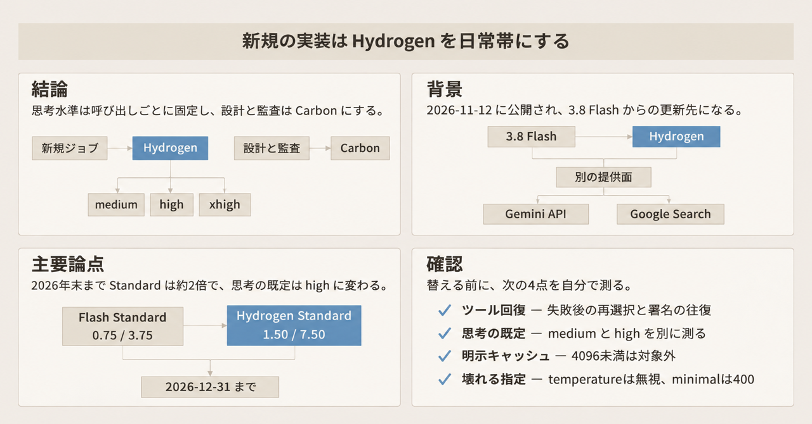
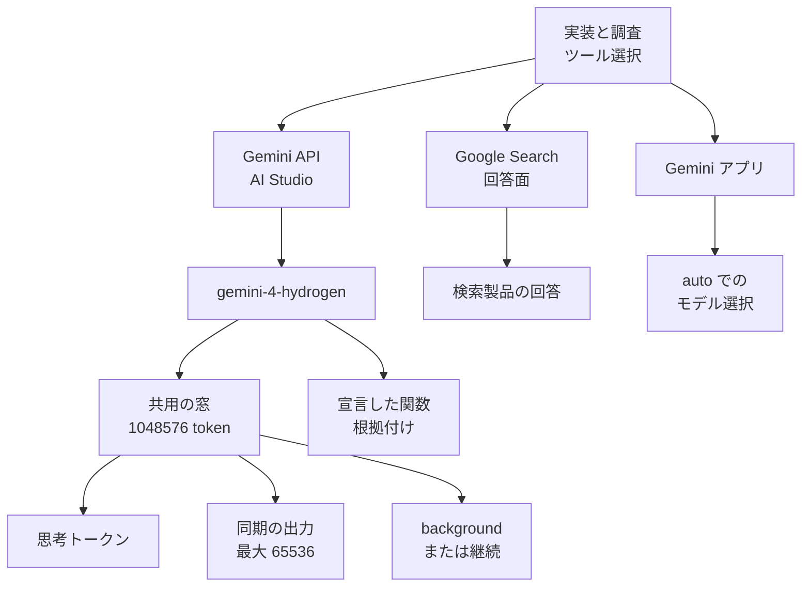

Gemini 4 Hydrogen は、Google が 2026-11-12 に公開した Gemini 4 系のモデルです。モデル ID は `gemini-4-hydrogen` です。この記事では、コーディングエージェントの実装、調査、ツール選択を、どの提供面のどの思考水準で Hydrogen に固定するかを、公開資料の範囲でまとめます。思考水準は、1 回の呼び出しでモデルにどれだけ考えさせるかの指定です。提供面は、Gemini API、Google Search の回答、Gemini アプリのように分かれた製品の面です。速度やベンチマークとして出ている数値の多くは、Google の発表本文か、思考水準を固定しないと読めない第三者測定です。

*この記事の全体像。以下、順に解説します。*

## Gemini 4 Hydrogenとは

Hydrogen は、日常のコーディング、ツール利用、文書、画像、音声、動画の読み取りを扱うモデルです。開発者向けの更新案内は、Gemini 3.8 Flash と、それ以前の Gemini 3、Gemini 2.5 からの更新先として Hydrogen を置いています。Gemini 3.8 Flash は、その案内が更新元に置く Flash 帯のモデルです。

呼び出せる場所は、Google AI Studio と Gemini API の無料枠と有料枠です。Google AI Studio は、この記事では Gemini API と同じ開発者向けの呼び出し側です。Agent Platform とは別です。GenerateContent と Interactions API は、どちらも Gemini API からこのモデルを呼ぶ名前です。同じ日に、開発者向け API と Google Search の回答面の両方へ載っています。開発者向け API は、この Gemini API を指します。

公式の導入ノートブックは、[GoogleCloudPlatform/generative-ai の intro_gemini_4_hydrogen.ipynb](https://github.com/GoogleCloudPlatform/generative-ai/blob/main/gemini/getting-started/intro_gemini_4_hydrogen.ipynb) です。[Colab でも開けます](https://colab.research.google.com/github/GoogleCloudPlatform/generative-ai/blob/main/gemini/getting-started/intro_gemini_4_hydrogen.ipynb)。

### モデル ID と思考水準

安定版のモデル ID は `gemini-4-hydrogen` だけです。最新更新は 2026 年 11 月です。根拠は [モデルページ](https://aistudio.google.com/docs/models/gemini-4-hydrogen) です。

思考水準は、1 回の呼び出しでモデルにどれだけ考えさせるかの指定です。値は `low`、`medium`、`high`、`xhigh` です。既定は `high` です。`minimal` は HTTP 400 になります。

Carbon と Argon は、同じ Gemini 4 系の別モデルです。Carbon はより多くの思考を使う側です。Argon は、Carbon より少ないトークンで長い作業を扱う側です。どちらも思考の既定は `medium` で、上限は `high` です。Hydrogen だけに `xhigh` があります。役割として書く「より多くの思考」と、この上限は、公開資料では別の文です。根拠は [What's new](https://aistudio.google.com/docs/whats-new-gemini-4-hydrogen) です。

### トークン窓

入力、思考、出力は、1,048,576 トークンの一つの窓を共有します。思考トークンは、出力単価の対象に含まれます。

同期の 1 回の応答は、What's new では出力 65,536 トークンまでです。それを超える生成は、`background=true` か、クライアント側の継続で、共有の 1,048,576 から入力を引いた残りまで伸ばせます。根拠は What's new です。

長文生成のガイドは、同じ 65,536 を思考と回答の合計として見ます。二つの文書は、この 65,536 の数え方を一つに揃えて書いていません。long decode は、その長い生成を伸ばす案内の名前です。多数の短いツール往復には long decode を使わない、と案内しています。難しいコーディングで、1 応答がその合計を超え得るときだけ使う、とも書いています。`background` だけが手段ではありません。SDK の継続と `continuation_token` もあります。根拠は [long decode](https://aistudio.google.com/docs/long-decode) です。

### 単価とキャッシュ

2026-11-13 時点の有料 Standard は、100 万トークンあたり入力 $1.50、出力 $7.50 です。窓の長さで単価は分かれません。根拠は [価格表](https://aistudio.google.com/docs/pricing) と What's new です。

キャッシュは暗黙キャッシュだけです。暗黙キャッシュは、4,096 トークン以上のプロンプトで動きます。ヒットした入力は、100 万トークンあたり $0.075 です。価格表はこれを 95% 割引と書いています。明示キャッシュの保存料は、Hydrogen の案内にはありません。What's new は Hydrogen を明示キャッシュ非対応と書きます。

同じモデルを別の単価で呼ぶ枠が、Batch、Flex、Priority です。2026-11-13 の価格表では、Batch と Flex が入力 $0.75、出力 $3.75 です。Priority は入力 $2.70、出力 $13.50 です。Batch の暗黙キャッシュは、100 万トークンあたり $0.0375 です。Flash の導入価格との期間差、Flex の失敗時の戻り方、Priority が静かに Standard へ落ちる条件は、注意点に置きます。

有料の Google Search 根拠付けは、回答の根拠に検索を使う機能です。Gemini 3 以降では、月 5,000 リクエストまで追加料金なしです。この枠はモデルをまたいで共有します。その後は 1,000 リクエストあたり $14 です。一つの Gemini リクエストが複数の検索クエリを生み、クエリごとに課金され得ます。Developer API は、ここまでの Gemini API と同じ呼び出し先の呼び方です。日次上限は、プロジェクトあたり 1,500 RPD です。RPD は 1 日あたりのリクエスト数です。Vertex は、Gemini API とは別の文書に出てくる呼び出し先の名前です。Vertex 側の既定は、1 日 1,000,000 検索クエリです。根拠は価格表です。

### 入出力とツール

入力はテキスト、画像、動画、音声、PDF です。出力はテキストです。

モデルページが対応機能として挙げる名前は次のとおりです。関数呼び出し、構造化出力、コード実行、コンピュータ操作、Search と Maps の根拠付け、File Search、URL context、Batch、Flex、Priority です。コンピュータ操作、File Search、URL context は、そのページに並ぶ機能名です。手順は、この記事の判断には使いません。

モデルページは、画像生成、音声生成、Live API を非対応と表示します。Live API は、そのページが非対応欄に置く機能名です。何をする機能かは、確認したモデルページの表示名以上には書かれていません。

Gemini Managed Agents は、What's new が Antigravity を置く実行面の名前です。Antigravity は、その上のエージェント名です。What's new は、エージェント `antigravity-preview-09-2026` の既定モデルが Hydrogen になった、と書いています。有料契約のどこに付くかは、注意点で記事の文言に沿って分けます。

### 呼び出し時の契約

Agent Platform は、Gemini API や AI Studio とは別の呼び出し先です。AI Studio と Gemini API で呼ぶジョブには、Agent Platform 固有の契約をそのまま当てません。`thinkingLevel` は思考水準の指定名です。`thinkingBudget` と `thinking_budget` は、同じ指定の表記差です。`thinkingLevel` との併用、および `MINIMAL` は HTTP 400 です。Agent Platform のガイドでは、`thinking_budget` の単独も HTTP 400 です。thought signature は、並列の関数呼び出しの応答に付く署名です。履歴の prefix は、その履歴の先頭側です。通す操作は、応答に付いた署名を改変せず、次のターンの履歴へ載せて返すことです。署名をコピーすることと、履歴の先頭側を削ることは、別の操作で、HTTP 400 になり得ます。

パラメータの扱いは、次のとおりです。

| 送るもの | 結果 |
|---|---|
| `temperature`、`top_p`、`top_k` | 送っても無視される |
| `thinkingLevel` と `thinkingBudget` の併用 | HTTP 400 |
| `MINIMAL` | HTTP 400 |
| Agent Platform での `thinking_budget` 単独 | HTTP 400 |
| ツールを宣言しない生の JSON | `MALFORMED_FUNCTION_CALL` になり得る |
| 状態数、分岐、深さが大きい関数スキーマ | `400 INVALID_ARGUMENT` になり得る。大きさの数は公開資料に無い |
| thought signature のコピー、履歴 prefix の削除 | HTTP 400 になり得る |
| 10 分窓の支出上限の超過 | `429 RESOURCE_EXHAUSTED` |

`temperature` が無視されること、併用と `MINIMAL` が HTTP 400 になることは、What's new 側の記述です。`thinking_budget` 単独の HTTP 400 は、Agent Platform の Hydrogen ガイドの記述です。一般の thinking ガイドより、モデル固有ガイドを優先します。根拠は What's new と [Agent Platform のガイド](https://docs.cloud.google.com/gemini-enterprise-agent-platform/models/guides/gemini-4-hydrogen) です。

関数呼び出しの回数と宣言数に、公開された固定上限はありません。アクティブなツールは 10 から 20 が案内上の目安です。根拠は [function calling](https://aistudio.google.com/docs/function-calling) です。

並列の関数呼び出しでは、上に書いたとおり、署名は改変せず次のターンへ返します。コピーと、履歴の先頭側の削除は、別の操作です。

支出の上限は 10 分窓です。Tier 1 が $10 です。Tier 2 と Tier 3 は、どちらも $200 です。同じ金額だと rate limits に書いてあります。これは、課金ティアの累積キャップとは別です。累積キャップは、Tier 1 が $250、Tier 2 が $2,000、Tier 3 が $20,000 以上です。どの支払い条件でその Tier に入るかは、採用した記述には含まれていません。根拠は [rate limits](https://aistudio.google.com/docs/rate-limits) です。確認日は 2026-11-13 です。

Batch の待ちトークン上限は、待ち時間とは別の数値です。Hydrogen と 3.8 Flash が同じです。Tier 1 が 3,000,000、Tier 2 が 400,000,000、Tier 3 が 1,000,000,000 です。Carbon と Argon は、Tier 1 が 5,000,000、Tier 2 が 500,000,000、Tier 3 が 1,000,000,000 です。対話の RPM、TPM、RPD は、公開ページに Hydrogen 固有の数値がありません。RPM は 1 分あたりのリクエスト数、TPM は 1 分あたりのトークン数です。ログイン後の AI Studio 画面にあります。

### となりのモデルとの仕様

2026-11-13 時点の公開仕様を、役割と契約の差に限って並べます。単価の期間差は次の注意点で読みます。Carbon と Argon の Standard 定価は、ここには再掲しません。

| 項目 | Hydrogen | 3.8 Flash | Carbon / Argon |
|---|---|---|---|
| 役割 | 日常の実装、ツール、調査 | いま動いている Flash 帯 | Carbon はより多くの思考。Argon は Carbon より少ないトークンで長い作業 |
| 思考の既定 | `high`。`xhigh` がある。`minimal` は HTTP 400 | `medium` | 既定 `medium`、上限 `high` |
| キャッシュ | 暗黙キャッシュのみ | 明示キャッシュに対応。保存料あり | 価格表からは再確認していない。What's new が非対応と書くのは Hydrogen |
| コンテキスト | 入力、出力、思考で 1,048,576 を共有。同期の 1 回は 65,536 | 入力 100 万と出力 64K が別予算。100 万は資料の 1M 表記で、1,048,576 と同じとは書いていない | 共用 100 万。非ストリーミング REST の 1 回は 32,768。100 万は同じく 1M 表記 |
| サンプリング | `temperature`、`top_p`、`top_k` は送っても無視される | 移行元として、独自値が効く前提のコードがある | What's new は、Hydrogen が Carbon、Argon と同じ Gemini 4 の API 設計だと書く。Carbon と Argon 側で無視されるかは、その一文からの読みである |
| Agent Platform の退役 | 短期提供。退役日は未発表 | 2027-09-02 以降 | Argon は 2027-10-13 以降。Carbon は API 側で停止日が未発表 |
| 月間稼働率の目標 | Agent Platform 側の短期提供で、`generateContent` と `streamGenerateContent` が 95%。Developer API の規約には数値の SLA が無い | より長い提供区分 | 同じ短期枠なら 95%。長い枠は別 |

3.8 Flash の明示キャッシュの保存料は、2026 年末まで 100 万トークンあたり毎時 $0.50 です。以後は $1.00 です。

月間稼働率の目標は、短期提供モデルに対する SLO です。根拠は [Vertex AI の生成 AI SLA](https://cloud.google.com/vertex-ai/generative-ai/sla) と、Agent Platform の [model versions](https://docs.cloud.google.com/gemini-enterprise-agent-platform/models/model-versions) です。

Gemini API の廃止予定では、公開日と停止日が別欄です。Hydrogen の公開日は 2026-11-12 で、停止日は未発表です。3.8 Flash の公開日は 2026-09-02 で、停止日は未発表です。Carbon は 2026-11-10、Argon は 2026-10-13 で、どちらも停止日は未発表です。根拠は [deprecations](https://aistudio.google.com/docs/deprecations) です。Agent Platform の退役日と、Gemini API の停止日は別欄です。

Developer API の公開利用規約には、確認した範囲で数値の SLA がありません。根拠は [terms](https://aistudio.google.com/docs/terms) です。

### 三つの提供面

依頼がどの製品面に入るかで、契約が分かれます。窓自体は、入力、思考、出力の共有です。API に入ったあと、その窓の中を思考と出力が分け合います。

図の 65536 は、What's new が書く同期の出力上限です。長文生成ガイドが思考と回答の合計として数える方は、図には入れていません。

開発者向け API のモデル選択、検索製品の回答、アプリの auto 選択は、別の提供面です。

Agent Platform では、エンドポイントが `global`、`us`、`eu` にあります。根拠は [Hydrogen の仕様](https://docs.cloud.google.com/gemini-enterprise-agent-platform/models/gemini/4-hydrogen) です。Developer API の利用可能国には Japan が含まれます。根拠は [available regions](https://aistudio.google.com/docs/available-regions) です。

## 注意点

ここからは、発表数値の読み方、単価が並ぶ期間、安全性、提供面の取り違え、プロンプトの残り方を分けます。

### 速度とベンチマークの読み方

Vercel AI Gateway の変更履歴は、2026-11-12 付です。執筆者は Aayush Kapoor、Jerilyn Zheng、Zachary Chen です。Hydrogen を 3.8 Flash の後継とし、同じ latency class のまま、より長い実装作業とツール利用を扱う、と書いています。latency class は、Vercel が遅延の区分として使う語です。区分の中の数値は、変更履歴にはありません。Gateway のモデル文字列は `google/gemini-4-hydrogen` です。料金は、プロバイダ料金をマークアップなしで反映する、と同履歴にあります。根拠は [changelog](https://vercel.com/changelog/gemini-4-hydrogen-now-available-on-ai-gateway) です。

Google の発表は、Koray Kavukcuoglu による 2026-11-12 の文章です。既定の `high` でタスク完了が 2.5 倍速い、と書いています。2.5 倍の比較相手は、この文だけでは特定できません。根拠は [introducing](https://blog.google/innovation-and-ai/models-and-research/gemini-models/introducing-gemini-4-hydrogen/) です。

latency class とタスク完了時間は、別の指標です。どちらも提供者側の記述です。独立した遅延の実測は、公開資料の範囲では見つかっていません。

同じ発表本文が自己申告として置く主な数値は次のとおりです。思考水準、プロンプト、ツール権限は、本文に個別には書かれていません。

| 主張 | 発表本文の値 | 読み方 |
|---|---|---|
| Terminal-Bench 4.1 | 57%、対 3.8 Flash 18.2% | Google の自己申告。独立再現は未確認 |
| AA Intelligence Index | `high` で 51、Argon 50。`xhigh` で 54 | 下の第三者測定と数値が一致する項目 |
| Orchestrator、Terminal-Bench 4.0 | Carbon に近い成功率、quota 24% 減、完了 19% 短縮 | Google の自己申告。4.1 のモデル単体スコアとは別。ここの quota はベンチマーク上の語 |
| 捏造の削減 | 3.8 Flash 比で 5 倍超の削減 | Google の自己申告。減った対象の定義は発表本文に無く、置換の根拠にしない |
| パートナー速度とトークン | 2 倍から 2.8 倍、トークン 12% から 23% の減少 | パートナーの自己申告 |

Terminal-Bench は、Google がスコアを自己申告しているベンチマーク名です。4.1 の実行条件は、発表本文に個別には書かれていません。AA Intelligence Index は、Artificial Analysis が公開している指標名です。Orchestrator は、Terminal-Bench 4.0 上の自己申告に出てくる呼び方であり、4.1 のモデル単体スコアとは別です。独立再現が無い自己申告は、置換の根拠にしません。

Artificial Analysis の公開ページには、独立測定として `xhigh` 54、`high` 51、`medium` 41、`low` 27 が載ります。取得日は 2026-11-13 です。同ページは、思考水準のあいだでタスクあたり費用が最大約 11 倍、と記します。この倍率は、同サイトの測定条件の値です。自前ジョブの見積もりには使えません。AA Index は Terminal-Bench 4.0 を構成要素に含みます。Google が挙げた Terminal-Bench 4.1 の再現ではありません。根拠は [releases](https://artificialanalysis.ai/models/releases/gemini-4-hydrogen) です。

モデルカード PDF の結果表は、5 ページ目が画像です。テキスト抽出では数値が取れませんでした。ベンチマークの表数値は、PDF から再掲していません。根拠は [Model card PDF](https://storage.googleapis.com/deepmind-media/Model-Cards/Gemini-4-Hydrogen-Model-Card.pdf) です。HTML 版は [model card](https://deepmind.google/models/model-cards/gemini-4-hydrogen/) です。

評価手法の説明 URL は [evals-methodology](https://deepmind.google/models/evals-methodology/gemini-4-hydrogen) です。この記事の数値は、そのページの本文を根拠にしていません。

### 単価は年末まで Flash の導入価格と並ばない

2026-11-13 の価格表で、有料 Standard の入出力は次のとおりです。出力には思考トークンが含まれます。

| モデル | 入力 / 100万 | 出力 / 100万 | 期間 |
|---|---:|---:|---|
| Hydrogen Standard | $1.50 | $7.50 | 確認日時点の定価 |
| 3.8 Flash Standard | $0.75 | $3.75 | 2026-12-31 まで |
| 3.8 Flash Standard | $1.50 | $7.50 | 2027-01-01 から |
| Hydrogen Batch | $0.75 | $3.75 | 価格表の Batch タブ |
| Hydrogen Flex | $0.75 | $3.75 | 価格表の Flex タブ |
| Hydrogen Priority | $2.70 | $13.50 | 価格表の Priority タブ |

2026-12-31 までは、同じトークン数なら、Hydrogen Standard は 3.8 Flash の導入価格の約 2 倍です。2027-01-01 以降の Flash 定価と、Hydrogen Standard の定価は一致します。

Hydrogen Batch の単価は、2026 年末までの Flash Standard 導入価格と数値が一致します。Flash 自身の Batch との比較ではありません。

思考の既定が、Flash の `medium` から Hydrogen の `high` に変わります。思考トークンが増えれば、単価差より費用差は広がります。増分は未測定です。

Flex には、標準の半額という一般規則があります。容量が無いときは 503 または 429 になります。サーバーが Standard へ戻すことはしません。再試行はクライアント側です。根拠は [Flex](https://aistudio.google.com/docs/flex-inference) です。

Priority は、標準より高い帯です。応答の `x-gemini-service-tier` を見ないと、Standard へ静かに落ちることがあります。落ちたと見なすヘッダの値は、確認した資料にはありません。落ちる頻度も未掲載です。根拠は [Priority](https://aistudio.google.com/docs/priority-inference) です。

### 安全性、知識、拒否

モデルカードは、3.8 Flash 比の自動評価を記します。低い方がよい unjustified refusals が 5.57 ポイント増です。この指標は、あとで不当な拒否と呼ぶものと同じです。高い方がよい tone が 0.65 ポイント低下です。tone は、そのカードが並記する評価名です。テキスト対テキストは 0.80 ポイント増、多言語は 1.10 ポイント増、画像対テキストは 7.00 ポイント増です。後の三つは、高い方がよい指標です。人手の再確認では、悪化の多くは偽陽性か、深刻ではない、とカード側が書いています。

完全な Safety & Security Report は、カード上 "coming soon" です。知識カットオフは 2026 年 3 月です。一部ドメインはそれより古い、とカードにあります。

発表ブログ側の安全数値は、Google の自己申告です。過到達の最大 81% 減、過少対応の最大 79% 減、不整合行動 12 倍、内部誠実性 96.7%、CoT 可読性 99.9%、Gray Swan IPI 2.3 倍超、HealthBench Pro の誤拒否 0.4% 未満、です。過到達、過少対応、不整合行動、内部誠実性、CoT 可読性、Gray Swan IPI、HealthBench Pro は、発表ブログが自己申告に付ける評価名です。高い低いの向きは、この記事では取りません。手順も、置換の判断にも使いません。

### 提供面を一つの契約に読まない

Google Search の告知は、Robby Stein による 2026-11-12 の文章です。Search の全ユーザー向けに、意図理解とクエリ展開を更新する、と書いています。根拠は [Search upgrade](https://blog.google/products-and-platforms/products/search/gemini-4-hydrogen-search-upgrade/) です。これは検索製品の提供範囲です。API のモデル選択、料金、可用性の契約ではありません。

モデル発表の脚注では、Gemini アプリの無料利用者は、適したプロンプトのとき auto 選択で Hydrogen に届く、とあります。無料利用者の多数が Flash-Lite に留まる、という比率は、一次資料では確認できていません。Flash-Lite は、その未確認の文が比較に出すモデル名です。

開発者ブログは、AI Studio、Android Studio、Gemini for business、有料の Pro または Ultra 向け Antigravity を挙げます。Gemini for business は、そのブログが列挙する製品名です。Pro と Ultra は、有料の契約名です。二つの中身の差は、確認した文言にはありません。根拠は [Build with Gemini 4 Hydrogen](https://blog.google/innovation-and-ai/technology/developers-tools/build-with-gemini-4-hydrogen/) です。

モデル発表の開発者向け箇条書きは、"Build with the Gemini API in AI Studio and Android Studio" のあと、"if you're a paid Google AI Pro or Ultra subscriber, you can try it in Google Antigravity" と続きます。有料の Pro または Ultra が付くのは、Antigravity です。根拠は introducing の HTML で、確認日は 2026-11-13 です。

Android の手順ページは、API キーでモデル一覧から選ぶ、と書きます。確認した Android の公式ページには、Hydrogen 固有の有料限定の文言はありません。

公式アプリ上のユーザー投稿が 1 件あります。計画実行は、その投稿が書くアプリ上の操作の名前です。Hydrogen の計画実行の直後に、`403 PERMISSION_DENIED (TOS_VIOLATION)` で止まった、という内容です。投稿日は 2026-11-12 です。原因と再現は未確認です。API の欠陥としては一般化できません。根拠は [discuss.ai.google.dev の投稿](https://discuss.ai.google.dev/t/appeal-bug-false-positive-403-tos-violation-after-gemini-4-hydrogen-plan-execution-google-ai-pro-official-app-only/199971) です。

### プロンプトが残る条件

価格表では、製品改善への利用が、無料枠は Yes、有料枠は No です。利用規約では、Unpaid Services の内容は製品改善に使われ、Paid Services は使われません。課金アカウントでの AI Studio 利用が、Paid Services に入ることがあります。画面上の無料表示だけでは判定しません。

確認した ZDR の説明では、ゼロデータ保持と DPA は Vertex と Agent Platform 側です。ZDR は、そのゼロデータ保持の説明の名前です。DPA は、同じ説明が ZDR と並べる契約名です。条文の中身は、ここでは展開しません。根拠は [ZDR](https://aistudio.google.com/docs/zdr) です。Search 根拠付けは、プロンプト、文脈、出力を 30 日保持する、と同系統の説明にあります。

データの所在地を一つの国に固定する約束は、確認した利用規約にはありません。

### 公開資料に数値が無い項目

次は、公開ページを読んでも数値が埋まらない項目です。

- 対話の RPM、TPM、RPD。ログイン後の AI Studio 画面にしかありません。
- 1 ターンあたりの関数呼び出し回数の固定上限。
- Terminal-Bench 4.1 の 57% と 18.2%、Orchestrator の 24% と 19% の独立再現と実行設定。
- Priority が Standard へ落ちる頻度。
- 先のフォーラム投稿の 403 の原因と再現性。
- 無料の Gemini アプリ利用者のうち、Hydrogen に届く割合。
- Hydrogen の退役日と、Gemini API の停止日。
- モデルカードが参照する評価手法ページの本文。
- Antigravity の Orchestrator が Ultra 限定かどうか。上の表の Orchestrator と同一かは、公開資料のこの範囲では結んでいません。Antigravity のブログ本文は、この記事の根拠に含めていません。Managed Agents の既定が Hydrogen であることだけを、What's new から採用しています。

## 日常の実装帯に置く

対象の仕様と、数値の読み方を分けたうえで、置き場を決めます。

新規に組む Gemini 系の実装、調査、ツール選択は、`gemini-4-hydrogen` を日常帯にします。思考水準は、ジョブごとに明示します。レイテンシを見るツール往復は `medium` です。品質を見る本処理は `high` です。`high` で足りない複数ステップだけ、`xhigh` にします。

上げる段は二つで、別の条件です。設計、難しいデバッグ、セキュリティ監査は、最初から Carbon にします。セキュリティ監査は、調査に含めても Hydrogen には残しません。それとは別に、`high` で品質が足りないときだけ、`xhigh` か Carbon にします。`xhigh` と Carbon のどちらにするかの追加条件は、この推奨にはありません。置き場の選択肢に Argon は入れません。長い作業であっても Argon にはしません。Argon は、比較のための隣のモデルです。

Search の搭載と、開発者 API の既定は、別契約として読みます。入力としての音声の読み取りは、モデルが扱う対象です。出力の音声生成は非対応です。音声対話は、公開資料が画像生成と並べて、そこまで既定にすると要件を満たさないと書く置き方です。音声の読み取りと同じだとは書いていません。Live API は非対応欄の機能名のままで、この判断の条件には使いません。

2026-12-31 までの既存の 3.8 Flash Standard ジョブは、次節の確認を通すまで、一括では替えません。

### 公開情報が支えている範囲

公式の更新案内は、日常のコーディングとツール利用の更新先として Hydrogen を推奨しています。Carbon は、より重い思考へ分けています。

Vercel は、同じ latency class の Flash 後継として Gateway に載せています。独立した実測ではありません。提供面の宣言ではあります。

Artificial Analysis の `high` 51 は、Google 発表の AA Index と一致します。思考水準を変えると 27 から 54 に開きます。水準の固定が、品質の本体になります。

ツール失敗時の適応と、欠損した文脈を推測で埋めないことは、公式が Flash 比の差分として挙げています。確認手順と一致するのは、失敗したツールからの回復です。推測で埋めないことは、確認手順の番号には入っていません。

2027-01-01 以降は、Flash の定価と Hydrogen Standard が一致します。価格だけの理由で Flash に残る期間は、そこで終わります。

### いま一括で替えない条件

2026 年末までは、Standard が約 2 倍です。思考既定の変更が、費用をさらに開き得ます。追加の能力を使わないジョブを、今すぐ全件置換する根拠は弱いです。

明示キャッシュ、サンプリング、`minimal`、`thinking_budget` は、契約として壊れます。既存の呼び出し側は、モデル名の置換だけでは動きません。

不当な拒否は 5.57 ポイント増です。調査や実装の正当な依頼を止める可能性があります。Safety Report は未公開です。

Agent Platform の Hydrogen は短期提供で、SLO は 95% です。Flash には、少なくとも 2027-09-02 までの退役枠があります。終了の圧力で今すぐ移る必要は、公開資料からは出ません。

Terminal-Bench 4.1 と Orchestrator の数値に、独立再現はありません。速度の「2.5 倍」と「同じ latency class」は、両立するとは限りません。

## 置換前の確認

2026-12-31 までに 3.8 Flash から替えるときの確認は、次の順です。

1. ツール選択、失敗したツールからの回復、thought signature の往復を見ます。long decode は、1 応答の思考と回答の合計が 65,536 トークンを超え得るジョブで検討します。多数の短いツール往復は、long decode のガイドが対象外としています。
2. 思考の既定が `medium` から `high` に変わること自体を、費用と挙動の変更として測ります。`medium` を明示して、Flash に近い帯を残す比較は、別に分けます。
3. 明示キャッシュを外したあとの入力費用を見ます。4,096 トークン未満のプロンプトは、暗黙キャッシュの対象外です。
4. `temperature` を頼りにしていた分岐、`minimal`、`thinking_budget`、未宣言の JSON ツールが、HTTP 400 になるか、無視されるかを見ます。

費用を、2026 年末までの Flash Standard 導入価格に合わせたいバッチは、Hydrogen Batch が数値上の対応先です。単価は入力 $0.75、出力 $3.75 です。待ち時間は分単位です。失敗時の再試行はクライアント側です。

本番のプロンプトは、有料枠にするか、Agent Platform の保持条件を別に契約します。有料枠で避けられるのは、製品改善への利用です。有料枠であることだけでは、プロンプトを保存しないことにはなりません。ゼロデータ保持は、Vertex と Agent Platform 側の別契約です。無料枠で調査の本文を送ると、製品改善に使われます。

### 判断がひっくり返る条件

次のどれかが自前の測定で立ったら、日常帯の固定を見直します。

- 自前のツール選択セットで、Hydrogen の `medium` が 3.8 Flash の `medium` に、品質でも費用でも勝たない。
- 不当な拒否が、調査や実装の完了率を Flash より下げる。
- 1 ターンが 64K を超える生成が主流で、継続処理の失敗が、Flash の分割出力より高い。ここでの 64K は、この条件の文言です。3.8 Flash の出力予算は 64K です。Hydrogen の同期 1 回は、What's new では出力 65,536、長文生成ガイドでは思考と回答の合計 65,536 です。公開資料は、この 64K と 65,536 を同じ上限だとは書いていません。Flash の分割出力は、この条件が比較に出す、Flash 側で出力を分けて返すやり方です。手順の詳細は、この一文以上には書かれていません。
- Agent Platform の 95% SLO が、いまの Flash 枠の稼働より業務上厳しい。

### 次に残す記録

代表ジョブでは、次の三点を残します。

1. 代表のツール往復を、Flash の `medium`、Hydrogen の `medium`、Hydrogen の `high` の 3 点で残します。残す値は、成功率、思考トークン、壁時計時間です。
2. 明示キャッシュを使っている呼び出しを洗い、暗黙キャッシュの 4,096 トークン条件に合うかを見ます。
3. Search 根拠付けの 1,500 RPD と、検索製品の Hydrogen 搭載を、同じ「検索」として契約しません。

## まとめ

新規の実装、調査、ツール選択は、`gemini-4-hydrogen` を日常帯にします。思考水準は呼び出しごとに固定します。ツール往復のレイテンシは `medium`、品質を見る本処理は `high`、`high` で足りない複数ステップだけ `xhigh` です。設計、難しいデバッグ、セキュリティ監査は、最初から Carbon にします。セキュリティ監査は、調査に含めても Hydrogen には残しません。それとは別に、`high` で品質が足りないときだけ、`xhigh` か Carbon にします。どちらにするかの追加条件は、この推奨にはありません。

2026-12-31 までの既存 Flash Standard は、ツールの回復、思考既定そのものの費用、明示キャッシュを外した入力費、無視または HTTP 400 になるパラメータの四点を見るまで、一括では替えません。Search の搭載と Developer API のモデル選択は、別の契約です。入力の音声読み取りは対象です。音声生成や画像生成が要るジョブは、このモデルの既定にしません。

この記事が少しでも参考になった、あるいは改善点などがあれば、ぜひリアクションやコメント、SNSでのシェアをいただけると励みになります！

## 参考リンク

- [Build with Gemini 4 Hydrogen](https://blog.google/innovation-and-ai/technology/developers-tools/build-with-gemini-4-hydrogen/)（2026-11-12）
- [Introducing Gemini 4 Hydrogen](https://blog.google/innovation-and-ai/models-and-research/gemini-models/introducing-gemini-4-hydrogen/)（Koray Kavukcuoglu、2026-11-12）
- [Gemini 4 in Google Search](https://blog.google/products-and-platforms/products/search/gemini-4-hydrogen-search-upgrade/)（Robby Stein、2026-11-12）
- [What's new in Gemini 4 Hydrogen](https://aistudio.google.com/docs/whats-new-gemini-4-hydrogen)
- [Gemini 4 Hydrogen model](https://aistudio.google.com/docs/models/gemini-4-hydrogen)
- [Gemini Developer API pricing](https://aistudio.google.com/docs/pricing)
- [Rate limits](https://aistudio.google.com/docs/rate-limits)
- [Function calling](https://aistudio.google.com/docs/function-calling)
- [Long decode](https://aistudio.google.com/docs/long-decode)
- [Flex inference](https://aistudio.google.com/docs/flex-inference)
- [Priority inference](https://aistudio.google.com/docs/priority-inference)
- [Deprecations](https://aistudio.google.com/docs/deprecations)
- [Available regions](https://aistudio.google.com/docs/available-regions)
- [Terms](https://aistudio.google.com/docs/terms)
- [Zero data retention](https://aistudio.google.com/docs/zdr)
- [Model card PDF](https://storage.googleapis.com/deepmind-media/Model-Cards/Gemini-4-Hydrogen-Model-Card.pdf)
- [Model card](https://deepmind.google/models/model-cards/gemini-4-hydrogen/)
- [Evals methodology](https://deepmind.google/models/evals-methodology/gemini-4-hydrogen)
- [Agent Platform の Hydrogen 仕様](https://docs.cloud.google.com/gemini-enterprise-agent-platform/models/gemini/4-hydrogen)
- [Agent Platform の Hydrogen ガイド](https://docs.cloud.google.com/gemini-enterprise-agent-platform/models/guides/gemini-4-hydrogen)
- [Agent Platform model versions](https://docs.cloud.google.com/gemini-enterprise-agent-platform/models/model-versions)
- [Vertex AI generative AI SLA](https://cloud.google.com/vertex-ai/generative-ai/sla)
- [Vercel changelog](https://vercel.com/changelog/gemini-4-hydrogen-now-available-on-ai-gateway)（2026-11-12）
- [Artificial Analysis](https://artificialanalysis.ai/models/releases/gemini-4-hydrogen)（取得日 2026-11-13）
- [intro_gemini_4_hydrogen.ipynb](https://github.com/GoogleCloudPlatform/generative-ai/blob/main/gemini/getting-started/intro_gemini_4_hydrogen.ipynb)
