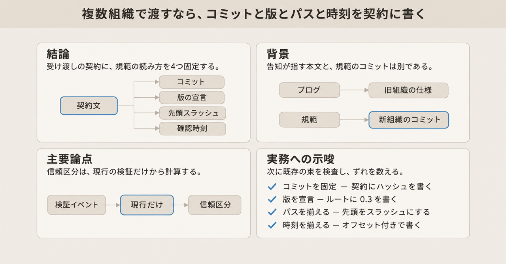
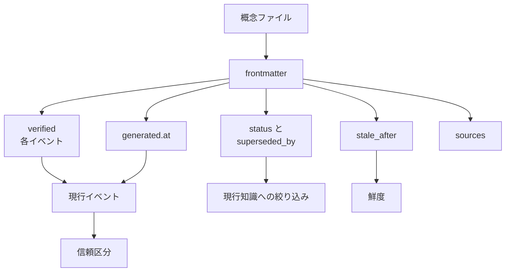

Open Knowledge Format（OKF）v0.3 は、知識のディレクトリを、別の組織やエージェントが同じ規則で読むための公開仕様です。この記事では、1つの概念ファイルから消費者が読む材料、適合が要求する範囲、受け渡しの契約に写す項目を説明します。規範として読むバイト列は 2026-11-18 のコミットに固定し、Google Cloud Blog の告知日 2026-11-19 とは分けます。

*この記事の全体像。以下、順に解説します。*

## OKF v0.3とは

OKF は、知識を Markdown と、ファイル先頭の YAML である frontmatter のディレクトリとして書きます。人とエージェントが束を継続して編集します。束とは、そのディレクトリを1つの受け渡し単位にしたものです。消費者は frontmatter から、出典、信頼区分、鮮度、ライフサイクル、計算の照合材料を読みます。ライフサイクルは、`draft`、`stable`、`deprecated` の状態です。計算の照合材料は、計算の定義に対する確認と、その値に付く `runtime`（実行環境）および `attester`（その実行を判定する主体）です。概念で常に必須のフィールドは `type` だけです。`type` は、その Markdown を概念として読むためのラベルです。

Google Cloud Blog は 2026-11-19 に公開を告知しています。著者として Sam McVeety と Amir Hormati が載っています。規範本文は `open-knowledge-format/open-knowledge-format` の [`SPEC.md`](https://github.com/open-knowledge-format/open-knowledge-format/blob/527e81aff55992be21507e97004286789126f88c/SPEC.md) です。固定する版は、committer date（コミットが記録された時刻）が 2026-11-18T17:00:25Z のコミット `527e81aff55992be21507e97004286789126f88c` です。コミットメッセージは `Update SPEC.md` です。

### 束と概念

仕様は自己完結です。適合の節は RFC 2119 の語を使います。MUST は必須、SHOULD は推奨、MAY は許可です。frontmatter は YAML 1.2 です。本文の Markdown は CommonMark を基本にします。CommonMark は、Markdown の基本仕様です。表と脚注は GitHub Flavored Markdown（GFM）の範囲を含みます。タイムスタンプは RFC 3339 です。RFC 3339 は、日時を文字で書く仕様です。

概念とは、`type` を持つ Markdown ファイルです。`type` の無い `.md` は概念の対象外です。消費者はそれを読み飛ばします。そのファイルが束の中にあっても、束は非適合になりません。`README.md` や `SKILL.md` を束の中に置けます。

束の直下の `index.md` は、任意で `okf_version`、`title`、`description`、`license` を持てます。`okf_version` は、その束をどの版の OKF として読むかの宣言です。`license` は SPDX 式か、束の中のライセンスファイルへのパスです。SPDX 式は、ライセンスを識別子で書く書き方です。

リポジトリには、エージェント用のスキル `okf-generate` と `okf-consume` があります。スキルは、生成と消費の手順をエージェントに読ませる同梱の文書です。

### 消費者が読む欄

タイムスタンプは、オフセット付きの日時か、日付だけです。日付だけは、その日の UTC 0時を意味します。

信頼区分は `unverified`、`machine-confirmed`、`human-reviewed` の3つです。信頼区分の算出に入るのは、現行の検証イベントだけです。現行とは、`verified.at` が `generated.at` 以降であるか、`generated` が無いことです。`generated` は生成の記録で、`generated.at` はその時刻です。`verified` は確認の履歴で、`verified.at` はその時刻です。`human:` の現行イベントがあるときだけ、区分は `human-reviewed` になります。それが無いとき、現行の `team:` または `process:` があれば、区分は `machine-confirmed` です。現行の検証イベントが無い概念は `unverified` です。

行為者は、生成や検証を行った主体の識別子です。形は `<producer>/<version>` か `<scheme>:<id>` です。仕様が名指しするスキームは `human:`、`team:`、`process:` です。

`status` は `draft`、`stable`、`deprecated` です。この欄がライフサイクルです。欠落時は `stable` です。`deprecated` の概念は、`superseded_by` で後継のパスを示せます。

リンクとパス欄は、同じ解決規則を使います。パス欄は、別ファイルや URL を指す欄です。スキーム付きは絶対 URL です。先頭が `/` のパスは、束のルートからです。それ以外は、そのファイルがあるディレクトリからです。

拡張キーは、YAML のどの入れ子にも置けます。将来の OKF 版は、`x-` で始まるキーを定義しません。生産者は、知らないキーを残します。

`Attested Computation` は、計算の照合材料を2つの行為に書き分ける仕組みです。計算の定義に対する `verified` は、束の frontmatter に残します。1回の実行が承認済みだったかという attester の判定そのものは、束には記録しません。`runtime` と `attester` が無い値は、確認済みの計算として表示しません。

### 概念から計算する状態

消費者が1つの概念から読む材料と、そこから計算する状態は次のとおりです。

`generated.at` は、その本文がいつ意味のある変更を受けたかを、生産者が書く時刻です。`verified` は、誰がいつその内容を確認したかの履歴です。信頼区分は、その履歴のうち現行のイベントだけから出ます。鮮度は `stale_after` との比較です。廃止と移動は、`status` と `superseded_by` の組です。出典は `sources` と、本文の脚注ラベルです。

束の版は、ルートの `index.md` にある `okf_version` が宣言します。パス欄の互換動作は、この宣言を見て分かれます。

## 注意点

告知、規範本文、公式の実装は、同じ日の近くに揃っています。公式の実装は、同じコミットに同梱された検査プログラムです。ブログのリンク先を開いただけでは、v0.3 の規則には到達しません。数値と状態は、2026-11-20 に取得した公開データです。

### 告知が指すファイルと、規範バイト

ブログ HTML の `datePublished` は `2026-11-19` です。表示も November 19, 2026 です。記事中の「v0.3 spec」は、旧組織 `GoogleCloudPlatform/open-knowledge-format` 上の `SPEC.md` を指します。同じ日に取得したその [`SPEC.md`](https://github.com/GoogleCloudPlatform/open-knowledge-format/blob/main/SPEC.md) は、冒頭で新しい組織への移動と、更新停止を警告しています。版の表示は Version 0.2 のままです。

v0.2 の本文は、タイムスタンプをオフセット付きの日時に限ります。信頼区分は、`verified` の有無と、`human:` かどうかから計算します。`verified` は `generated.at` と独立だとも書きます。v0.3 の現行検証ルールは、この v0.2 本文にはありません。

新しい組織の `main` は、2026-11-20 時点で、上のコミット `527e81aff55992be21507e97004286789126f88c` です。GitHub の Releases API の件数は 0 です。tag 名は返りませんでした。`okf_version: "0.3"` という文字列だけでは、どのバイトの仕様かは特定できません。以後 Release が増えるかは、2026-11-20 時点では未確認です。

旧組織の [issue #24](https://github.com/GoogleCloudPlatform/open-knowledge-format/issues/24) は、2026-11-20 時点で OPEN のままです。タイトルは、`okf_version: "0.2"` が2つの文書を指す、という内容です。issue 本文は、PR #6（2026-08-21、コミット `ad30107c`）が、公開後の v0.2 本文へオフセット必須を入れた、と書いています。issue #24、[#29](https://github.com/GoogleCloudPlatform/open-knowledge-format/issues/29)、[#34](https://github.com/GoogleCloudPlatform/open-knowledge-format/issues/34)、[#60](https://github.com/GoogleCloudPlatform/open-knowledge-format/issues/60) が新しい組織へ移ったかは、同じ時点では未確認です。

引用するときは、告知日と規範バイトの日付を分けます。ブログの `datePublished` は 2026-11-19 です。仕様コミットは 2026-11-18 です。

### 案内文と、その日のツリー

`usecases/` は、ブログと README が案内する置き場です。2026-11-20 の GitHub Contents API は、新しい組織のそのパスを 404 としました。Contents API は、ディレクトリの中身を返す API です。[PR #7](https://github.com/open-knowledge-format/open-knowledge-format/pull/7)「Remove the Ossie use case for now」は、2026-11-06 にマージ済みです。案内文と、その日のツリーは一致していません。のちにガイドが戻るかは未確認です。

スキルの入れ方も、文書のあいだで割れています。README の表が挙げるクライアントは、Claude Code、Codex CLI、Antigravity CLI 1.3.2 以降です。いずれも、エージェントに手順を読ませる導入先として文書が名指しするクライアントです。ブログは Gemini CLI の `gemini skills install` を2行書いています。2行目のコメントは `# install okf-generate` のままです。2行目の `--path` は `skills/okf-consume` です。差は、文書に書かれた手順の差です。

星の数は、時点つきの概数にします。2026-11-20 の GitHub API では、新しい組織が約50、旧組織が約1,600です。どちらも `isArchived` は false です。`isArchived` は、リポジトリがアーカイブ済みかを示す値です。旧組織の方が多いです。`pushedAt` はどちらも 2026-11-18 です。`pushedAt` は、最終 push の時刻です。

### 適合が揃えないもの

適合は、すべての消費者が同じ答えを返すことと同じ範囲には収まりません。§11.1 の適合は、frontmatter が YAML の mapping であることと、仕様が構造を定めているファイルがその節の形に合うことです。YAML の mapping は、キーと値の組です。任意フィールドの欠落、未知の `type`、壊れたリンクでは、消費者は拒否しません。

信頼区分の計算は MUST です。`superseded_by` を辿ることと、鮮度を `stale_after` だけから見ることは SHOULD です。版が 0.2 以前、または未宣言のとき、先頭が `/` でないパス欄をルートからも試すのは MAY です。公式の `scan.py` は、同じコミットの `skills/okf-consume/scripts/scan.py` です。`okf-consume` に同梱されるスキャナーです。宣言が無い、または `0.2` 以下のときに、この再試行を行います。

信頼区分はアクセス制御ではありません。§5.3 がそのように書いています。`human:` は不透明な文字列です。本人確認の手続きは、仕様にありません。[issue #60](https://github.com/GoogleCloudPlatform/open-knowledge-format/issues/60) は OPEN で、生成者自身の `verified` が `machine-confirmed` になる点を挙げています。

`license` を書いても、消費者に利用権の執行を求める文は §11 にありません。公式 validator の `W116` は警告です。validator は、`okf-generate` に同梱される検査プログラムです。`W116` は、値が SPDX 式でも、束の中のファイルでもないときに出ます。公式サンプル `bundles/acme_retail/index.md` は `okf_version: "0.3"` を宣言し、`license` キーを持ちません。欄が空でも、束は適合します。

`generated.at` は、生産者の判断です。仕様は、意味のある変更で更新し、整形と空白とリンク修復では据え置く、と書きます。本文ハッシュとの照合は定義していません。§5.3 は、`generated` という記録が無いとき、検証イベントを現行として扱います。同じコミットの `scan.py` は、比較時刻に `generated.at` が無いとき、v0.1 の時刻欄 `timestamp` を使います。`generated.at` と `timestamp` の両方が無いときは、残った検証を現行にします。

日付だけの検証は、同じ暦日の日時より前になります。§5 は、日付だけをその日の UTC 0時とします。公式 `scan.py` は `T00:00:00+00:00` に変換してから比較します。第三者の相互運用記録では、この切り捨てが区分を変えています。その記録が AI-XF の実験 E9 です。実装は `knowledgex` 0.4.0、実行記録は 2026-10-02T21:51:42Z です。日付だけに平坦化したコピーでは、human-reviewed が 5件から 0件になりました。日時を順序どおり書いた版では、human-reviewed 5件と unverified 2件で、書き手側と一致しました。この実験は v0.3 の公開より前です。Google の公式測定ではありません。v0.3 の比較式は、この落ち方を仕様側で再現します。

`superseded_by` の循環、段数の上限、後継が欠けたときの共通の戻り値は、§5.4 にありません。公式スキャナーが返す後継は、`deprecated` のときの1段です。`stale` は、再確認が要る状態です。内容が偽である状態は、`stale` とは別です。その名前 `refuted` は、§12.2 で延期です。肯定の検証が無い概念は、`unverified` に集まります。

コア仕様は、暗号署名を要求しません。§12.2 の延期リストに、束の署名（英語では bundle signature）という語はありません。延期されているのは、receipt と verdict のワイヤ形式、validity window、`refuted`、型付き関係などです。ワイヤ形式は、交換するデータの形です。語の上では、receipt は受領の記録、verdict は判定、validity window は有効期間です。型付き関係は、種類を持つ結びつきです。第三者の [knowledge-catalog #140](https://github.com/GoogleCloudPlatform/knowledge-catalog/issues/140) は OPEN で、共有束に署名と完全性の検査が無いと書いています。同じ議論の参加者は、署名は誰が言ったかを示し、信じる量は別だと書いています。`lemmaoracle/verifiable-okf` は、ベースの OKF を変えずに、由来を示す `provenance` を足す草案です。OKF の `verified` とは別の状態名を使います。

旧組織の [issue #29](https://github.com/GoogleCloudPlatform/open-knowledge-format/issues/29) は OPEN です。タイトルは、スラッシュで始まらないパス欄をファイル相対とする定義と、例および `acme_retail` の書き方が、12件中12件でルート相対だった、と述べます。v0.3 の §13.1 は、先頭が `/` でないパスを、ファイルのディレクトリから解決する規則を、破壊的変更に数えています。ルート相対で書かれた旧サンプルは、その規則では見つかりません。フォールバックは MAY です。

1.0 より前の minor は、破壊的変更を含んでよい、と §12 が書きます。v0.3 の破壊的変更は、§13.1 の2つです。パス解決と、現行の検証だけを区分に使うことです。後者について仕様は、区分は下がる方向なのでフォールバックは要らない、と書きます。下がった区分を、受け手が通知するかは MUST ではありません。

公式 validator の `I204` は info です。info は情報で、拒否はしません。`generated.at` があり、解析できた検証時刻の全部がそれより古いときに出ます。そのとき消費者は `unverified` と読みます。現行の `process:` や `team:` が残って、`human-reviewed` から `machine-confirmed` へ下がる場合、`I204` は出ません。

## 組織をまたぐ受け渡しで揃える読み

組織間の契約に「OKF v0.3 に適合」とだけ書くと、前節の MAY、SHOULD、`generated.at` を生産者が書いたまま受け取る判断、日付の切り捨てが、受け手ごとに残ります。次の読みを、仕様の節番号つきで契約文に写します。

1. 規範バイトをコミットで固定します。固定点は `527e81aff55992be21507e97004286789126f88c` です。ブログの URL と、旧組織の `main` は固定点にしません。
2. ルートの `index.md` に `okf_version: "0.3"` を書きます。未宣言の束では、公式スキャナーが v0.2 以前のパス再試行を行います。
3. 信頼区分は §5.3 だけから計算します。現行でない `verified` は履歴として残し、区分には入れません。
4. 順序が同じ暦日の中で意味を持つときは、`generated.at` と `verified.at` をオフセット付き日時で書きます。日付だけは UTC 0時として比較されます。
5. パス欄は、先頭 `/` の、束のルート基準で書きます。`okf-generate` の手順も、そのように指示しています。
6. `deprecated` の `superseded_by` を辿ります。循環と欠落の停止は仕様に無いので、契約側でどちらかを選びます。公式スキャナーの実装に合わせるなら1段です。もう一方は、`deprecated` でなくなるまで辿り、循環なら停止して両方を見せることです。
7. `stale_after` を過ぎた概念は、再確認の対象です。回答へ使うかどうかは、区分とは別に決めます。
8. `license` が利用条件そのものになる取引では、SPDX 式か束内ファイルに加え、許諾の主体と範囲を OKF の外に置きます。欄が空でも束は適合します。

判断の基準は、受け手が返す区分、辿る後継、再利用の条件が、契約文を読んだだけで一意になることです。節番号の無い「v0.3 に適合」は、その一意性を満たしません。

## 束と一緒に渡す項目

知識の本文と別に、受け渡しの単位へ次を含めます。

| 項目 | 置く場所 | 受け手が揃えるもの |
|---|---|---|
| 仕様のコミット | 契約文 | どのバイトを読んだか |
| `okf_version` | ルート `index.md` | パスの互換規則 |
| `license` | ルート `index.md`、必要なら別契約 | 再利用の条件 |
| `generated` と `verified` の履歴 | 各概念 | 現行区分と、変更前の確認 |
| `status` と `superseded_by` | 廃止・移動した概念 | 古いパスから後継へ進む規則 |
| `stale_after` | 見直し日が分かっている概念 | 再確認の期限 |
| `sources` と脚注 `id` | 主張ごと | 出典へ戻るキー |
| 拡張キー `x-<producer>-<name>` | コアに無い実験 | 知らないキーを消さないこと |

オントロジーは、その語が何を指すかを組織の中で固定します。v0.3 が足すのは、別の3点です。その文面を、いつ、どの行為者が、現行の本文に対して確認したかです。廃止後にどこへ進むかです。どの条件で受け取ったかです。確認の責任は、現行の検証イベントにあります。クラス定義は、オントロジーが語の種類を定める定義です。束の欄ではありません。イベントが `generated.at` より古ければ、過去の人の確認は履歴になり、区分は下がります。

## 複数組織で回すときの採用条件

複数組織が同じ束を編集するなら、v0.3 の現行検証、先頭 `/` のパス、ルートの `okf_version` を、受け渡しの必須にします。適合という語だけでは、出典と鮮度と検証状態は揃いません。

### 仕様が支持する点

- §5.3 は、エージェントが書き換えたあとの人間の確認を、時刻比較で区分から外す、と MUST で書きます。v0.2 の本文は逆に、`verified` は `generated.at` と独立だと書きます。
- 公式 `scan.py` は、その比較、`human:` の前方一致、日付だけの UTC 0時、版に応じたパス再試行を実装しています。前方一致は、識別子が `human:` で始まるかを見る検査です。
- `okf-generate` は、生成したばかりの内容へ `verified` を書きません。意味が変わったときだけ `generated.at` を進めます。移動では、旧パスに `deprecated` を残します。
- §13.1 は、区分は下がる方向だと明示しています。古い確認を、新しい本文の承認として見せない、という側です。
- E9 は、日付だけの検証が別実装で human-reviewed 5件を 0件にした記録です。v0.3 の、日付だけを UTC 0時とする規則は、この種類のずれを残します。

### 残る限界

- `generated.at` の「意味のある変更」は、機械的に再計算できません。ハッシュはコアにありません。
- `human:` はラベルです。なりすましを止める手続きは仕様にありません。2026-11-20 時点で参照した仕様、公式ツール、公開 issue の範囲では、なりすましの実害報告は確認できません。
- パスのルート再試行は MAY です。issue #29 のタイトルが示す 12件中12件は、旧サンプルの書き方と定義のずれです。v0.3 の宣言が無い束では、実装が割れてよいです。
- `superseded_by` を辿るのは SHOULD です。多段と循環は未定義です。
- `license` の空欄は適合です。Acme Retail の公式サンプルが空欄です。
- 署名の層は、第三者が別仕様で足しています。コアの `verified` と、それらの `verified` は別の語です。
- 本番で、通知のない降格が業務を止めた、という当事者報告は、同じ範囲では確認できません。確認できるのは、仕様、公式ツールのメッセージ、公開前の相互運用実験、OPEN の issue です。

### 発注側が契約に書く条件

発注側が、複数のエージェントや取引先と同じ知識束を回すなら、v0.3 を採用してよいです。採用条件は4つです。契約に書く固定点は、コミット `527e81aff55992be21507e97004286789126f88c` です。各束のルートに `okf_version: "0.3"` を置きます。パス欄を先頭 `/` にします。確認時刻をオフセット付き日時にします。

人の承認が費用や対外説明に効く概念では、`human:` の文字列を本人確認とみなしません。確認者、確認したコミット、確認日時を、束の外の記録と突き合わせます。区分が `human-reviewed` であることは、そのラベルが現行の `generated.at` 以降に付いていることまでを示します。

計算結果を出す概念は、`verified` と attestation を混ぜません。attestation は、束に残さない、1回の実行の判定です。定義の確認は frontmatter に残ります。§10.2 は、値に付く `runtime` と `attester` が無いものを、確認済みの計算として表示しないことを、消費者に求めています。

コアに無い完全性、反証イベント、有効期限の窓が必要なら、`x-` キーで実験します。そのキーの読みを契約に書きます。コアの `verified` へ、別名の状態を重ねません。

次に手を動かすなら、既存の束を公式 `scan.py` に通します。数えるものは3つです。信頼区分の変化です。先頭 `/` の無いパス欄です。ルート `index.md` の `okf_version` の欠落です。`I204` は、検証が全部 `generated.at` より古く、`unverified` になる件数だけを数えます。人の確認が残りつつ、区分が `machine-confirmed` へ下がる分は、区分の差分として別に数えます。

## まとめ

OKF v0.3 は、Markdown と frontmatter の束を、出典、信頼区分、鮮度、ライフサイクル、計算の照合材料つきで渡す仕様です。概念で常に必須なのは `type` です。信頼区分は、`generated.at` 以降の現行の検証だけから計算します。

告知のリンク先は、取得時点で v0.2 の本文と移動の警告が残る旧組織です。規範バイトは、新しい組織のコミット `527e81aff55992be21507e97004286789126f88c` です。Release は 2026-11-20 時点で 0件です。適合は、任意欄の欠落や壊れたリンクを拒否しません。日付だけの検証、先頭 `/` の無いパス、空の `license`、1段を超える後継は、受け手の実装に残り得ます。

複数組織で同じ束を編集するなら、そのコミット、ルートの `okf_version: "0.3"`、先頭 `/` のパス、オフセット付きの確認時刻を契約に書きます。`human:` が示すのは、そのラベルが現行の `generated.at` 以降に付いていることまでです。実行の承認は、`verified` とは別の行為です。

この記事が少しでも参考になった、あるいは改善点などがあれば、ぜひリアクションやコメント、SNSでのシェアをいただけると励みになります！

## 参考リンク

- [Google Cloud Blog, "What's new in OKF v0.3"（`datePublished` 2026-11-19）](https://cloud.google.com/blog/products/data-analytics/introducing-okf-v0-3/)
- [OKF SPEC v0.3, commit `527e81aff55992be21507e97004286789126f88c`（2026-11-18）](https://github.com/open-knowledge-format/open-knowledge-format/blob/527e81aff55992be21507e97004286789126f88c/SPEC.md)
- [旧組織の SPEC（取得時点で Version 0.2 の本文と、移動および更新停止の警告）](https://github.com/GoogleCloudPlatform/open-knowledge-format/blob/main/SPEC.md)
- [新しい組織の README（スキル導入の表と、use case の案内）。同じコミット](https://github.com/open-knowledge-format/open-knowledge-format/blob/527e81aff55992be21507e97004286789126f88c/README.md)
- [旧組織の issue #24（2026-11-20 時点で OPEN。#29、#34、#60 も同じ）](https://github.com/GoogleCloudPlatform/open-knowledge-format/issues/24)
- [旧組織の issue #29](https://github.com/GoogleCloudPlatform/open-knowledge-format/issues/29)
- [旧組織の issue #34](https://github.com/GoogleCloudPlatform/open-knowledge-format/issues/34)
- [旧組織の issue #60](https://github.com/GoogleCloudPlatform/open-knowledge-format/issues/60)
- [新しい組織の PR #7 "Remove the Ossie use case for now"（merged 2026-11-06）](https://github.com/open-knowledge-format/open-knowledge-format/pull/7)
- [David R. Oliver, AI-XF E9 results（run 2026-10-02）](https://github.com/DavidROliverBA/ai-xf-format/blob/main/experiments/e9-knowledgex/e9-results.md)
- [GoogleCloudPlatform/knowledge-catalog issue #140](https://github.com/GoogleCloudPlatform/knowledge-catalog/issues/140)
