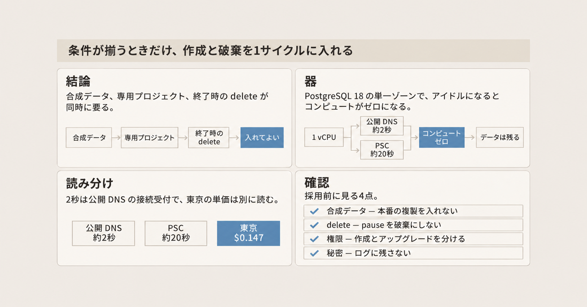
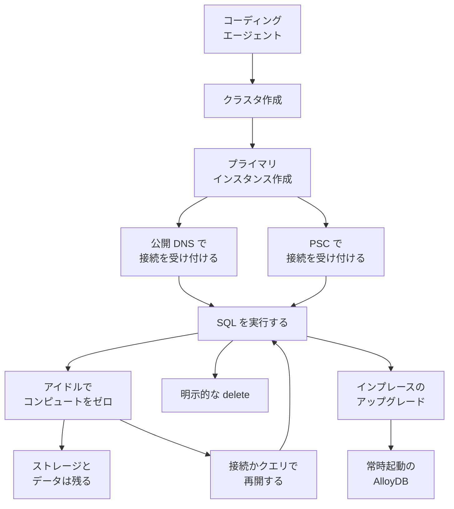

AlloyDB Express は、AlloyDB for PostgreSQL の構成の一つです。試作、開発、テスト、コーディングエージェントの作業向けに、小さな PostgreSQL を払い出し、使っていないあいだはコンピュートをゼロにします。2026-11-04 時点では Preview で、載せる PostgreSQL は 18 だけです。同じクラスタを、後から通常の AlloyDB 構成へ上げる経路があります。

この記事では、器の大きさ、接続の受け付け方、アイドル時の課金、通常の AlloyDB や手元の PostgreSQL との違いを整理します。読み終えると、エージェントの 1 サイクル（作業を始めてから終えるまでの 1 回）にデータベースの作成と破棄を入れてよいかを、データの種類、権限、終了手順で判断できます。

秒数、価格、対応範囲は、2026-11-05 に確認した公式 overview、英語の価格ページ、2026-11-04 の発表ブログ（Ravi Murthy / Gopal Ashok）の記述です。

*この記事の全体像。以下、順に解説します。*

## AlloyDB Expressとは

利用者は、エージェントの 1 サイクルにデータベースの作成と破棄を入れるかを決める開発者です。

### 払い出す器

プライマリは単一ゾーンです。サイズは 1 vCPU / 4 GB か、2 vCPU / 8 GB です。作成時の `cpuCount` は 1 だけです。2 にするのは作成後の更新です。

ストレージは自動で増えます。上限は 20 GB です。上限に達すると、それ以上の書き込みはできません。

`max_connections` は 200 で固定です。フラグを変えても効果はありません。

小さいメモリでメモリ不足を防ぐため、拡張のメモリ使用量は固定です。`google_plan_management` 拡張のプール `managed_plans_pool_size_in_mb` は 10 MB です。カラムナエンジンのメモリ `google_columnar_engine.memory_size_in_mb` は 400 MB です。自動カラム化（`enable_auto_columnarization`）とカラムアドバイザ（`enable_columnar_advisor`。カラムナエンジンの推奨を出す設定）は無効です。

対応リージョンは asia-east1、asia-east2、asia-northeast1、asia-southeast1、australia-southeast1、europe-west2、us-west1 です。東京（asia-northeast1）が含まれます。

マイナーバージョンとセキュリティ更新はサービスが適用します。典型的には再開時です。稼働中なら、低利用の時間帯です。

管理インターフェースはコンソール、gcloud、REST API です。MCP（AlloyDB の remote MCP サーバーへ、ツール呼び出しで接続する経路）から `create_cluster` と `create_instance` を呼べます。

### 接続を受け付けるまで

払い出しは、完了を待つ操作を 2 段に分けます。先にクラスタを作り、そのあとプライマリインスタンスを作ります。

接続を受け付けるまでの公式の目安は、経路で分かれます。公開 DNS は約 2 秒です。公開 DNS は、公開 IP アドレスの代わりに、Virtual Private Cloud（VPC。クラウド内の自分のネットワーク）の外からつなぐための DNS 名です。Private Service Connect（以下 PSC。コンシューマ側の Google Cloud プロジェクトを許可リストに載せ、その VPC からエンドポイントでつなぐ接続）は約 20 秒です。PSC はデータベースを公開インターネットには出しません。

クエリが終わりアイドルになると、コンピュートがゼロになります。ストレージとデータは残ります。次の接続かクエリで再開します。再開の公式の目安は約 20 秒です。データを消す操作は、明示的な delete です。別の操作として、同じクラスタを通常の AlloyDB へ上げられます。

公開 DNS 名への直接接続は、既定ではクライアント IP をすべて拒否します。許可は CIDR のリストです。更新は、そのリスト全体の置換です。

gcloud、REST、MCP のクラスタ作成は、既定で PSC のみです。コンソールは、公開 DNS と PSC の両方を既定で有効にします。PSC の許可リストは、プライマリインスタンスの作成か更新で指定します。エンドポイント自体を、サイクルのたびに作るのか、事前に一度用意するのかは、その手順には書かれていません。

認証はパスワードか、IAM データベース認証です。IAM データベース認証は、パスワードの代わりに、IAM のアクセストークンでデータベースへ入る方式です。

コンピュートは秒課金です。アイドルでコンピュートがゼロのあいだは、コンピュートを課金しません。ストレージは、そのあいだも課金します。

### 掲載されている単価

2026-11-05 の英語価格ページでは、1 CU は 1 vCPU 対 4 GB です。コンピュートの時間単価は次のとおりです。

| リージョン | 1 CU の時間単価 |
|---|---|
| us-west1 | $0.115 |
| asia-northeast1（東京） | $0.147 |
| asia-east1 | $0.133 |
| asia-east2 | $0.161 |
| asia-southeast1 | $0.141 |
| australia-southeast1 | $0.144 |
| europe-west2 | $0.131 |

同じページの AlloyDB Express Database storage 表では、単位は 1 Gibibyte Month です。

| リージョン | ストレージ |
|---|---|
| us-west1 | $0.30 |
| asia-northeast1（東京） | $0.384 |
| asia-east1 | $0.348 |
| asia-east2 | $0.42 |
| asia-southeast1 | $0.369 |
| australia-southeast1 | $0.375 |
| europe-west2 | $0.342 |

無料枠は、請求先アカウントあたり、最初の 12 か月、毎月 50 compute units と 2 GB のストレージです。1 vCPU のインスタンスは 1 compute unit、2 vCPU は 2 compute units です。50 compute units が 50 CU・時を指すかは、原文の単位だけでは閉じません。課金開始の文言は "Billing starts from December 2026" です。最初の 12 か月と、この課金開始の文言がどう重なるかは、価格ページの並記だけでは分かりません。確約利用割引（CUD）はありません。

## 通常の AlloyDB や手元の PostgreSQL との違い

比較の軸は、用途、準備、器の上限、可用性、接続、版、暗号、課金、データの置き場所です。

| 基準 | AlloyDB Express | 通常の AlloyDB | マシン内の使い捨て PostgreSQL |
|---|---|---|---|
| 用途 | 試作、開発、テスト、エージェント作業 | 開発、テスト、本番 | 合成データでのローカル検証 |
| 準備の公式目安 | 公開 DNS 約 2 秒、PSC 約 20 秒 | 数分 | プロセス起動 |
| コンピュート | 1 または 2 vCPU。アイドルでゼロ | 最大 288 vCPU。読み取りプール最大 20。常時起動 | そのマシンの余力 |
| ストレージ | 最大 20 GB | 最大 128 TB | ディスクの余力 |
| HA とバックアップ | スタンバイ無し。バックアップ無し。ポイントインタイムリカバリ（PITR）無し | リージョン HA、セカンダリ最大 5、自動バックアップ、PITR | プロセス終了で消える |
| SLA | 無し | リージョン HA で 99.99% | 無し |
| 接続 | 公開 DNS と PSC。公開 IP アドレスは非対応 | 公開 IP、PSC、private services access | ローカルソケット |
| PostgreSQL | 18 のみ | 14、15、16、17、18 | 選んだ版 |
| 暗号 | Google 既定。顧客管理の暗号鍵（CMEK）は非対応 | 既定または CMEK | 自分で決める |
| 課金 | 秒課金。アイドル中のコンピュートは $0。アイドル中もストレージは課金。2026-12 から課金開始の文言 | 時間課金。1 年・3 年の CUD。8 vCPU の 30 日試用は別物 | マシンの電気とディスク |
| データの置き場所 | 選んだクラウドリージョン | 同左 | マシンの外へ出ない |

読み取りプールは、読み取り専用の追加インスタンスです。通常の AlloyDB は最大 20 ノードで、Express は読み書きを単一のプライマリが担当します。セカンダリは、別リージョンへ複製する副クラスタです。同じリージョンで障害時に切り替えるスタンバイや、読み取りプールとは別です。Express にはありません。private services access は、公開 IP および PSC と別に、通常の AlloyDB の接続方式として並ぶ名前です。Express の接続はこの名前を使いません。PSC との手順の差は、Express の overview にはありません。

インプレースのアップグレード後は、接続文字列、DNS、データ、スキーマ、ユーザー資格情報、ネットワークが維持されます。アイドルでコンピュートをゼロにする動作は切れ、常時起動の AlloyDB 料金になります。vCPU 数は維持されます。メモリ比は 1:4 から 1:8 になります。

1 vCPU のまま上げられるのは、C4A マシンシリーズに対応するリージョンに限られます。C4A は、そのアップグレード手順がマシンシリーズの名前として書く識別子です。上に挙げた Express の対応リージョンのどれが C4A かは、作成手順の本文には列挙されていません。非対応なら、先に 2 vCPU へ変更します。アップグレードの操作の中で CMEK へ切り替えることはできません。上げたあと別操作で付けられるかは、この手順には書かれていません。SLA 99.99% は、アップグレード後に HA を有効にしたクラスタの話です。アップグレード操作そのものが HA を自動で付ける、とは書かれていません。Express へ戻す操作はありません。

## 注意点

発表ブログと公式 overview は、同じ速さや同じ作成手段を指しているとは限りません。価格も、地域と単位を落とすと別の数字になります。

### 準備時間とアイドルの分数

ブログは、準備が "under two seconds" であり、新しいクエリが来ると "seconds" で起き、"15 minutes of inactivity" で pause する、と書きます。この pause は、コンピュートをゼロにするアイドルを指す記述です。削除ではありません。公式 overview が秒数を分けているのは次の 3 つです。

| 読みたいもの | 公式 overview | 発表ブログ |
|---|---|---|
| 公開 DNS の接続受付 | 約 2 秒 | under two seconds |
| PSC の接続受付 | 約 20 秒 | seconds と一括 |
| アイドル後の再開 | 約 20 秒 | seconds で起きる |
| 作成 API 全体の所要時間 | 記載は無い | 準備が under two seconds |
| pause するまでの分数 | 本文に分数は無い | 15 minutes of inactivity |

2 秒は、公開 DNS が接続を受け付けるまでの目安です。PSC の接続受付と、アイドル後の再開は約 20 秒です。作成は 2 段の操作です。待ち時間のすべてが 2 秒になるわけではありません。

15 分は公式ブログの記述です。2026-11-05 に読んだ overview 本文には、アイドル閾値の分数はありません。ドキュメント本文の仕様としては未確定です。

### Terraform

ブログは Terraform を作成手段に挙げます。overview の limitations は、Terraform と Config Connector を非対応と書きます。Config Connector は、通常の AlloyDB の管理インターフェースとして Terraform と並ぶ名前です。比較表の Express 列は、コンソール、gcloud、REST API です。2026-11-05 時点の公式文書同士で、どちらが正かは決まりません。採用判断では limitations を優先し、Terraform 対応とは扱いません。

### 価格の読み方

ブログが地域を書かずに出す $0.115 は、英語価格ページの表では us-west1 の 1 CU 時間単価です。東京で読むときは $0.147 の行を使います。ストレージも同様で、東京は $0.384 / 1 Gibibyte Month です。

同じ価格ページの計算例は、US_CENTRAL1、1 CU、1 日 5 時間、ストレージ 10 GB で、コンピュート $0.575、ストレージ $0.098、合計 $0.674 と書きます。ストレージ行は $0.30/GB・月を 730 時間で割り、24 時間 × 10 GB としています。コンピュートは 5 時間分、ストレージは 24 時間分です。対応リージョン一覧に us-central1 はありません。この例の地域は一覧と一致しません。計算例の単位は GB、表の単位は Gibibyte Month です。計算例とブログの $0.30 は、us-west1 の $0.30 / 1 Gibibyte Month と一致します。

無料枠の "50 compute units" が 50 CU・時を指すかは、原文の単位だけでは閉じません。ブログの "50 free CUs every month" は、12 か月と 2 GB を落とした短縮です。2026-11-05 に取得した日本語の価格ページには、AlloyDB Express の文字列はありませんでした。通常 AlloyDB の 30 日試用を、Express の無料枠と読まないでください。

### Express の器に付いていない主張

300 万 queries per second、sub-millisecond I/O、集約スキャンが terabit/s、という記述は、2026-11-04 のまとめブログが本番側のエージェント用インスタンスに付けている主張です。Express の器は 1 vCPU か 2 vCPU と、20 GB です。

2026-09-24 の "PostgreSQL for agents" は、本番データ向けに隔離したインスタンスを用意する別発表です。読み取りプールの接続断は、Express が読み取りプールを持たないため、Express の障害としては転記しません。ブログの「市場の PostgreSQL サービスで、これまでこの組み合わせは無かった」は発表者の主張で、比較表や件数は付いていません。

### 2026-11-05 時点で閉じていないこと

次の項目は、公式文書を読んだ範囲では値が確定しません。断定せず、判断への影響だけを後の節で分けます。

- IAM データベース認証トークンの有効秒数。Cloud SQL の「1 時間」は Cloud SQL の文なので、Express には適用しません。AlloyDB Auth Proxy は、Express へ接続する公式クライアントの一つです。その一時 SSL 証明書が 24 時間なのは、データベースパスワードの寿命ではありません。
- インスタンスごとの per-minute サインイン quota の回数。超過すると一時的にサインインできない、とだけあります。
- クラスタ数の既定クォータを Express が消費するか。既定値そのものが、プロジェクトごと、リージョンごと 3 から 10 の幅で、上限は 20 です。2026-11-05 に再取得したクォータページの更新表示は 2026-11-03 UTC で、Express の公開日 2026-11-04 より前です。本文に Express の名指しはありません。ページの「プライマリは VM を 2 つ使う」は、Express の単一ノードと揃いません。
- Mutate API の既定は、プロジェクト、リージョン、ユーザーの組み合わせごとに 1 分あたり 180 から 250 リクエストです。`clusters.create`、`instances.create`、`clusters.delete` がこのグループに入ります。超過は HTTP 429 `rateLimitExceeded` です。Express 専用の例外、推奨バックオフ、タイムアウトは確認できませんでした。
- Express 固有の CVE は、NVD の名称検索では見つかりませんでした。結果ページの本文は取得時にエラーで、不存在とは扱いません。
- Express 向けの実行可能ノートブックは、探索した範囲では見つかりませんでした。AlloyDB AI は、overview が小さいインスタンスでも使えると書く機能で、ScaNN によるベクトル検索と、SQL から埋め込みの作成や Gemini モデルの呼び出しをする関数を含みます。AlloyDB AI 一般のノートブックを、Express で動く実例としては転記しません。
- overview はガバナンス制御として、データレジデンシー、Access Transparency、Access Approval をサポートすると名指しします。各項目の手順は、その文にはありません。保管場所をリージョンに限る共通文書は、Express を名指ししていません。Express 固有の保管保証文は確認できませんでした。
- AlloyDB 共通のバージョン表では、PostgreSQL 18 の通常サポート開始が 2026-03-18 で、その行に default とあります。延長サポート開始と deprecation の欄は空です。2026-03-18 は Express の開始日ではありません。Express の Preview 開始は 2026-11-04 です。

pause は削除ではありません。データとストレージ課金が残ります。バックアップと PITR が無いので、delete は戻せません。自動で消える期限は、2026-11-05 に読んだ範囲の公式文書には見当たりません。

overview 自身は、Pre-GA、"as is"、サポートは限られる、と書きます。SLA はありません。

払い出しの速さは、上の表の公式の数字として読めます。15 分、Terraform、50 compute units の単位、トークン寿命、クォータ適用は、2026-11-05 時点では閉じていません。300 万 queries per second などの性能主張は、Express の器の話ではありません。

## 1サイクルに作成と破棄を入れる条件

次が同時に揃うとき、エージェントの 1 サイクルに作成と破棄を入れてよい、が現時点の結論です。

- 投入データが合成データである。本番データの複製を入れない。
- プロジェクトが専用である。本番のネットワークと本番の接続情報に届かない。
- エージェントの権限が、クラスタ作成と削除に足り、アップグレードと本番ネットワークの変更を含まない。この分け方の事前定義ロールは、作成手順にありません。
- サイクルの終了手順が delete を呼ぶ。pause を破棄の代わりにしない。
- 初期パスワードと IAM トークンを、コマンド履歴、CI ログ、リポジトリに残さない。
- 公開 DNS を使うときは、許可 CIDR をその実行に必要な範囲だけにする。リスト更新は全置換なので、広い CIDR を足すと閉じた入口が開きます。

この結論を支える公式の事実は 3 つです。用途にコーディングエージェントの作業が含まれ、公開 DNS の接続受付は約 2 秒で、アイドル時のコンピュート課金はゼロです。削除は明示的な API なので、サイクルが delete を呼べばクラスタを残さずに終われます。コンソール以外の作成既定は PSC のみで、公開 DNS は既定で全クライアント IP を拒否します。入口は最初から開いていません。

同じ結論を弱める事実もあります。ドキュメントがクラスタの作成と管理のロールとして名指しするのは `roles/alloydb.admin`、`roles/owner`、`roles/editor` です。AlloyDB の remote MCP サーバー（上の MCP）を使うときは、MCP Tool User（`roles/mcp.toolUser`）が追加で要ります。作成手順は、このロールの権限範囲をそれ以上は書いていません。admin、owner、editor はクラスタの更新を含みます。アップグレードは、接続文字列を維持したまま常時課金へ移します。作成を許すことと、本番形への到達を止めることは、このロール一覧では分かれていません。作成だけを許しアップグレードを拒む事前定義ロールの名前は、作成手順にはありませんでした。分けるならカスタムロールです。

秘密の残り方にも経路があります。gcloud の `--password`、REST の `initialUser.password`、IAM 手順の `PGPASSWORD=$(gcloud auth print-access-token)` は、コマンド履歴、ログ、リポジトリに秘密が残る経路です。トークンの有効秒数は、IAM 認証ページと接続ページにありません。

トークン寿命、自動削除、クォータ適用が未確認でも、先に進める手当ては決まっています。サイクル終了時に明示 delete する。秘密をログに残さない。並列数は小さく始める。必須 CI の信頼性の床にする判断は、SLA が無く、overview が Pre-GA でサポートは限られると書いている時点で止まります。夜間の必須 CI の土台にすると、制御プレーンと Preview の停止が検証の停止になります。

AlloyDB の拡張（ScaNN や、SQL からの Gemini のような AlloyDB AI）が検証対象のとき、クラウド側の器に意味があります。標準の PostgreSQL だけで足りる検証は、マシン内の使い捨て PostgreSQL のほうが、データを外へ出さず、プロセス終了で捨てられます。

直近の確認は 3 つで足ります。専用プロジェクトで作成権限とアップグレード権限が分かれるか。1 サイクルの終了で delete が必ず走るか。ログにパスワードやアクセストークンが出ないか。

## Expressを採用しない条件

次のどれかに当たる検証では、Express を採用しません。

- 結果を残す検証、20 GB を超えるデータ、同時実行が 200 接続を超える検証。
- HA、バックアップ、PITR、SLA、CMEK が要る検証。
- Terraform で払い出しを再現することが採用条件になっているチーム。overview の limitations は非対応と書き、発表ブログは作成手段に挙げます。
- 課金の地域を us-west1 のコンピュート $0.115、ストレージ $0.30 / 1 Gibibyte Month で見積もること。東京は 2026-11-05 時点の掲載値で、コンピュート $0.147、ストレージ $0.384 / 1 Gibibyte Month です。

払い出しの速さは公式の数字として採用できます。その速さは、本番へ届かないことの保証ではありません。アップグレードが、試作の器から常時起動の AlloyDB への到達経路です。

## まとめ

AlloyDB Express は、PostgreSQL 18 だけの Preview で、1 vCPU / 4 GB から始まる単一ゾーンの器です。公開 DNS の接続受付は約 2 秒、PSC とアイドル後の再開は約 20 秒です。アイドルでコンピュート課金は止まり、データとストレージ課金は残ります。消す操作は delete です。

エージェントの 1 サイクルに作成と破棄を入れるのは、合成データ、専用プロジェクト、作成と削除に足りてアップグレードを含まない権限、終了時の delete、秘密を残さない接続、必要最小の CIDR、が同時に揃うときです。20 GB、200 接続、HA、バックアップ、PITR、SLA、CMEK、Terraform 再現のどれかが条件なら採用しません。東京の見積もりは、2026-11-05 時点でコンピュート $0.147、ストレージ $0.384 / 1 Gibibyte Month です。

この記事が少しでも参考になった、あるいは改善点などがあれば、ぜひリアクションやコメント、SNSでのシェアをいただけると励みになります！

## 参考リンク

- [AlloyDB Express overview](https://docs.cloud.google.com/alloydb/docs/express-overview)
- [Express の作成と管理](https://docs.cloud.google.com/alloydb/docs/create-manage-express-clusters)
- [AlloyDB overview](https://docs.cloud.google.com/alloydb/docs/overview)
- [価格（英語）](https://cloud.google.com/alloydb/pricing)
- [発表ブログ（2026-11-04）](https://cloud.google.com/blog/products/databases/introducing-alloydb-express-for-rapid-testing-and-prototyping/)
- [IAM データベース認証](https://docs.cloud.google.com/alloydb/docs/database-users/iam-authentication)
- [IAM での接続](https://docs.cloud.google.com/alloydb/docs/connect-iam)
- [Auth Proxy](https://docs.cloud.google.com/alloydb/docs/auth-proxy/overview)
- [クォータ](https://docs.cloud.google.com/alloydb/quotas)
- [バージョン方針](https://docs.cloud.google.com/alloydb/docs/db-version-policies)
- [PostgreSQL for agents（2026-09-24、別発表）](https://cloud.google.com/blog/products/databases/announcing-postgresql-for-agents-in-alloydb)
- [同日のまとめブログ](https://cloud.google.com/blog/products/databases/whats-new-across-googles-agentic-data-cloud)
