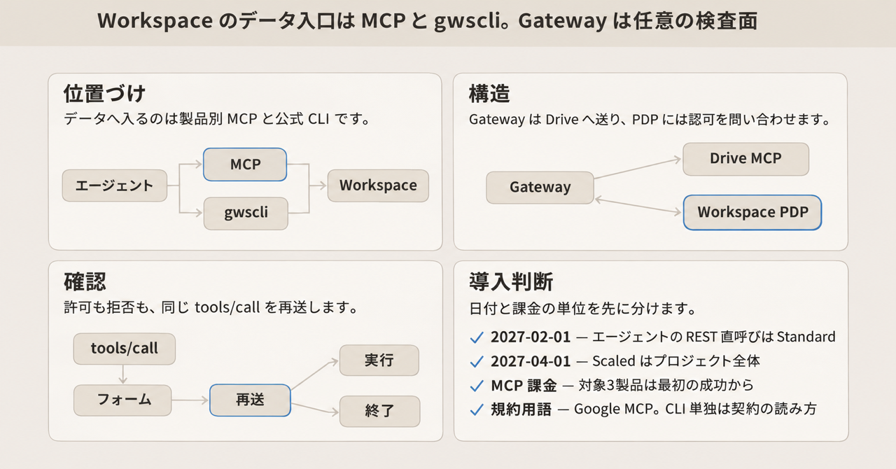
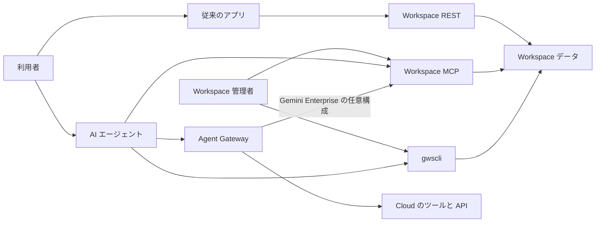
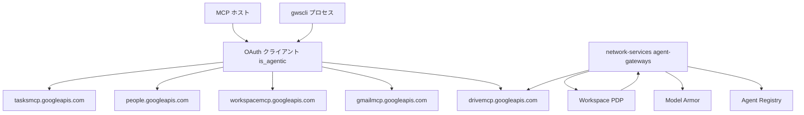
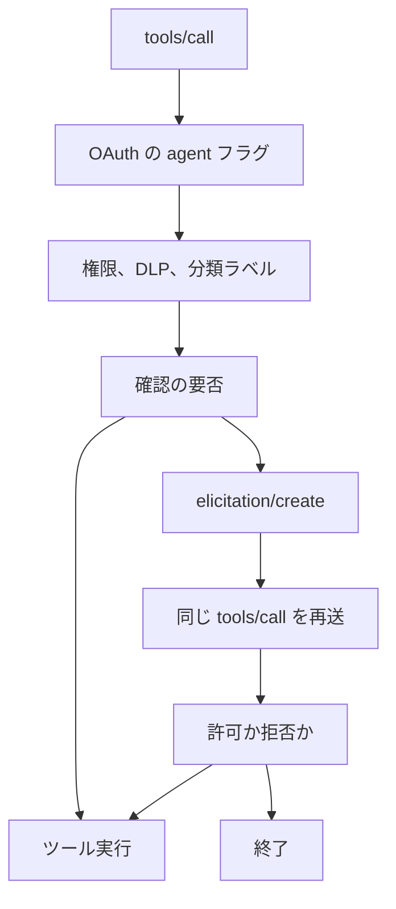
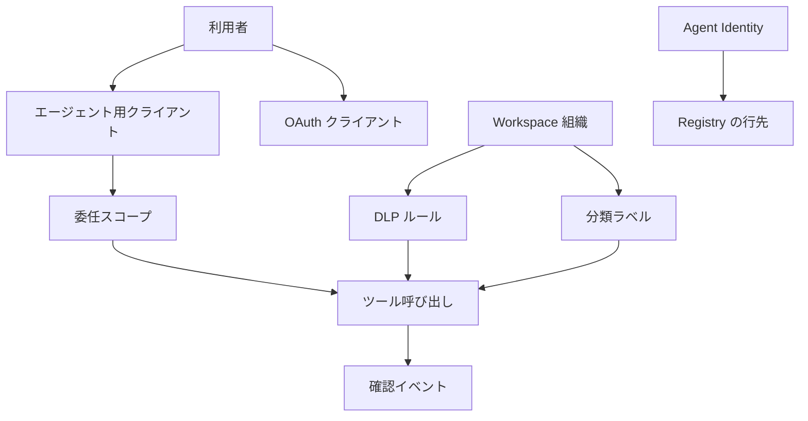
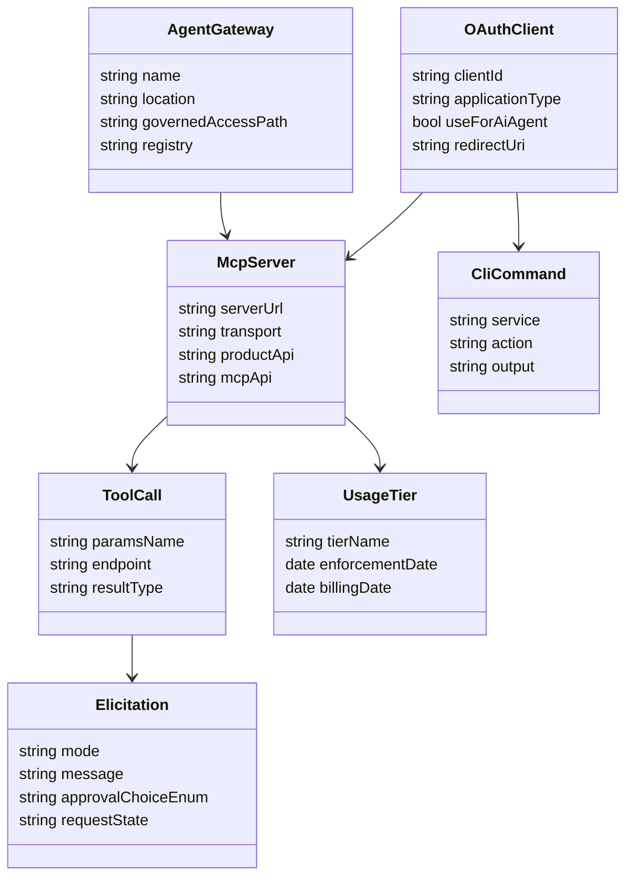

2026-11-24 に Google は、Workspace の Model Context Protocol（MCP）サーバーと公式 CLI を一般提供しました。MCP は、クラウド上や Web 上のエージェントが、Google のホストするツールを呼ぶプロトコルです。公式 CLI のバイナリ名は `gwscli` で、同じ Workspace の操作を端末、VM、コンテナから呼びます。2026-03 に公開した記事の `gws` はコミュニティ製の `@googleworkspace/cli` で、本稿の対象ではありません。移行表は [googleworkspace/cli](https://github.com/googleworkspace/cli#moving-to-the-official-google-workspace-cli) にあります。Cloud Blog は、Google Cloud の Agent Gateway をこの発表と並べて説明しています。Agent Gateway は、Cloud 上の LLM、MCP、Agent2Agent（A2A）のトラフィックを受けるプロトコル対応のゲートウェイです。A2A は、エージェント同士が通信するプロトコルです。表示日の違いは、運用の日程表にまとめます。

この記事では、エージェント向けの入口がどう分かれ、呼び出しのたびに何が検査され、接続と運用をどの識別子で行うかを整理します。手順と値は、公開された開発者ガイド、Workspace Updates、Cloud Blog、Workspace Blog、管理コンソールのヘルプに沿います。


*この記事の全体像。以下、順に解説します。*

## Google Workspace MCPとは

Workspace MCP サーバーは、クラウド上や Web 上のエージェント向けに Google がホストするリモートサーバーです。一般提供の発表が覆うのは Gmail、Drive、Docs、Sheets、Slides、Calendar、Chat、Tasks です。Keep は今後の対象です。開発者ドキュメントはこれに加え、People、Classroom、横断検索（Universal Search）のサーバーも説明しています。People、Classroom、Universal Search の個別ガイドは Developer Preview で、Classroom と Universal Search は Developer Preview Program への参加が前提です。Universal Search がまたげるのは Gmail、Drive、Calendar、Chat で、実際に検索する製品は同意したスコープに従います。

Workspace CLI は、端末、VM、コンテナサンドボックスで動くローカルエージェント向けです。実行時にコマンドとスキーマを発見し、JSON を返し、スコープを絞った OAuth でサインインします。敏感な操作には、組み込みの human in the loop（HITL、人の確認）があります。

Agent Gateway は、Agent Registry に対して Agent Identity を確かめ、IAM と外向きの default-deny を適用します。Agent Registry は、Agent Identity と、MCP などの行先を登録する台帳です。Agent Identity は Cloud 上のエージェントの識別子です。default-deny は、許可を明示しない行先を拒否する初期状態です。Model Armor は、有効化したときにプロンプトと応答を検査する Cloud のフィルタです。ゲートウェイ作成例の YAML だけでは Model Armor は有効になりません。Workspace MCP の設定ガイドが必須とする検査は、別ページの手順です。

エージェント向けの入口は、この 3 つです。Workspace のデータへ入るのは製品別 MCP と `gwscli` です。Agent Gateway は Cloud 上の通信の検査面で、そこから Workspace MCP へつなぐのは Gemini Enterprise で選ぶ任意構成です。従来のアプリは、これまでどおり Workspace の REST API を使います。2027-02-01 の技術的強制について、利用枠ガイドは、AI エージェント等が Workspace の REST を直接呼ぶと、選んだ tier にかかわらず Standard のクォータに制限される、と書いています。同じ日に Addendum が発効し、MCP の利用が要件になります。Workspace Updates が移す先として書くのは Workspace MCP です。Addendum が名指しするのは Google MCP で、定義は server、endpoint、tool interface です。CLI は Access Point の定義に command line interface として入りますが、CLI だけで Google MCP の要件を満たすかは契約の読み方です。

Cloud Blog は、Workspace API が月間 2.8 兆回を超え、公開 Drive API のトラフィックは 2022 年の 2.5 倍を超え、Drive の API 呼び出し元からの読み取りが 1 日 180 億回を超える、と書いています。同じ記事は、従来の REST が有効な OAuth トークンが利用者の意図を含意する前提で作られており、エージェントが機械の速さで動くとその前提だけでは足りない、と書いています。権限検査、データの境界、人の確認をリクエスト経路に置く、というのが今回の切り分けです。

Workspace 側の毎回の検査は、組織の権限、既存のユーザー単位 DLP ルール、分類ラベルです。DLP は、データ損失防止のルールです。Cloud 側の Agent Gateway が載せる検査は、IAM と外向きの default-deny です。Model Armor は、ゲートウェイで有効化したときにリクエストと応答を見ます。両者は同時に発表され、ポリシーエンジンは別です。Gemini Enterprise では、Workspace MCP への入口を Agent Gateway と Workspace の Policy Decision Point（PDP）に載せる任意構成があります。PDP は、Admin console のアクセス制御を、ゲートウェイ経由の MCP 入口に適用する決定点です。

Agent Gateway から Workspace MCP へ向かう線は、Gemini Enterprise で選ぶ任意構成です。Google Cloud 上で動くエージェントの外向きと内向きは、Agent Gateway が別の検査面になります。

## 特徴

エージェント専用の OAuth クライアントを要求します。Cloud コンソールの「Use this client for an AI-powered agent」を選んだクライアントだけが、ユーザー委任で MCP と CLI を呼びます。Workspace Updates はこの選択を設定名 `is_agentic` と書いています。Cloud Blog は、Workspace MCP が非エージェントの OAuth クライアントを拒否する、と書いています。ドメイン全体の委任を使うサービスアカウントは、agent 設定が無いことだけでは拒否しない、と MCP 設定ガイドは書きます。敏感なツールでは人の確認が残ります。

権限と DLP は呼び出しのたびにかかります。Workspace Updates は、既存のユーザー単位 DLP がエージェント利用時に自動で適用され、監査ログがエージェントの操作と利用者の確認を残す、と書いています。

HITL はサーバー側のポリシーで決まります。外部エージェントの共有を伴う書き込みは、管理コンソールの既定では確認を求めます。自分だけの私的な書き込みは既定で確認なしです。ゴミ箱へ移す操作は、確認の選択肢が `ALLOW_ONCE` と `DENY_ONCE` だけで、呼び出しをまたぐ持続承認を出しません。持続承認が返る操作では、管理者が「Except when user always allows」を残すと、保存した Always allow は最長 90 日です。coming soon の時間制限と、OAuth アクセス トークンの約 1 時間とは別です。外部データへの読み取りも、既定では確認対象です。

下書きの作成や文書の要約は、Cloud Blog の説明では自律で進みます。メール送信、Drive の共有変更、一括編集は、Cloud Blog が高影響の例として挙げる操作です。Gmail と Drive の公開ツール一覧に、メール送信や共有権限の変更そのものの名前があるとは、本稿では確認していません。人が確認すればその 2 つを今の公開ツールで実行できる、という意味には読みません。

Workspace Blog は、MCP が境界の内側で relevant context を返すと書いています。Workspace Updates が書くのは synthesized summaries です。設定ガイドの動作確認には、スレッドの `gmail.get_thread` やファイルの `drive.read_file_content` も載っています。返却内容はツールごとに異なり、本文を返すツールもあります。CLI は端末上で複数ツールを鎖状に呼べます。

コマンド体系は実行時に発見します。CLI ドキュメントは、固定のコマンド署名を静的スクリプトに頼らないよう明記しています。

利用枠は Standard と Scaled の 2 段です。一般提供の MCP 8 製品では、Standard は 1 製品・1 プロジェクト・1 日 5,000 リクエストまでで、請求先アカウントは要りません。1 回のツール呼び出しが複数リクエストに数えられることがあります。Scaled の課金開始は 2027-04-01 です。その日以降、Gmail、Calendar、Drive の REST は日次の無料枠を超えた分が課金対象で、同じ 3 製品の MCP は Scaled では最初の成功リクエストから課金されます。Scaled を選んだだけでは上限は増えず、クォータ増加の申請が別途要ります。利用枠ガイドは、Standard を超える枠が必要になるアクティブな開発者は 1% 未満と見込んでいます。Workspace Updates は、アクティブな開発者の 99% 超が今は Standard の範囲で運用している、と書いています。

Addendum（最終更新 2026-11-24）は、利用者データと Google Technical Information の処理目的を、現在進行中の、利用者が許可したタスクに限る、と書いています。30 日以内であっても、別タスクへ転用する許可にはなりません。学習、ファインチューニング、評価データセットの構築、蒸留も禁じます。スクレイピング、許可された作業を超える系統的な探索も禁じます。利用者データまたは Google Technical Information を使って、Google Workspace のサービスに似た製品を開発することも禁じます。Google Technical Information の保存は 30 日が上限です。切断または失効の時点で、利用者データと Google Technical Information の両方を残してはなりません。先に切断した場合は、30 日を待たずに保持を終えます。Google Technical Information の定義には、ベクトル埋め込み、メモリ索引、利用者プロファイル、組織グラフ、呼び出しの失敗パターンが含まれます。利用者データそのものは、この定義に含まれません。AI Harness は、AI Agent を配置できる、ツールや API を呼べる、または 1 つ以上の AI Agent の作業を編成できるソフトウェア層です。3 条件のすべてを満たす必要はありません。Addendum は、AI Agent、AI Harness、AI モデルを用いるアクセスツールに Google MCP の使用を求めます。

Agent Gateway は MCP の JSON-RPC からツール名とメソッド属性を取り、ツール単位のアクセスポリシーに使います。対応プロトコルは MCP、A2A、REST、gRPC です。1 つの Agent Gateway インスタンスが統治できる、Agent Registry に登録済みの資源は 5,000 までです。

## 構造

人と従来アプリは、これまでどおり Workspace REST を使います。2027-02-01 に Updates が技術的強制の経路として名指ししているのは Workspace MCP です。CLI は 2026-11-24 に一般提供された入口です。

### システムコンテキスト図



コンテキスト図の `gwscli` から Workspace データへの矢印は、到達先を示します。呼び出しは、コンテナ図のとおり製品別の MCP サービスを有効にしたうえで行います。

| アクター | 使う入口 | この入口が守るもの |
|---|---|---|
| 従来のアプリ | Workspace REST | 人が操作する速さのアプリ。有効なトークンが意図の代理になる前提を残す |
| クラウド / Web のエージェント | 製品別リモート MCP | 権限、DLP、分類ラベル、サーバー駆動の HITL |
| 端末 / VM / コンテナのエージェント | `gwscli` | スコープを絞った OAuth、JSON、組み込み HITL |
| Cloud 上のエージェント実行 | Agent Gateway | Agent Identity、Registry、IAM の default-deny。Model Armor は構成したとき |
| Workspace 管理者 | API controls と Agents の Settings | OAuth クライアントの信頼は API controls。外部エージェントの確認は User review for external agents。監査は Access Evaluation log events |
| 従来アプリの開発者 | REST のまま | Addendum の MCP 必須は、AI エージェントと、それに類するアクセスツールが対象 |

### コンテナ図

MCP は製品ごとにホストが分かれます。People API だけは `people.googleapis.com` が MCP も兼ねます。横断検索は `workspacemcp.googleapis.com` です。CLI はローカルプロセスで、同じ `*mcp.googleapis.com` サービスをプロジェクトで有効にしたうえでコマンドを発見します。Agent Gateway は Network Services の資源で、Agent Registry と Model Armor と IAM を横に置きます。



データの経路は Agent Gateway から Drive MCP です。Workspace PDP は、Gateway からの認可問い合わせに答える側で、Drive への呼び出しを中継しません。ヘルプが登録例に挙げる接続先は Drive MCP です。

| コンテナ | 置き場所 | 主な入出力 |
|---|---|---|
| リモート MCP | `https://<product>mcp.googleapis.com/mcp/v1` | Streamable HTTP。OAuth 2.0。ツール一覧はサーバーが返す |
| `/mcp/v1self` | 同じホストの限定エンドポイント | フォーム elicitation をまだ持たないホスト向けのフォールバック |
| Universal Search | `https://workspacemcp.googleapis.com/mcp/v1` | `search_corpus`。Gmail、Drive、Calendar、Chat を 1 回で検索 |
| `gwscli` | `~/.local/bin` または `GWSCLI_INSTALL_DIR` | `gwscli <service> <action>`。標準出力は JSON |
| Agent Gateway | `gcloud network-services agent-gateways` | プロトコル MCP。`governedAccessPath` に `AGENT_TO_ANYWHERE` などを指定 |
| Workspace PDP | Gemini Enterprise の任意構成 | Admin console のアクセス制御を、Agent Gateway 経由の MCP 入口に適用 |
| 監査 | Admin console と Cloud Audit Logs | エージェント操作と、利用者の確認。Cloud 側は Agent Observability へも出す |

Streamable HTTP は、この MCP サーバーが使う HTTP トランスポートの名前です。フォーム elicitation は、サーバーが `elicitation/create` を返し、利用者にフォームで確認させる MCP の手順です。`/mcp/v1self` は、フォーム elicitation をまだ持たないホスト向けの限定エンドポイントです。elicitation ガイドが載せるのは、一般提供の各サーバーと Universal Search です。People は `/mcp/v1` だけで、`/mcp/v1self` はありません。確認が要るツールを、フォーム elicitation を宣言せずにどちらのパスで呼んでも、コード `-32021` になります。`/mcp/v1self` は確認が要る操作の回避先ではなく、常に確認が要るツールを外し、検索は確認なしで届く範囲に絞ります。`governedAccessPath` の `AGENT_TO_ANYWHERE` は、エージェントから外向きに出る経路の指定です。

### コンポーネント図

1 回の MCP ツール呼び出しでは、OAuth のエージェント判定のあと、Workspace の権限、DLP、分類ラベルがかかります。Cloud Blog はこれらを各呼び出しの検査項目として書き、ACL から DLP、確認までの固定順は書いていません。確認が要る呼び出しは `input_required` で止まります。許可でも拒否でも、クライアントは同じ `name` と `arguments` に `requestState` と `inputResponses` を付けて `tools/call` を再送します。サーバーが引数と `requestState` を照合し、許可なら実行し、拒否なら終了します。



| コンポーネント | 役割 | 公式の手掛かり |
|---|---|---|
| agent フラグ | クライアントを AI エージェントとして宣言する | Auth Platform の「Use this client for an AI-powered agent」。Updates は設定名 `is_agentic` と書く |
| 権限検査 | サインインした利用者と同じ ACL を継承する | MCP 設定ガイドの Respect security |
| DLP と分類ラベル | 既存ルールをエージェント呼び出しにも適用する | Workspace Updates の Automatic DLP。Cloud Blog の every call |
| ポリシー評価 | 操作種別、利用者ポリシー、管理者ポリシーで確認の要否を決める | elicitation ガイド |
| フォーム elicitation | `mode: "form"` の `elicitation/create` | MCP プロトコルのフォーム elicitation。サンプルのプロトコル版文字列は `2026-07-28` |
| 拒否の終了 | 同じ `tools/call` に選択結果を載せて再送し、拒否結果のあと別ツールでやり直さない | エラーメタ `UserDeniedAction`。クライアントが elicitation を宣言しないと JSON-RPC `-32021` |
| Model Armor | プロンプトとツール応答のインジェクションと機微データ | Cloud Blog は Workspace MCP が Model Armor と連携すると書く。Agent Gateway ドキュメントはゲートウェイにフィルタを付ける |
| Agent Identity | SPIFFE ID。既定で mTLS と DPoP | Agent Gateway 概要。共有の長期鍵は置かない、と Cloud Blog は書く |

`UserDeniedAction` は、利用者が確認を拒否・辞退・取り消したときのエラーメタデータです。JSON-RPC の `-32021` は、クライアントがフォーム elicitation を宣言していないために確認を完了できないときのコードです。Agent Identity は SPIFFE ID で、既定では mTLS と DPoP を使います。Cloud Blog は、共有の長期鍵は置かない、と書いています。

## データ

### 概念モデル

許可の単位は「人の OAuth クライアント」と「エージェントの OAuth クライアント」で分かれます。エージェントのクライアントは、利用者の権限を委任されて Workspace データへ触ります。組織の DLP と HITL は、その委任の上に毎回乗ります。Cloud 側では、エージェント自身の Agent Identity が Registry に載り、IAM が行先を default-deny で縛ります。利用者委任の認可を Workspace のメールやファイルへ持ち込むことは、Cloud Blog が Agent Identity の説明で述べています。



| 概念 | 意味 | 境界 |
|---|---|---|
| 利用者 | Workspace にサインインする人 | ACL の主体。エージェントは利用者の権限を超えない |
| 組織 | Admin console を持つ Workspace 顧客 | DLP、HITL 規則、接続の許可と失効の主体 |
| 従来クライアント | agent フラグなしの OAuth | REST と、エージェントではない機能向け。MCP のユーザー委任では拒否される |
| エージェント用クライアント | agent フラグあり | MCP と `gwscli` のユーザー委任に必要。非エージェント機能と分ける |
| 委任スコープ | `gmail.compose` や `drive.file` など | ログインは増分で、新しいスコープを足す。`--bundle=readonly` は初回に要求する読み取りで、既存の書き込み権限は削らない。現在値は `gwscli auth status` |
| ツール呼び出し | MCP の `tools/call` または `gwscli <service> <action>` | 検査の単位。REST のメソッドそのものではない |
| 確認イベント | フォーム elicitation または CLI の HITL | 監査ログに、操作と確認が残る |
| Agent Identity | Cloud 上のエージェントの SPIFFE ID | Workspace の OAuth クライアントとは別の識別子。ユーザー委任を載せて Workspace へ入れることがある |
| 利用枠 | Standard または Scaled | プロジェクト単位。internal の印が増枠するのは非エージェント向け REST。MCP の増枠は Scaled とクォータ申請 |

### 情報モデル

次のクラス図は概念モデルです。箱の名前は JSON のフィールド名そのものではありません。公式に確認できたパスは直後の表に置きます。ツールの引数スキーマは実行時発見が前提なので、フィールドの全量はここに固定しません。



クラス図の `useForAiAgent` は、「Use this client for an AI-powered agent」を型に置いた名前です。Updates の設定名は `is_agentic`、Personal mode の URL パラメータは `isAgent=true` です。公開資料はこの 3 つを同一フィールドだとは書いていません。`paramsName` は要求の `params.name`、`approvalChoiceEnum` は応答の `approval_choice.enum` を概念図に置いた名前です。

| 型 | 公式に確認できた値 |
|---|---|
| MCP URL | `https://gmailmcp.googleapis.com/mcp/v1`、`drivemcp`、`docsmcp`、`sheetsmcp`、`slidesmcp`、`calendarmcp`、`chatmcp` の各 `.googleapis.com/mcp/v1`。People は `https://people.googleapis.com/mcp/v1`。Tasks は `https://tasksmcp.googleapis.com/mcp/v1`。Classroom は `https://classroommcp.googleapis.com/mcp/v1`。Universal Search は `https://workspacemcp.googleapis.com/mcp/v1` |
| トランスポート | Streamable HTTP |
| リダイレクト | Antigravity は `https://antigravity.google/oauth-callback`。Claude は `https://claude.ai/api/mcp/auth_callback`。CLI は `http://127.0.0.1:<port>/` |
| 設定ファイル | Antigravity は `~/.gemini/config/mcp_config.json` の `mcpServers.*.serverUrl` と `oauth.clientId`。CLI は `gwscli auth setup --oauth_client_file` |
| elicitation | `resultType: "input_required"`。`method: "elicitation/create"`。`mode: "form"`。再送時に `requestState` と `inputResponses`。未対応クライアントはコード `-32021` |
| CLI 構文 | `gwscli <service> <action> [flags]`。グローバル `--oauth_token`。入力フラグは `--help`、出力の JSON スキーマは `--schema`。`--schema` はコマンドを実行しない |
| Gateway YAML | `name`、`protocols: [MCP]`、`googleManaged.governedAccessPath`、`registries` に `//agentregistry.googleapis.com/projects/PROJECT_ID/locations/LOCATION`。Gemini Enterprise の対応リージョンは global と us が `us-central1`、eu が `europe-west1` |
| 日程 | ロールアウトは発表から 2 週間。2027-02-01 はエージェントの REST 直呼びを Standard のクォータへ制限し、MCP の利用を求める。Scaled 課金は 2027-04-01。Cloud Support の変動費からの除外は少なくとも 2027-12 までで、変更は 90 日以上前に通知 |

## 構築方法

### 前提

Workspace の全顧客と開発者に提供される、と Updates は書いています。Rapid Release と Scheduled Release のドメインへは、MCP、CLI、Admin console のエージェント制御、利用ダッシュボード、Scaled の選択が 2 週間かけて出ます。設定ガイドの HTML（Last updated 2026-11-24 UTC）の本文に、Developer Preview の警告はありません。同じ URL の markdown 書き出しには警告が残ります。画面の HTML を正とします。People API MCP と People の CLI には、別ガイドが Developer Preview を残しています。

個人利用は Personal mode です。同意画面の審査なしに、自分の Google アカウントだけで動く OAuth クライアントを作れます。複数利用者は、API の有効化、同意画面、スコープ、エージェント用クライアントの作成を個別に行います。

### Cloud プロジェクトと API

製品 API と、対になる MCP サービスを同じプロジェクトで有効にします。People は製品 API と MCP が同じ `people.googleapis.com` です。People の MCP と CLI は別ガイドが Developer Preview を残しています。Classroom と Universal Search の個別ガイドも Developer Preview で、Developer Preview Program への参加が前提です。使うサーバーのガイド節を開いてから有効化します。

```bash
gcloud services enable gmail.googleapis.com \
  drive.googleapis.com \
  docs.googleapis.com \
  sheets.googleapis.com \
  slides.googleapis.com \
  calendar-json.googleapis.com \
  chat.googleapis.com \
  people.googleapis.com \
  classroom.googleapis.com \
  --project=PROJECT_ID
```

```bash
gcloud services enable gmailmcp.googleapis.com \
  drivemcp.googleapis.com \
  docsmcp.googleapis.com \
  sheetsmcp.googleapis.com \
  slidesmcp.googleapis.com \
  calendarmcp.googleapis.com \
  chatmcp.googleapis.com \
  people.googleapis.com \
  tasksmcp.googleapis.com \
  classroommcp.googleapis.com \
  workspacemcp.googleapis.com \
  --project=PROJECT_ID
```

設定ガイドの Supported products は、Tasks の接続先を `https://tasksmcp.googleapis.com/mcp/v1` と書きます。Enable the APIs の段では、Universal Search と Tasks に別の製品 API は要らない、と書きます。上の `gcloud services enable` の例はリモート MCP 向けで、`tasks.googleapis.com` を含みません。CLI のサービス表に合わせるときは `tasks.googleapis.com` と `tasksmcp.googleapis.com` の両方を有効にします。Personal mode の URL には `isAgent=true` を付けます。Web クライアントは `clientType=web`、CLI は `clientType=desktop` です。

Chat でメッセージ送信まで行うときは、Chat アプリをプロジェクトに作ります。ドキュメントの例は、アプリ名 `Chat MCP`、アバター `https://developers.google.com/chat/images/quickstart-app-avatar.png`、対話機能はオフ、ログは Logging へエラーを出す、です。検索だけの読み取りは Chat アプリ不要です。

### エージェント用 OAuth クライアント

Google Auth Platform の Clients で、Web なら MCP ホストのリダイレクト URI、Desktop なら CLI 用クライアントを作ります。どちらの作成時も「Use this client for an AI-powered agent」を選びます。既存クライアントのフラグを変えられないとき、または同じクライアントが非エージェント機能も持つときは、エージェント用に新しいクライアントを作ります。

Web クライアントで 1 時間ごとの再サインインを避けるには、MCP クライアントに `access_type=offline` か `offline_access` スコープを依頼します。

同意画面のスコープはサーバーごとに公式一覧があります。例として Gmail は `gmail.readonly`、`gmail.compose`、`gmail.modify` です。Drive は `drive.readonly` と `drive.file` です。Universal Search は、同意したスコープの製品だけを検索します。対象になり得るのは Gmail、Drive、Calendar、Chat です。

### リモート MCP の接続

Antigravity は `~/.gemini/config/mcp_config.json` にサーバーごとに URL と OAuth を書きます。Google の設定ガイドが Claude のプランとして挙げるのは Enterprise、Pro、Max、Team です。Claude のコネクタ案内は、Free もカスタムコネクタ 1 件に対応し、Team と Enterprise では Owner が組織へ追加したあと、各利用者が接続する、と書いています。Workspace 側は、その接続に専用 OAuth クライアントの ID と secret を要します。共通のトランスポートは Streamable HTTP です。

```json
{
  "mcpServers": {
    "gmail": {
      "serverUrl": "https://gmailmcp.googleapis.com/mcp/v1",
      "oauth": {
        "clientId": "OAUTH_CLIENT_ID",
        "clientSecret": "OAUTH_CLIENT_SECRET"
      }
    },
    "drive": {
      "serverUrl": "https://drivemcp.googleapis.com/mcp/v1",
      "oauth": {
        "clientId": "OAUTH_CLIENT_ID",
        "clientSecret": "OAUTH_CLIENT_SECRET"
      }
    }
  }
}
```

JSON を保存したあとの Antigravity の確認は、設定ガイドが次の順で書きます。GUI は Customizations の Installed MCP Servers で Refresh し、サーバーごとに Authenticate して、Sign out が見えるまで進みます。CLI は Antigravity の CLI である `agy` のあと `/mcp` を開き、Authenticate を選び、状態が Authed になることを見ます。そのあと、設定ガイドの試験プロンプトで Drive の既知ファイルを `drive.search_files` に検索させます。

```bash
agy
```

プリビルドのホストがフォーム elicitation に対応している場合、`/mcp/v1` に繋ぎます。そのホスト自身の汎用ツール確認は、Workspace の `/mcp/v1` について Always allow にします。サーバー側の確認ダイアログと二重に聞かないためです。elicitation 未対応のホストは、その製品のエンドポイント表に `/mcp/v1self` があるときだけ、限定の `/mcp/v1self` へ繋ぎます。People にはこのパスがありません。検索結果は確認なしで届く範囲に絞られます。

プロンプトと応答の検査は、MCP 設定ガイドが必須と書きます。手段は Model Armor か、利用者がリスクを受け入れられるよう文書化した独自対策です。手順の入口は「Configure security for Google Workspace MCP servers」です。この手順は、Agent Gateway に付ける Model Armor とは別ページです。floor setting の例は `projects/PROJECT_ID/locations/global/floorSetting` で、`GOOGLE_MCP_SERVER` を統合対象にします。CLI ガイドは、プロジェクトに設定した MCP の floor setting が `gwscli` のリクエストにも適用される、と書いています。クイックセットアップのクリック順には、この検査のリソース作成は入っていません。

### CLI の導入

Linux と macOS のクイックインストールは次のとおりです。導入先は `~/.local/bin` です。変えるときは `GWSCLI_INSTALL_DIR` を置きます。

```bash
curl -fsSL https://dl.google.com/workspace-cli/install.sh | bash
gwscli version
```

資格情報の登録とサインインは、エージェント経由ではなく人が端末で行います。Personal mode で落としたデスクトップ用クライアント JSON を渡します。

```bash
gwscli auth setup --oauth_client_file=/path/to/client_secret.json
gwscli auth login --bundle=readonly
gwscli auth status
```

`--bundle=readonly` は、そのログインで読み取り用スコープを要求します。既存の書き込み権限は削りません。今の権限は `gwscli auth status` で見ます。サービス単位なら `gwscli auth login drive` です。1 コマンドなら `gwscli auth login gmail search_threads` です。全サービスは引数なしの `gwscli auth login` ですが、ドキュメントは最小権限から始めるよう注記しています。

ブラウザが `http://127.0.0.1:<port>/` へ戻れることが対話ログインの条件です。ヘッドレス、ポート転送のない SSH、localhost を映射していないコンテナでは完了しません。その場合は別途発行したアクセストークンを `--oauth_token` で渡します。トークンをコマンドラインに直書きするとプロセス一覧と履歴に残る、とドキュメントは警告しています。

ユーザー委任のトークンは、agent フラグ付きクライアントから発行します。サービスアカウントは Auth Platform の Clients に無いので、同じチェックは付けられません。MCP 設定ガイドは、ドメイン全体の委任を使うサービスアカウントからの呼び出しを、agent 設定が無いことだけでは拒否しない、と書きます。アクセスは管理者が置いた委任設定で決まり、敏感なツールではフォーム elicitation が残ります。CLI ドキュメントは、その委任で発行したアクセストークンも受け付ける、と書きます。

同梱スキルはバイナリの中にあります。共有スキルディレクトリへ出します。スキルは、発見、認証、確認プロンプト、出力の読み方をエージェントに教える同梱物です。

```bash
gwscli skills list
gwscli skills install --dir ~/.agents/skills
```

バイナリを更新したあとは `--overwrite` でスキルだけを差し替えます。他のスキルは触りません。

### Agent Gateway のリソース

Gemini Enterprise から Workspace MCP へ入る任意経路は、Workspace ヘルプが手順を持ちます。前提は Gemini Enterprise の Cloud プロジェクトと、API と Network Services、Network Security、Service Extensions を扱える `gcloud` です。下の有効化例に、Service Extensions の API 名は入っていません。ヘルプの例は `gcloud beta` で資源をインポートします。

最小の API 有効化は、セットアップガイドが次を挙げます。

```bash
gcloud services enable \
  compute.googleapis.com \
  networksecurity.googleapis.com \
  networkservices.googleapis.com \
  iam.googleapis.com \
  iap.googleapis.com \
  agentregistry.googleapis.com \
  --project=PROJECT_ID
```

Model Armor を使うときだけ `modelarmor.googleapis.com` を足します。ゲートウェイ定義の例は次の形です。

```yaml
name: AGENT_GATEWAY_NAME
protocols:
  - MCP
googleManaged:
  governedAccessPath: AGENT_TO_ANYWHERE
registries:
  - //agentregistry.googleapis.com/projects/PROJECT_ID/locations/LOCATION
```

セットアップガイドの import は beta がありません。Workspace ヘルプの Gemini Enterprise 手順は `gcloud beta network-services agent-gateways import` です。

```bash
gcloud network-services agent-gateways import AGENT_GATEWAY_NAME \
  --source=agent-gateway.yaml \
  --location=LOCATION \
  --project=PROJECT_ID
```

Workspace PDP をゲートウェイに載せるには、上のゲートウェイだけでは足りません。Workspace ヘルプは、Authorization Extension と Authorization Policy を続けて import します。Extension の `service` は `workspacepolicyengine.pa.googleapis.com` です。Policy は `policyProfile: CONTENT_AUTHZ`、`action: CUSTOM` で、ゲートウェイと extension を結びます。ヘルプの import はどちらも `gcloud beta` です。

```yaml
name: AUTHZ_EXT_NAME
service: workspacepolicyengine.pa.googleapis.com
failOpen: true
timeout: 5s
```

`failOpen: true` は、拡張の呼び出しが失敗したとき、または 5 秒でタイムアウトしたときに、判定を得ずに処理を続ける設定です。PDP が明示的に拒否したときは拒否のままです。認可ポリシーを一つも付けていないときの外向き default-deny とは別の動作です。

```yaml
name: AUTHZ_POLICY_NAME
target:
  resources:
    - projects/PROJECT_ID/locations/LOCATION/agentGateways/AGENT_GATEWAY_NAME
policyProfile: CONTENT_AUTHZ
action: CUSTOM
customProvider:
  authzExtension:
    resources:
      - projects/PROJECT_ID/locations/LOCATION/authzExtensions/AUTHZ_EXT_NAME
```

```bash
gcloud beta service-extensions authz-extensions import AUTHZ_EXT_NAME \
  --source=ws-pdp-authz-extension.yaml \
  --location=LOCATION \
  --project=PROJECT_ID
gcloud beta network-security authz-policies import AUTHZ_POLICY_NAME \
  --source=ws-pdp-authz-policy.yaml \
  --location=LOCATION \
  --project=PROJECT_ID
```

そのあとヘルプは、エンジンを Google Identity Provider に接続し、Gemini Enterprise の Configure Agent Gateway に資源名を入れ、Admin console の Agents でアクセスを置きます。ヘルプは、この任意経路が Google 提供（一次パーティ）と第三者提供（三次パーティ）の標準データコネクタ向けであり、Drive MCP などを登録したうえでゲートウェイへ流す、と書いています。セットアップガイドは、ゲートウェイと Registry を同じプロジェクトの同じリージョンに置き、Gemini Enterprise のアプリ所在地が global または us なら `us-central1`、eu なら `europe-west1` とします。

認可ポリシーが無い Agent-to-Anywhere は、default-deny で外向きを全部止めます。Agent-to-Anywhere は、エージェントからツール、リモート MCP、SaaS、下流エージェントへの出口です。Client-to-Agent は、クライアントからエージェントまたは MCP ツールへの入口で、ポリシーが無いときに default-deny にはなりません。外向きの到達には、エージェント ID へ `iap.resources.egressViaIAP` を与えます。行先を Registry に登録しない場合は、未登録エンドポイント向けの別ポリシーが追加で要ります。

Workspace ヘルプの YAML 例は `locations/global` と書いています。セットアップガイドの地域対応表は `global` を Registry のロケーションにしていません。構築時はセットアップガイドの地域名を正とします。

インポートのあと、セットアップガイドが求める確認は次の順です。対象の MCP を Agent Registry に登録します。外向きならエージェント ID に `iap.resources.egressViaIAP` を付けます。Gemini Enterprise を使うなら、接続データストアに MCP を有効化し、Configure Agent Gateway にゲートウェイの資源名を入れます。認可ポリシーを付けた宛先へ届き、ポリシーが無い外向きが拒否されることまでを見ます。追加のサブコマンドは、実行環境の `gcloud network-services agent-gateways --help` を正とします。

Agent Gateway 本体の配置はランタイムで分かれます。Agent Runtime と Gemini Enterprise は Google 管理です。GKE は、Client-to-Agent が Gateway API、クラスタ外の Agent-to-Anywhere が Secure Web Proxy、pod 間が ambient です。Gateway API、Secure Web Proxy、ambient は GKE 上の配置の名前で、Agent Gateway 資源そのものではありません。Cloud Run と、Google Cloud 外の Kubernetes は Limited Preview で、早期アクセスの申し込みがドキュメントに残っています。概要は、トークン管理ポリシーと extension bindings を coming soon と書きます。同じページの GKE と Cloud Run の機能一覧は extension bindings を含みます。使えるかどうかはランタイムのページで見ます。

## 利用方法

### 読み取り

設定ガイドがホストへの試験プロンプトに挙げる修飾名は、プロンプトと対で次のとおりです。JSON-RPC の `tools/call` に渡す `params.name` は、修飾名の製品接頭辞を外したツール名です。たとえばホストへの指示が `drive.search_files` のとき、Drive サーバーへの `params.name` は `search_files` です。

- Gmail の検索は `gmail.search_threads`、スレッドは `gmail.get_thread` です。
- Drive の検索は `drive.search_files`、本文は `drive.read_file_content` です。
- Docs の構造は `docs.read_doc` です。
- Sheets の格子は `sheets.get_values` です。
- Slides のレイアウトは `slides.read_presentation` です。
- Calendar は `calendar.list_events` です。
- Chat のスペース検索は `chat.search_conversations`、メッセージは `chat.list_messages` です。
- プロフィールは `people.get_user_profile` です。
- Classroom のコース一覧は `classroom.list_courses` です。
- 横断検索は Universal Search の `search_corpus` です。

CLI で同じ読み取りを行う例は次です。クエリのフラグ名は実行時の `--help` を正とします。ドキュメントが示している Drive 検索は `--query` です。

```bash
gwscli drive search_files --query="title contains 'Quarterly'"
gwscli drive read_file_content --fileId="FILE_ID"
gwscli calendar list_events --show-scopes
gwscli drive search_files --schema
```

`--schema` はコマンドを実行しません。`--show-scopes` は、その操作に必要なスコープをヘルプに足します。

### 下書きと共有を伴う書き込み

下書きは確認なしで進む例として、設定ガイドが `gmail.create_draft` を挙げています。Classroom の告知下書きは `classroom.create_announcement` です。Cloud Blog は、下書き作成と文書要約を自律で進む作業の例に置き、メール送信、Drive 共有の変更、一括編集を人の確認が要る作業の例に置いています。後者 3 つを、今の公開ツール名として固定しません。

elicitation ガイドの既定はもう一段細かいです。

- 聴衆へ共有する書き込み、または共有資源の変更は、利用者か管理者のポリシーが許す場合を除き、確認します。
- 自分だけの私的なファイル作成のような自己完結の書き込みは、既定では確認しません。
- ゴミ箱へ移す操作は、持続承認を持たず、呼び出しごとに確認します。
- 読み取りとメタデータも、利用者または管理者のポリシーで確認対象にできます。Updates の例は、サードパーティの AI ツールで外部ファイルを読む場合と、データを共有する場合です。

メール送信のツール名として、elicitation ガイドのシステムプロンプト例は `send_message` を挙げています。これは「意図に一番近いツールを選べ」という例であり、Gmail の全ツール一覧の固定仕様ではありません。一覧は `tools/list` と `gwscli gmail --help` を正とします。

CLI の書き込み例として、ドキュメントは Drive の新規アップロードと版の追加を挙げています。読み取り専用のログインのままでは、`create_file` に必要なスコープがありません。実行前にそのコマンドのスコープを足します。

```bash
gwscli auth login drive create_file
gwscli drive create_file --filePath="./report.pdf" --title="Quarterly Report"
gwscli drive upload_file_revision --fileId="FILE_ID" --filePath="./report-v2.pdf"
gwscli drive download_file_content --fileId="FILE_ID" \
  --destinationPath="./report.pdf" --exportMimeType="application/pdf"
```

Google ドキュメント系の `--exportMimeType` は省略すると `text/plain` や `text/csv` に寄ります。PDF や画像ではこのフラグは無視されます。

### CLI の発見と JSON

サービス一覧は `gwscli --help`、操作一覧は `gwscli drive --help` です。出力は標準出力の JSON で、ドキュメントは `jq` でフィールドを抜く例を出しています。

```bash
gwscli drive search_files --query="title contains 'Quarterly'" \
  | jq '.files[] | {id: .id, title: .title}'
```

`drive read_file_content` の本文は `fileContent` フィールドです。コマンド名とフラグはリリースをまたいで互換を保証しません。入力フラグは `--help`、JSON の出力スキーマは `--schema` で見ます。`--schema` はコマンドを実行しません。

パッケージしたスキルは、発見、認証、確認プロンプト、出力の読み方をエージェントに教えます。インストール後はエージェントのセッションを読み直します。Addendum の AI Harness は、AI Agent を配置できる、ツールや API を呼べる、または作業を編成できるソフトウェア層です。スキルを読むこと自体は定義の条件ではありません。多くの実行環境は起動時にしかスキルを読みません。

### フォーム elicitation

`/mcp/v1` が主経路です。流れは次のとおりです。

1. クライアントは、HTTP ヘッダーを本文と一致させます。`MCP-Protocol-Version` は使う版、`Mcp-Method` は `tools/call`、`Mcp-Name` は `params.name` です。MCP 仕様 2026-07-28 では、`Mcp-Method` は全リクエスト、`Mcp-Name` は `tools/call` で必須です。ヘッダーが欠けると、確認フォームの前に失敗します。elicitation 能力は `params._meta` に宣言します。確認結果の再送も、同じヘッダー規則です。
2. ポリシーが確認を要ると、サーバーは `resultType: "input_required"` を返します。中身は `elicitation/create`、`mode: "form"`、Markdown の `message`、`approval_choice` の `enum` と `enumNames` です。選択肢はリクエストごとに変わり、ゴミ箱のような破壊操作は `ALLOW_ONCE` と `DENY_ONCE` だけです。持続承認が許される操作では `ALLOW_AUDIENCE_ALWAYS` や `ALLOW_TOOL_ALWAYS` も返ることがあります。
3. クライアントは、返った `enum` を `enumNames` と対にして表示します。固定の二択にしません。
4. 許可でも `DENY_ONCE` でも、クライアントは同じ `name` と `arguments` に `requestState` と `inputResponses` を付けて `tools/call` を再送します。`DENY_ONCE` は `action: accept` と `approval_choice: DENY_ONCE` です。フォームを閉じたときは `action` を `decline` または `cancel` にし、`content` を省きます。
5. サーバーは引数と `requestState` を照合し、許可なら実行し、拒否なら `UserDeniedAction` で終えます。拒否のあと、別の書き込みツールへすり替えません。

サンプル実装が置く上限は `MAX_ELICITATION_ROUNDS = 3` です。これはガイド内の TypeScript 例の定数であり、サーバーの公開上限として別ページが保証している値ではありません。

クライアントがフォーム elicitation を宣言せず、確認が要るツールを `/mcp/v1` または `/mcp/v1self` で呼ぶと、コード `-32021` が返ります。メッセージは「Action could not be completed. This action requires user confirmation, which this client does not support. Use a client that supports form elicitation to perform this action.」です。`data.requiredCapabilities.elicitation.form` が空オブジェクトで付きます。

利用者が `DENY_ONCE` を選ぶ、辞退する、またはフォームを取り消すと、`UserDeniedAction` が返ります。既定の英語メッセージは「Action canceled. The user declined the confirmation request.」です。ガイドは、このメタデータがサービスと環境でゲートされるため、無いときは `result.content` の文言を読む、と書いています。

### 利用枠

Standard は無償で、一般提供の MCP 8 製品では 1 製品・1 プロジェクト・1 日 5,000 リクエストです。請求先アカウントは要りません。一部のツールは複数リクエストに数えます。Scaled はプロジェクト全体の選択で、API ごとや MCP ごとには選べません。選ぶと、そのプロジェクトの Standard の MCP 無料枠は外れます。課金そのものは 2027-04-01 からです。Gmail、Calendar、Drive の REST は、日次の無料枠を超えた分が対象で、その無料枠は請求先アカウントごとに集計します。同じ 3 製品の MCP は、Scaled では日次の無料枠が無く、最初の成功リクエストから課金されます。Drive の REST だけを増枠したくても、同じプロジェクトの Gmail MCP まで最初の成功リクエストから課金対象になります。何もしないと、高い上限は Standard の公開クォータへ戻ります。MCP の対象は一般提供の 8 製品で、Scaled の MCP 課金の開始集合は Gmail、Calendar、Drive です。

組織内だけで使うプロジェクトでも、internal の印で対象になるのは非エージェント向け REST のプロジェクト枠です。印を付けられるのは Workspace の特権管理者で、同一組織の利用者だけが使い、API と MCP のアクセスを第三者サービスへ直接共有せず、外部向け OAuth クライアントを含まないプロジェクトです。既存の高い REST 上限を維持する手続きと、新しい上限を申請する手続きは別です。新しい REST 上限も、例外を有効にしたうえでクォータ増加を申請します。MCP の増枠は、社内利用でも請求先アカウント、プロジェクト全体の Scaled、クォータ増加の申請が要ります。Scaled の選択だけでは上限は増えません。

`gwscli` 自体の追加料金はありません。呼び出しはプロジェクトの利用枠とクォータに数えます。

AI エージェントが REST を直接呼び続けると、2027-02-01 から、選んだ tier にかかわらず Standard のクォータに制限されます。当日に REST がすべてエラーになる、という意味ではありません。MCP の利用が要件になり、より高いエージェント用の上限は MCP と Scaled へ移します。従来アプリの REST は残ります。

## 運用

### 管理コンソール

管理者は、OAuth クライアントの信頼・制限・ブロックを Admin console の Security、Access and data control、API controls で扱います。外部エージェントの確認規則は Menu、Agents、Settings の User review for external agents です。この確認規則の対象は、Workspace MCP または CLI を使う外部エージェントです。通常のアプリ接続には適用しません。外部との共有、組織内の共有、外部データの読み取りは既定で確認が要り、組織内データの読み取りは既定で Allow です。監査は Access Evaluation log events で、Agent ID と User approved を見ます。ヘルプの入口は「Control which third-party & internal apps access Google Workspace data」です。

接続の見え方は従来のアプリと同じ列に載ります。エージェントだと分かるのは、専用の OAuth クライアントと、同意画面、管理コンソールの表示です。時間制限付きの承認は coming soon です。利用者自身がエージェントの活動を見てメールとファイルへのアクセスを取り消す機能も、Workspace Blog が soon と書いています。

運用で定期的に見るものは次です。

- API Controls に、想定外のエージェント用クライアントが増えていないか
- 監査に、確認なしで通った共有と送信が無いか
- 利用ダッシュボードに、Standard を超えたプロジェクトが無いか
- `gwscli version` と、導入済みスキルの更新日が揃っているか

失効とトークンの捨て方は CLI では次の 2 コマンドです。

```bash
gwscli auth logout
gwscli auth reset
```

### 監査で残るもの

Workspace の監査は、エージェントの操作と、利用者の確認を記録します。Cloud 側は Security Command Center、Agent Observability、Cloud Audit Logs が挙動を見る、と Cloud Blog は書きます。Agent Gateway はネットワーク層のテレメトリを Agent Observability へ出します。

Cloud CLI のリモート MCP は、Data Access ログのサービス名を `cloudcli.googleapis.com/mcp` と書きます。`mcp.googleapis.com/tools.call` は、その資料が IAM の権限名として使う識別子です。ログの出力先ではありません。画面の日付は 2026-10-01、JSON-LD の datePublished は 2026-09-30 です。この製品は Workspace CLI の `gwscli` とは別です。ログ名を `gwscli` の監査項目として流用しません。Data Access ログは既定で無効で、使う前に有効化します。

### 失効

Workspace では、管理者が Admin console からエージェントを失効します。Cloud では、Agent Identity または OAuth グラントの失効がその場でアクセスを止める、と Cloud Blog は書いています。Addendum は、切断または失効の時点で、利用者データと Google Technical Information の両方を残さないことも求めています。

クライアント側のトークン寿命は、Google の OAuth 2.0 アクセス トークンが通常 1 時間である、という CLI ドキュメントの注記に従います。`gwscli` は期限を見てリフレッシュトークンで更新します。即時に更新したいときだけ `gwscli auth refresh` を使います。`gwscli auth logout` はトークンを失効し、`gwscli auth reset` は登録した OAuth クライアントごと消します。

### 枠と課金の日程

| 日付 | 何が変わるか |
|---|---|
| 2026-11-24 | Updates の発表日。MCP と CLI の一般提供、2 段の利用枠、Addendum、管理コンソールの制御を告知 |
| 2026-11-25 | Cloud Blog と Workspace Blog のページ日付。同じローンチを Chandu Thota と Brad Calder、および Yulie Kwon Kim が説明 |
| 発表から 2 週間 | Rapid Release と Scheduled Release の全ドメインへ、MCP、CLI、HITL、監査、利用ダッシュボード、Scaled 選択がロールアウト |
| 2027-02-01 | Addendum が発効し、AI エージェント等に Google MCP の使用を求める。REST 直呼びは、選んだ tier にかかわらず Standard のクォータに制限される。REST がすべてエラーになる、とは利用枠ガイドは書いていない。開発者向けの案内では、Workspace Blog が接続経路に Workspace MCP と Workspace CLI を挙げ、利用枠ガイドが高い上限の経路として書くのは MCP と Scaled である。CLI だけで Addendum の定義を満たすかは契約の読み方 |
| 2027-04-01 | Gmail、Calendar、Drive の REST は日次無料枠の超過分を課金。同じ 3 製品の Scaled MCP は最初の成功リクエストから課金。未対応の高い上限は Standard へ戻る。MCP の internal 増枠は対象外 |
| 少なくとも 2027-12 | Workspace API を Cloud Support の変動費計算から除外。変更は 90 日以上前に通知 |

Google Cloud Support の顧客向けの除外は、サポートパッケージのページで選択肢を確認する、と Updates が案内しています。

### アイデンティティの持ち方

Workspace に入るエージェントは、人とは別の OAuth クライアント ID を持ちます。最小スコープ、今後の時間制限、利用クォータと組にします。

Cloud に住むエージェントは Agent Registry の Agent Identity を持ちます。長期の共有鍵は置きません。IAM と、組織、フォルダ、プロジェクトのクォータで上限を付けます。このアイデンティティは、メールやファイルへ入るときに利用者委任の認可を載せることができます。

Agent Gateway の Agent-to-Anywhere は、認可ポリシーが無いと外向きを全部止めます。未登録の宛先は、それに加えて未登録エンドポイント向けのポリシーが要ります。内向きの Client-to-Agent は、クライアントからエージェントまたは MCP ツールへの入口です。プロンプト検査は、Model Armor を構成したときにかかります。未設定の着信は通過します。外向きの Agent-to-Anywhere は、エージェントからツール、リモート MCP、SaaS、下流エージェントへの出口です。

VPC Service Controls は、2026-06-27 の記事で、MCP 属性 `mcp.toolName`、`mcp.method`、`mcp.tool.isReadOnly` による条件を説明しています。例として、Workspace MCP の読み取りを許し、メール送信を拒否する、と書いています。これは Agent Gateway の IAM ポリシーとは別の、ネットワーク境界の条件です。

## ベストプラクティス

### 人の API 許可とエージェントの入口を分けて決める

従来アプリの OAuth クライアントと、エージェント用クライアントを同じクライアント ID に載せません。フラグを後から変えられない場合に備え、最初からクライアントを分けます。スコープも読み取りの束から始め、CLI なら `gwscli auth login --bundle=readonly` を最初の許可にします。

### 検査の種類ごとに置く場所を決める

業務データへ触る MCP を、どの検査の後ろに置くかを分けます。

- 利用者の ACL と、既存の Workspace DLP、分類ラベルは、Workspace MCP と CLI の呼び出しごとです。新しい DLP 製品を契約しなくても、既存ルールがエージェントに適用される、と Updates は書いています。
- 共有、送信、ゴミ箱、外部ファイルの読み取りは、HITL の規則として Admin console に置きます。下書きと私的な作成を確認必須にすると、サーバー既定と逆になります。既定を変えるなら管理者ポリシーとして明示します。
- プロンプトインジェクションと、プロンプトおよびツール応答の機微データは Model Armor です。Cloud の外へ出る前のフィールドマスクは Sensitive Data Protection で、Cloud Blog が Cloud 側の項目として書いています。
- 行先の許可は Agent Gateway の IAM と Registry です。Workspace の DLP 規則の代わりにはなりません。
- Gemini Enterprise のエージェントから Workspace MCP へ入るときに、Admin console の決定をゲートウェイで効かせるなら、Workspace PDP 付きの Agent Gateway を opt-in します。

| 検査 | REST | Workspace MCP | `gwscli` | Agent Gateway |
|---|---|---|---|---|
| 利用者の ACL | スコープと共有権限 | 呼び出しのたびに継承 | 組織の管理者ポリシーに従う | Workspace の ACL そのものではない |
| DLP と分類ラベル | 既存のユーザー操作 | Updates は呼び出しのたびに適用と書く | 同じ発表の対象 | Workspace DLP の代替ではない |
| HITL | この elicitation の対象外 | フォーム elicitation。委任ユーザーの敏感操作も確認 | CLI ドキュメントが組み込み HITL と書く | 人の確認の代わりではない |
| プロンプトと応答 | 設定ガイドの必須項目ではない | Model Armor、または文書化した独自対策 | 必須文の主語は MCP サーバーで、CLI 単独の必須とは書いていない | 管理構成は Model Armor のプロンプト検査 |
| IAM の default-deny | 使わない | 使わない | 使わない | 認可ポリシーが無い外向きは全部拒否。未登録宛先は別ポリシー |
| 識別子 | 従来の OAuth クライアント | ユーザー委任は agent フラグ。DWD は管理者の委任設定 | ユーザー委任は agent フラグ。DWD トークンも受ける | Agent Identity（SPIFFE） |

DWD は、ドメイン全体の委任（domain-wide delegation）です。サービスアカウントに対して管理者が置く委任設定を指します。概念モデルでは、エージェントは利用者の権限を超えません。`gwscli` も同じ MCP サービスを呼びます。検査表の CLI 列は、公開資料が利用者 ACL について「組織の管理者ポリシーに従う」と書いている側を写しています。

### ホストの確認ダイアログをサーバー確認と重ねない

`/mcp/v1` に繋ぐホストは、汎用の事前確認を Always allow にし、`input_required` のときだけ利用者に聞きます。拒否のあとに別ツールで同じ書き込みを再試行するプロンプトを、エージェントのシステム指示から外します。elicitation ガイドがその指示文を掲載しています。

### 静的スクリプトに CLI のフラグを焼かない

`gwscli` は実行時にスキーマを引きます。定期ジョブへコマンド列を埋めるときは、リリースノートと `gwscli version` を突き合わせ、壊れたら `--help` を読み直す運用にします。バイナリ更新のたびに次を走らせます。

```bash
gwscli skills install --dir ~/.agents/skills --overwrite
```

### 強制日の前に呼び出し元を分類する

2027-02-01 に、AI エージェントとそれに類するアクセスツールの REST 直呼びは Standard のクォータへ制限されます。当日に REST がすべて止まる、とは利用枠ガイドは書いていません。人が使うバッチや従来の Web アプリまで MCP へ移す必要は、Addendum の文言からは読めません。台帳には「呼び出し元はエージェントか」を先に書きます。Scaled はプロジェクト全体にかかり、REST だけを Scaled にして MCP の無料枠を残すことはできません。選ぶ前に、同じプロジェクトの課金対象 MCP と、同じ請求先の REST 利用量を見ます。REST の既存上限を社内で維持するなら internal、新しい REST 上限には例外の有効化と申請、MCP の増枠には請求先アカウントと Scaled とクォータ申請が要ります。

## 注意点

### ドキュメントと実装の差

| 対象 | 資料の記載 | 実態 | 読者への影響 |
|---|---|---|---|
| MCP の提供段階 | 設定ガイドの HTML（Last updated 2026-11-24 UTC）本文に Developer Preview 警告は無い | 同じ URL の markdown 書き出しには警告とプログラム加入が残る。elicitation ガイドはサーバーを General Availability と書き、People API MCP だけ Developer Preview と書く | 画面の HTML を正とする。markdown 書き出しだけで未提供と判断しない |
| 一般提供の製品集合 | 両 Blog と投稿は Gmail、Drive、Docs、Sheets、Slides、Calendar、Chat、Tasks。Keep は今後 | 設定ガイドは People、Classroom、Universal Search の URL とスコープも載せる。People、Classroom、Universal Search の個別ガイドは Developer Preview。Classroom と Universal Search は Developer Preview Program が前提 | Tasks と Classroom と People と Universal Search を同じ成熟度で書かない。使うサーバーのガイド節を開いてから有効化する |
| Agent Gateway の段階 | Cloud Blog は Workspace MCP と CLI と並べて Agent Gateway を紹介する | 概要はトークン管理と extension bindings を coming soon と書き、同じページの GKE と Cloud Run の機能一覧は extension bindings を含む。Cloud Run とクロスクラウドは Limited Preview | ゲートウェイ全体が同日に一般提供された、と運用設計しない。使うランタイムのページを見る |
| サービスアカウント | CLI はドメイン全体の委任で発行したアクセストークンを受け付けると書く | MCP 設定ガイドは、そのサービスアカウントを agent 設定の欠落だけでは拒否しない、と書く。アクセスは管理者の委任設定。敏感な呼び出しはフォーム elicitation が残る | フラグが無いことをもって MCP が必ず拒否する、とは読まない。敏感操作の確認は残る |
| `send_message` | elicitation ガイドのプロンプト例が、メール送信のツール名として `send_message` を書く | 設定ガイドの動作確認リストに Gmail の送信ツール名は出てこない。確認リストにある書き込みは `gmail.create_draft`。Cloud Blog の送信と共有変更は高影響の例で、公開ツール名としては固定しない | 例のツール名を見つければ送信できる、とは読まない。一覧は `tools/list` を正とする |
| DLP という語 | 投稿と Updates の DLP は Workspace の既存ルール | Agent Gateway の Google 管理構成の説明は「Model Armor prompt scanning and DLP」と書く。Cloud Blog の Sensitive Data Protection は Cloud から出る前のマスク | 同じ略称を 1 つの製品にまとめない。検査の表で列を分ける |
| Cloud CLI リモート MCP | 画面の日付は 2026-10-01。JSON-LD の datePublished は 2026-09-30。ログは `cloudcli.googleapis.com/mcp` | 今回の Workspace CLI のバイナリは `gwscli` で、配布元は `dl.google.com/workspace-cli` | 監査ログのサービス名を取り違えない。日付は画面と datePublished のどちらを引用したかを書く |

### 資料間の食い違い

| 対象 | 資料の記載 | もう一方の記載 | 読者への影響 |
|---|---|---|---|
| 発表日 | X の投稿と Workspace Updates は 2026-11-24。投稿時刻は 17:08 UTC | Cloud Blog と Workspace Blog のページ日付は 2026-11-25 | 引用するときはどのページの日付かを書く。内容は同一ローンチである |
| HITL の例 | Cloud Blog はメール送信、Drive 共有の変更、一括編集を、確認が要る操作として挙げる | Updates は、管理者が規則を置ける例として、外部ファイルの読み取りとデータの共有を挙げる。elicitation ガイドは操作種別の既定を 4 つに分ける | ブログの 3 例だけを全製品の固定リストにしない。既定は elicitation ガイド、組織差は Admin console の規則 |
| 数値の母数 | Cloud Blog は利用者 40 億、組織 1,300 万。遮断の 99.9% 超は、スパム、フィッシング、マルウェアの遮断である | Workspace Blog は 40 億超、1,300 万超。遮断の 99.9% 超も同じ保護実績である | API 呼び出しは月間 2.8 兆超、Drive は 2022 年の 2.5 倍超、1 日 180 億超の読み取りで、いずれも Cloud Blog の数字である。保護実績の数字と混ぜない |
| 課金の対象 | Updates は Scaled の課金開始を Gmail、Calendar、Drive の API と Workspace MCP と書く | CLI ドキュメントは、`gwscli` に別料金はなく、プロジェクトの利用枠に数えると書く | CLI 経由の呼び出しも、裏の Gmail、Drive、Calendar の枠に入る。CLI プロセスの起動料ではない |
| Gateway のインポートコマンド | Workspace ヘルプの Gemini Enterprise 手順は `gcloud beta network-services agent-gateways import` | セットアップガイドの egress と ingress は `gcloud network-services agent-gateways import` で、beta が無い | ヘルプの beta とセットアップガイドの非 beta を、どちらの手順かで使い分ける。実行環境の `gcloud` のヘルプを見る |

### 公開資料が値を固定していない点

| 対象 | 資料の記載 | 公開資料上の扱い | 読者への影響 |
|---|---|---|---|
| Keep の MCP | Workspace Blog は Keep coming soon と書く | サーバー URL は設定ガイドの接続例に無い | Keep のホスト名を推測で書かない |
| 時間制限付き承認 | Workspace Blog と Cloud Blog が coming soon | 期間の既定値は未掲載。設定ガイドの Known issues は、保存したツール承認が 90 日で失効すると書く | coming soon の日数、保存済み承認の 90 日、OAuth アクセス トークンの約 1 時間を同一視しない |
| 利用者向けの活動ビュー | Workspace Blog が soon と書く | 画面名は未掲載。管理者が今見られる監査は Access Evaluation log events | 利用者画面の代替として API controls を案内しない |
| elicitation のラウンド上限 | サンプルコードが `MAX_ELICITATION_ROUNDS = 3` | サーバー保証値としての記載は、公開手順の本文には無い | クライアント実装の例として扱う |
| ツール引数の全スキーマ | CLI の入力フラグは `--help`、出力の JSON スキーマは `--schema`。MCP の入力は `tools/list` の `inputSchema` | 2026-11-25 時点で、固定スキーマファイルはリポジトリとして公開されていない | `--schema` を入力フラグの一覧として読まない。記事のコード例を次回リリースの正本にしない |
| クイックセットアップと Model Armor | 設定ガイドは検査を必須とし、Model Armor か文書化した独自対策を選ばせる。セキュリティ手順の floor setting 例は `projects/PROJECT_ID/locations/global/floorSetting` | クイックセットアップのクリック順に、そのリソース作成は無い | 接続 JSON の保存と、プロンプト検査の設定を別作業にする。資源名が未定だとは読まない |
| 保持の 30 日 | Addendum の 2.a と 2.c は、処理目的を現在進行中の、利用者が許可したタスクに限る。2.b は Google Technical Information を 30 日を超えて保存することを禁じる | 利用者データの数値の保持日数は、2.b には無い。切断後の残置禁止は 2.d。30 日は別タスクへの転用許可ではない | 30 日を利用者の生データ全体の保持期限、または別用途の猶予として案内しない |
| Registry の `locations/global` | Workspace ヘルプの Agent Gateway YAML 例は `locations/global` | セットアップガイドはリージョン Registry で、Gemini Enterprise は `us-central1` または `europe-west1` | ヘルプの例をそのまま適用せず、アプリの所在地に対応するリージョンを使う |
| CLI と Addendum の「Google MCP」 | Addendum 1 の用語は Google MCP。定義は server、endpoint、tool interface | Workspace Blog は、エージェントの接続経路として Workspace MCP サーバーと Workspace CLI を挙げる。利用枠ガイドが高い上限の経路として書くのは MCP と Scaled | 開発者向けの案内経路と、契約用語を混ぜない。CLI だけで Addendum の定義を満たすかは契約の読み方 |

Addendum の AI Harness は、AI Agent を配置できる、ツールや API を呼べる、または 1 つ以上の AI Agent の作業を編成できるソフトウェア層です。スキルを読むことだけでは、その定義を満たすとは限りません。

## トラブルシューティング

利用者が遭遇する失敗は、確認プロトコル、サインイン、クライアントの種別、Chat のアプリ設定、利用枠の 5 つに寄ります。

- 確認を宣言していないクライアントは、敏感な操作で `-32021` になります。
- ホスト確認とサーバー確認が重なると、ダイアログが 2 回出ます。
- 拒否のあとに別ツールへすり替わると、HITL が実質無効になります。
- Web クライアントのオフラインアクセス不足と、CLI の localhost コールバック失敗は、どちらもサインインの症状です。
- agent フラグの無いクライアントは、MCP と CLI のユーザー委任で拒否されます。

### ツール呼び出しが `-32021` で止まる

症状は、敏感な操作の `tools/call` が「This action requires user confirmation, which this client does not support.」で失敗することです。原因は、クライアントがフォーム elicitation を能力宣言せずに `/mcp/v1` または `/mcp/v1self` を呼んでいることです。対処は、ホストを elicitation 対応にして `/mcp/v1` を使うことです。`/mcp/v1self` は確認が要る操作の回避先ではなく、フォーム未対応ホスト向けの限定経路です。

### 確認ダイアログが 2 回出る

症状は、ホストの汎用確認のあとに Workspace のフォームが続けて出ることです。原因は、`/mcp/v1` なのにホストのローカル確認が Always allow になっていないことです。対処は、Workspace の `/mcp/v1` についてローカル確認を Always allow にし、`input_required` のときだけフォームを描画することです。

### 拒否したのにエージェントが別の書き込みを試す

症状は、利用者がフォームを辞退したあとに、別ツールで同じ送信や共有が走ることです。原因は、エージェントの指示が失敗を別経路で回復するよう書かれていることです。対処は、`UserDeniedAction` または辞退の文言を見たらそのターンを終える指示を入れることです。ガイドの例文は、利用者の新しいメッセージが明示するまで再試行しない、です。

### 1 時間ごとに MCP のサインインが戻る

症状は、Web アプリケーション型の OAuth クライアントで、約 1 時間ごとに同意へ戻ることです。原因は、オフラインアクセスを依頼していないことです。対処は、`access_type=offline` または `offline_access` を付けてリフレッシュトークンを取れるようにすることです。CLI の対話ログインは、ドキュメントの注記どおり、コマンド実行時に期限を見てリフレッシュします。

### `gwscli auth login` がブラウザで戻らない

症状は、認可 URL は出るが、コールバックが完了しないことです。原因は、実行環境が `127.0.0.1` の一時ポートへブラウザを戻せないことです。Cloud Shell、ポート転送のない SSH、localhost を映射していないコンテナが該当します。対処は、表示されたポートをローカルから転送するか、短命のアクセストークンを `--oauth_token` で渡すことです。トークン文字列はシェル履歴に残しません。

### 非エージェントのクライアントが拒否される

症状は、既存の OAuth クライアントで MCP または CLI のユーザー委任が拒否されることです。原因は、agent フラグが無いことです。Cloud Blog は、Workspace MCP が非エージェントの OAuth クライアントを拒否する、と書いています。対処は、エージェント専用のクライアントを作り、従来アプリのクライアントと分けることです。フラグを変更できない既存クライアントは、新しいクライアント ID へ切り替えます。

### Chat の送信だけ失敗する

症状は、Chat の検索は動くが `gwscli chat send_message` が失敗することです。この action 名は CLI ガイドの表にあります。elicitation ガイドのプロンプト例にある `send_message` は、メール送信の例であり、Chat の固定コマンドとして流用しません。原因は、Workspace アカウントでないか、プロジェクトに Chat アプリが無いことです。対処は、Workspace アカウントで、Chat API の Configuration にアプリを保存することです。読み取りの検索はアプリ不要です。

### 2027-04-01 以降にレートが落ちる

症状は、これまで通っていた量の呼び出しが Standard の公開クォータで絞られることです。既存の高い REST 上限を社内で維持するなら、特権管理者が internal の例外を有効にします。新しい REST 上限は、例外を有効にしたうえで申請します。MCP は internal では増えません。MCP で上限を上げるには、請求先アカウント、プロジェクト全体の Scaled、クォータ増加の申請が要ります。Scaled は API 単位では選べず、選ぶとそのプロジェクトの Gmail、Calendar、Drive の MCP が最初の成功リクエストから課金されます。利用ダッシュボードで、同じプロジェクトの MCP と、同じ請求先の REST を先に見ます。制限未満なら、高い上限は要りません。

| 症状 | 原因 | 対処 |
|---|---|---|
| `-32021` で敏感な操作が失敗する | クライアントがフォーム elicitation を宣言していない | `/mcp/v1` を elicitation 対応ホストで使う |
| 確認が 2 回出る | ホストの汎用確認とサーバー確認が重なっている | `/mcp/v1` のローカル確認を Always allow にする |
| 拒否後に別ツールが書く | エージェントが失敗を別経路で回復する | 辞退でターンを終える指示を入れる |
| 1 時間ごとに同意へ戻る | Web クライアントがオフラインアクセスを依頼していない | `access_type=offline` か `offline_access` を付ける |
| CLI のログインが完了しない | `127.0.0.1` へブラウザが戻れない | ポート転送、または短命トークンの `--oauth_token` |
| 既存の OAuth クライアントが拒否される | agent フラグが無い | エージェント専用クライアントを新設する |
| Chat の送信だけ失敗する | Chat アプリ未設定、または Workspace アカウントでない | Configuration を保存し、Workspace アカウントで再実行する |
| 2027-04-01 以降に量だけ落ちる | REST の既存上限なら internal 未設定。新しい上限や MCP は申請が無い。Scaled はプロジェクト全体 | ダッシュボードで同一プロジェクトの MCP と同一請求先の REST を見てから、維持、申請、Scaled を選ぶ |

## まとめ

2026-11-24 の一般提供で、エージェント向けの入口は製品別の Workspace MCP、端末とサンドボックスの `gwscli`、Cloud 上の通信を検査する Agent Gateway の 3 つです。Workspace のデータへ入るのは MCP と `gwscli` です。Agent Gateway から Workspace MCP へつなぐのは、Gemini Enterprise で選ぶ任意構成です。従来アプリの REST はそのまま残ります。

Workspace 側は、利用者の権限、既存の DLP、分類ラベル、サーバー側の HITL を呼び出しごとに見ます。Cloud 側の Agent Gateway は、Agent Identity と IAM の default-deny を見ます。Model Armor は、ゲートウェイで有効化したときに見ます。同じ日の発表でも、ポリシーエンジンは別です。Gemini Enterprise から Workspace MCP へゲートウェイを載せる構成は任意で、Workspace PDP は Authorization Extension と Authorization Policy を足してから効きます。

接続するクライアントは「Use this client for an AI-powered agent」を選んだ OAuth クライアントに分けます。読み取りから始め、確認が要る書き込みは返ってきた選択肢に従います。入力フラグは `--help`、出力スキーマは `--schema` を正とします。一般提供の MCP の Standard は 1 製品・1 日 5,000 リクエストです。Scaled はプロジェクト全体の選択です。2027-04-01 以降、Gmail、Calendar、Drive の REST は日次無料枠の超過分、同じ 3 製品の Scaled MCP は最初の成功リクエストから課金されます。2027-02-01 から、エージェントの REST 直呼びは Standard のクォータに制限されます。Addendum の用語は Google MCP です。Workspace Blog が案内する接続経路は Workspace MCP と Workspace CLI で、利用枠ガイドが高い上限として書く経路は MCP と Scaled です。CLI だけで Addendum の定義を満たすかは契約の読み方です。

この記事が少しでも参考になった、あるいは改善点などがあれば、ぜひリアクションやコメント、SNSでのシェアをいただけると励みになります！

## 参考リンク

### 発表

- [Chandu Thota のスレッド起点](https://x.com/ChanduThota/status/2125275496355348799)
- [Cloud Blog「Deploying agents safely in your enterprise」](https://cloud.google.com/blog/products/identity-security/deploying-agents-safely-in-your-enterprise)
- [Workspace Blog「Built for trust and control」](https://workspace.google.com/blog/product-announcements/built-for-trust-and-control-new-ai-agent-protections-and-developer-tools-in-google-workspace)
- [Workspace Updates（2026-11-24）](https://workspaceupdates.googleblog.com/2026/11/mcp-servers-cli-standardized-usage-tiers-now-available.html)
- [Workspace AI Tools Addendum](https://workspace.google.com/terms/ai-tools)

### 開発者手順

- [MCP サーバーの設定](https://developers.google.com/workspace/guides/configure-mcp-servers)
- [MCP のプロンプト検査](https://developers.google.com/workspace/guides/configure-mcp-security)
- [フォーム elicitation](https://developers.google.com/workspace/guides/mcp-elicitation)
- [Workspace CLI](https://developers.google.com/workspace/guides/workspace-cli)
- [利用枠](https://developers.google.com/workspace/guides/quota-usage-tiers)
- [標準化された利用モデル](https://developers.google.com/workspace/tools-safety)
- [エージェント用 OAuth クライアント](https://support.google.com/cloud/answer/15549257#agentic-client)

### 管理と Cloud のゲートウェイ

- [アプリとエージェントのアクセス管理](https://support.google.com/a/answer/7281227)
- [Gemini Enterprise で Workspace MCP 入口に Agent Gateway を付ける](https://knowledge.workspace.google.com/admin/generative-ai/gemini-enterprise/set-up-agent-gateway-for-workspace-mcp-ingress)
- [Agent Gateway 概要](https://docs.cloud.google.com/gemini-enterprise-agent-platform/govern/gateways/agent-gateway-overview)
- [Agent Gateway のセットアップ](https://docs.cloud.google.com/gemini-enterprise-agent-platform/govern/gateways/set-up-agent-gateway)
- [`gcloud network-services agent-gateways`](https://docs.cloud.google.com/sdk/gcloud/reference/network-services/agent-gateways)

### 隣接するが別製品の資料

- [VPC Service Controls の MCP 属性（2026-06-27）](https://cloud.google.com/blog/products/identity-security/securing-agentic-ai-whats-new-in-vpc-service-controls)
- [Google Cloud CLI リモート MCP のプレビュー（2026-09-30）](https://cloud.google.com/blog/products/ai-machine-learning/google-cloud-cli-remote-mcp-server-in-preview)
