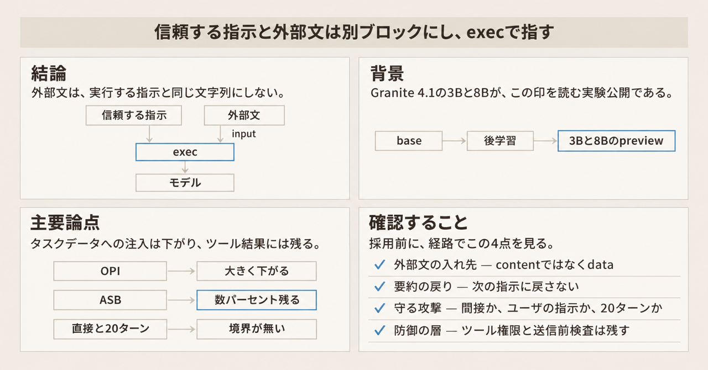
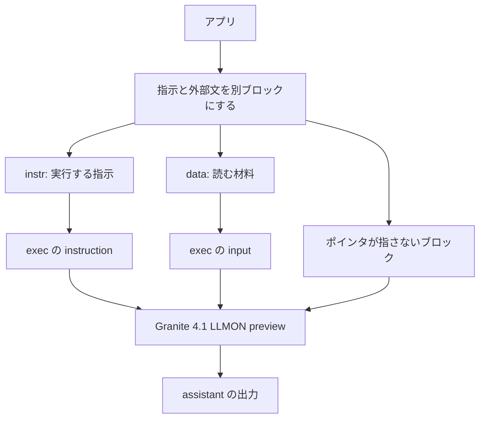

IBM は 2026年11月12日、LLM 向けのマークアップ LLMON を消費するように後学習した [Granite 4.1 の 3B と 8B](https://huggingface.co/blog/ibm-granite/llmon-an-llm-native-markup-language-now-in-granite) を、Apache-2.0 の preview として公開しました。preview は、実験として公開されたモデルです。LLMON（LLM Object Notation。読みは lemon）は、指示、データ、要件、文書、ツールをタグで区切り、どれを実行するかは exec というポインタで指す印です。

使う側は、信頼する指示と、メール、検索結果、チケット本文のような外部文を、別のブロックとしてモデルに渡します。この記事では、印の形、Granite 4.1 の preview がチャットをどう描くか、公開された数字の分母、外部文を渡すときに何を分けるかを説明します。

公開ブログは、この 2 つを探索と評価のための実験 preview と書いています。数値の出典は、特記しない限り学習論文 [arXiv:2610.38120v1](https://arxiv.org/abs/2610.38120)（2026-10-28 投稿の preprint。会議採録としては扱いません）と、3B / 8B のモデルカードです。モデルカードは、そのモデルに付く説明文書です。確認日は 2026-11-14 です。


*この記事の全体像。以下、順に解説します。*

## LLMONとは

LLMON は、テキストの区間（スパン）にタグを付け、実行する区間をポインタで指すマークアップです。言語の仕様と変換ツールは [generative-computing/llmon](https://github.com/generative-computing/llmon) にあります。権限の読み方とは、どのブロックを実行する指示として読み、どのブロックを材料として読むかです。その読み方を学習した公開モデルは、確認日時点では Granite 4.1 の 3B と 8B の preview です。モデル ID は [granite-4.1-3b-llmon-preview](https://huggingface.co/ibm-granite/granite-4.1-3b-llmon-preview) と [granite-4.1-8b-llmon-preview](https://huggingface.co/ibm-granite/granite-4.1-8b-llmon-preview) です。

### 予約する区切り

予約する区切りは 6 個で、いずれも 1 トークンです。トークンは、モデルが文字列を区切って数える単位です。

- `<|open|>` は、タグ付きの区間を開きます。
- `<|close|>` は、タグ名の部分を閉じます。
- `<|open_end|>` は、区間を終えます。
- `<|self_close|>` は、本文を囲まずタグの存在だけを示します。
- `<|.|>` は、入れ子のパスを結びます。
- `<|:|>` は、タグと ID を区切ります。

6 個は未使用の語彙スロットへ割り当てます。モデルが持つ語の一覧と、その一覧に対応するベクトルの表は増やしません。

### タグと、実行を指すポインタ

学習が意味を与えるタグには、instr、data、req、doc、tool、system、assistant、exec があります。req は出力の制約、doc は文書、assistant はモデルの出力、system はターンをまたいで残る方針を置くタグです。言語 README は、タグ名そのものに組み込みの意味はなく、学習したモデルが読むものだと書いています。ユーザ定義のタグ、短い ID、JSON と Shorthand の変換を仕様に含みます。Shorthand は、同じ文法を人が書きやすい記号に置き換えた記法です。

権限の読み方は次のとおりです。権威、つまり実行する指示として読む側になるのは、exec が instruction として指した中身と、exec が system として指した中身です。exec の input から届くデータ、文書、ツールスキーマ、ツール結果は、文言が命令でも読む材料です。ツールスキーマは、ツールの名前や引数の形を書いた定義です。ポインタが指さないブロックは文脈に残りますが、束縛されません。束縛とは、ポインタが指して実行の対象に結ぶことです。

言語 README は、指示とデータの区間を次の形で示します。これは言語の例であり、Granite のチャットテンプレートがそのまま出力する文字列ではありません。

```text
<|open|>instruction<|close|>
  Suggest a title for the following email:
<|open_end|>
<|open|>data<|close|>
  Dear customer support, I am writing about the wifi connection on my recent
  flight from JFK to LAX. The quality was poor. I paid $25, and I want a refund.
<|open_end|>
```

同じ README は、複数の指示のうち 1 件だけを exec が指す形も示します。単純な例のタグ名は `instruction` で、ポインタの例と Granite の学習タグは `instr` です。README の説明どおり、綴り自体に組み込みの意味はありません。

```text
<|open|>instr<|:|>f<|close|>    Translate the text into French<|open_end|>
<|open|>instr<|:|>g<|close|>    Count the number of words in the given sentence<|open_end|>
<|open|>instr<|:|>h<|close|>    Summarize the text in one short sentence<|open_end|>
<|open|>data<|:|>1<|close|>    The quick brown fox jumps over the lazy dog<|open_end|>
<|open|>exec<|:|>m<|.|>instr<|close|> instr<|:|>g <|open_end|>
<|open|>exec<|:|>m<|.|>input<|close|> data<|:|>1 <|open_end|>
```

上の 2 番目では、exec の instr が `instr:g`（語数を数える指示）を指し、exec の input が `data:1` を指します。例のパス `instr` は、権威の文で言う instruction と同じ指し方です。exec の input が指す data は読む材料であり、権威ではありません。この例に system の行はありません。フランス語訳と要約の指示は文脈に残りますが、この exec はそれらを指しません。

### チャットテンプレートが描くもの

出発点は Granite 4.1 の base です。base は、指示追従の追加学習をする前のモデルです。表に出る Instruct は、通常のチャット向けに別に学習したモデルです。LLMON の報告値は、base から教師あり学習のあと 5 段の GRPO と、約 1,000 件の on-policy DPO を終えたチェックポイントです。GRPO は、複数の出力の相対的な好ましさでモデルを更新する後学習です。ここでの on-policy DPO は、その時点のモデル自身の出力を、好ましいものと好ましくないものの対にして調整する後学習です。

同梱のチャットテンプレートは、user の `content` 文字列を、exec を有効にした指示 1 件として描画します。有効とは、その 1 件を実行する指示として結ぶ印です。data、requirement、documents、tool の結果も、それぞれのブロックへ本文を連結します。requirement はタグ req、documents はタグ doc に対応します。tool の結果は data で包み、続く exec の input が指します。言語 README は、このテンプレートと同じ文字列を Python で描く `render_chat` を案内しています。確認日は 2026-11-14 です。

文法は JSON と違い、タグの付いていない通常文を文書の中に置けます。モデルカードの対応言語は 12 で、English に加えて Japanese、German、Spanish、French、Portuguese、Arabic、Czech、Italian、Korean、Dutch、Chinese を挙げます。カードのパラメータ表示は、名前が 3B のモデルで 4B params、名前が 8B のモデルで 9B params です。ライセンスはモデルもツールキットも Apache-2.0 です。3B と 8B のカードは、確認日時点でどの Inference Provider からも配信されていないと表示します。Inference Provider は、Hugging Face 上でそのモデルの推論を配信する提供者です。

### 指示と外部文がモデルに届くまで

アプリが信頼する指示と外部文を分け、ポインタで結ぶまでの流れです。



ツール結果は data 側に入り、exec の input から参照されます。要約、コピー、ログ文字列を次のターンの `content` へ戻すと、テンプレートはそれを新しい指示ブロックとして結びます。

## 注意点

公開文には、到達に見える言い方があります。どの表が、何を、どの向きで測っているかを分けます。

### 間接注入の攻撃成功率はベンチで違う

間接注入は、メール、検索結果、ツール結果のような外部文の中に命令を埋め、モデルにそれを実行させる攻撃です。論文 Table 2 は攻撃成功率です。攻撃成功率（ASR）は、注入が通った割合で、低いほど注入が通りにくい数字です。LLMON 側ではペイロードを data に置き、Instruct 側は同じペイロードを通常のチャット形式で受けます。

OPI は、タスクデータの中への古典的な注入です。種類は naive、escape、ignore、fake-completion、combine です。5 つは論文が OPI の攻撃の種類として挙げる名前で、この記事では種類ごとの差は使いません。ASB は、ツール観測への注入です。ツール観測は、ツールが返してモデルが見る文字列で、テンプレートが data に包むツール結果のことです。

Granite-4.1-3B の Instruct は、OPI が 100.0%、ASB が 99.2% です。同じ 3B の LLMON は、OPI が 0.1%、ASB が 5.6% です。8B の Instruct は、OPI が 96.3%、ASB が 52.8% です。8B の LLMON は、OPI が 0.02%、ASB が 3.1% です。

論文は、テキスト水準でおおよそ 3 桁、エージェント水準でおおよそ 17 倍の低下と書きます。テキスト水準は OPI、エージェント水準は ASB です。abstract が書く幅は、53% から 100% が、0.02% から 5.6% になる、というものです。この幅は、この 2 ベンチの Instruct 側と LLMON 側です。ASB は 0 になりません。3B で 5.6%、8B で 3.1% 残ります。

論文の中で、ペイロードの置き方の説明は一致していません。評価手順（4.3.2）は、LLMON 側の注入を exec の input から届く data の中に置くと書きます。学習データの説明は、注入指示をどの実行ポインタも参照しないブロックとして描くと書きます。結果の節（5.2）は、注入指示がポインタの無い data に入るので、仕組みは学習された拒否ではなく構造だと書きます。Table 2 の 0.02% から 5.6% を、指されていない区間だけの数字とも、指されている入力だけの数字とも、論文の一文だけでは決められません。

モデルカードは、input 経由の中身について別の文を置きます。権限ルールは学習された振る舞いであり、強制される保証ではありません。data、文書、ツール結果に埋め込まれた指示に従う確率は大きく下がりますが、ゼロにはなりません。機密へ届くエージェントの唯一の防御にしてはならない、とカードは書きます。結果の節が言う構造は、注入がポインタの無い data に入ることです。カードが言う学習は、そのポインタの読み方をモデルが学習した振る舞いです。両方を、論文とカードが同時に書いています。

### 赤チームの数字は頑健性である

Table 3 は ARES の頑健性です。ARES は、IBM Research の頑健性評価（AI robustness evaluation system）の名前です。頑健性は 1 から攻撃成功率を引いた値で、高いほど防いだ割合です。Table 2 と向きが逆です。シード 808 本を、攻撃の強さで変異させて約 15,000 プロンプトにしています。直接は、敵対的な指示そのものがユーザの指示になる入り方です。元の名前は Purple、Gandalf、TensorTrust です。間接は、データ側に入る入り方です。元は Alpaca と安全ポリシーの集合です。多ターンは、会話を重ねる入り方で、上限は 20 ターンです。形の名前は Crescendo の変種です。攻撃文を作るモデルは DeepSeek-V3.2、成否を判定するモデルは GPT-OSS 120B です。各名前の手順は、この記事では分けません。

Granite-4.1-3B の Instruct は、間接 2.8%、直接 17.6%、多ターン 15.0% です。同じ 3B の LLMON は、間接 84.6%、直接 37.1%、多ターン 28.0% です。8B の Instruct は、間接 0.7%、直接 9.2%、多ターン 15.0% です。8B の LLMON は、間接 79.8%、直接 32.7%、多ターン 37.0% です。単位は頑健性です。

間接は、分布内と分布外の平均です。分布内は学習で見た攻撃の型に近いもの、分布外はそこから外れたものです。LLMON の分布内は 3B が 90.3%、8B が 83.6% です。分布外は 3B が 79.0%、8B が 75.9% です。

100 から頑健性を引いた値は、論文が載せていない換算です。LLMON では、間接が 15.4% と 20.2%、直接が 62.9% と 67.3%、多ターンが 72.0% と 63.0% です。順は 3B、8B です。Limitations は、直接 33% から 37%、多ターン 28% から 37%、間接 80% から 85% と、頑健性の幅でまとめています。直接と多ターンは、敵対的な指示そのものがユーザの指示になる局面です。守るべき指示とデータの境界がありません。

### ブログの「ほぼ消える」と比較の 47%

47% と 95% は、OPI についての比較です。ブログは、LLMON が問題を実質的に消し、試験した最良のフロンティアモデルより攻撃を 47% 多く回避し、最良のオープンソースモデルより 95% 多い、と書きます。フロンティアモデルは、その文が比較相手にした大規模モデルの呼び方です。本文は続きます。これらのベンチが静的な間接注入を測ること、ASB と StruQ でも似た傾向があること、多ターンの適応的攻撃は現在取り組んでいることです。静的な間接注入は、攻撃文をあらかじめ固定した測定です。適応的攻撃は、会話の進み方に応じて攻撃文を変える測定です。StruQ は、プロンプトとデータを別のチャネルに分ける先行手法です。ベンチの名前ではありません。

相手モデルの名前、相手側の防御を有効にしたか、同じ詰め方かは本文にありません。図の目盛りから読み取った値は、この記事の根拠にしていません。47% と 95% を、既存の防御付きエージェントとの運用差としては使いません。

### 能力の平均は個別の落ちを隠す

Table 1 の分野平均は、Instruct、LLMON の順です。

General は、3B が 57.91 と 57.16、8B が 64.95 と 63.31 です。Alignment は論文が能力をまとめた分野名の 1 つで、中の課題一覧はこの記事では分けません。3B が 82.30 と 81.02、8B が 87.06 と 86.69 です。Math は、3B が 75.19 と 73.25、8B が 84.09 と 79.63 です。Code は、3B が 64.19 と 65.45、8B が 72.38 と 71.01 です。Tool-Calling は、3B が 60.80 と 60.71、8B が 68.27 と 67.93 です。Multilingual は、3B が 59.89 と 62.68、8B が 68.68 と 68.24 です。Safety は、3B が 80.89 と 89.64、8B が 84.19 と 90.36 です。

論文は、安全性を除く 6 分野の平均が 3B で不変、8B で 1.4 ポイント低いと書きます。安全性は 3B で 8.8 ポイント、8B で 6.2 ポイント上がります。8B のカードは、この形式が狙いとする「束縛されない、または敵対的な中身があるときの指示とデータの境界」を、これらのベンチのどれも測っていないと書きます。

平均の下では、8B の Minerva Math が 72.20 対 80.10、DeepMind Math が 70.86 対 80.07、CRUXEval-O が 36.88 対 47.63 です。いずれも LLMON、Instruct の順です。Minerva Math と DeepMind Math は数学のベンチ、CRUXEval-O はコードの出力を予測するベンチです。3B の CRUXEval-O は 32.75 対 40.75 です。コード分野の平均が 3B で上がっても、CRUXEval-O は下がります。

### 印は変換と平文化で残らないことがある

平文化は、タグの構造を外して 1 本の `content` 文字列にすることです。チャットテンプレートは、`content`、data の値、文書の本文、ツール結果を、区切りの検査なしに連結します。3B と 8B のテンプレートに、文書の text を `"<|open|>doc<|.|>text<|close|>" + item["text"]` と連結する行があります。部分語は、モデルが普通の文字列を割るときの断片です。論文は、予約トークンをその断片の組み合わせでは作れない、と書きます。外部の文字列に区切りと同じ文字の並びが入っていても、テンプレートはそれを検査せず本文へ足します。そのため、論文のその説明は、この連結では自動には成り立ちません。区切り文字列を混ぜたときに出力が壊れるかは、論文にもカードにも測定がありません。

言語 README は、タグの無い通常文を許します。学習済みモデルが期待するのは、テンプレートが描く LLMON です。従来のチャット形式は分布外で、品質が落ちます。分布外とは、学習で見た形から外れていることです。拒否して棄てる、とは書かれていません。

[Issue #1](https://github.com/generative-computing/llmon/issues/1)（2026-11-14 時点で open）は、Shorthand 変換で区切り文字列を無害な表記へ置換する `sanitize()` の話です。チャットテンプレートの修正完了ではありません。[Issue #4](https://github.com/generative-computing/llmon/issues/4)（open）は、JSON ファイルの往復は通る一方、タグの無い LLMON 文は JSON へ戻せず、同名タグは JSON のキーが潰れる、という未了の設計です。[Issue #16](https://github.com/generative-computing/llmon/issues/16)（open）は、OpenClaw との組み合わせでツールを起動する注入が通った、という投稿者の自己申告です。OpenClaw は、その報告が組み合わせたと書く別ソフトウェアの名前です。シナリオは添付の ZIP にあります。ZIP は再生していません。LLMON 単体が壊れている証拠にはせず、失敗報告が無いとも書きません。

### 仕様の外と、学習済みの範囲

言語論文 [arXiv:2603.22519](https://arxiv.org/abs/2603.22519)（初版 2026-03-23、v4 は 2026-10-15、28 ページ。会議採録としては扱いません）と、Apache-2.0 のツールキットは、特定モデルの外にあります。学習論文は、構造の監督はアーキテクチャに依らないと書き、同じ幅の改善が他の事前学習コーパス、他のアーキテクチャ、より大きいスケールへ移るかは未検証だと続けます。評価は Granite 4.1 の 3B と 8B だけです。印の仕様と、LoRA で足す話は外にあります。LoRA は、低ランクの差分だけで重みを足す学習です。権限の読み方を学習した公開の重みは、確認日時点ではこの 2 つの preview です。

学習コーパスは英語が大半です。多言語ベンチは評価に含みます。タグの負荷を、形態が豊かな言語や非常に長い文書で特徴づけてはいません。形態が豊かな言語は、語の形の変化で意味や役割を表す言語です。カードが日本語を対応言語に含めることと、日本語の間接注入の攻撃成功率が論文にあることは別です。後者はこの論文にありません。

リポジトリの star は、2026-11-14 時点で 17 です。アーカイブではありません。pushedAt は 2026-11-12T19:13:32Z で、任意ブランチへの push 時刻です。default branch の最新コミット日は突き合わせていません。その時刻を、開発が活発である証拠にはしません。LLMON 自体に対応する CVE は、確認日時点の検索では見つかりませんでした。番号は挙げません。

注意の層 25 と 28 では、LLMON の IFR が 86.5% と 87.2%、Instruct が 25.8% と 37.7% です。層は、モデルが内部で計算を重ねる段です。IFR（Instruction Focus Ratio）は、指示への注意のうち、対象の指示が占める割合です。LEAK は層 25 で 8.6% 対 44.9%、層 28 で 6.3% 対 34.9% です。LEAK（Leakage）は、注意のうち妨害側の中身へ届く割合です。最終層 39 では IFR が 28.0% 対 17.2% まで落ちます。順は LLMON、Instruct です。論文は、注意と出力品質の相関であり、因果は示していないと書きます。可視化のデモは [LLMON Attention Visualization](https://huggingface.co/spaces/ibm-granite/LLMON-Attention-Visualization) にあります。

区切りにより文脈はおおよそ 7% から 15% 長くなります。推論の遅延は体系的に測っていません。

## 先行する分け方と何が違うか

LLMON が足すのは、通常の部分語と重ならない予約トークンと、役割名ではなくポインタで示す権限です。公開 preview が、次の先行手法より強い強制保証を持つとは、カードも論文の Limitations も書いていません。

StruQ（[arXiv:2402.06363](https://arxiv.org/abs/2402.06363)）の要旨は、構造化クエリがプロンプトとデータを 2 つのチャネルに分ける、と書きます。コメント欄には USENIX Security Symposium 2025 に採録予定とあります。proceedings の頁は確認日時点では確認していません。SecAlign（[arXiv:2410.05451](https://arxiv.org/abs/2410.05451)）の要旨は、安全な出力を不安全な出力より好むよう選好最適化する、と書きます。コメント欄は ACM CCS 2025 と DOI 10.1145/3719027.3744836 に触れます。Spotlighting の著者ページは、入力の変換で出所の連続した信号を与える、と書きます。

| 基準 | スパンを分けた LLMON preview | content へ平文化する | Instruct を通常のチャットで測る | StruQ / SecAlign / Spotlighting |
|---|---|---|---|---|
| 外部文の置き場 | exec の input として置ける | content 全体が実行する指示になる | 同じプレーンテキストの中に頼む | チャネル、選好、出所の印で分ける先行例がある |
| 公開されている間接注入 | OPI は大きく下がり、ASB はゼロにならない。値は Table 2 | この詰め方の攻撃成功率は論文にもカードにも無い | Table 2 の Instruct は通常チャットのベースライン。LLMON を平文化した測定ではない | 相手手法の表は再実行していない |
| 直接指示と 20 ターン | 頑健性は間接より低い。値は Table 3 | 未測定 | Table 3 の Instruct も頑健性であり、攻撃成功率ではない | 権限ルールの主対象外、という整理は LLMON 側の論文の話 |
| 印の維持 | アプリがブロックを描き続ける間は残る | 最初から 1 本の指示 | 変換で残らない | 変換のたびに出所を付け直す必要がある |
| 移しやすさ | 言語と LoRA の話は外にある。学習済みの消費は今この 2 モデル | 既存のチャット文字列に近い。このモデルでは分布外で品質が落ちるとカードが書く | モデルを選ばない | 各手法の学習や前処理が要る |
| 本番の位置 | 実験 preview。ブログは探索と評価のためであり、本番のためではないと書く | 同じ preview の位置 | 製品ごとの契約に従う | 手法ごとに違う |

注入を見つけようとする検知器と、ツール権限の制限は、印の代わりにはなりません。印が「何を命令として読むか」をモデルに伝え、権限制限は「読んだあと何を実行できるか」をアプリが止めます。論文もカードも、LLMON を層の 1 つとして置けと書きます。

## 外部文を渡すときに分けるもの

メール、検索結果、チケット本文を Granite 4.1 の LLMON preview に渡すなら、信頼する指示と外部文を別スパンにし、exec で結びます。平文化と、要約・コピー・ログの再投入は、境界のやり直しとして扱います。唯一の防御にはしません。印の無い文書を渡したときの既定は、拒否ではなく、`content` に置いた場合は指示としての通常処理です。

この分け方を残す材料は 4 つです。カードが、input 経由の中身は読む材料だと定義していること。Table 2 で、同じペイロードの攻撃成功率が Instruct のチャット形式より低いこと。Table 3 の間接で、頑健性が 3B は 2.8% から 84.6%、8B は 0.7% から 79.8% へ上がること。文法、論文、ツールキットがモデル系列の外にあり、印の仕様を Granite の閉域にしていないことです。

残らない読み方は次のとおりです。ASB と赤チームの間接には残差があります。OPI の 0.02% を現場の動作点にしません。直接と多ターンは、権限ルールが主に守る局面ではありません。テンプレートは外部文字列を無加工で連結します。Issue #1 の `sanitize()` は Shorthand 変換の課題です。8B の数学と CRUXEval-O は Instruct より低いです。境界の維持は、既存の能力ベンチが測っていません。他系列への同じ幅の移転は未検証です。日本語の注入の攻撃成功率は論文にありません。Issue #16 の自己申告はあり、再生はしていません。ブログの 47% と 95% は OPI の比較で、相手モデルの条件が本文にありません。

「ほぼ止まる」「唯一の制御で足りる」「既存モデルへそのまま移る」は残りません。残るのは、印が無いときの既定が指示としての処理だ、という理由での「分ける」です。

メール、検索結果、チケット本文をモデルへ渡す経路では、信頼する指示と外部文を同じプレーンテキストにしません。この preview を試すなら、指示は instr、外部文とツール結果は data とし、exec で指します。`content` 文字列は、実行する指示 1 件として扱われる前提でアプリを組みます。

要約、コピー、ログの再投入は、印を剥がす変換として見ます。出した文字列を次の指示スパンへ戻す前に、出所が信頼する指示か、外部文の残りかをアプリが付け直します。

採用しないものは 5 つです。

- OPI の攻撃成功率だけを見て、ツール結果、直接指示、多ターン、日本語入力の動作点だとみなすこと。
- LLMON だけを、機密へ届くエージェントの防御にすること。ツールの実行権限は別に狭めます。
- 送信前の成果物検査の代わりにすること。印は入力の層で、送信前検査は出力の層です。
- 従来のチャット文字列を、この preview へ無変更で差し替えること。分布外です。
- 本番向けの製品として扱うこと。ブログは、探索と評価のためであり本番のためではないと書きます。SLA の有無はブログに書かれていません。

逆転条件は 2 つです。自分の経路で、スパンを分けてもツール結果の注入が運用上の許容を超えること。または、要約の再投入を止められず、境界を付け直せないこと。そのときは印を足す効果は残っても、この preview をその経路の制御としては採用しません。

直近の確認は 3 つで足ります。

1. 外部文を渡しているフィールドが `content` か、data と exec の input か。
2. 要約とログが、次のターンで指示スパンに戻っていないか。
3. 守ろうとしている攻撃が、静的な間接注入か、ユーザ自身の指示か、20 ターンかのどれか。

自分の経路で比べるなら、同じ攻撃文で次の 3 つを見ます。指示と本文を分けた詰め方。`content` への平文化。要約を次ターンの `content` へ戻す詰め方。論文の OPI を再実行する必要は、この比較より小さいです。

他系列の公開重みとして、権限の読み方を学習したモデルが出るかは未確認です。テンプレートを通さない生の LLMON 文書で、タグの無い文だけを読ませたときの拒否率は測っていません。区切り文字列を data に入れたときの実害率も未測定です。Issue #16 の ZIP を、申告と同じ条件で再生した成功率も未確認です。他系列への移植と日本語の攻撃成功率が未確認であることは、この preview でスパンを分ける判断を止めません。本番の唯一の制御にする判断は止めます。

## まとめ

LLMON は、指示と外部文をタグで分け、exec で実行対象を指すマークアップです。Granite 4.1 の 3B と 8B の preview は、その読み方を base から後学習した実験公開のモデルです。チャットテンプレートは、`content` を実行する指示 1 件として描き、ツール結果は data に包んで exec の input から指します。

間接注入の Table 2 では、OPI が 100.0% と 96.3% から 0.1% と 0.02% へ下がり、ASB は 5.6% と 3.1% 残ります。赤チームの Table 3 は頑健性で、間接は上がり、直接と 20 ターンは 28% から 37% が中心です。能力の平均は、8B の数学と CRUXEval-O の落ちを隠し、境界そのものは測っていません。テンプレートは外部文字列を無検査で連結します。

メール、検索結果、チケット本文を渡す経路では、信頼する指示と外部文を同じプレーンテキストにしません。印は層の 1 つであり、ツール権限と送信前検査の代わりにはしません。本番の製品としては扱いません。

この記事が少しでも参考になった、あるいは改善点などがあれば、ぜひリアクションやコメント、SNSでのシェアをいただけると励みになります！

## 参考リンク

- [IBM Granite ブログ（2026-11-12）](https://huggingface.co/blog/ibm-granite/llmon-an-llm-native-markup-language-now-in-granite)
- [granite-4.1-3b-llmon-preview](https://huggingface.co/ibm-granite/granite-4.1-3b-llmon-preview)
- [granite-4.1-8b-llmon-preview](https://huggingface.co/ibm-granite/granite-4.1-8b-llmon-preview)
- [3B チャットテンプレート](https://huggingface.co/ibm-granite/granite-4.1-3b-llmon-preview/raw/main/chat_template.jinja)
- [8B チャットテンプレート](https://huggingface.co/ibm-granite/granite-4.1-8b-llmon-preview/raw/main/chat_template.jinja)
- [Shbita ほか、Post-Training Large Language Models with LLMON、arXiv:2610.38120v1](https://arxiv.org/abs/2610.38120)
- [Hind ほか、LLMON: An LLM-native Markup Language、arXiv:2603.22519v4](https://arxiv.org/abs/2603.22519)
- [ツールキット generative-computing/llmon](https://github.com/generative-computing/llmon)
- [言語 README](https://github.com/generative-computing/llmon/blob/main/llmon/lang/README.md)
- [Issue #1](https://github.com/generative-computing/llmon/issues/1)
- [Issue #4](https://github.com/generative-computing/llmon/issues/4)
- [Issue #16](https://github.com/generative-computing/llmon/issues/16)
- [Chen ほか、StruQ、arXiv:2402.06363](https://arxiv.org/abs/2402.06363)
- [SecAlign、arXiv:2410.05451](https://arxiv.org/abs/2410.05451)
- [Spotlighting](https://www.microsoft.com/en-us/research/publication/defending-against-indirect-prompt-injection-attacks-with-spotlighting/)
- [注意のデモ LLMON-Attention-Visualization](https://huggingface.co/spaces/ibm-granite/LLMON-Attention-Visualization)
