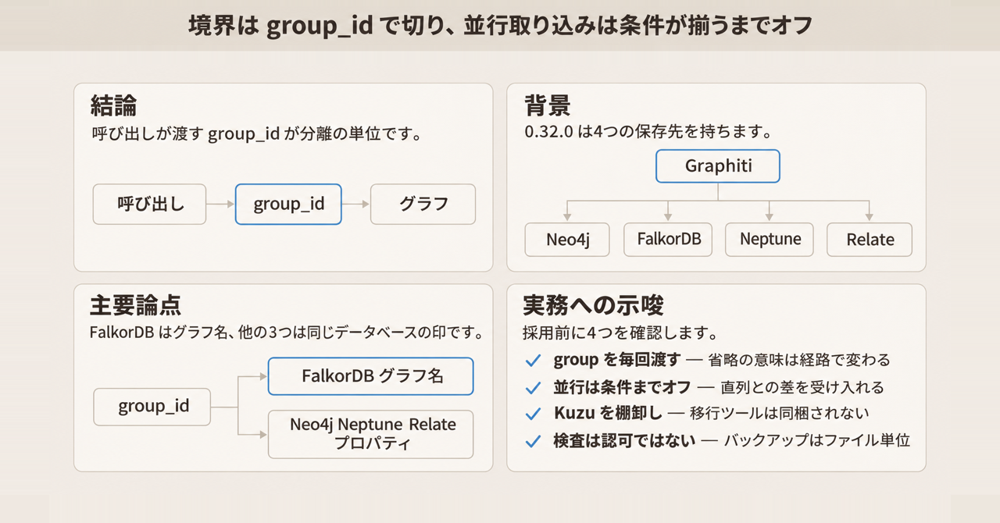
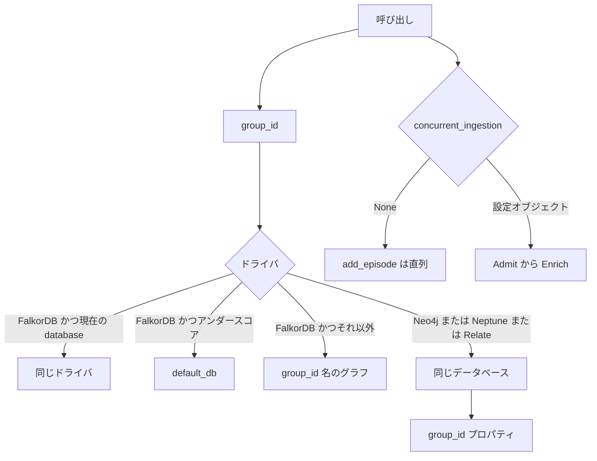

Graphiti は、AI エージェントの記憶を知識グラフとして構築する Apache-2.0 のフレームワークです。知識グラフは、エンティティとファクトを結んだグラフです。エンティティは、グラフに書く対象です。ファクトは、その対象の間に立つ事実です。アプリケーションはエピソードを渡します。エピソードは、渡す入力のひとかたまりです。Graphiti はそれをエンティティとファクトへ分けてグラフへ書きます。

この記事は、タグ `v0.32.0`（commit `083f0887f05a83bcee80b327a60a6bcae8c9f85b`）の時点で、分離キーの `group_id` が保存先ごとにどう実体になるか、並行取り込みをいつ有効にできるかを整理します。2026-11-23 のタグページは git tag です。同じ日に本文付きで公開された Release は、リポジトリに同梱する MCP サーバの `mcp-v1.1.4` です。MCP は Model Context Protocol の略で、モデルが外部のツールを呼ぶ接続規約です。


*この記事の全体像。以下、順に解説します。*

## Graphiti とは

パッケージは `graphiti-core` 0.32.0 です。タグは 2026-11-23 の commit を指し、同日に PyPI へ公開されています。Python は 3.10 以上 4 未満です。2026-11-24 時点の star は約 3.3 万で、リポジトリは archive されていません。

`GraphProvider` は、保存先の種類を表す列挙です。値は `NEO4J`、`FALKORDB`、`NEPTUNE`、`RELATE` です。Relate は、ファイルパスまたは `':memory:'` の埋め込みストアです。書き込みの owner はスレッド 1 本です。extra は、その保存先だけを使うときに追加する依存です。Relate の extra は Python 3.11 以上で `relate-db==1.0.1` です。

ひとつ前のタグ `v0.31.2` からの 64 commit には、Kuzu ドライバの削除、1 つの `group_id` 向けの並行取り込み、Relate ドライバ、UUID 参照のグループ検査が入っています。Kuzu は、`v0.31.2` まであった別の保存先ドライバです。削除を入れた PR は [#2151](https://github.com/getzep/graphiti/pull/2151) です。上流の `kuzudb/kuzu` は 2025-10-10 に archive されています。

### group_id

`group_id` は、呼び出しが持つ分離キーです。空文字以外は、英数字、ハイフン、アンダースコアだけが通ります。外れると `GroupIdValidationError` です。

既定の文字列は、置き場で違います。

| 置き場 | 既定 |
|---|---|
| core の FalkorDB | `'_'` |
| core の Neo4j、Neptune、Relate | 空文字 |
| 参照 MCP サーバの設定 | `main` |

`support-team` のように英数字とハイフンだけなら、呼び出し側の `group_id` として通ります。core の空文字、FalkorDB の `'_'`、MCP の `main` は、別の文字列です。

### 保存先ごとの実体

分離キーは呼び出しの `group_id` です。ドライバがそのキーをグラフ名へ写すか、同じデータベースのプロパティとして残すかは、保存先で分かれます。取り込みは、設定オブジェクトの有無で直列と並行に分かれます。図の FalkorDB の 3 分岐は、`clone` の結果です。`clone` は、別の `group_id` を指すドライバを得るメソッドです。Admit から Enrich は、このあと説明する 4 段階です。



FalkorDB の `clone` は 3 通りです。引数が今の database なら、同じインスタンスを返します。引数が既定の `'_'` なら、`database` を渡さず、コンストラクタ既定の `default_db` になります。それ以外は、その文字列を database 名にした新しいドライバを、同じ接続の上に作ります。FalkorDB では、この database 名が、その `group_id` のグラフ名です。Neo4j、Neptune、Relate は基底の `clone` のままで、自分自身を返します。

| 基準 | FalkorDB | Neo4j | Neptune | Relate |
|---|---|---|---|---|
| 既定 `group_id` | `'_'` | 空文字 | 空文字 | 空文字 |
| `clone` | 条件付きでグラフを切り替える | 同じドライバ | 同じドライバ | 同じドライバ |
| 分離の実体 | 既定以外はグラフ名。`'_'` は `default_db` | `group_id` プロパティ | `group_id` プロパティ | `group_id` プロパティ |
| 公式ページが書く並行取り込み | 利用できる。テストは埋め込み FalkorDB | 利用できる。テストはしていない | 利用できる一覧に無い。テストしていない | 利用できる一覧に無い |
| タグ上の並行テスト | 埋め込み FalkorDB の統合テストがある | `tests/ingestion` にサーバ試験は無い | 同じ | 同じ |
| バックアップ | データディレクトリの tar | `/data` と `/logs` の tar | 同梱 docker の手順の対象外 | ファイルそのもの。グループ API は無い |

表の埋め込み FalkorDB は、テストに組み込んだ FalkorDB です。メモリ上だけのグラフとは別で、Relate の `':memory:'` でもありません。docker 同梱のバックアップは、FalkorDB の `/var/lib/falkordb/data` と、Neo4j の `/data` と `/logs` を tar します。グループを選ぶ引数はありません。

### 並行取り込みの進み方

並行取り込みは、`ConcurrentIngestionConfig` を渡したときだけ有効です。`concurrent_ingestion` が既定の `None` のときは、`add_episode` と `add_episode_bulk` は直列です。1 回の呼び出しが 1 ユニットです。`add_episode_bulk` も 1 ユニットで、その中のエピソードはまとめて確定します。

ユニットは Admit、Analyze、Commit、Enrich の順に進みます。2026-11-24 に取得した [concurrent ingestion のページ](https://help.getzep.com/graphiti/core-concepts/concurrent-ingestion) は、各段階を次のように書いています。

- Admit は、呼び出し順の通し番号を取り、エピソードのノードを保存します。
- Analyze は、エンティティとファクトを抽出し、既存のグラフと突き合わせます。この段階では、エンティティとファクトをグラフへ書きません。同じグラフの `window` 件まで、同時に進みます。
- Commit は、通し番号順に 1 件ずつ確定します。分析の開始後に確定した他のユニットと突き合わせ、衝突した項目だけ直します。衝突は、重複ノード、重複ファクト、新しいファクトと矛盾するファクトです。直しは LLM の呼び出しを伴うことがあります。
- Enrich は、そのユニットのノードの属性と要約を更新します。

`window` は、1 つの `group_id` で Admit から Enrich の終わりまで同時に在籍するユニット数の上限です。値は 1 以上で、既定値はありません。公式ページは、1 プロセスで同時に走る、1 つのグラフのユニット数の上限とも書いています。例として `4` から始める、とも書いています。

状態の置き場は 3 つです。プロセス内メモリが既定です。同じマシンの複数プロセスは、同じファイルパスの SQLite を使います。複数マシンでは、Graphiti を呼び出すアプリケーションが `IngestionStateStore` を実装します。`IngestionStateStore` は、通し番号と変更を置くストアのインターフェースです。`enabled_for_group` は、グラフごとに並行モードを残すかを返す関数です。この関数を渡さない既定の `None` では、各グラフが並行モードを使います。関数が `False` を返す `group_id` だけ、設定オブジェクトがあっても直列のままです。`True` を返す `group_id` は、並行モードのままです。ここでの `None` は、`concurrent_ingestion` 自体の `None` とは別です。後者は、モード全体を直列にします。

有効にするときの呼び出し方は、同じページの例が次のとおりです。接続先と本文はページのままです。この記事では実行していません。

```python
import asyncio
from datetime import datetime, timezone

from graphiti_core import Graphiti
from graphiti_core.ingestion import ConcurrentIngestionConfig
from graphiti_core.nodes import EpisodeType


async def main() -> None:
    graphiti = Graphiti(
        "bolt://localhost:7687",
        "neo4j",
        "password",
        concurrent_ingestion=ConcurrentIngestionConfig(window=4),
    )
    try:
        await asyncio.gather(
            graphiti.add_episode(
                name="note-1",
                episode_body="Maria Lopez joined Northwind Robotics in March 2024.",
                source=EpisodeType.text,
                source_description="support notes",
                reference_time=datetime(2024, 3, 4, 9, 0, tzinfo=timezone.utc),
                group_id="support-team",
            ),
            graphiti.add_episode(
                name="note-2",
                episode_body="Maria Lopez now leads the support team at Northwind Robotics.",
                source=EpisodeType.text,
                source_description="support notes",
                reference_time=datetime(2024, 9, 2, 9, 0, tzinfo=timezone.utc),
                group_id="support-team",
            ),
        )
    finally:
        await graphiti.close()


asyncio.run(main())
```

`add_episode` と `add_episode_bulk` のシグネチャと戻り値の型は、このモードでも変わりません。公式ページは、Neo4j と FalkorDB で利用できると書き、テストはインメモリのグラフと組み込みの FalkorDB で、Neo4j と Amazon Neptune ではテストしていない、と書いています。インメモリはメモリ上だけのグラフ、埋め込み FalkorDB はテストに組み込んだ FalkorDB です。

### 検索と UUID 参照

`group_ids` が空、または空文字 1 件のとき、core は `None` にします。fulltext は全文検索、similarity は類似検索です。どちらも、`group_ids` が `None` でないときだけ `group_id IN` を足します。node BFS は、起点ノードから繋がるノードを辿る検索で、起点の `group_id` と一致するノードだけを辿ります。

`group_ids` を省略した fulltext と similarity は、Neo4j ではそのデータベース内の group を横断します。node BFS は起点の group に残ります。FalkorDB で `group_ids` を省略すると、今指しているグラフだけを見ます。全テナントの横断にはなりません。

`group_id` を渡した参照は、他グループの UUID を見つからなかったものにします。対象は、エピソードを消す `remove_episode`、そのエピソードのノードとエッジを取る `get_nodes_and_edges_by_episode`、エピソードのノードを UUID で取る `EpisodicNode.get_by_uuid`、ファクトのエッジを UUID で取る `EntityEdge.get_by_uuid`、それに `summarize_saga` です。例外は `NodeNotFoundError` または `EdgeNotFoundError` です。

### 参照用 MCP サーバ

参照用は、リポジトリに同梱された見本のサーバのことです。読み取り専用ではなく、エピソードの追加と削除も受けます。Release `mcp-v1.1.4` は、`graphiti-core[falkordb]>=0.32.0` を要求します。`delete_episode`、`get_episode_entities`、`get_entity_edge`、`delete_entity_edge`、`summarize_saga` が `group_id` を core に渡します。

このサーバは、バックエンドに関係なく、`group_id` ごとに 1 本の直列キューを持ちます。`add_memory` はエピソードを受け取る入口で、そのキューへ入ります。`ConcurrentIngestion` は、このサーバのツリーにはありません。core の並行モードとは別です。

省略された `group_id` は、設定値で埋まります。既定は `main` です。既定のままなら、呼び出し側が省略しても、他グループの UUID は拒否されます。設定の group が空で、呼び出し側も渡さないとき、この検査は外れます。`get_episodes` は、有効な group が無いとき空リストを返します。`clear_graph` は、未設定ならエラーになり、データベース全体は消しません。

## 注意点

### 出典の範囲

このタグを、1 本のリリースノートが 4 つの変更を同時に説明した版として扱うと、出典がずれます。`gh release view v0.32.0` は release not found です。タグ先端の commit メッセージは、空の `group_id` が、すでに設定してあるグループを使う、という文書の更新です。これはその文書の話で、core の空文字の既定や、検索がフィルタを外す話とは別です。Kuzu 削除は PR #2151、並行取り込みは PR #2154、Relate の実装 commit は issue #2158 を参照し、グループ検査は PR #2178 と Release `mcp-v1.1.4` に分かれています。

2026-11-24 に取得した [overview](https://help.getzep.com/graphiti/graphiti/overview) のバックエンドは、Neo4j、FalkorDB、Amazon Neptune です。本文に Relate、Kuzu、concurrent ingestion はありません。同じ日の Kuzu 設定の URL は Page not found でした。overview を 0.32.0 の全機能一覧としては読みません。

### 速度の数字

README の「Default to Low Concurrency」は、`SEMAPHORE_LIMIT` の既定を 10 と書きます。コードの `DEFAULT_SEMAPHORE_LIMIT` は 20 で、環境変数が無ければ 20 になります。実行時のフォールバックはコードの 20 です。セマフォは `semaphore_gather` ごとで、プロセス全体の単一上限ではありません。公式ページは、1 ユニットが同時に出せる LLM 呼び出しを `SEMAPHORE_LIMIT` までとし、モード全体では `window` 倍まで、と書いています。

PR [#2154](https://github.com/getzep/graphiti/pull/2154) の表は、次の秒数を書いています。これは PR の自己申告です。データセット A の直列は 2139 秒と 2462 秒、`window=8` は 734 秒で、PR は直列平均より 68% 短いと書きます。B の直列は 502 秒と 440 秒、`window=8` は 127 秒で、73% 短いと書きます。直列は各 2 回、並行は各 1 回です。PR 自身が、記述であり統計検定ではない、と書きます。実行は「このブランチと #2153 のローカル merge」であり、タグ `v0.32.0` の計測とは書いていません。この百分率は、製品の性能値ではありません。

公式ページは、`window` が 1 より大きいグラフは直列と異なり得て、等しいグラフは保証しない、と書きます。example の README も、2 つのモードは等しいグラフを返さない、と書きます。理由には、実行ごとの LLM 出力の差と、LLM が見る文脈の差の両方が入ります。公式ページは、直しのプロンプトが、分析時に見ていない候補だけを持つ、とも書きます。ノード数とエッジ数が直列 2 回のばらつきより小さい、という記述も PR #2154 の自己申告です。時間が短いことと、グラフが一致することは別です。

1 呼び出しずつ待つ使い方では、公式ページは直列より遅いと書きます。時間が短くなるのは、同じグラフへ複数の呼び出しを同時に出したときだけです。`lease_seconds` 60、`write_margin_seconds` 5、`poll_interval_seconds` 0.25、`index_lag_seconds` 300、`max_apply_attempts` 5 について、公式ページは計測が無いと書きます。順に、応答が無いユニットを期限切れにする秒、書き込みを終える余裕、他プロセスのユニットを待つ間隔、全文検索へ出るまでの遅れ、確定のやり直し回数です。これらは設定表の既定です。

`update_communities=True` の `ValueError` は、その `group_id` で並行モードが有効なときだけです。既定の直列経路では起きません。コミュニティは、関連するエンティティをまとめたグループです。公式の Communities のページは、`build_communities` がそれを作ると書いています。並行モードの `add_episode` では途中更新ができないので、使うときは取り込みのあとに呼びます。コミュニティを使わないときは、この更新をオンにする必要はありません。`add_triplet` は、ファクトの三つ組を手動で書く呼び出しです。三つ組は、2つのノードとその間のエッジです。`add_triplet`、`remove_episode`、`build_communities`、ノードとエッジの直接書き込みは、通し番号の外です。公式ページは、そのグラフのユニットが進行していないときに実行する、と書きます。進行中のユニットのエピソードへ `remove_episode` は呼びません。同じグラフで直列と並行を同時には使いません。`enabled_for_group` の結果を変える前に、そのグラフの呼び出しが無い状態を待ちます。

### 公開されていない識別子

PR [#2178](https://github.com/getzep/graphiti/pull/2178) は、Neo4j と FalkorDB で 74 ケースを回し、そのブランチでは漏洩が無かったと書きます。これも PR の自己申告です。PR が触れる `GHSA-ffvj-pf2p-38h3` は、GitHub の advisory 識別子です。2026-11-24 時点で GitHub advisory の API と advisory ページが 404 で、NVD の keywordSearch は 0 件でした。NVD は、米国の脆弱性データベースです。公開 advisory としては扱いません。CVE 番号は付いていません。CVE は、公開された脆弱性に付く番号です。

### タグで取り直されていない報告

[#2080](https://github.com/getzep/graphiti/issues/2080) は 2026-11-24 時点で open です。複数 `group_id` の Neo4j fulltext が、最後の group しか必須にしない、という報告です。タグの `fulltext_query` は、Falkor 以外で `group_id:"A" OR group_id:"B" AND (q)` の形のままです。単一 group の形は、これとは別です。Lucene は、Neo4j の fulltext がこの式を評価する規則です。issue は、この並びだと前の `group_id:"A"` が検索語の必須から外れ、最後の group だけが必須になる、と読んでいます。これは issue の自己申告です。再現は graphiti-core 0.30.1 で、タグでの再実行はありません。

[#2121](https://github.com/getzep/graphiti/issues/2121) は 2026-11-24 時点で open です。報告は、Neptune の node BFS が起点の種別と group 条件を落とす、というものです。`origin` は起点、`n` は辿る先です。今実行される `search_utils` の条件は、`WHERE origin:Entity OR origin.Episode AND n.group_id = origin.group_id` です。issue は、`origin.Episode` がラベル検査ではなくプロパティ参照で常に空になり、AND が OR より先に結ぶため、起点が Entity のときは group の条件を見ずに別グループへ辿り得る、と書いています。Episode を起点にすると行が残らない、とも書いています。これは issue の説明で、タグ `083f088` での再実行はありません。先の「node BFS は起点の group に残る」は、この Neptune の経路には当てはまりません。`search_interface` は、ドライバが自分の検索を差し込む口です。それをセットしているのは Relate だけで、Neptune は共通経路の `search_utils` を使います。driver 側の別クエリは、この経路からは呼ばれません。

[#2159](https://github.com/getzep/graphiti/issues/2159) は 2026-11-24 時点で open です。Neo4j で `remove_episode` と `add_episode` が重なると、新しいエピソードの entity と fact が消える、という報告です。これも issue の自己申告です。Neo4j 5.26.2 で 20 回中 19 回、同じグループに束ねた FalkorDB 6.0.4 で 0/20 でした。計測は `v0.31.2` と main `ebef986a` で、タグ `083f088` の再計測ではありません。タグも、MENTIONS を数えてから `Node.delete_by_uuids` する並びのままです。公式ページは、直列モードも重なった呼び出しを順序づけしない、と書きます。並行モードをオフにしても、この重なりが安全になるとは書いてありません。

`window` が 1 より大きいこと自体が重複ノードを作る、という issue はありませんでした。近い #1872 は、1 回の `add_episode_bulk` の話で、状態は open です。コードが今もそうかは未確認のままです。共有の `self.driver` を書き換える古い報告について、このタグでは代入がコンストラクタの 2 行だけでした。

### Relate と認証

Relate の `graph_operations_interface` は、`node_update_bulk` と `edge_update_bulk` を持ちます。不足メソッドの検査は、interface が無いドライバでは空リストを返して通ります。メソッドが揃うことと、公式ページが available と書くことは別です。公式ページは、interface があるドライバでは 6 つの bulk メソッドが要り、欠けると `ValueError` で何も書かない、と書いています。

翻訳層は、Relate が Neo4j 向けの文を自分のストア向けに書き換える層です。vector procedure はベクトル検索の手続きで、これをプロパティ代入にします。fulltext の 3 つ目の limit を外し、明示トランザクション内の `DETACH DELETE ... IN TRANSACTIONS` を平文の `DETACH DELETE` にし、可変長を 500 hop で切ります。identity properties は、呼び出しが渡す照合用のプロパティです。README がその照合を書くのは、Neo4j と FalkorDB です。

README と `SECURITY.md` は、参照 MCP と REST に認証も認可もプロンプト注入対策も無い、と書きます。REST は、参照実装が持つ HTTP の入口です。任意の呼び出し元が、任意の `group_id` を読み書き削除できます。本番は、呼び出し側が認証と認可とテナント分離を足すか、Zep を使う、と README が書きます。overview は、Graphiti がオープンソースのフレームワークで、Zep はそれを使う管理された層だと書いています。`SECURITY.md` は、参照サーバに認証が無いことは脆弱性報告の対象外だと書きます。サポートするバージョンは、最新の 0.x だけです。Zep のクエリレイテンシの宣伝数値は、ここでの判断には使いません。

### まだ閉じていない問い

次は、2026-11-24 時点でタグの上では閉じていません。

- #2159、#2080、#2121 をタグ `083f088` で再実行すると、同じ症状が残るか。
- Relate で `ConcurrentIngestionConfig` を渡したとき、公式ページが書かないだけで動くのか、翻訳層で commit が落ちるのか。
- 複数マシンの状態ストアを自作したとき、FalkorDB のサーバ設定 `TIMEOUT_MAX` が 0 であることと、Neptune に書き込み時間制限が無いことが、リース期限後の上書きをまだ許すか。公式ページは、`TIMEOUT_MAX` が 0 の FalkorDB と Neptune では、リース期限のあとにも書き込みが完了し、より新しい値を置き換え得る、と書いています。Neo4j は書き込みの時間制限を適用する、とも書いています。
- `.kuzu` ファイルを Neo4j か FalkorDB へ移す手順は、このリポジトリの外にあるかもしれない。2026-11-24 のリポジトリ検索 `graphiti kuzu migration` は 0 件でした。
- `GHSA-ffvj-pf2p-38h3` が後から公開されたとき、影響範囲は PR #2178 の UUID 越境と同じか。

日本語の Kuzu 移行失敗報告は、Zenn と Qiita の `graphiti kuzu` 検索では 0 件でした。これは、移行が安全だという証拠にはなりません。

## 境界は group_id で切る

テナント境界は、呼び出しが知っている `group_id` として設計します。データベース製品の種類を、境界の定義にはしません。FalkorDB では、既定以外の id がグラフ名になり、`'_'` は `default_db` になります。Neo4j、Neptune、Relate では、同じデータベースのプロパティです。

検索と削除は、意図した group を毎回渡します。省略の意味は経路で変わります。Neo4j の fulltext と similarity はデータベース内を横断し、node BFS は Neptune の #2121 を除いて起点の group に残ります。複数 group の Neo4j fulltext は #2080 が open です。Neptune の node BFS は #2121 が open です。

参照 MCP のグループ検査は、認可としては使いません。既定設定は `main` を埋めますが、その group を使ってよい呼び出し元かは見ません。検査が効くのは、設定か呼び出しが group を渡したときだけです。バックアップは、ボリュームまたはファイル単位で取ります。グループを選ぶ引数はありません。

## 並行取り込みをオンにする条件

並行取り込みは、次が揃うまでオフのままにします。

1. 1 つの `group_id` へ、複数の `add_episode` を同時に出す。
2. 直列とグラフが異なり得ることを受け入れる。
3. コミュニティを、取り込みの途中では更新しない。使うときは、あとで `build_communities` を呼ぶ。使わないときは、`update_communities=True` を渡さなければよい。
4. 公式ページが利用できると書く保存先である。書くのは Neo4j と FalkorDB です。テスト済みと書くのは、メモリ上のグラフと組み込みの FalkorDB です。

`add_triplet` と `remove_episode` は、通し番号の外に置きます。Neo4j では、モードがオフでも #2159 の重なりが残っている可能性があります。1 件ずつ `await` する直列が、重なりを順序づけするとは書いてありません。参照 MCP サーバは、このモードをオンにしません。

`window` が 1 のときは、公式ページは直列と同じ順序だと書きます。1 より大きいときだけ、同時に分析します。同じグラフのエンティティとファクトが大半で重なると、公式ページは時間の利得が小さい、と書きます。

## 0.32 へ上げる前に見ること

上げる前に、次の 4 つを棚卸しします。

- `graphiti_core.driver.kuzu_driver`
- `GraphProvider.KUZU`
- extra の `graphiti-core[kuzu]`
- ディスク上の `.kuzu` ファイル

タグの `*.py`、`*.md`、`*.toml`、`*.yml` に kuzu の文字列は無く、`graphiti_core/migrations/` は `__init__.py` だけです。2026-11-24 の `gh search code "kuzu" --repo getzep/graphiti` も 0 件でした。タグ内の移行ツールは見つかりませんでした。PR #2151 が書く移行先は、Neo4j か FalkorDB です。Relate は新しい埋め込みストアであり、Kuzu ファイルの取り込み口ではありません。

非推奨の PR [#1548](https://github.com/getzep/graphiti/pull/1548) は 2026-06-06 に close しています。当時はドライバを残し、Ladybug の採用は別決定だと書きます。Ladybug は、issue が別ドライバとしての追加を求めるデータベースです。その issue [#1509](https://github.com/getzep/graphiti/issues/1509) は 2026-11-24 時点で open で、このタグには入っていません。

確認する項目は 5 つです。既定の置き場が、core の既定か、Falkor の `'_'` か、MCP の `main` か。その id がグラフ名になるか、プロパティになるか。省略したとき、クエリと削除のどちらが検査を外すか。バックアップが group を選ばないこと。廃止ストアにファイルが残っていないこと。

留保を外せる条件は、次のとおりです。タグ上で #2080 と #2121 が閉じ、再現が通らなくなったら、複数 group の検索の留保を外せます。#2159 がタグで再現しなくなったら、Neo4j の削除と追加の重なりの留保を外せます。`GHSA-ffvj-pf2p-38h3` が NVD か GitHub advisory に載ったら、影響範囲はその本文で書き直します。

## まとめ

Graphiti 0.32.0 の分離の単位は、呼び出しが渡す `group_id` です。FalkorDB では既定以外がグラフ名になり、Neo4j、Neptune、Relate では同じデータベースのプロパティです。core の空文字、FalkorDB の `'_'`、参照 MCP の `main` は、同じ文字列ではありません。

並行取り込みは、設定を渡したときだけ有効です。1 つの `group_id` へ同時に出し、直列との差を受け入れ、コミュニティの途中更新はしない、という条件が揃うまでオフのままにします。速度の百分率は、タグの計測ではありません。グループ検査は、認可でもバックアップでもありません。0.32 へ上げる前に、Kuzu の利用箇所と `.kuzu` ファイルを棚卸しします。

この記事が少しでも参考になった、あるいは改善点などがあれば、ぜひリアクションやコメント、SNSでのシェアをいただけると励みになります！

## 参考リンク

- [タグ v0.32.0](https://github.com/getzep/graphiti/releases/tag/v0.32.0)
- [Release mcp-v1.1.4](https://github.com/getzep/graphiti/releases/tag/mcp-v1.1.4)
- [PyPI graphiti-core 0.32.0](https://pypi.org/pypi/graphiti-core/json)
- [並行取り込み](https://help.getzep.com/graphiti/core-concepts/concurrent-ingestion)（2026-11-24 取得）
- [overview](https://help.getzep.com/graphiti/graphiti/overview)（2026-11-24 取得）
- [MCP Server](https://help.getzep.com/graphiti/getting-started/mcp-server)
- [Zep と Graphiti の対比](https://help.getzep.com/docs/faq/zep-vs-graphiti)
- [Kuzu ドライバの削除](https://github.com/getzep/graphiti/pull/2151)
- [1 グラフの並行取り込み](https://github.com/getzep/graphiti/pull/2154)
- [Relate の設計 issue](https://github.com/getzep/graphiti/issues/2158)
- [UUID 参照のグループ検査](https://github.com/getzep/graphiti/pull/2178)
- [Neo4j で削除と追加が重なる報告](https://github.com/getzep/graphiti/issues/2159)
- [Neo4j fulltext の複数 group の報告](https://github.com/getzep/graphiti/issues/2080)
- [Neptune の node BFS の報告](https://github.com/getzep/graphiti/issues/2121)
- [LadybugDB ドライバの要望](https://github.com/getzep/graphiti/issues/1509)
- [Kuzu を非推奨にした PR](https://github.com/getzep/graphiti/pull/1548)
