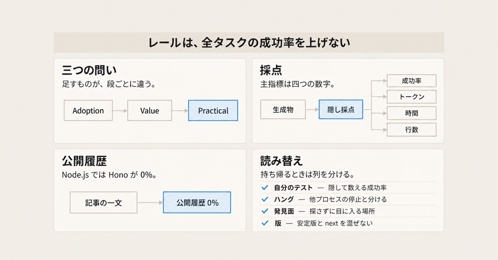
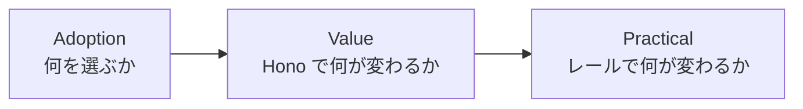
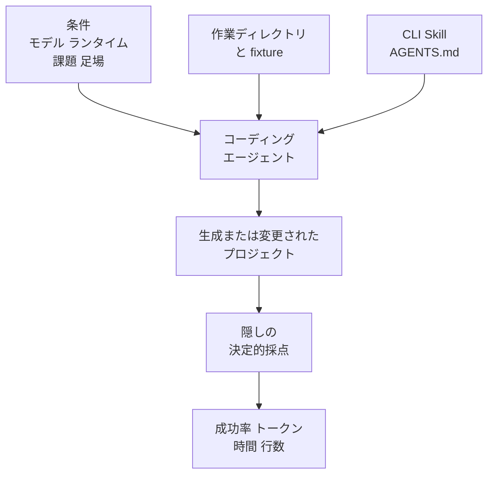

Hono の Agent DX は、作者の Yusuke Wada が公開している評価プロジェクトです。コーディングエージェントが Hono を選ぶか、Hono で書くと何が変わるか、CLI や Skill を足すと変更作業がどう変わるかを、エージェントから隠した採点で測ります。決定的の意味は、最初の節で定義します。結果は [agent-dx.hono.dev](https://agent-dx.hono.dev) にあり、実装は [honojs/agent-dx](https://github.com/honojs/agent-dx) にあります。

[2026-11-01 の Zenn 記事](https://zenn.dev/yusukebe/articles/3d3dc6605ca1b1) は、フロントエンドカンファレンス福岡（2026-09-12）、Hono Conference（2026-10-11）、Cloudflare Connect の三講演を文章にしたものです。同じ日の FOSS4G 分科会は、外部からの Pull Request を閉じた理由を扱う別講演です。公開系列は、公開ダッシュボード、講演スライド、2026-11-01 の記事です。記事と講演は、その一部だけを「分かったこと」に圧縮しています。

この記事は、三つの問いと採点の仕組みを先に置き、そのあとで公開ダッシュボードと講演の数字がどこまで一致するかを分けます。最後に、社内のライブラリへ読み替えるときの列の切り方を置きます。数値の取得日は 2026-11-02 です。週次の表は、その後も動きます。

*この記事の全体像。以下、順に解説します。*

## HonoのAgent DXとは

Hono は、Yusuke Wada が作者である Web フレームワークです。Agent DX は、そのフレームワークをコーディングエージェントがどう扱うかを、条件を固定した会話の繰り返しで測るプロジェクトです。評価は、同じ条件の会話を何度も走らせ、生成物だけを採点します。

### 三つの問い

問いは三つです。足すものの段が違います。

Adoption は、中立な依頼で Hono を選ぶかを見ます。ここでの中立は、依頼文に Hono の名前を書かない、という意味です。Value は、同じ課題を素のハンドラと Hono で比べます。素のハンドラは、Hono を介さない書き方で、公開の表では plain と書きます。Practical は、既存の Hono プロジェクトへの変更を、レールの有無で比べます。レールは、エージェント向けの足場の総称です。あとで挙げる足場は四つで、週次の条件名 `cli + skill` はそのうち CLI と Skill だけを指します。

週次の Adoption は、空のディレクトリから始めます。runtime は Cloudflare Workers、Bun、Node.js、Deno の 4 つです。scenario は 4 つです。scenario の名前は `minimal`、`routes`、`api`、`framework` です。`minimal` は `GET /health` です。`api` はバリデーション付きの TODO です。`framework` は、同じ API にフレームワークを使え、と明示します。`framework` は Hono とは書きません。`routes` は、4 つのシナリオ名の一つです。課題本文は、公開の説明では名前以外がありません。

`package.json` に `hono` を置く実験は、この週次の表とは別です。Practical の週次は、モデル `claude-haiku-4-5` に対して、baseline と `cli + skill` をタスクごとに 5 回ずつ走らせます。baseline は、CLI も Skill も足さない側です。`cli + skill` は、CLI と Skill を足した側です。`claude-haiku-4-5` は、週次 Practical の既定モデルです。Claude のモデル名です。

### 採点が返すもの

決定的とは、テスト、型チェック、import の静的解析が合否を決めることです。プロジェクト全体の採点は、この三つです。Practical について公開されている手続きは、終了後の `tsc --noEmit` と、見えない check script です。check script が検査する項目は、公開されていません。テストと import の静的解析が、その check script の中にあるかは、公開の説明では分かりません。Practical の採点基準は、エージェントから隠します。

記録する主指標は、成功率、トークン、時間、書いた行数です。どのフレームワークを選んだか、CLI を呼んだかは、診断用の記録です。Adoption の公開履歴に出るのは、選んだフレームワークの割合です。これは診断の記録で、主指標の成功率とは別の欄です。

`tsc --noEmit` は、TypeScript の型検査で、出力ファイルを書きません。README は、Adoption が動く理由を、作業ディレクトリの初期状態に置きます。依存が `package.json` にあると、エージェントはその依存に従います。テンプレートを使うときは、そのテンプレートが作業ディレクトリにコピーされます。これは Adoption の初期状態として README が書く仕組みです。空のディレクトリから始める週次と、`package.json` に `hono` を入れる実験は、始め方が別です。どちらも、エージェントは渡された初期状態に従います。

### エージェント向けの足場

エージェント向けの足場は、次の四つです。

- Hono CLI。パッケージ名は `@hono/cli` です。コマンド名として `request`、`batch`、`snapshot` があります。各コマンドの動作は、公開の説明では名前までです。初期の `request` がどの書き方をエラーにしたかだけ、注意点にあります。
- Hono Skills。CLI や `AGENTS.md` とは別の置き場にある、エージェントが読む手順の足場です。
- `AGENTS.md` の一行。`AGENTS.md` は、そのプロジェクトでエージェントに読ませる指示ファイルです。
- 失敗時の JSON。フィールドは `code`、`message`、`suggestions`、`docs` です。どの処理がこの JSON を返すかは、公開の説明ではフィールド名までです。

週次の条件名 `cli + skill` が名指しするのは、このうち Hono CLI と Hono Skills です。`AGENTS.md` と失敗時の JSON は、その条件名の外です。同じ実行に含まれていたかは、条件名からは決まりません。

人間向けの足場も残します。安定版テンプレートの `dev` は `wrangler dev` です。next のテンプレートは `cf dev` を残します。`dev` は npm script の名前で、`wrangler dev` と `cf dev` は、どちらもそのテンプレートが開発サーバーを起動するコマンドです。next の `AGENTS.md` は「人間用であり、確認のために起動するな」と書きます。安定版と next の版の違いは、あとで読み替えの節に置きます。

2026-10-05 以降、`honojs/hono` の Pull Request はメンテナに限ります。外部の変更は Issue で受けます。閉じた理由と、閉じたあとの経路は別の節です。

評価の流れは、条件と作業ディレクトリをエージェントに渡し、生成物を隠し採点へ入れる形です。fixture は、採点用に用意した作業ディレクトリです。下の図は、評価に渡り得る足場の流れです。週次の `cli + skill` が必ず名指しするのは、CLI と Skill だけです。失敗時の JSON は、この図には入っていません。

### 週次が固定している条件

週次 Adoption の実行定義は、[eval.yml](https://github.com/honojs/agent-dx/blob/main/.github/workflows/eval.yml) にあります。セルは、runtime と scenario の組み合わせ一マスです。`claude-haiku-4-5` は各セル 10 回、concurrency 5 です。`claude-opus-5` は各セル 5 回、concurrency 1 です。concurrency は、同時に走らせる会話の数です。コメントは、Opus が課金枠の上限に当たるため、と書きます。コメント中の呼び名は、unified billing の wholesale rate limit です。この名は、同時実行を 1 にする理由としてコメントが書く課金側の上限です。429 のときだけ、ツール呼び出し前に最大 3 回、15 秒、45 秒、90 秒待って、会話を最初からやり直します。429 は、呼び出しが多すぎるという応答です。

週次 Practical が回すモデルの既定は、`cloudflare-ai-gateway/claude-haiku-4-5` だけです。この文字列は、同じ haiku を週次 Practical が呼ぶときのモデル名です。公開の週次経路は、Flue 上の agent-dx CLI です。Flue は、その週次 workflow が agent-dx CLI を載せる実行先の名前です。agent-dx CLI は、評価の会話を起動する側のコマンドです。エージェントに足す `@hono/cli` とは別です。README は、Claude Code を、差分が再現するかの別確認に置きます。Claude Code は、その別確認の名前です。週次の起動コマンドは `claude` ではありません。

## 注意点

ここからは、記事と講演の「分かったこと」を、公開のセルと突合します。定義、分母、計測日がそろうものだけを、同じ強さで読みます。

### Node.js の公開履歴

2026-11-01 の記事は、Opus 5 に「フレームワークを使って」と言うと Node.js でも Hono を選ぶ、と書きます。公開履歴 [node-js × framework](https://agent-dx.hono.dev/adoption/node-js/framework) は、2026-09-04 から 2026-10-26 まで Hono が 0% です。`claude-haiku-4-5` は毎週 Express 10 件です。Opus は各週 5 回で、Express、Fastify、Failed だけです。最新週 2026-10-26 は Express 5 です。Failed は、Express でも Fastify でもない結果のラベルです。失敗の中身は、公開履歴のこの表だけでは分かりません。

同じ週のホームページでは、Opus の framework シナリオは次のとおりです。Cloudflare Workers が Hono 100%（5 回）、Bun が Hono 100%（5 回）、Node.js が Express 100%、Deno が Oak 80% です。福岡スライドの箇条も「Node.js → Express」です。

`package.json` に `hono` を入れると Workers 5/5、Node.js 5/5、という数字は、記事と両講演にあります。週次ダッシュボードのセルにはありません。Hono Conference の注は、haiku、n=5、福岡のあとに追加計測した、という位置づけです。n は試行回数です。README も、依存を種まきする実験はスケジュール実行の suite ではない、と書きます。suite は、週次で回す一式です。

### Value の数字の読み方

[agent-dx.hono.dev](https://agent-dx.hono.dev) の Value は、2026-09-06、`claude-haiku-4-5`、各 10 回です。週次ではありません。トークン、時間、行数の減りは、中央値の比較です。

| 課題 | plain | Hono |
|---|---|---|
| shop API | 2/10、103k tok、85 秒、254 行 | 4/10、87k tok、72 秒、156 行 |
| notes API | 10/10、134k tok、103 秒、195 行 | 10/10、93k tok、82 秒、129 行 |

行数の減りは約 39% と約 34% で、記事の「30〜40%」に入ります。トークンの減りは約 16% と約 31% です。約 16% は記事の「15〜30%」に入ります。約 31% はその上限をわずかに超えます。README の「16–31%」には両方が入ります。notes は両方とも成功 10/10 です。shop は Hono ありでも 4/10 のままです。サイトのカード文 “with no loss in success” は、Value の比較で成功率が下がっていない、という言い方です。notes は両方 10/10 です。shop は 2/10 から 4/10 で、絶対成功率が半分を超えたという意味ではありません。shop API と notes API は、この表の課題名です。課題本文は、公開の表にはありません。

### 採点の中身

Practical の採点は、型を誤読した回数の集計ではありません。公開されている手続きは、終了後の `tsc --noEmit` と、項目が非公開の check script です。合否を言語モデルに尋ねる方式は取っていません。

workflow のコメントは、Adoption のモデルの一つを “the Claude Code default model” と呼びます。Claude Code は、README が差分の再現確認に置く別確認の名前です。コメントが指すモデルは、本文の haiku か Opus かは、このコメントだけでは固定できません。並びの何番目かも、workflow の本文からは特定できません。起動しているコマンドは `claude` ではありません。公開の週次経路は、Flue 上の agent-dx CLI です。

### Practical の開発サーバー課題

記事の「15/15 が `wrangler dev` を起動」「Sonnet 5 は成功率 20%、5 本中 4 本が 600 秒ハング」「CLI と Skills で全モデル成功率 100%、約 30 秒」は、福岡スライドと Hono Conference の `build-endpoints-workers` の話と一致します。`build-endpoints-workers` は、開発サーバーを扱う課題の名前です。公開ホームページのセル title は、2026-11-02 取得の時点で日付が揃っていません。

| モデル | セルの日付 | CLI | baseline | cli + skill |
|---|---|---|---|---|
| claude-sonnet-5 | 2026-09-08、5 回 | `@hono/cli` 0.2.0-next.7 | 20%、28k tok、600 秒、CLI 0% | 100%、54k tok、22 秒、CLI 100% |
| claude-opus-5 | 2026-09-08、5 回 | 同 | 100%、36k tok、67 秒、CLI 0% | 100%、66k tok、32 秒、CLI 100% |
| claude-haiku-4-5 | 2026-10-26、5 回 | `@hono/cli` 1.0.0-rc.8 | 80%、82k tok、69 秒、CLI 0% | 100%、70k tok、25 秒、CLI 100% |

600 秒は、agent-dx の 1 ターン上限 `DEFAULT_TIMEOUT_MS = 10 * 60 * 1000` と一致します。Sonnet の中央値が 600 秒なのは、そのセルで上限に当たった run が中央値を引き上げた、と読めます。記事の「4 本がハング」はスライドの自己申告です。公開表は本数ではなく中央値です。

同じ haiku の 2026-10-26 では、レールが成功率を下げ、トークンを増やすタスクがあります。`refactor-routes`、`session-users`、`fix-404` は課題名です。課題本文は、公開の表にはありません。

| タスク | baseline | cli + skill |
|---|---|---|
| refactor-routes | 100%、178k tok、64 秒 | 80%、328k tok、84 秒 |
| session-users | 40%、75k tok、42 秒 | 80%、476k tok、88 秒 |
| fix-404 | 100%、21k tok、16 秒 | 100%、106k tok、24 秒 |

README は「レールは軽いハーネスでは成功率を上げ、強いモデルではコストを上げる」と書きます。ハーネスは、エージェントを動かす側の枠です。どのモデルが軽いかは、その文では指定しません。haiku の refactor-routes は、安いモデルでも成功率が 20 ポイント下がり、トークンが増えています。記事のまとめは、この週次セルを含みません。

空の fixture では、開発サーバーが一度も起動しなかった、という福岡の注があります。約 100 run で起動 0 回、という言い方は講演スライドの自己申告です。ハングは、Hono の API 一般の性質ではありません。create-hono の Workers テンプレートが `dev` を置いたときに再現しました。create-hono は、starter のテンプレートを取るコマンドです。ハングはその `dev` の話です。`pkill -f vite` は、コマンド行に vite を含むプロセスを止めるコマンドです。同じ失敗の型として講演が自己申告した、他プロセスの停止です。44 回中 24 回という分母は、公開セルと突合できません。

### 改善前の CLI

福岡スライド（2026-09-12）は、改善前の Practical を「差が出ない。どころか悪化している」と書きます。敗因は二つです。

エージェントが `app.request()` の書き捨てスクリプトを、1 回のツール呼び出しで書きます。そして全エンドポイントを確認してしまいます。`app.request()` の動作は、公開の説明では、その書き捨てが全エンドポイントを確認するために使う、というところまでです。初期の `hono request` は、`GET /api/orders` のようにメソッド名とパスを空白で並べる書き方をエラーにします。エージェントは書き捨てに戻ります。

改善後の結論は、「CLI が効くのは量と継続のタスクで、簡単なタスクは書き捨てで足りる」です。2026-11-01 の記事は、この敗因を開発サーバーの話に要約しています。

### 講演だけにある数字

福岡スライドの「約 700 run、約 $200、CLI リリース 7 回」は、リポジトリ内の請求資料と突合できません。根拠は講演スライドです。

Hono Conference の「Opus は CLI なしでも壊さない。ただし 44 回中 24 回は `pkill -f vite` で他のサーバーまで止める」も、公開セルの分母と突合できません。`pkill -f vite` は、コマンド行に vite を含むプロセスを止めるコマンドです。根拠は講演スライドです。

カウンターを作ってからパスワードを足す例は、CLI なし 13 ターン・70 秒、CLI あり 8 ターン・39 秒です。各 1 回で、どちらも動作します。スライドと記事は一致します。n=1 です。

### 一次資料と一致した件数

api.npmjs.org の `hono`（2026-11-02 取得）は、次のとおりです。

| 期間 | downloads | スライドの言い方 |
|---|---|---|
| 2025-10-01..31 | 11,086,894 | 2025 年 10 月 1,110 万 |
| 2026-09-01..30 | 267,460,679 | 2026 年 9 月 2.67 億 |
| 2025-09-01..30 | 8,693,386 | 比較の起点。スライドは倍数だけ |

2026-09 / 2025-09 = 30.77 です。スライドの「hono は 30.8 倍」（2025 年 9 月→2026 年 9 月）と合います。express など他パッケージの倍数は、再取得していません。

GitHub の検索（2026-11-02）では、`honojs/hono` の Pull Request 作成数は、2025-07-01..2025-09-30 が 82、2026-07-01..2026-09-30 が 345 です。両講演の数字と一致します。star は約 33,000 です。一次取得は 32,773 です。default branch の最新コミットは 2026-11-01 の `4.13.16` です。FOSS4G スライドの「32K」は、概数として合います。

### 講演と記事の対応

公開スライドがあるのは、福岡、Hono Conference、FOSS4G です。Cloudflare Connect のスライド URL は見つかっていません。2026-10-21 の参加者スレッドは、同じ Adoption の表と、13 ターンから 8 ターン、70 秒から 39 秒を再掲しています。第三の独立したデータセットとしては扱いません。表に出る RPC は、型を介して別プロセスの手続きを呼ぶ形です。inbox は、届いた変更依頼が処理しきれない、という言い方です。

| 失敗の型 | 福岡 2026-09-12 | HonoConf 2026-10-11 | 記事 2026-11-01 | FOSS4G 2026-11-01 |
|---|---|---|---|---|
| ヒントが無いと素のハンドラを書く | 中心 | 同じ | 同じ | 無し |
| 「フレームワークを使え」はランタイムの定番に流れる | Node.js は Express、と明記 | 画像中心。本文は「賢いモデルほど使う」 | Opus は Node.js でも Hono、と書く。公開履歴と福岡の箇条と食い違う | 無し |
| 人間用 `dev` でサーバーを起動し、ハングするか他プロセスを止める | 15/15 起動。Sonnet の 20% と 600 秒。空 fixture では約 100 run 起動 0 回、とも言う | 同じ。Opus はワンライナーで回避し、`pkill` の巻き添えを自己申告 | ハングと、n=1 の他サーバー停止 | 無し |
| 初期 CLI は書き捨てとコマンド誤用に負ける。効くのは量と継続 | 詳しい | 開発サーバーに要約 | 開発サーバーに要約 | 無し |
| 補完用の厚い型は人間向け。`tsc` で検査できる型はエージェント向け | 薄い | RPC と補完を人間向け、`tsc` をエージェント向け、と分ける | 「人間向け DX と AI 向け DX」の開発サーバー例だけ | 無し |
| 外部 PR を閉じる | 無し | inbox、姿勢、件数 | 無し | 三理由と、フォーク案内の撤回 |

ここでいう人間向けは、人が補完と短いコマンドで書く側です。エージェント向けは、`tsc --noEmit` で採点に入る側です。2026-11-01 の記事は、この対比を開発サーバーの例に限っています。

### 未確認のまま残る点

- Cloudflare Connect のスライド原本は見つかっていません。参加者スレッド以外の差分は未確認です。
- `package.json` に `hono` を置いた 5/5 の生ログは、週次ダッシュボードのセルにありません。プロンプトとモデルの再実行はしていません。
- RPC 関連 Issue の割合が 2024〜2025 年は 8〜12%、2026 年 4 月以降は 2〜3%、という Hono Conference の数字は再集計していません。
- スライドの 34 Issue のうち 17 がブランチ付き、という内訳は再集計していません。窓の違いは、次の節に数字だけ置きます。
- `routes` シナリオの課題本文は、公開の説明では名前以外が書かれていません。
- Adoption の公開履歴は、選んだフレームワークの割合です。主指標の成功率としては出ていません。
- Practical の週次履歴ページは、モデルごとの最新セルだけです。haiku の refactor-routes が過去週にどう動いたかは未確認です。
- Opus の concurrency を 1 にする理由として、workflow は wholesale rate limit と書きます。RPM の数値表はありません。
- 約 700 run と約 $200 の会計一次資料はありません。
- 44 回中 24 回の `pkill` の分母は未公開です。

## 外部の変更を Issue で受ける

2026-10-05 の投稿で、Wada は外部コントリビューターからの Pull Request を止めた、と書いています。[honojs/hono#5526](https://github.com/honojs/hono/pull/5526) は同日 merged です。CONTRIBUTING を「Issue をくれ。Pull Request はメンテナに限る」に変えています。2026-11-02 の [docs/CONTRIBUTING.md](https://github.com/honojs/hono/blob/main/docs/CONTRIBUTING.md) も同じ文です。

この閉鎖は、Agent DX の点数ではありません。メンテナの受信と、貢献の態度の話です。FOSS4G スライド（2026-11-01）の理由は三つです。

1. コードを書くこと自体の希少性が落ちた、とスライドは置きます。メンテナもモデルで書けます。モデル利用料は残る、とスライドは留保します。
2. 貢献のためだけの貢献です。品質が低い、とは置いていません。直す必要のない修正、リポジトリを走査して指摘を探す態度、実績や就職のためのコントリビューションを問題にします。Hacktoberfest とバグバウンティは、スライドが態度のたとえに使った名前です。CVE 番号はありません。
3. 件数です。上の 82 と 345 です。朝に 12 件、同じ人から複数、Issue の直後に修正 PR が複数、という体験談はスライドの自己申告です。

Hono Conference（2026-10-11）は、同じ閉鎖を「inbox が追いつかない」「品質より姿勢」「細かい指摘とリファクタ」と短く言い、ボット hono-kun に触れます。inbox は、届いた変更依頼が処理しきれない、という言い方です。hono-kun は、講演が名前だけ挙げたボットです。2026-11-02 時点で `honojs/hono-kun` は、公開リポジトリとして解決できません。

閉じたあとの経路は Issue です。スライドは一時期、フォークのブランチを Issue に貼ってよい、メンテナが PR を作り co-author にする、と書いていました。co-author は、コミットメッセージの `Co-authored-by` です。実例の [honojs/hono#5531](https://github.com/honojs/hono/pull/5531) は、2026-10-08 に merged の `defineHandler()` です。作者は yusukebe で、コミットメッセージに `Co-authored-by: Ashunar0` があります。[honojs/hono#5593](https://github.com/honojs/hono/pull/5593) は 2026-10-30 に merged で、そのフォーク案内の文を削除しています。削除前の文はスライドに残っています。

スライドは「10 月 5 日以降の Issue 34 件のうち 17 件がフォークのブランチ付き」と話します。根拠は講演スライドです。GitHub の検索では、2026-10-05..2026-10-31 の Issue が 37 件、2026-11-01 まで含めると 41 件でした（2026-11-02 取得）。17 件のブランチ付きは再集計していません。窓が一致しないので、34 と 17 は講演の自己集計です。

実バグの例として、[honojs/hono#5560](https://github.com/honojs/hono/issues/5560) は 2026-11-02 時点で open です。`hono/jsx` の SSR で object ref が文字列化される、という再現付きの報告です。SSR はサーバー側の描画です。コメントは「Pull Request はメンテナに限られる」として、フォークの compare URL を貼っています。閉鎖方針そのものを批判する Issue は、この範囲の検索では見つかっていません。

## 社内のライブラリへ読み替える

技能や CLI の欠落は、固定した課題の成功率、トークン、時間で数えます。人が便利な省略をフレームワークが残すかも、同じ数字に混ざります。外部の Pull Request を閉じるかは、この採点の点数ではありません。Hono が数えているのは、固定した課題でエージェントが成功し、いくらのトークンと時間を使うかです。

読み替えは、次の六つです。

1. 成否を三列に分けます。第一列は、自分たちが隠して走らせるテストの成功率です。Hono の Practical で公開されている合否は、終了後の `tsc --noEmit` と、項目が非公開の check script です。公開セルの成功率は、この第一列の定義そのものではありません。第二列は、確認の途中でハングしたか、他のプロセスを止めたかです。第三列は、人間用の短いコマンド（`dev`、補完が厚いクライアント）にエージェントが従ったかです。成功率だけを見ると、Opus のように悪い足場を `pkill` で回避した成功が、設計の良さに見えます。
2. 発見面に置きます。発見面は、エージェントが探さずに目に入る場所です。`package.json` の依存、`AGENTS.md` の「確認は CLI で、`dev` は人間用」、失敗 JSON の `suggestions` と公式の短い例です。README が書くとおり、発見面に無い機能は使われません。初期の `hono request` は、メソッド名とパスを並べる呼び出しをエラーにしたため、エージェントはそこに留まりませんでした。
3. 型は二種類に分けます。エディタ補完のための厚い RPC は、講演が人間向けに置いています。RPC は、型を介して別プロセスの手続きを呼ぶ形です。`tsc --noEmit` で落ちる型は、Practical の採点に入っています。社内ライブラリで数えるなら、後者を採点に入れ、前者の厚みは別枠にします。
4. レールは、全タスクの改善とみなしません。公開の haiku 週次では、開発サーバー課題の成功率は上がり、refactor は下がり、トークンは増えるタスクがあります。量が多い確認と、同じ会話で仕様が続く変更に限って CLI を推奨する、が福岡スライドの結論です。
5. 安定版と next を混ぜません。2026-11-02 時点のピンは次のとおりです。`create-hono@latest`（0.19.5）が取る [`honojs/starter` の main](https://github.com/honojs/starter/blob/main/templates/cloudflare-workers/package.json) の Workers テンプレートは `"dev": "wrangler dev"` です。`AGENTS.md` も `@hono/cli` もありません。`create-hono@next`（0.20.0-rc.2）が取る [`v0.20`](https://github.com/honojs/starter/blob/v0.20/templates/cloudflare-workers/AGENTS.md) は、`dev` が `cf dev` のまま、`AGENTS.md` と `@hono/cli` `^1.0.0-rc.8` を持ちます。`@hono/cli@latest` は 0.1.11 で、`batch` と `snapshot` は無く、`error.code` もありません。`error.code` は、その版に無いと書かれている失敗時のコードです。足場の JSON フィールド `code` と同一かは、公開の説明では結ばれていません。公式の agent 文書が書くコマンドは、1.0.0-rc.8 側です。[文書のインストール例](https://hono.dev/docs/agents/cli) `npm install -D @hono/cli` は、latest に解決します。
6. Pull Request を閉じる判断は、Agent DX の点数ではありません。閉じたあとも、実バグの修正はフォークに残り、案内文は一度出してから消しています。社内ライブラリで同じことをするなら、「コードは自分たちで書く」と「実害の再現は Issue で受ける」を分けます。フォーク案内を残すか消すかを、明示します。

逆転する条件は二つです。利用エージェントが単一の強いモデルで、失敗が成功率に出ず、巻き添え停止だけなら、型と例を磨いても週次の成功列は動きません。そのときは、巻き添えを採点に入れます。課題が `GET /health` のような一行なら、CLI を足す根拠は福岡スライドの結論にありません。

## まとめ

Agent DX は、Adoption、Value、Practical の三段で、エージェントの選択と、Hono で書く効果と、レールの効果を、隠しの決定的採点で見ます。主指標は成功率、トークン、時間、行数です。フレームワークの選択と CLI の呼び出しは、診断です。

公開セルと一致するのは、Value の中央値の減り、開発サーバー課題の cli+skill 側の短時間、npm のダウンロード、PR 作成数 82 と 345、star の概数です。一致しないのは、「Node.js でも Hono」という記事の一文と、2026-09-04 から 2026-10-26 の公開履歴です。レールは全タスクで成功率を上げるわけではなく、haiku の refactor-routes では 100% から 80% に下がり、トークンは増えています。約 700 run、約 $200、44 回中 24 回の `pkill` は、講演スライドの自己申告です。

社内へ持ち帰るなら、自分たちが隠して走らせるテストの成功率、ハングと巻き添え、人間用コマンドへの追従を分けます。Hono の Practical の公開上の合否は、`tsc --noEmit` と項目が非公開の check script です。発見面と、`tsc` で落ちる型にレールを置きます。安定版テンプレートと next の CLI は、2026-11-02 時点で別物です。外部 PR を閉じる話は、この採点の外です。

この記事が少しでも参考になった、あるいは改善点などがあれば、ぜひリアクションやコメント、SNSでのシェアをいただけると励みになります！

## 参考リンク

- Yusuke Wada「Agent DX 〜 AI時代にフレームワークHonoは必要か」（2026-11-01）: https://zenn.dev/yusukebe/articles/3d3dc6605ca1b1
- 福岡スライド: https://slides.yusu.ke/web-frameworks-in-the-ai-era
- Hono Conference 2026: https://slides.yusu.ke/honoconf-2026
- FOSS4G 分科会（2026-11-01）: https://slides.yusu.ke/foss4g-2026
- 公開結果: https://agent-dx.hono.dev
- Node.js × framework の履歴: https://agent-dx.hono.dev/adoption/node-js/framework
- README: https://github.com/honojs/agent-dx/blob/main/README.md
- 週次 workflow: https://github.com/honojs/agent-dx/blob/main/.github/workflows/eval.yml
- Hono for Coding Agents: https://hono.dev/docs/agents
- Hono CLI: https://hono.dev/docs/agents/cli
- CONTRIBUTING: https://github.com/honojs/hono/blob/main/docs/CONTRIBUTING.md
- next テンプレートの AGENTS.md: https://github.com/honojs/starter/blob/v0.20/templates/cloudflare-workers/AGENTS.md
- 安定版テンプレートの package.json: https://github.com/honojs/starter/blob/main/templates/cloudflare-workers/package.json
- npm downloads（2026-09）: https://api.npmjs.org/downloads/point/2026-09-01:2026-09-30/hono
- CONTRIBUTING 変更の PR: https://github.com/honojs/hono/pull/5526
- `defineHandler()` の PR: https://github.com/honojs/hono/pull/5531
- フォーク案内を削除した PR: https://github.com/honojs/hono/pull/5593
- `hono/jsx` の open Issue: https://github.com/honojs/hono/issues/5560
