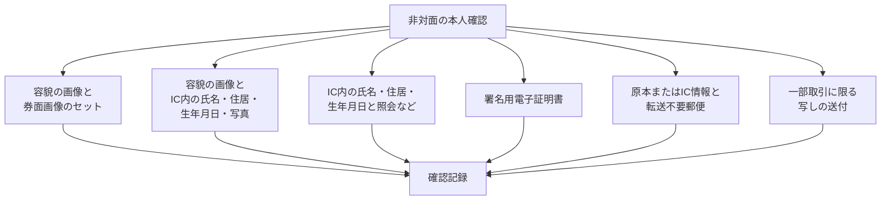

2026年10月23日、三井住友銀行はオンライン口座開設での「本人確認書類の画像送信」による申し込みの受付を止めました。同じ日にコード決済サービスの PayPay は、運転免許証などを撮影する本人確認をやめ、IC チップの読み取りへ統一すると発表しました。背景には、2027年4月1日に施行される犯罪収益移転防止法（犯収法）施行規則の改正があります。犯収法は、銀行などに顧客の本人確認と、その記録の保存を義務づける法律です。

この記事では、改正で削られる方式と残る方式、銀行と PayPay で今なにが残っているか、過去に預かった券面画像をいつまで保存するか、委託先との契約をどう点検するかを整理します。オンライン本人確認（eKYC）の受付方式を変える立場の人が、何を止めて何を残すかを判断できることを目指します。記述は2026年10月24日時点の法令・監督官庁・各社の公開文書に基づき、報道でしか確認できない事項はその旨を書きます。

*この記事の全体像。以下、順に解説します。*

## オンライン本人確認のIC移行とは

非対面で口座を開くとき、銀行などは顧客が誰かを確かめる「取引時確認」を行います。確かめる氏名・住居・生年月日を、法令は本人特定事項と呼びます。どの方法で確かめてよいかは、犯収法施行規則の第6条第1項第1号に、イ・ロ・ハと続く細かい項目（号の細分）として列挙されています。

2025年6月24日公布の改正省令（令和7年省令第3号）は、2027年4月1日から、非対面の次の2つの方式を削ります。

- 顧客の容貌の画像と、写真付き本人確認書類の券面画像（厚みその他の特徴を含む）をセットで送らせる方式。容貌の画像は、本人の顔をその場で撮影させた画像です
- 本人確認書類の写しを送らせる一般の方式

同じ2027年4月1日には、2026年3月6日公布の改正省令（令和8年府省令第1号）も施行されます。こちらは対面の確認を IC 付き書類の提示へ寄せる改正で、非対面で残る方式の位置も整理します。容貌の画像と、IC チップに記録された氏名・住居・生年月日・写真を送らせる方式は、改正後の「ハ」に置かれます。令和7年省令向けに警察庁が出した Q&A は、この方式を「新規則第6条第1項第1号ホ」と呼んでいます。令和8年の改正で号の細分の記号が二つずつ繰り上がる（ホがハになる）ため、Q&A を読むときは記号のずれに注意が要ります。

金融庁は2026年10月9日、施行を待たずに可及的速やかに画像送信の受付をやめるよう、金融機関へ注意喚起しました。注意喚起の本文は「記」の下に番号付きの項目を並べており、この記事では項目1〜3を記1〜記3と呼びます。三井住友銀行と PayPay の動きは、この前倒しにあたります。

### 削られる方式と残る方式

非対面の本人確認には複数の方式があり、方式ごとに事業者が受け取るデータが違います。どの方式で受けても、結果は確認記録に残ります。確認記録は、取引時確認の内容を事業者が作って保存する記録です。

図では、非居住者等を対象にした方式を省いています。表には含めています。

| 方式 | 2027年4月1日以降 |
|---|---|
| 容貌の画像と券面画像のセット | 削られる |
| 本人確認書類の写しの送付（一般） | 削られる |
| 容貌の画像と、IC 内の氏名・住居・生年月日・写真 | 改正後のハとして残る |
| IC 内の氏名・住居・生年月日の送信と、照会などの行為の組み合わせ | 残る（照会の中身はこの記事では扱わない） |
| 署名用電子証明書 | 残る |
| 原本の送付、または IC 情報の送信と、転送不要郵便の組み合わせ | 残る |
| 給与振込口座など一部取引に限る写しの送付 | 細分の記号が繰り上がって残る |
| 非居住者等を対象にした、券面画像の送信や書類の送付と転送不要郵便の組み合わせ | 残る（対象者と対象取引の範囲はこの記事では特定しない） |

署名用電子証明書は、マイナンバーカードの IC に入っている電子証明書のうち、電子署名に使うものです。この証明書で本人を確かめる仕組みを公的個人認証（JPKI）と呼びます。警察庁の Q&A（No.13）は、この方式で券面撮影を追加で必須とはせず、地方公共団体情報システム機構（J-LIS）に有効性を確認すればよいとしています。

転送不要郵便は、転居先へ転送せず、宛先の住所に届かなければ差出人へ戻る郵便です。原本の送付と転送不要郵便を組み合わせる方式は、IC 付き書類や読取手段を持たない人にも使えます。Q&A（No.1〜2）は、この方式が IC を読める人を排除しないことも書いています。同じ号には、IC 情報の送信と転送不要郵便を組み合わせる枝もあります。一部取引に限る写しの送付について、対象取引の具体的な範囲は改正の対照表で「略」とされており、この記事では特定しません。

### 確認記録の作り方と保存期間

確認記録の扱いは犯収法第6条が定め、警察庁の「犯罪収益移転防止法の概要」（2026年8月7日版）が要点をまとめています。

- 取引時確認を行ったら、直ちに確認記録を作る
- 特定取引等の契約が終了した日その他主務省令で定める日から、7年間保存する。特定取引等は取引時確認が必要な取引で、預金口座の開設もこれに含まれる
- 添付資料は「該当するもの全て」。画像の送信を受けたときはその画像または写し、IC チップ情報の送信を受けたときはその IC 情報または写しを付ける
- 内容の変更を知ったときは付記する。既に書いた内容は消去してはならない。付記の代わりに別の記録にしてもよい
- マイナンバーカードを本人確認書類に使っても、記録するのは個人番号以外の事項（発行者や有効期間など）である

保存の時計は二つあります。確認記録は、契約終了日等から7年です。犯収法第7条の取引記録等は、個々の取引の記録で、取引の日から7年です。後者は確認記録の起算とは別の記録です。

## 注意点

### 「3メガバンクが顔写真の本人確認を廃止」は公式発表より広い

報道の見出しには「3メガバンクがオンライン口座開設で顔写真の本人確認を廃止し、IC チップへ移行した」という趣旨のものがあります。公式ページで日付まで確認できるのは、三井住友銀行の2026年10月23日だけです。

- 三井住友銀行が止めたのは、オンラインでの「本人確認書類の画像送信」による申し込みの受付です。運転免許証を本人確認書類から外したとは書いていません。店頭では運転免許証の原本提示が残ります
- みずほ銀行が2026年10月19日、三菱UFJ銀行が2026年5月から対応した、という日付は、共同・朝日・産経・読売・時事の報道で一致しています。ただし両行の公式リリースに、その日に券面撮影を止めたという文は見つかりませんでした
- みずほ銀行の本人確認書類ページにある「2026年10月19日現在」は、書類一覧の時点を示す注記で、停止日の告知ではありません。同行の撮影手順ページは、運転免許証のおもて・厚み・うらの撮影を案内しています
- 三菱UFJ銀行の書類ページは、アプリで使える書類に運転免許証を残しており、フッターは「2025年12月25日現在」です。同行の FAQ（2026年5月21日公開）は、IC 読取と運転免許証の暗証番号（4桁が2種類）を案内しています

みずほ銀行と三菱UFJ銀行の実施日は、公式の停止告知が確認できるまで、報道ベースの日付として扱うのが安全です。

### 「顔写真のデータを預からなくなる」は、残る方式と合わない

改正後のハは、容貌の画像と、IC 内の写真を含む情報の送信です。IC へ移っても、顔の画像は新規に届き続けます。PayPay の公式手順も、運転免許証の IC を読んだあとに顔写真を撮影し、まばたきを確認します。署名用電子証明書の経路の手順には、顔写真の撮影ステップがありません。暗証番号を忘れた場合の経路と在留カードの経路では、顔写真を撮影します。

### 「IC に原則一本化」は条文より広い要約

金融庁の注意喚起の記3は、施行日から「本人確認書類の画像送信を受ける方法は廃止し、IC チップ情報の読取に原則一本化」と書きます。省令が残すのは、容貌の画像と IC、IC と照会など、原本または IC 情報と転送不要郵便、一部取引に限る写しの送付、公的個人認証です。また、非居住者等を対象にした方式には券面画像の送信が残ります。「原則一本化」は監督上の方向を示す要約として読み、残る方式は条文で確かめる必要があります。解説記事などが「JPKI へ一本化」と要約している場合も同じです。

### PayPay の発表と手順ページのずれ

PayPay は、2026年10月23日の発表で、2026年11月上旬までにマイナンバーカード・運転免許証・運転経歴証明書（運転免許を返納した人などが受け取る証明書）の撮影による申請を廃止すると書きます。残す方法は、署名用電子証明書、署名用電子証明書の暗証番号を忘れた場合のカード表記の番号入力と顔認証と IC 読取、運転免許証の IC 読取の3つです。2026年10月24日に確認した手順ページは、次の状態でした。

- 暗証番号を使わない場合の書類撮影（表面・厚み・裏面）の経路が残っている
- 「2026年10月23日より本人確認に運転経歴証明書はご利用できません」と書く
- 署名用電子証明書の経路で IC スキャンの対象外の機種は、書類撮影へ進むと書く
- 在留カード・特別永住者証明書は、IC スキャンに加えて表面・裏面の撮影と顔写真の撮影がある。16歳未満は使えない。2026年6月14日以降に発行されたカードは受け入れ準備中で、申請に使えない

撮影申請の廃止は予告であり、10月23日にすべての撮影経路が止まったわけではありません。発表にある「本人確認完了ユーザーは2026年9月時点で4,400万人超」は、同社の自己申告で、時点付きの概数です。

### 三井住友銀行のページ間でも記述が揃っていない

画像送信の停止を告げるページとは別に、三井住友銀行の口座開設の案内ページとその FAQ には、自撮りや運転免許証に触れた記述が残っています。法人口座のページは、SMBC BUSINESS アプリで運転免許証を読み取ると書きます。カードローンのオンライン本人確認ページ（2026年8月30日時点）は、顔と顔写真付き書類の撮影と書いており、10月23日の停止文はありません。法人口座やカードローンが個人口座と同じ停止に含まれるかは、公開ページからは確認できませんでした。

### 確認できていない点

- 金融庁の注意喚起が踏まえるとしている、内閣官房（国家サイバー統括室）の同日の注意喚起の本文
- みずほ銀行のインターネット口座開設が、撮影手順ページのとおり今も券面撮影を受け付けているか
- 三菱UFJ銀行が、FAQ の IC 読取と、キャンペーンページにある「顔を撮影」の手順のどちらを現行としているか
- 非居住者等に残る券面画像の方式が、どの取引に及ぶか

## 銀行と PayPay で、何が残っているか

三井住友銀行の個人口座と PayPay を、2027年4月1日の省令と並べます。三井住友銀行は公式の口座開設窓口ページ、PayPay は2026年10月23日の発表と10月24日の手順ページによります。

| 項目 | 三井住友銀行の個人口座 | PayPay | 2027年4月1日の省令 |
|---|---|---|---|
| 券面画像の送信 | オンライン受付を2026年10月23日に停止 | 3書類は11月上旬までに廃止予定。手順ページは撮影経路を残す。在留カードは表面・裏面の撮影が残る | 容貌と券面のセットの方式を削る。一部取引の写し送付と、非居住者等の方式は残る |
| 容貌の画像 | 停止の対象は画像送信全体。容貌だけを残すとは書いていない | 運転免許証の IC、暗証番号を忘れた場合の経路、在留カードの経路で顔写真を撮る。署名用電子証明書の経路の手順には撮影ステップがない | ハとして容貌の送信が残る |
| 運転免許証の IC（氏名・住居・生年月日・写真） | オンラインの手順に記載なし。店頭での原本提示は残る | IC 読取のあと顔写真を撮る。暗証番号は4桁が2種類 | ハで送る IC 情報に写真が含まれる |
| 署名用電子証明書 | オンラインの方法として JPKI を挙げる | 6〜16桁の暗証番号と IC。対象外の機種は書類撮影へ進む | 券面撮影を追加で必須としない（Q&A No.13） |
| 原本の送付 | オンラインでできなければ店頭。郵送とは書いていない | 手順ページの範囲では見当たらない | IC 付き書類や読取手段を持たない人にも使える。IC を読める人も排除しない |

揃っていないのは、運転免許証の IC をオンラインの経路として残すかどうかです。PayPay は残し、三井住友銀行の個人口座は、オンラインを JPKI などに限り、運転免許証は店頭へ戻しています。三井住友銀行は、在留カード等で申し込む人には8つの店舗拠点を勧めています（他の店舗でも手続きはできます）。

表の省令の列にある非居住者等の方式と、PayPay が在留カードで残している撮影が同じ方式にあたるかは、この記事では判断しません。在留カードを持つ人が非居住者等にあたるとも限りません。警察庁の Q&A（No.9）は、在留カード裏面の撮影画像は IC 情報ではないため、それで現在の住居を確認したことにはならないとしています。IC で現在の住居を確認できない場合は、住居を別に確認する必要があります。IC が読めない人や暗証番号がロックされた人の受け皿を、店頭に置くか、原本送付に置くかは、事業者ごとに分かれています。

## 過去に預かった券面画像はいつまで残すか

受付方式を変えた日は、過去に預かった券面画像を消してよい日にはなりません。確認記録の保存期間と、添付の規定が根拠です。

### 保存期間の起算日

犯収法第6条第2項は、確認記録を「特定取引等に係る契約が終了した日その他の主務省令で定める日」から7年間保存すると定めます。その日を定めるのが施行規則第21条です。

- 第21条第1項: 起算日は「取引終了日及び取引時確認済みの取引に係る取引終了日のうち後に到来する日」
- 第21条第2項第1号: 施行令第7条第1項第1号イからヘまで等の取引は、その契約が終了した日が取引終了日
- 同項第2号: それ以外の取引は、その取引が行われた日が取引終了日

施行令第7条第1項第1号イは「預金又は貯金の受入れを内容とする契約の締結」です。したがって預金口座の確認記録は、口座の契約が終了した日から7年が基本です。

取引時確認済みの取引は、既に取引時確認を済ませた顧客と後日行う取引で、保存している確認記録を参照することで、改めての取引時確認を省いたものです。警察庁の概要は、このとき確認記録を検索するための事項、取引等の日付、取引等の種類を記録するとしています。この後日の取引が第2号に当たり、その取引の日が口座の契約終了日より後なら、確認記録の起算日はその取引の日へずれます。「取引の日から7年」とも「契約終了日から7年」とも一律には読めません。

### 添付と既記載の扱い

確認記録には、画像の送信を受けたときはその画像または写しを、IC 情報の送信を受けたときはその IC 情報または写しを添付します。既に記載した内容は消去できません。券面画像で確認した過去の記録には、券面画像が添付として残り続けます。

Q&A の No.29 は、送付を受けた本人確認書類について、原本の保存は必須ではなく、スキャンデータを写しとして保存してよいとしています。保存形式を選べるという意味で、添付を捨ててよいという意味ではありません。

### 施行日をまたぐ確認

Q&A の No.3 は、施行前に廃止予定の方式で本人特定事項を確認して開いた預貯金口座について、施行後に別の方法で確認し直すことは求めないとしています。No.4 は、施行前に写しを発送し、施行後に受け取った場合は、新しい規則の別の方法でやり直すとしています。受付をやめた日は過去の確認を無効にしませんが、施行後に届く旧方式の送付は、新しい確認になりません。

### 個人情報保護法との関係

個人情報保護法第22条は、個人データを利用する必要がなくなったときは遅滞なく消去するよう「努めなければならない」と定めます。努力義務です。犯収法で保存期間が定められている間は、その記録について利用する必要がなくなったとは言いにくい、というのが条文の並びからの読みです。個人情報保護委員会の通則ガイドライン（3-4-1）にも、法令で保存期間等が定められている場合はこの限りではない、という注記があると読めます。運用に使う前に、ガイドライン本文の文言を確認してください。

方式を変えた日に過去の画像を消してよい、または消せ、と書いた警察庁・金融庁・個人情報保護委員会の文書は、2026年10月24日時点で確認した範囲には見つかりませんでした。金融庁の注意喚起の記2は、移行までの間、本人確認書類の画像と容貌の画像に不自然な点がないかを改めて確認せよ、という指示です。消去ではなく、画像を見続けることを求めています。

## 委託先との契約は、同じ日に直す義務があるか

本人確認の処理を外部に委託している場合、委託先に券面画像を提出させる条項が残っていることがあります。受付方式の変更と同時に、委託契約を改めよと定めた明文は、確認した範囲にはありませんでした。確認したのは、犯収法第6条・第7条、確認記録の添付の規定、個人情報保護法第22条、金融庁の注意喚起の記1です。

金融庁の記1が求めているのは、内閣官房の同日の注意喚起や今後明らかになる手口を踏まえ、サードパーティリスク管理とインシデント対応の態勢を点検することです。不十分なら、リスクに応じて措置を講じます。

明文の義務がなくても、点検する理由は実務の側にあります。新しい受付が IC になっても、委託先へ渡す提出物が券面画像のままなら、現場は画像を作り続けます。例えば、みずほ銀行のウェブ手続規定は、検索結果の抜粋で読む限り、容貌と本人確認資料の画像を送り、外部事業者の TRUSTDOCK がそれを保存することへの同意を求めています。規定の PDF 本文までは確認できていません。この規定も、画像を消したとは書いていません。

## 受付方式を変えるときの進め方

受付方式を変える側は、次の順に分けて判断すると、止めるものと残すものが混ざりません。

1. 新規受付でやめるもの（容貌の画像と券面画像のセット、写しの送付の一般方式）と、法令上残る方式（容貌の画像と IC 内の情報、IC と照会など、署名用電子証明書、原本または IC 情報と転送不要郵便、一部取引に限る写しの送付、非居住者等の方式）を、方式ごとに一覧にする。他社の現行手順は法令の一覧と分けて扱う。例えば PayPay は在留カードの表面・裏面の撮影を残しているが、Q&A No.9 は裏面の画像を IC 情報と認めず、IC で現在の住居を確認できなければ住居を別に確認する必要があるとしている。銀行の個人口座とコード決済でも、運転免許証の IC をオンラインに残すかは揃っていないため、他社の方式をそのまま写さない
2. 過去の確認記録は、方式を変えた日に消さない。起算日は契約終了日等とし、確認記録を参照して後日行った取引時確認済みの取引（日付と種類）で起算日が延びる場合を台帳に残す。添付は、画像で受けた記録は画像または写し、IC で受けた記録は IC 情報または写し、と分けて管理する
3. 施行前に発送され、施行後に届く写しは、新しい方法での確認にならない（Q&A No.4）。切り替え日の前後で滞留している送付物を別扱いにする
4. 委託先との契約は、同日に改める明文がない前提で、提出物が券面画像のまま残る条項がないかを点検する。この確認を、金融庁の記1が求めるサードパーティリスクの点検に載せる。確認記録には個人番号を書かない
5. みずほ銀行の10月19日、三菱UFJ銀行の5月という実施日は、公式の停止告知を確認できるまで、確定した日付として社内資料に書かない

この判断が変わるのは、監督官庁が保存期間前の画像削除を明示した場合か、施行規則が確認記録の起算日を取引の日へ改めた場合です。2026年10月24日時点では、どちらも確認できていません。

## まとめ

- 2027年4月1日に削られるのは、容貌の画像と券面画像をセットで送る方式と、写しの送付の一般方式です。容貌の画像と IC 内の情報を送る方式（改正後のハ）、署名用電子証明書、原本送付などは残ります
- 前倒しの停止日を公式に確認できるのは、三井住友銀行の2026年10月23日です。PayPay は11月上旬までの廃止予告で、10月24日時点の手順ページには撮影経路が残っています
- IC へ移っても、顔の画像は多くの経路で新規に届き続けます。「顔写真を預からなくなる」とは言えません
- 過去に預かった券面画像は、確認記録の添付として、契約終了日等から7年間保存します。受付方式を変えた日は、消去の起点になりません
- 委託先との契約を同じ日に改める明文はありませんが、提出物が券面画像のまま残っていないかは、サードパーティリスクの点検として確かめる価値があります

この記事が少しでも参考になった、あるいは改善点などがあれば、ぜひリアクションやコメント、SNSでのシェアをいただけると励みになります！

## 参考リンク

- [犯罪による収益の移転防止に関する法律（e-Gov）](https://laws.e-gov.go.jp/law/419AC0000000022)
- [犯罪による収益の移転防止に関する法律施行規則（e-Gov）](https://laws.e-gov.go.jp/law/420M60000F5A001)
- [犯罪による収益の移転防止に関する法律施行令（e-Gov）](https://laws.e-gov.go.jp/law/420CO0000000020)
- [令和7年省令第3号 新旧対照表（警察庁）](https://www.npa.go.jp/sosikihanzai/jafic/hourei/250624/anbun02.pdf)
- [令和7年省令第3号に関する Q&A（警察庁）](https://www.npa.go.jp/sosikihanzai/jafic/hourei/data/25062402qa.pdf)
- [令和8年府省令第1号 新旧対照表（警察庁）](https://www.npa.go.jp/sosikihanzai/jafic/hourei/260306/anbun.pdf)
- [犯罪収益移転防止法の概要 2026年8月7日版（警察庁）](https://www.npa.go.jp/sosikihanzai/jafic/hourei/data/hougaiyou20260807.pdf)
- [個人情報の保護に関する法律（e-Gov）](https://laws.e-gov.go.jp/law/415AC0000000057)
- [個人情報の保護に関する法律についてのガイドライン（通則編）（個人情報保護委員会）](https://www.ppc.go.jp/personalinfo/legal/guidelines_tsusoku)
- [金融庁 2026年10月9日 注意喚起](https://www.fsa.go.jp/news/r8/sonota/20261009/20261009.html)
- [三井住友銀行 口座開設の窓口](https://www.smbc.co.jp/kojin/open-account/mado/)
- [三井住友銀行 口座開設](https://www.smbc.co.jp/kojin/open-account/)
- [三井住友銀行 法人口座の手続き](https://www.smbc.co.jp/hojin/kouza/otetsuduki.html)
- [三井住友銀行 カードローンのオンライン本人確認](https://www.smbc.co.jp/kojin/cardloan/online_kakunin/)
- [PayPay 2026年10月23日 発表](https://about.paypay.ne.jp/pr/20261023/01/)
- [PayPay 本人確認の手順](https://paypay.ne.jp/guide/auth/)
- [三菱UFJ銀行 口座開設に必要な書類](https://www.bk.mufg.jp/kouza/order/shorui.html)
- [三菱UFJ銀行 FAQ（運転免許証の IC 読取）](https://faq01.bk.mufg.jp/faq/show/861?site_domain=default)
- [三菱UFJ銀行 キャンペーンページ（2026年10月）](https://www.bk.mufg.jp/kouza/lp/pjsekaicp_202610/index.html)
- [みずほ銀行 本人確認書類](https://www.mizuhobank.co.jp/honnin/kojin/index.html)
- [みずほ銀行 運転免許証の撮影手順](https://www.mizuhobank.co.jp/account/untenmenkyosho.html)
- [みずほ銀行 ウェブ手続規定](https://www.mizuhobank.co.jp/regulation/pdf/tetsudukiweb.pdf)
- [日本経済新聞（会員限定）](https://www.nikkei.com/article/DGXZQOUB224DA0S6A021C2000000/)
- [東京新聞（共同通信）](https://www.tokyo-np.co.jp/article/523526)
