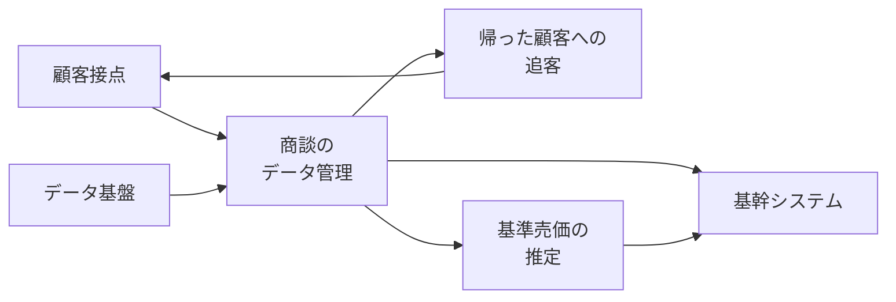

株式会社IDOMは、中古車の買取と販売のブランド「ガリバー」を運営する、東証プライム上場の会社です。証券コードは7599です。2026年10月26日、日経クロステックは、同社がAIを前提に事業とシステムを組み替えるAXに、総額約135億円を投じると報じました。AXは、その報道が置いた呼び方です。同日午後に「Gulliver AX宣言」を発表し、顧客接点から基幹システムまでを対象にAIエージェントを使う、とも書いています。AIエージェントは、同紙が使うと書いた呼び方です。どの製品を指すかは、公開部分にはありません。

約135億円と、宣言という語の出所は、同日時点では同紙の公開部分です。有料の本文は、この記事では読んでいません。

この記事は、その公開部分と、会社がすでに出している発表、決算説明、適時開示を並べます。適時開示は、上場会社が取引所を通じて出す法定の開示です。読後にたどれるのは、金額がどの文書にあるか、会社が金額つきで説明しているデジタル投資はどれか、在庫と契約と返金をエージェントが書いてよいかを人が確定するかが文書で分かれているか、の3点です。この記事では、在庫、契約、返金のように取引の状態を記録する帳票を台帳と呼びます。

*この記事の全体像。以下、順に解説します。*

## IDOMのAXとは

2026年10月26日の報道が置いた範囲は、顧客接点から基幹システムまでです。見出しは「顧客接点・MDを抜本改革」です。MDの展開は、確認した公開文にはありません。同紙は、同日午後のGulliver AX宣言、AIエージェントの活用、AIネイティブ化を報じています。AIネイティブ化は、同紙の語です。意味も、完了の条件も、確認した公開文にはありません。

公開導入は、連載目次にある導入文です。第1回記事の冒頭の公開リードとは、別の公開文です。公開導入が挙げる具体は、次の4つです。SalesforceとDatabricksを全面採用すること。紙とホワイトボードで回していた商談をデータで管理し、AIが進捗を判定すること。商談を終えて帰った顧客を、LINEで追うこと。ベテランの値付けを、AIで自動化すること。Databricksは、その公開導入がSalesforceと並べて名指しした製品名です。何をする製品かは、公開導入には書かれていません。公開導入は、SalesforceとDatabricksをデータ基盤とは呼んでいません。

会社側で日付が先に出ているのは、顧客接点のCRMです。CRMは、顧客との商談から納車後までを記録する仕組みを、会社発表が組み直しの対象にしている語です。2025年1月6日の会社発表は、IDOM Digital DriveによるCRMの再構築で、Salesforce Service CloudとLightning Platformを使う、と書いています。IDOM Digital Driveは、その発表が再構築に付けた名前です。Salesforce Service CloudとLightning Platformは、同じ発表が名指ししたSalesforceの製品です。二つの製品の機能の差は、その発表には書かれていません。使う範囲は、ヒアリング、提案、契約に伴う連絡、納車後のメンテナンスまでです。

2026年2月期の決算説明は、単体の販売費及び一般管理費について、前期比の注記に「DX投資の一環として、CRM開発のための10億円を追加投資を含む」と書いています。単体は、グループ会社を合算した数字ではなく、その説明がIDOM本体として分けている区分です。10億円は、同じスライドにある前年差の棒そのものではありません。棒は人件費、地代家賃などです。注記の文面だけでは、10億円が追加投資の総額なのか、より大きい額に含まれる額なのかは、一意に決まりません。同じ説明は、次期の中期計画に向けて、顧客データの統合とOMOで生産性を上げる、とも書いています。OMOの定義は、確認した決算説明にはありません。

2027年2月期の第1四半期の説明は、単体の業務委託費と支払手数料に含まれるDX関連費が4億円増え、計画通り進んでいる、と説明しています。

別系統として、グループのIDOM CaaS Technologyは、残価を予測するAIモデルを、同じ系統の説明会で開示しています。残価は、契約期間の終わりに車両がいくらで残るかの見積りです。このモデルは、2026年10月26日の約135億円の報道とは別の開示です。

次の図の箱は、出所が一つではありません。矢印は、会社が公開したシステムの接続ではありません。出所の違う語を並べるために引いた線です。データ基盤の箱は、Databricksの別名ではありません。

顧客接点と基幹システムは、2026年10月26日の第1回の公開リードにあります。商談をデータで管理すること、帰った顧客へのLINEでの追客、SalesforceとDatabricksの全面採用は、連載目次の公開導入にあります。基準売価の推定は、2026年10月29日公開予定の見出しにあります。基準売価は、その見出しが置く、社内の売値の見積りです。公開導入にある「ベテランの値付け」と、この見出しの基準売価が同じ対象かは、公開文では確認できません。データ基盤という語は、2026年10月30日公開予定の見出しにあります。2026年10月26日時点では、どちらの見出しも公開前の予告です。

## 注意点

約135億円と「基幹まで」は、2026年10月26日の日経クロステックの公開リードにある数字と範囲です。有料の本文は未読です。内訳、期間、委託先が本文にあるかは、公開リードからは分かりません。同じ連載の目次の公開導入は「総額135億円」と書き、「約」が付きません。公開文どうしで、金額の言い方が揃っていません。

2026年10月26日までに確認した会社のニュースページ、PR TIMES、適時開示、決算説明には、「Gulliver AX宣言」の本文も、135億円（13,500百万円）も見当たりませんでした。在庫、契約、返金のどれをエージェントが更新してよいか、どれを人が確定するかも、確認した会社資料にはありません。この分離は、公開文を読む側の問いです。IDOMが公表した設計ではありません。

会社が金額つきで説明しているデジタル投資は、桁が違います。

| 数字 | 何の数字か | 出所 |
|---|---|---|
| 約135億円 | AXの総額、という取材 | 日経クロステック 2026-10-26 の公開リード |
| 135億円 | 同上。「約」が無い | 同連載の目次 |
| 50億〜60億円 | 2025年の顧客接点DX。リードは50億〜60億円規模、見出しは60億円 | 日経クロステック 2025-01-06 の公開ページ。同日の会社プレスに金額は無い |
| 10億円 | 2026年2月期の注記「CRM開発のための10億円を追加投資を含む」。前年差の棒そのものではない | 2026-04-14 の決算説明 |
| 4億円の増加 | 2027年2月期第1四半期。単体のDX関連費の前年差。計画通り | 2026-07-14 の決算説明 |
| 761百万円 | 2026年3月〜8月の無形固定資産の取得。前年同期は766百万円 | 第33期半期報告書 |
| 2,285百万円 | 2026年8月31日のソフトウエア残高。2026年2月28日は1,873百万円 | 同上 |

無形固定資産の取得は、その期間に資産として計上した支出です。ソフトウエア残高は、償却後に帳簿へ残っているソフトウエアの額です。10億円、4億円、761百万円を足して、135億円の内訳にしてはいけません。会社は、包含関係を書いていません。ソフトウエア残高の差412百万円（2,285百万円から1,873百万円を引いた額）は、償却後の帳簿の動きです。プログラム予算ではありません。135億円が複数年の将来支出なら、2026年8月時点の残高に一度で出ない余地は残ります。期間がそうだと会社が書いた文書は、確認した範囲にはありません。

2025年1月6日の日経は、リードで投資額を50億〜60億円規模とし、見出しでは60億円としています。50億〜60億円と約135億円を足す根拠は、確認した会社文書にはありません。両者の関係は、会社文書では未確認です。足さない理由は、代表者の表記が違うことではありません。2025年の取材の話し手は羽鳥貴夫社長です。2026年10月14日の業績修正の代表者表記は羽鳥由宇介です。2026年10月15日提出の第33期半期報告書の代表者欄の戸籍名は羽鳥裕介です。この3つの表記が同一人物かどうかは、ここでは判定しません。金額を足すかどうかは、この表記では決めません。

未刊行の見出しを、実績にしてはいけません。連載目次の第3回は、2026年10月28日公開予定です。見出しは「不成約客をAIが追客、ガリバーの成約率1ポイント超上昇、60億円増収へ」です。本文は無く、増収の実績としては未確認です。10月27日の商談データ化、10月29日の基準売価、10月30日のデータ基盤も、2026年10月26日時点では予告です。

2026年10月14日の通期予想の修正は、会社自身の文書では次のとおりです。この表は、先に書いた単体の注記とは別の表です。単体か、グループを合算した数字かは、確認した抜粋には書かれていません。単位は百万円です。

| 項目 | 前回予想 | 修正後 |
|---|---:|---:|
| 売上高 | 629,000 | 655,000 |
| 営業利益 | 24,000 | 18,501 |
| 経常利益 | 22,400 | 16,422 |
| 親会社株主に帰属する当期純利益 | 14,200 | 10,501 |

本文は、営業利益を185億円、経常利益を164億円、純利益を105億円と丸めています。表の18,501百万円は185.01億円です。10,501百万円は105.01億円です。売上を上げた理由は、大型店の新規出店を期初の10店から13店にしたことと、卸売台数の増加です。利益を下げた理由は、上期の営業利益が期初計画に対して下振れたことと、下期の成長投資です。上期の営業利益について、会社本文は期初計画に対する31億円の下振れと書いています。その比較として並ぶ数字は11,900百万円と8,771百万円で、差は3,129百万円です。8,771百万円は、この半期の営業利益として後に出る額と同じです。11,900百万円を期初計画の額だと科目名まで書いた箇所は、確認した本文にはありません。上の通期予想の表にも、11,900百万円はありません。下期の費目として名指しされているのは、大型店の準備費用と設備投資、人員、買取を強める広告です。この節に、AXも135億円もありません。

中間の差異の理由は、通期の節とは別です。会社は、三つを並列に書いています。小売台数は、期初の90千台に対し88千台です。半期報告書の国内直営店の小売台数は88,043台です。オークション相場の下落で、卸の台あたり粗利が想定を下回りました。販売費及び一般管理費は、期初想定の410億円から432億円へ増え、差は22億円です。主因として、大型店に向けた先行採用と処遇改善の人件費、および「商談の効率化とAIの活用を目的としたCRM開発を含むDX支出」を挙げています。この文は、2026年10月14日の英語版適時開示の本文です。DX支出は、その22億円の一要素です。135億円のプログラムが利益を削った、という文ではありません。

第33期の半期は、2026年3月1日から8月31日までです。提出日は2026年10月15日です。ここからの売上高、営業利益、販売費及び一般管理費は、先の単体の注記とは別の数字です。単体かグループ合算かは、確認した抜粋では分けて書かれていません。販売費及び一般管理費は43,219百万円です。前年同期は36,338百万円で、18.9%増です。本文は、大型店の地代家賃と減価償却、先行採用の人件費、CRMとAIのシステム等の開発投資、じしゃロンの貸倒引当金を、並列で挙げています。じしゃロンは、その貸倒引当金の対象として半期報告書が名指しした事業名です。AXの費用項目としては書かれていません。貸倒引当金の定義は、確認した注記にはありません。注記で金額が出る費目に、CRMとAIの単独行はありません。中間の業績は増収増益です。売上高は318,100百万円、営業利益は8,771百万円です。比較は、第33期の期首からの収益認識の変更を遡った後の数字です。収益認識は、売上をどの時点で計上するかの会計方針です。この修正開示が前期通期の売上高として置くのは559,250百万円です。変更前の決算短信に出ていた562,774百万円とは、取り違えないでください。

支払利息は、前中間が582百万円、当中間が975百万円です。長期借入金は、2026年2月28日の70,000百万円から、2026年8月31日の79,777百万円へ増えています。固定のリース債務は、9,720百万円から15,805百万円へ増えています。固定が金利の種類なのか、期間の区分なのかは、確認した本文にはありません。資金の制約にはなります。AXの採否を、会社が書いた文ではありません。

LINEの自動追客と、社内の基準売価の確定を、IDOMのエージェントに対して名指しで禁じる条文は、確認した範囲では特定できませんでした。自動車公正取引協議会の支払総額のQ&Aは、顧客に示す価格の表示を制約します。支払総額は、車両本体と諸費用を合わせ、顧客が支払う総額です。表示した支払総額で売らないこと、支払総額に含めずに諸費用を後から請求すること、車両価格に含めるべき商品化費用を別途請求することは、不当な価格表示だと説明しています。商品化費用の中身は、確認したQ&Aの抜粋にはありません。諸費用を車両価格から分けて、支払総額の内訳として表示すること自体は、同ページが求めている表示です。改正規約は2023年10月1日施行、と同ページにあります。未表示の社内推定を禁じる文ではありません。

Databricksの全面採用、紙とホワイトボード、LINEでの追客、基準売価の自動化は、連載の公開導入の記述です。会社の2025年のプレスが確認している製品は、Salesforceです。

宣言の本文が、有料記事の中にあるのか、同日午後に別の会社資料として出たのかは、2026年10月26日時点では分かっていません。約135億円の期間、費用と資産の区分、外部委託の範囲、基幹システムの定義も、確認した公開文にはありません。エージェントが書いてよい台帳と、人が確定する在庫、契約、返金が、有料本文で分かれているかも、未読のままです。

## 台帳の更新権が分かれるまで分母にしない

約135億円と「顧客接点から基幹まで」は、2026年10月26日の日経クロステックの報道として読みます。取締役会や有価証券報告書が確定したプログラム予算としては、読みません。宣言の本文が出るまでは、135億円を投資対効果の分母にしません。分母にするとは、その額で効果を割って、投資の大きさを判定することです。

見るのは、金額の大きさではありません。宣言または設計書が、エージェントが更新してよい台帳と、人が確定する点を分けているかです。在庫、契約、返金は、その確定点の候補です。この分離が文書に無いとき、見積を出す主体、承認する主体、取り消す主体を分けた実例としては読みません。

2026年10月26日時点では、その分離は、会社の公表にも、日経の公開部分にもありません。分離が有料本文にあれば、小売の実例として読めます。無ければ、「基幹まで」は範囲の宣言です。見積、承認、取消の主体を分けた実例には、できません。

価格表示の制約は、顧客に示す支払総額の話です。社内の基準売価を、画面に出す前の推定として持つこと自体を、確認したQ&Aは禁じていません。禁じているのは、表示した総額と違う条件で売ること、総額の外に諸費用を後から足すこと、車両価格に含めるべき商品化費用を別に請求することです。エージェントが基準売価を更新してよいとしても、顧客に示す支払総額の確定は、別の点として残ります。

## 下方修正と増収見出しを135億円へ結びつけない

通期の営業利益を24,000百万円から18,501百万円へ下げた理由の本文は、大型店、卸売の粗利、人員、広告です。AXを主因とは書いていません。135億円の失敗談としては、読みません。

ただし、中間の販売費及び一般管理費が計画を上回った要因の一つに、CRMとAIのDX費用を、会社自身が挙げています。挙がっているのは、410億円から432億円へ増えた22億円の一要素です。135億円のプログラムが利益を削った、という文ではありません。費用としてデジタル投資が実在することは、この文で確認できます。金額の全体が約135億円であることまでは、確認できません。

「成約率1ポイント超上昇、60億円増収へ」は、2026年10月28日公開予定の見出しです。本文は無く、実績としては未確認です。回収の根拠にはしません。本文が出たら、1ポイントの分母と、60億円の定義を、本文の側で読み直します。見出しの語だけで増収を確定しません。

## 宣言本文が出たら読みを変える

読みを変える条件は、宣言の本文か適時開示が、次の3つを書いたときです。135億円の期間と内訳。基幹に含む台帳。エージェントの更新権。そのときは、約135億円を「報道の総額」として読むのをやめます。プログラム予算として、期間と内訳の側から読み直します。

それまでは、次の公開物で判定します。有料記事の本文に、対象システム、期間、委託範囲、更新権の有無があるか。2026年10月26日午後以降の会社ニュース、TDnet、EDINETに、宣言の語と135億円があるか。TDnetは適時開示の閲覧サイト、EDINETは有価証券報告書等の閲覧サイトです。連載の第2回以降が公開されたら、予告見出しの成約率と60億円を、本文の定義と分母で読むか。3つのどれも、2026年10月26日の公開リードだけでは閉じません。

## まとめ

IDOMは、顧客接点のCRMを2025年1月に自社で発表しています。2026年2月期の説明の注記は「CRM開発のための10億円を追加投資を含む」と書き、2027年2月期の第1四半期はDX関連費が4億円増えたと説明しています。2026年10月26日の日経クロステックは、その先を、顧客接点から基幹まで、総額約135億円のAXだと報じました。約135億円は報道の数字です。同日までに確認した適時開示のプログラム予算ではありません。

宣言または設計書が、エージェントが更新してよい台帳と、人が確定する在庫、契約、返金を分けているかが、投資対効果の分母にする前の条件です。2026年10月26日時点では、その分離は、会社の公表にも、日経の公開部分にもありません。分離が有料本文にあれば小売の実例になり、無ければ「基幹まで」は範囲の宣言にとどまります。未刊行の増収見出しと、通期利益の下方修正は、135億円の回収にも失敗にも読みません。中間費用の上振れの一要素として、CRMとAIを会社自身が書いている点だけは、別です。

この記事が少しでも参考になった、あるいは改善点などがあれば、ぜひリアクションやコメント、SNSでのシェアをいただけると励みになります！

## 参考リンク

- [日経クロステック（2026-10-26）「IDOM、顧客接点から基幹までをAXの対象に約135億円」](https://xtech.nikkei.com/atcl/nxt/column/18/03801/101900001/)（公開リード。有料本文は未読）
- [日経クロステック 連載目次](https://xtech.nikkei.com/atcl/nxt/column/18/03801/)（公開導入と、未刊行の見出し）
- [日経クロステック（2025-01-06）顧客接点DXの取材](https://xtech.nikkei.com/atcl/nxt/column/18/00001/10108/)（公開ページ。50億〜60億円）
- [IDOM（2025-01-06）IDOM Digital DriveとSalesforceの発表](https://idom-inc.com/news/press/20250106-37210.html)
- [IDOM（2026-04-14）2026年2月期 決算説明（PDF）](https://idom-inc.com/wp-content/uploads/2026/04/setsumei_20260414.pdf)
- [IDOM（2026-04-14）2026年2月期 決算説明テキスト](https://idom-inc.com/wp-content/uploads/2026/04/setsumei_text_20260414.pdf)（CRM開発のための10億円）
- [IDOM（2026-07-14）2027年2月期第1四半期 決算説明テキスト](https://idom-inc.com/wp-content/uploads/2026/07/setsumei_text_20260714.pdf)（DX関連費4億円増）
- [IDOM（2026-10-14）業績予想との差異および通期業績予想の修正（英語PDF）](https://tdnet-pdf.kabutan.jp/20261014/140120261014550598.pdf)
- [IDOM（2026-10-14）同開示の日本語PDF](https://ssl4.eir-parts.net/doc/7599/tdnet/2894591/00.pdf)
- [IDOM（2026-10-14）四半期データ](https://idom-inc.com/wp-content/uploads/2026/10/Quarter-Data-j-20261014_V5.pdf)（通期予想18,501百万円など）
- [IDOM 第33期半期報告書の転載](https://zaimdoc.com/docs/s100z7fk)（提出2026-10-15。本文の数字は、EDINET原本ではなく転載テキストの範囲で確認しています。原本との全文の突合は、していません）
- [自動車公正取引協議会「支払総額に関する質問と回答」](https://www.aftc.or.jp/contents/am/shiharai/faq.html)（価格表示の制約。エージェントの更新権は書いていない）
