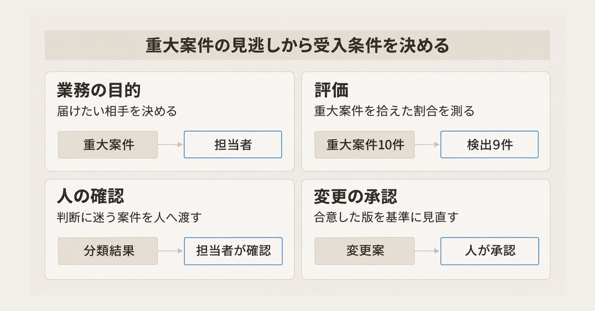

問い合わせを担当部署に振り分けるAIを導入するとします。担当者と開発者が「精度90%」で合意しても、重大な問い合わせを見逃したとき、誰が拾うのかは決まっていません。情報処理推進機構（IPA）のハンドブックにある問い合わせ分類の例を使って、業務の目的から、受け入れを判断する条件と運用時の役割までを書いてみます。

## 「AI時代の要求管理ハンドブック」とは

IPAが2026年11月5日に公開した解説書です。第1版（Ver.1.0.0）は、経営や現場の困りごとを聞くところから、実装後に要求を見直し、システムを廃止・移行するところまでを扱います。本書でいう「要求管理」には、何を実現するかを関係者で決める活動も含まれます。[IPAの公開ページ](https://www.ipa.go.jp/digital/kaihatsu/youkyu-kanri.html)

本書は、具体化の段階に応じて「要望」「要求」「要件」を使い分けます。問い合わせ窓口に当てはめると、次のように書き分けられます。

| 段階 | 関係者が答える問い | 窓口での記述例 |
|---|---|---|
| 要望 | 現場で何に困っているか | 重大な問い合わせが通常の受付に埋もれる |
| 要求 | 業務で何を実現したいか | 重大な問い合わせを、対応できる担当者に届けたい |
| 要件 | どう動けば実現できたと確かめられるか | 高リスクに分類した問い合わせは担当者の確認を必須にする |

要求まで書くと、受付フォームの変更とAIによる分類を、同じ目的に照らして比較できます。AIを採用する場合には、さらに二つの役割を区別します。**要求を書く作業をAIに手伝わせる**場面では、担当者が提案の採否を決めます。**業務でAIを使う**場面では、AIが判断に迷ったときの動作まで開発側と合意します。

## 注意点

**第5.3節の再現率90%は、要件の書き方を示す例です。** 再現率とは、実際にある分類に属する問い合わせのうち、正しくその分類に振り分けた割合です。評価用の問い合わせ100件に重大案件が10件あり、そのうち9件を拾えば、重大案件の再現率は90%です。残る1件を見逃すことの影響は業務ごとに違います。受け入れに使う値は、どの誤りなら許容できるかを現場と話して決めます。[ハンドブック第5.3節](https://www.ipa.go.jp/digital/kaihatsu/rqr7mi000000f5up-att/req-mgmt-hb.pdf)

予算についても、本書が示す総プロジェクトコストの2〜5%は、広い意味での要求管理に予算を割く際の出発点です。案件での適切な配分は、要求に起因する手戻りや、変更の影響を調べるのにかかった時間を見て調整します。[実プロジェクトでのテーラリング（PDFの16枚目）](https://www.ipa.go.jp/digital/kaihatsu/rqr7mi000000f5up-att/req-mgmt-hb.pdf#page=16)

## 問い合わせ分類の受入条件に何を書くか

第5.3節の例は、分類結果をどう測るかと、個々の問い合わせをどう扱うかを分けています。以下は、この月次評価を受入時にも使う場合の記述例です。重大案件の再現率は、正解が重大案件である全件のうち、人が確認する前にAIが重大と判定した割合で測ります。AIが判断を保留した重大案件も分母に含めます。

| 決めること | 問い合わせ分類での具体化 |
|---|---|
| 評価対象と頻度 | 正しい分類を付けた評価用データで、受入時に主要分類ごとの再現率が合意した値に達したかを確認する。運用後は月次で測る |
| 人へ渡す条件 | AIが分類結果にどの程度自信を持つかを示す値が、合意した境界値を下回ったら人に渡す |
| 重大案件の扱い | 高リスクに分類した案件は、AIの自信の度合いにかかわらず人が確認する |
| 分類できない案件 | 未分類として記録し、分類ルールや学習データを改善する際に使う |
| 分類の見直し | 新しい傾向が増えたら分類の区分を見直す |

ここで、重大案件を**通常案件と誤判定した場合**を考えてみてください。「高リスクと判定したら人が確認する」という条件だけでは、その案件は確認対象から外れます。分類別の再現率を測る理由はここにあります。月次評価は、個別案件を救済する手順とは役割が違うため、見逃しが許容できない業務では、受付の設計自体も検討対象になります。

## 要求案を誰が承認し、変更後に何を確かめるか

会議の記録からAIが「高リスク案件は担当者が確認する」という文を抽出しても、その時点では候補です。窓口側が対象と例外を確認し、採用を決める人が承認します。こうして関係者が合意し、以後の変更の基準にする版を、本書は**ベースライン**と呼びます。第6章は、AIが承認済みの要求を直接書き換えることを避け、人が変更を承認する運用を示しています。

小規模な試行なら、目的、要求一覧、状態や変更を記録する台帳、実装する要件、受入条件から始められます。各要求に識別番号を付けて対応をたどれるようにすれば、一冊の文書にまとめる必要はありません。AIによる分類では、入力データの定義、人が確認する条件、評価方法、稼働後に監視する項目と更新の条件も、その要求の番号に対応付けます。たとえば「重大案件」の範囲が変わったとき、同じ番号から、評価データに付けた正解と人が確認する条件の両方に戻れるかを確かめます。[ハンドブック第6章・第16章](https://www.ipa.go.jp/digital/kaihatsu/rqr7mi000000f5up-att/req-mgmt-hb.pdf)

## まとめ

問い合わせ分類のレビューには、重大案件を正しく拾えた例と、通常案件に紛れた例を一つずつ持ち込めます。それぞれについて、誰が確認するか、どの評価で誤りに気付けるか、分類を変えたら何を再確認するかをたどると、「精度90%」という一行から抜けていた判断が見えてきます。

この記事が少しでも参考になった、あるいは改善点などがあれば、ぜひリアクションやコメント、SNSでのシェアをいただけると励みになります！

## 参考リンク

- [IPA「AI時代の要求管理ハンドブック」公開ページ・更新履歴](https://www.ipa.go.jp/digital/kaihatsu/youkyu-kanri.html)
- [IPA「AI時代の要求管理ハンドブック」Ver.1.0.0（PDF）](https://www.ipa.go.jp/digital/kaihatsu/rqr7mi000000f5up-att/req-mgmt-hb.pdf)
