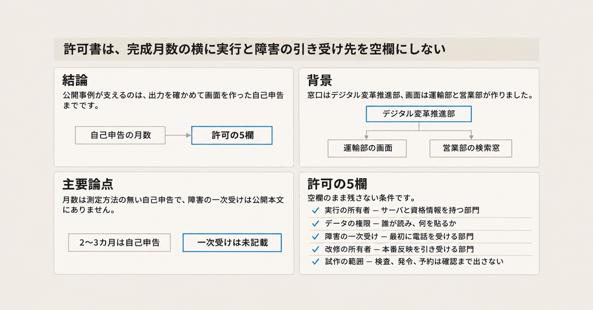
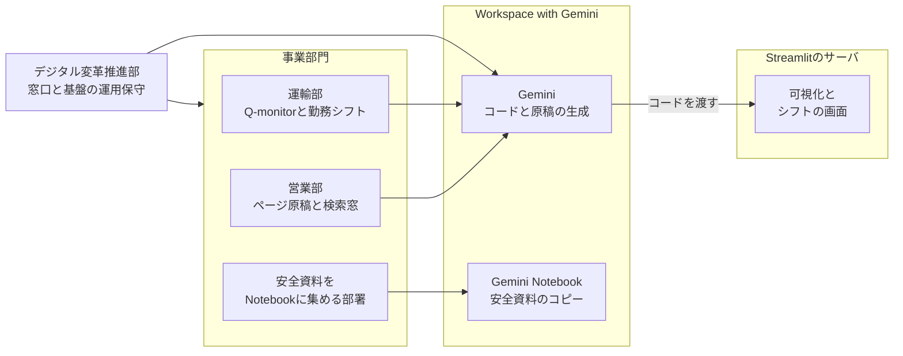

JR九州は、総合企画本部デジタル変革推進部を生成AIの導入窓口にし、Google Workspace with Gemini を既存の生成AIと並行して使う体制を公開しています。運輸部の担当者は、Python の Streamlit で車両センサの可視化と勤務シフトの支援画面を作り、営業部はランディングページのたたき台と、日付と時間から予約手続きへ進む検索窓を作りました。

この記事では、その公開事例が記録していることと、公式資料が示す管理の置き場を先に整理します。そのうえで、内製を認める条件に、完成までの月数と、本番の実行、障害、改修の引き受け先をどう並べるかを決める材料を置きます。月数や割合の多くは担当者の自己申告で、顧客事例には測定方法が書かれていません。

*この記事の全体像。以下、順に解説します。*

## 非IT部門によるGeminiでの業務アプリ内製とは

Gemini は、自然言語から文章やコードを出す Google の生成AIです。Google Workspace は、Docs や Gmail を含む Google の業務サービスです。Google Workspace with Gemini は、その Workspace の中で Gemini を使う利用形態です。ここでの内製は、ITを専門としない事業部門の担当者が、自然言語で要件を伝え、Gemini の出力を検証しながら画面を作る、という公開された記録を指します。発言の記録は Google の顧客事例（2026年10月30日）にあり、ITmedia の記事（2026年11月13日 07:00）は同じ取り組みを再話しています。

### 窓口と期間

推進部門は総合企画本部デジタル変革推進部です。顧客事例の話し手は、担当課長の小林健太郎氏、主査の姫野晋之介氏、運輸部企画課 DX推進プロジェクト主席の上城悠貴氏、営業部主査の永留宏一郎氏です。

2023年5月に生成AIガイドラインを策定したあと、部署ごとに分かれていた生成AIの導入窓口を、セキュリティとガバナンスの観点から一本化しています。2025年9月からの PoC は、KPI を置かず、できることを見るものでした。対象部署は運輸部、新幹線部、未来市場戦略部、営業部、工務部、建設工事部などで、人数は約30名です。運用開始時のアカウントは約400名分、と姫野氏の説明を顧客事例が記します。2025年11月に、既存の生成AIと並行して使う方針を決めています。

### 事業部門が作った画面

運輸部が示したアプリは2つです。画面名は、Q-monitor（車両センサデータの可視化・分析用アプリ）と、勤務（複雑な条件が絡む勤務シフトの作成を支援するアプリ）です。いずれも Streamlit で作られています。Streamlit は、Python で画面を作るライブラリです。公式のアーキテクチャは、アプリの Python バックエンドがサーバであり、`streamlit run` で起動したそのサーバが、画面を見ている人の端末ではなく、サーバ側で計算を担う、と説明しています。公式が案内する置き場は Community Cloud、Snowflake、その他のプラットフォームです。これらは公式が一般に案内している実行場所の名前であり、この2画面の実行場所としては公開されていません。

Q-monitor は、営業運転中（乗客を乗せて走っている間）の車両データをリアルタイムで分析し、可視化する画面です。勤務シフトの画面は、夜勤、休日当番、個人のスキルを考慮して勤務を組む画面です。

上城氏は、プログラミングの専門知識を持たない担当者が、自然言語で要件を伝え、Gemini の出力コードを検証して改良し、コードの9割以上を Gemini が書いた、と述べています。完成までの期間は2〜3カ月です。業務の定量的成果はまだ測定していない、とも述べています。外部ベンダーに依頼すれば半年から1年、とも同じ段落で述べています。検査は現在も一定間隔で実施している、とも述べています。ここでの検査は、車両の定期検査を指します。常時監視ができるようになり、検査代替に向けた検証を進めている、とも分けて述べています。

営業部には専任エンジニアがいない、と永留氏は述べています。ランディングページは指示だけで複数のたたき台を出し、区間別ページには検索窓を置いて、予約手続きまで進む動線にしています。永留氏は、SEO スコアが40点ぐらいから約70点になった、と述べています。

姫野氏は、安全管理や保守点検の手書き報告書をスキャンした PDF や表形式の記録を Gemini Notebook に集め、メンバーが参照する部署が出てきている、と述べています。Gemini Notebook は、安全資料を集めてメンバーが参照する機能として、姫野氏が述べているものです。プライバシーハブは、Gemini のデータの扱いを書いた Google の説明です。Drive は、ファイルを置く Google の場所です。ハブは、Drive 上のファイルを Gemini Notebook へ上げると新しいコピーができ、そのコピーは Drive ではなく Notebook 側に置かれる、と書きます。

小林氏は、既存のレガシーシステムとの連携など、技術的な課題が残っている、と述べています。

### 全社文書での役割

統合報告書2026の31ページは、生成AIの利活用と、デジタルチャレンジを別の行にしています。生成AIの利活用は、指針の策定と、社員用の生成AI活用プラットフォームです。デジタルチャレンジは、IT専門外の社員による市民開発です。32ページでは、デジタル変革推進部が企画、人材、業務用アプリ内製の支援、全社システムと基盤の導入・運用保守、セキュリティを持ち、事業部門とグループ会社が戦略を実行する、と書きます。統合報告書がデジタルヒーローとして数える人数は、2025年度末までに307名です。累計で10万時間を超える業務削減は、車掌用の座席整理表アプリや、保線区で生成AIを参謀にする例を含む、現場発の改善の累計として書かれています。

### 公式資料が示す管理の置き場

Workspace のサービス固有の利用規約（最終更新 2026年2月5日）は、サポート対象エディションに限り、Gemini in Workspace のユーザープロンプトと生成物をデータリージョンの対象データに含める、と定めています。Gemini in Workspace は、Workspace のサービスの中で動く Gemini です。後述の Gemini アプリや Gemini Notebook とは、保持と監査の範囲が分かれます。データリージョンは、データを保管する地域の指定です。選べる地域は米国またはヨーロッパです。AppSheet はヨーロッパのみです。AppSheet は、サインインやアプリ共有を管理者が制御できる Google の製品です。データリージョンを選べる対象、つまり先のサポート対象エディションは、G Suite Business、Google Workspace Enterprise Plus、Google Workspace for Education Standard、Google Workspace for Education Plus の4つです。

プライバシーハブ（最終更新 2026年10月6日）は、次を書いています。Gemini は、その利用者の権限の範囲の Workspace コンテンツだけを見ます。Drive の IRM がかかったファイルは取得しません。IRM は、ダウンロード、印刷、コピーの禁止をファイルに付ける制御です。クライアントサイド暗号化のコンテンツは、Google 側から読めません。Gemini in Workspace のプロンプトと応答の保持は、管理者が90日から無期限で決めます。

同じハブは、組織のファイル共有設定とデータリージョン設定は、Gemini Notebook のデータには適用されない、とも書きます。

### 三つの層

公開事例が並べている構成は、生成の場所、実行の場所、全社の役割の3層です。

上城氏が説明した画面は、運輸部が要件を出し、Gemini がコードの大半を書き、Streamlit のサーバがその画面を動かす、という並びです。営業部の検索窓は、日付と時間を入れると予約手続きまで進む動線として、永留氏が説明しています。Notebook に置いた安全資料は、Drive 上のファイルとは別のコピーとして、ハブが説明しています。統合報告書の32ページは、事業部門の実行と、デジタル変革推進部によるアプリ内製の支援および全社基盤の運用保守を、会社全体の型として並べています。

## 注意点

顧客事例の数字は、測定方法が付いていない自己申告として読みます。公開資料に無いことは、社内に取り決めが無いことと同じには扱いません。

### 自己申告の数字

| 発言 | 誰が、どの資料で | 読み方 |
|---|---|---|
| コードの9割以上、2〜3カ月で完成 | 上城氏。Google 顧客事例 2026-10-30 | 完成の定義（本番公開日、利用者数）は無い |
| ベンダーなら半年から1年 | 同上 | 見積書や実績比較ではなく、本人の見立て |
| 定量的な成果はまだ測定していない | 同上 | 本人が未測定と明示している |
| SEO が40点ぐらいから約70点 | 永留氏。同じ顧客事例 | ツール名、対象URL、時点が無い |
| PoC 約30名、アカウント約400名分 | 姫野氏。同じ顧客事例 | 契約台帳は公開されていない |
| 累計10万時間、デジタルヒーロー307名 | 統合報告書2026 32ページ | 現場発改善の累計と認定人数。Q-monitor とシフトアプリの成果とは書かれていない |

ITmedia（2026年11月13日）は、9割、2〜3カ月、ベンダーなら半年から1年、を顧客事例と同じ数値で再掲します。記事末尾の「IT部門は現場の細かな開発要望から解放され、より戦略的なIT基盤の構築やガバナンス強化に注力できるようになる」は、顧客事例の引用ではなく、記事のまとめ段落です。顧客事例の小林氏は、レガシー連携が残ることを述べ、Streamlit アプリの運用を IT から外したとは述べていません。

### 検査の周期は維持されている

検査代替は完了ではありません。上城氏は、検査は今も一定間隔で行い、常時監視は検査代替に向けた検証である、と分けています。国土交通省が掲載する「施設及び車両の定期検査に関する告示」（平成13年国土交通省告示第1786号）の第五条は、車両の種類ごとに別表の期間を超えない期間ごとに定期検査を行う、と定めています。ただし書きは、耐摩耗性、耐久性等を有し、機能が別表の期間以上に確保される部位に限ります。例外の条件は部位の性能であり、監視画面の有無ではありません。別表の現行の年数や走行距離は、この整理では特定できていないため引用しません。

### 生成物は確認してから置く

生成したコードを、確認なしの成果としては置けません。Workspace のラーニングセンターは、Gemini が不正確な情報を提供することがあり、回答は必ず再確認する、と書きます。専門的な助言として利用しない、とも書きます。サービス固有の利用規約 12.1 は、Workspace 生成 AI サービスが不正確または不適切な生成物を提供する可能性があり、生成物は規制上、法律上、その他の義務を満たすよう設計されたものではなく、専門的助言の代わりに依拠するものでもない、と定めています。12.12 の「生成物」は、利用者が送ったデータに応じて生成または受信したデータまたはコンテンツであり、コードを除外していません。

### 保持期間の説明は日付で分かれる

2025年8月6日の Google 日本語ブログは、データエクスポートの説明のなかで、プロンプトや回答を保存しない Gemini in Workspace アプリに触れています。プライバシーハブは 2026年10月6日版で、Gemini in Workspace の保持を管理者設定の90日から無期限と書いています。保持期間はハブを優先します。2025年のブログ文は、その時点の説明として残ります。

### 実行中の画面は Gemini 監査の外

実行中の Streamlit は、Workspace の Gemini 監査の列挙に含まれません。ハブが監査ログを案内するのは、Gemini アプリと、Chat、Docs、Drive、Gmail、Meet、Sheets、Slides などの Workspace アプリです。ここでいう Gemini アプリは、それらの Workspace サービスとは別に、ハブが監査の対象として名を挙げる Gemini です。画面を動かしているサーバに置く資格情報の扱いは、Streamlit の公式が、画面を公開する先の仕組みとして説明しています。この資格情報は、車両センサや勤務データそのものとは別です。

AppSheet の管理者向けページ（最終更新 2026年11月10日）は、Enterprise Plus ではサインイン必須や外部データ源、アプリ共有をガバナンスポリシーで制御できる、と書きます。AppSheet Core のセキュリティ設定で止められるのは、外部への共有、外部データ接続、外部宛の自動化メール、アプリ API、Webhook です。外部データ源が組織ルールに合うかは、常にアプリ所有者の責任だ、とも書きます。顧客事例の利用サービス欄に AppSheet は無く、この制御は Streamlit のプロセスには付きません。

車両データの通り道として、公開資料には別の名称の基盤もあります。ソラコムのプレスリリース（2026年4月28日）は、鉄道車両データ分析プラットフォームについて、クラウドへのつなぎ込みまで含めてグループ内で内製し、AWS 上のデータストアで空調、ドア、電源などのデータを常時モニタリングや故障予兆に使う、と書きます。引用は課長代理の松原大知氏です。Streamlit、Gemini、Q-monitor、勤務シフト、障害当番、改修責任は書いていません。この基盤と Q-monitor が同一か、接続があるかは、公開資料にはありません。

### 画面、データ、権限のどこまでが書いてあるか

| 層 | 公開事例が言っていること | 公開事例が言っていないこと | 公式資料が示す管理の置き場 |
|---|---|---|---|
| 画面 | 運輸の担当者が Streamlit で2つの画面。営業がページのたたき台と検索窓 | 項目定義を承認した人 | コード生成は Gemini。画面を公開するプロセスは Streamlit のサーバ |
| データ | 営業運転中の車両センサ。シフトの夜勤、休日当番、スキル。安全の PDF を Notebook へ | センサの接続方式。プロンプトへ原データを貼ったか | Workspace 内は利用者の権限と IRM。Notebook のコピーは Drive の共有とデータリージョンの外。Streamlit が読むデータは別の系統 |
| 権限 | 生成AIの導入窓口をデジタル変革推進部に一本化。約400名分のアカウント | アプリ利用者のロール。誰がコードを本番へ出すか | Gemini 機能のオンオフは管理用の画面。画面の認可は、画面を動かしているサーバ側 |
| 運用 | 定量成果は未測定。レガシー連携は残る。検査の周期は維持 | 障害の一次受け、改修の責任部門、夜間対応 | 統合報告書の全社モデルでは、基盤の運用保守とセキュリティはデジタル変革推進部。個別アプリへの適用は書かれていない |

Gemini 機能のオンオフを説明するページ（最終更新 2026年11月10日）が列挙する対象エディションは、Enterprise Standard、Enterprise Plus、教育向けの指定アドオン、Google AI Pro for Education です。既定はオンです。1つの Workspace サービス（Docs や Gmail など）の Gemini を切っても、別のサービスの Gemini がそのデータを読むことは止まらない、と同じページが説明しています。ここでいうサービスは、運輸部や営業部が作った画面ではなく、Workspace の各機能です。JR九州がこのスイッチをすべて使えるエディションかは、顧客事例にも統合報告書にもありません。データリージョンを米国かヨーロッパから選べるのも、利用規約第1項の4エディションに限られます。データリージョンの定めが適用されない顧客データは、利用規約が Cloud と呼ぶデータ処理の追加条項に従い、Google または復処理者の任意の施設で保存または処理できます。復処理者は、利用規約 1.3 が Google と並べて処理の委託先として置く相手です。

生成AIガイドラインを策定した事実は、顧客事例と統合報告書31ページの両方にあります。禁止事項と事故の報告先を書いた本文は、2026年11月16日時点で、jrkyushu.co.jp 上の公開 PDF としては見つかっていません。

### 公開資料が名指ししていないこと

次は、公開された顧客事例、統合報告書、公式説明の範囲では名指しされていません。

- 2本の Streamlit は、どのホストで、誰の資格情報で動いているか。
- 障害の一次受けと改修は、運輸部、営業部、デジタル変革推進部のどこか。公開事例に無いことを、社内に取り決めが無いこととしては扱えません。
- Q-monitor は、2026年4月に発表された AWS 上の車両データ分析基盤を読んでいるか。
- 車両センサや勤務の個人データを、どの Gemini のプロンプトへ貼ったか。顧客事例は、コード作成に使った画面が Gemini in Workspace か Gemini アプリかを特定していません。保持期間は製品で分かれます。ハブは、Gemini in Workspace を管理者設定の90日から無期限、Gemini Notebook のプロンプトはセッション後に保持しない、と書きます。Notebook に上げたファイルのコピーは、データリージョン設定の外に出ます。貼付の有無と製品が分かるまで、90日から無期限をこの事例のコード生成へは当てはめません。
- JR九州の Workspace 契約エディションは何か。データリージョンを米国かヨーロッパから選べるかは、利用規約第1項の4エディションに入るかで分かれます。
- AppSheet Enterprise Plus を契約しているか。ガバナンスポリシーの条件は AppSheet Enterprise Plus の利用であり、Workspace のエディションが分かっただけでは判断できません。
- 2023年5月のガイドライン本文は、事故の報告先を書いているか。
- 告示別表の現行の検査周期は、Q-monitor の対象車種に対していくらか。車種も周期も、公開事例にはありません。

後から一次資料が、実行の所有者、障害の一次受け、改修の所有者を名指ししていた場合、その3点については「責任分界が無い」とは読みません。月数の自己申告を、測定済みの工数削減へ読み替える理由にはなりません。

## 公開事例が支持する範囲

いま置ける結論は次です。この公開事例は、非エンジニアが Gemini の出力を検証しながら Streamlit の画面を数カ月で作った、という自己申告の記録です。本番の障害一次受けと改修の責任部門は、公開本文には書かれていません。したがって、内製を認める文書には、完成月数とは別に、実行の所有者、データの出どころと権限、障害の一次受け、改修の所有者を先に書きます。

支持できる点は次です。

- 上城氏の発言が、作った主体（プログラミングを専門としない運輸部の担当者）、作った物（Streamlit の2画面）、作り方（自然言語、出力の検証、コードの9割以上）、期間（2〜3カ月）、未測定の定量成果、を一つの段落に置いています。
- デジタル変革推進部は、窓口の一本化、2023年5月のガイドライン、勉強会までを語っています。全社の統合報告書も、アプリ内製の支援と基盤の運用保守を同部に置いています。
- 検査の周期を維持したまま検証する、という本人の言い方は、告示第五条のただし書き（部位の耐久性）と衝突しません。

判断を弱める材料は次です。

- 完成月数を、本番許可や IT の関与終了の条件だと書いた一次資料は、今回参照した範囲では見当たりません。Google 自身が、生成物の再確認と、規制上の義務を満たす設計ではないことを書いています。
- 2つの画面を公開して動かす主体、監視、障害、改修の主体は、公開された一次資料にありません。2026年4月のベンダー発表は、AWS 上の車両データ分析基盤を記します。Q-monitor と同一か、別の系統かは、その発表には書いていません。
- Streamlit は、画面を公開する先の Python サーバです。AppSheet の共有制限、データ源の制限、作成用 Gemini の停止は、そのプロセスには付きません。作成用 Gemini は、AppSheet で作るときの Gemini を指します。
- 他製品の公式説明として、Microsoft Learn は、Power Automate の所有者が組織を離れると、有効な所有者のいないフローになり、その人の接続に依存するフローは失敗し得る、と書きます。Power Automate は、Microsoft の業務フロー製品です。JR のアプリがこの状態だという証拠ではありません。作った人の所属に運用が自動で残る、ともこの説明は書いていません。
- 「Workspace が Streamlit アプリの本番ホストである」と書く公式記述は、今回参照した Workspace のハブ、利用規約、Streamlit のアーキテクチャページの範囲では見当たりません。

## 許可書に空欄のまま残さない欄

内製を認める文書には、完成までの月数の横に、次の5つを空欄のまま残しません。

1. 実行の所有者。Streamlit のサーバ、そこに置く資格情報、ネットワーク公開を、どの部門が持つか。
2. データの出どころと権限。車両センサ、勤務の個人データ、予約、Notebook にコピーした安全資料の、それぞれについて、誰が読み、プロンプトへ貼ってよいか。
3. 本番障害の一次受け。画面が止まったとき、最初に電話を受ける部門。
4. 改修の所有者。要件変更と、Gemini が書き直したコードの本番反映を、誰が引き受けるか。
5. 試作のままにする範囲。検査代替、勤務の発令、顧客の予約完了に読める機能は、基盤側または安全、人事の確認が終わるまで本番に出さない。Q-monitor は検査代替、勤務シフトの画面は勤務の発令、営業部の検索窓は予約完了に、それぞれ読める範囲です。

運用を作った部門に残すのは、データの影響がその部門の中で閉じ、その部門が一次受けを引き受けると書けるときです。車両の安全に関するデータ、勤務の個人データ、顧客の予約動線、法令上の定期検査に触れるときは、画面を動かしているサーバと、そこに置く資格情報と、障害の指揮を、全社基盤の運用保守を持つ側へ戻します。画面の要件を出した部門は、要件の側に残ります。これは、統合報告書の「事業部門が実行し、デジタル変革推進部が基盤の運用保守とセキュリティを持つ」という全社の型を、個別アプリの許可条件へ読み下した解釈です。JR九州がその文書をすでに持っている、という認定ではありません。

画面を組み立てる時間を誰の職務にするかとは別です。組み立てが非ITでも、動いているアプリの障害と改修は、影響範囲が部署の外へ出た時点で基盤側の職務に戻る、と許可書に書きます。

直近で確認するなら、許可書のひな型に上の5欄を足し、既存の内製アプリについて、画面を動かしているサーバと一次受けの欄が空でないかを見ます。空なら、完成月数の実績があっても、本番継続の条件を満たしていない、と扱います。

## まとめ

JR九州の公開事例は、非エンジニアが Gemini の出力を検証しながら、Streamlit の画面を2〜3カ月で作った、という自己申告を記録しています。窓口の一本化、ガイドライン、約400名分のアカウント、全社基盤の運用保守をデジタル変革推進部に置く型も、公開文書にあります。

同じ文書は、本番のホスト、障害の一次受け、改修の所有者を名指ししていません。コードの割合、月数、SEO の点数、10万時間は、測定方法の無い自己申告か、別の累計として読み分けます。検査の周期は維持されたままで、生成物は再確認する前提です。Streamlit の実行は、Workspace の Gemini 監査と AppSheet の共有制限の外にあります。

内製を認める文書には、完成月数の横に、実行の所有者、データの出どころと権限、障害の一次受け、改修の所有者、試作のままにする範囲を空欄にしない、という条件を置きます。

この記事が少しでも参考になった、あるいは改善点などがあれば、ぜひリアクションやコメント、SNSでのシェアをいただけると励みになります！

## 参考リンク

- [Google Workspace 顧客事例「JR九州、Google Workspace with Gemini を導入」（2026-10-30）](https://workspace.google.com/blog/ja/customer-stories/jr-kyushu-implements-google-workspace-with-gemini)
- [ITmedia エンタープライズ（2026-11-13）](https://kn.itmedia.co.jp/kn/article/2611/13/2000003142/)
- [JR九州グループ 統合報告書2026](https://www.jrkyushu.co.jp/company/ir/library/integrated_report/online/pdf/ar02.pdf)
- [ソラコム プレスリリース（2026-04-28）](https://prtimes.jp/main/html/rd/p/000000381.000034562.html)
- [Gemini in Workspace プライバシーハブ（最終更新 2026-10-06）](https://knowledge.workspace.google.com/admin/gemini/generative-ai-in-google-workspace-privacy-hub?hl=en)
- [Gemini 機能のアクセス管理（最終更新 2026-11-10）](https://knowledge.workspace.google.com/admin/gemini/manage-access-to-gemini-features-in-workspace-services?hl=en)
- [AppSheet 機能のアクセス制御（最終更新 2026-11-10）](https://knowledge.workspace.google.com/admin/appsheet/control-access-to-appsheet-features?hl=en)
- [Workspace サービス固有の利用規約（最終更新 2026-02-05）](https://workspace.google.com/intl/ja/terms/service-terms-20260716/)
- [Gemini の回答を確認する（ラーニングセンター）](https://support.google.com/a/users/answer/16304582?hl=ja)
- [Workspace のセキュリティ管理（2025-08-06）](https://workspace.google.com/blog/ja/ai-and-machine-learning/enterprise-security-controls-google-workspace-gemini)
- [Streamlit アーキテクチャ](https://docs.streamlit.io/develop/concepts/architecture/architecture)
- [Streamlit のデプロイチュートリアル](https://docs.streamlit.io/deploy/tutorials)
- [施設及び車両の定期検査に関する告示（平成13年国土交通省告示第1786号）](https://www.mlit.go.jp/notice/noticedata/sgml/2001/62aa2981/62aa2981.html)
- [Microsoft Learn「所有者が離れたフローの扱い」](https://learn.microsoft.com/en-us/troubleshoot/power-platform/power-automate/flow-management/manage-orphan-flow-when-owner-leaves-org)
