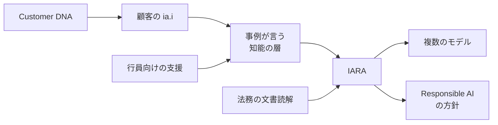

ブラジルの Itaú Unibanco は、顧客が銀行と話す入口として ia.i を置き、行内では複数のモデルを方針どおりに使う基盤として IARA を置いています。OpenAI が 2026 年 10 月 16 日に公開した導入事例が、その組み合わせを説明しています。起点は導入事例であり、銀行の有価証券報告書ではありません。

この記事では、ia.i と IARA がそれぞれ何をするか、人数・件数・倍率がどの出典にどう書かれているか、全社展開の設計レビューで確認する項目を順に整理します。

*この記事の全体像。以下、順に解説します。*

## Itaúのia.iとIARAとは

ia.i は、顧客向けの会話層です。テキストか音声で、口座、与信、カード、保険などの相談を一つの会話にまとめ、必要なら人へ渡します。原則は、対話性、マルチモーダル（テキスト、音声、画像、クリック）、個別化です。

初回の提供は約 30 万人です。2026 年末までに顧客基盤全体へ広げる、というのが OpenAI 事例の目標です。会話は人への引き継ぎを持ちます。発売時点の銀行側説明では、取引として通る操作の中心は Pix で、多くは情報の照会です。

Customer DNA は、約 7,000 万人の金融上の文脈を会話に渡す層だと事例は書いています。GPT モデルはその維持と充実の一部で、ガバナンスと Responsible AI の管理下にあります。モデルは一つに固定しません。費用と遅延、推論と根拠づけの間で使い分ける、と OpenAI を含むモデルについて Mazzei が述べています。

IARA は、社内方針に沿ったモデルアクセスを担います。OpenAI はその提供者の一つです。IARA が同時に扱う問題は、トークンあたりのコスト、応答の正確性、Responsible AI 方針の適用です。観測可能性と、開発から継続監視までのライフサイクルも含みます。

事例が IARA の用途として名指しするのは、法務の文書読解です。リポジトリは 9,000 万件超、月間タスクは 200 万超、工程による効率は 20% から 80% と、事例の地の文が書いています。行内では、面談の要約と準備、課題の理解、計画に同じ知能の層を使います。期待として、顧客との関係に使える時間が 3 倍、対応は最大 2 倍速く、会話は最大 3 倍効果的、と事例は書いています。

次の図は、2026 年 10 月の OpenAI 事例が言葉で並べた構成です。

顧客の会話と行員の支援は、事例の文では同じ知能の層に乗ります。IARA という名前で結ばれる明示例は、法務の文書読解です。Customer DNA は顧客側の文脈として描かれます。

## 注意点

成功側の事例と、発売当日の会見は、到達と効果を広く書いています。設計レビューに使う前に、主語と定義を分けます。

### 期待と実績

OpenAI 事例の「3 倍の時間、最大 2 倍の速度、最大 3 倍の会話効果」は、行内利用への significant expectations（大きな期待）です。測定済みの結果としては書かれていません。

[Mobile Time の発売当日記事](https://www.mobiletime.com.br/noticias/27/07/2026/itau-copiloto-ia-i-ai/)は、Pedro Prates の期待を「顧客に使える時間が最大 3 時間」と伝えます。迅速さと解決が 2 倍、会話の実効性が 3 倍、という残り二つは倍率です。英語事例の「3 倍の時間」と、ポルトガル語記事の「最大 3 時間」は、同じ文の翻訳として扱いません。

### 法務の件数

OpenAI 事例の地の文は、9,000 万件超の文書、月 200 万超のタスク、工程による効率 20% から 80% を IARA の節に置いています。Mazzei の引用そのものは、情報を銀行内に保つこと、モデルアクセスのガバナンス、トークン利用の効率です。

同じ週の [Mobile Time](https://www.mobiletime.com.br/noticias/27/07/2026/itau-custo-ia-generativa/) は、Mazzei の会見として、法務が 4,300 万文書と 30 万通話を転写したと書いています。9,000 万件と 4,300 万文書は、対象も時点も記事上で揃っていません。20% から 80% は幅が広く、どの工程と比べたかは事例にありません。定義と期間は記事にありません。会見での自己申告です。

### 展開の母数

| 出典 | 時点の書き方 | 人数 | 年末の母数 |
|---|---|---|---|
| [OpenAI 事例](https://openai.com/index/itau-generative-ai)（2026-10-16） | 初回フェーズと目標 | 約 30 万人。9 月の 300 万人は書かない | 顧客基盤の 100% |
| [Feito.Itaú](https://feito-itau.cloud.itau.com.br/itau-iai-superapp-inteligencia-artificial/)（2026-07-28、本文を確認） | 発売時の予定 | 30 万人。9 月までに 300 万人 | Superapp の個人顧客 100% |
| [Mobile Time](https://www.mobiletime.com.br/noticias/27/07/2026/itau-copiloto-ia-i-ai/)（2026-07-27） | 見通し。技術の進み具合による | 当月 30 万人。9 月に 300 万人 | 顧客基盤全体 |
| [Itaú IR 英語](https://www.itau.com.br/relacoes-com-investidores/noticias/itau-unibanco-lanca-ia-i-nova-experiencia-conversacional-que-levara-a-ia-generativa-a-todos-os-produtos-e-servicos-do-banco/?lang=en) | 検索結果の抜粋 | 約 30 万人、9 月までに約 300 万人 | 顧客基盤全体。全文は未確認 |

2026 年 10 月 18 日時点で、9 月に 300 万人へ達したという一次発表も、達しなかったという一次発表も、確認できていません。10 月 16 日の OpenAI 事例が初回の約 30 万人を現在形の起点として残していることと、9 月 29 日の銀行広告が ia.i を beta と呼んでいることは、到達の証明にはなりません。広告は人数を書きません。

広告は [G1 の記事](https://g1.globo.com/inovacao/especial-publicitario/itau/noticia/2026/09/29/iai-vamos-conversar.ghtml)（Por Itaú、2026-09-29）です。10 月 15 日付とされる利用ガイドが、beta であり回答に不正確さがあり得る、と書く、という報告は、本文を確認できた範囲に入っていません。本文で確認できたのは、9 月 29 日の広告が beta と書くことまでです。

### 65% は支出の減少

Mobile Time は、取り組みを始めた 2022 年以降、生成 AI の支出が 65% 減ったと Mazzei が述べた、と書いています。単位コストの前年比とは書いていません。算定式もありません。FEBRABAN TECH の自動字幕が伝える単位コスト削減は、話者と文言が字幕上で崩れているため、数値として採用しません。口頭と自動字幕のままでは、話者と文言を確定できません。定義と期間は記事にありません。会見での自己申告です。

この 65% は、後述する Consumoteca の 65% とは別の数字です。

### 7,000 万人の指すもの

OpenAI 事例の約 7,000 万人は、Customer DNA が金融文脈を持つ人数です。ia.i の利用者数ではありません。銀行の顧客数として過去の取材が使った人数とも、Gartner 登壇紹介の「7,000 万超の顧客への体験」とも、同じ計測だとは確認できません。

[Gartner のページ](https://www.gartner.com/en/conferences/la/data-analytics-brazil/speakers/featured-speakers/carlos-eduardo-mazzei)はセッション日を 2026 年 4 月 29 日と示し、同じページのイベント日付は 2027 年 6 月 2 日から 3 日です。141% は本番施策の増え方で、基準件数はページにありません。日付の並びがページ内で揃っていないため、141% とあわせて、このページの数値を確定情報とは読みません。

### 名前が揃わない

| 呼び方 | どこに出るか | この事例で指すもの |
|---|---|---|
| ia.i | OpenAI、Feito.Itaú、Mobile Time、G1 | 2026 年の会話体験。Mobile Time は行員 copiloto も含む。Feito.Itaú 本文は顧客の Superapp |
| IARA | OpenAI 事例が固有名で書く | ガバナンスとオーケストレーション |
| 単一の集中プラットフォーム | Mobile Time の 7 月 27 日会見 | モデルを編成する基盤。記事は IARA と書かない |
| Inteligência Itaú | [Canaltech](https://canaltech.com.br/mercado/startse-ai-festival-cto-do-itau-diz-que-ia-ja-impacta-experiencia-de-clientes/)、2025-10-20 | エージェントとユースケースをつなぐ傘。開発 600 超、本番 120。時点は 2025 年 10 月 |
| 別の Iara | Barkus、CARF、灌漑、iara.app.br | Itaú の基盤ではない |

2025 年 10 月の 120 と 600 を、2026 年 10 月の IARA の処理量として読みません。

Mobile Time が例示したモデル名（GPT 5.6、Sonnet 5、Qwen 32B、GLM 5.1、KimK）は取材記事の表記です。ベンダーのモデル ID との一致は確認できていません。取材記事の表記として読みます。

### 二次記事が足す制御

[OpenAImpact](https://openaimpact.com/news/itau-generative-ai-governance-brazilian-banking)（2026-10-17）は、IARA が ia.i の出力を監視し、マネーロンダリング防止手順の逸脱を止める、と書いています。OpenAI 事例の対応箇所は、トークンあたりのコスト、応答の正確性、Responsible AI 方針です。AML の判定文も、遮断の実績も、事例本文にはありません。二次情報です。

Blockchain.News の再話は、OpenAI 事例に利用者数も日程も成果も無い、と書いています。事例本文には約 30 万人、年末目標、法務の件数と効率幅があります。Rio Times（2026-07-28）は、本番 150、開発 750 超、技術予算およそ 300 億レアル、と書いています。Mobile Time の日程とも、2025 年の技術投資として別記事が伝える 117 億レアルとも揃いません。これらの数字は事実として使いません。二次情報です。

### 同じ層は、同じ監査ログではない

OpenAI は「ia.i を支える同じ intelligence layer」が行員も助ける、と書いています。IARA の監査ログを共有する、とは書いていません。IR 英語の検索抜粋は、従業員への ia.i 適用が情報、知識、文脈を一つの体験にまとめる、と伝えています。全文は未確認です。

Feito.Itaú の本文は、行員が顧客との会話で使う情報と洞察、までです。Mobile Time は、製品名 ia.i を顧客と行員の両方に使う、と書いています。どちらも、顧客データと従業員データが同じログに入るか、分かれて保存されるかは書いていません。

Exame INSIGHT の断片では、Ricardo Guerra が Iara を市場 LLM への gateway と呼び、顧客の内部情報は銀行自身の知能、一般的な照会は市場モデル、と説明したとされます。これはデータの種類によるモデルの振り分けであり、顧客と従業員の分離方式ではありません。確認できたのは断片であり、全文の条件は分かっていません。二次情報です。

[Exame INSIGHT](https://exame.com/insight/com-nova-plataforma-proprietaria-de-ia-cto-do-itau-estima-escala-inedita-no-uso-de-agentes/)

### ログ仕様に転記できない記録

Itaú 系の [ICTi](https://www.icti.org.br/article/observabilidade-agentes-inteligencia-artificial-pix/) は 2026 年 10 月 2 日、会話で Pix を頼んだときの記録を説明しています。図の説明は、この絵が Itaú の製品内部を表さない、と書いています。公開された製品からは、応対がどう記録されるかも分からない、とも書いています。LGPD 第 46 条への言及は、個人データの保護措置についての一般説明です。IARA がその条項に適合している証明ではありません。記録項目は架空の Pix です。製品のログ仕様に転記できません。

### 会見が並べた成果

同じ 7 月 27 日の会見は、データキュレーター 1,500 人、データ所有者の名前が付く割合 95%、内部テーブルの継続的な品質監視 70%、メタデータの 70% を AI が生成、卸の不動産文書 年 3 万件で時間 75% 減、信用リスク評価の精度 30% 増、AI 支援の与信初年度の純金融マージン 10 億レアル、Itaú Emps の利用者 54% が資金フローの半分超をデジタル旅程に載せる、初期利用者の満足度 87.5%、と Mobile Time が伝えています。定義、期間、母数は記事にありません。初期テストの満足度を、全顧客展開後の品質とは読みません。会見での自己申告です。

Consumoteca の 65% は、Mobile Time では Itaú が依頼した調査の「金融 copiloto としての AI に開かれている人の割合」、OpenAI 事例では「継続して導く financial copilot を望む人の割合」として要約されます。80% は家計をよりよく整理したい人の割合として事例だけが書いています。原票は未取得です。定義と期間は記事にありません。

## 公開記録が支える範囲

公開された物語は、顧客向けの会話と、モデルを統制する層を組にして語ります。監査の主キー、拒否する操作の一覧、ログの項目、顧客データと従業員データの分離は、公開事例の範囲では確認できていません。

### 事例と会見が支えていること

- OpenAI 事例は、見える体験の背後に IARA を置き、教訓として「ガバナンスの層を、規模を広げる前に作れ」と書いています。
- 2026 年 6 月 9 日の [Mobile Time](https://www.mobiletime.com.br/noticias/09/06/2026/itau-iai/) では、CIO Ricardo Guerra が、ia.i の背後を複数 LLM のオーケストレータと説明しています。名前は IARA ではありません。
- 2026 年 7 月 27 日の会見は、ガバナンスを一つの集中プラットフォームが担う、と Mazzei が述べた、と Mobile Time が書いています。
- 行内への広がりは、OpenAI が「同じ知能の層」、Mobile Time が「ia.i を行員の copiloto にも使う」と書いています。IR 英語の抜粋も従業員への ia.i に触れます。全文は未確認です。
- 規制業種であることは、Mazzei が「高度に規制された環境でガバナンスと観測可能性を持つための基盤」と IARA を呼んだ、という引用で事例に残ります。法令の条項名は付きません。

### 公開記録が支えていないこと

- 顧客の全対話が IARA を通る、という経路図は OpenAI 事例にありません。IARA の明示例は法務です。迂回を示す一次資料も、公開資料の範囲では確認できていません。
- 監査主キーを「誰が、どのモデルに、どのデータ文脈で、何を許可または拒否したか」と置くのは、設計上の問いです。IARA がその四つの項目を一つのレコードに持つ、とは公開資料が言いません。
- 独立監査、インシデント件数、拒否率、誤答率、実測のトークン支出は、OpenAI 事例と追加の公開記事では確認できていません。観測可能性という言葉を、監査済みの有効性とは読みません。
- 9 月の 300 万人は、7 月時点の予定です。2026 年 10 月 18 日時点の実績としては確認できていません。未達とも書きません。
- 「規制業種」は事例の形容です。LGPD、Banco Central、特定の Resolução への適合を、この事例は示しません。

読み方は二つに分かれます。どちらも、公開記録が支える範囲と、レビューで足す問いを分けます。

| 読み方 | 公開記録が支える範囲 | レビューで追加するもの |
|---|---|---|
| 一つの基盤 | 事例と会見は、会話の前に編成とガバナンスの層があると言う | その層の名前が IARA でも、無名のプラットフォームでも、チャネル側の操作がそこへ辿れるか |
| ルータは共有、監査キーは別 | モデルの振り分けは語られる。監査キーの共有は語られない | 顧客の ia.i と行員の支援が、別の台帳のまま終わっていないか |

取引そのものの記録は、会話のターンとは別に、アプリが実際に記帳した操作に残る可能性があります。発売時に取引として通るとされたのは Pix が中心です。会話ログを監査の主キーだと決めつける前に、記帳側の主キーと会話側の主キーが結ばれているかを見ます。

## 設計レビューで辿る項目

全社展開の設計レビューでは、チャネルを追加したこと自体を完了としません。そのチャネルの操作を、許可・拒否、モデル選択、データ文脈、トークン記録まで辿れるかを確認項目にします。この確認項目は、公開事例の読みから立てた提案です。IARA の公開済み仕様ではありません。

利用者向けチャネルの案件と、監査・制御の基盤の案件を並べて見ます。規制業種では、基盤へ辿れないチャネル追加を完了と数えません。辿れる、の中身は次の四つが一つの操作に結び付くことです。

1. 誰が話したか（顧客か、行員か、どの権限か）。
2. どのモデルを選んだか。
3. どのデータ文脈を渡したか（顧客の関係文脈か、行員の業務文脈か）。
4. 許可したか、拒否したか。トークンと費用が同じ操作に残るか。

Itaú の公開事例は、この四つを IARA の列名として公開していません。レビューの質問は「IARA があるので完了」ではなく、「このチャネルの操作を、その四つまで辿れるか」です。名前の付いた基盤が別案件のまま、チャネルだけがリリース判定を通過する状態を、完了とは扱いません。

公開事例がまだ答えていない問いは、次のとおりです。

- IARA が止める操作は何か。公開事例には一覧がありません。
- ログの粒度は何か。誰の識別子、モデル、データ文脈、許可または拒否、トークンが同一レコードに含まれるかは未公開です。
- 顧客データと従業員データはどこで分かれるか。分離も混在も、公開資料では確認できていません。
- 2026 年 9 月の 300 万人は達成されたか。
- 行員向けの ia.i と顧客向けの ia.i は、同じ監査キーを出すか。

金融機関の利用回数や権限表の次に見る主語は、利用率ではなく監査の主キーです。顧客向けと従業員向けを同一基盤で扱うと言うとき、その基盤のレコードは会話一回を主キーにするのか、記帳された取引を主キーにするのか、モデル呼び出しを主キーにするのか。Itaú の公開範囲は、その選択をまだ示していません。

## まとめ

Itaú の公開事例は、顧客向けの会話 ia.i と、モデルを統制する IARA を組にして語っています。ia.i は口座から保険までを一つの会話にまとめ、必要なら人へ渡し、発売時点で取引として通る中心は Pix です。IARA はトークンあたりのコスト、応答の正確性、Responsible AI 方針を同時に扱い、名前が付いた用途は法務の文書読解です。行員の支援は、同じ知能の層に乗ると書かれています。

人数、件数、倍率は、出典ごとに主語が違います。約 30 万人は初回提供、約 7,000 万人は Customer DNA の金融文脈、9 月の 300 万人は 7 月時点の予定です。3 倍や 20% から 80% は、測定条件が事例にありません。二次記事が足す AML の遮断や、別記事の本番件数は、OpenAI 事例の本文にはありません。

設計レビューでは、IARA という名前の有無で完了を判定しません。一つの操作に、話者、モデル、データ文脈、許可または拒否とトークンが結び付くかを見ます。顧客の会話と行員の支援が同じ層だと書かれていても、同じ監査ログだとは書かれていません。

この記事が少しでも参考になった、あるいは改善点などがあれば、ぜひリアクションやコメント、SNSでのシェアをいただけると励みになります！

## 参考リンク

- [OpenAI, “How Itaú is building generative AI for its entire customer base”, 2026-10-16](https://openai.com/index/itau-generative-ai)
- [Feito.Itaú, “Itaú lança ia.i”, 2026-07-28（更新 2026-07-30）](https://feito-itau.cloud.itau.com.br/itau-iai-superapp-inteligencia-artificial/)
- [Mobile Time, Henrique Medeiros, 2026-07-27（ia.i の copiloto）](https://www.mobiletime.com.br/noticias/27/07/2026/itau-copiloto-ia-i-ai/)
- [Mobile Time, Henrique Medeiros, 2026-07-27（生成 AI の費用）](https://www.mobiletime.com.br/noticias/27/07/2026/itau-custo-ia-generativa/)
- [Mobile Time, Fernando Paiva, 2026-06-09](https://www.mobiletime.com.br/noticias/09/06/2026/itau-iai/)
- [G1 広告記事, Por Itaú, 2026-09-29](https://g1.globo.com/inovacao/especial-publicitario/itau/noticia/2026/09/29/iai-vamos-conversar.ghtml)
- [Itaú ICTi, 2026-10-02](https://www.icti.org.br/article/observabilidade-agentes-inteligencia-artificial-pix/)
- [Canaltech, 2025-10-20](https://canaltech.com.br/mercado/startse-ai-festival-cto-do-itau-diz-que-ia-ja-impacta-experiencia-de-clientes/)
- [Gartner, Carlos Eduardo Mazzei](https://www.gartner.com/en/conferences/la/data-analytics-brazil/speakers/featured-speakers/carlos-eduardo-mazzei)
- [Exame INSIGHT](https://exame.com/insight/com-nova-plataforma-proprietaria-de-ia-cto-do-itau-estima-escala-inedita-no-uso-de-agentes/)
- [OpenAImpact, 2026-10-17](https://openaimpact.com/news/itau-generative-ai-governance-brazilian-banking)
- [Itaú IR（全文は未確認）](https://www.itau.com.br/relacoes-com-investidores/noticias/itau-unibanco-lanca-ia-i-nova-experiencia-conversacional-que-levara-a-ia-generativa-a-todos-os-produtos-e-servicos-do-banco/?lang=en)
