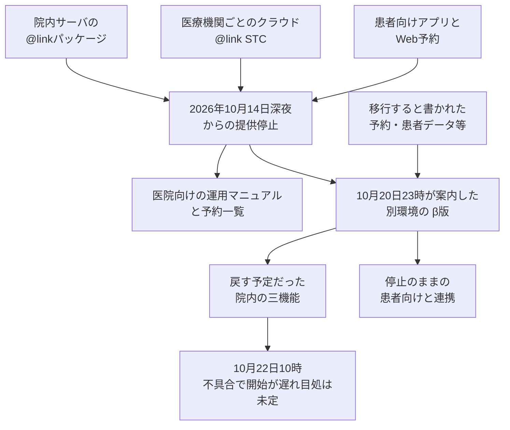

株式会社メドレーが医療機関へ提供する業務支援システム「アットリンク」は、2026年10月14日深夜から提供を止めています。2026年10月20日23時の公式案内は、これまでの系統を再稼働せず、別環境に作った新サービスへ予約・患者データ等を移すと書いていました。この記事で系統と言うときは、これまで提供していたアットリンクの環境を指します。2026年10月22日10時の同じページは、その提供開始が不具合で遅れ、目処は立っていないと書いています。

この記事は、その公開された範囲で、製品の形と、戻す予定だった機能と、止まったままの機能を先に整理します。続けて、数字と文言をどこまで信じてよいかと、委託先の系統が止まったときに手順へ先に書いておく分岐を示します。適時開示は、2026年10月15日に株式会社メドレーが出した開示文書です。公式案内は、アットリンクの告知ページです。数値と再開方針は、この適時開示と公式案内を正とします。

*この記事の全体像。以下、順に解説します。*

## アットリンクとは

アットリンク（@link）は、予約、受付、患者向けアプリ、周辺サービスを一つの提供として扱う業務支援システムです。使うのは、医療機関の受付と、アプリや Web で予約していた患者です。

2026年10月14日深夜から、この提供は止まっています。2026年10月20日23時の公式案内は、これまでの系統を再稼働せず、別の環境に作った新サービス「@link クラウド β版」へ「予約・患者データ等」を移し、2026年10月22日朝7時以降に院内業務の一部から戻す予定だと書いていました。β版は、その案内が別環境の新サービスに付けた名称です。2026年10月22日10時の同じページは、その提供開始が不具合で遅れ、目処は立っていないと書いています。不具合の内容は書いていません。

### 二つの設置

製品ページは、設置を二つに分けています。

- 院内にサーバを置く「@linkパッケージ」
- 医療機関ごとのクラウド「@link STC（Single Tenant Cloud system）」

STC では、院内に NAS を置き、サーバはクラウドにあります。

### 患者側に標準で付く経路

標準で付く患者側の経路は、Web 予約、アットリンクアプリ、Wovie、マタニティダイアリーです。マタニティダイアリーは、この経路に名前だけが挙がっています。戻す予定の三つにも、停止のままの列にも、この名前はありません。

### 戻す予定だった院内の機能

2026年10月20日23時の案内が、10月22日に戻す予定として挙げた院内機能は三つです。

- 予約の確認、受付、登録
- 患者の登録、更新、検索
- 診察カレンダー

同じ案内は、画面のデザインと操作は従来のものを踏襲すると書いています。動作保証は Windows 11 と Microsoft Edge です。利用前にブラウザの設定変更が必要で、そのマニュアルは後日送ると書いています。

次の一覧は、上の三つの内訳です。

- 予約一覧と院内スケジュール
- 患者 ID や日時を指定した予約登録
- 初診の予約登録
- 当日受付
- 枠数の調整
- ステータス（受付、呼出、終了、会計、不在、外出、取消）
- 患者メモと予約コメント
- 患者情報の確認と変更
- 患者の登録、更新、検索
- 診療科、診察室、時間帯、時間枠、来院目的ごとの診察カレンダー

### 停止のままの機能

停止の列は、機能の名前の並びです。各名前が何をするかは、案内に書いていません。標準 Web 問診と問診は、別の項目として並んでいます。同じものかどうかは、その列には書いていません。Wovie は患者側の経路の名前でもあり、この停止の列に入っています。停止のままの側には、次があります。

- 患者向けのアットリンクアプリと Web 予約
- 他社の電子カルテやレセコンとの連携
- Wovie
- 標準 Web 問診
- マーケティング
- 出産、月経、手術処置、入院の管理
- 問診
- Echo Diary
- 予防接種管理
- DearBaby
- ギフト
- オンライン決済
- デジタル診察券
- デジタルサイネージ

次に戻す機能は、10月20日の案内では「今週中」に改めて知らせる、とあります。

### 停止中に医院へ案内されたもの

停止中の院内支援として、運用マニュアルと、医療機関ごとの予約一覧ファイルを案内しています。新しい予約と予約の変更は、各医療機関が対応します。患者からの問い合わせ先は at-link@medley.jp です。

停止期間の利用料金は返金します。11月中を目処に、指定口座への振込等を予定しています。2026年10月15日の適時開示は、2026年12月期の連結業績への影響を軽微と見込む、と会社として書いています。

### 2026年10月22日10時の分かれ方

2026年10月22日10時の公開状態は、四つに分かれます。従来の系統、医院向けに案内された受け皿（運用マニュアルと予約一覧ファイル）、10月20日23時が案内した別環境、その提供開始の遅延、です。図の二つの設置は、製品ページの分け方です。矢印は、提供全体が止まったことからの整理であり、告知がパッケージと STC を別々に止めたとは書いていません。β版がどちらの設置向けかは、公開された案内には書いていません。

## 注意点

公開の数字と文言は、次の範囲で読みます。

### 787件は確定した漏えい件数ではない

787 は、漏えいが確定した医療機関数ではありません。適時開示の文は、「漏えいの対象となる可能性のある医療機関は、最大で、アットリンク等を利用している全医療機関（787件）」です。「アットリンク等」の「等」が何を含むかは、この開示文には書いていません。朝日新聞 2026年10月15日の見出しは「最大800機関」で、見える本文は全国787です。

### 発覚の日付は確認の日付ではない

「10月11日に発覚」は、開示の文言より強い言い方です。開示は、10月11日に外部の専門機関から可能性の情報提供を受け、調査のうえ不正アクセスを確認した、と書いています。確認した時刻は書いていません。

### 安全性の確保は事業者の文である

「安全性を確保したうえで」は、10月20日23時の更新に事業者が書いた文です。その更新は、個人情報への影響の報告を「本日中」から「明日以降」へ延ばしています。外部機関の調査結論としては書かれていません。10月22日10時の本文も、安全性を確保したうえで再開すると案内した、と過去の案内を指しています。

### 朝7時は再開が完了した時刻ではない

10月22日朝7時は、再開が完了した時刻ではありません。10月20日23時の本文は「再開する予定」でした。10月22日10時の本文は、不具合により提供開始が遅れ、目処は立っていない、と書いています。不具合の内容は書いていません。

### オンプレミスとクラウドの混在は版によって出し入れされている

オンプレミス型とクラウド型の混在は、2026年10月16日19時の公式本文が、確認に時間がかかる理由として書いています。10月20日23時の本文からはその文が消え、報告延期の理由は「追加的に調査が必要な項目」になっています。10月22日10時の本文は、混在の文を再び載せています。ITmedia の 2026年10月20日11時23分の記事は、混在と「20日中にも調査状況を報告」を伝えています。

確認した告知本文に、STC という製品名はありません。製品ページが STC と呼ぶ設置と、告知が書くオンプレミス型・クラウド型が同じ境界かは、告知本文だけでは閉じていません。

### 10月19日の時刻は公式の二つの版に残っていない

ITmedia は「メドレーは10月19日」に再開方針を発表した、と書いています。10月16日19時の公式は、見通しを 10月19日中に知らせる、と予告しています。「19日19時」という時刻は、ロケットボーイズの記事にあります。10月20日23時版と 10月22日10時版は、19日の時刻を載せていません。

### 個人情報の項目列挙は適時開示の本文には無い

氏名、性別、生年月日、住所、電話番号、メールアドレス、問診の回答、ワクチン接種履歴は、ITmedia 2026年10月15日の整理です。適時開示の本文にこの列挙はありません。

### 予約一覧は公式ではファイルである

予約一覧を PDF と書くのは日本経済新聞 2026年10月15日です。公式は「予約一覧ファイル」と書いています。

### 医院の告知と公式で停止時刻が違う

医院の告知には、停止を 2026年10月15日0時とするものがあります。公式の停止時刻は 10月14日深夜です。

### PHP の脆弱性を理由にした停止は別ページである

2026年10月21日付の別告知は、PHP の脆弱性を理由に一部プロダクトを止めた、と書いています。2026年10月22日10時時点の同じページは、対策を終えたものから再開したと書き、GUPPY、GUPPY国家試験対策アプリ、MEDIXS薬歴、WHITE CROSS、みんかいを再開済みとしています。これらは、その別告知が再開済みとした製品名で、アットリンクとは別です。再開の時刻は書いていません。アットリンクはこのページにありません。原因を同一とする公式の文もありません。この事案の公式資料に CVE 番号はありません。

### 業績影響の軽微は見込みである

2026年12月期の影響が軽微、は会社の見込みであり、被害額の確定値ではありません。

## 手順に先に書いておく三つの分岐

委託先の系統が止まったとき、手順に先に書いておく分岐は三つあります。ここでの指針は、そのうちの一つだけを既定にしていません。戻し方は、同じ系統を起動する分岐と、別環境へ移す分岐の二つです。止まっている間の受付は、そのどちらかの開通を待たず、医院側の代替として同時に書いておきます。

参照する公的ガイドは二つです。一つは NIST SP 800-61 Rev. 2（2012年8月、Computer Security Incident Handling Guide）です。もう一つは、厚生労働省の「医療情報システムの安全管理に関するガイドライン」第7.0版（令和8年6月）システム運用編です。この記事で known good と言うときは、NIST が戻す候補として書く、汚染されていないと扱えるバックアップの世代を指します。「同じ系統を塞いで起動する」列の NIST のセルは、Rev. 2 が並べる選択肢の一覧です。クリーンなバックアップからの復元、作り直し、汚染ファイルの置換、パッチ、パスワード変更が、その一覧に入っています。「別環境に必要な機能だけ載せる」列にある Appendix G は、完全に侵害された系統を一から作り直すか、known good のバックアップから戻すか、を書いた文です。その文面は、別環境へ移すこととも、必要な機能だけを載せることとも同じ決定ではありません。

| 基準 | 同じ系統を塞いで起動する | 別環境に必要な機能だけ載せる | 患者の予約は医院側で続ける |
|---|---|---|---|
| この事案で公表されたか | 10月20日23時の公式は、この分岐を採らないと書いています。10月22日10時の本文は、その提供開始が遅れたと書いています | 同じ 10月20日23時の文が、@link クラウド β版として採ると書いています。10月22日10時の本文は、この文を繰り返しても、撤回してもいません | 10月16日19時と 10月22日10時の公式が、運用マニュアルと予約一覧ファイルを案内しています |
| 公的ガイドでの位置 | NIST SP 800-61 Rev. 2 は、クリーンなバックアップからの復元、作り直し、汚染ファイルの置換、パッチ、パスワード変更を並べます | 同書 Appendix G は、完全に侵害された系統について、一から作り直すか、known good のバックアップから戻すか、と書いています | 厚労省ガイドライン第7.0版は、紙での運用等の代替と、連絡経路を事前に用意する、と書いています |
| データの扱い | 戻す世代が既に汚染されていると、被害が繰り返される、と厚労省ガイドラインが注意します | 公式が移すと書くのは「予約・患者データ等」までで、known good とは書いていません | 医院が手元に持つ予約一覧と、停止後に医院が受けた新規予約は、新環境の外にあります |
| 誰が続けるか | 委託先が同じ系統を戻します | 委託先が別環境を用意します | 医院が電話、臨時予約、来院時の受付を続けます。予約一覧ファイルは案内されており、届いていない場合の連絡先もあります |
| この事案で残る穴 | 10月20日23時の本文も 10月22日10時の本文も、院内サーバを止めたかも消したかも書いていません | 移行項目の一覧と、不正に作られた ID の無効化は書いていません。10月22日10時の本文は、開始遅延の理由を「不具合」とだけ書いています | 患者向けアプリと Web 予約は、10月22日10時の本文でも停止のままです。停止後の新規予約を β 版へどう入れるかは書いていません |

NIST SP 800-61 Rev. 2 は、2025年4月に Rev. 3 が後継になっています。ここでの引用は、作り直しを選択肢として明示した Rev. 2 の文章です。Rev. 3 の本文はこの記事では引用しません。現行の Rev. 3 で同じ分岐が残るかは、この記事では判断できません。

厚労省ガイドライン第7.0版のシステム運用編は、侵害された系統を起動するな、とは書いていません。書いているのは、代替手段、ネットワークの分離、バックアップが既に影響を受けている可能性、不正に作られた ID やパスワードの無効化、委託先との非常時の役割分担を事前に決めることです。役割分担は、医療機関が見られる運用情報と、委託先だけが持つ資料を合わせて、被害の拡大防止、原因究明、対外説明を分ける、という形です。

## 戻さないことを唯一の手順にはしない

現在の読みは、次のとおりです。委託先の業務系統については、同じ系統を戻す分岐と、戻さず別環境へ移す分岐を、被害範囲が確定するより前から手順に書いておきます。戻さない間の患者対応は、新環境の開通ではなく、医院側の代替として書いておきます。器を新しくすることと、移すデータが健全であることは、別の確認にします。

この読みを支える公式の一次資料は、次です。

- 2026年10月15日の適時開示は、再開の見通しを調査の結果のあとにすると書いています。その時点では、再稼働の可否はまだ出ていません
- 2026年10月20日23時の公式は、これまでのシステムを再稼働せず、別環境の β 版へ予約・患者データ等を移して提供する、と書いています。同じ更新が、影響の報告を翌日以降に延ばしています。この版は Wayback（2026年10月21日取得）で残っています
- 2026年10月22日10時の公式は、朝7時以降に再開すると案内した提供が、不具合で遅れ、目処は立っていない、と書いています。オンプレミス型とクラウド型の混在を、確認に時間がかかる理由として再び書いています
- 2026年10月16日19時の公式は、項目と医療機関の範囲を週末から週明けに概ね特定できる見通し、と書いています。その特定の報告は、10月20日23時の時点で延期されています
- 患者向けアプリと Web 予約は、10月22日10時の本文でも停止の列にあります。新規予約は各医療機関です。予約一覧ファイルは案内され、届いていない場合の連絡先もあります

医院側の代替の例は、メドレーの公式案内とは別です。はらメディカルクリニックの告知（Wayback、ページ更新 2026年10月17日）は、電話集中を避けるため別システムを転用して臨時予約サイトを作った、と書いています。同じページは、アットリンクを電子カルテとは別で、予約、受付、呼び出し、メール配信に使っている、と書いています。ライブの URL は 2026年10月22日に HTTP 503 でした。

反証は、この読みを「範囲が分かるまで同じ系統は起動しないのが既定」に広げないためのものです。

- NIST は作り直しを唯一の処置にしていません。完全に侵害された場合でも、一から作り直すか、known good のバックアップから戻すか、です。公式の「予約・患者データ等を移行」は、そのデータが known good だという説明ではありません
- 厚労省ガイドラインは、バックアップからの復元を対応の一つに残しています。同時に、数世代前まで影響が及んでいる可能性と、不正に作られた ID の無効化を書いています。公式の移行文は、世代の切り分けや ID の無効化を行ったとは書いていません
- 「別環境で構築」は、院内サーバまで止めた、または消した、という意味にはなっていません。消去と廃棄は、10月20日23時の本文にも 10月22日10時の本文にもありません。オンプレミスとクラウドの混在は、10月22日10時の本文に戻っています
- 10月20日23時の案内は、Windows 11 と Edge 以外は正しく動かない場合があると書き、設定マニュアルは後日だとしています。10月22日10時の本文は、その提供開始の目処が立っていないと書いています
- 患者が予約を続ける経路は、β 版ではなく、医院の臨時予約や電話です。代替を書いておく理由は、患者向けの経路が止まっていることです

## 公式がまだ書いていないこと

2026年10月22日時点で確認できた公式の公開範囲には、次がありません。無いのは、その時点の公開範囲についてです。

- 移行した「予約・患者データ等」の項目の閉じた一覧
- 旧環境を止めた、または消した時刻と、院内のオンプレミス機器を含むか
- 移したデータが known good であること、不正に作られた ID を無効化したこと
- 不具合の内容。10月22日10時の公式は、提供開始が遅れたことと、目処が立っていないことまでを書いています
- 漏えいの有無、漏れた項目、対象になった医療機関の確定
- 10月19日の発表本文そのもの。10月20日23時版と 10月22日10時版は、19日の時刻を載せていません

院内サーバを止めたか消したか、院内のオンプレミス機器を含むかは、告知に書いていません。パッケージの院内サーバと、STC で院内に置く NAS のどちらをその機器に含めるかも、告知は区別していません。

## 手順に先に置く四つの確認

委託先と自社の境界を書いたあとの復旧の分岐は、次の四つを手順に先に置きます。

1. 同じ系統を、原因を塞いだうえで起動する分岐と、同じ系統は起動せず別環境で必要な機能だけ戻す分岐を、両方書いておきます。どちらを採るかは、被害範囲の確定を待たずに選べるよう、判断者と判断の材料を決めておきます。この事案では、10月20日23時の公式が後者を採ると書き、10月22日10時の時点でもその文は撤回されていません。開始の目処は立っていません。
2. その間の受付を、新環境の開通とは別に書きます。紙、電話、事前に書き出した予約一覧、医院が用意する臨時予約、患者が聞く先、を名指しします。この事案では、マニュアルと予約一覧が 10月16日から案内され、10月22日10時の時点でも患者向けアプリは停止のままです。院内三機能の開始目処は立っていません。はらメディカルクリニックの告知は、電話集中を避ける臨時予約サイトを医院側で作った例です。
3. 器を新しくすることと、移すデータの健全性を分けます。確認項目は、移行する項目の一覧、戻してよい世代、不正に作られた ID の無効化、です。公式が移すと書いているのは「予約・患者データ等」までです。
4. 委託先だけが持つ資料と、医院が見られる運用情報を、拡大防止、原因究明、対外説明で事前に分けます。厚労省ガイドライン第7.0版の非常時の責任分界が、この分け方を求めています。

この一社の計画は、範囲の報告を延ばした同じ更新で、別環境への移行を予告した例です。範囲が確定する前に再稼働しないことが常に正しい、という証明としては使いません。

逆転するのは、次の一次資料が出たときです。移行項目の一覧、院内サーバを含む旧環境の停止または消去、移したデータが known good である外部の所見が出れば、この事案の「別環境」は器だけの話ではなくなります。ここでの残存経路は、旧系統に残る入口と、移したデータに残る侵害の痕跡を指します。旧系統を実際に再稼働した、または移したデータに侵害の痕跡があった、と一次資料で出れば、戻さない判断が残存経路を断った、という読みは維持しません。

直近で追う発表は、四つです。影響範囲の続報、移行した項目、旧環境の扱い、遅延の理由と次の開始時刻、です。

## まとめ

アットリンクは、2026年10月14日深夜から提供を止めています。10月20日23時の公式は、これまでの系統を再稼働せず、別環境の β 版へ予約・患者データ等を移すと書いていました。10月22日10時の公式は、その提供開始が不具合で遅れ、目処は立っていないと書いています。

787件は、漏えいが確定した件数ではありません。朝7時は、再開が完了した時刻ではありません。器を新しくする案内と、移すデータが健全であることは、別です。患者向けのアプリと Web 予約は止まっているので、医院側の代替は新環境の開通とは別に書きます。

同じ系統を戻す分岐と、別環境へ移す分岐は、被害範囲が確定するより前から両方書いておきます。この一社の計画は、範囲が確定する前に再稼働しないことが常に正しい証明ではありません。

この記事が少しでも参考になった、あるいは改善点などがあれば、ぜひリアクションやコメント、SNSでのシェアをいただけると励みになります！

## 参考リンク

- [株式会社メドレー「当社サービス『アットリンク』への不正アクセス及びサービスの一時停止に関するお知らせ」2026年10月15日](https://ssl4.eir-parts.net/doc/4480/tdnet/2895027/00.pdf)
- [アットリンク「アットリンクへの不正アクセスおよびサービスの一時停止に関する最新情報」（最終更新の表示 2026年10月22日10時）](https://at-link.net/information/%e3%82%a2%e3%83%83%e3%83%88%e3%83%aa%e3%83%b3%e3%82%af%e3%81%b8%e3%81%ae%e4%b8%8d%e6%ad%a3%e3%82%a2%e3%82%af%e3%82%bb%e3%82%b9%e3%81%8a%e3%82%88%e3%81%b3%e3%82%b5%e3%83%bc%e3%83%93%e3%82%b9%e3%81%ae/)
- [同じページの Wayback（最終更新の表示 2026年10月20日23時）](https://web.archive.org/web/20261021050957/https://at-link.net/information/%e3%82%a2%e3%83%83%e3%83%88%e3%83%aa%e3%83%b3%e3%82%af%e3%81%b8%e3%81%ae%e4%b8%8d%e6%ad%a3%e3%82%a2%e3%82%af%e3%82%bb%e3%82%b9%e3%81%8a%e3%82%88%e3%81%b3%e3%82%b5%e3%83%bc%e3%83%93%e3%82%b9%e3%81%ae/)
- [同じページの Wayback（最終更新の表示 2026年10月16日19時）](https://web.archive.org/web/20261018174057/https://at-link.net/information/%e3%82%a2%e3%83%83%e3%83%88%e3%83%aa%e3%83%b3%e3%82%af%e3%81%b8%e3%81%ae%e4%b8%8d%e6%ad%a3%e3%82%a2%e3%82%af%e3%82%bb%e3%82%b9%e3%81%8a%e3%82%88%e3%81%b3%e3%82%b5%e3%83%bc%e3%83%93%e3%82%b9%e3%81%ae/)
- [メドレー企業サイトの案内](https://www.medley.jp/notice/20261015.html)
- [製品の設置形態](https://at-link.net/package/stc/)
- [ITmedia News、林裕也、2026年10月20日11時23分](https://www.itmedia.co.jp/news/article/2610/20/2000002413/)
- [ITmedia News、岡田有花、2026年10月15日](https://www.itmedia.co.jp/news/article/2610/15/2000002293/)
- [朝日新聞、2026年10月15日](https://www.asahi.com/articles/ASVBH1JGWVBHOXIE01ZM.html)
- [日本経済新聞、2026年10月15日](https://www.nikkei.com/article/DGXZQOUC152JY0V11C26A0000000/)
- [はらメディカルクリニックの告知（Wayback、ページ更新 2026年10月17日）](https://web.archive.org/web/20261020084327/https://www.haramedical.or.jp/column/atlink-response.html)
- [ロケットボーイズの記事（「19日19時」の時刻）](https://rocket-boys.co.jp/security-measures-lab/medley-atlink-restart-outlook-october19-investigation-update-20261018/)
- [メドレー「一部プロダクトの提供再開に関するお知らせ」2026年10月21日](https://www.medley.jp/notice/post-185.html)
- [NIST SP 800-61 Rev. 2](https://nvlpubs.nist.gov/nistpubs/SpecialPublications/NIST.SP.800-61r2.pdf)
- [NIST CSRC, Incident Response](https://csrc.nist.gov/projects/incident-response)
- [厚生労働省「医療情報システムの安全管理に関するガイドライン」第7.0版 システム運用編](https://www.mhlw.go.jp/content/10808000/001716295.pdf)
- [同ガイドラインの索引](https://www.mhlw.go.jp/stf/shingi/0000516275_00006.html)
