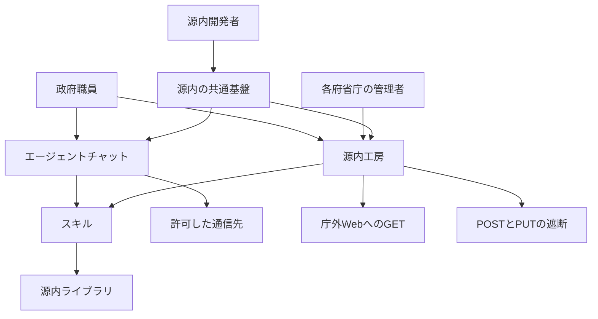

2026年10月20日、デジタル庁は、政府職員向けの生成AI利用環境「ガバメントAI 源内」で、職員がAIエージェントを作り、動かし、使う環境の提供を始めました。同日、「ガバメントAI 源内 ガバナンス・セキュリティ・セーフティに関する基準」（源内基準）第1版を公表しています。公表ページは、源内基準を、地方公共団体や民間事業者が導入を検討するときのモデルケースとしても参考になる、と位置付けています。

この記事では、同日から各府省庁へ順次入る「エージェントチャット」、令和8年12月頃までの導入を目指す個人専用の開発環境「源内工房」、職員が作ったスキル（業務手順や判断基準などを、エージェントが実行できる形にしたもの）などを府省庁横断で共有する「源内ライブラリ」、そして源内基準が三つの主体に分けて書く事項を、第1版と同日の公表資料に沿って説明します。記述の時点は、2026年10月20日の公表です。

*この記事の全体像。以下、順に解説します。*

## ガバメントAI源内のエージェント環境とは

源内は、デジタル庁がクラウドサービスとして運営し、各府省庁等へ直接提供する方式です。基準はこの方式を「デジタル庁ホスト方式」と呼びます。システム基盤はガバメントクラウドです。ガバメントクラウドとは、デジタル庁が整備・運用する、政府共通のクラウドサービスの利用環境です。推論と関連データの保存は、原則として国内のデータセンターで行います。国内リージョンに無い高度な基盤モデルに限り、推論終了後に入出力が海外に保存されないことを調達契約で確保したうえで、海外のデータセンターで推論する例外があります。入力データは、学習や再学習に使わないことを契約で確保します。

基準第1版の本文では、源内は、各府省庁等が定める条件の下で機密性2情報を扱える環境です。行政機関の情報には、機密性の区分があります。機密性1情報は、公表済みの情報、または公表を前提とする情報であり、原則として源内で扱えます。機密性3情報は、行政事務で取り扱う情報のうち、秘密文書に相当する機密性を要する情報であり、源内に入力してはなりません。デジタル庁は、職員が源内で扱える情報を、機密性2情報までとして運用します。第1版は、機密性2情報そのものがどの情報かを定義する文を置きません。内容や漏えい時の影響に幅があるため、一律に入力できるものではない、と書きます。特定秘密（特定秘密の保護に関する法律が定めるもの）と、重要経済安保情報（重要経済安保情報の保護及び活用に関する法律が定めるもの）も、入力の方法を問わず源内では扱いません。チャット、翻訳、文書作成、画像生成などの汎用機能と、法令調査や国会答弁作成支援などの行政実務向けを含む、約40種類のAIアプリを提供しています。

デジタル庁は、令和7年（2025年）5月以降に庁内で源内を使いました。令和8年（2026年）5月には、全府省庁の約18万人の政府職員を対象とする大規模実証を始めています。令和9年度（2027年度）以降は、各府省庁等が予算を付けたうえでの本格利用へ移る、と基準は書きます。

### エージェントチャット

エージェントチャットは、源内のWeb画面から使う環境です。質問、壁打ち、情報整理、文書作成、データ分析、資料生成、コード実行、既存スキルの利用、新しいスキルの作成を、一つの画面で行います。複数の基盤モデルを選べます。ファイルは、職員ごとのマイドライブに置きます。マイドライブとは、ファイルの入力、出力、参照のために職員単位で用意された記憶場所です。一時的な作業領域として設計され、セッションが終わったあともファイルは残りますが、永続的な保存は保証されません。

### 源内工房

源内工房は、利用者ごとに割り当てる個人専用の環境です。複数のWebサイトを直接読みながら集める調査、動くプロトタイプ（Webアプリケーション等）の開発、ファイル操作、コマンド実行、Web取得を、数十から数百の工程で連続して行えます。基盤は SageMaker Studio と Claude Code です。基準は SageMaker Studio を工房の基盤の名前として挙げるだけで、その製品が工房のどの役割かを、この文では説明しません。Claude Code は、基準が挙げる、ことばの指示でファイル作成やデータ分析まで進めるコーディングエージェントの例です。JupyterLab（プログラムを実行し開発するツール）、専用のWeb画面、コマンドラインから、bash、Python、Node 等を実行します。環境を止めても、ファイルは残ります。

エージェントチャットと源内工房は、令和9年（2027年）2月頃を目途に、商用利用ができるライセンスで「源内OSS Ver.2.0」として、利用・改変・再配布できる形で無償公開する予定です。源内OSS Ver.1.0 は、2026年4月に公開済みです。ライセンスの名称は、第1版と概要資料には書かれていません。

### スキルと源内ライブラリ

スキルとは、職員や部局に属人的にたまっていた業務手順、判断基準、参照資料、関連データ、確認方法、出力形式、例外処理などを、エージェントが実行できる形にしたものです。基準はこの形をスキルと定義します。エージェントチャットでも源内工房でも、スキルを作れます。

源内ライブラリは、政府職員が作ったスキルとデータセットを、府省庁横断で共有し再利用する基盤です。調査、分析、政策企画、国会対応、調達、文書作成など、幅広い行政分野を共有対象として想定します。

### 基準が分ける三つの主体

源内基準第1版の発行日は、2026年10月20日です。策定には、AIの安全性の評価を担うAIセーフティ・インスティテュート（AISI）が協力しています。基準の本文は、エージェントを、特定の目標を達成するために、環境を感知し自律的に行動するAIシステム、と説明します。同日の概要資料は、定義の根拠を「AI事業者ガイドライン第1.2版」（2026年3月31日、総務省・経済産業省）とする、と注記します。

基準は、守る事項を次の三主体に分けて書きます。

- 利用者は、政府職員等です。
- 各府省庁の管理者は、源内工房を職員に開く側です。
- 源内開発者は、源内を企画・開発・運用する側です。委託先で実務に就く者を含みます。共通基盤を持つのは、この源内開発者です。

職員が触る面は、エージェントチャットと源内工房です。スキルの府省横断の置き場が、源内ライブラリです。

図は、令和8年10月現在の基準が書く構成と、通信の分け方です。エージェントチャットの外部通信は、システムが必要とする宛先だけを許可します。源内工房は、外部への POST と PUT を遮断します。GET は許可し、通信先、通信量、通信日時をログに残します。

## 注意点

### 約18万人は三つの時点を指す

約18万人は、導入が完了した人数の合格線ではありません。基準本文は「令和8年5月に、全府省庁の約18万人を対象とする大規模実証を開始した」と書きます。源内の親ページ（最終更新は公表資料と同じ2026年10月20日）は、別の文で「2026年度中には、全府省庁約18万人の政府職員が生成AIを利用可能とする予定」とします。2026年10月20日の公表ページは「約18万人の政府職員を対象に、2種類のAIエージェント利用環境の提供を開始する。本日からエージェントチャットを各府省庁等へ順次導入し、令和8年12月頃までに源内工房の導入を目指す」とします。

三つの文は、別の時点を指します。一つ目は実証の対象規模です。二つ目は、年度内に生成AIを使えるようにする予定です。三つ目は、エージェント環境を順次入れ始める、という開始の書き方です。

### 世界初は自己申告である

世界初は、デジタル庁自身の調査による自己申告です。公表ページが範囲とするのは、次の取組です。「先進的なAIコーディングエージェントに相当する高度な利用環境を、専門職員に限らず一般の職員も日常業務で使える政府共通基盤として、約18万人規模で導入する取組」。調査の対象国、時点、比較条件は、添付にありません。

二次報道は、この限定を強くすることがあります。

- 日本経済新聞（2026年10月20日）は「同日から国家公務員らおよそ18万人に提供を始めた」と書きます。一次資料の「順次」より強い書き方です。源内工房は「12月には導入も予定する」とします。
- Impress Watch（2026年10月21日）の見出しは「世界初18万人にAIエージェント導入」です。本文は順次導入と12月頃を維持します。世界初は「（デジタル庁）」までで、「当庁の調査によれば」は見出しから落ちています。
- ITmedia NEWS（2026年10月20日 16:03公開、17:14更新、林裕也）の見出しは「政府職員18万人にAIエージェント環境を展開」です。本文は、同日から順次、源内工房は12月ごろ、世界初は「同庁の調査によると」を維持します。実証期間を「27年3月までの予定」とする一文は、同記事の記述です。基準本文が切っているのは「令和9年度以降の本格利用」です。2027年3月という月末は、一次の基準本文にはありません。

### 拒否の留保と、GETの三通りの読み

プロンプトインジェクション対策と、源内工房の個人情報・認証情報の検出は、比較表①が「完全な機能ではない」と留保します。比較表①は、源内基準の別紙1にある、エージェントチャットと源内工房の比較です。後述する、電子透かし等の対応表とは別の表です。エージェントチャットの個人情報検出は「なし。通信先限定で担保」です。比較表②も別紙1にあり、エージェントチャットと源内工房の比較で、セキュリティ対策を含みます。頁が画像中心で、同じ行の留保がテキストからは読み取れません。表②だけを、完成した拒否として写すと、表①の留保が落ちます。

源内工房の GET は、第1版の中で三通りに読めます。

- 「３－６ 源内工房の利用確認及び安全管理措置」は「Web検索に必要な GET リクエストは許可する」と書きます。
- 別紙1の比較表①は「GET は全サイト可、POST や PUT は全サイト不可」と書きます。
- 「１－４」の源内工房の説明は「任意サイトへの直接アクセスは原則可能で、源内開発者が危険性が高いと判断したものは遮断する」と書きます。

遮断先の一覧は、第1版にありません。検索キーワードは、エージェントチャットではガバメントクラウド内の索引で完結します。源内工房では、ガバメントクラウド外に出ます。比較表①はそのように書きます。国内データセンターで推論と保存をする、という原則を、源内工房の GET にまで広げると、別の話になります。

「庁外に出ない」を両環境へ一括すると、源内工房の GET と矛盾します。エージェントチャットに限れば、検索キーワードを含む処理はガバメントクラウド内で閉じます。コンテンツを取得したサイトへは通信しません。「３－５ エージェントチャットの利用管理及び安全管理措置」がそう書きます。索引が庁外のページをあらかじめ含むかは、この文からは分かりません。任意の URL を利用者が直接読む機能は、エージェントチャットにはありません。

### ライブラリのデモと本文は一致しない

導入資料の源内ライブラリは、デモ画面で「自由に共有・入手できる」と書きます。本文は「無条件に政府内で共有することは適切ではない」とします。審査、品質評価、セキュリティ確認、版管理、廃止手続を、今後整備する必要がある、と書きます。図の注記は「イメージ（開発中）」です。

導入資料スライドの「組織内外で横断的に共有」は、本文の「府省庁内及び政府横断」より広く読めます。一般のインターネットへ、職員の作成物を公開する、とは書いていません。公開予定として日付があるのは、環境そのものの源内OSS Ver.2.0（令和9年2月頃）です。

### 検収は職員エージェントの合否を決める語ではない

「検収」という語は、行政実務用の検索連携アプリ（資料上の表記はRAGアプリ）の受託開発工程に出ます。工程は、プロトタイプの確認、検収、本番公開後の更新です。職員が作ったエージェントの合否を決める章ではありません。受入条件、検収基準という見出しは、第1版にありません。

### OSSを使うだけでは安全な環境にならない

OSSを使うだけでは安全な環境にならない、と本文は書きます。デジタル庁は、ホスト方式以外の自営方式や、外部で構築した環境の損害と事故について、責任を一切負わない、とします。地方公共団体等には、OSSをそのまま指定することを前提にせず、技術的な参照実装の一つとして調達仕様で使う、と書きます。令和9年度の本格運用後、自営方式の府省庁は、ホスト方式のAIアプリ、エージェント環境、政府共通データセット、基盤モデル、ライブラリの機能を使えません。政府共通データセットとは、デジタル庁が源内で整備し、政府職員が源内を通じて使うデータです。AIが回答するとき、信頼できる行政資料や専門情報を根拠として参照するためのものです。源内ライブラリに職員が置くスキルやデータセットとは別です。

### 対応表の丸は受入検査の実装済みを意味しない

別紙の対応表は、AI生成物と判断できる技術（電子透かし、来歴管理等）を「×（未対応）」とします。凡例の「○」は「源内基準において対応済」です。受入検査のプログラムが実装済み、という意味の凡例ではありません。

### 第1版のテキストから決まらないこと

次の項目は、第1版のテキストからは確定できません。

- 危険コマンドの具体名と、GET で遮断する宛先の一覧です。第1版と比較表①のテキストには、一覧がありません。公開リポジトリ `digital-go-jp/genai-web` と `digital-go-jp/genai-ai-api` の README にも、一覧はありません。
- 「当庁の調査」の対象国、時点、比較条件です。
- 比較表②の時間、回数、容量、保管日数です。頁が横向きで、テキストとしてはほぼ読み取れません。この記事では、その数値を置きません。
- 源内工房が、デジタル庁の中でどこまで動いているかです。各府省庁への導入目標は、令和8年12月頃です。
- テナント管理者機能を、いつ提供するかです。テナント管理者機能とは、利用者の停止、費用ダッシュボードの権限、使えるモデルと機能の管理を指します。基準は、提供を検討する段階と書きます。
- 源内OSS Ver.2.0 のライセンス名です。
- 行政通則法AI利活用ガイドライン（仮称）の確定文です。これは既存の法律の名前ではなく、総務省の「行政通則法的観点からのAI利活用調査研究会」で検討中のガイドラインの仮称です。源内のエージェント環境は、そのガイドラインへの適合を前提に設計する、と基準は書きます。源内の資料は、第Ⅱ期人工知能基本計画を2026年7月14日の閣議決定、「デジタル社会の実現に向けた重点計画」を2026年7月21日の閣議決定として引いています。

## 機械が届く範囲と人が守る事項

発注側が条項の種にできるのは、環境が到達する範囲と、使い始める前の権限です。基準の型は、受入試験の仕様書ではありません。三主体の遵守事項です。令和8年10月現在の記載を、機械で確認できる到達、人の義務、まだゲートが無いものに分けます。

### エージェントチャットで機械が確認できる到達

比較表①と本文が、エージェントチャットについて書く到達は次のとおりです。

- 利用前のポップアップに同意したときだけ使えます。
- 上書きと削除の対象は、AIが生成したファイルに限ります。アップロードした原本は直接上書きしません。複製を上書きします。
- 検査できないファイルは、読み取りを遮断します。
- Web検索は、ガバメントクラウド内の索引で完結します。検索キーワードを含む処理はガバメントクラウド内で閉じ、取得元サイトへは通信しません。索引が庁外のページを含むかは、この記述からは分かりません。任意URLの直接取得はできません。
- ツールは、本人のマイドライブ内です。ローカルPCは直接操作できません。
- 源内開発者が管理していないAPIやMCPサーバーへは、直接アクセスできません。MCPとは、AIと外部のデータやツールを連携するための共通的な仕組みです。
- 添付の実行ファイルは、アップロードだけでは自動実行しません。
- 通信は許可リストです。アップロード時のセキュリティスキャンはあります。未知の脅威は排除しきれない、と本文は留保します。
- マイドライブは、一時的な作業領域です。セッション終了後もファイルは残ります。永続的な保存は保証しません。定期的なスナップショットはある、と別紙1の比較表①は書きます。

判断の目安は、チャット側の「クラウド内で閉じる」を、工房の通信へコピーしないことです。任意URLを取らない、という文はエージェントチャットの文です。

### 源内工房で機械が確認できる到達

源内工房について、本文と比較表①が書く到達は次のとおりです。

- 初期状態では利用できません。リテラシー等を確認した職員の申請に、管理者が権限を付与します。
- POST と PUT は、意図の有無を問わず遮断します。GET は許可し、通信先、量、日時をログに残します。危険と判断したものは遮断する、と源内基準第1版の「１－４」（源内工房の説明）が書きます。
- セキュリティフックの状態にかかわらず、ネットワーク層の防御は回避できない、と基準は書きます。この文は、セキュリティフックの中身を定義しません。比較表①が危険コマンドの事前ブロックに挙げる実行前フック（PreToolUse Hook）と同一かは、第1版の本文だけでは断定できません。
- 操作ログは、改ざん防止の形式で残します。
- 共通設定は、起動のたびに最新版で上書きします。
- 問題があるときは、源内開発者が権限を止め、アクセスを遮断できます。
- 個人情報やAPIキーの疑いは、送信前に利用者へ確認します。工房の中にAPIキーを持たせず、ロールでクラウド資源を使う、と比較表①は書きます。
- 危険コマンドは、実行前フック（資料上の表記は PreToolUse Hook）で事前に止めます。コマンド名の一覧は第1版にありません。対策は「完全な機能ではない」と留保されます。

判断の目安は、工房を「開いているかどうか」と「書き込みを止めているか」で見ることです。危険コマンドの名前が条項に必要なら、第1版の外に一覧を求める必要があります。

### 利用者と管理者の義務

利用者と管理者が守る事項として、本文が書くものは次のとおりです。システムが代わりに判定する、とは書いていません。

- 未確認の出力を、行政上の判断、通知、外部送信にそのまま使いません。
- 重要な判断と外部発信は、確認と承認を経ます。
- 理解できない処理は実行しません。異常なら止めて、管理者へ報告します。
- 高リスクの可能性が高い業務は、高リスク判定シートを参考に整理し、CAIOへ報告します。高リスク判定シートは、「AI調達・利活用ガイドライン」の高リスク判定の考え方とあわせ、業務の性格からリスクの程度を見るためのシートです。このガイドラインの正式名は「行政の進化と革新のための生成AIの調達・利活用に係るガイドライン（第2.0版）」で、2026年6月12日にデジタル社会推進会議幹事会が決めた文書です。前に出たAI事業者ガイドラインとも、検討中の行政通則法AI利活用ガイドライン（仮称）とも別です。CAIOとは、各府省庁等におけるAI統括責任者です。
- 許認可、給付、不利益処分、採用など、国民の権利利益に影響する業務は、リスクに応じて利用を制限します。
- 入力前に機密性を確認します。機密性3情報、特定秘密、重要経済安保情報は、プロンプト、添付、マイドライブ保存を問わず入力しません。
- デジタル庁の運用上限は機密性2です。他府省は、自らの規程で範囲を決めます。機密性2情報を入力した出力にも、機密性2情報以上の、機密として扱う必要のある情報が含まれ得ます。
- 組織が認めていない生成AIを、業務に使いません。私用のチャット、個人端末、個人アカウント、個人契約が、その例です。
- 人物の検索は、担当事務に必要な場合に限ります。
- 出力を組織の共有場所で使い始めると、行政文書になり得ます。本人だけが管理する検討のままなら、非行政文書として整理できる、と本文は書きます。根拠として、令和7年2月14日内閣府大臣官房公文書管理課長通知の整理を引いています。

### まだゲートが無い共有と停止

共有と、府省庁側の停止について、第1版が「今後」または「検討」とするものは次のとおりです。

- スキルの審査、品質評価、セキュリティ確認、版管理、廃止は、今後整備します。
- テナント管理者機能は、提供を検討する段階です。提供までの利用停止は、管理者の報告を受けたデジタル庁が行います。
- セキュリティの詳細は、「源内開発者が別途定めるセキュリティ基準」に委ねます。
- 源内工房で使えるモデルは、現時点で限定されます。他のモデルは検討中です。
- 源内工房には、自動バックアップがありません。必要なファイルは、利用者自身がダウンロードします。エージェントチャットには、定期的なスナップショットがある、と別紙1の比較表①は書きます。

許認可のどの記録が合格線か、という完成した判定表は、第1版にありません。高リスク業務では、通常のアクセスログとは別に、AI利用記録を必須にする機能を検討する、とあります。

基準には、特定の事業者や基盤モデルへの過度な依存を避け、代替構成への移行可能性を検討・検証する、という方針があります。同じ基準は、源内工房の基盤を SageMaker Studio と Claude Code と名指しします。依存を避ける方針の文言を、製品名が付いた参照実装の機械的な不受理条件へ写すと、基準が示す環境自体が不合格になります。切替試験の合格条件は、第1版にありません。

## 庁外への到達と公開の範囲

令和8年10月現在、職員が作ったスキルを一般に公開する手続は、書かれていません。共有の想定は、府省庁の中と、政府横断です。ライブラリの審査が整うまでは、政府内であっても無条件共有は適切ではない、と本文が書きます。

庁外のシステムへの到達は、環境で分かれます。

- エージェントチャットは、任意URLを読みません。通信先は許可リストに限ります。管理外のAPIとMCPへは、直接届きません。
- 源内工房は、GET で庁外のWebへ届きます。検索キーワードは、ガバメントクラウド外に出ます。機微な検索語はエージェントチャットを検討する、と比較表①は書きます。書き込みである POST と PUT は遮断します。
- 別の節は、各府省庁等が独自に持つ業務用AI基盤と源内を、政府共通基盤として接続する方針を書きます。連携方式として、API、MCP、A2A を想定します。APIは、複数のシステム間でデータや機能を連携する仕組みです。A2Aは、AIエージェント間で情報交換や、処理の依頼と連携を行うための共通的な仕組みです。地方公共団体との接続は「将来的には」とあります。この節は、エージェントチャットが管理外のAPIやMCPへ直接アクセスしないこととは、別の話です。源内工房が POST と PUT を遮断することとも、別の話です。

源内開発者は、公開できるソースコードと開発上の知見を、OSSとして出す役割を持ちます。これは、職員が作ったスキルの一般公開とは別です。

接続方針を読むときの基準は、次の二つを混ぜないことです。一つは、今日のチャットと工房が、外部へどう届くかです。もう一つは、将来、政府共通基盤として業務システムとつなぐ、という方針です。

## 発注条件に写すときの分け方

今日写せるのは、環境ごとの到達範囲と、源内工房を開く前の権限です。スキルの出来栄えを点数化する条項、危険コマンドの名前、遮断するサイトの名前、ライブラリの審査手続、府省庁管理者が自分の画面で止める機能は、第1版からは写せません。件数、世界初、同日の約18万人では、導入の進み具合を切りません。

受入条件の種は、三つの層に分けます。

1. 機械で確認できる到達だけを、条項の文案にします。エージェントチャットは、任意URLを取らず、許可した通信先に限る、と書きます。源内工房は、POST と PUT を遮断し、GET はログを残して許可する、と分けて書きます。源内工房は初期状態で使えず、管理者が権限を付ける、と書きます。チャット側の、ガバメントクラウド内で完結する、という記述を、工房へコピーしません。
2. 人の義務は、確認、承認、入力前の機密性確認、権利利益に影響する業務の利用制限、として残します。システムが代わりに判定する、とは書きません。組織が認めていない生成AIを使わないことは、利用者の義務です。源内が私用チャットを検知して止める機能としては、書かれていません。
3. 危険コマンドの名前、遮断サイトの名前、ライブラリへ載せる前の審査、府省庁管理者の自前の停止画面は、一覧か手続が公開されるまで受入条件にしません。公開を求めるなら、別途のセキュリティ基準か、源内OSS Ver.2.0 の設定の添付を条件にします。

層の外に、合否の切り方を二つ残します。

4. 作ったスキルの件数、世界初、同日に約18万人へ入ったことでは、受入の合否を切りません。見るなら、エージェントチャットが順次入っているかです。源内工房が、令和8年12月頃の目標に対して、どこまで開いているかです。
5. 基準の全文を調達仕様に貼って、受入条件にした、とは扱いません。基準は、ホスト方式の遵守事項です。OSSは、参照実装の一つです。ホスト外の事故責任は、デジタル庁が負わない、と本文が書きます。

この分け方を弱める一次の記述もあります。GET の範囲は三通りに読めます。比較表②は、留保の文言がテキストから確認しづらく、完成した拒否に見え得ます。危険コマンドと遮断先の中身が、非公開の運用設定にある可能性を、第1版は否定していません。

境界を引き直す条件は、次の三つが揃うことです。危険コマンドと遮断先の一覧が、一次資料で公開されること。ライブラリの審査手続が運用されること。テナント管理者機能が提供され、府省庁側で停止できること。そのときは、人の義務と、まだ受入条件にしない項目の境界を引き直します。

## まとめ

源内のエージェント環境は、Web画面のエージェントチャットと、個人専用の源内工房に分かれます。どちらでもスキルを作れます。府省横断の置き場として、源内ライブラリを整備します。基準第1版は、利用者、各府省庁の管理者、源内開発者の遵守事項です。受入試験の完成した判定表ではありません。

チャットは、許可した通信先と、ガバメントクラウド内の検索に閉じます。工房は、GET で庁外のWebへ届き、POST と PUT を遮断します。工房は初期状態では使えず、管理者が権限を付けます。約18万人と世界初は、導入完了の合格線にはなりません。スキルの審査、危険コマンドの名前、遮断先の一覧、府省庁管理者の停止画面は、第1版からは条項に写せません。

この記事が少しでも参考になった、あるいは改善点などがあれば、ぜひリアクションやコメント、SNSでのシェアをいただけると励みになります！

## 参考リンク

- [デジタル庁「ガバメントAI 源内においてAIエージェント利用環境の提供を開始するとともに、『源内基準』を公表します」（2026-10-20）](https://www.digital.go.jp/policies/genai/agent-safety-standard)
- [デジタル庁「ガバメントAI 源内 ガバナンス・セキュリティ・セーフティに関する基準」（源内基準 第1版、2026-10-20）](https://www.digital.go.jp/assets/contents/node/basic_page/field_ref_resources/b033337d-dad1-4493-9316-d929597e4667/9bbaf559/20261020_policies_genai_guideline_02.pdf)
- [デジタル庁「ガバナンス・セキュリティ・セーフティに関する基準（源内基準）の策定・公表について」（2026-10-20）](https://www.digital.go.jp/assets/contents/node/basic_page/field_ref_resources/b033337d-dad1-4493-9316-d929597e4667/4c25aead/20261020_policies_genai_guideline_01.pdf)
- [デジタル庁「ガバメントAI 源内における『AIエージェント』利用環境の導入」（2026-10-20）](https://www.digital.go.jp/assets/contents/node/basic_page/field_ref_resources/b033337d-dad1-4493-9316-d929597e4667/aaad4788/20261020_policies_genai_guideline_03.pdf)
- [デジタル庁「ガバメントAI『源内』」](https://www.digital.go.jp/policies/genai)
- [ITmedia NEWS「デジタル庁、政府職員18万人にAIエージェント環境を展開」（2026-10-20）](https://www.itmedia.co.jp/news/article/2610/20/2000002428/)
- [日本経済新聞「政府AI『源内』にエージェント機能」（2026-10-20）](https://www.nikkei.com/article/DGXZQOUA19A1I0Z11C26A0000000/)
- [Impress Watch「ガバメントAI『源内』、世界初18万人にAIエージェント導入」（2026-10-21）](https://www.watch.impress.co.jp/docs/news/2149756.html)
