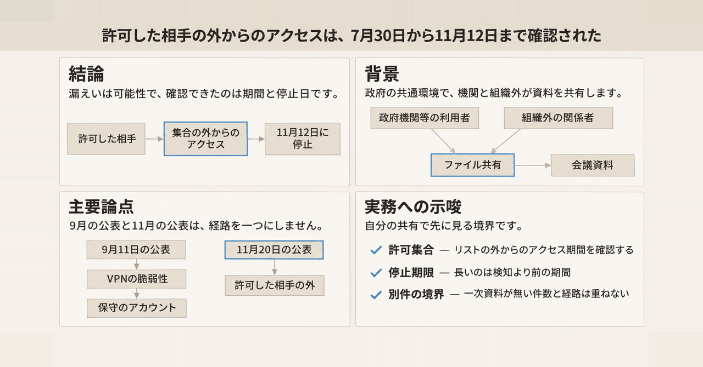
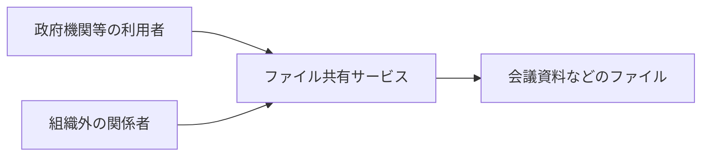
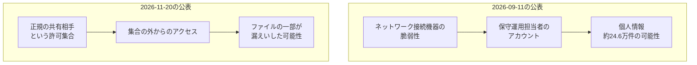

2026年11月20日、デジタル庁は、ガバメントソリューションサービス（GSS）のファイル共有サービスについて公表しました。GSSは、デジタル庁が運用する政府共通の業務環境です。公表の内容は、このサービスにアップロードされていたファイルの一部が、外部に漏えいした可能性がある、というものです。

公表が確認したのは、正規の共有相手以外からのアクセスが、2026年7月30日から11月12日まであったことです。提供の停止も、11月12日です。この記事では、その公表が確認した範囲と、共有の許可を運用で見直すときの境界を整理します。

11月20日の公表は、漏えいを「可能性」、個人情報の含有を「想定」と書いています。

*この記事の全体像。以下、順に解説します。*

## ガバメントソリューションサービスのファイル共有とは

GSSは、業務用PCやネットワークを含む、政府共通の業務実施環境です。デジタル庁のサービス説明では、そのように位置づけられています。説明ページの最終更新は、2024年4月3日です。

ファイル共有サービスは、GSSを使う政府機関等の利用者に提供されています。共有の相手は、利用者同士に加えて、事業者などの組織外の関係者を含みます。共有するものは、会議資料などの大容量ファイルです。

公表が前提にしている共有は、ファイルと「正規の共有相手」の対応です。組織外の関係者も、正規の相手として共有に入ります。正規の相手かどうかは、公表が書く「正規の共有相手先」の集合で決まります。この集合を、許可集合と呼びます。

2026年11月20日の公表は、この集合の外からのアクセスを、今回の事象として書いています。

## 11月20日の公表が確認している範囲

11月20日の公表が書いている確認事項は、次のとおりです。

| 項目 | 11月20日公表の書き方 |
|---|---|
| 検知 | 2026年11月12日（木）。正規の共有相手以外からのアクセスの可能性を検知し、調査を開始 |
| 確認されたアクセス期間 | 2026年7月30日（木）から11月12日（木）まで。現時点までの調査。期間の詳細は調査中 |
| 停止 | 2026年11月12日に当該サービスの提供を停止。検知後すぐに外部との通信を遮断 |
| ファイル | アップロードされていたファイルの一部が漏えいした可能性 |
| 個人情報 | 含まれていることも想定される。個人情報保護委員会に速やかに報告 |
| 調査 | 警察等と連携し、外部専門事業者の協力を得て継続 |
| 二次被害 | 本事案に起因する個人情報の二次被害等は、現時点では未確認 |

7月30日と11月12日は、どちらも木曜日です。公表の曜日と一致します。2つの日付の差は105日で、両端を日数に入れると106日です。この106は公表に書かれた日数ではなく、二つの日付から数えた日数です。

公表は、確認されたアクセス期間を「現時点までの調査」とし、期間の詳細は調査中としています。起点の7月30日は、この調査の現時点の結果です。今後の調査で、7月30日より前のアクセスが加わる余地を、公表自身が残しています。

## 注意点

11月20日の公表は、漏えいを可能性、個人情報の含有を想定と書いています。件数、対象機関、アクセス経路は書いていません。「不正アクセス」という語も、この公表の本文にはありません。

次の語は、報道が足したものです。11月20日公表の本文にはありません。

| 報道が足した内容 | 出典 |
|---|---|
| 「不正アクセス」「3カ月以上」 | 日経クロステック（2026年11月20日、中島募） |
| 「複数回」。ファイル共有は民間クラウド。GSSは25の政府機関が使用。9月の事案は別の不正アクセス | 日本経済新聞（2026年11月20日） |
| 総務省や内閣府など25機関の約15万人が使用。外務省や防衛省は使っていない。GSSで扱える情報は機密性2まで | 朝日新聞（2026年11月20日） |

日経クロステックの「3カ月以上」は、7月30日から11月12日までの期間の要約です。朝日新聞の25機関、約15万人は、GSS全体の利用規模として書かれています。機密性2は、GSSで扱える情報の上限としての記述であり、今回アクセスされたファイルの格付けではありません。25機関、約15万人、機密性2について、2026年11月22日までに公開された一次資料は見つかっていません。

日経クロステックの見出しは、7月末から第三者がアクセスした、という書き方です。公表の語は「正規の共有相手以外」です。組織外の関係者は、正規の共有相手に入ります。見出しの「第三者」を組織の外の人と読むと、許可集合の内側にいる組織外の相手まで、外に入ります。

個人情報の二次被害について、公表は「現時点において、本事案に起因する個人情報の二次被害等は確認されておりません」と書いています。この文は、個人情報の二次被害等について現時点では未確認、という範囲です。個人情報以外の被害全般まで未確認、とは読めません。

2026年11月20日の古川デジタル大臣の会見ページは、「会見要旨は後日、掲載いたします」とだけあります。口頭で経路に触れたかは、このページからは確認できません。

2026年9月11日に公表された別件の数字を、今回のファイル件数として使うことはできません。別件は、個人情報 約24.6万件、ネットワーク接続機器（VPN）の脆弱性、保守運用担当者のアカウント、という公表です。11月20日の公表は、件数を書いていません。

ITmedia NEWSと日経クロステックを、11月20日の公表と並べると、次のようになります。経路は、共有リンク、アカウント、設定の誤りのいずれとも、両記事は書いていません。

| 点 | デジタル庁 11月20日 | ITmedia NEWS 11月20日 21:18（山川晶之） | 日経クロステック 11月20日（中島募） |
|---|---|---|---|
| 期間 | 7月30日から11月12日 | 同じ | 同じ |
| 検知と停止 | 11月12日に検知し、同日停止。外部通信を遮断 | 同じ | 同じ。加えて「不正アクセス」と書く |
| 漏えい | 可能性 | 可能性 | 「恐れ」 |
| 個人情報 | 想定。委員会に報告。個人情報の二次被害は現時点で未確認 | 同じ範囲 | 悪用などの2次被害は現時点で未確認、と書く。公表の「個人情報の二次被害等」より広い |
| 件数 | 記載なし | 記載なし | 調査中 |
| 経路 | 記載なし | 記載なし | 記載なし |
| 9月の約24.6万件 | この公表には無い | 別の発表として末尾に併記 | 関連記事としてリンク |

ITmedia NEWSは、公式の「正規の共有相手先以外」に沿っています。日経クロステックは、主体の呼び方を「不正アクセス」に変えています。

## 9月11日の公表とどこが違うか

9月11日の公表は、今回とは別のページです。公式の標題から、対象が違います。

| 点 | 2026年9月11日公表 | 2026年11月20日公表 |
|---|---|---|
| 公式の標題 | 不正アクセスによる職員等の個人情報の漏えいの可能性 | ファイル共有サービス上のファイルの漏えいの可能性 |
| 検知 | 2026年6月25日。保守運用担当者のアカウントで大量のファイルへアクセス | 2026年11月12日。正規の共有相手以外からのアクセスの可能性 |
| 経路 | 7月9日に、ネットワーク接続機器（VPN）の脆弱性による侵入と判明。同日、保守運用担当者のアカウントを停止 | 記載なし |
| 個人情報 | ファイルに含まれることを確認。約24.6万件。氏名 約23.6万件、メール 約23.1万件、電話 約9.4万件、住所 約0.1万件（重複あり）。マイナンバー、口座、年金番号は含まれていないことを確認 | 含まれていることも想定 |
| 内訳 | 職員等 約18.9万件、業務に携わった事業者および個人 約5.7万件 | 記載なし |
| 本人への連絡 | 対象者を特定し、順次個別に連絡する | この節は無い |
| 中心 | 保守運用のアカウントとVPN | 正規の共有相手という許可集合 |

9月の公表は、一般の方の個人情報は含まれていない、と確認しています。ここでの一般の方は、GSSを使う機関の職員等でも、その業務に携わった事業者や個人でもない人です。同時に、対象には業務に携わった事業者と個人が入ります。これは、GSS上のファイルに、その人たちの個人情報が含まれていた、という範囲です。委託先がデータを保管していた、とはこの公表は書いていません。

11月の公表は、共有先として許した相手の集合と、実際にアクセスした主体がずれていた、と書いています。公式は、二つの事案が同一の侵入だと書いていません。日本経済新聞は、9月の事案を「別の不正アクセス」と書いています。関係が無い、と公式が証明したわけでもありません。

## 個人情報保護委員会への報告から読めること

デジタル庁は、個人情報が含まれることも想定されるため、速やかに個人情報保護委員会へ報告した、と書いています。どの報告事由に当てたかは、書いていません。

個人情報保護委員会の説明では、国の行政機関を含む行政機関等について、報告義務の対象に次が含まれます。同じページの民間事業者等向けの人数要件は、1,000人を超える漏えい等です。下の100人は、行政機関等の要件です。

- 要配慮個人情報が含まれる保有個人情報の漏えい等、またはそのおそれ
- 不正に利用されることにより財産的被害が生じるおそれがある保有個人情報の漏えい等、またはそのおそれ
- 不正の目的をもって行われたおそれがある、当該行政機関等に対する行為による保有個人情報の漏えい等、またはそのおそれ。保有個人情報として取り扱われる予定の、取得しようとしている個人情報も含む
- 保有個人情報に係る本人の数が100人を超える漏えい等、またはそのおそれ

要配慮個人情報について、同じ案内は次のものを挙げています。人種、信条、社会的身分、病歴、犯罪の経歴、犯罪により害を被った事実、その他政令で定めるものです。政令で定めるものには、障害があること、健康診断その他の検査の結果、保健指導、診療・調剤情報、本人を被疑者または被告人とする刑事事件の手続、本人を非行少年またはその疑いがある者とする少年保護事件の手続が含まれます。11月20日の公表は、今回のファイルに要配慮個人情報が含まれるとは書いていません。

案内の図は、速報を発覚日から3〜5日以内、確報を発覚日から30日以内、と書いています。図の直下の本文は、不正な目的で行われたおそれがある場合は発覚日から60日以内、とも書いています。別の本文は「発覚したら、まずは速やかに報告してください」と書いています。これらの期限を一つの「おおむね」にまとめた語は、この案内ページの本文にはありません。

11月20日の公表は、報告済みとだけ書いています。受理日は書いていません。検知日の11月12日から公表日の11月20日までは8日あります。この8日は、報告日そのものではありません。

9月の公表には、本人へ順次連絡するとあります。11月の公表には、その節がありません。11月の事案で本人通知が無い、と読む材料としては、この差だけでは弱いです。

## 共有の許可を運用で持つ境界

11月20日の公表に紐づけて読める境界は、次の3点です。共有リンク、アカウント、設定の誤りのいずれかを、今回の原因としては置きません。経路を置くなら、デジタル庁が経路を書いた後です。

1. 共有の許可は、作った瞬間の相手リストで終わりません。リストの外からのアクセスが、2026年7月30日から11月12日までの期間で確認されています。起点は、現時点の調査結果です。組織外の事業者を共有に入れていても、その相手は許可集合の内側です。見るべきずれは、組織の内外ではなく、許した相手の集合と、実際にアクセスした主体の差です。
2. 検知から共有停止までの期限は、運用として持ちます。今回の公表では、検知と提供停止は同じ11月12日で、外部通信の遮断は検知後すぐに行われています。長いのは、停止の遅れではありません。検知される前の期間です。
3. 11月20日の公表に紐づける境界は、共有先として許した相手の集合と、実際のアクセス主体のずれです。9月11日の公表は、ネットワーク接続機器（VPN）の脆弱性、保守運用担当者のアカウント、GSS上のファイルに含まれていた職員等と業務関係者の個人情報（約24.6万件）までを、別の公表として置きます。委託先がデータを保管していたとは、9月の公表は書いていません。委託先に残るデータの境界として9月の事案を使うのは、保管を示す別の一次資料があるときだけにします。二つの公表を、一つの侵入経路として書きません。

自分の共有運用に引き直すときの判断基準は、次の3問です。

- 許可集合は、共有を作ったときの相手リストのままか。リストの外からのアクセスを、どの期間まで確認したか。
- 検知の時刻と、共有停止および外部通信の遮断の時刻は、同じ運用期限に入っているか。長い期間は、停止後ではなく検知前にないか。
- 別の公表の件数、経路、保管場所を、この共有の事象へ重ねる一次資料があるか。無ければ、許可集合とアクセス主体のずれまでに止める。

## 続報で判断を更新する条件

上の3点は、11月20日時点の公表の範囲です。次のどれかが公開されたら、境界の置き方を更新します。

- 続報または会見要旨が、経路をどれか一つに特定する
- 続報が、漏えいと個人情報の含有を確認に変える、または件数を出す
- 続報が、9月のVPN侵入と今回を同一だと書く
- 調査の更新で、アクセス期間の起点が7月30日から動く

経路が特定されるまでは、共有リンク、アカウント、設定の誤り、脆弱性のどれか、またはその組合せかは、未確認のままにします。漏えいした可能性があるファイルの件数、機関、個人情報の有無も、11月20日の公表にはありません。7月30日より前のアクセス、大臣会見で公表文に無い説明があったか、9月の事案とシステムのどこまでが共通か、GSSの現行の利用機関数と利用者数、ファイル共有の提供事業者、個人情報保護委員会への報告事由、本人通知の扱いも、この公表の範囲外です。

## まとめ

GSSのファイル共有は、政府機関等の利用者と、事業者などの組織外の関係者との間で、会議資料などの大容量ファイルをやり取りするサービスです。正規の共有相手は、組織の内外では決まりません。許した相手の集合で決まります。

2026年11月20日の公表が確認しているのは、その集合の外からのアクセスが、現時点の調査では2026年7月30日から11月12日まであり、11月12日に提供を停止し、検知後すぐに外部通信を遮断した、ということです。ファイルの一部漏えいは可能性、個人情報の含有は想定です。件数、機関、経路は書いてありません。

9月11日の公表は、ネットワーク接続機器（VPN）の脆弱性と保守運用担当者のアカウントを経路とし、個人情報約24.6万件を確認した、別のページです。二つの公表を一つの侵入としては書きません。運用で先に持つのは、許可集合の外側からのアクセスと、検知から停止までの期限です。

この記事が少しでも参考になった、あるいは改善点などがあれば、ぜひリアクションやコメント、SNSでのシェアをいただけると励みになります！

## 参考リンク

- [デジタル庁「ガバメントソリューションサービスで提供しているファイル共有サービス上のファイルの漏えいの可能性について」（2026年11月20日）](https://www.digital.go.jp/press/a966ee61-478c-4194-8f13-f97599fae986)
- [デジタル庁「古川大臣記者会見（令和8年11月20日）」](https://www.digital.go.jp/speech/minister-261120-01)
- [デジタル庁「ガバメントソリューションサービスへの不正アクセスによる職員等の個人情報の漏えいの可能性について」（2026年9月11日）](https://www.digital.go.jp/news/2026-0911-01)
- [デジタル庁「ガバメントソリューションサービス」（最終更新 2024年4月3日）](https://www.digital.go.jp/policies/gov_solution_service)
- [個人情報保護委員会「漏えい等の対応とお役立ち資料」](https://www.ppc.go.jp/personalinfo/legal/leakAction/)
- [ITmedia NEWS「デジ庁、政府機関向けファイル共有サービスで漏えいか」（2026年11月20日 21:18、山川晶之）](https://www.itmedia.co.jp/news/article/2611/20/2000003381/)
- [日経クロステック「デジ庁の政府向けファイル共有で漏洩の恐れ、7月末から第三者がアクセス」（2026年11月20日、中島募）](https://xtech.nikkei.com/atcl/nxt/news/24/03483/)
- [日本経済新聞「政府システムからファイル流出か、個人情報含む恐れ」（2026年11月20日）](https://www.nikkei.com/article/DGXZQOUA20A0V0Q6A121C2000000/)
- [朝日新聞（2026年11月20日）](https://www.asahi.com/articles/ASVCN30WCVCNULFA01NM.html)
