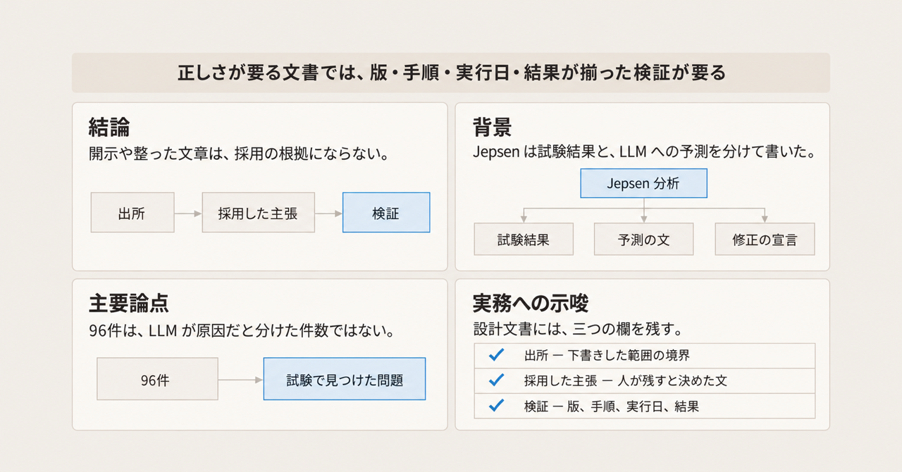
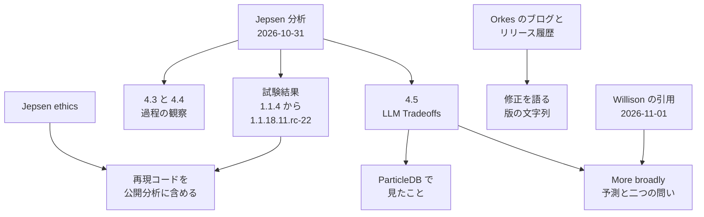

Kyle Kingsbury が 2026-10-31 に公開した [ParticleDB 1.1.4 の分析](https://jepsen.io/analyses/particledb-1.1.4) と、Simon Willison が翌日に転載したその一節を読みます。対象は、Orkes のデータベース ParticleDB を Jepsen が試験した結果と、議論の節 4.5 が LLM の利用と文書の信頼について置いた見立てです。新しいソフトウェアの文書を受け取る人と、自分の設計文書に検証を残す人が、試験の記録、予測の文、ベンダーが修正を語る文を分けて読めるようにします。分析は Orkes, Inc. の資金で行われ、Jepsen は 1.1.18.11.rc-22 より後の版を評価していません。

*この記事の全体像。以下、順に解説します。*

## ParticleDBのJepsen分析とは

Jepsen は、Kyle Kingsbury がデータベースの振る舞いを試験し、公開する分析の名前です。ParticleDB は Orkes のデータベースで、分析の冒頭はこれを AI の作業負荷（AI workloads）向けの multi-model database と呼びます。multi-model database は、複数の形のデータを一つのデータベース製品で扱う、という分類名です。試験した版は 1.1.4 から 1.1.18.11.rc-22 です。分析は 96 件の問題を報告します。

資金源は本文に “funded by Orkes, Inc.” とあります。実施方針は [Jepsen の倫理](https://jepsen.io/analyses/ethics) に従う、と書かれています。倫理のページは、公開する分析には発見を再現する完全なコードを含める、と約束しています。試験コードは [jepsen-io/particledb](https://github.com/jepsen-io/particledb) にあります。2026-11-02 の GitHub API では star は 1 で、アーカイブされていません。default branch `main` の先端は 2026-10-31 です。

多くは単一サーバ、単一クライアント、故障注入なしで起きました。故障注入は、試験が故障を意図的に起こして振る舞いを見る操作です。ここでは、その操作がない健全な単一ノードでも起きた、という意味です。第3章は、96 件のうち 3 件を除き、健全な単一ノードで起きた、と書きます。提供されたビルドは複製に対応せず、節 4.6 は複製方式が未試験のままである、と書きます。1.1.18.11.rc-22 の時点では、10 件を除き解消したように見えた、と冒頭が書きます。既定のトランザクションモード `occ` は、通常運転でコミット済みの書き込みを失いました。分析はこのモードを Optimistic Concurrency Control（楽観的同時実行制御）として扱い、その趣旨はロックを取らずに進めることだ、と説明します。最も強い設定の `serializable` は、内部異常と Lost Update を許しました。`serializable` は、分析が完全な直列化、最も強い設定と書く隔離の名前です。並行する処理があっても、一つの順序で実行したのと同じ結果になる、という保証です。内部異常は、分析が internal consistency の破れとして挙げる異常で、一つの処理の中の読み取り結果が互いに合いません。Lost Update は、分析がこの名で挙げる、更新が失われる異常です。

議論の節は、試験が示せるのは不具合の存在であり、不在ではない、と書きます。倫理のページも、実験は誤りの存在を示せても不在は示せない、と同じ限定を置きます。分析は、見つけた安全性エラーの程度と、それを出した過程の両方を理由に、ParticleDB のこれ以上の導入を止め、他のデータベースへ移るよう利用者に勧めています。ここでの安全性は、データを失う、または壊すことです。通信の盗聴のようなセキュリティ上の欠陥を指す語ではありません。96 件は、その種以外のクラッシュなども含む、試験で見つけた問題の数です。

節 4.5「LLM Tradeoffs」は四段でできています。LLM（大規模言語モデル）は、少人数が広いソフトウェアと文書を短い時間で作れるようにする、という段です。5 年前ならこの規模の分散 SQL データベースは数百人年だったかもしれない、と書き、脚注で MongoDB と Cockroach Labs の従業員数の例を添えます。次の段は、ParticleDB では正しさの誤りがフラクタルになり、LLM のツールが未修正のバグを修正済みと繰り返し言った、という観察です。ここでのフラクタルは、どの尺度で見ても同種の正しさの誤りが現れる、という比喩です。本文は “ParticleDB was a fractal of correctness errors.” と “LLM tooling repeatedly claimed that bugs had been fixed when, in fact, they had not.” と断言します。三つ目は対比です。Orkes は Conductor の不具合については原因と解消を説明できました。Conductor は、分析がその対照に挙げる名前です。どの種類の製品かは、この段落には書かれていません。ParticleDB のほぼすべての問題は説明できず、変更履歴のないビルドが出てきました。そのあと “More broadly” で信頼の予測を書き、正しさが要るところで業界はこの得失を認め、緩和すべきだ、と続けます。

保守者への問いは二つです。正しいソフトウェアと正確な文書をどう作るか。その作業のあと、品質を利用者にどう示すか。分析の英文は次のとおりです。

> In the age of LLMs, what can maintainers do to ensure correct software and accurate documentation? Having done that work, how can they demonstrate its quality to users?

“More broadly” の段落は、次の文で始まります。

> More broadly, the use of LLMs erodes trust in documentation, in software, and in the organizations which produce them. Perhaps engineers will begin to treat any new software project with suspicion—the signals we used to rely on as markers of a mature system are now easier to counterfeit.

続く呼びかけは、次の文です。

> Where correctness matters—and surely it ought to matter for databases!—our industry must acknowledge and mitigate these tradeoffs.

Willison のページは 2026-11-01 の 4:49 pm とあります。タイムゾーンはページにありません。ページは引用だと示し、上の “More broadly” の段落と二つの問いを掲げます。間の文は `[...]` です。省かれるのは、正しさが要るところで得失を認め、緩和すべきだ、という呼びかけの文です。

節 4.3「Quality Assurance」は、基本機能の試験が無いように見える開発過程を指摘します。原因候補は “Perhaps” で三つ並びます。リリース前に試験を走らせていないこと。試験は走ったが基本機能を踏んでいないこと。技術者が試験を LLM に任せたこと。推奨は、機能ごとの単純な試験をリリース前に走らせ、失敗を観察することです。失敗の観察は、その試験が何かを測っていることの確認だ、と書きます。

節 4.4「Documentation」は、サイトが成熟したデータベースに見えたことと、公開文書の欠落、不一致、作話を並べます。当時の公開面は、PostgreSQL の約 1000 倍、TLA+ による “formally verified”、13 言語のクライアント、という強い標語を掲げていました。TLA+ は、システムの振る舞いを記号で書いて性質を検査する、形式仕様の記法です。形式仕様は、その記号で書いた仕様を指します。“formally verified” は、形式的に検証済み、という宣言です。その証明は公開されず、共同作業中にも仕様は入手できませんでした。“formally verified” の直下に書いてあった文言は、snapshot isolation（スナップショット分離という隔離レベル）でした。分析のモード表では、この隔離レベルは `occ` 系の行にあり、最も強い設定の `serializable` とは別です。形式的に検証済み、という宣言の直下に書いてあったのは、その最も強い設定の名前ではなく、こちらの隔離レベルです。この段落は、その隔離レベルがどの結果を保証するかは定義しません。試験中の速さは、公開文書の “1087x faster than PostgreSQL” ではありませんでした。分析が当時の公開文書から引いた標語には、“Full ACID. 159K TPS.”、“formally proven”、“formally verified” があります。ACID は、原子性、一貫性、独立性、永続性をまとめた標語です。TPS は 1 秒あたりのトランザクション数で、159K は約 15.9 万です。“formally proven” は、形式的に証明済み、という宣言です。

同じ節は、存在しない依存座標、誤った既定ユーザ名、分析著者の架空のメールアドレスを、公開文書の作話として挙げます。依存座標は、Java クライアントがライブラリを指定する名前と版の番地です。推奨は、人のテクニカルライターが、意図した振る舞いと利用者が期待できる保証を書き直すことです。既知の重大な問題は、目立つ警告にすべきだ、とも書きます。

同じ日の短い告知は、ParticleDB を “built for and with AI” と呼びます（[ブログ](https://jepsen.io/blog/2026-10-31-particledb-1.1.4)）。Orkes のブログは表示日 October 30, 2026 で、Jepsen が 1.1.4 から 1.1.18.11.rc-22 に 96 件を見つけ、ParticleDB 1.1.19 の時点で指摘はすべて対処した、と Orkes が報告する、と書きます（[記事](https://orkes.io/blog/particledb-database-built-for-ai-agents)）。分析本文が伝える Orkes の主張は、版 `1.1.19-rc.13` です。2026-11-02 に開いた [リリース履歴](https://particledb.ai/installation/releases/) の現行版は `1.1.19-rc.16`（released 2026-10-30）です。`1.1.4` から `1.1.18.11.rc-22` は unsupported pre-release（サポート対象外のプレリリース）とあります。`1.1.19-rc.13` の行は Superseded（後継に置き換わった）と Native SDK support（ネイティブ SDK への対応）です。サーバはコンパイル済みバイナリで、エンジンのソースは公開されていない、とページが書きます。履歴は、モードを消しただけでは、そのモードを受け付けた旧ビルドの所見は解消しない、とも書きます。

`particledbai/jepsen#110` は 2026-10-27 に completed として閉じられています。題名は “Routine data loss with `occ-v3`”（`occ-v3` での定常的なデータ喪失）です。`occ-v3` は、分析が `occ` の別名としても挙げるトランザクションモードです。起票者のアカウント名は `aphyr` です。URL は [当該 issue](https://github.com/particledbai/jepsen/issues/110) です。close の 2 秒前、`nikhilkala` が 2026-10-27 に、ParticleDB `1.1.19-rc.13` で native JDBC 1.0.10 と pgjdbc 42.7.11 のそれぞれについて 4 時間の OCC/sync append 試験をし、成功トランザクション 2,766,668 件、append（追記）の書き込み喪失は報告されなかった、と書いています。sync は、そのコメントが試験条件に付けた語です。ここでは、追記の喪失が報告されなかった自己申告の条件名として読みます。native JDBC と pgjdbc は、そのコメントが挙げる二つの接続実装で、アプリケーションがデータベースへ話す方式です。同じコメントは、より前の rc.10 と rc.12 で成功 7,702,247 件、20 workload-hours（試験を動かした時間の合計）とも書きます。

分析は、試験結果、開発過程の観察、一段階広い予測を一段ずつ置いています。Willison のページは、広い予測の一部だけを引用します。ベンダーの公開文書は、別の版の文字列で修正を報告します。

読者に届く文書は三つに分かれます。試験の記録、予測の文、ベンダーが自分の修正を語る文です。

## 注意点

4.5 の文は、LLM の利用が文書、ソフトウェア、それを出す組織への信頼を削る、と述べています。そこから先を、業界全体の測定結果や、96 件が LLM のせいだという件数に読み替えると、本文の留保が落ちます。

### 広い段落の書き方

“More broadly” の段落は “Perhaps engineers will begin” で始まる予測です。業界全体の測定結果としては書かれていません。“our work on ParticleDB (and other databases) suggests” は、他のデータベースの名前をこの分析に書きません。一般化の材料は、ParticleDB の観察と、名前の無い参照です。

“LLM tooling repeatedly claimed that bugs had been fixed when, in fact, they had not.” は断言です。この文に、ツールのログ、プロンプト、特定の issue へのリンクは付いていません。観察として読み、個別に追試できるログとしては読めません。追試の単位は、この断言ではなく、分析が手順とともに示す個々の SQL の例です。この記事には、その SQL を再掲していません。

Willison の `[...]` が省いても、信頼が削れるという予測は引用の中に残っています。省かれるのは、正しさが要るところで得失を認め、緩和すべきだ、という次の呼びかけです。脚注16は、完全な正しさを要しない用途もある、と 4.5 の「正しさが要る」を狭めます。どの用途かは、脚注が一覧にしていません。脚注15の従業員数は、人年の測定値ではありません。整数は各社の届出を開いていないので、ここでは繰り返しません。

### 件数と原因の切り分け

96 件は、試験で見つけた問題の数です。LLM が原因だと切り分けた件数ではありません。4.3 の三つの “Perhaps” は、原因の候補を並べた文です。LLM に試験を任せた、という断定ではありません。

節 4.1 は、Orkes が 1.1.4 の問題を 2026 年春の大規模リファクタのせいだと考えている、と書きます。Jepsen が 1.0.0 の内部ビルドを短時間見た範囲では、1.1.4 の重大な安全性エラーの多くは見えませんでした。その確認は cursory（ざっと見た確認）で、単一ノードだけです。この段落は、リファクタの時期と障害の時期を並べます。そのリファクタに LLM がどれだけ寄与したかは切り分けません。LLM が単独原因だという読みも、LLM が無関係だという読みも、この段落からは決まりません。

文書が正確であるべきだ、という基準は、この分析が初めて書いたものではありません。倫理のページは以前から、意図した振る舞いを文書の抜粋で支える、と書いています。LLM が偽造のコストを下げた、という比較の数値は、この分析にありません。

### 公開文書の標語

“Full ACID. 159K TPS.” や “formally verified”、13 言語、PostgreSQL の 1087 倍は、分析が当時の公開文書から引用した標語です。ここでの整理は、性能を測り直していません。分析自身が、共同作業中に TLA+ の仕様が入手できなかったこと、直下の文言が snapshot isolation だったこと、試験中の速さは 1087 倍ではなかったことを書いています。

生成テストは、SQL を人手で列挙せず、ランダムに作ってデータベースへ投げる試験です。分析が “roughly two thousand lines” と書いた箇所は、コミット `d4721aee` の [`src/jepsen/particledb/gen/tc.clj`](https://github.com/jepsen-io/particledb/blob/d4721aeef9435af0131eacfb2163059272b13d57/src/jepsen/particledb/gen/tc.clj) だけにリンクします。2026-11-02 にそのファイルの raw を数えると 1288 行でした。同じ節が別の箇所で指すコミット `e804ab8` では、[`compare.clj`](https://github.com/jepsen-io/particledb/blob/e804ab8b0528b089b908b6249d2e1e4ac966802f/src/jepsen/particledb/workload/compare.clj) が 651 行、[`gen/tc.clj`](https://github.com/jepsen-io/particledb/blob/e804ab8b0528b089b908b6249d2e1e4ac966802f/src/jepsen/particledb/gen/tc.clj) が 1288 行、合計 1939 行でした。合計は “roughly two thousand” に近いです。本文はその合計だと書いていません。他のファイルは数えていません。

### 版の文字列

Orkes の「指摘はすべて対処した」は、ブログでは版 `1.1.19`、分析本文では Orkes の主張として版 `1.1.19-rc.13` です。2026-11-02 のリリース履歴は、現行を `1.1.19-rc.16` とし、`1.1.19-rc.13` を Superseded とします。三つの文書は、同じ完了宣言ではありません。Jepsen は後続版を評価していません。現行 `1.1.19-rc.16` の安全性は、この分析の範囲外です。

`#110` のコメントは、Orkes の技術者による当該 issue の自己申告です。96 件全体の確認でも、Jepsen による後続版の評価でもありません。2,766,668 が両インタフェースの合計か、各回の件数かは、コメントの文面だけでは決まりません。

### 公開コメントと未確認

[Lobsters のスレッド](https://lobste.rs/s/drwd4j/jepsen_particledb_1_1_4) には “deep in AI psychosis” とあります。2026-11-02 にページを取得しています。Hacker News の item `50316100` には、試験工程が飛ばされたという推測があります。どちらも分析本文の診断ではありません。推奨を強める根拠には使いません。再現用リポジトリの star は、2026-11-02 時点で 1 です。利用の広さの指標としては使いません。

開いたリリース履歴、ベンチマーク文書、Orkes の当該ブログには、LLM をどの工程で使ったかの開示は見当たりません。サイトの他のページまでは見ていません。開示を義務化したとき、読者の判断が良くなるかは未測定です。“other databases” がどの分析を指すかは、この分析からは特定できません。

資金提供は Orkes です。倫理のページは、ベンダー報酬が好意的な結論への圧力になると認め、公開分析の最終的な編集権は Jepsen にある、と書きます。資金の開示は利害の表示です。観察の自動的な無効化でも、観察の実証でもありません。

## 受け取る文書を三種類に分ける

試験結果として読む範囲は、1.1.4 から 1.1.18.11.rc-22 と、本文が単一ノードで、複製は未試験だと書いた範囲です。Jepsen の導入中止の推奨は、この試験した過程に対する推奨です。2026-11-02 の現行版を、この文章が再試験した結果ではありません。

予測として読む範囲は、4.5 の “More broadly” です。採用してよいのは、引用の意味までです。成熟の合図（長い文書、強い標語、先の “formally verified” のような正式検証の宣言）は、以前より偽造しやすくなった、という予測です。試験より安く作れる、は、この引用を測った数値ではありません。偽造のコストがどれだけ下がったかの数値は、この分析にありません。すべての新しいソフトウェアを疑え、という規則にはしません。適用範囲は、正しさが要る文書に限ります。正しさが要る、の例はデータベースです。完全な正しさを要しない用途がどれかは、脚注16が一覧にしていません。データベース以外の文書がそこに入るかは、受け取る側が見ます。この記事が分類する例は、データベースだけです。

ベンダーの「直した」は、対象版、再現手順、実行日、結果がそろうまで、採用した主張の欄に上げません。ブログの `1.1.19` と、分析が伝える主張 `1.1.19-rc.13` と、現行 `1.1.19-rc.16` は、同じ完了の証拠として束ねません。`#110` に付いた自己申告は、その issue の append 試験についての報告として読みます。リリース履歴が書くとおり、モードを削除しても、そのモードを受け付けたビルドの所見は解消しません。

検証欄に書く結果は、その版、その手順、その日の結果に限ります。試験が問題を見つけなかったことは、問題が無いことの証明にはなりません。

## 設計文書に検証の欄を置く

自分の設計文書とリリースノートでは、言語モデルが下書きしたこと、人が採用した主張、第三者がやり直せる検証を、三つの欄に分けます。言語モデルは、ここまで読んできた LLM を指します。データの持ち方を指す multi-model の「モデル」とは別です。文章のうまさは、採用した根拠の代わりにしません。開示だけで信頼が戻ることは、ここで確認できた事実ではありません。開示は出所の記録です。

| 欄 | 書くこと | 書いても戻らないもの |
| --- | --- | --- |
| 出所 | 言語モデルが下書きした範囲と、人が採用した範囲 | 文章が整っていること |
| 採用した主張 | 人が残すと決めた文。言語モデルの所見と混ぜない | 出所の開示そのもの |
| 検証 | 対象の版、やり直す手順、実行日、結果、結果が違ったら主張を下げる条件 | 手順の欄があることだけ |

欄を必須にしても、実行せずに書けます。実行結果、対象版、日付が無ければ、成熟の標語と同じ種類の文になります。出所の欄に書く「人が採用した範囲」は、人が手を入れた範囲の境界です。採用した主張の欄は、その範囲の中で人が残すと決めた文そのものです。境界を書いただけでは、残す文は決まりません。

ParticleDB の受け取り方は、この三欄の例です。出所の欄には、言語モデルが下書きした範囲の開示があるかどうかを書きます。開いたリリース履歴、ベンチマーク文書、Orkes の当該ブログには、LLM をどの工程で使ったかの開示は見当たりません。採用した主張の欄には、成熟の合図は以前より偽造しやすくなった、という予測の引用までを残します。試験より安く作れる、は、その引用を測った数値ではありません。信頼が削れるという文は、採用した主張には入れず、予測の引用として残します。業界全体の測定結果としても採用しません。検証の欄には、1.1.4 から 1.1.18.11.rc-22 の単一ノードで見た結果を書きます。中身は 96 件と、既定の `occ` が通常運転でコミット済み書き込みを失ったこと、`serializable` が内部異常と Lost Update を許したことです。96 件を LLM 起因の実証件数にはしません。ベンダーの修正宣言は、版と手順と実行日と結果がそろうまで、採用した主張へ上げません。

自分のメモでは、AI の所見と、採用した文の隣に、検証欄を一行置きます。その行には、対象の版、やり直す手順、実行日、結果を書きます。URL だけ、またはコマンドだけでは、この欄は埋まりません。文章を磨いたことは、この行の代わりにしません。

## まとめ

Jepsen の ParticleDB 分析は、1.1.4 から 1.1.18.11.rc-22 で 96 件の問題を報告し、その多くが健全な単一ノードで起きた、と書きます。節 4.5 は、その過程の観察のあとで、LLM の利用が文書とソフトウェアと組織への信頼を削る、という予測を置きます。Willison の引用は、その予測と二つの問いを掲げ、正しさが要るところで得失を緩和すべきだ、という文を `[...]` で省きます。

96 件は、LLM が原因だと切り分けた件数ではありません。後続版は Jepsen が再試験していません。正しさが要る文書では、開示だけでは足りず、対象の版、やり直す手順、実行日、結果が揃った検証が要ります。

この記事が少しでも参考になった、あるいは改善点などがあれば、ぜひリアクションやコメント、SNSでのシェアをいただけると励みになります！

## 参考リンク

- Kyle Kingsbury. “ParticleDB 1.1.4.” Jepsen, 2026-10-31. <https://jepsen.io/analyses/particledb-1.1.4>
- Kyle Kingsbury. “ParticleDB 1.1.4.” Jepsen blog, 2026-10-31. <https://jepsen.io/blog/2026-10-31-particledb-1.1.4>
- Jepsen. “Research Ethics.” <https://jepsen.io/analyses/ethics>
- Simon Willison. “A quote from Kyle Kingsbury.” 2026-11-01. <https://simonwillison.net/2026/Nov/1/kyle-kingsbury/>
- Nikhil Kala. “ParticleDB: A Database Built for AI Agents.” Orkes, ページ表示 October 30, 2026. <https://orkes.io/blog/particledb-database-built-for-ai-agents>
- ParticleDB. “Releases and client availability.” 2026-11-02 に取得。現行表記 `1.1.19-rc.16`. <https://particledb.ai/installation/releases/>
- jepsen-io/particledb. <https://github.com/jepsen-io/particledb>
- particledbai/jepsen#110. closed completed, 2026-10-27. <https://github.com/particledbai/jepsen/issues/110>
- Lobsters. “Jepsen: ParticleDB 1.1.4.” <https://lobste.rs/s/drwd4j/jepsen_particledb_1_1_4>
