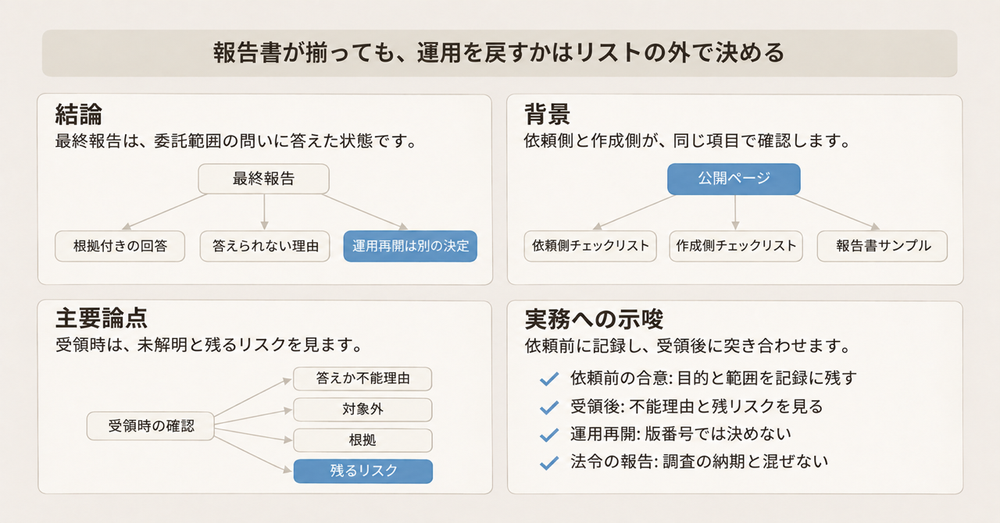
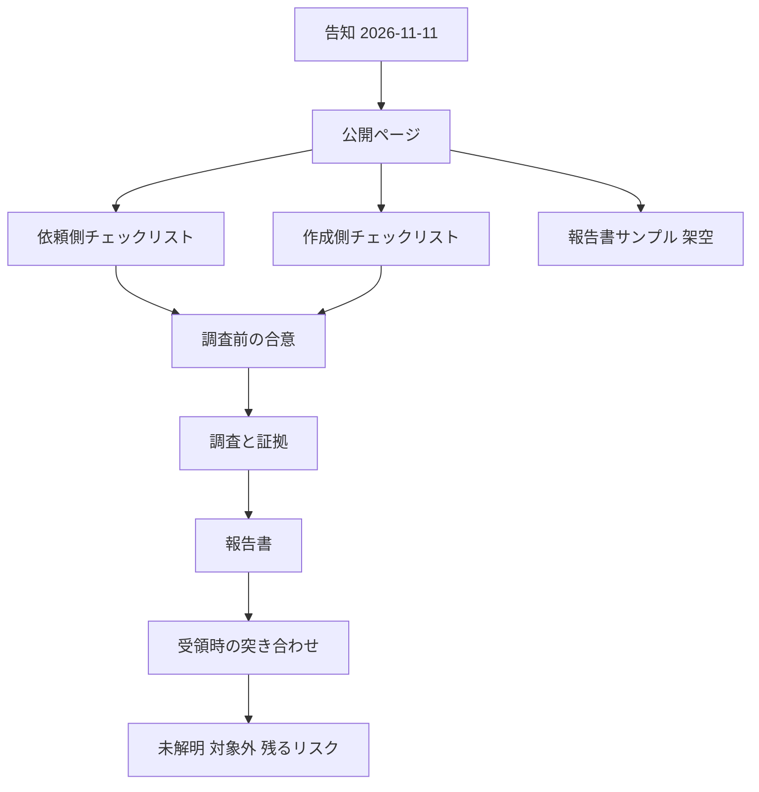

2026年11月11日、一般社団法人JPCERTコーディネーションセンター（JPCERT/CC）は、「インシデント調査報告書チェックリスト」を公開しました。被害を受けた組織が、外部の調査委託先と、調査の目的、範囲、報告書の中身を、同じ項目で確認するための補助ツールです。

この記事は、マルウェア感染などをともなうネットワーク侵害の調査を外部へ頼む担当者向けに、3つの文書の中身と、依頼前と受領後に確認する項目を示します。項の数、リポジトリの状態、PDF のページ数は、2026年11月12日時点の公開物です。

本体は GitHub 上の公開ページです。中身は、依頼する組織向けのチェックリスト、報告書を書く担当者向けのチェックリスト、架空事例の報告書サンプルの3点です。

*この記事の全体像。以下、順に解説します。*

## インシデント調査報告書チェックリストとは

公開の告知は、ランサムウェア攻撃や情報漏えいに関するインシデントが増え、調査を外部へ委託することが一般的になった、と書いています。そのうえで、初めてインシデントに対応する被害組織には、外部組織による調査の妥当性の評価や、インシデント収束の判断に迷うことがある、と続けています。チェックリストは、その課題に対応するため、調査を依頼する被害組織と、報告書を作成する担当者が、共通認識を持って調査を進めるためのもの、と告知は位置づけています。

公開ページは、調査を円滑に進めることをサポートする補助ツール、と書いています。想定しているのは、マルウェア感染などをともなうネットワーク侵害です。

### 3つの文書

3つの文書の役割は分かれています。

依頼側のチェックリストは、正式名が「インシデント調査報告書作成依頼時のチェックリスト（ユーザー向け）」です。調査を依頼する組織が、ベンダーと調査方針を合意するときと、受領した報告書の最低限の確認に使います。

作成側のチェックリストは、正式名が「インシデント調査報告書作成時のチェックリスト（レポーター向け）」です。調査を担当する者が、報告書を作るときに使います。

報告書サンプルは、チェックリストの基準を、実際の報告書の構成と記載例へ落とした架空の最終報告です。表紙の報告区分は「最終報告」、版は v1.0、作成日は 2025-06-20 です。組織名、ホスト名、アカウント名、ファイル名、IP アドレス、ハッシュ値、日時は作成例です。冒頭は、実際の報告書が同じ項目を持つ必要はない、と書いています。

2026年11月12日時点の PDF は 42 ページ、A4 です。生成元は文書変換の pandoc で、PDF 化は WeasyPrint 67.0 です。WeasyPrint は、HTML を PDF にするソフトウェアです。

### 公開ページの置き場所

利用者が開く案内は、公開ページです。GitHub Actions の workflow が HTML を `dist/` に作り、その `dist/` を GitHub Pages へ載せています。workflow は、更新のたびにページを組み立てる自動化の設定です。

リポジトリ直下の `index.html` は、題が「インシデント調査報告書サンプル」の別ページです。3つの文書を案内するのは、公開ページの URL です。

3つの成果物と、その前後の作業は次のとおりです。

### 依頼側と作成側が見る同じ話題

依頼側と作成側は、同じ話題を逆方向から見ています。依頼側に必須と推奨の区分はありません。作成側の区分は、各項に付いています。

| 話題 | 依頼側 | 作成側 |
| --- | --- | --- |
| 目的 | 何を明らかにするか、結果をどの用途に使うかを組織内で確認する | 目的を事前に合意し、報告書に明記する（必須） |
| 判断できないこと | 原因、影響、追加調査の可能性の説明を受ける | 不足するログと、結果への影響を説明する（必須） |
| 根拠 | 主要な結論を、証拠 ID、ログ、対象、日時まで追えるか見る | 結果ごとに根拠を書く（必須）。証拠 ID との対応は推奨 |
| 断定 | 概要で、確認できたこと、可能性があること、判断できないことを区別する | 直接証拠がない事項を断定しない（必須） |
| 合意の残り方 | 口頭ではなく、メールなど記録が残る形で受領する | 同じことを共有する（必須） |
| 対応策 | 依頼している場合、目的、対象、優先度、業務と証拠への影響を見る | 合意している場合に書く。業務を把握しきれないときは、その旨と影響を書く（必須） |

依頼側 1-1 が、調査結果の用途の候補に挙げるのは、復旧判断、再発防止、経営判断、法令対応、関係者への説明、被害公表です。法令対応は、用途の候補の一つです。

情報漏えいの評価は、依頼側 3.2.3-3 が4つに分けています。漏えいを確認した、漏えいした可能性がある、漏えいを示す痕跡は確認されなかった、判断できない、です。影響範囲の方は、依頼側 3.2.2-1 が3つです。侵害を確認した、侵害の痕跡は確認されなかった、ログ不足などにより判断できない、です。

封じ込め、根絶、復旧と、脅威インテリジェンスは、それらを依頼している場合の項目です。脅威インテリジェンスは、攻撃に関係するアドレスやファイルのハッシュを、外部の情報と突き合わせる調査です。作成側の脅威インテリジェンス（3.6）と、封じ込め、根絶、復旧（3.7）は、調査事項として合意されている場合に確認する、と見出しの前で限定しています。

証拠保全の節（作成側 2-1 から 2-9）に必須はありません。任意か推奨です。サンプルの付録 E は、証拠の残し方の例として、JPCERT/CC 以外の団体である特定非営利活動法人デジタル・フォレンジック研究会の「証拠保全ガイドライン」第10版を参考にする、と書いています。JPCERT/CC の Weekly Report 2025-03-26 は、同じ第10版の公開を紹介しています。

### 項の数と、報告書に入れる章

依頼側は、調査開始前の合意が 1-1 から 1-10 の10項です。その後の受領時の確認と、参考の詳細確認を合わせると、項番は 58 です。必須と推奨の列はありません。

作成側は、項番 76 です。区分は必須 41、推奨 18、任意 10 です。付録 7 項（4-1 から 4-7）に区分はありません。付録は、必要に応じて作成を検討する資料です。

報告書の提出を依頼する場合、依頼側 1-6 が最低限含めるよう合意する章は5つです。

1. エグゼクティブサマリー（インシデント概要）
2. インシデントの原因（初期侵入原因）
3. 影響範囲（被害拡大）
4. 被害内容
5. 再発防止策

簡易報告の場合も、必要な項目と省略する項目を事前に合意します。作成側 1-4 は、正式な報告書を作らない場合に、その理由と、最終成果物として共有する内容を合意する、と必須にしています。

### サンプルの章

サンプルの章は、調査概要、エグゼクティブサマリー、調査結果、対象別の詳細、対応状況と推奨対策、付録です。付録は、IoC の一覧、アカウントと端末、別紙、証拠保全の記録と、攻撃手口の項目へ調査結果を対応付ける表です。作成側 4-7 は、この表を MITRE ATT&CK 対応表と呼んでいます。対策や検証項目の検討に使う、とも書いています。IoC は、調査の過程で確認された、監視や検索に使う値です。依頼側 2.3 は、種別、値、概要を書くよう求めています。

## 注意点

### 収束の合格条件は置いていない

告知が課題に挙げるのは、外部調査の妥当性の評価と、インシデント収束の判断です。チェックリスト本文は、収束したかどうかの合格条件を置いていません。依頼側、作成側、公開ページの HTML に「収束」と「クローズ」はありません。「再開」は、依頼側 1-2 の「調査を優先すると業務再開が遅れる」の1回です。サンプルの「終息」は、終息させるための施策という章の説明であり、終息したという宣言ではありません。

公開ページは、一般的な手順や考慮事項を網羅している、と書いた直後に、すべての状況には適用できない、と続けています。INTERNET Watch の 2026年11月12日 06:45 の記事は「網羅されている」と書き、この留保を落としています。記事本文の公開日は11月11日で、告知と一致します。記事が書くサンプル 42 ページは、PDF のページ数と一致します。

### 最終報告という表示

サンプルの表紙は、報告区分を最終報告、版を v1.0 としています。変更履歴の v1.0 の欄は「最終版」です。同じ資料の留意事項は、調査時点の情報に基づき、正確性、妥当性、完全性を保証しない、と書いています。報告区分の「最終報告」も、変更履歴の「最終版」も、未解明が残っていないことや、評価が今後変わらないことを意味しません。組織名、日付、ハッシュ、IP アドレスは作成例です。

### 謝辞と、公開直後の star

公開ページの謝辞は 14 組織です。見出しは謝辞であり、保証や監修とは書いていません。謝辞の 14 組織を、内容の共同保証と読む根拠は、公開ページにも告知にもありません。

リポジトリは 2026年11月7日に作成され、main の最新コミットは 2026年11月10日です。2026年11月12日時点の star は 3、fork は 1 です。star の数は、採用の広さを示しません。

### 漏えい等報告の期限は別にある

このチェックリストは、個人情報保護委員会への漏えい等報告の様式ではありません。依頼側 1-1 は、調査結果の用途の候補に「法令対応」を挙げるだけです。日数も法令名も、両方のチェックリストにはありません。

別制度として、個人情報保護委員会のガイドライン（通則編）は、ページ上、令和8年6月一部改正です。ガイドライン（通則編）の 3-5-3 は、報告対象事態を知ったあと、速報の「速やか」の目安を概ね3日から5日以内としています。確報は、知った日から30日以内です。規則第7条第3号の事態は60日以内です。第3号は、不正の目的で行われたおそれがある行為による個人データの漏えい等です。確報の時点で、合理的努力を尽くしても一部が判明しないときは、把握している内容を出し、判明後に追完する、とも書いています。これは、個人データの漏えい等の報告対象事態の話です。すべてのインシデント調査の納期ではありません。

個人情報の漏えい等報告の事項と日数は、依頼側の合意10項に入っていません。法令対応が必要な事案では、調査報告書とは別に期限が走ります。

### ライセンス表示と LICENSE ファイル

公開ページと README は、クリエイティブ・コモンズ 4.0 の表示-継承（CC BY-SA 4.0）で公開する、と書いています。改変は自由で、改変された部分についても JPCERT/CC は責任を負わない、とも書いています。2026年11月12日時点で、GitHub の license API は null です。リポジトリに LICENSE ファイルはありません。

表示-継承 4.0 のコモンズ証は、ライセンス本文ではなく、その要約ページです。コモンズ証は、改変して頒布するなら貢献部分を同じライセンスにすること、クレジットと改変の表示を求める、と要約しています。同時に、証自体はライセンスではなく、法的意味を持たない、と書いています。社内で改変した版を委託先へ渡すことが頒布に当たるかは、公開ページも証も決着させていません。

### 内部不正では3か所の書き方がずれる

内部不正の境界は、3か所でずれています。

公開ページは、ネットワーク侵害が対象で、内部不正では使えない項目がある、と書いています。作成側 1-8 は、内部不正も、必要な項目が変わる類型の一つとし、合意時にサンプルや章立ての例を見せると認識が合いやすい、と書いています。サンプル冒頭は、内部不正では目的も記載も大きく異なる、と書いています。

公開ページの冒頭だけを読むと、内部不正の調査全体が対象外に見えます。作成側 1-8 だけを読むと、サンプルの章を内部不正の報告書へ流用する読みになります。サンプル冒頭は、その流用を避けています。

### 公開物が書いていないこと

サイバー保険の約款や、業法ごとの報告期限は、このチェックリストの本文にありません。約款や業法が、リストに無い項目と期限を求めるかは、これらの公開物の範囲では決まりません。

発注側が運用再開を決めることと、委託契約上の責任制限がどう重なるかも、チェックリストは書いていません。サンプルの免責は、架空の調査会社の文面です。実契約の条項ではありません。

既存のインシデント対応サービスや SOC サービスの契約書、サービス仕様書、SLA がある場合、公開ページはチェックリストと契約を比べ、追加対応が必要な項目は委託先と協議する、としています。SOC は、セキュリティの監視を担うサービスです。SLA は、契約で定めたサービス水準です。契約とチェックリストのどちらが優先するかは、公開ページは定めていません。

2026年11月12日時点で、Pages の設定は公開元をリポジトリ直下と示します。それでも、workflow が実際に載せるフォルダは `dist/` です。利用者が開くのは、その `dist/` から出た公開ページです。リポジトリ直下の `index.html` は、その公開ページではありません。

## 報告書が揃っても運用再開は決まらない

受領時に、公開物が見させる状態は次のとおりです。

- 合意した目的が、抜けずに、答えか、答えられない理由とともに書いてある
- 概要と、本文、タイムラインが矛盾していない
- 調べたシステム、ログ、期間と、調べなかったものが書いてある
- 主要な結論を、証拠まで戻れる
- ログ不足、暗号化、削除で調べられなかったことが書いてある
- 判断できない事項について、足りない情報と、残るリスクが書いてある
- 追加調査があれば、目的と優先度がある
- 再発防止は、その事案で見えたことに結び付いている。一般論だけではない

ここまで揃っても、公開物は「業務を戻してよい」とは書きません。依頼側 1-2 が依頼側にさせるのは、両方を聞いたうえで優先を決めることです。復旧を優先すると証拠が失われることがあります。調査を優先すると業務再開が遅れます。同じ項は、調査の目的によっては、事前に優先順位を決めずに進める場合もある、と残しています。

したがって、最終報告を受け取った状態は、委託範囲の問いに、根拠付きで答えた、または答えられない理由を書いた状態です。運用再開は、その記述を材料に、停止の影響と残リスクを見て、システムを運用する側が決める行為です。チェックリストはその決定の欄を持っていません。

「事業再開の条件を委託時に合意する」とまで言うと、本文より強くなります。合意させるのは、判断できない原因と、その影響の説明までです。依頼側 1-5 は、判断できない原因、判断材料の不足が調査に与える影響、追加調査で確認できる可能性、の説明を受けたか、を見ます。

サンプルの対応策は、技術的な影響を中心に見ており、業務影響とシステムの依存をすべて確認したわけではない、と断っています。認証情報の一斉リセット、サーバー再構築、ネットワーク隔離は停止を招きうるので、実施可否は協議する、と書いています。復旧の章の注釈は、被害組織の現状と業務を理解しないと、調査結果だけでは復旧を書けないことがある、としています。作成側 3.7-3 も、把握できていないときは、その旨と、実施した場合の影響を書け、と必須にしています。

契約範囲外やログ欠損を、調査の制約として書く作成側 3.3-5 は推奨であり、必須ではありません。初期侵入を断定できない理由を書く作成側 3.5-6 は必須です。依頼側の 2-4 と 2-6 は、対象外と、ログ不足などで調べられなかったことの記載を、受領時の確認項目に入れています。作成側の区分と、依頼側の確認項目は、この点で強さが揃っていません。

## 発注側と委託先が持つ確認

文書は「責任は発注側にある」とは書いていません。書いてある役割分担は次のとおりです。

委託先が必須で担うのは、目的と範囲と手法の事前合意です。手法で分かることと分からないことの説明、判断できない可能性の説明、合意の文書化も必須です。報告書では、タイムゾーン、defang、問い合わせ先が必須です。defang は、攻撃に関係する IP アドレスやドメイン名を、自動で開かない形に書くことです。作成側 3.1-5 の例は、`203[.]0[.]113[.]10` と `example[.]com` です。目的ごとの回答または不能理由、確認済みと疑いと対象外の区別、直接証拠のない断定の回避、初期侵入を断定できない理由も必須です。対応策を依頼されている場合は、調査結果との対応、優先度、業務を把握できていないときの影響も必須です。

発注側のリストが求めるのは、同じ事項を合意し、受領後に抜けと矛盾と根拠と残リスクを見ることです。優先順位は、業務、証拠保全、調査期間の説明を受けて判断する、と依頼側 1-2 が書いています。この判断は、チェックリスト上、発注側の行為です。

このチェックリストだけでは評価できない、と公開ページが書くのは、調査の技術的な品質、範囲と手法の妥当性、証拠の十分さ、再発防止の妥当性です。技術的な品質などの評価を、発注側と委託先のどちらがやらないとも、公開ページは書いていません。懸念があれば、JPCERT/CC などの専門機関へ相談する、と公開ページは書いています。チェックリストを全部満たすことは、その評価の代わりになりません。依頼側の冒頭も、完全な正しさはチェックできない、と書いています。

証拠の残し方について、作成側が「証拠保全ガイドライン」と書く 2-1 は任意です。参照先を特定しているのはサンプル付録 E です。指しているのは、JPCERT/CC 自身の手順書ではありません。

## 依頼前と受領後に見ること

ネットワーク侵害の外部調査を依頼する前に、依頼側の節 1 を使います。次を、メールなど記録が残る形で合意します。

1. 何を明らかにするか。結果を、復旧判断、再発防止、経営判断、法令対応、説明、被害公表のどれに使うか。
2. 優先して確認する事項。業務、証拠保全、調査期間の説明を受けて、発注側が優先を決める。事前に決めず進める場合は、そのことも残す。
3. 正式な報告書が要るか。要らない場合は、理由と、最終成果物の中身。
4. 対象のシステム、ログ、期間と、採用する手法で分かること、分からないこと。
5. 判断できない可能性がある事項。原因、調査への影響、追加調査で確認できる可能性。
6. 報告書を求めるなら、上の5つの章。簡易報告なら、残す項と省く項。
7. 報告の頻度、期限、手段。納品後の問い合わせ窓口、期間、追加費用。
8. 監督官庁、保険会社、取引先、親会社などへ出す可能性があるなら、共有先と利用目的。

頻度は、作成側も依頼側も、報告を増やしすぎると調査が進まない、と書いています。速報が要る局面として依頼側 1-7 が挙げるのは、新しい侵害対象、漏えい評価の変化、封じ込めや復旧ステータスの見直し、範囲と費用と完了予定の変更です。ここでの速報は、委託先から依頼側への途中報告です。個人情報保護委員会への速報とは別です。

報告書を受け取ったら、節 2 を見ます。目的ごとの答えか不能理由、対象外、根拠、残リスクです。対応策を頼んでいる場合だけ、節 2.1 を見ます。再発防止は、一般論だけになっていないか（2.2-3）を見ます。サンプルの章立ては、ネットワーク侵害の記載例として使います。内部不正の報告書の型にはしません。

運用を戻す判断は、最終報告の版番号では行いません。次を見てから決めます。

- 判断できないシステムが残っているか。
- 証拠を残す前に、再構築や初期化をしようとしていないか。サンプルは、再構築の前に証拠保全を終える、と書いています。
- 対応策の業務影響を、委託先が把握していると書いているか。把握していない場合は、その旨と、実施したときの影響が書いてあるか。
- 法令上の漏えい等報告が別にある事案では、調査の納期と、速報・確報の期限を同じ日付だと扱っていないか。

技術的な妥当性に懸念が残るときは、公開ページが書くとおり、このリストの完了をもって足りたとせず、別の専門家への相談を検討します。

## まとめ

JPCERT/CC が 2026年11月11日に公開したチェックリストは、ネットワーク侵害の外部調査について、依頼側と作成側が同じ項目で確認するための補助ツールです。本体は公開ページで、依頼側、作成側、架空の報告書サンプルの3点です。

依頼前は、目的、優先、報告書の要否、対象と手法、判断できない事項、5つの章、頻度と期限、共有先、納品後の問い合わせを、記録が残る形で合意します。受領後は、目的ごとの答えか不能理由、対象外、根拠、残リスクを見ます。最終報告という表示は、未解明が残っていないことを意味しません。

運用を戻すかは、このリストの外で、停止の影響と残リスクを見て、システムを運用する側が決めます。リストを全部満たすことは、調査の技術的な妥当性の評価の代わりにはなりません。漏えい等の法令報告が別にある事案では、調査の納期と、速報・確報の期限を同じ日付だと扱いません。

この記事が少しでも参考になった、あるいは改善点などがあれば、ぜひリアクションやコメント、SNSでのシェアをいただけると励みになります！

## 参考リンク

- [JPCERT/CC「インシデント調査報告書チェックリスト公開のお知らせ」（最終更新 2026-11-11）](https://www.jpcert.or.jp/ir_report_checklist_20261111.html)
- [公開ページ](https://jpcertcc.github.io/ir_report_checklist/)
- [依頼側 Markdown](https://github.com/JPCERTCC/ir_report_checklist/blob/main/checklist_for_customer.md)
- [作成側 Markdown](https://github.com/JPCERTCC/ir_report_checklist/blob/main/checklist_for_reporter.md)
- [報告書サンプル Markdown](https://github.com/JPCERTCC/ir_report_checklist/blob/main/incident_forensic_report_template_ja.md)
- [報告書サンプル PDF](https://jpcertcc.github.io/ir_report_checklist/pdf/incident_forensic_report_template_ja.pdf)
- [リポジトリ](https://github.com/JPCERTCC/ir_report_checklist)
- [README（CC BY-SA 4.0 の表示）](https://github.com/JPCERTCC/ir_report_checklist/blob/main/README.md)
- [ランディングのテンプレート](https://github.com/JPCERTCC/ir_report_checklist/blob/main/templates/landing.html)
- [デプロイ workflow](https://github.com/JPCERTCC/ir_report_checklist/blob/main/.github/workflows/build-report-pdf.yml)
- [デジタル・フォレンジック研究会「証拠保全ガイドライン第10版」](https://digitalforensic.jp/home/act/products/df-guideline-10th/)
- [JPCERT/CC Weekly Report 2025-03-26](https://www.jpcert.or.jp/wr/2025/wr250326.html)
- [個人情報保護委員会「個人情報の保護に関する法律についてのガイドライン（通則編）」](https://www.ppc.go.jp/personalinfo/legal/guidelines_tsusoku/)
- [Creative Commons 表示-継承 4.0 のコモンズ証](https://creativecommons.org/licenses/by-sa/4.0/deed.ja)
- [INTERNET Watch 2026-11-12](https://internet.watch.impress.co.jp/docs/news/2155614.html)
