Kargo は、Akuity が公開する OSS の継続的プロモーション基盤です。この記事では、2026-11-16 時点の最新版 v1.12.5（2026-10-27 公開）について、仕組み、データの形、導入、使い方、運用までを整理します。読み終えると、dev から本番までの昇格を Kargo に任せるかどうかを判断でき、導入手順と主要リソースの書き方がわかります。

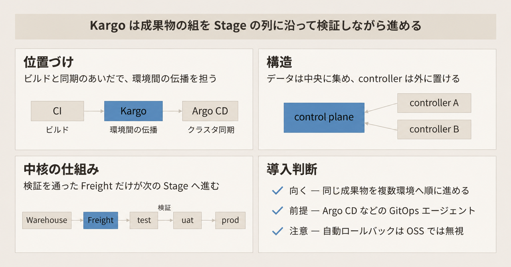
*この記事の全体像。以下、順に解説します。*

## Kargoとは

Kargo は、ある段階の desired state に入った変更を、次の段階の desired state へ伝える基盤です。desired state は、Git などに宣言した「あるべき状態」です。実体は GitHub の [akuity/kargo](https://github.com/akuity/kargo) と[公式ドキュメント](https://docs.kargo.io/)です。

典型的な動きは次のとおりです。新しいイメージが出ると、Kargo は test 用ブランチのマニフェストを書き換えて push し、Argo CD に同期させます。test での検証が通ると、同じイメージとコミットの組を uat 用ブランチへ書きます。

継続的プロモーションは、この伝播をパイプラインとして定義し、一部または全部を自動化した状態です。公式ドキュメントは Kargo を unopinionated な continuous promotion platform と説明しています。

周辺ツールとの分担は次のとおりです。

- クラスタの実状態を desired state へ合わせる仕事は、Argo CD などの GitOps エージェントが担います。
- CI はテストと成果物のビルドを担います。
- Kargo は、成果物リポジトリに現れた新しい版を起点に、Stage の列を進めます。

リソースの apiVersion は `kargo.akuity.io/v1alpha1` です。パイプラインの中心は次の 5 つです。

| リソース | 役割 |
| --- | --- |
| Project | テナンシーの単位。クラスタスコープで、同名の Namespace と 1 対 1 |
| Warehouse | Git、コンテナイメージ、Helm チャートを監視し、発見した改訂の組を 1 つの Freight にまとめる |
| Freight | 特定リビジョンの組を運ぶメタ成果物。パイプラインを通る単位 |
| Stage | プロモーション先。環境と重ねて考えられることがあるが、定義上は書き換え対象の desired state |
| Promotion | 1 つの Freight を 1 つの Stage へ載せる実行。Stage に書いた手順のひな形（`promotionTemplate`）のステップを順に走らせる |

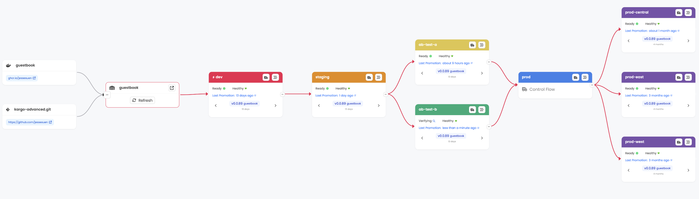
*Stage を連結したパイプライン（出典: Kargo ドキュメント）*

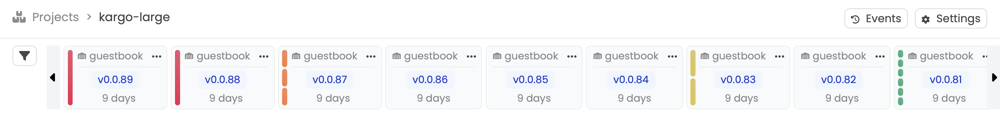
*Freight は改訂の組を運ぶ箱（出典: Kargo ドキュメント）*

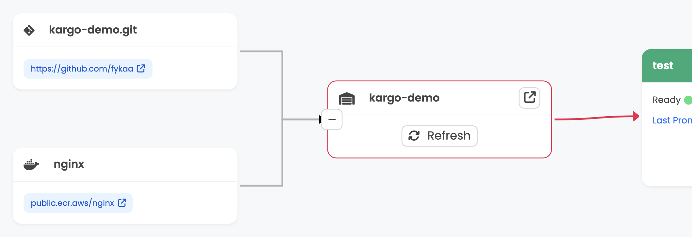
*Warehouse が Freight を供給する（出典: Kargo ドキュメント）*

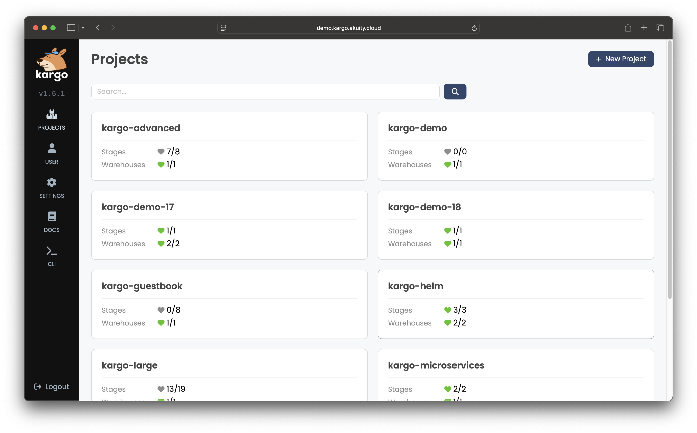
*Project がパイプラインを束ねる（出典: Kargo ドキュメント）*

流れは次のとおりです。

1. Warehouse が新しいリビジョンを見つけると、Freight ができます。
2. Stage は `requestedFreight` で、欲しい origin（Freight の作成元である Warehouse）と入手元を宣言します。
3. 最初の Stage は Warehouse から直接受け取り、下流の Stage は上流で検証済みの Freight を受け取ります。
4. Stage に検証を付けていれば、Promotion の成功後に検証が走ります。検証は任意で、付けていない Stage ではコントローラが成功の検証を記録します。
5. 検証を通過した Freight が、直下の Stage への候補になります。

データの置き場は Kargo の control plane です。単体構成では全コンポーネントがそこに乗ります。分散構成では、controller が各クラスタから control plane へ接続します。このとき controller が担当するデータの部分集合を shard と呼びます。shard ごとに、担当の controller を別のクラスタへ置けます。control plane は他クラスタへの特権を持ちません。

導入の基本は Helm です。チャートは `oci://ghcr.io/akuity/kargo-charts/kargo` です。Quickstart は、手元のクラスタで一巡するための別の入口です。

2026-11-16 時点の GitHub API の値は次のとおりです。

| 項目 | 値 |
| --- | --- |
| リポジトリ | akuity/kargo |
| ライセンス | Apache-2.0 |
| 作成日 | 2022-07-14 |
| デフォルトブランチ | main |
| 最新リリース | v1.12.5（2026-10-27） |
| stars | 3787 |
| forks | 474 |
| open issues（オープンな PR を含む） | 243 |
| コントリビューター数（contributors API のページ合計） | 214 |

Akuity の紹介ページは、最初の公開リリースを 2023 年とし、維持主体を Argo CD を作ったチームとしています。質問先は GitHub Discussions と `https://akuity.community` です。企業向けのホスティングは [Kargo Enterprise](https://akuity.io/kargo-enterprise) です。

Kargo、GitOps エージェント、CI、カナリアの境界は次のとおりです。

| 対象 | 実行方式 | 責務 | Git への書き込み |
| --- | --- | --- | --- |
| Kargo | controller が CR を監視し、Promotion の手順を実行する | 段階間の desired state の伝播、関門、現在位置の可視化 | `git-commit` や `git-push` を手順に含めると commit と push を行う |
| Argo CD | Git 上の desired state を pull して reconcile する | 宣言された状態へクラスタの実状態を合わせる | 同期の入力として Git を読む |
| Flux ImageUpdateAutomation | ポリシーが選んだ新しいイメージで、印付き YAML を更新する | 単一リポジトリへのイメージ書き戻し | checkout したリポジトリへ commit を push する |
| 自前 CI | ジョブが同期的にスクリプトを実行する | テストとビルド。環境間コピーが同じジョブ群に集まりやすい | 環境ブランチへの commit と PR が典型 |
| Argo Rollouts のカナリア | ReplicaSet を段階的に操作する | 本番トラフィックの一部から安定版へ進める | ライブの配分を変える。Git への desired state 更新は外側 |

Kargo が向く仕事は次の 4 つです。

- 同じ成果物の組を、dev から本番まで規則どおり進める
- 環境ごとに CI ジョブへ書いていた環境間コピーの処理を、Stage の定義に置き換える
- モノレポで、アプリごとに監視するパスを分けて別々に進める
- Argo CD が複数あるとき、Argo CD ごとに controller を置いて担当を分ける

クラスタを Git に合わせ続ける仕事そのものは Argo CD か Flux の担当です。本番トラフィックの割合を広げる仕事は Argo Rollouts の担当です。

## 特徴

- パイプラインの定義が Kubernetes の CRD です。中心は Project、Warehouse、Freight、Stage、Promotion です。
- Freight は不変の参照の組です。イメージ、Git コミット、Helm チャートが一緒に移動します。
- Stage は環境という見方を取れます。定義上は、プロモーションが書き換える desired state の対象です。
- 公式は Stage ごとのブランチを推奨します。単一ブランチのディレクトリ構成も使えます。
- 自動プロモーションのオンオフは ProjectConfig（Project と同名の設定リソース）の `promotionPolicies` にあります。Stage の spec にはスイッチがありません。
- 検証は Argo Rollouts の AnalysisTemplate と AnalysisRun を Stage の関門に使います。アプリの配信が Rollout である必要はありません。
- soak time（上流 Stage に留まって様子を見る時間）は `sources.requiredSoakTime` で指定します。手動承認した Freight は、soak の経過を待たずにその Stage で使えます。
- Argo CD Application が Healthy になるまで、検証の開始を遅らせます。
- Project は Namespace と RBAC の単位です。UI と CLI を経由しない kubectl にも同じ規則がかかります。
- 利用者認証は OpenID Connect と PKCE です。GitHub ログインは Dex がアダプタになります。
- データは中央の control plane に集まります。controller は shard として外のクラスタから接続できます。
- 操作面は UI、`kargo` CLI、`kubectl` の 3 つです。
- 導入の基本は Helm です。既定構成は非公開のローカルクラスタ向けです。
- ライセンスは Apache-2.0 です。
- Promotion の成功の綴りは `Succeeded` です。検証の成功の綴りは `Successful` です。
- イメージ購読の制約フィールドは `image.constraint` です。Git と Helm チャートの制約フィールドは `semverConstraint` です。

## 構造

Kargo v1.12.5 は、継続的プロモーションを Kubernetes のカスタムリソースとして扱う control plane です。データの実体は、control plane のクラスタに置いた Project、Warehouse、Stage、Freight、Promotion です。

### システムコンテキスト図

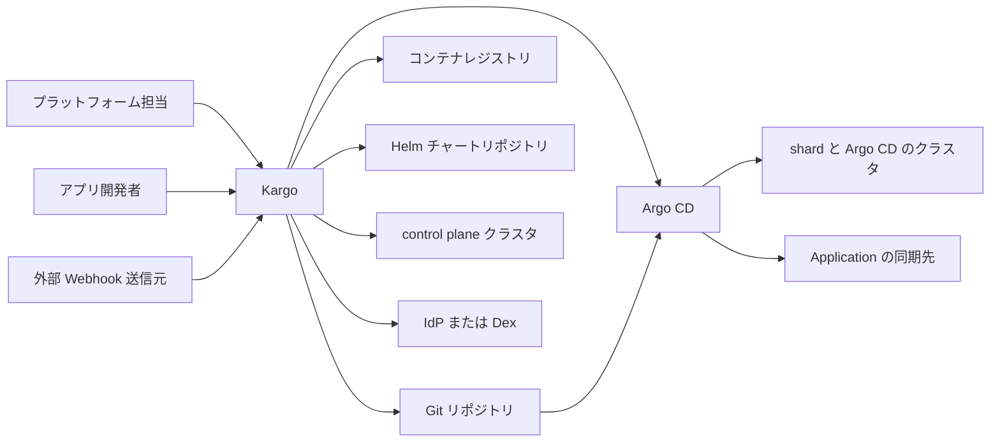

| 要素名 | 説明 |
| --- | --- |
| プラットフォーム担当 | インストール、shard 用の ServiceAccount、ClusterConfig、OIDC、システム横断のロールを扱う |
| アプリ開発者 | Project の中で Warehouse、Stage、Promotion を組み立てる |
| Kargo | プロモーションを制御する本体。データは control plane のクラスタに集約する |
| Git リポジトリ | Warehouse の監視対象であり、Promotion が desired state を書き戻す先でもある |
| コンテナレジストリ | Warehouse がイメージの新しいリビジョンを発見する場所 |
| Helm チャートリポジトリ | Warehouse がチャートの新しいバージョンを発見する場所 |
| Argo CD | Application の desired state をクラスタへ同期する。Kargo は更新と同期待ちを依頼する |
| control plane クラスタ | Project、Warehouse、Freight、Stage、Promotion を置くクラスタ。API と management controller はここに残る |
| shard と Argo CD のクラスタ | 担当 controller と、その controller が高々 1 つだけ見る Argo CD の置き場。単体構成では control plane と同じクラスタ |
| Application の同期先 | Argo CD が Application を同期するクラスタ。Kargo の control plane とは別 |
| IdP または Dex | 利用者認証の相手。この図では外部 IdP と Dex を 1 つにまとめている |
| 外部 Webhook 送信元 | Git ホスティングやレジストリが、新しいアーティファクトの通知を Kargo へ送る |

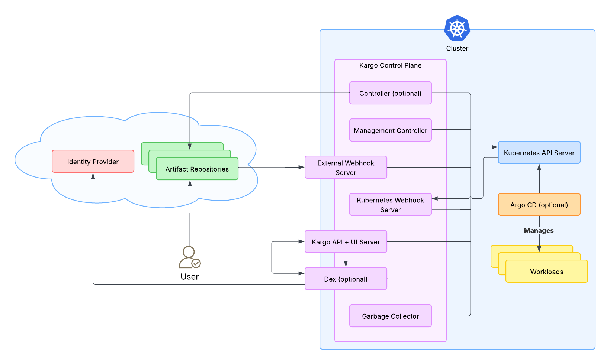
*単体構成のトポロジ（出典: Kargo ドキュメント）*

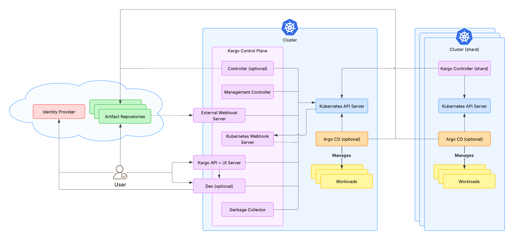
*shard 構成のトポロジ（出典: Kargo ドキュメント）*

### コンテナ図

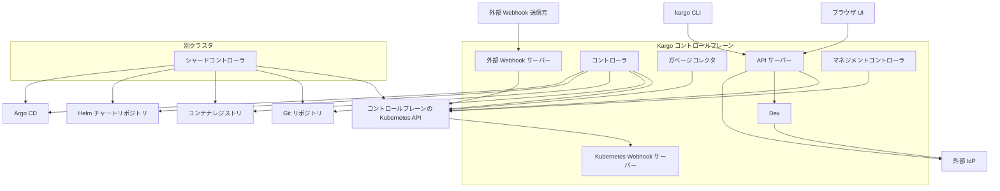

| 要素名 | 説明 |
| --- | --- |
| API サーバー | UI と CLI のバックエンド。SPA の静的ファイルもこのプロセスが配信する。インターネット向けの入口 |
| ブラウザ UI | API サーバーの基底アドレスをブラウザで開く画面 |
| kargo CLI | ドメイン向けの操作を API サーバーへ送る。同じデータは kubectl からも読める |
| コントローラ | control plane 内に置く調整プロセス。最小構成ではリポジトリ監視と Promotion 実行を担う |
| シャードコントローラ | 別クラスタに置く controller。接続は shard から control plane の Kubernetes API へ向かう。担当する Argo CD は高々 1 つ |
| ガベージコレクタ | 古い Freight と Promotion を削除する。チャートの既定では有効 |
| Kubernetes Webhook サーバー | validating webhook と mutating webhook。呼び出し元は同一クラスタの API サーバー。TLS が必須で、動作に必須のプロセス |
| 外部 Webhook サーバー | 送信元からの HTTP を受け、Warehouse の発見を起動する。チャートの既定では有効 |
| マネジメントコントローラ | Project の作成と削除に合わせて権限を伸縮する。control plane 内に固定し、shard へ置かない。動作に必須 |
| Dex | OIDC のアダプタ。チャート同梱の有効化 `api.oidc.dex.enabled` の既定は false |
| コントロールプレーンの Kubernetes API | Kargo の全データの置き場であり、shard の接続先 |
| 別クラスタ | シャードコントローラの置き場。対応する Argo CD と同じ側に置く想定 |
| Git リポジトリ | 監視の入力であり、`git-commit` と `git-push` の出力先 |
| コンテナレジストリ | イメージ購読の発見元 |
| Helm チャートリポジトリ | チャート購読の発見元 |
| Argo CD | `argocd-update` ステップが Application を更新する |
| 外部 IdP | OIDC と PKCE を話す IdP は、API サーバーが issuerURL と clientID で直接扱う。GitHub は Dex のコネクタ |
| 外部 Webhook 送信元 | Secret から作った URL へイベントを送る |

最小構成では controller を control plane に 1 つ置きます。分散構成ではデータを control plane に残し、controller を shard として別クラスタへ分けます。

controller の担当は Helm の値で決まります。

- `controller.shardName` を省略した controller は、未割当リソースの既定担当です。
- `shardName` だけを設定した controller は、その名前のリソースを担当します。
- `controller.isDefault` が true で `shardName` もある controller は、その shard と未割当の両方を処理します。

各 shard は control plane 上の ServiceAccount を持ち、トークン付き設定を自分のクラスタへ配ります。controller は Lease を更新して生存を知らせます。

v1.12.5 のチャートは、コンポーネントごとに api、controller、garbage-collector、external-webhooks-server、kubernetes-webhooks-server、management-controller、dex-server のテンプレートディレクトリを持ちます。v1.12.5 の controller コマンドは、Warehouse、Promotion、通常 Stage、制御フロー Stage（プロモーション手順を持たない Stage）などの調整器（reconciler）と、Lease の heartbeat を同じプロセスで動かします。

### コンポーネント図

コンポーネント図は、controller プロセスの中の 4 責務を示します。プロセスの境界は、コンテナ図のコントローラとシャードコントローラです。制御フロー Stage 用などの調整器は、この 4 つの外にあります。

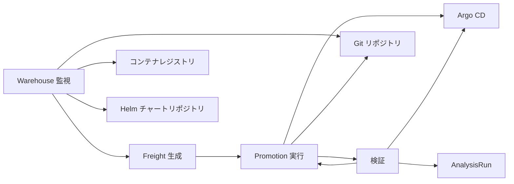

| 要素名 | 説明 |
| --- | --- |
| Warehouse 監視 | Warehouse 調整器が Git、レジストリ、チャートの購読を定期的に調べる。前回と同じ Git ref は `git ls-remote` で判定し、一致する巡回は clone の前に発見を終える。外部 Webhook と `kargo refresh` は発見を即座にキューへ入れる |
| Freight 生成 | 同じ Warehouse 調整器が、各購読の最新リビジョンを 1 つの Freight に梱包する。`freightCreationPolicy` を省略したときの扱いは Automatic |
| Promotion 実行 | Promotion 調整器が Stage の promotionTemplate を順に実行する。骨格は git-clone、レンダリング、git-commit、git-push、argocd-update |
| 検証 | 通常 Stage の調整器が、成功した Promotion のあと Stage を Verifying にする。AnalysisTemplate から AnalysisRun を作る。Successful になると、その Freight は下流の候補になる |
| Git リポジトリ | 監視の入力であり、書き戻す desired state の保管場所 |
| コンテナレジストリ | イメージ購読の発見元 |
| Helm チャートリポジトリ | チャート購読の発見元 |
| Argo CD | Application を更新する。検証の開始前に Healthy を待つ |
| AnalysisRun | 1 回の検証の進行と結果。apiVersion は `argoproj.io/v1alpha1` |

検証から Promotion 実行へ戻る矢印は、検証済みの Freight が次の Promotion の入力になることを示します。下流の Promotion は、その Stage の調整が別に作ります。`requiredSoakTime` は AnalysisRun とは別のゲートです。

`controller.rollouts.integrationEnabled` は既定 true です。起動時に Argo Rollouts の CRD が無いと、controller は統合を無効にした扱いで起動を続けます。その状態で Analysis による検証を定義した Stage は、検証の試行が失敗します。

## データ

対象は v1.12.5 の `apiVersion: kargo.akuity.io/v1alpha1` です。フィールド名は Go 型の json タグに合わせています。

### 概念モデル

| 要素名 | 説明 |
| --- | --- |
| Project | クラスタスコープのテナント。同名 Namespace と生死を共有する |
| ProjectConfig | 自動プロモーションの方針を持つ、Project と同名の設定 |
| Warehouse | 購読の発見元。改訂の組を 1 つの Freight にする |
| Freight | パイプラインを通る不変の参照の組 |
| Stage | 受け取る origin と、直接か上流 Stage かを宣言する |
| Promotion | テンプレートを展開して、1 つの Freight を 1 つの Stage へ載せる |
| PromotionTask | Project Namespace に置く再利用手順 |
| AnalysisTemplate | 検証手順の定義。実行のたびに AnalysisRun ができる |

Project はクラスタスコープです。同名の Namespace を 1 対 1 で調整し、Project を消すと Namespace も消え、逆も同様です。既存 Namespace を採用するときは、ラベル `kargo.akuity.io/project: "true"` を付けます。

ProjectConfig は、その Namespace に置かれ、名前が Project と一致する設定です。自動プロモーションの可否はここにあります。Stage の spec から切り離し、別の権限で委譲するためです。

Stage は `requestedFreight` で origin と sources を宣言します。

- 現行の `origin.kind` は Warehouse のみです。
- `sources.direct` が真のとき、その Warehouse が作った Freight を直ちに使えます。
- `sources.stages` に上流 Stage 名を並べたとき、Freight は上流で検証を通過したあと、必要なら soak の連続滞在のあとに下流へ出ます。
- `availabilityStrategy` の OneOf は上流のいずれか、All は列挙した上流のすべてでの検証を求めます。
- 手動承認（`approvedFor`）は、その Stage について上流の検証と soak を飛ばす経路です。Stage が要求していない origin を通すものではありません。

Promotion は Stage の promotionTemplate から作られ、1 つの Freight をその Stage に載せます。テンプレートの step は、`uses` で組み込みステップを指すか、`task` で PromotionTask または ClusterPromotionTask を展開します。展開後の Promotion の step は `uses` だけを持ちます。

検証は、`Stage.spec.verification.analysisTemplates` が指す AnalysisTemplate から AnalysisRun を起こす任意の過程です。テンプレートは Stage と同じ Project Namespace に置きます。`kind: ClusterAnalysisTemplate` のときはクラスタスコープです。

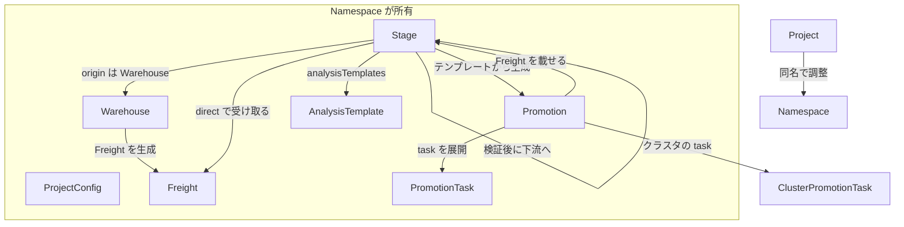

### 情報モデル

クラス図は 2 枚に分けます。1 枚目は Project から Warehouse と購読まで、2 枚目は Freight、Stage、Promotion です。属性の型名は list、map、string、bool、duration に揃えています。属性名は json パスを短くしたものです。

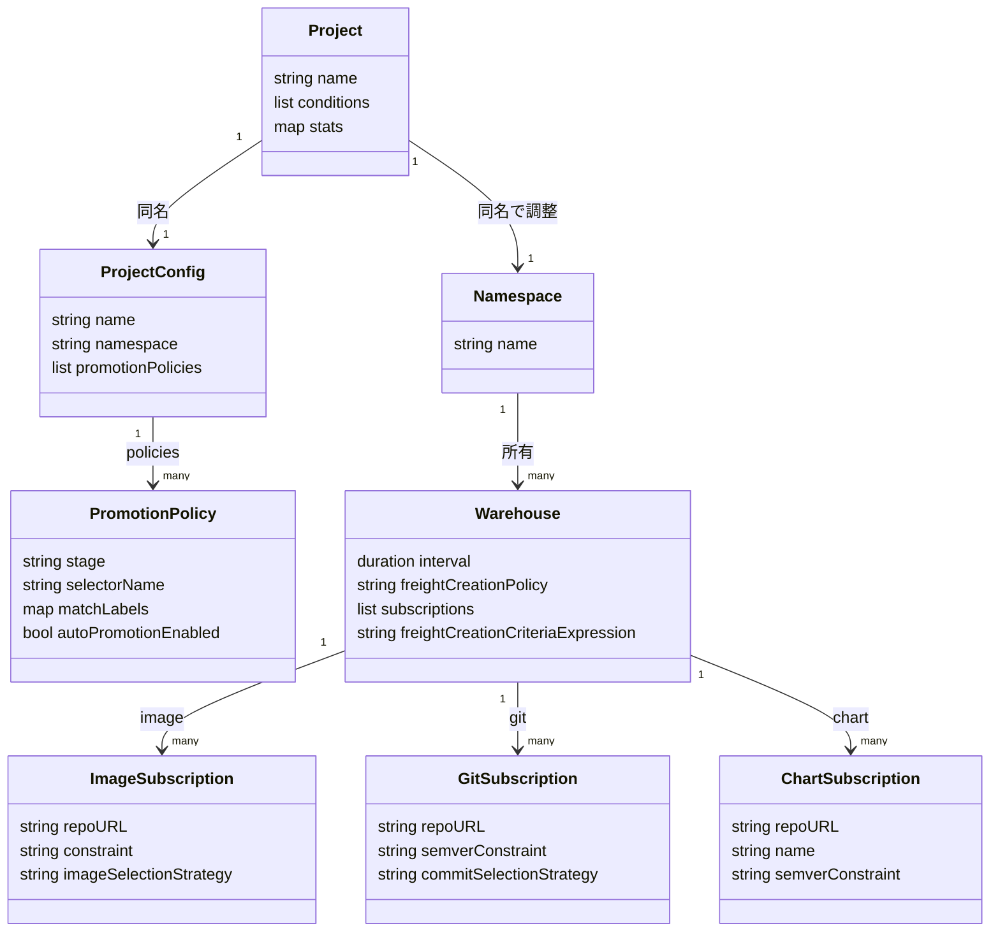

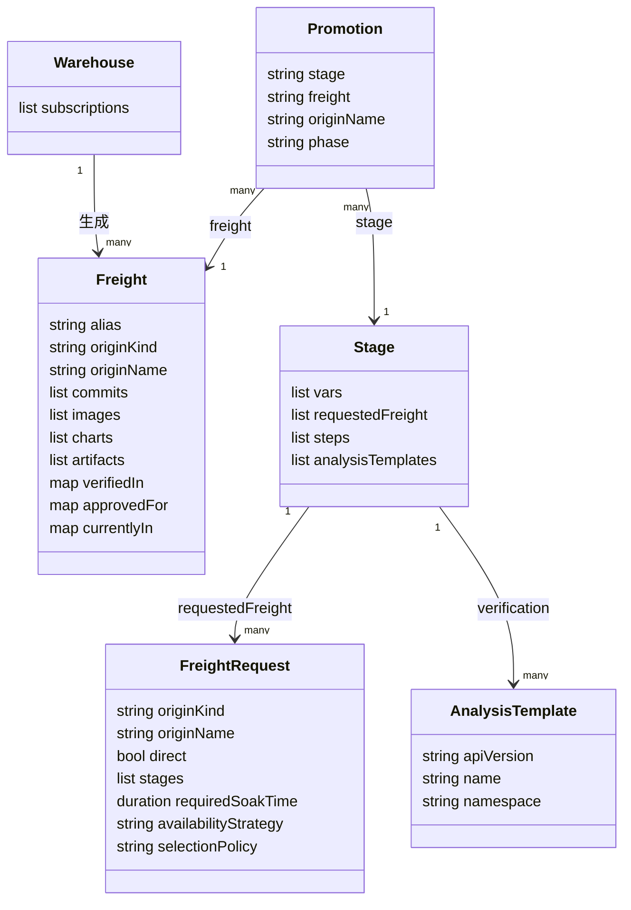

**Project と ProjectConfig**

- Project の型が持つのは `status.conditions` と `status.stats` です。
- `spec.promotionPolicies` の置き場所は ProjectConfig です。
- 各ポリシーは `stage` と `stageSelector` のちょうど一方を持ちます。`stage` は単一 Stage 名で、非推奨です。
- `stageSelector.name` は完全一致、`regex:` または `regexp:` 付きの正規表現、`glob:` 付きのグロブです。ラベルセレクタと name を併記したときは、両方に一致する Stage が対象です。
- `autoPromotionEnabled` を省略したときの扱いは偽です。

**Warehouse**

- `freightCreationPolicy` は Automatic または Manual です。省略時は Automatic です。
- `freightCreationCriteria.expression` は、自動作成の直前に評価される式です。真のときだけ Freight ができます。
- `interval` の省略時は `5m0s` です。
- `subscriptions` は 1 件以上です。各要素は任意の `name` と、種別キーをちょうど 1 つ持ちます。組み込みのキーは git、image、chart です。

| 購読 | 制約フィールド | 選択戦略 | 補足 |
| --- | --- | --- | --- |
| image | `constraint` | `imageSelectionStrategy`: SemVer（省略時）、Lexical、Digest、NewestBuild | `repoURL` はタグを含まない URL で必須。`discoveryLimit` の既定は 20、上限は 100 |
| git | `semverConstraint` | `commitSelectionStrategy`: NewestFromBranch（省略時）、SemVer、Lexical、NewestTag | ブランチを省略するとデフォルトブランチを見る。制約は SemVer 戦略のときに効く |
| chart | `semverConstraint` | なし | `repoURL` は必須。HTTP チャートは `name` が必須で、OCI チャートは name を空にする |

イメージ購読の SemVer 戦略では、constraint が空なら最大の semver タグを選びます。Digest 戦略では、constraint が `latest` のような可変タグです。イメージ購読の `allowTags` と `ignoreTags` は、v1.11 以降、空でないと発見が失敗します。代わりに使うフィールドは `allowTagsRegexes` と `ignoreTagsRegexes` です。

**Freight**

- `alias` は人間向けの別名で、ラベル `kargo.akuity.io/alias` と同期します。
- `origin.kind` は Warehouse、`origin.name` はその Warehouse 名です。
- `commits` は repoURL、id、任意の branch、tag、message などを持ちます。
- `images` は repoURL、tag、digest などを持ちます。
- `charts` は repoURL、任意の name、version を持ちます。
- `status.currentlyIn`、`verifiedIn`、`approvedFor` は Stage 名をキーにする map です。下流の条件が読むのは verifiedIn と、検証済み Stage での soak です。

**Stage**

- `requestedFreight` は空にできません。`direct` が偽のときは `stages` が必要です。
- `availabilityStrategy` の省略時の扱いは OneOf です。
- `autoPromotionOptions.selectionPolicy` は NewestFreight（省略時）または MatchUpstream です。MatchUpstream は上流 Stage がちょうど 1 つのときに使えます。
- 検証は Stage の `spec.vars` を読みます。プロモーションの outputs とテンプレートの vars は検証へ渡りません。

**Promotion**

- `spec.stage` は必須です。受付時は `spec.freight` と `spec.origin` のちょうど一方を渡します。
- origin を渡したときは、webhook が候補 Freight に解決し、永続化の前に `spec.freight` を埋めます。
- `status.phase` は Pending、Running、Succeeded、Failed、Errored、Aborted です。

プロモーションの手順は、式で実行時の値を読めます。主なパスは次のとおりです。

| パス | 型 | 内容 |
| --- | --- | --- |
| `ctx.project` | string | Project の名前 |
| `ctx.stage` | string | Stage の名前 |
| `ctx.promotion` | string | Promotion の名前 |
| `ctx.uiBaseUrl` | string | UI のベース URL |
| `ctx.targetFreight.name` | string | この Promotion の Freight 名 |
| `ctx.targetFreight.origin.name` | string | その Freight の Warehouse 名 |
| `ctx.targetFreight.alias` | string | 人間向け別名。作成後に変更できる |
| `ctx.meta.promotion.actor` | string | Promotion の作成者 |
| `ctx.meta.promotion.rollback` | bool | この Promotion がロールバックか |
| `ctx.meta.step.alias` | string | 現在の step の別名 |

同じ木には `vars`、`outputs`、`task.outputs` があります。Freight の中身は関数で取ります。

| 対象 | 式 |
| --- | --- |
| Git コミット | `commitFrom(repoURL).ID` |
| イメージ | `imageFrom(repoURL).Tag`、`imageFrom(repoURL).Digest` |
| OCI チャート | `chartFrom(repoURL).Version` |
| HTTP チャート | `chartFrom(repoURL, "chart-name").Version` |
| origin を指定 | `commitFrom(repoURL, warehouse("名前")).ID` |

式の書き方には次の決まりがあります。

- 関数の戻り値フィールドはパスカルケースです。
- Kargo 側の式は `${{ }}` で囲みます。YAML のキーには書けません。
- 数値や真偽を文字列のまま残すには `quote()` を使います。
- AnalysisTemplate 側の式の区切りは `{{ }}` で、先頭に `$` はありません。
- 検証の式が読める ctx は `ctx.project` と `ctx.stage` だけです。
- alias は作成後に変更できるので、コミットメッセージや成果物パスのように安定が要る箇所では避けます。
- template の vars は、同名の Stage vars より優先します。

## 構築方法

対象は 1.12 系です。2026-11-16 時点で `https://akuity.github.io/kargo/1.12/version.txt` の中身は `v1.12.5` です。この記事の手順はパッチを `1.12.5` に固定しています。

### 前提

- 公式の基本導入は、Helm で controller と API サーバーを入れます。手順の検証に使われた Helm は v3.13.1 です。それ未満だと OCI チャート取得で 401 になることがあります。
- 既定構成では cert-manager が必要です。公式の検証時の組み合わせは Kubernetes v1.29.3、cert-manager v1.16.1、Argo CD v2.13.0、Argo Rollouts v1.7.2 です。
- Argo CD と Argo Rollouts は任意です。
- 管理者パスワードのハッシュは `kargo hash-password` で作るため、Helm より先に CLI を入れます。初回は、後述の Homebrew かリリース資産から入れます。
- パスワードとトークン署名鍵に既定値はありません。
- 既定構成は、インターネットに公開しないローカルクラスタ向けです。
- Quickstart は `release-1.12` の `hack/quickstart` を使う短縮経路です。

### Helm によるコントロールプレーン導入

CLI 導入後、パスワードと署名鍵を作り、パスワードだけをハッシュします。平文は `Password:` の行に出るので、ログイン用に控えます。

```shell
pass=$(openssl rand -base64 48 | tr -d "=+/" | head -c 32)
echo "Password: $pass"
hashed_pass=$(kargo hash-password --password "$pass")
signing_key=$(openssl rand -base64 48 | tr -d "=+/" | head -c 32)
```

ハッシュと署名鍵を Helm に渡して、namespace `kargo` へ入れます。

```shell
helm install kargo \
  oci://ghcr.io/akuity/kargo-charts/kargo \
  --version 1.12.5 \
  --namespace kargo \
  --create-namespace \
  --set api.adminAccount.passwordHash=$hashed_pass \
  --set api.adminAccount.tokenSigningKey=$signing_key \
  --wait
```

403 で失敗するときは、期限切れトークンで `ghcr.io` に認証しようとしていることが多いです。チャートとイメージは公開されているので、ログアウトしてから再実行します。

```shell
docker logout ghcr.io
```

チャートの API Service は既定で ClusterIP、API ホストは localhost、API の TLS は cert-manager の自己署名です。Ingress は既定では作りません。

### CLI の導入

UI の CLI タブが、実行中の API サーバーと同じ版のバイナリを配ります。ファイル名は `kargo-darwin-arm64` のように OS と CPU が付くので、`kargo` に改名して PATH へ置きます。

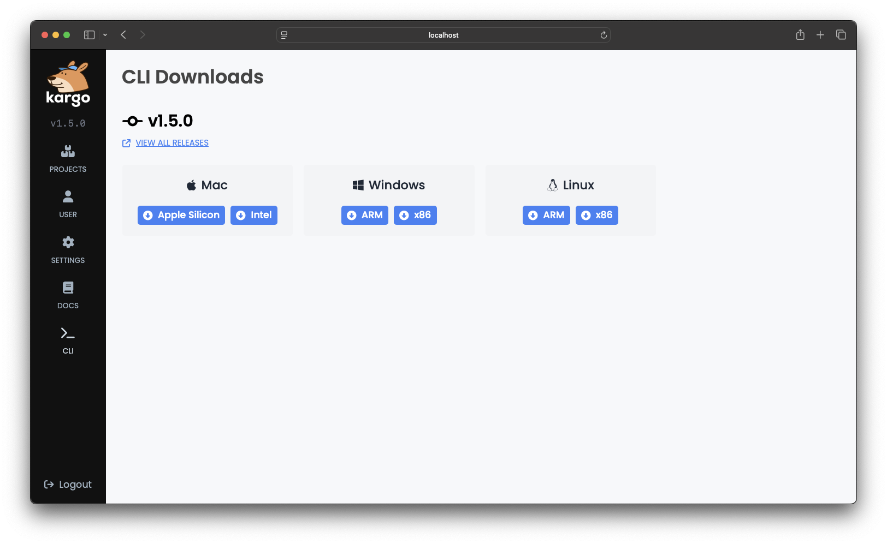
*UI の CLI タブ（出典: Kargo ドキュメント）*

macOS では Homebrew でも入ります。

```shell
brew install kargo
```

Linux または WSL では、1.12 系の version.txt が指すリリース資産を取得します。

```shell
arch=$(uname -m)
[ "$arch" = "x86_64" ] && arch=amd64
[ "$arch" = "aarch64" ] && arch=arm64
version=$(curl -sL https://akuity.github.io/kargo/1.12/version.txt)
curl -L -o kargo https://github.com/akuity/kargo/releases/download/${version}/kargo-"$(uname -s | tr '[:upper:]' '[:lower:]')-${arch}"
chmod +x kargo
```

取得したファイルを PATH 上のディレクトリへ移します。GitHub の資産名は `kargo-linux-arm64` や `kargo-darwin-arm64` です。`uname -m` が返す `aarch64` を `arm64` に、`x86_64` を `amd64` に変換せずに URL を組むと 404 になります。

v1.12.0 で Connect ベースの gRPC API が削除されています。サーバーを 1.12 系にするときは、CLI も 1.12.0 以上に揃えます。

### 導入後の確認

`helm install --wait` が戻れば、チャートが Ready と判断しています。

```shell
helm status kargo --namespace kargo
kubectl get pods --namespace kargo
```

API Service の名前は `kargo-api` です。TLS 有効時の Service ポートは 443 です。

```shell
kubectl port-forward --namespace kargo svc/kargo-api 8443:443
```

ブラウザと CLI の入口は、この API サーバーのベースアドレスです。上のフォワードなら `https://localhost:8443` です。証明書は自己署名なので、ブラウザは警告を出します。警告を承認すると接続できます。

Quickstart スクリプトの入口は別です。UI は `http://localhost:31081`、初期パスワードは `admin` です。Helm の基本導入では、控えた平文パスワードを使います。

## 利用方法

Project の名前は、Kargo が作る Namespace の名前と一致します。その Namespace に Warehouse、Stage、Secret、ProjectConfig を置きます。

| リソース | 必須の指定 | 役割 |
| --- | --- | --- |
| Project | `metadata.name` | 同名の Namespace を作る |
| Warehouse | `spec.subscriptions` | 購読一覧。発見結果から Freight を作る |
| Stage | `spec.requestedFreight` | どの origin を、どこから受け取るか |
| Promotion | `spec.stage` と、`freight` または `origin` の一方 | 対象 Stage へ Freight を載せる実行 |

### 認証と API アドレス

ログインに使うアドレスは API サーバーのアドレスです。既定構成では admin アカウントが有効で、CLI はパスワードをプロンプトで聞きます。

```shell
kargo login https://kargo.example.com --admin
```

SSO の場合はブラウザが開きます。

```shell
kargo login https://kargo.example.com --sso
```

Quickstart のローカルクラスタはパスワードを渡せます。

```shell
kargo login http://localhost:31081 --admin --password admin
```

以降の `kargo get` や `kargo promote` は、ログイン済みの API アドレスに対して動きます。Project は `--project` で指定するか、`kargo config set-project` で既定にします。

### Project の作成

Project を作ると、同名の Namespace と、プロジェクト用の RBAC、ServiceAccount が同時に入ります。

```yaml
apiVersion: kargo.akuity.io/v1alpha1
kind: Project
metadata:
  name: kargo-demo
```

CLI では名前だけでも作れます。

```shell
kargo create project kargo-demo
kargo get project kargo-demo
```

マニフェストから作る場合は `kargo apply -f` または `kubectl apply -f` です。自動プロモーションのオンオフは ProjectConfig に書きます。名前と Namespace は Project 名にします。

```yaml
apiVersion: kargo.akuity.io/v1alpha1
kind: ProjectConfig
metadata:
  name: kargo-demo
  namespace: kargo-demo
spec:
  promotionPolicies:
  - stageSelector:
      name: test
    autoPromotionEnabled: true
  - stageSelector:
      name: uat
    autoPromotionEnabled: true
```

プライベート Git へ push するときは、Project Namespace に Git 資格情報の Secret を置きます。

```yaml
apiVersion: v1
kind: Secret
type: Opaque
metadata:
  name: kargo-demo-repo
  namespace: kargo-demo
  labels:
    kargo.akuity.io/cred-type: git
stringData:
  repoURL: https://github.com/example/kargo-demo.git
  username: octocat
  password: <personal-access-token>
```

### Warehouse の購読

Warehouse は subscriptions でイメージ、Git、Helm チャートを購読し、新しいリビジョンを 1 つの Freight にまとめます。

```yaml
apiVersion: kargo.akuity.io/v1alpha1
kind: Warehouse
metadata:
  name: kargo-demo
  namespace: kargo-demo
spec:
  subscriptions:
  - image:
      repoURL: public.ecr.aws/nginx/nginx
      constraint: ^1.26.0
      discoveryLimit: 5
  - git:
      repoURL: https://github.com/example/kargo-demo.git
      branch: main
```

Git をタグの SemVer で選ぶときは、戦略と `semverConstraint` を指定します。

```yaml
apiVersion: kargo.akuity.io/v1alpha1
kind: Warehouse
metadata:
  name: my-warehouse
  namespace: kargo-demo
spec:
  subscriptions:
  - git:
      repoURL: https://github.com/example/repo.git
      commitSelectionStrategy: SemVer
      semverConstraint: ^1.0.0
```

HTTP の Helm チャートは `chart.name` が必須です。

```yaml
apiVersion: kargo.akuity.io/v1alpha1
kind: Warehouse
metadata:
  name: charts
  namespace: kargo-demo
spec:
  subscriptions:
  - chart:
      repoURL: https://charts.example.com
      name: my-chart
      semverConstraint: ^1.0.0
```

### Stage とプロモーション手順

`sources.direct: true` の Stage は、Warehouse が作った Freight を直接受け取ります。下流の Stage は `sources.stages` に上流 Stage 名を並べます。

```yaml
apiVersion: kargo.akuity.io/v1alpha1
kind: Stage
metadata:
  name: test
  namespace: kargo-demo
spec:
  requestedFreight:
  - origin:
      kind: Warehouse
      name: kargo-demo
    sources:
      direct: true
---
apiVersion: kargo.akuity.io/v1alpha1
kind: Stage
metadata:
  name: uat
  namespace: kargo-demo
spec:
  requestedFreight:
  - origin:
      kind: Warehouse
      name: kargo-demo
    sources:
      stages:
      - test
```

上の例は、Freight の受け取り元だけを示しています。プロモーション手順（`promotionTemplate`）を書いていない Stage は、制御フロー Stage として扱われ、ブランチの更新などは行いません。各 Stage で実際に desired state を書き換えるには、次のように `promotionTemplate` を書きます。

よくある手順は次の流れです。

1. Git を作業ツリーに clone する
2. Kustomize でイメージを更新し、レンダリングする
3. Stage 用のブランチへ commit して push する
4. Argo CD の Application をそのコミットへ同期する

各ステップの決まりは次のとおりです。

| ステップ | 決まり |
| --- | --- |
| `git-commit` | 書くのは path と message。差分がなければ新しいコミットは作らず、出力 commit は作業ツリーの HEAD の SHA。作者と署名は git-clone の author か ClusterConfig の gitClient に置く |
| `git-push` | ブランチ指定は `targetBranch`。省略時はチェックアウト中のブランチ。出力 `commit` は実際に push したコミットの SHA |
| `kustomize-set-image` | `images` の各要素に、`tag` か `digest` のどちらか一方を指定する |
| `argocd-update` | `desiredRevision` は健全性確認の値。push 時に rebase や merge が起きても一致するよう、git-push の出力 `commit` を渡す。Application の `targetRevision` を書き換えるのは `updateTargetRevision: true` のときだけ |

```yaml
apiVersion: kargo.akuity.io/v1alpha1
kind: Stage
metadata:
  name: test
  namespace: kargo-demo
spec:
  requestedFreight:
  - origin:
      kind: Warehouse
      name: kargo-demo
    sources:
      direct: true
  promotionTemplate:
    spec:
      vars:
      - name: gitRepo
        value: https://github.com/example/kargo-demo.git
      steps:
      - uses: git-clone
        config:
          repoURL: ${{ vars.gitRepo }}
          author:
            name: Kargo
            email: no-reply@example.com
          checkout:
          - commit: ${{ commitFrom(vars.gitRepo).ID }}
            path: ./src
          - branch: stage/${{ ctx.stage }}
            create: true
            path: ./out
      - uses: git-clear
        config:
          path: ./out
      - uses: kustomize-set-image
        as: update-image
        config:
          path: ./src/base
          images:
          - image: public.ecr.aws/nginx/nginx
            tag: ${{ imageFrom("public.ecr.aws/nginx/nginx").Tag }}
      - uses: kustomize-build
        config:
          path: ./src/stages/${{ ctx.stage }}
          outPath: ./out
      - uses: git-commit
        config:
          path: ./out
          message: ${{ outputs['update-image'].commitMessage }}
      - uses: git-push
        as: push
        config:
          path: ./out
          targetBranch: stage/${{ ctx.stage }}
      - uses: argocd-update
        config:
          apps:
          - name: kargo-demo-${{ ctx.stage }}
            sources:
            - repoURL: ${{ vars.gitRepo }}
              desiredRevision: ${{ outputs.push.commit }}
```

uat の Stage にも、同じ `promotionTemplate` を書きます。ブランチ名とパスは `ctx.stage` から組み立てているので、手順はそのまま流用できます。

Kargo が更新する Application には、アノテーション `kargo.akuity.io/authorized-stage: "<project>:<stage>"` が必要です。v1.11 以降、このアノテーションはカンマ区切りの複数指定を受けます。

```yaml
apiVersion: argoproj.io/v1alpha1
kind: Application
metadata:
  name: kargo-demo-test
  namespace: argocd
  annotations:
    kargo.akuity.io/authorized-stage: kargo-demo:test
spec:
  project: default
  source:
    repoURL: https://github.com/example/kargo-demo.git
    targetRevision: stage/test
    path: .
  destination:
    server: https://kubernetes.default.svc
    namespace: kargo-demo-test
```

レンダリング結果を Git ではなく OCI レジストリへ push し、Argo CD に読ませる構成もあります。この構成で OCI を desiredRevision にするときは、oci-push の tag ではなく digest を渡します。タグと比較すると一致せず、ステップが待ち続けます。式の関数の戻り値はパスカルケースですが、ステップ出力のキーは小文字の `digest` です。

```yaml
steps:
- uses: tar
  config:
    inPath: ./manifests
    outPath: ./manifests.tar.gz
    gzip: true
- uses: oci-push
  as: push
  config:
    srcPath: ./manifests.tar.gz
    destRef: ghcr.io/example/config/app:${{ ctx.promotion }}
- uses: argocd-update
  config:
    apps:
    - name: app
      sources:
      - repoURL: oci://ghcr.io/example/config/app
        desiredRevision: ${{ outputs.push.digest }}
        updateTargetRevision: true
```

Promotion は、UI のトラックアイコンか次の CLI で作ります。手順は Stage のテンプレートから写ります。

```shell
kargo promote --project kargo-demo --freight <freight-name> --stage test
```

同じ origin の現在の自動プロモーション候補を選ばせるときは、Warehouse 名を渡します。

```shell
kargo promote --project kargo-demo --warehouse kargo-demo --stage test
```

PR を使う手順には次の決まりがあります。

- `git-open-pr` は、source と target に差分が無いとき自分だけを Skipped にします。後続の `git-wait-for-pr` は自動では止まらないので、`if: ${{ status('open-pr') != 'Skipped' }}` を付けます。
- `git-merge-pr` の `mergeMethod` はプロバイダごとに違います。GitHub の値は merge、rebase、squash で、既定は merge です。
- `deleteSourceBranch` の削除失敗はステップを失敗させず、メッセージに残します。

### 式で参照するコンテキスト

- プロモーション手順の値と、Stage の `spec.verification.args` は式を使えます。
- 式を含む YAML は、評価前の時点で YAML として整っている必要があります。
- `outputs` は、それより前のステップを `as` の別名で引いたマップです。
- `vars` は Stage の `spec.vars` と promotion template の vars を重ねたものです。同名なら template 側が優先します。
- `task.outputs` は、同じ PromotionTask の中だけで使います。

クラスタ全体の Git 作者は ClusterConfig で設定します。署名鍵の Secret はシステムリソース用の Namespace（チャート既定は `kargo-system-resources`）に置き、キー名は `signingKey` です。鍵はパスフレーズ無しの ASCII-armored GPG です。

```yaml
apiVersion: kargo.akuity.io/v1alpha1
kind: ClusterConfig
metadata:
  name: cluster
spec:
  gitClient:
    name: Kargo
    email: no-reply@kargo.io
    signingKeySecret:
      name: my-gpg-key
```

git-clone の author を書くと、その作業ツリーではシステム既定より優先されます。

### 検証の設定

検証は、Promotion が成功したあとに、Freight がその Stage で期待どおりかを確認する任意の処理です。上流に検証があるとき、下流へ進めるのは検証を通過した Freight です。

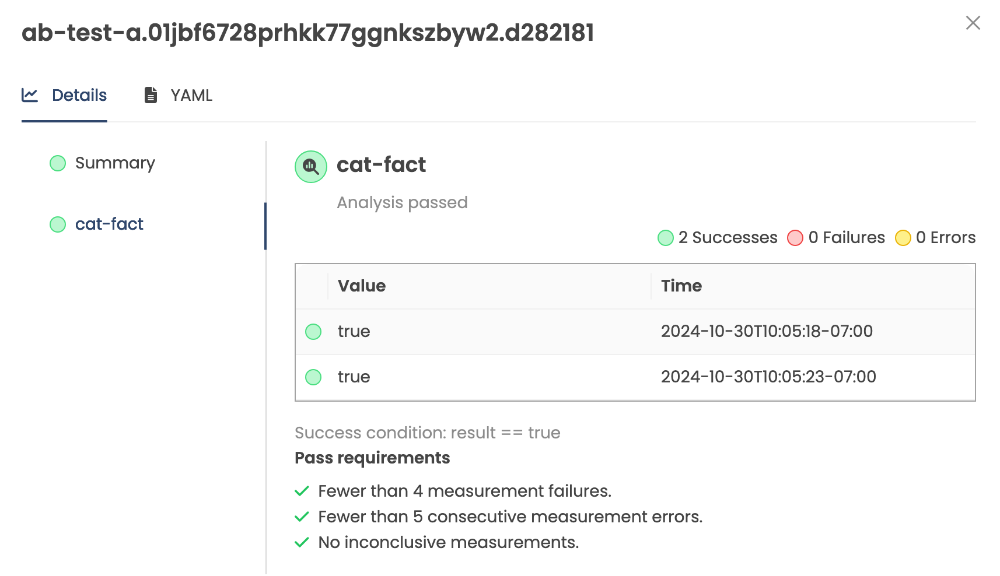
*検証タブの AnalysisRun（出典: Kargo ドキュメント）*

```yaml
apiVersion: kargo.akuity.io/v1alpha1
kind: Stage
metadata:
  name: dev
  namespace: kargo-demo
spec:
  requestedFreight:
  - origin:
      kind: Warehouse
      name: kargo-demo
    sources:
      direct: true
  verification:
    analysisTemplates:
    - name: integration-test
```

AnalysisTemplate は実行方法の定義で、実行のたびに AnalysisRun ができます。成功すると、Freight はその Stage で verified になります。検証中は、その Stage への次の Promotion は待ちます。

```yaml
apiVersion: argoproj.io/v1alpha1
kind: AnalysisTemplate
metadata:
  name: integration-test
  namespace: kargo-demo
spec:
  args:
  - name: commit
  metrics:
  - name: integration-test
    provider:
      job:
        spec:
          backoffLimit: 1
          template:
            spec:
              restartPolicy: Never
              containers:
              - name: sleep
                image: alpine:latest
                command: [sleep, "10"]
```

Stage から渡す引数の名前は、参照する各 AnalysisTemplate の `spec.args` にも宣言します。宣言が無いと AnalysisRun が失敗します。

```yaml
apiVersion: kargo.akuity.io/v1alpha1
kind: Stage
metadata:
  name: test
  namespace: kargo-demo
spec:
  requestedFreight:
  - origin:
      kind: Warehouse
      name: kargo-demo
    sources:
      direct: true
  verification:
    analysisTemplates:
    - name: integration-test
    args:
    - name: commit
      value: ${{ commitFrom("https://github.com/example/kargo-demo.git").ID }}
```

プロモーションが Argo CD の Application を触る Stage では、Application が Healthy になるまで検証の開始が遅れます。検証を明示していない Stage でも、同期対象の Application が Healthy になることが成功条件に含まれます。再実行は `kargo verify stage <stage> --project <project>`、停止は同じコマンドに `--abort` です。

### CLI と kubectl の使い分け

- データは Kubernetes の CRD です。クラスタに資格情報がある人は、kubectl で Project、Warehouse、Stage、Freight、Promotion、Secret を読めます。
- `kargo` CLI は API サーバー経由の操作向けです。ログイン、`kargo promote`、`kargo refresh`、`kargo verify`、`kargo hash-password` はこちらを使います。
- マニフェストの適用はどちらでもできます。Secret のように画面より先にクラスタへ置きたいリソースは kubectl が向きます。
- 一覧は `kargo get stages --project kargo-demo` または `kubectl get stages.kargo.akuity.io -n kargo-demo` です。
- Promotion の作成は UI か `kargo promote` に任せると、テンプレートが手順として写ります。

## 運用

正本は control plane 上の Kubernetes リソースです。Project、Warehouse、Stage、Freight、Promotion を見れば、パイプラインの状態はクラスタから読めます。

### 状態の確認

日常の確認は CLI か kubectl で足ります。

```shell
kargo get stages --project kargo-demo
kargo get stages --project kargo-demo test
kargo get promotions --project kargo-demo --stage test
kargo get freight --project kargo-demo --warehouse kargo-demo
kubectl get promotions -n kargo-demo -l kargo.akuity.io/stage=test
```

監視で使う要約は、Stage の Ready 条件の reason です。Verified は、Stage が healthy であり、かつ Freight の検証を通過した状態です。`spec.verification` が無い Stage も、コントローラが合成の成功検証を記録するため Verified に到達します。アラートは「Verified ではない」ではなく、理由を指定して組みます。

| Ready の reason | 意味 |
| --- | --- |
| Verified | healthy かつ検証済み |
| ActivePromotion | Promotion 実行中 |
| ListPromotionsFailed | 実行の有無を判定できない |
| LastPromotionFailed | 直近が Failed |
| LastPromotionErrored | 直近が Errored |
| LastPromotionAborted | 直近が Aborted |
| Unhealthy | 健全ではない |
| Progressing | まだ進行中 |
| NoFreight | 載せる Freight が無い |
| WaitingForHealthCheck | 健全性確認待ち |
| PendingVerification | 未検証（検証待ちの総称に近い） |
| VerificationPending | 検証がまだ始まっていない |
| VerificationRunning | 検証の実行中 |
| VerificationFailed | 検証が Failed で終わった |
| VerificationError | 検証が Error で終わった |
| VerificationAborted | 検証が中断された |
| VerificationInconclusive | 検証結果が判定不能 |
| ReconcileError | 調整に失敗し、再試行する |
| Unknown | まだ reconcile されていない |

制御フロー Stage は、health と検証を Ready に載せません。メトリクス `kargo_stages_by_ready_reason` からも外れます。

手動の再調整は `kargo refresh stage <stage> --project <project>` です。shard を使っているときは、Stage と Warehouse の `spec.shard` とラベル `kargo.akuity.io/shard` が同期します。ラベルは利用者が直接書き換える対象ではありません。

### ログとメトリクス

既定では各メトリクスサーバは無効です。有効化は controller、managementController、webhooksServer の `metrics.enabled` です。

```yaml
controller:
  metrics:
    enabled: true
    serviceMonitor:
      enabled: true
      additionalLabels:
        release: prometheus
      interval: 30s
managementController:
  metrics:
    enabled: true
webhooksServer:
  metrics:
    enabled: true
```

既定の待受は平文 HTTP のポート 9090、ポート名は `http-metrics` です。ServiceMonitor は、metrics.enabled と serviceMonitor.enabled が両方 true で、かつ Prometheus Operator の CRD があるときだけ作られます。CRD が無いときはインストールを失敗させず、スキップします。

| メトリクス | 型 | 内容 |
| --- | --- | --- |
| `kargo_promotions_completed_total` | Counter | 終端 phase。Succeeded、Errored、Failed、Aborted |
| `kargo_promotions_non_terminal` | Gauge | スクレイプ時点の Pending または Running |
| `kargo_promotion_duration_seconds` | Histogram | startedAt から finishedAt。Pending の待ちは含まない |
| `kargo_promotion_step_duration_seconds` | Histogram | ステップ単位。ラベルは stepKind と terminalStatus |
| `kargo_stages_by_ready_reason` | Gauge | Project ごとの Ready reason。制御フロー Stage は除く |

ステップの terminalStatus は次のとおりです。Skipped は記録されません。

| terminalStatus | 意味 |
| --- | --- |
| Succeeded | ステップが完了した |
| Failed | 非技術的な失敗。再試行しない |
| Errored | 技術的な失敗。エラー閾値まで再試行する |

メトリクスを読むときの決まりは次のとおりです。

- 待ちをまたぐステップは、最後の試行だけではなく生存期間全体を報告します。
- 開始せずに終端へ達した Promotion は duration に含まれませんが、completed カウンタには入ります。
- 系列が無い Project のゼロが要るクエリでは `or vector(0)` を使います。
- 各 controller は、自分が担当する Promotion だけを出します。

ログの既定レベルは API も controller も INFO です。拒否の 401 と 403 は INFO、サーバエラーは ERROR、それ以外は DEBUG です。全リクエストを INFO にするには `api.requestLog.allEnabled: true` です。送信元 IP は既定では残さず、`api.requestLog.sourceIPEnabled: true` で追加します。パスワードはログに出ません。OIDC のログイン失敗は IdP 側に残ります。

ガベージコレクタは CronJob です。`kubectl -n kargo get deploy,cronjob,pods` で実名を確認してからログを追います。

### ガベージコレクション

v1.12.5 チャートの既定は次のとおりです。

| 値 | 既定 | 意味 |
| --- | --- | --- |
| `garbageCollector.enabled` | true | 無効化は可能だが、リソースが溜まる |
| `garbageCollector.schedule` | `0 * * * *` | 毎時 0 分 |
| `garbageCollector.workers` | 3 | 並列ワーカー |
| `minPromotionDeletionAge` | 336h | この年齢未満は削除候補にしない |
| `maxRetainedPromotions` | 20 | Stage ごとの保持目安 |
| `minFreightDeletionAge` | 336h | Freight の最短保持 |
| `maxRetainedFreight` | 20 | Warehouse ごとの保持目安 |

```yaml
garbageCollector:
  schedule: "0 * * * *"
  minPromotionDeletionAge: 336h
  maxRetainedPromotions: 20
  minFreightDeletionAge: 336h
  maxRetainedFreight: 20
```

- Promotion の保持は Stage 単位です。年齢未達や使用中の Promotion があると、実保持数は上限を超えます。
- v1.12.5 のガベージコレクタは、終端の phase（Succeeded、Failed、Errored、Aborted）を区別せず、年齢と保持数を満たした Promotion を削除します。
- Freight の並びと年齢の基準は、v1.11 以降、作成時刻ではなく `discoveredAt` です。
- PromotionDiscarded イベントは、一度も Running にならなかった Promotion を control plane が消したときに出ます。

### 自動ロールバックのドキュメント形状

自動ロールバックは、v1.12.5 の型コメントが Enterprise 専用とし、OSS では無視すると書いている機能です。ドキュメントの説明と食い違うので、OSS で使う前に自分のクラスタで動作を確認します。

公式ガイドの Working with Projects は、自動ロールバックの有効化を、ProjectConfig の `promotionPolicies[].autoRollback` として示しています。空オブジェクトは、検証の Failed だけを既定で戻す設定です。検証の Error と、プロモーションの Failed と Errored は、フィールドを書いたときだけ対象になります。

```yaml
apiVersion: kargo.akuity.io/v1alpha1
kind: ProjectConfig
metadata:
  name: my-project
  namespace: my-project
spec:
  promotionPolicies:
  - stageSelector:
      name: prod
    autoRollback:
      onVerification:
      - Failed
      - Error
      onPromotion:
      - Failed
      - Errored
```

戻す Promotion には、アノテーション `kargo.akuity.io/rollback: "true"` が付きます。ステップは `ctx.meta.promotion.rollback` で通常の Promotion と分けられます。

上の YAML はドキュメントが示す形状です。OSS での扱いは「注意点」にまとめます。

### アップグレード

値の抽出は `helm inspect values`、適用は `--values` です。CLI はサーバと同じマイナーに揃えます。

v1.12.0 へ上げる前に、次を確認します。

- `controller.gitClient.pushIntegrationPolicy` の既定が AlwaysRebase から RebaseOrMerge に変わります。無条件 rebase を続けるなら、アップグレード前に AlwaysRebase を明示します。
- `git-open-pr` の `createTargetBranch` と、`git-commit` の author ブロックは削除済みです。
- `global.clusterSecretsNamespace` か `controller.globalCredentials.namespaces` が values に残っていると、チャートの検査が `helm upgrade` を失敗させます。Secret は `global.systemResources.namespace`（既定 `kargo-system-resources`）と `global.sharedResources.namespace` へ先に移します。v1.9 から v1.11 まであった自動コピーは、v1.12 で無くなっています。
- イメージの作成時刻の読み方が変わります。これまで `discoveryLimit` で切れていたイメージが、アップグレード後に見えることがあります。自動プロモーションが有効な Stage では、既存アーティファクトの Promotion が走ることがあります。
- Webhook が duration を書き換える挙動（`10m` が `10m0s` になる）は、v1.12 以降の新規書き込みでは起きません。既存値はそのままです。

v1.11 を飛ばして上げる場合は、次も確認します。

- イメージ購読の `allowTags` と `ignoreTags` は、発見がエラーになります。`allowTagsRegexes` と `ignoreTagsRegexes` へ移します。
- v1.11 より前は、Stage に Promotion が既にあると、自動プロモーションはその Stage を動かしませんでした。v1.11 以降はこの挙動が無いので、古い Freight に手動で止めていた Stage が進みます。先に自動プロモーションを止め、上げたあとに古い Freight を再プロモートします。再プロモートすると hold（その Stage の自動プロモーションを保留にする記録）が残ります。

v1.12.5 のパッチには、次の修正が含まれます。

- soak を上流 Stage にいる時間だけ数える修正
- 拒否前に API で Freight の可用性を確認する修正
- クローン用一時ディレクトリの漏れを止める修正
- Go 1.27.3 による高深刻度 CVE への対応

### シャードと分散コントローラ

単体構成では、controller を含む全コンポーネントが control plane に乗ります。分散構成では、データ、API、Webhook、management controller、ガベージコレクタは control plane に残り、controller は shard 先のクラスタで動きます。複数の Argo CD があるとき、Kargo controller はそれらと 1 対 1 に置く想定です。

分散の理由は、ファイアウォールの内側にあるリポジトリ、負荷の分割、Argo CD との対応です。

| 値 | 既定 | 動き |
| --- | --- | --- |
| `controller.shardName` | 未設定 | 未設定なら未割当リソースの既定担当になる |
| `controller.isDefault` | false | shardName が未設定なら、この値に関係なく既定担当になる。shardName があり true のとき、自分の shard と未割当の両方を処理する |

```yaml
controller:
  shardName: prod-east
  isDefault: false
```

リソース側は Stage と Warehouse の `spec.shard` です。空なら既定の shard です。Promotion も同じラベルで担当が決まります。大規模な資格情報の自動配布はチャートの範囲の外で、ドキュメントは Akuity Platform のホスト型を案内しています。

### 認証と権限

権限の実体は Kubernetes RBAC です。OIDC で入った利用者は、ServiceAccount のアノテーション `rbac.kargo.akuity.io/claims` で sub、email、groups に写像されます。実効権限は、写像された ServiceAccount の和です。

| ServiceAccount | Helm キー | 範囲 |
| --- | --- | --- |
| kargo-admin | `api.oidc.admins` | Kargo リソースへのクラスタ全体のフルアクセス。Secret は Project の作成と削除に追従して伸縮する |
| kargo-viewer | `api.oidc.viewers` | 読み取り。Secret は含まない |
| kargo-user | `api.oidc.users` | Project の一覧とシステム設定の参照。Secret は含まない |
| kargo-project-creator | `api.oidc.projectCreators` | user に加え Project 作成。UI と CLI で作った Project では、その Namespace の admin が動的に付く。kubectl で直接作った場合は付かない |

Secret へのアクセスは次のように絞られています。

- API サーバーは Secret へのクラスタスコープのアクセスを持たず、Project Namespace に限って動的に開きます。
- controller の Secret アクセスは読み取り専用で、同様に伸縮します。
- `controller.serviceAccount.clusterWideSecretReadingEnabled` の既定は false です。
- API からの Secret 操作を止めるには `api.secretManagementEnabled: false` です。

インターネット向けの入口は、API サーバーと外部 Webhook サーバーです。API の TLS は既定で自己署名です。本番では `api.tls.selfSignedCert: false` とし、Secret `kargo-api-cert` を用意します。Ingress の対応 Secret は `kargo-api-ingress-cert` です。Ingress で TLS を終端しても、API 側の TLS は残します。admin を残す場合は、ハッシュと署名鍵を Secret に入れ、`api.secret.name` で参照します。

### 資格情報の探索

リポジトリ資格情報は Project Namespace の Secret です。ラベル `kargo.akuity.io/cred-type` は git、helm、image、generic です。`repoURL` は必須で、正規表現にするときは `repoURLIsRegex: "true"` を付けます。

探索の順序は次のとおりです。

1. Project Namespace の完全一致
2. Project Namespace の正規表現（複数一致したら、Secret 名の辞書順で最初）
3. 共有 Namespace
4. 一致する Secret が無ければ、EKS Pod Identity、IRSA、GKE または AKS の Workload Identity

式から読む場合、Project の Secret は `secret()`、汎用の共有 Secret は `sharedSecret()` です。共有のリポジトリ資格情報は `secret()` では参照できません。

GitHub App を共有 Namespace に 1 つ置くと、インストールしたリポジトリへ全 Project から届きます。Project ごとに App を分けると、組織の App 登録上限 100 に近づきます。

## ベストプラクティス

### 環境を Stage の列にする

Kargo に公式のパイプラインリソースはありません。Warehouse と Stage の DAG がパイプラインです。

- 1 つの Warehouse がイメージと Git の両方を購読すると、両方を参照する 1 つの Freight ができます。以降の Stage はその組を単位に進めます。
- 別の周期で進めたい成果物は、Warehouse を分けます。
- 同じ Stage が複数の origin を要求すると、その Stage の中を独立した流れが並走します。
- 設定の置き場は、Stage 専用ブランチがメンテナの好む形です。ブランチ間のマージは利用者の仕事ではなく、各ブランチは保管場所です。
- main へ書き戻す場合は、入力パスと出力パスを分け、Warehouse の path filter（購読するパスを絞る設定）で出力を購読から外します。
- 同じリポジトリの出力を購読に含めると、プロモーションが新しい Freight を生み、フィードバックループになります。
- モノレポでは、アプリ単位の path filter を Warehouse に付けます。

### 検証してから下流へ出す

- 上流 Stage に検証があるとき、Freight はその Stage で検証を通過してから下流の候補になります。
- AnalysisRun が Successful になると、直下の Stage へ自動または手動で出せます。
- 検証中は、同じ Stage への次の Promotion は待ちます。
- Argo CD 連携では、Application が Healthy になるまで検証の開始を遅らせます。
- `verification.args` の名前は、各 AnalysisTemplate の `spec.args` にも宣言します。
- 式の括弧は、Kargo 側が `${{ }}`、AnalysisTemplate 側が `{{ }}` です。

### soak time を本番の前に置く

`requiredSoakTime` は、上流 Stage で検証済みであることに加えて求める、連続滞在時間です。自動プロモーションでも手動プロモーションでも、この時間を満たすまで下流へ出せません。例外は、下流の Stage に対して手動承認した Freight だけです。手動承認した Freight は、soak が残っていてもその Stage で使えます。

```yaml
apiVersion: kargo.akuity.io/v1alpha1
kind: Stage
metadata:
  name: prod
  namespace: kargo-demo
spec:
  requestedFreight:
  - origin:
      kind: Warehouse
      name: kargo-demo
    sources:
      stages:
      - uat
      requiredSoakTime: 1h
```

UI での手動承認は、Freight タイムラインの三点メニューから Manually Approve を選び、対象 Stage の Approve を押します。

- 承認は `status.approvedFor` に記録されます。
- 承認しても Promotion は作られません。使うときは、その Stage へ別途プロモートします。
- 承認に必要な権限は、その Stage へのプロモーションと同じです。

低い環境だけ `autoPromotionEnabled: true` にし、本番は手動、という混在が一般的です。セレクタは完全一致が最も安全です。`regex:`、`glob:`、ラベルセレクタは、名前やラベルが一致した Stage を意図せず対象にします。

### Git への書き込みと PR

`git-push` と `github-push` が、リモートが進んだブランチへ統合する方法は 4 つです。v1.12 の既定は RebaseOrMerge です。force push のときは統合自体を行いません。

| 方針 | 動き |
| --- | --- |
| AlwaysRebase | 常に rebase する。署名の付け替えが起きる |
| RebaseOrMerge | 署名の信頼分析で安全なときだけ rebase し、それ以外はマージコミットにする |
| RebaseOrFail | 安全なときだけ rebase し、それ以外はステップを失敗させる |
| AlwaysMerge | 常にマージコミットにする。既存コミットと署名を書き換えない |

- Helm のキーは `controller.gitClient.pushIntegrationPolicy` です。
- `github-push` はコミットを GitHub REST で再生し、GitHub App のトークンで Verified を付けられます。
- 1 回の push で再生するコミット数の既定上限は、`controller.githubPush.maxRevisions` の 10 です。
- レンダリング済みの平文 YAML を Git に書くと、PR の diff が適用内容そのものになります。
- コミット作者の既定は Kargo と no-reply@kargo.io です。ClusterConfig に書くと、再起動なしで優先されます。

### 資格情報を Project の Secret に閉じる

- 探索は Project Namespace が先で、共有 Namespace は一致が無いときだけです。
- GitHub App を全 Project で共有すると、インストール先のリポジトリへ届く範囲が広がります。
- UI のクリック操作は慣れる段階向けです。継続する形は、Sealed Secrets や External Secrets と GitOps です。
- `api.secretManagementEnabled: false` のとき、UI と CLI では Secret を書けません。

### 本番では admin アカウントを使わない

admin は唯一の組み込みアカウントです。既定で有効なのは、ローカルクラスタで OIDC を組まずに試すためです。

- ローカル以外では `api.adminAccount.enabled: false` にします。無効にすると OIDC が必須になります。
- Entra ID、Okta、Google Cloud Identity は API が直接扱います。GitHub ログインは Dex を有効にします。
- API を外へ出す場合は、独自 TLS の Secret `kargo-api-cert` を用意し、controller の Secret 範囲は既定のままにします。

## 注意点

公式ドキュメントの記載と v1.12.5 の OSS の実装には、ずれている箇所があります。古い記事の例を写すときにも同じ注意が要ります。

**OSS では効かない、または未確定の機能**

| 対象 | 資料の記載 | v1.12.5 の実態 | 影響 |
| --- | --- | --- | --- |
| 自動ロールバック | ガイドは `promotionPolicies[].autoRollback` を説明する | 型コメントは Enterprise 専用とし、OSS では無視すると書く | OSS で戻ることを前提にしない。動かすクラスタで確認する。公式例は `autoRollback: {}` で、bool の `true` は型が違い拒否される |
| プロモーション窓（プロモーションを許可または拒否する時間帯の設定） | 同じポリシーに `promotionWindows` があり、営業時間の例がある | 型コメントは Enterprise 専用とし、OSS では無視すると書く | OSS で窓を書いても、時刻による凍結は効かないことがある |
| 管理版の機能 | Fleet Management などが紹介ページにある | ホスト型と Enterprise 専用の機能 | OSS チャートの手順と混ぜない |

ドキュメントが示す自動ロールバックの動作は次のとおりです。

- 検証成功のたびに Freight を安定版として記録し、後続の失敗で、ロールバックの Promotion を作ります。
- 次のどれかに当てはまるときは、新しいロールバックを作りません。
  - 失敗が完了から 20 分より古い
  - Pending か Running の Promotion がある
  - 安定版の Freight が一度も記録されていない
  - 失敗したのがロールバック自身である
- 戻したあと、その Stage の自動プロモーションは hold で止まります。再開は、現行候補の promote です。

**古い例を写すと動かない箇所**

| 対象 | 古い記載 | 現行（v1.12.5） |
| --- | --- | --- |
| ポリシーの置き場所 | `kind: Project` の `spec.promotionPolicies` | Project に spec は無い。ポリシーは ProjectConfig |
| イメージの制約名 | `image.semverConstraint` | `image.constraint`。イメージの semverConstraint は v1.7 で非推奨、v1.9 で削除 |
| allowTags と ignoreTags | Warehouse 例が使う | イメージ購読では発見が失敗する。正規表現フィールドへ移す |
| push の既定 | AlwaysRebase | RebaseOrMerge。上げたあとマージコミットが増える |
| gRPC API | 古い API ドキュメントに残る | v1.12.0 で削除。UI と CLI は REST |
| 共有資格情報のキー | `controller.globalCredentials.namespaces` | v1.12 で削除。残すと helm upgrade が失敗する |
| git-commit の author | author ブロックを書く | v1.12 で削除。git-clone の author か ClusterConfig へ移す |

**公式ドキュメント内の表記ゆれ**

| 対象 | ゆれ | 採るべき値 |
| --- | --- | --- |
| git-push のブランチ | Working with Stages の例に `branch` と書く箇所がある | リファレンスのフィールドは `targetBranch` |
| システム Secret の Namespace | 例に `kargo-cluster-secrets` が残る | 本文と Helm 既定は `kargo-system-resources` |
| 式の大小文字 | 一部の例が小文字のフィールドに見える | 関数の戻り値は Tag、Digest、ID。ステップ出力 `outputs.push.digest` は小文字 |
| git-clone の author 型 | `[]object` と書く箇所と、単一オブジェクトの説明がある | 配列で拒否されたら単一オブジェクトにする |
| 外部 Webhook サーバー | アーキテクチャ本文は「必要なとき」のコンポーネントとする | チャート既定は有効 |
| GC の対象 | 削除対象の終端を Succeeded と Failed と書く | 実装は Errored と Aborted も同じ条件で消す |
| CLI 導入の URL | 索引の `llms.txt` は `/user-guide/installing-the-cli` を指す | 手順は `/user-guide/cli/installation` |
| v1.12.5 のリリースノート | ドキュメントサイトの `release-notes/v1.12.5` は 2026-11-16 時点で 404 | GitHub Releases を読む |
| SSH 鍵の削除時期 | Deprecations は v1.13.0、v1.12.0 のノートは次を v2.0.0 と予告 | 新規は HTTPS か App トークンにする |
| Stage の status 例 | ガイドに `health.argoCDApps` を含む例がある | 現行 Health のキーは status、issues、config、output |
| 規模の数字 | 紹介ページのダウンロード数は 19.5M と 3.5M で割れる | リポジトリの規模は GitHub の stars を使う |

Quickstart と Helm 基本導入は、入口とパスワードが違います。Quickstart は `http://localhost:31081` と admin、Helm は port-forward した `https://localhost:8443` と自分で作ったパスワードです。手順を混ぜるとログインできません。

## トラブルシューティング

切り分けの順番は次のとおりです。

1. Stage の Ready reason
2. 直近 Promotion の phase
3. ステップの terminalStatus
4. 検証タブの AnalysisRun
5. ProjectConfig の自動プロモーション
6. controller のログ

Failed は、手順や検証の結果として確定した失敗です。Errored と ReconcileError は、資格情報、ネットワーク、API の一時失敗を先に見ます。

### 導入時の失敗

| 症状 | 原因 | 対処 |
| --- | --- | --- |
| Helm 導入が 401 | Helm が 3.13.1 未満 | Helm を 3.13.1 以上にする |
| Helm 導入が 403 | ghcr.io へ期限切れの Docker ログインが残っている | `docker logout ghcr.io` のあと再実行する |
| helm upgrade が legacy namespace で止まる | `global.clusterSecretsNamespace` か `controller.globalCredentials.namespaces` が残っている | Secret を system と shared の Namespace へ移し、その 2 キーを消す |
| アップグレード直後に CLI が失敗する | v1.12 で gRPC が無く、CLI が古い | CLI をサーバと同じ 1.12 系にする |
| localhost:31081 を開いても Helm 導入先に届かない | Quickstart と Helm 基本導入の入口が違う | `kubectl port-forward -n kargo svc/kargo-api 8443:443` と `https://localhost:8443` を使う |
| 自己署名で接続を拒否される | API TLS の既定が自己署名 | ブラウザで警告を承認するか、`kargo-api-cert` を用意して自己署名を止める |

### プロモーションが進まない

| 症状 | 原因 | 対処 |
| --- | --- | --- |
| 下流へ Freight が出ない | 上流が未検証、All で一部が未検証、soak 未経過、自動プロモーションが無効 | Ready reason、requiredSoakTime、ProjectConfig を見る。緊急時はその Stage への手動承認 |
| アップグレード直後に、止めていた Stage が進んだ | v1.11 より前の手動の固定に hold が無い。v1.12 は以前見えなかったイメージを候補にすることがある | 上げる前に自動プロモーションを止める。戻すときは古い Freight を再プロモートする |
| 手動で戻した Freight が新しい候補で上書きされる | 自動プロモーションが有効で、プロモートした Freight が現行候補と違う | 止めておきたい間は、古い Freight の再プロモートで hold を維持する |
| Stage や Warehouse が動いていない | `spec.shard` が、動いている controller の shardName と一致していない | ラベル `kargo.akuity.io/shard` と Helm の shard 設定を突き合わせる |
| 同じリポジトリへ書くたびに Freight が増える | 出力パスを Warehouse が購読している | 出力を別ブランチ、別パス、別リポジトリにし、入力に path filter を付ける |
| 窓を書いたのに本番が凍結されない | promotionWindows が OSS では無視されることがある | OSS では、手動プロモーションと自動プロモーションのオフで止める |
| 検証失敗なのに本番が戻らない | autoRollback が OSS では無視されることがある | OSS では戻ることを手順にしない。戻すときは `kargo promote` で明示する |

- 手動承認は soak を免除します。Stage が要求していない origin は通しません。
- 制御フロー Stage は Ready に health を載せないので、Verified を待っても遷移しません。
- メトリクスは担当 controller にしか出ないため、shard をまたぐ集計にはスクレイプラベルが要ります。

### 検証と Git の失敗

| 症状 | 原因 | 対処 |
| --- | --- | --- |
| 検証が始まらない | Application が Progressing のまま。検証は Healthy まで遅延する | Application の health と sync を直す |
| AnalysisRun が引数不足で失敗する | verification.args の名前を AnalysisTemplate の spec.args に宣言していない。または式の括弧が違う | テンプレートに引数名を宣言する。Kargo は `${{ }}`、AnalysisTemplate は `{{ }}` |
| ステップが失敗し再試行されない | terminalStatus が Failed。非技術的な失敗は再試行しない | メッセージを読む。一時的な失敗は Errored になり、閾値まで再試行する |
| argocd-update が OCI で待ち続ける | desiredRevision に tag を渡している。Argo CD が記録するのは digest | `outputs.push.digest` を渡し、必要なら updateTargetRevision を true にする |
| アップグレード後にマージコミットが増えた | push の既定が RebaseOrMerge になった | 無条件 rebase を続けるなら、`controller.gitClient.pushIntegrationPolicy` を AlwaysRebase にする |
| Git 履歴の署名が変わった | AlwaysRebase がコミットを付け替える | 署名を守るなら RebaseOrMerge か AlwaysMerge |
| private リポジトリが 404 になる | GitHub App トークンが拒否されると、private は 404 に見える | App のインストール先、Installation ID、Project Namespace の Secret を確認する |
| Application が duration で OutOfSync のまま | 過去の webhook が `10m` を `10m0s` にした。v1.12 は既存値を戻さない | マニフェストをクラスタ上の値に合わせる |
| git-commit に author を書くと拒否される | v1.12 で author ブロックは削除済み | git-clone の author か ClusterConfig の gitClient へ移す |

差分ゼロの `git-open-pr` は、失敗ではなくスキップです。

### 権限と資格情報

| 症状 | 原因 | 対処 |
| --- | --- | --- |
| Secret を controller が読めない | Project ラベルの無い Namespace や、shard 用 ServiceAccount の RoleBinding 不足 | Project 経由で Namespace を作る。既存採用には `kargo.akuity.io/project: "true"` を付ける |
| kubectl で作った Project の作成者に admin が付かない | 動的付与は UI と CLI の作成時だけ | 必要な RoleBinding を別に付ける |
| UI から資格情報を保存できない | `api.secretManagementEnabled: false` | GitOps か `kargo apply` で Project Namespace の Secret を置く |
| 共有 Secret を `secret()` で読めない | 共有のリポジトリ資格情報は式から参照できない | Project Namespace の Secret を `secret()` で読む。汎用は `sharedSecret()` |
| クラスタ全体の Secret を読みすぎている | `clusterWideSecretReadingEnabled` を true にした | 既定の false に戻し、Project 範囲の付与を直す |
| OIDC 失敗の詳細が API ログに無い | API が見るのは提示されたトークン。失敗の理由は IdP または Dex に残る | IdP 側のログと、API の 401 を分けて見る |

## まとめ

Kargo は、Warehouse が見つけた成果物の組（Freight）を、Stage の列に沿って検証しながら進める継続的プロモーション基盤です。クラスタへの同期は Argo CD、トラフィックの切り替えは Argo Rollouts に任せ、Kargo は段階間の desired state の伝播に集中します。自動ロールバックとプロモーション窓は、v1.12.5 の型コメントが OSS では無視すると書いている機能です。OSS では、本番の関門を検証、soak time、手動プロモーションで組むのが確実です。

この記事が少しでも参考になった、あるいは改善点などがあれば、ぜひリアクションやコメント、SNSでのシェアをいただけると励みになります！

## 参考リンク

### 公式ドキュメント

- [Kargo ドキュメント](https://docs.kargo.io/)
- [Core Concepts](https://docs.kargo.io/user-guide/core-concepts)
- [FAQ](https://docs.kargo.io/faqs)
- [Architecture](https://docs.kargo.io/operator-guide/architecture)
- [Basic Installation](https://docs.kargo.io/operator-guide/basic-installation)
- [Quickstart](https://docs.kargo.io/quickstart)
- [CLI Installation](https://docs.kargo.io/user-guide/cli/installation)
- [CLI Usage](https://docs.kargo.io/user-guide/cli/usage)
- [Working with Projects](https://docs.kargo.io/user-guide/how-to-guides/working-with-projects)
- [Working with Warehouses](https://docs.kargo.io/user-guide/how-to-guides/working-with-warehouses)
- [Working with Stages](https://docs.kargo.io/user-guide/how-to-guides/working-with-stages)
- [Verification](https://docs.kargo.io/user-guide/how-to-guides/verification)
- [Expressions](https://docs.kargo.io/user-guide/reference-docs/expressions)
- [Promotion Steps](https://docs.kargo.io/user-guide/reference-docs/promotion-steps)
- [Promotion Tasks](https://docs.kargo.io/user-guide/reference-docs/promotion-tasks)
- [Patterns](https://docs.kargo.io/user-guide/patterns)
- [Monitoring](https://docs.kargo.io/operator-guide/monitoring)
- [Common Configurations](https://docs.kargo.io/operator-guide/advanced-installation/common-configurations)
- [Cluster Configuration](https://docs.kargo.io/operator-guide/cluster-configuration)
- [Secure Configuration](https://docs.kargo.io/operator-guide/security/secure-configuration)
- [Access Controls](https://docs.kargo.io/operator-guide/security/access-controls)
- [OpenID Connect](https://docs.kargo.io/operator-guide/security/openid-connect)
- [Managing Secrets](https://docs.kargo.io/user-guide/security/managing-secrets)
- [Deprecations](https://docs.kargo.io/release-notes/deprecations)
- [Release notes v1.10.0](https://docs.kargo.io/release-notes/v1.10.0)
- [Release notes v1.11.0](https://docs.kargo.io/release-notes/v1.11.0)
- [Release notes v1.12.0](https://docs.kargo.io/release-notes/v1.12.0)

### ソースと配布

- [akuity/kargo](https://github.com/akuity/kargo)
- [Release v1.12.5](https://github.com/akuity/kargo/releases/tag/v1.12.5)
- [Chart README v1.12.5](https://github.com/akuity/kargo/blob/v1.12.5/charts/kargo/README.md)
- [Chart templates v1.12.5](https://github.com/akuity/kargo/tree/v1.12.5/charts/kargo/templates)
- [controller.go v1.12.5](https://github.com/akuity/kargo/blob/v1.12.5/cmd/controlplane/controller.go)
- [What is Kargo](https://akuity.io/what-is-kargo)
- [Akuity Promote](https://akuity.io/platform/promote)
- [Kargo Enterprise](https://akuity.io/kargo-enterprise)
- [Flux ImageUpdateAutomation](https://fluxcd.io/flux/components/image/imageupdateautomations)
- [Argo Rollouts Canary](https://argo-rollouts.readthedocs.io/en/stable/features/canary/)
