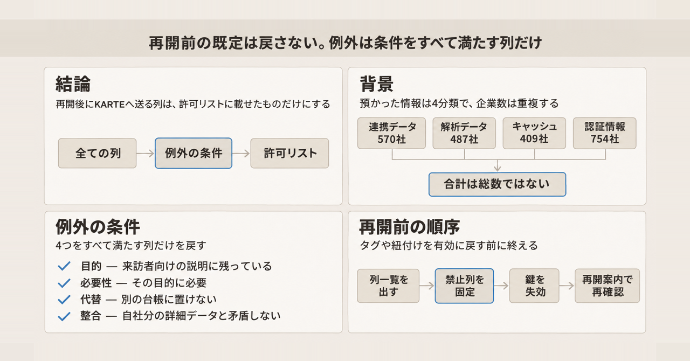
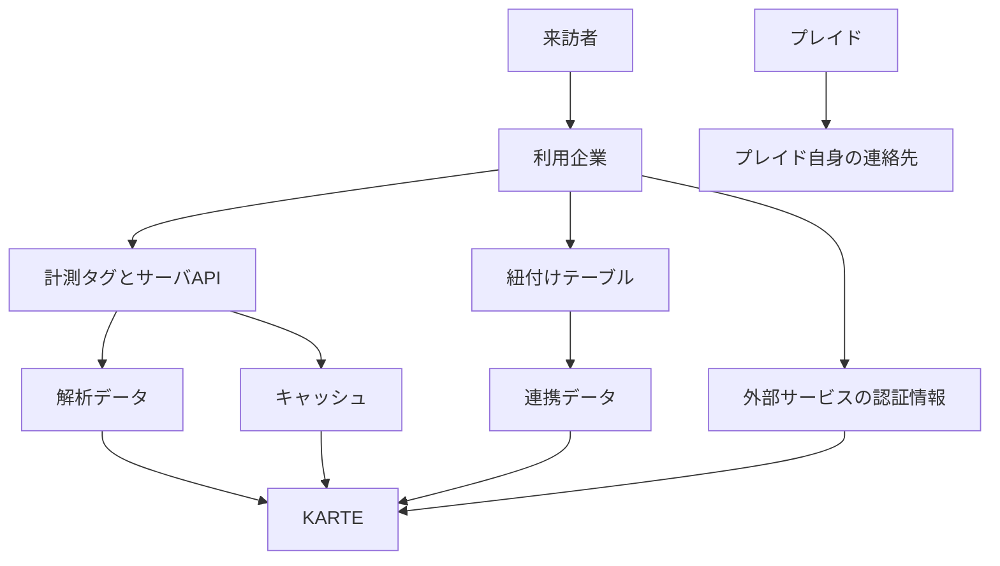

2026年11月20日、株式会社プレイドは、マーケティング支援ツール KARTE への不正アクセスについて、自社調査の完了、預かった情報の範囲、サービス再開の見通しを公表しました。

この記事は、KARTE を使っていた企業で計測や法務を担当する人が、再開の前に「どの列を KARTE へ戻さないか」を決めるための材料を、公開された一次資料から整理したものです。ここでの「列」は、計測タグ、API、紐付けテーブルを通じて KARTE へ送るデータ項目を指し、「戻す」は再開後にそれを再び送ることを指します。公表された4つの分類の意味、契約と API から読めるデータの形、列ごとの初期判断と例外の条件、再開前の作業を順に扱います。

扱うのは全社に共通する初期判断までです。企業ごとの詳細データ（その企業について、4分類のどれがどの程度含まれていたかの詳細）は、プレイドが2026年11月24日から順次渡す予定であり、何がどの粒度で載るかは公表されていません。本記事を書いた2026年11月21日時点では、この詳細データを反映できていません。

*この記事の全体像。以下、順に解説します。*

## KARTEとは

KARTE は、株式会社プレイドが提供するマーケティング支援ツールです。利用企業は、自社のサイトやアプリを訪れた人の属性や行動に合わせて、表示やメッセージを変えるために使います。

[KARTE利用契約書（2024年2月15日改定版）](https://plaid.co.jp/assets/pdf/terms/KARTE%E5%88%A9%E7%94%A8%E5%A5%91%E7%B4%84%E6%9B%B8%EF%BC%882024%E5%B9%B42%E6%9C%8815%E6%97%A5%E6%94%B9%E5%AE%9A%E7%89%88%EF%BC%89.pdf)の第27条第1項は、利用企業が KARTE を使う際に、来訪者の個人情報の取扱いをプレイドへ委託すると定めます。委託目的には次が含まれます。

- 属性や趣向の分析と、それに合わせた表示やメッセージ（メール、SMS、チャット、ブラウザ通知など）
- 問い合わせ対応
- 来訪者の不正行為の監視
- 類推情報と統計情報の作成
- 行動の再生
- 利用企業とプレイドが合意した業務

### データがどこから入り、どこに溜まるか

KARTE に溜まる情報は、利用企業が送るものと、プレイドが自分の業務のために持つものに分かれます。利用企業からの入口は主に3つあります。

- **計測タグとサーバAPI**: 利用企業のサイトやアプリに組み込み、閲覧やクリックなどの行動を KARTE へ送る経路です。
- **紐付けテーブル**: 利用企業が年齢や会員ランクなどの業務データを、主キー付きの表の形で KARTE へ連携する仕組みです。
- **外部サービスの認証情報**: 利用企業が KARTE に預けた、外部サービスのシークレットキーやアクセストークンです。

図の「解析データ」「キャッシュ」「連携データ」は来訪者に由来しうる情報です。外部サービスの認証情報は、個人情報を含まないと公表されています。プレイド自身が持つログイン用メールアドレスや営業の連絡先は、利用企業のタグから入る情報とは別の箱です。

[セキュリティホワイトペーパー](https://plaid.co.jp/assets/pdf/terms/KARTE%E3%82%BB%E3%82%AD%E3%83%A5%E3%83%AA%E3%83%86%E3%82%A3%E3%83%9B%E3%83%AF%E3%82%A4%E3%83%88%E3%83%9A%E3%83%BC%E3%83%91%E3%83%BC_v2.pdf)（2.5版）は、保管先を GCP の台湾・米国・東京リージョンと、AWS の東京リージョンと書いています。どの列がどのリージョンに置かれるかは、公開資料からは特定できません。

## 2026年11月20日の公表内容

### 何が起きたか

2026年11月13日未明、第三者が複数の経路から断続的に攻撃し、データ取得用の公開経路の内部処理にあった脆弱性を悪用しました。一部のデータが取得され、取得された認証情報で KARTE の管理画面へアクセスされました。プレイドは同日、全サービスの提供を止めています。

プレイドは[2026年11月16日の第一報](https://plaid.co.jp/news/20261116/)で分類を公表し、[11月20日のニュース](https://plaid.co.jp/news/20261120/)と[同日の適時開示](https://pdf.irpocket.com/C4165/xoA3/Laiu/rVla/otGG.pdf)で、自社調査の完了として件数、再開の見通し、停止期間の料金を公表しました。4つの分類のどれがどの程度含まれるかは、企業ごとに異なります。

### 預かった情報の4分類

企業から預かった情報は、次の4つに分かれます。1社が複数の分類に入るため、企業数は足し合わせられません。ニュースは「単純合算とはなりません」、適時開示は「各分類の企業数の合計は対象企業の総数とは一致しません」と書いています。

| 分類 | プレイドの説明 | 企業数 |
|---|---|---|
| 連携データ | 紐付けテーブルなど、KARTEへ連携されたデータ。企業によっては個人情報を含む | 570社 |
| 解析データ | サイト閲覧、ボタンクリックなどの記録と、会員ランクなど行動から作られたデータ。企業によっては個人情報を含む | 487社 |
| キャッシュ | リアルタイム処理の高速化のため、KARTEが一時的に生成・保持するデータ。エンドユーザーの識別子を含む。個人情報を含む可能性がある | 409社（推定される最大値） |
| 外部サービスの認証情報 | シークレットキー、アクセストークンなど。個人情報は含まない | 754社 |

件数はいずれも11月20日に確定したものです。連携データと外部サービスの認証情報は、分類自体は11月16日に公表され、当時は件数を調査中としていました。

キャッシュについて、プレイドは、短時間で上書きされるため攻撃を受けた時間帯の内容を復元できず、一件ずつの読み出し記録も無いと説明しています。そのため、その時間帯にキャッシュへ保存されていた可能性があるデータすべてを、漏えいの可能性があるものとして扱っています。409社が「推定される最大値」なのはこのためです。

### 契約が終わった企業のデータも残っていた

契約の全部または一部が終わった企業のデータも残っていました。適時開示は、利用規約に基づいて終了後に削除されるべきだった情報が、人的オペレーションと管理体制の不備で保管されていたと書いています。

このデータは、再開に向けた第三者機関によるフォレンジック調査（侵害の経路や範囲を記録から確かめる調査）のため、11月21日時点では削除されていません。適時開示はその調査の完了後に削除すると書き、ニュースは検証の完了後に速やかに削除し、適切に通知すると書いています。

契約が終わった企業の連絡先は、適時開示では privacy@plaid.co.jp、ニュースが案内するサポート窓口では support+status@plaid.co.jp です。適時開示が案内する[問い合わせフォーム](https://plaid.co.jp/notice/202611-faq/)の対象は、エンドユーザー、連絡先を提供した人、採用応募者です。

### プレイド自身が保有していた情報

適時開示は、利用企業から預かった分とは別に、プレイド自身が保有していた情報として次を挙げています。

- KARTE のアカウントとして登録されていたメールアドレス 79,249件（11月16日に公表）
- 営業活動とサービス利用支援で受け取った連絡先（氏名、メールアドレス等）45,816件（11月20日に公表）

### 再開の見通しと料金

適時開示は、KARTE を含む同社のサービス（適時開示の表記は「KARTE等」）を11月13日からすべて止めていると書き、ニュースは停止対象を KARTE と書いています。プレイドは、侵入経路を塞ぐだけでは足りず、システム構成を含む再構築が必要だと判断しました。段階的な再開の目標時期は、ニュースと適時開示のどちらも KARTE について2027年1月中旬としており、時期は変わりうるとしています。

2026年11月分とサービス停止期間中の該当利用料金は、請求しないとされています。ニュースは詳細を対象企業へ個別に連絡すると書きますが、適時開示の該当節には個別連絡の一文がありません。

同日の[業績予想の修正](https://pdf.irpocket.com/C4165/xoA3/Laiu/rVla/UGuz.pdf)は、決算期変更に伴う2025年10月1日から2026年12月31日までの15ヶ月を対象にしています。

| 項目 | 前回予想 | 今回修正予想 |
|---|---|---|
| 売上高 | 20,800百万円 | 18,500百万円 |
| 営業利益 | 1,600百万円 | △900百万円 |
| 親会社株主に帰属する当期純利益 | 600百万円 | △2,000百万円 |

会社は、サービス停止と、11月および停止期間中の費用を請求しないことで、売上高と各段階利益が減る見込みだと説明しています。これは見通しであり、注記は結果が異なりうるとしています。

料金に関わる契約条項も確認しておきます。返金やサービスクレジットを確認するときの材料になります。

- 利用契約書第16条第1項は、利用料金を合意した金額とします。第2項は、当社の解除等で満了前に終了した場合その他いかなる場合でも、満了までの利用料金等の全額を支払い、受領した利用料金等は返金しないとします。
- 第45条は、規約と個別契約が抵触するときは個別契約を優先するとします。
- [SLA](https://plaid.co.jp/assets/pdf/terms/KARTE%E3%82%B5%E3%83%BC%E3%83%93%E3%82%B9%E3%83%AC%E3%83%99%E3%83%AB%E3%82%A2%E3%82%B0%E3%83%AA%E3%83%BC%E3%83%A1%E3%83%B3%E3%83%88%EF%BC%88SLA%EF%BC%89.docx.pdf)は、月間利用可能時間割合が99.5%以上となるよう最大限努力すると書きます。ダウンは、5分（300秒）以上継続して、計測・配信・管理画面のすべてが利用できない状態です。サービスクレジットの計算対象は固定額のシステム費用部分で、申し出の期限は対象障害の翌月末です。

## 送る側から見たデータの形

再開後に何を戻すかを決めるには、利用企業から KARTE へ、どんな形でデータが入るかを知っておく必要があります。

KARTE のサポートサイト（support.karte.io）は2026年11月21日時点で緊急メンテナンス中で、計測タグの `identify` と `attribute` の使い分けを説明する本文は取得できませんでした。`identify` と `attribute` は、KARTE へユーザーに関する値を送るときに使うイベントの名前です。開発者向け API のリファレンスは同日に取得できたので、以下はそれに基づきます。

### 紐付けテーブルの行を更新するAPI

[紐付け行の更新API](https://developers.karte.io/reference/post_v2beta-track-reftable-row-upsert)（`POST /v2beta/track/refTable/row/upsert`）は β 版です。

- 必須項目は `id`、`rowKey`、`values` です。`rowKey` は主キーに当たり、指定できるプロパティは1つです。
- スキーマも主キーも未設定のテーブルは、**最初に受け取ったリクエストの値で主キーとスキーマが設定されます**。
- 公式のリクエスト例にある `values` は `age`、`rank`、`last_login_date` です。
- Scope は `beta.track.refTable.row.upsert` です。
- [リクエスト回数制限](https://developers.karte.io/reference/api-v2-limitation)は、Free Plan が10回/分、Growth が30回/分、Enterprise は応相談です。集計単位はプロジェクトとエンドポイントの組で、超過すると 429 が返り、そのリクエストは処理されません。

### イベントを送信するAPI

[イベント送信API](https://developers.karte.io/reference/post_v2-track-event-write)（`POST /v2/track/event/write`）は次の仕様です。

- `keys` には `user_id` か `visitor_id` のどちらかが必須で、両方は指定できません。`visitor_id` の説明は「ユーザーを識別する任意のキー」です。
- `event_name` に使えない名前に `view` が含まれます。
- `identify` を送る場合は、`values` の中に `user_id` が必要です。詳細はサポート記事を参照するよう書かれています。
- この API で送ったイベントは、ポップアップ、メール、アプリプッシュ通知などのすべてのアクションの配信トリガーには使えません。
- Scope は `track.event.write` です。上限に達すると [422](https://developers.karte.io/reference/response-v2) が返ります。

リージョン固定オプションのプロジェクトは、本番エンドポイント `https://api-jp.karte.io` を使うと OpenAPI の servers に書かれています。

### 保管、暗号化、バックアップ

セキュリティホワイトペーパー2.5版の記述は次のとおりです。

- 第12節: データベースに保管されるお客様の各種情報（氏名、メールアドレス、各機能で利用するデータなど）をディスクレベルで暗号化します。パスワードはハッシュ化して保管します。
- 第14節: イベントデータと解析データのバックアップを日次で2世代取り、お客様からの復元要望は受けません。

### 個人関連情報と要配慮個人情報

[重要事項説明書](https://plaid.co.jp/assets/pdf/terms/%E3%80%90%E9%87%8D%E8%A6%81%E4%BA%8B%E9%A0%85%E8%AA%AC%E6%98%8E%E6%9B%B8%E3%80%91KARTE%E3%81%AE%E5%88%A9%E7%94%A8%E3%81%AB%E4%BC%B4%E3%81%86%E5%80%8B%E4%BA%BA%E3%81%AB%E9%96%A2%E3%81%99%E3%82%8B%E3%83%87%E3%83%BC%E3%82%BF%E3%81%AE%E5%8F%96%E6%89%B1%E3%81%84%E3%81%AB%E3%81%A4%E3%81%84%E3%81%A6.pdf)は、個人関連情報の例として、クッキー、IPアドレス、閲覧履歴、行動履歴、購買履歴、端末ID、ユーザーエージェント、リファラ、性別や年齢などの類推情報を挙げます。他のデータと容易に照合して個人が特定できる場合は、個人情報になりうると書いています。来訪者向けのオプトアウトは [karte.io/optout](https://karte.io/optout/) です。

要配慮個人情報の例は人種、病歴、犯罪経歴等で、取得にはあらかじめ同意を求めると書いています。

### 削除に関する条項

- 利用契約書第28条第1項第4号: 利用目的の達成または利用契約の終了で利用を終えた本個人情報を、速やかに安全な方法で消去・廃棄します。
- 第40条第3項第1号: 本個人情報を、利用契約終了後90日以内に削除します。第2号は、それ以外のデータを、プレイドが定める相当な期間の後に削除できるとします。
- [KARTE MessageのSMSに関する特則](https://plaid.co.jp/assets/pdf/terms/KARTE%20Message%E3%81%AESMS%E3%81%AB%E9%96%A2%E3%81%99%E3%82%8B%E7%89%B9%E5%89%87%EF%BC%882025%E5%B9%B410%E6%9C%8831%E6%97%A5%E5%88%B6%E5%AE%9A%EF%BC%89.docx.pdf)（2025年10月31日制定）: 第2条は Message SMS を、携帯電話やスマートフォンの電話番号を宛先にテキストを送るサービスと定義します。第3条は、利用契約終了後、利用規約第40条第3項にかかわらず、Message SMS で送信されるデータを3年経過後に削除するとします。

## 利用企業が同日に公表した項目

同じ11月20日に、利用企業も自社の該当項目を公表しています。全社共通の判断を作るうえで、どんな列が実際に対象になったかの具体例になります。

### 丸井グループ

[丸井グループの公表](https://www.0101maruigroup.co.jp/nr/26_1120_1)は、漏えいがプレイドの KARTE で起きたもので、丸井グループのシステムからではないと書いています。対象は2つです。

1. マルイウェブチャネルを利用したことがある人と、「マルイからのおトクな情報メール」の配信を希望する人。氏名・性別・生年月日・メールアドレス・顧客管理番号が漏れている方が約883万件。
2. エポスカードの利用者（退会者を含む）。顧客管理番号・性別が漏れている方が約850万件。うち、氏名・年齢・年収・キャッシング限度額が漏れた可能性のある方が約6万件。

顧客管理番号だけでは個人を特定できない、カード番号・暗証番号・セキュリティコードの漏えいは確認されていない、と書いています。11月13日には、自社システムと KARTE のあいだのアクセスを遮断しています。

### 三井住友銀行

[三井住友銀行の公表](https://www.smbc.co.jp/news/pdf/j20261120_01.pdf)は、銀行のサイトとスマートフォンアプリのお知らせに KARTE を使っていたと書いています。

- 項目: 生年月日、年齢帯・性別・電話番号の登録有無（区分値のみ）、お知らせの要否を判定するフラグ
- 件数: 最大約14百万件
- 含まれていないもの: 氏名、住所、電話番号、メールアドレス、銀行口座番号、暗証番号、インターネットバンキングのログインID・パスワード

生年月日を含んでいても、氏名等と紐づいていないため個人を特定できない、と書いています。

## 注意点

### 報道の数字と一次資料の数字

- **「のべ約2200社」はユニーク企業数ではありません。** 4分類の企業数 570、487、409（推定最大）、754 を足すと 2220 になります。[日経](https://www.nikkei.com/article/DGXZQOUC204SK0Q6A121C2000000/)は重複を含めて計2220社と書き、[朝日新聞](https://www.asahi.com/articles/ASVCN3PTWVCNULFA01BM.html)の自由閲覧部分は「のべ約2200社分」と書いています（いずれも二次情報）。プレイドは、合計が対象企業の総数と一致しないと明記しています。
- **「延べ1733万件」は丸井の公表に無い数字です。** 丸井の約883万件と約850万件を足した数と一致しますが、丸井はその合計を書いておらず、2つの対象の重なりも分かりません。丸井の本文は「漏れている方が約883万件」のように人と件を併記しており、「万人」とは書いていません。項目名も「キャッシング限度額」です。
- **「20億円の赤字」は実績ではなく見通しです。** 15ヶ月の会計期間について、親会社株主に帰属する当期純利益の修正予想が△2,000百万円という意味で、営業利益の修正予想は△900百万円です。業績予想の理由文は「費用は請求いたしません」と書き、インシデントの公表は「該当利用料金」と書いており、語が揃っていません。報道には「2026年11月」や「該当」を落とした書き方もあります。
- **再開時期の出どころ。** [ステータスページの当該インシデント](https://status.karte.io/incidents/rs1gsmckc197)の最終更新は2026年11月19日 11:08 JST で、再開の目処は未定のままでした。2027年1月中旬は、11月20日のニュースと適時開示が示した目標です。

### 公式に確認できていない仕様

- `identify` を個人情報、`attribute` を個人情報でない属性とする説明、`attribute` の例に `birth_date` があるという説明、`user_id` に氏名やメールを使わないという説明は、サポート本文が取得できず確認できていません。
- 紐付けテーブルのテーブル数、列数、CSV容量の上限も、サポートが HTTP 503 を返していたため確認できていません。
- この事案に紐づく公開の CVE 番号は、一次資料で確認できたものがありません。

### 別の事案と混同しない

- [物語コーポレーションの発表](https://www.monogatari.co.jp/news/261020_news/)（2026年10月20日）は、焼肉きんぐ公式アプリの会員管理システムへの不正アクセスを受け、グループの公式アプリ11本で、2027年上期に氏名と電話番号を保持しない計画を示したものです。メールは予約と利便性のために取得を続けるとしています。KARTE の被害の公表ではなく、すでに外し終えたという完了の記述もありません。
- [個人情報保護委員会の注意喚起](https://www.ppc.go.jp/news/careful_information/261118_alert_idcard/)（2026年11月18日）は、レンタカー事業者に、本人確認の後に顔写真付き身分証の画像を保管し続けないよう求めたものです。道路運送法との関係で保管が求められるのは運転免許証の番号を2年間であり、画像を貸渡後も保管する義務は無いとしています。個人情報保護法第22条の消去の努力義務と、第147条の指導等の可能性に触れています。KARTE への命令ではありません。

### 削除の条項は、削除が済んだ証拠ではない

契約には90日以内の削除が書かれていますが、適時開示は、終了後に削除されるべきデータが残っていて、フォレンジック調査が終わるまで削除しないと書いています。イベントと解析のバックアップは日次2世代で、Message SMS で送信されるデータは契約終了後3年経過後に削除されます。条項があることと、削除が完了したことは分けて扱う必要があります。

### まだ分かっていないこと

- 自社が実際に送っていた列の一覧（各社で確認が必要です）
- 該当利用料金に含まれる明細と、11月分の既請求を返金するか
- `identify` と `attribute` の現行フィールド定義
- どの列が台湾、米国、東京のどれに保管されるか、リージョン固定の対象範囲
- 紐付け更新APIは β であり、廃止日は確認できていません
- 再開後に、既存の紐付けテーブルのスキーマと主キーが残るか
- 11月16日の公表は、検知を8時59分、サーバー停止の開始を14時27分頃、封じ込めの完了を15時23分頃と書いています。11月20日の本文は、キャッシュの「当該時間帯」の開始と終了を時刻で書いておらず、両者が一致するかは分かりません

## 再開前に、どの列を戻さないか

ここからは、公表と契約を踏まえた判断の提案です。初期状態は「戻さない」とし、目的が残る列だけを、計測と法務が文書化したうえで例外にします。

分け方には2つの前提を置きます。

- サポート本文が取れていない以上、列を `identify` か `attribute` かで分けません。
- 経路が紐付けテーブルでも、`identify` でも、`attribute` でも、同じ列は同じ扱いにします。

| 列や対象 | 公表・契約との対応 | 初期判断 |
|---|---|---|
| 氏名、メールアドレス、電話番号そのもの、住所、身分証画像 | 丸井は氏名・メールを約883万件側に書いています。電話番号そのものと住所は、三井住友銀行が対象外と書いた項目です。身分証画像は、個人情報保護委員会が別事案で保管継続を戒めた対象です。契約第27条第1項第1号はメールとSMSを委託目的に含みます | 戻さない。メール配信や SMS を今も続けるなら、その宛先だけを例外候補にする |
| 生年月日 | 丸井の約883万件側に含まれます。三井住友銀行は最大約14百万件の項目に含め、氏名等と紐づかず個人を特定できないと書いています | 氏名と一緒には戻さない。単独で戻す場合は、照合できないことを法務が文書化する |
| 性別、年齢帯、年齢、会員ランク | 丸井は性別を両方の件数に書き、三井住友銀行は年齢帯・性別を区分値として書いています。解析データの例に会員ランクがあり、upsert の公式例に `age` と `rank` があります。契約第27条第1項第4号は、性別・年齢の類推を、特定個人が識別されないよう匿名化して作ると書いています | 戻さない。ベンダーの例や類推情報という語は、送ってよい許可ではない |
| 年収、キャッシング限度額 | 丸井は約6万件の可能性に限って書いています。重要事項説明書の要配慮個人情報の例には含まれませんが、漏えいの可能性がある項目として公表されています | 全社の標準列としては戻さない。自社が送っていたかは、11月24日以降に届く自社分の詳細データで確認する |
| 電話番号の登録有無、お知らせ要否のフラグ | 三井住友銀行が区分値・フラグとして公表しています | 戻さない。区分だけでも漏えいの対象になりうる |
| 顧客管理番号、推測しにくい `user_id` | 丸井は番号だけでは特定できないと書いています。イベント送信APIの `keys` は `user_id` か `visitor_id` が必須です | 結合が今も必要で、氏名やメールを鍵にしない場合だけ例外候補にする。`visitor_id` も「ユーザーを識別する任意のキー」と定義されており、`user_id` から `visitor_id` に替えても識別子であることは変わらない |
| 計測タグが送る閲覧の記録のうち、識別子を載せないもの | 解析データは閲覧とクリックを含みます。イベント送信APIは `event_name` に `view` を使えないため、閲覧の送り方は計測タグ側の仕様に依存しますが、そのフィールド一覧は確認できていません | タグのフィールドが確認できるまで、例外候補に上げない |
| 外部サービスのシークレットキー、アクセストークン | 754社。個人情報は含まず、プレイドは無効化を要請しています | 再開判断を待たずに失効する。同じ鍵は戻さない |
| プレイドのログインメール、営業連絡先 | 79,249件、45,816件 | 利用企業のタグの判断の外 |

紐付けテーブルには注意が要ります。スキーマも主キーも未設定のテーブルへ最初の1件を送ると、そのリクエストで主キーとスキーマが固定されます。新しくテーブルを作る場合や、再開後にテーブルが未設定の状態で用意される場合は、戻す列を削る作業を、最初の書き込みより前に終えておく必要があります。再開後に既存テーブルのスキーマが残るかは、公開資料では確認できていません。

## 「何も戻さない」とは言い切れない理由

一律に何も戻さない、という結論までは取れません。契約第27条第1項は、メール、SMS、チャット、ブラウザ通知、問い合わせ対応、不正行為の監視を委託目的に書いています。SMS特則は電話番号を宛先にするサービスです。丸井の約883万件側には、メール配信を希望する人が含まれます。

そのため、例外は次の4条件をすべて満たす列だけにします。この記事で「例外の条件」と呼ぶのはこの4つです。

1. その目的が、来訪者向けの説明に今も残っている。「来訪者向けの説明」は、プライバシーポリシー等で来訪者に示している利用目的のことで、契約第27条の委託目的と一致している必要があります
2. その列が、その目的に必要である
3. 別の台帳に置けない。つまり、KARTE 以外の自社の管理台帳で保持して用を足すことができない
4. 11月24日以降に届く自社分の詳細データと矛盾しない。詳細データが届く前に決めた例外は仮のものとし、届いたら、その列を自社が実際に KARTE へ預けていたかと突き合わせて確定します

判断表の行ごとに書いた追加の条件（生年月日を単独で戻すときの文書化、結合キーに氏名やメールを使わないこと）は、この4つに上乗せされます。

なお、不正監視のために氏名・電話番号・メール・生年月日・年収の再送が必須だと書いた利用企業の一次公表は、見つかりませんでした。

ほかにも、判断の範囲を限定しておくべき点があります。

- **閲覧から識別子を外しても、個人情報でなくなるとは公式は書いていません。** クッキーと閲覧履歴は個人関連情報の例で、容易に照合できれば個人情報になりえます。イベント送信APIも、いずれかの識別キーを必須にしています。
- **生年月日を氏名と同じ直接識別子とだけ扱うのは、三井住友銀行の公表より広い扱いです。** 同行は、氏名等と紐づかない生年月日を個人を特定できないと書きつつ、漏えいの対象には含めています。戻さない初期判断は維持し、単独で送る場合の例外条件だけを残します。
- **11月24日以降の自社分の詳細データで、前の判断表を緩めてよい場合があります。** 全社共通の判断表には、他社の公表に出てきた列（年収など）も入っています。詳細データで自社が KARTE へ預けていなかったと分かった列まで、全社共通の判断表のまま禁止し続ける必要はありません。逆に、自社分の詳細データに載った列が少なかったとしても、それを再開後に氏名・電話番号・メールを送り直す理由にはしません。
- **キャッシュに、送っていない列まで載っていたとは書かれていません。** 制御できないのは、その時間帯に保存されていた可能性があるものについて、読み出されたかどうかを会社が区別できないという点です。409社は推定最大値であり、すべての企業のキャッシュが個人情報を含むとも書かれていません。
- **料金の不請求は、再開を急ぐ理由にしません。** 不請求は、該当利用料金の範囲では利用企業への請求の圧力を弱めますが、範囲は文書間で揃っていません。既に受領した料金は、標準契約の第16条第2項が返金しないと書いており、不請求の個別連絡がこの条項を上書きするかは公開資料では確認できません。期限として意識すべきなのは、タグや紐付けを再び有効にする前です。公表された目標は KARTE の2027年1月中旬の段階的再開であり、変わりえますし、KARTE 等の全体が同じ日に再開するとも書かれていません。
- **今後の送信を止めても、既に預けたデータの処理は終わりません。** 既存データの消去、契約終了後の90日削除、SMS特則の3年削除、丸井が書く該当者への連絡、三井住友銀行が書く当局への報告は、送信停止とは別に完了させる必要があります。
- **再開後のタグが、停止前と同じフィールドを持つかは分かりません。** 再開後に KARTE へ送ってよい列の一覧（以下、許可リスト）は、再開案内が来たときに読み直します。

## 再開前にやること

再開前に、計測と法務で許可リストを固定します。既定は、前の判断表の「戻さない」です。許可リストに載せるのは、前の節の「例外の条件」4つをすべて満たす列だけです。

1. 自社の計測タグ、`identify`、`attribute`、紐付けテーブルの列一覧を出す。サポートサイトの復旧後に、公式のフィールド定義と突き合わせる。
2. 判断表で「戻さない」とした列（氏名、電話番号そのもの、メールアドレス、住所、身分証画像、年収、キャッシング限度額、性別、年齢帯、年齢、会員ランク、電話番号の登録有無、お知らせ要否のフラグ）を、初期の禁止列として固定する。これは判断表の既定と同じ意味で、メール配信や SMS を続ける場合の宛先のように、例外の条件4つを満たす列だけは、法務が文書化したうえで許可リストに載せられる。生年月日は氏名と同時に戻さない。
3. 外部サービスのシークレットキーとアクセストークンを、再開の判断を待たずに失効し、同じ値を戻さない。
4. 2026年11月24日以降に届く自社分の詳細データで、自社が KARTE へ預けていなかった列の禁止を緩めてよいかを確認し、仮決めの例外を確定する。詳細データを、氏名・電話番号・メールを送り直す根拠には使わない。
5. 料金の個別連絡が来ても、再開日を前倒しする条件にしない。第16条第2項の返金しない条項と、不請求の範囲を、その連絡文で確認する。
6. 段階的再開の案内が来たら、計測タグと API のフィールドが停止前と同じかを確認し、許可リストを更新してから有効に戻す。
7. 既に預けた分については、削除の完了、該当者への連絡、当局への報告を、送信停止とは別の作業として残す。

## まとめ

- プレイドは2026年11月20日、KARTE への不正アクセスについて、預かった情報を連携データ、解析データ、キャッシュ、外部サービスの認証情報の4分類で公表しました。企業数は重複しており、足し合わせた「約2200社」はユニーク企業数ではありません。
- キャッシュは、攻撃を受けた時間帯の内容を復元できないため、保存されていた可能性があるもの全体を漏えいの可能性として扱っています。契約が終わった企業のデータも、削除されないまま残っていました。
- スキーマも主キーも未設定の紐付けテーブルは、最初の書き込みでスキーマと主キーが固まります。そうしたテーブルへ送る場合は、戻す列の選別を最初の送信より前に終える必要があります。
- 再開前の既定は「戻さない」です。例外は、目的が今も来訪者向けに説明されていて、その列が必要で、別の台帳に置けず、自社分の詳細データとも矛盾しない場合に限ります。外部サービスの鍵は、再開を待たずに失効します。
- 11月24日以降の自社分の詳細データは、自社が預けていなかった列の禁止を緩める材料にはなりますが、再開後に氏名・電話番号・メールを送り直す理由にはなりません。送信の停止と、既に預けたデータの削除・連絡・報告は、別々に完了させる作業です。

この記事が少しでも参考になった、あるいは改善点などがあれば、ぜひリアクションやコメント、SNSでのシェアをいただけると励みになります！

## 参考リンク

- [プレイド「不正アクセスによる個人情報を含む可能性のある情報等の漏えいに関するお詫びとお知らせ」（2026-11-16）](https://plaid.co.jp/news/20261116/)
- [プレイド「KARTEへの不正アクセスに関する調査結果およびサービス再開の見通しのお知らせ」（2026-11-20）](https://plaid.co.jp/news/20261120/)
- [同日の適時開示PDF](https://pdf.irpocket.com/C4165/xoA3/Laiu/rVla/otGG.pdf)
- [プレイド「業績予想の修正に関するお知らせ」（2026-11-20）](https://pdf.irpocket.com/C4165/xoA3/Laiu/rVla/UGuz.pdf)
- [KARTE ステータスページの当該インシデント](https://status.karte.io/incidents/rs1gsmckc197)
- [KARTE利用契約書（2024年2月15日改定版）](https://plaid.co.jp/assets/pdf/terms/KARTE%E5%88%A9%E7%94%A8%E5%A5%91%E7%B4%84%E6%9B%B8%EF%BC%882024%E5%B9%B42%E6%9C%8815%E6%97%A5%E6%94%B9%E5%AE%9A%E7%89%88%EF%BC%89.pdf)
- [重要事項説明書（KARTEの利用に伴う個人に関するデータの取扱いについて）](https://plaid.co.jp/assets/pdf/terms/%E3%80%90%E9%87%8D%E8%A6%81%E4%BA%8B%E9%A0%85%E8%AA%AC%E6%98%8E%E6%9B%B8%E3%80%91KARTE%E3%81%AE%E5%88%A9%E7%94%A8%E3%81%AB%E4%BC%B4%E3%81%86%E5%80%8B%E4%BA%BA%E3%81%AB%E9%96%A2%E3%81%99%E3%82%8B%E3%83%87%E3%83%BC%E3%82%BF%E3%81%AE%E5%8F%96%E6%89%B1%E3%81%84%E3%81%AB%E3%81%A4%E3%81%84%E3%81%A6.pdf)
- [KARTE MessageのSMSに関する特則（2025年10月31日制定）](https://plaid.co.jp/assets/pdf/terms/KARTE%20Message%E3%81%AESMS%E3%81%AB%E9%96%A2%E3%81%99%E3%82%8B%E7%89%B9%E5%89%87%EF%BC%882025%E5%B9%B410%E6%9C%8831%E6%97%A5%E5%88%B6%E5%AE%9A%EF%BC%89.docx.pdf)
- [KARTE セキュリティホワイトペーパー](https://plaid.co.jp/assets/pdf/terms/KARTE%E3%82%BB%E3%82%AD%E3%83%A5%E3%83%AA%E3%83%86%E3%82%A3%E3%83%9B%E3%83%AF%E3%82%A4%E3%83%88%E3%83%9A%E3%83%BC%E3%83%91%E3%83%BC_v2.pdf)
- [KARTE サービスレベルアグリーメント（SLA）](https://plaid.co.jp/assets/pdf/terms/KARTE%E3%82%B5%E3%83%BC%E3%83%93%E3%82%B9%E3%83%AC%E3%83%99%E3%83%AB%E3%82%A2%E3%82%B0%E3%83%AA%E3%83%BC%E3%83%A1%E3%83%B3%E3%83%88%EF%BC%88SLA%EF%BC%89.docx.pdf)
- [KARTE Developers: 紐付け行の更新API](https://developers.karte.io/reference/post_v2beta-track-reftable-row-upsert)
- [KARTE Developers: リクエスト回数制限](https://developers.karte.io/reference/api-v2-limitation)
- [KARTE Developers: イベント送信API](https://developers.karte.io/reference/post_v2-track-event-write)
- [KARTE Developers: Response](https://developers.karte.io/reference/response-v2)
- [KARTE オプトアウト](https://karte.io/optout/)
- [丸井グループ（2026-11-20）](https://www.0101maruigroup.co.jp/nr/26_1120_1)
- [三井住友銀行（2026-11-20）](https://www.smbc.co.jp/news/pdf/j20261120_01.pdf)
- [物語コーポレーション（2026-10-20）](https://www.monogatari.co.jp/news/261020_news/)
- [個人情報保護委員会 注意喚起（2026-11-18）](https://www.ppc.go.jp/news/careful_information/261118_alert_idcard/)
- [日経「プレイド『KARTE』の情報漏洩2200社」（2026-11-20、二次情報）](https://www.nikkei.com/article/DGXZQOUC204SK0Q6A121C2000000/)
- [朝日新聞（2026-11-20、自由閲覧部分、二次情報）](https://www.asahi.com/articles/ASVCN3PTWVCNULFA01BM.html)
