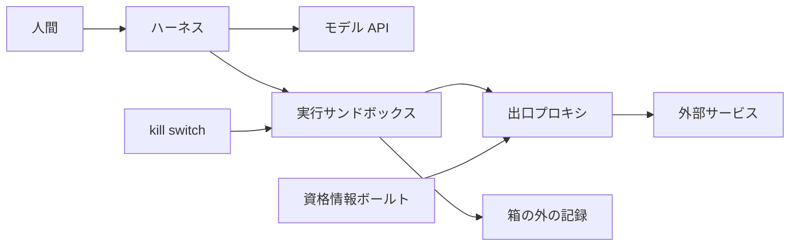

Anthropic で Platform engineering を率いる Katelyn Lesse が、2026-10-26 に X へ論考を投稿しました。テーマは、マルチエージェントシステムを本番で動かすときにエンジニアが解くべき新しい問題です。論考は問題を4つの領域に分けています。実行基盤、身元と認可、隔離、監視と停止です。

この記事では、まず論考の中身と、本人が別のブログで書いている設計を整理します。次に、4領域それぞれについて、各社の公式ドキュメントにどこまで書いてあるかを確かめます。最後に、今期の設計で守る制約としてまとめます。プラットフォームやセキュリティを担当していて、エージェント基盤の設計で何を先に決めるべきかを知りたい人に向けた記事です。

*この記事の全体像。以下、順に解説します。*

## Katelyn Lesse の論考とは

### 書き手と論考の位置づけ

本人のサイトによると、Katelyn Lesse は現在 Anthropic の Platform engineering を率いています。以前は Stripe で Connect engineering を、Betterment で product engineering を率いていました。

論考が想定しているのは、多数のエージェントが長い期間動き続けるシステムです。そうしたシステムを運用するときにエンジニアが新しく解く問題を、4つの領域に分けて挙げています。論考は問題を提起する文章で、計測データは付いていません。

### 4つの領域

| 領域 | 論考が書いていること |
|---|---|
| 実行基盤 | エージェントの仕事は、アイドルの時間が長い、状態を持つ、単一インスタンスで動く、突発的に負荷が跳ねる、という性質を持つ。これは既存の Kubernetes の使い方には収まらない。例として、AI インフラ企業が新しいファイルシステムやサンドボックスを作っていること、Google が Agent Substrate を新しいランタイムとして作っていることを挙げる |
| 身元と認可 | 認証には、短命のワークロード身元をそのまま再利用できる。一方で認可は "much more wide open" だとする。ツール呼び出しを自動承認するだけでは足りない。数週間動くシステムで人間が意味のある承認をする方法は、同意の深い問題だとする。ユーザーの代わりに動く場合 (on-behalf-of) や、エージェント同士の信頼も未解決とする |
| 隔離 | 未信頼のコードを書かせ、未信頼の内容を読ませるエージェントは、強いサンドボックスに置く必要がある。ここ数週間、中核ソフトウェアの脆弱性がパッチより速いペースで出ていることを危険として挙げる。乗っ取られたエージェントが、プロンプトインジェクション (外部の内容に紛れ込ませ、モデルに従わせる指示) を別のエージェントへ渡し、その指示が後のエージェントの記憶に残ることにも触れる |
| 監視と停止 | エージェントが OpenTelemetry のトレースを書き換えられないことを求める。監視する側が、系全体を一度に止め、資格情報も切れるスイッチを持つことも求める。良性の粘り強さが悪意と似て見える、という判別の難しさも挙げる。例として、allowlist に無いドメインへ何度も接続を試みる振る舞いを挙げる |

### 本人のブログにある「脳と手を分ける」設計

本人は 2026-09-13 のブログで、エージェントを安全に動かす構造を具体的に書いています。中心にあるのは「脳と手を分ける」という考え方です。判断する部分 (脳) と、コードを実行する部分 (手) を別の場所に置きます。

- ハーネス (モデルを呼び出し、ツールの実行を仲介するエージェントの本体) とセッションと資格情報は、サンドボックスの外に置く。
- 出口プロキシ (サンドボックスから外へ出る通信を中継する仕組み) が、宛先ごとに資格情報を注入する。
- MCP (エージェントが外部ツールを呼ぶためのプロトコル) のツール用 OAuth トークンは、ハーネスの隣にあるボールト (資格情報の保管庫) に置く。
- ログと kill switch (緊急停止の仕組み) もサンドボックスの外に置く。

サンドボックスの中で動くのは、未信頼のコードと、そのコードが触るファイルやプロセスだけです。モデルの呼び出し、人間による承認、資格情報の保管はハーネスの側に残ります。サンドボックスから外部サービスへの通信は、必ず出口プロキシを通ります。出口プロキシは、宛先が許可されているときだけ、ボールトから受け取った資格情報を付け足します。サンドボックスの中には資格情報そのものを置かず、プロキシが置き換える仮の値だけを置きます。記録は、サンドボックスの中のプロセスがログを消せない場所に出力します。

同じブログでは、隔離の強さを段階で示しています。弱い方から順に次のとおりです。本人は microVM を好むと書いています。

| 段階 | 隔離方式 | ブログでの位置づけ |
|---|---|---|
| 1 | コンテナ | カーネルを共有するので、セキュリティの境界ではない |
| 2 | gVisor | コンテナより一段強い |
| 3 | Firecracker などの microVM | 本人が好む方式 |
| 4 | フル VM、または専用ホスト | 4段階の中で最も強い |

### 論考に出てくる Agent Substrate

論考が固有名で挙げている取り組みは、Google の Agent Substrate だけです。

Agent Substrate は、多数のエージェントを、起動済みで待機しているワーカーのプールに多重化して動かす実行ランタイムです。Pod 1つにエージェント1体を割り当てる方式ではありません。オープンソースで、ライセンスは Apache-2.0 です。リポジトリの README は、1.0 より前の版であり、後方互換は保証しないと書いています。

使うリソースは次の4つです。

| リソース | 意味 |
|---|---|
| Actor | エージェント1体 (1インスタンス) |
| ActorTemplate | Actor のイメージと資源のひな型 |
| Worker | 実行中のサンドボックス |
| WorkerPool | 起動済みで待機している Worker の集まり |

Actor がアイドルになると、そのメモリとローカルファイルをスナップショットとして保存し、Worker をプールへ戻します。必要になったら、空いている Worker でスナップショットから再開します。休止の間、データベースや MCP への接続はスナップショットに含まれません。再開したときにエージェントがつなぎ直します。

Kubernetes との関係は次のとおりです。Kubernetes の公式プロジェクトである Agent Sandbox は、サンドボックスを扱うカスタムリソース (Sandbox CRD) を既存の Kubernetes に足す拡張です。Agent Substrate はその Agent Sandbox の上に載ります。マシンや Worker の Pod の管理は Kubernetes に任せ、頻繁な休止と再開だけを Kubernetes 標準のコントロールプレーンとは別の層で扱います。Google は、標準の Pod の振る舞いで足りる仕事には Agent Sandbox を、アイドルが多く休止と再開を頻繁に繰り返すエージェントを大量に動かす仕事には Agent Substrate を、という使い分けを示しています。

## 注意点

論考とその周辺の公式発表には、強く聞こえる表現があります。どこまでが計測された値で、どこからが例え話や自己申告なのかを分けて読む必要があります。

### 論考に出てくる規模の表現は計測値ではない

論考の "Picture thousands of agents" は「想像してほしい」という意味の例え話です。"If multiagent systems are working for weeks" はシナリオです。"the next, call it a year or two" は見通しを言っているだけで、期間を裏づける資料はありません。創薬やハードウェア設計で数千のエージェントが常駐しているという場面も、論考の中では例として書かれています。

近い規模の実例を公開資料で探すと、Stanford Medicine の「仮想バイオテク」の記事 (2026-09-17) が見つかります。大学の記事は、人間ではない 37,000 人分の組織という比喩を使っています。また、約 50,000 件の治験を1週間足らずで目録にまとめた、という研究者の発言を載せています。ただし同じ記事は "Our next step is to bring the new findings from the virtual biotech into real labs" と書いています。このシステムが治験を実施したとは書いていません。ハードウェア設計の分野で、数千のエージェントが本番で日常的に常駐しているという公開資料は、本稿で確認した範囲では見つかりませんでした。

### Agent Substrate の性能値は、資料ごとに比べている相手が違う

次の値は、どれも Google のブログか OSS の README による自己申告です。どの資料にも、ハードウェア構成、パーセンタイル、スナップショットのサイズは書かれていません。「10 倍で 500 ms」のような1つの数字にまとめて読まないでください。

| 主張 | 出典 | 資料に書かれていないこと |
|---|---|---|
| 標準のコンテナランタイムより 10 倍の密度。1ホストあたり休眠エージェントが 1,000 を超える。再開は 500 ms 未満。休止と再開による起動は毎秒 500 を超える | Google Cloud Blog (2026-09-16) | ホストの vCPU と RAM。「休眠」の定義 |
| ベンチマークで 200,000 エージェント、毎秒 500 回の起動。休止と再開は 500 ms 未満。従来の計算基盤と比べて最大 10 倍 | Google Cloud Blog (2026-10-22) | 200,000 が同時実行数か登録数か。10 倍が同じベンチマークの結果か |
| 標準のコンテナより 10 倍。再開は 400 ms 未満。毎秒 1,500 を超える起動 | OSS の README (2026-10-27 時点) | 400 ms がどのパーセンタイルか |
| 再開は1秒未満 | GKE の About ページ (最終更新 2026-10-22 UTC) | 10 倍、500、200,000 という値はこのページには無い |
| データプレーンは 100 ms 未満を目標に最適化している | リポジトリの architecture.md。ファイル自体に目標 (aspirational) と注記がある | README の 400 ms 未満との関係 |
| デモでは、状態を持つ約 250 の actor を8つの Pod で動かす | OSS の README (`demos/counter`) | 8つの Pod のマシンタイプ |

### Google のブログと GKE の製品ドキュメントで、資格情報の注入の記述が食い違う

2026-09-16 と 2026-10-22 の Google のブログ、および OSS の README のセキュリティモデルは、2つのことを書いています。通信は既定で拒否すること。資格情報はサンドボックスの外で注入すること。

一方で GKE の About ページ (最終更新 2026-10-22 UTC) は、EgressPolicy (ホスト名や IP アドレスで出口の通信を制御するルール) について、既定の拒否、ホスト名によるルール、資格情報の注入を、いずれも未サポートと書いています。日本語版のドキュメントも、資格情報の注入を未サポートと書いています。

どちらが実装の実態なのかは、公開資料からは決められません。GKE で出荷済みの機能として読むなら、製品ドキュメントを優先してください。ブログの一文を根拠に、GKE で既に使える機能だと判断しないでください。

GKE の About ページと Install ページ (いずれも最終更新 2026-10-22 UTC) が書いている提供状態と制約は次のとおりです。

| 項目 | ドキュメントの記述 |
|---|---|
| 提供状態 | GKE の全顧客向けには本番以外の用途。本番の GA は、申請して承認された顧客だけ |
| 対応版 | GKE Standard 1.36 で beta フラグを有効にするか、1.37 以上 |
| 前提 | Workload Identity Federation が必要 |
| 既定の隔離 | gVisor。インストーラは microVM を構成しない |
| ノード | 既存クラスタのノードは c3-standard-4 以上。Autopilot は非対応 |
| マシン | 混在アーキテクチャのマシンファミリ (E2) は使えない。1つの ActorTemplate の中で VM タイプを混ぜられない |
| GPU | Actor のコンテナに GPU はパススルーされない。gVisor は動作中の CUDA をスナップショットできない |
| 課金 | Agent Substrate 自体に追加料金は無い。作成したリソースに GKE の料金がかかる |

OSS の README は、自前のクラスタでは必要な Kubernetes の beta API をクラスタ作成時にしか有効にできない、と書いています。一方で Install ページには、既存のクラスタを更新するコマンドが載っています。ここも資料の間で食い違っています。

なお、2026-10-22 の発表記事は、Agent Substrate と同時に Agent Compute Engine という別のサービスも発表しています。記事にあるミリ秒や密度の数値は Agent Substrate の節にあり、Agent Compute Engine のものではありません。Agent Compute Engine のプレビューは "in the coming months" とされています。

### 「ここ数週間の中核ソフトウェアの脆弱性」は具体的に特定されていない

論考は、"the past couple weeks" に中核ソフトウェアの脆弱性がパッチより速いペースで出た、と書いています。しかし CVE の番号は挙げていません。時期が重なる CVE は次の3件です。いずれも論考が名指しした脆弱性ではないので、論考の主張の裏づけとしては使えません。

| CVE | NVD の記述 | 読むときの条件 |
|---|---|---|
| CVE-2026-111497 | 2026-10-22 公開。Brotli のデコーダのバッファオーバーフロー。影響する版は 1.0.3 から 1.2.0。修正版は 1.0.10、1.1.1、1.2.1。Google による CVSS 4.0 のスコアは 9.2。悪用は確認されていない | 日付は論考の「数週間」に入る。ただし論考は Brotli とは書いていない |
| CVE-2026-99999 | 2026-10-15 公開。Linux カーネル。不正なチェックサムの情報が IPv4 スタックに入ると、ネットワークヘッダを壊すおそれがある。CVSS 3.1 は 9.3 で、ローカルからの攻撃 CVSS は高いが、NVD の本文はゲストからホストへの脱出やホストでのコード実行とは書いていない |
| CVE-2026-92392 | 2026-10-14 公開。curl。HTTP/2 のアップロード中の処理で use-after-free が起きる。影響は 8.12.0 から 8.22.0 の一部の版 | 修正版と重大度は curl のアドバイザリで確認する |

同じ時期に、Vercel は「100 万ドルの Vercel Sandbox チャレンジ」の結果を公開しました (2026-10-14)。2週間で 1,285 件の報告があり、そのうち有効なものは 57 件、支払額は 242,000 ドルでした。顧客データへのアクセスを示した報告は無かった、とページは書いています。実証された内容は、検証した環境で分けて読む必要があります。

| 実証された内容 | 検証した環境 |
|---|---|
| ホストのメモリの漏えい | Vercel の本番サンドボックス |
| ホストのクラッシュ、ホストでのコード実行 | 研究者が自前で用意した KVM と Firecracker (Vercel の構成に合わせたもの)。本番での RCE とは書かれていない |
| 制御プレーンが、ゲストが申告したスナップショットの保存先・サイズ・チェックサムをそのまま信用した。その結果、あるアカウントのスナップショットを別のアカウントのものと入れ替えられた | 研究者が自分で持つ2つのアカウントの間だけ。第三者を狙うには API に出てこない 96 bit のストレージキーが必要で、その経路は示されていない |

Vercel は、1週間以内にスナップショットの生成をホスト側に移したと書いています。

### 「認可は空洞」は、単一のクラウドの中では言い過ぎ

論考の "much more wide open" は、認可の領域全体がまだ設計されていない、という意味に広がりやすい表現です。しかし、単一のクラウドの中で閉じた範囲では、製品ドキュメントが手順を公開しています。

Google Agent Identity (最終更新 2026-10-22 UTC) は次のように書いています。

- エージェントごとに SPIFFE ID (ワークロードの身元を表す標準の ID) を割り当てる。なりすましはできない。
- 開発者は長命のサービスアカウント鍵を発行できない。
- X.509 証明書の有効期限は 24 時間で、自動でローテーションされる。
- ユーザーの代わりに動くときは、ログにエージェントとユーザーの両方の身元が残る。
- Google のゲートウェイ製品と組み合わせると、エンドユーザーの資格情報はゲートウェイで復号される。エージェントは生の資格情報を見ない。

ただし、対応する実行環境として挙がっているのは Cloud Run など Google の一部のサービスです。GKE の Agent Substrate はこの一覧に入っていません。また制限として、エージェントを削除しても IAM のバインディングは残ること、同じ表示名で作り直しても principal は別のものになることが書かれています。

Microsoft Entra の On-behalf-of のページは、テナントの中での委任を書いています。Entra では、ブループリント (エージェントの種類ごとの登録で、トークンを取得する主体) が親になり、個々のエージェントの身元はその子として作られます。管理者が親のブループリントに事前に同意し、子は対話による同意なしでその権限を継承します。子は対話型の `/authorize` を開始できません。継承はテナントの境界の中だけです。数週間にわたって人間が意味のある承認を続ける方法を標準として完成させた、とは書いていません。

SPIFFE の SVID はワークロードの身元を示すもので、認可そのものではありません。SPIFFE の実装である SPIRE の既定の有効期限は、X.509 SVID が1時間、JWT SVID が5分、CA が 24 時間です。Google の 24 時間は、SPIRE の既定とは別の製品の値です。

### トレースの改ざん耐性と全体の停止は、仕様では保証されていない

OpenTelemetry の GenAI セマンティック規約 (生成 AI の処理をトレースに記録するときの名前の決まり) は、`open-telemetry/semantic-conventions-genai` で開発されています。2026-10-27 時点でタグの付いたリリースは0件で、README の Schema URL は TODO のままです。agent spans や `invoke_agent`、`execute_tool` の状態は Development です。Development は、破壊的な変更が起こり得て、長期的に依存するべきではない、という段階です。規約が決めているのは span の形だけです。エージェントが自分の span を偽造できない、という保証は含まれていません。

Anthropic の OpenTelemetry ドキュメント (beta) は、配送は best effort で span が失われることがある、と書いています。呼び出し側が `traceparent` の sampled フラグを落とすと、そのリクエストの span は出力されません。サンドボックスの外に出した記録が、そのまま改ざんできない監査記録になる、とは書いていません。

停止の手段は、製品ごとに止められる単位が違います。表の Managed Agents は、Anthropic がホストするエージェントの実行環境 (beta) です。1つのセッションの中に複数のスレッドがあります。動的なワークフローを使うと、セッションの中で run という処理の単位が起動され、run は自分のスレッドを持ちます。

| 製品 | 手段 | 止められる範囲 |
|---|---|---|
| Claude (Managed Agents) | interrupt (beta) | `session_thread_id` を指定すればそのスレッド、指定しなければセッション内のアーカイブされていない全スレッド。動的なワークフローを含むセッションでは run は終わらず、run のスレッドを指定しても何も止まらない。run を止める別の手段は、このページには書かれていない |
| Claude | ワークスペースの archive | そのワークスペース向けに作った API キーを数秒で archive する。取り消しはできない。Default Workspace は archive できない |
| Claude | 人間のユーザーの全セッションからのログアウト | claude.ai へのログイン状態を切る。API キーには影響しない |
| Redpanda Agentic Data Plane (エージェントの呼び出しを AI Gateway で中継する製品) | kill switch | AI Gateway がそのエージェントの呼び出しを拒否する。ページには "The agent's runtime keeps running" とある。対象は1エージェント |
| Port | kill switch | Port 自身はエージェントを止めない。Flag、Restrict、Pause、Revoke、Decommission の段階で依存先の API を呼ぶ。Pause では資格情報は残る |

本稿で確認した公開ドキュメントの範囲では、系全体を一度に止め、同時に資格情報も切ることを仕様として保証した単一の制御は見つかりませんでした。

## 4つの問題はどこまで未解決なのか

4つの領域は実在する問題です。ただし、未解決の度合いは領域ごとに違います。

| 領域 | ドキュメントで既に手当てされていること | まだ開いていること | どう読むか |
|---|---|---|---|
| 実行基盤 | Kubernetes 公式ブログ (2026-03-20) は、サイズ1の StatefulSet と headless Service と PVC の組み合わせは理論上できるが、規模が大きくなると運用が破綻すると書き、Sandbox CRD を出した。GKE のドキュメントは、アイドルなエージェントを Pod のまま 100 万置くと、Pod の上限とコントロールプレーンのメモリを使い切ると書く。Google は、標準の Pod の振る舞いで足りる仕事には Agent Sandbox を勧める | Agent Substrate の本番利用は申請制。GKE では出口の資格情報の注入が未サポート。密度は自己申告。1.0 より前の版 | 突発的な負荷や 100 万のアイドルを Pod の寿命で運ぶ前提は、公式が既に否定している。ただし、すべての仕事に Agent Substrate が先に必要なわけではない |
| 身元と認可 | 短命のワークロード身元。Google の 24 時間の X.509。単一クラウドの中での委任と、エージェントとユーザーの両方の身元が残る監査。Entra のテナント内の On-behalf-of | ベンダーをまたいだ人間の委任。数週間にわたって人間が意味のある承認をする標準。削除後も残る IAM バインディングと、再作成で変わる principal | 認証の仕組みが無いとは読まない。同意の期間とベンダーをまたぐ部分は、公開された仕様では閉じていない |
| 隔離 | 隔離の強さの段階と、コンテナは境界ではないという本人の記述。Vercel は Firecracker と専用のゲストカーネルを境界として説明する。GKE の既定は gVisor | Vercel の本番で、ゲストからホストのメモリが漏えいした。ゲストが申告した値を制御プレーンが信用したことによる入れ替え | microVM を採用しても、ゲストとホストのパッチ適用の間隔は管理し続ける必要がある。既定が gVisor の製品を microVM と読まない |
| 監視と停止 | GenAI の span 名は Development の草案として存在する。Claude は、セッション、鍵、ワークスペース、スレッドを止める手段を文書化している。Redpanda はエージェント単位でゲートウェイで拒否できる | エージェントがトレースを書き換えられない、という仕様上の保証。系全体の同時停止と資格情報の切断を担う単一の制御。良性の粘り強さと悪意を見分ける方法 | 記録をサンドボックスの外に出すのは配置の設計にすぎない。それだけでは改ざんできない監査や全体の停止は保証されない |

論考の主張を強く言い切った形にすると、次の4つは言い過ぎになります。

- **「認可はまだ空洞」**: Google と Entra は、それぞれ単一のクラウド、単一のテナントの中での手順を公開しています。
- **「microVM ならゲストはホストに届かない」**: Vercel は本番でホストのメモリが漏えいしたことを公開しています。
- **「サンドボックスの外にトレースを出せば監査になる」**: Anthropic の OpenTelemetry ドキュメントは、配送が best effort であることと、呼び出し側が span を抑制できることを書いています。
- **「脳と手の分離は失敗モード無しに採用できる」**: OpenSandbox は、サンドボックスの外で資格情報を注入する機能 (Credential Vault) を持つ OSS のサンドボックスです。そのドキュメントは、次の失敗モードを書いています。pause の後でサイドカーのボールトが空になる。DNS だけで出口を制御していると、資格情報の注入を安全に有効にできない。既定で許可する設定だと、宛先を迂回されることがある。プロキシが落ちると、捕捉した通信は fail closed (遮断側に倒れる) になる。

それでも論考の骨格は崩れません。言い過ぎを差し引くと、未解決として残るのは次の5点です。

- ベンダーをまたいで、人間が長期にわたって同意する方法
- 良性の粘り強さと悪意を見分ける方法
- トレースの改ざん耐性が仕様で保証されていないこと
- GKE では出口の資格情報の注入が未サポートであること
- 密度の数値が自己申告であること

標準が完成するのを待つ理由にはなりません。ただし、採用するときには条件を付ける必要があります。

## 今期の設計で守る7つの制約

標準の完成を待たず、次の7つを設計の制約にすることを勧めます。

1. **判断・セッション・資格情報・記録・停止操作を、未信頼のコードと同じファイルシステムに置かない。** 本人のブログが、この配置を構造の問題として書いています。
2. **資格情報の注入を採用するなら、失敗したときの挙動を受け入れ条件に書く。** 書く内容は3つです。注入する仕組みが落ちたときにどうなるか。pause や suspend の後でボールトと接続が空になること。allowlist が広いと被害の範囲は狭まらないこと。GKE の Agent Substrate を選ぶ場合、製品ドキュメントは注入を未サポートと書いています。ブログの記述で補わないでください。
3. **未信頼のコードを実行する境界は、カーネルを共有する通常のコンテナより強いものを選ぶ。** 本人は microVM を好みます。GKE のインストーラの既定は gVisor で、microVM は同梱されていません。Firecracker を採用した後も、ゲストとホストのパッチ適用の間隔は管理対象として残してください。Vercel は Firecracker を境界として説明したうえで、本番でのメモリの漏えいを公開しています。
4. **監査ログには、エージェントの身元と、ユーザーの代わりに動いた場合はユーザーの身元の両方を残す。** 単一クラウドでの実装例は Google の製品ドキュメントにあります。証明書の有効期限は、即時の失効の代わりにはなりません。Google の X.509 は 24 時間、SPIRE の既定は1時間です。
5. **停止の手段ごとに止まる範囲が違うことを、ランブックに書く。** セッション、スレッド、API キー、ワークスペース、ゲートウェイでの拒否は、それぞれ別の手段です。Claude のドキュメントによると、動的なワークフローを含むセッションでは interrupt は run を終わらせません。人間のユーザーがログアウトしても API キーは消えません。
6. **GenAI の OpenTelemetry の名前を、長期の契約にしない。** 状態は Development で、2026-10-27 時点でタグの付いたリリースはありません。
7. **Agent Substrate の 10 倍、200,000、500 ms を、条件が公開されるまで容量計画の入力にしない。** OSS は 1.0 より前の版です。

次のいずれかが起きたら、制約 2、5、6 を見直してください。

- GKE のドキュメントが、資格情報の注入と、申請不要の本番 GA を書いたとき
- OpenTelemetry が、トレースの改ざん耐性を仕様で保証したとき
- 系全体の同時停止と資格情報の切断を、1つの出荷済みの仕様が保証したとき

## まとめ

- Katelyn Lesse の論考は、マルチエージェントを本番で動かすときの問題を4つの領域に分けています。実行基盤、身元と認可、隔離、監視と停止です。論考は問題提起であり、規模の表現は計測値ではありません。
- 本人のブログには、判断・資格情報・記録をサンドボックスの外に置く「脳と手を分ける」設計が書かれています。
- 公開ドキュメントと照らし合わせると、4つの問題の未解決度は一様ではありません。単一クラウドの中での認可や、Pod では運べない仕事への対処は、既に手当てが進んでいます。残っているのは、ベンダーをまたぐ長期の同意、トレースの改ざん耐性、系全体の停止、出口での資格情報の注入です。
- Agent Substrate の性能値は資料ごとに比べている相手が違い、GKE では資格情報の注入が未サポートです。ブログではなく製品ドキュメントを基準に判断してください。
- 標準の完成を待たずに、配置、失敗時の挙動、隔離の強さ、監査ログ、停止の範囲を、今期の設計の制約にできます。

この記事が少しでも参考になった、あるいは改善点などがあれば、ぜひリアクションやコメント、SNSでのシェアをいただけると励みになります！

## 参考リンク

- [Katelyn Lesse の X の論考](https://x.com/katelyn_lesse/status/2114542280535318557)
- [Katelyn Lesse のサイト](https://www.katelynlesse.com/)
- [Katelyn Lesse のブログ: エージェントの安全な構造とサンドボックス (2026-09-13)](https://www.katelynlesse.com/blog/secure-agents-architecture-and-sandboxing)
- [Kubernetes 公式ブログ: Agent Sandbox (2026-03-20)](https://kubernetes.io/blog/2026/03/20/running-agents-on-kubernetes-with-agent-sandbox/)
- [Google Cloud Blog: Agent Substrate on GKE (2026-09-16)](https://cloud.google.com/blog/products/containers-kubernetes/agent-substrate-available-on-gke)
- [Google Cloud Blog: Agent Compute Engine の発表 (2026-10-22)](https://cloud.google.com/blog/topics/ai-infrastructure/introducing-agent-compute-engine-and-expanded-agent-governance)
- [GKE ドキュメント: About Agent Substrate](https://docs.cloud.google.com/kubernetes-engine/ai-ml/about-agent-substrate)
- [agent-substrate/substrate (GitHub)](https://github.com/agent-substrate/substrate)
- [Google Agent Identity の概要](https://docs.cloud.google.com/gemini-enterprise-agent-platform/govern/agent-identity-overview)
- [Microsoft Entra Agent ID: On-behalf-of](https://learn.microsoft.com/en-us/entra/agent-id/identity-platform/agent-on-behalf-of-oauth-flow)
- [SPIRE サーバの設定](https://spiffe.io/docs/latest/deploying/spire_server/)
- [open-telemetry/semantic-conventions-genai (GitHub)](https://github.com/open-telemetry/semantic-conventions-genai)
- [Claude ドキュメント: OpenTelemetry](https://platform.claude.com/docs/en/manage-claude/opentelemetry)
- [Claude ドキュメント: Managed Agents のセッションスレッド](https://platform.claude.com/docs/en/managed-agents/session-threads)
- [Claude ドキュメント: ワークスペース](https://platform.claude.com/docs/en/manage-claude/workspaces)
- [Claude ヘルプセンター: 監査ログ](https://support.claude.com/en/articles/9970975-access-audit-logs)
- [Vercel Blog: Vercel Sandbox チャレンジの結果 (2026-10-14)](https://vercel.com/blog/findings-from-the-1-million-dollar-vercel-sandbox-challenge)
- [NVD API: CVE-2026-111497](https://services.nvd.nist.gov/rest/json/cves/2.0?cveId=CVE-2026-111497)
- [NVD API: CVE-2026-99999](https://services.nvd.nist.gov/rest/json/cves/2.0?cveId=CVE-2026-99999)
- [NVD API: CVE-2026-92392](https://services.nvd.nist.gov/rest/json/cves/2.0?cveId=CVE-2026-92392)
- [curl のアドバイザリ: CVE-2026-92392](https://curl.se/docs/CVE-2026-92392.html)
- [Redpanda Agentic Data Plane: kill switch](https://docs.redpanda.com/agentic-data-plane/control/kill-switch/overview/)
- [Port: kill switch](https://docs.port.io/solutions/agentops/governance-enforcement/kill-switch/)
- [Stanford Medicine: 仮想バイオテク (2026-09-17)](https://med.stanford.edu/news/all-news/2026/09/virtual-biotech-company.html)
- [OpenSandbox: Credential Vault](https://github.com/opensandbox-group/OpenSandbox/blob/main/docs/guides/credential-vault.md)
