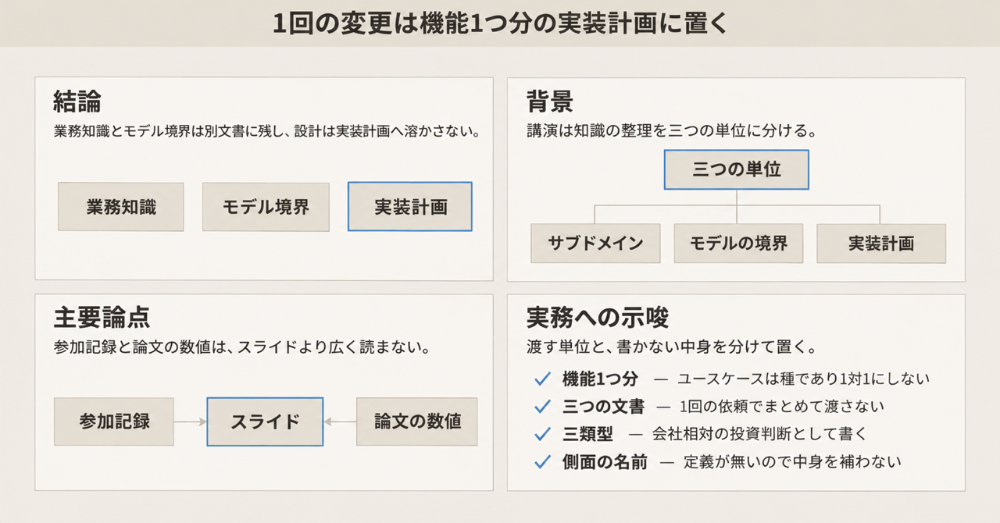
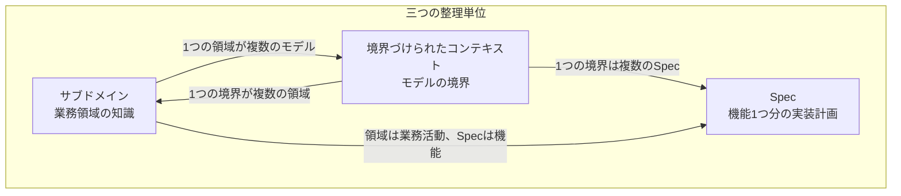

2026年11月27日のアーキテクチャConference 2026で、Vlad Khononov は、AI がコードを書くときの設計を、知識をどう整理するかという話として置きました。公開スライドは、コードを知識の符号化とし、設計をその知識の整理とします。整理の単位は三つです。サブドメインは業務領域の知識、境界づけられたコンテキストはモデルの境界、Spec は実装計画を、それぞれまとめます。

この記事では、三つの単位が何を保持し、互いにどう数えるかを説明します。続けて、公開資料のあいだで読みが広がりやすい箇所、要件の言葉との対応、エージェントへ渡す1回の変更を置く文書を示します。定義は、表紙が “THE THREE BOUNDARIES / SOFTWARE DESIGN WHEN AI WRITES THE CODE” の[公開スライド](https://drive.google.com/uc?export=download&id=1b4IHT5jreUauZ1Ou4Bo9052DlgAoviwy)（101ページ、PDF の作成時刻は 2026-11-27 15:47 JST）から取り、同日の参加記録はスライド本文と突き合わせる二次情報として扱います。

*この記事の全体像。以下、順に解説します。*

## 三つの境界とは

知識の種類は、機能、非機能、基盤・技術の見出しで並びます。設計は、その知識を境界で分けることです。分ける単位は、サブドメイン、境界づけられたコンテキスト、Spec の三つです。

電子商取引の例では、ユースケース名が CATALOG、PRICING、ORDERING、PAYMENTS、INVENTORY、SHIPPING、RETURNS、CUSTOMERS の8塊に並びます。ユースケースは、サブドメインに束ねる仕事の項目です。同じスライドには、入力が具体的でないほど、出力は一般的になる、という対比もあります。ここでの入力は機能の記述、出力は動くコードです。

### サブドメイン

サブドメインは、業務領域の知識をまとめる単位です。共有される機能知識は、三つの目安で切ります。強いデータ整合、順序や時間の依存、実体の構造についての知識、です。強いデータ整合は、直前の書き込みを読むこと（read-the-last-write）を指します。実体の構造は、扱う対象がどんな形で成り立っているか、という知識です。それ以上の切り方の手順は、取り出せたテキストにはありません。

同じスライドは、core、supporting、generic の三類型も残します。core と supporting で実装方針を分ける、という見出しもあります。2018年1月26日の著者のブログでは、既製品を買っても競争優位を損なわないものを generic、競争優位が無く既製品も無いものを supporting、競争優位がありロジックが複雑で変化が速いものを core とします。2026年のスライドは、類型の区別は曖昧になってきている、とも書きます。

### 境界づけられたコンテキスト

モデルは、認知負荷を扱う道具です。スライドは、DDD のやり方として、問題領域ごとに最適化した複数のモデルを使う、と書きます。DDD は Domain-Driven Design の略で、スライドがこのモデルの使い方に付けている名前です。境界づけられたコンテキストは、そのモデルの境界です。その境界は、肥大化したモデルを防ぎます。同じスライドは、コンテキストに載せるトークンの量をさらに限る、とも書きます。トークンは、言語モデルが文を読むときの断片です。

境界の側面として、スライドは Physical、Ownership、Lifecycle の三つの名前を並べます。取り出せたテキストには、三つの名前それぞれの定義文はありません。サブドメインは同定し、境界づけられたコンテキストは設計します。

基数は両方向です。1つのサブドメインは、複数のモデルで記述できます。1つの境界づけられたコンテキストは、複数のサブドメインを反映できます。スライドの英文は “One bounded contexts” です。これは、1つの境界が複数のサブドメインを反映できる、という直前の文の英語です。

### Spec

Spec は、何をなぜ作るかを明示します。レビューする人には、結果を突き合わせる基準を渡します。同じスライドは “MAKES DESIGN IMPLICIT” と書き、設計を暗黙にすると置きます。これは Spec に書き込む項目ではなく、設計が表に出なくなる、という置き方です。

1つの Spec は、機能を記述します。サブドメインは、業務活動の領域です。スライドは、1つの集約に属するユースケースが複数の Spec に割れうると書きます。集約は、サブドメインそのものではなく、スライドがそのユースケースを複数の Spec に割りうる単位として置いている語です。一つの集約を見分ける手順は、取り出せたテキストにはありません。1つの境界づけられたコンテキストは、必ず複数の Spec にまたがります。

サブドメインと境界づけられたコンテキストが埋めていないものとして、非機能要求、正確な振る舞い、変更とその背後の意図の追跡、が並びます。

### 三つの単位の基数

ユースケースは、サブドメインに束ねる項目です。Spec は、その機能について何をなぜ作るかを書きます。末尾のモジュール性は、結合の強さと距離の組み合わせとして、三つの整理単位の横に置かれます。

### 結合の強さと距離

末尾の具体例は、結合の強さを Intrusive、Functional、Model、Contract の順に置きます。四つの名前は強さの段階のラベルです。各段階の定義文は、取り出せたテキストにはありません。距離は、スライドが強さと組にしているもう一方の軸です。何と何の隔たりかは、取り出せたテキストでは特定できません。強さと距離の組み合わせは、次の4マスです。両方低い、または両方高いときが Complexity です。片方だけが高いときが Modularity です。

末尾のリンクは、著者サイト、[coupling.dev](https://coupling.dev)、公開スキル [modularity](https://github.com/vladikk/modularity) です。

|  | 強さが低い | 強さが高い |
|---|---|---|
| 距離が低い | Complexity | Modularity |
| 距離が高い | Modularity | Complexity |

## 注意点

参加記録、論文の引用範囲、Spec という言葉、スキルのライセンス、認知科学と Goldratt の書誌は、スライドの三つの境界より広く読まれやすい箇所です。どこまでを講演の主張として扱えるかを分けます。

### 参加記録とスライド本文

[Zenn の参加記録](https://zenn.dev/koga_atsu/articles/ea4fa6d041d29d)（公開 2026-11-27 17:17 JST）は、同日の二次情報です。定義はスライドから取ります。文字として取り出せた範囲と、参加記録の言い方は、次のようにずれます。Context Rot は、モデルが一度に受け取る文の範囲（コンテキストウィンドウ）のトークンが増えるほど、その中の情報を正確に想起する能力が落ちる、という概念です。Anthropic の記事が、Chroma（その記事がリンクしている調査の発表元）の発見として紹介しています。attention budget は、大量の文脈を読むときに引き出す、有限の注意です。図の中だけに文字がある可能性は残ります。地下鉄の地図や口座の開閉が、図の中だけに描かれているかは未確認です。

| 参加記録の言い方 | スライド本文 |
|---|---|
| 一緒に変わり、同じビジネス要件の変更を必要とするユースケース | その文は無い。目安は強いデータ整合、時間順序、実体構造 |
| ヒューリスティックの第一は並行処理で制御するもの | 第一は strong data consistency（read-the-last-write） |
| 境界は必ず1チーム | Ownership は側面の一つ。必ず1チームという文は、取り出せたテキストには無い |
| サブドメインと境界は1対1または1対多 | 両方向。1領域が複数モデル、1境界が複数領域 |
| 地下鉄と航空の地図、口座の開閉 | 取り出せたテキストには無い。具体例として読めるのは8つの業務塊 |
| Context Rot を講演者の定義として短く言い換える | スライドはその語を出さず、Anthropic の attention budget の文を引用する |
| Spec は正確な振る舞いと技術的意思決定を書ける | 正確な振る舞いは、埋める盲点の一つ。技術的意思決定という語は無い。加えて設計を暗黙にする |

### SlopCodeBench が測っているもの

スライドが引くのは、軌跡の 77% で構造的侵食が上がり、75.5% で冗長さが上がる、という二つです。軌跡は、エージェントが自分のコードを区切り（チェックポイント）ごとに伸ばした一本の経過です。構造的侵食は、正しさとは別に論文が測る、コードの構造側の指標です。これは arXiv HTML v2（[arXiv:2603.24755v2](https://arxiv.org/html/2603.24755)、2026-05-07）の要約および 3.2 節と一致します。SlopCodeBench は、エージェントがコードを繰り返し拡張したときの正しさ、構造的侵食、冗長さを測ったベンチマークです。

論文側のほかの数値を、スライドの主張と混ぜません。

| 項目 | 論文の値 | スライドの引用文にあるか |
|---|---|---|
| 構造的侵食が上がった軌跡 | 77% | ある |
| 冗長さが上がった軌跡 | 75.5% | ある |
| 規模 | 36問、196チェックポイント、15エージェント | 無い |
| strict solve rate | 最良は 14.8%（GPT 5.5）。端から端まで解けたエージェントは無い | 無い |
| 473件の Python のオープンソースとの比較 | エージェントのコードは冗長さ 2.3倍、侵食 2.0倍 | 無い。参加記録が足した倍率 |
| 要約が書く品質の指示 | 初期の冗長さと侵食を最大で約3分の1下げる。劣化率は変わらない | 無い |
| 本文 RQ4 | 初期の侵食を最大 62.3%、冗長さを最大 34.8% 下げうる。平均の品質速度はチェックポイントあたり 1.3 パーセントポイント。コストはチェックポイントあたり平均 12.1% 増える | 無い |

正しさの低下は、一つの数にまとめません。strict solve rate は、論文が strict と呼ぶ解決率です。RQ4 は論文本文の問いの一つ、品質速度はその区切りあたりの品質の変化、貢献リストは論文冒頭のまとめです。貢献リストは 2.3 パーセントポイント、3.4 節は anti-slop で平均 2.4、plan-first で 3.6、と丸めが違います。anti-slop は禁則の列挙、plan-first はコードの前に計画を書かせることです。3.4 節は、anti-slop では GPT 5.4 だけ、開始から終了にかけて品質が改善した、と書きます。どの条件でも劣化が止まらない、とは書いていません。

試した指示は、禁則の列挙と、コードの前に計画を書かせることです。サブドメイン文書、モデル境界、Spec の三点を、独立変数にしていません。

Hugging Face の論文カードに残る 20問、93チェックポイント、17.2%、80%、89.8%、2.2倍は、現行 HTML の v2 と一致しません。現行の数値には使いません。

三つの文書に分けると劣化が止まる、という文は、この論文からは出ません。近い介入である plan-first も、劣化速度を止めず、strict の合格率を下げています。

### Spec の形は道具ごとに違う

スライドが引く Fowler サイトの文は、Birgitta Böckeler の記事（2025-10-15）と一致します。

> What is a spec? There doesn’t seem to be a general definition.
>
> The term is quite overloaded at the moment.

記事の作業定義は、自然言語で、振る舞い向きで、エージェントの手引きになる構造化された成果物です。実装計画、とは書いていません。記事は、実装のレベルを三つに分けます。spec-first はその作業の前に書く程度、spec-anchored は機能の寿命のあいだ残す程度、spec-as-source は人が編集するのは仕様だけ、という程度です。

Kiro は requirements、design、tasks の3ファイルで、設計が別ファイルにあります。小さい不具合を Kiro にかけると、ユーザーストーリー4本、受け入れ条件16本になった、と記事は書きます。spec-kit は、変更要求の寿命、つまりその変更要求を扱っている期間でブランチを切ります。3〜5ポイント程度の機能でも、spec-kit の Markdown の量がレビューを重くした、と書きます。ポイントは、機能の大きさを見積もる点数です。Tessl の beta はファイルと仕様が1対1で、生成コードに編集禁止の印を付けます。

したがって、スライドの “MAKES DESIGN IMPLICIT” は、Kiro のように設計ファイルを分ける道具の共通性質ではありません。弱まるのは、「Spec という名前の成果物が、安定した一種類の変更単位である」という読みです。常時渡す文脈と、その機能の仕様を分けること自体は、記事が memory bank と spec を分けていることと矛盾しません。memory bank は、その記事が常時渡す文脈として分けている側です。

### 末尾のスキルが検査するもの

[modularity](https://github.com/vladikk/modularity) は、Claude Code のプラグインです。README の技能は `/modularity:review` と `/modularity:design` で、判定は `BALANCE = (STRENGTH XOR DISTANCE) OR NOT VOLATILITY` です。STRENGTH は前に書いた結合の強さ、DISTANCE は前に書いた距離です。VOLATILITY は、この式にある語です。結合の平衡を見る、という結論以上には、ここでは展開しません。三つの文書が混ざっていないかを見る検査器ではありません。結合の平衡を見ます。

2026-11-28 時点の star は約680です。アーカイブではありません。default branch `main` の先端コミットは 2026-04-04（`bcdca9a`、メッセージは readme の更新）です。`pushedAt` の 2026-08-31 は、任意ブランチへの push であり、main の先端ではありません。その push は、未マージの `review-discovery-sweeps`（`55cb465`）でした。

README は CC BY-NC-SA 4.0 で、商用は連絡先へ、学習データへの利用は書面の許可が必要、と書きます。作者の 2026-11-27 の[投稿](https://x.com/vladikk/status/2126209292068143479)は、商用制限は気にしなくてよい、ただし LLM の学習には使うな、と書いています。学習の禁止は README と一致します。商用は一致しません。投稿が LICENSE を書き換えたかは未確認です。ここでは法的な可否を決めません。

作者は 2026-04-06 の[投稿](https://x.com/vladikk/status/2041125473845965172)で、サブドメイン同定の能力はまだ作業中だ、と書いています。直後の[返信](https://x.com/vladikk/status/2041125476446441941)は、リポジトリのリンクだけです。同定の文は親投稿にあります。それ以降に同定が完成した、と読める公開投稿は、この記事の範囲では確認できていません。main の README は、core、supporting、generic を利用者に尋ねたままです。

### 書誌でスライドより強く言えないところ

複雑性の頁は、変更を入れたときの制御と予測の難しさ、という文を Eliyahu M. Goldratt『The Choice』（2008）に帰しています。原書の当該頁は開いていません。文が書籍に無い、とも、ある、とも確定しません。著者自身の [coupling.dev の複雑性の頁](https://coupling.dev/posts/core-concepts/complexity/) は、この文を使わず説明しています。三つの境界の分け方は、この引用が確定しなくても残ります。

認知容量の頁は、Miller 1994 を1950年代の 7±2、Cowan 2001 を2000年代の 4±1 として並べます。Miller 1994（Psychological Review 101(2) 343–352、[DOI 10.1037/0033-295X.101.2.343](https://doi.org/10.1037/0033-295X.101.2.343)）は、1956年論文の部分再録です。Cowan 2001（Behavioral and Brain Sciences 24(1) 87–114、[DOI 10.1017/S0140525X01003922](https://doi.org/10.1017/S0140525X01003922)）は、7 を修辞とし、精密な限界を約3〜5、中心を約4チャンクとします。同じ実験をやり直したら 7 が 4 に減った、という故事にはできません。著者の別頁が「50年後に同じ実験が 4±1 に落ちた」と書く箇所は、Cowan の要約と一致しません。

Anthropic の引用文は、[context engineering の記事](https://www.anthropic.com/engineering/effective-context-engineering-for-ai-agents)の段落と一致します。記事は context rot を、[Chroma の発見](https://research.trychroma.com/context-rot)として紹介します。人間の作業記憶へのリンクは Cowan 2010（Current Directions in Psychological Science、[DOI 10.1177/0963721409359277](https://doi.org/10.1177/0963721409359277)、約3〜5項目）であり、Miller の 7±2 ではありません。記事の処方は、そのターンに要る小さい高信号のトークン、実行時の取得、圧縮、ノート、サブエージェントです。高信号は、そのターンの判断に効く情報が多い、という意味です。三種類の設計文書へ進む、とは書いていません。

### 1チーム規則をスライドに足さない

スライドは、Physical、Ownership、Lifecycle を側面の名前として並べます。各名前の定義文は、取り出せたテキストにはありません。Ownership はその一つです。Eric Evans『Domain-Driven Design Reference』（2015、CC BY 4.0）は、境界をチーム編成、利用箇所、コードやスキーマなどの物理的実体で明示する、と書きます。同じ境界に複数人が入ることを前提に、継続的統合を置きます。Shared Kernel では、合意した部分集合を複数チームが共同で持ちます。Open Host Service では、一つの上流を多数の下流が使います。

同じ著者の『Learning Domain-Driven Design』の公開抜粋は、“one team only” と “No two teams can work on the same bounded context” を書き、Shared Kernel を実務上の例外とします。抜粋であり、書店版の当該頁は再確認していません。2026年のスライドは、この強い規則の再掲ではありません。

Team Topologies の[公式解説](https://teamtopologies.com/key-concepts-content/what-are-the-core-team-types-in-team-topologies)（2019-11-07）は、プラットフォームを、他の開発チームを顧客とするサービスとして運営し、焦点はストリームアラインドチームに置く、と書きます。ストリームアラインドチームは、価値の流れに沿って開発するチームです。これは消費が多数である例です。変更権の共有の例は、Shared Kernel の方が直接です。[InfoQ の記事](https://www.infoq.com/news/2019/06/bounded-context-eric-evans/)（2019-06-26）は、Evans が二つのチームが同じ境界に残ると大きな泥団子になると話した、という二次要約です。共有を勧める材料ではありません。

### まだ確認できないこと

次の点は、この記事では閉じていません。

- 公式プログラムのセッション要旨は、本文を確認できていません。スライドに無い口頭の定義が要旨にあるかは未確認です
- Goldratt『The Choice』の当該頁は未照合です
- 画像だけの具体例がスライドにあるかは、文字の抽出では確定できません
- 2026-11-27 の投稿が、リポジトリの CC BY-NC-SA の商用条項を法的に変えるかは未確認です。利用の可否は、ここでは決めません
- 『Learning Domain-Driven Design』の “one team only” は公開抜粋までで、書店版の当該頁は未確認です
- 三つの文書を独立変数にした実験は、SlopCodeBench と、ここで開いた関連研究の範囲にはありませんでした。ほかの論文に無い、とまでは言えません
- RDRA（神崎善司氏の要件定義の枠組み）の公式ハンドブック本文は、ここでは読めていません。次節の対応表は解釈のままです

実装1回の文書の分け方には、これらの未確認は及びません。効果の有無、ライセンスの商用可否、Goldratt の原文には及びます。次に足すなら、原書の該当頁、公式セッション要旨、RDRA ハンドブックの順です。

## 要件の言葉とどこで重なりどこで割れるか

ここでの対応は、要件定義で使う業務、ユースケース、情報モデルと、講演の三つの境界がどこで重なり、どこで割れるかです。RDRA は、神崎善司氏の要件定義の枠組みです。公式サイト [rdra.jp](https://www.rdra.jp/) を開いたときに本文がほとんど取れず、公開デッキ等の二次に依ります。表は講演者の主張ではなく、スライドの定義に対する解釈です。

RDRA 側の作業定義は、次の三つです。業務は、ビジネスユースケースを束ねる活動のまとまりです。ビジネスユースケースは業務の仕事、システムユースケースはシステムの仕事です。ここでのユースケースは、システムの仕事です。情報モデルは、ユースケースに駆動されて業務用語を構造化したもので、実現手順そのものは持ちません。

| 要件の用語 | 講演で近いもの | 重なるところ | 割れるところ |
|---|---|---|---|
| 業務 | サブドメイン | どちらも業務活動の領域として置ける | 講演の切り方の目安は、強いデータ整合、時間順序、実体構造である。RDRA の業務はビジネスユースケースのまとまりである。講演は core、supporting、generic も残し、区別は曖昧になってきている、と書く。RDRA にその三類型は無い |
| ユースケース | サブドメインに束ねる項目。Spec が記述する機能に種を渡せる | 講演の例（商品を足す、など）は、システムの操作より業務能力に近い | ユースケース自体は境界ではない。講演はビジネスユースケースとシステムユースケースを分けない。1つの集約のユースケースは複数の Spec に割れうるので、その集約を1つの Spec にもできない。集約の見分け方は取り出せたテキストに無い |
| 情報モデル | 境界づけられたコンテキストの内側にあるモデル | モデルは認知負荷を扱う道具である、という点は重なる | 境界づけられたコンテキストはモデルの境界である。側面に Physical、Ownership、Lifecycle がある。基数は両方向なので、1つの業務が複数のモデルを要し、1つの境界が複数の業務を含みうる |
| （対応する層が無い） | Spec | ユースケースは Spec の種にはなる | Spec は機能サイズの実装計画で、何をなぜ作るか、レビュー基準、非機能、正確な振る舞い、変更意図の追跡を扱う。設計の暗黙化は、書く項目ではなく、設計が隠れるというスライドの警告である。これを情報モデルへ入れると、モデル境界と実装計画が一つの文書になる。1つの境界は複数の Spec にまたがる |

## エージェントに渡す1回の変更はどこに置くか

実装を1回進めるときの変更単位は、機能サイズの Spec に置きます。業務領域の知識とモデル境界は、別の文書に残し、Spec に混ぜません。モデル境界は、Spec の外に既にあります。これはスライドの定義からの読み方であり、三つの文書が劣化を止める、という測定結果ではありません。

この読みを支えるのは、次の点です。

- スライドの末尾は、サブドメインが業務知識、境界がモデル、Spec が実装計画、と役割を分けている
- 1つの Spec は機能を記述し、1つの境界は複数の Spec にまたがり、1つの集約のユースケースは複数の Spec に割れうる
- Spec は設計を暗黙にする、とスライドが警告している。モデル境界を Spec の中へ溶かすと、設計の置き場が消える
- 三つの目安（強い整合、時間順序、実体構造）と、両方向の基数を、ここで開いた公開資料は否定していない
- Anthropic の記事は、毎回渡すトークンを小さい高信号の集合にする、と書く。三つの文書を毎回まとめて渡すことは、その処方から外れる

適用範囲は、次のとおり狭まります。

- Böckeler の比較では、Spec の形と寿命がツールごとに違います。Kiro は設計を別ファイルにします。spec-kit は変更要求の寿命であり、Markdown の量がレビューを壊した例があります。「Spec」という名前だけでは、変更単位は安定しません
- SlopCodeBench は、品質指示や plan-first が初期の侵食と冗長さを下げても、反復の劣化速度を止めない、と書きます。GPT 5.4 の anti-slop には改善の例外があります。三つの文書の効果は未試験です
- modularity プラグインは、結合の平衡を見ます。サブドメイン同定は、2026-04-06 時点で作者が未完成と言い、main の README は分類を利用者に尋ねたままです
- core、supporting、generic を投資判断の規則として読むと、2018-01-26 のブログが置いた購入、人員、パターンの分岐は、会社相対であるうえに、2026年の “getting fuzzy” でさらに解像度が落ちます。購入、人員、パターンは、三類型の別名ではなく、その分類で分ける投資の中身です。スライドは分類を残しているので、廃止した、とは読みません
- 2018年のブログは、この三分類を Evans と Vernon が支持しなかった、と著者自身が書いています。Vernon は、そのブログが Evans と並べている Vaughn Vernon です

分けて書く理由は、測定された効果ではありません。スライドが三つの整理単位を別物として定義し、Spec が設計を暗黙にすると警告していることにあります。効果が出るかどうかは、まだ開いています。

エージェントに渡す1回の変更単位は、機能サイズの Spec にします。サブドメイン全体でも、境界づけられたコンテキスト全体でもありません。スライドは、1つの集約のユースケースが複数の Spec に割れうる、と書きます。集約の見分け方は取り出せたテキストに無いので、切る単位には使いません。1つの Spec は機能1つ分にし、ユースケースは種にとどめます。1回の依頼で三つの文書をまとめて渡すことは、Anthropic の処方から外れます。渡すのは、その機能に必要な小さい高信号の断片です。

三つは、別の文書にします。

1. 業務知識の文書には、強いデータ整合、時間順序、実体構造で切ったサブドメインを書きます。core、supporting、generic を書くなら、2018年のブログどおり、会社相対の投資判断として書きます。客観的な分類としては扱いません。同じブログは、同じカタログ管理でも、会社によって supporting にも core にもなる、と書きます。
2. モデル境界の文書には、その問題用のモデルを書きます。Physical、Ownership、Lifecycle は、スライドが側面として並べた名前です。定義文は取り出せたテキストに無いので、スライドの定義として中身を補いません。Ownership を、必ず1チーム、とは書きません。基数は両方向にして、1つの業務が複数のモデルを持ち、1つの境界が複数の業務を含みうる、と書きます。
3. Spec には、その機能について何をなぜ作るか、レビュー基準、非機能、正確な振る舞い、変更の意図を書きます。設計判断は、ここに溶かし込みません。スライドが設計を暗黙にする、と書いているので、モデル境界は Spec の外に既にある状態にします。

RDRA で書くなら、業務をサブドメインに、情報モデルを境界の内側のモデルに、システムとしてのユースケースを Spec の種に対応させます。ビジネスユースケースは業務の仕事、システムユースケースはシステムの仕事です。商品を足す、は前者に近い例です。この二つを一つの「ユースケース」にまとめたまま Spec にすると、講演が分けた変更単位が再び一つに戻ります。

この置き方は、要件の文書向けの読み方です。Khononov が三つの文書の効果を測定した、という主張ではありません。SlopCodeBench と Anthropic の記事は、その効果を証明しません。品質の指示と計画の指示は、初期値を下げても劣化の速度を止めた実績が、この論文にはありません。strict の合格率を下げているのは plan-first です。コストをチェックポイントあたり平均 12.1% 上げているのは、本文 RQ4 がまとめたプロンプト手法です。Spec という名前の道具は、Kiro のように設計を別ファイルにするものも含みます。名前ではなく、中身が機能1つ分で、設計を外に残しているかで見ます。

逆転条件は、次のとおりです。三つの文書を混ぜた方が影響範囲を追える、という測定が出たとき。または、使う道具が Kiro のように設計ファイルを仕様の外に必ず出すときで、その設計ファイルがすでにモデル境界を担っているとき。商用でプラグインを使うかは、LICENSE と当日投稿のどちらを採るかが決まるまで、この置き方の外に置きます。

## まとめ

Khononov の公開スライドは、AI がコードを書くときの設計を、三つの整理単位に分けます。サブドメインは業務領域の知識、境界づけられたコンテキストはモデルの境界、Spec は機能1つ分の実装計画です。サブドメインは同定し、境界は設計します。1つの領域は複数のモデルを持て、1つの境界は複数の領域を含め、1つの境界は複数の Spec にまたがります。

参加記録の「一緒に変わるユースケース」「必ず1チーム」「1対1または1対多」は、取り出せたスライド本文とはずれます。SlopCodeBench がスライドの引用として支えるのは、侵食 77% と冗長さ 75.5% までです。三つの文書が劣化を止める、という測定にはなっていません。Spec という名前も、Kiro、spec-kit、Tessl のあいだで形が違います。

エージェントへ渡す1回の変更は、機能サイズの Spec に置きます。業務知識とモデル境界は別の文書に残し、設計判断を Spec へ溶かし込みません。core、supporting、generic を書くなら、会社相対の投資判断として書きます。この分け方は、スライドの定義と、設計を暗黙にするという警告からの読み方です。効果の測定、商用ライセンスの可否、Goldratt の原文は、まだこの読みの外です。

この記事が少しでも参考になった、あるいは改善点などがあれば、ぜひリアクションやコメント、SNSでのシェアをいただけると励みになります！

## 参考リンク

- 講演スライド PDF「ArchitectureCon 2026 Boundaries Public」（101ページ、作成時刻 2026-11-27 15:47 JST）: https://drive.google.com/uc?export=download&id=1b4IHT5jreUauZ1Ou4Bo9052DlgAoviwy
- 参加記録（二次、2026-11-27 17:17 JST）: https://zenn.dev/koga_atsu/articles/ea4fa6d041d29d
- SlopCodeBench v2（arXiv:2603.24755v2、2026-05-07）: https://arxiv.org/html/2603.24755
- Birgitta Böckeler, SDD ツールの比較（2025-10-15）: https://martinfowler.com/articles/exploring-gen-ai/sdd-3-tools.html
- Anthropic, Effective context engineering for AI agents: https://www.anthropic.com/engineering/effective-context-engineering-for-ai-agents
- Chroma, context rot: https://research.trychroma.com/context-rot
- Vlad Khononov, modularity（star は約680、2026-11-28 時点。main の先端は 2026-04-04）: https://github.com/vladikk/modularity
- coupling.dev: https://coupling.dev
- 複雑性の頁: https://coupling.dev/posts/core-concepts/complexity/
- Vlad Khononov, Revisiting the Basics of DDD（2018-01-26）: https://vladikk.com/2018/01/26/revisiting-the-basics-of-ddd/
- サブドメイン同定は作業中（2026-04-06）: https://x.com/vladikk/status/2041125473845965172
- 同定投稿の直後の返信（リポジトリのリンク）: https://x.com/vladikk/status/2041125476446441941
- 商用制限と学習禁止（2026-11-27）: https://x.com/vladikk/status/2126209292068143479
- Eric Evans, Domain-Driven Design Reference（2015）: https://www.domainlanguage.com/wp-content/uploads/2016/05/DDD_Reference_2015-03.pdf
- Learning Domain-Driven Design 公開抜粋（書店版の当該頁は未確認）: https://cdn.sanity.io/files/6l74mhm8/production/3052a10338f8e41040ed8ba998de73ff5f985397.pdf
- Team Topologies, core team types（2019-11-07）: https://teamtopologies.com/key-concepts-content/what-are-the-core-team-types-in-team-topologies
- Miller 1994: https://doi.org/10.1037/0033-295X.101.2.343
- Cowan 2001: https://doi.org/10.1017/S0140525X01003922
- Cowan 2010: https://doi.org/10.1177/0963721409359277
- InfoQ（二次、2019-06-26）: https://www.infoq.com/news/2019/06/bounded-context-eric-evans/
- RDRA: https://www.rdra.jp/
