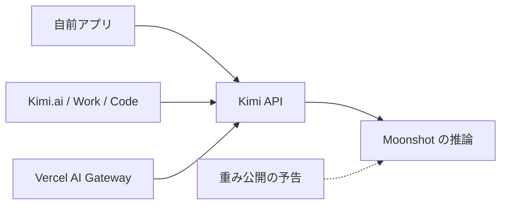
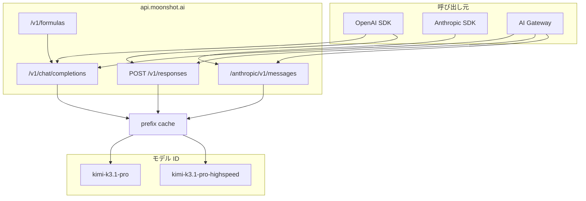
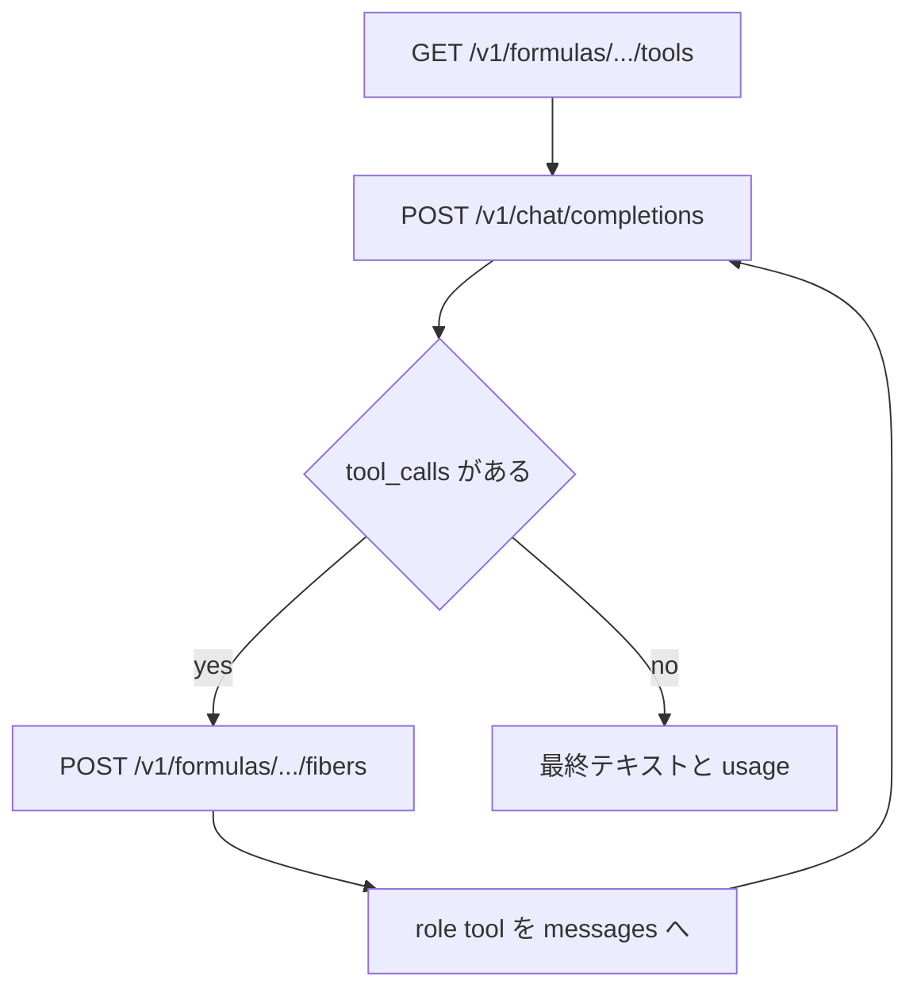
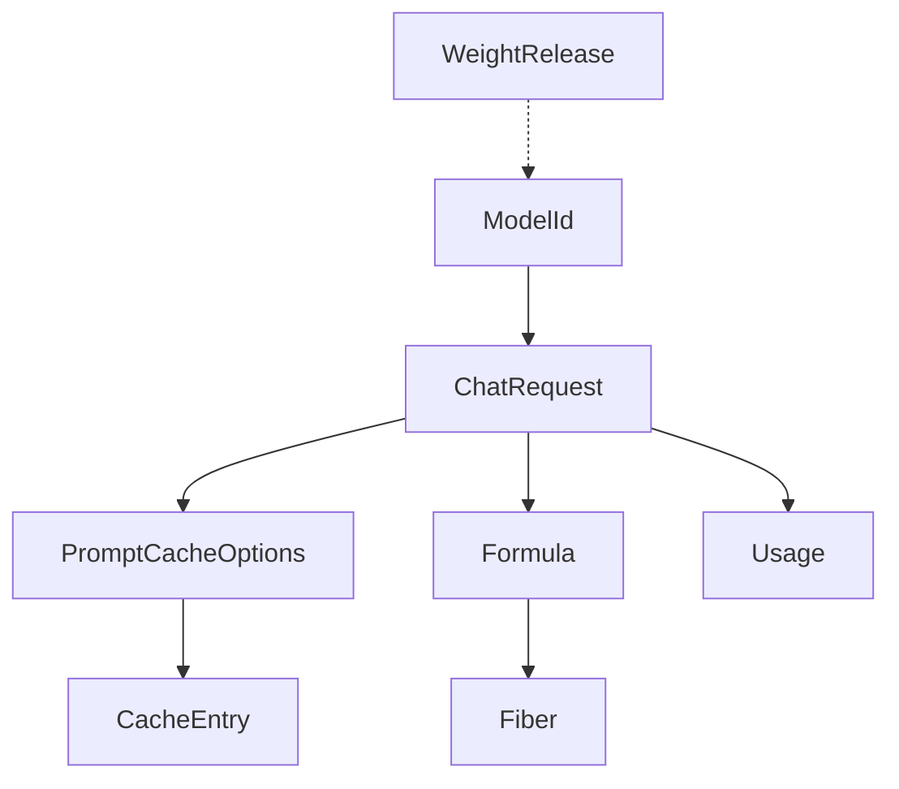
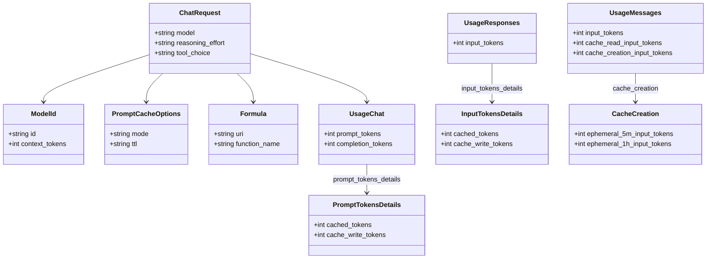

Kimi K3.1 Pro は、Kimi K3 に追加のポストトレーニングを重ねた、長いコンテキストを扱うモデルです。2026年10月23日、Moonshot（Kimi）はこれを Kimi.ai、モバイルアプリ、Kimi Work、Kimi Code、Kimi API に同時に出しました。2026年11月4日は、重みファイルが置かれる日ではなく、公開の期限です。

この記事では、API のモデル ID、3 つの呼び出し経路、プレフィックスキャッシュ（プロンプト先頭の一致分を別単価にする仕組み）、公式ツールの呼び方を、公式ブログと API ドキュメントの記載に沿って整理します。読み終わると、直 API（`https://api.moonshot.ai` を直接呼ぶ側）と Vercel AI Gateway（モデル名を中継する入口）のどちらで呼ぶか、本体 `kimi-k3.1-pro` と Highspeed `kimi-k3.1-pro-highspeed`（同じ能力をより短い待ち時間で返す別 ID）のどちらを既定にするか、キャッシュの TTL（エントリを維持する時間）をいつ固定するかを切り分けられます。文中の日付と数値は、2026年10月26日に公式ブログ、Kimi API ドキュメント、Artificial Analysis の公開記事、Simon Willison の公開記事を照合したものです。


*この記事の全体像。以下、順に解説します。*

## Kimi K3.1 Pro とは

Kimi K3.1 Pro は、Kimi K3 に追加のポストトレーニングを重ねたモデルです。3T 級は公式ブログの規模の呼び方で、後の節では一つのパラメータ数にまとめません。ポストトレーニングは、既に学習した K3 に訓練を足した版、という意味で公式ブログが使っています。公式ブログは、その計算を大きく増やし、数百ドメインで同時に強化学習（RL）を回した、と書きます。

API のモデル ID は 2 つです。本体は `kimi-k3.1-pro`、Highspeed は `kimi-k3.1-pro-highspeed` です。Highspeed は、同じ能力をより短い待ち時間で返す別 ID です。呼び出し経路は 3 つです。OpenAI 互換の Chat Completions（`POST /v1/chat/completions`）、OpenAI 互換の Responses（`POST /v1/responses`。usage の名前が Chat と違います）、Anthropic 互換の Messages（`POST /anthropic/v1/messages`）です。コンテキスト窓は K3 系共通で 100万トークンです。モデル一覧の表記は 1M-token context window です。料金は、コンテキスト長で段階を切りません。

推論の実体は、2026年10月26日時点では Moonshot 側にあります。公式ブログの重みに関する文は “Full model weights will be released by Nov 4, 2026” です。ファイルの URL がブログに載るまでは、モデル選択は API 名の設定 1 箇所に閉じます。自前ホストの作業は、その URL が掲載されたあとで始まります。

Vercel は同日、AI Gateway に `moonshotai/kimi-k3.1-pro` と `moonshotai/kimi-k3.1-pro-highspeed` を載せました。AI Gateway は、Vercel がモデル名を中継する入口です。例の base URL は `https://ai-gateway.vercel.sh/v1` です。モデル名は `moonshotai/` 付きで、ホストと model は組で指定します。

## 特徴

K3.1 という系統の最初のモデルで、中身は Kimi K3 のポストトレーニング版です。パラメータ面は、`kimi-k3` と同じ制約を本体と Highspeed の両方に適用します。

`reasoning_effort` は推論の長さの指定です。受理値は `low`、`high`、`max` で、既定は `max` です。`thinking` オブジェクトは、2026年12月末までに廃止予定の K2 系専用で、K3.1 には送りません。K2.6 と K2.7 Code は、その K2 系の ID です。`tool_choice` は `auto`、`none`、`required` です。`required` は、ツール呼び出しを必ずさせる値です。`auto` と `none` も受理値です。K2 系で `required` がエラーになるときは、`auto` か `none` を送ります。`auto` と `none` の動作の差は、パラメータ一覧のこの行には書いてありません。K2.6 と K2.7 Code が拒否する `required` を、K3.1 の 2 ID は受けます。

`temperature` は 1.0、`top_p` は 0.95、生成本数の `n` は 1、presence penalty と frequency penalty は 0 で固定です。別の値を渡すとエラーになります。公式は、これらのキーを明示的に渡さないよう書きます。

公式ツールは Formula URI で宣言を取ります。Formula は、公式ツールの宣言を取る URI です。例は `moonshot/web-search:latest` です。宣言は Chat Completions の `tools` に載せ、実行は `POST /v1/formulas/{uri}/fibers` です。この実行を fiber と呼びます。`web-search` は呼び出しのたびに課金されます。それ以外の掲載ツールは、期間限定で課金対象外、とツール案内は書きます。期限日は書かれていません。

`max_completion_tokens` は、1 回の応答で返すトークン数の上限です。コンテキスト窓の 100万トークンとは別の項目で、既定は 131072、上限は 1048576 です。この上限はクイックスタートの数値です。入力はテキストと画像です。公開の画像 URL は受けません。base64 か、`ms://` と file id を使います。`ms://` は、公開 URL の代わりに使うファイル参照です。クイックスタートは、動画を Files API の `video_url`（`ms://` と file id）でも送ると書きます。Files API の他の操作は、この文にはありません。フラッグシップと呼ばれる対象は、最低 1 USD をチャージしたあとで解放されます。どのモデル ID がフラッグシップかは、この文では特定できません。この 2 つの ID を呼ぶ前に 1 USD が要るかも、この文では決められません。ここまでの上限、画像、動画、チャージは、いずれも公式の導入文書（クイックスタート）の制限一覧です。

プレフィックスキャッシュは、プロンプト先頭の一致したトークンを、通常の入力単価とは別の単価で扱う仕組みです。既定で有効で、TTL の既定は 5 分です。TTL は、そのエントリを維持する時間です。`prompt_cache_options.ttl` は `5m` か `1h` です。組織の中では共有され、組織をまたぎません。手動では削除できません。

製品面では、Kimi Work は 3.1.0 以降（Windows と Apple silicon Mac）です。Kimi Code はアプリ内の `/model` で選びます。チャット、Work、Code に加え、3D Make という製品面も利用できます。3D Make の操作は、API のモデル ID とは別の選択です。Enterprise の組織アカウントは、管理者が有効化するまでオフです。個人アカウントとは分かれています。ブログは、API 顧客に Zero Data Retention があると書きます。Zero Data Retention は、リクエストのデータを保持しない、というブログ上の名称です。

K2 系は 2026年10月31日から新規登録ユーザーへ出さず、2026年12月末までに廃止予定です。`kimi-k2.5` は 2026年8月31日に停止済みです。移行先として、ドキュメントは `kimi-k3.1-pro` を名指しします。

Moonshot が公開した BenchCAD（ツールあり、1,000 件のサブセット）の図です。API のモデル ID 選びには使いません。図の指標名は Voxel IoU で、何が一致すると点になるかは図の説明にはありません。図の alt と本文が一致する値は、Claude Opus 5.5 が 96.2、GPT-6 Astra が 95.9、Kimi K3.1 Pro が 92.7 です。


| 面 | 本体 `kimi-k3.1-pro` | Highspeed | 出典 |
|---|---|---|---|
| 入力 / 100 万トークン | 2.00 USD | 4.00 USD | platform.kimi.ai の料金カード、Simon Willison、Vercel、Artificial Analysis |
| 出力 / 100 万トークン | 10.00 USD | 20.00 USD | 同上 |
| キャッシュヒット / 100 万トークン | 0.20 USD | 0.20 USD | 料金カードは / MTok。Simon Willison はヒットだけ同額、と要約 |
| キャッシュ書き込み（カード上の 1 行） / 100 万トークン | 2.00 USD | 4.00 USD | platform.kimi.ai の料金カードと Vercel。この 1 行を 1 時間 TTL の単価にはしない |
| 1 時間 TTL のキャッシュ書き込み | 未確認 | 未確認 | 数値表は `kimi-k3` のみ。K3.1 の 1 時間のドルは料金カードに無い |
| 速度の公式表現 | 基準 | 2〜3 倍 | 公式ブログと API クイックスタート |
| Gateway 上の ID | `moonshotai/kimi-k3.1-pro` | `moonshotai/kimi-k3.1-pro-highspeed` | Vercel changelog 2026-10-23 |

同じ料金カードの K3 は、入力 3.00 USD、出力 15.00 USD、キャッシュ書き込み 3.00 USD、ヒット 0.30 USD です。キャッシュガイドが K3 について書く 1 時間 TTL の書き込みは 6.00 USD で、料金カードの 1 行とは別の階層です。

## 構造

呼び出し元は自前アプリ、Kimi 製品、Vercel AI Gateway の 3 つに分かれます。API ホストは `https://api.moonshot.ai` です。OpenAI 形は `/v1`、Anthropic 形は `/anthropic/v1/messages` です。Formula は同じ `/v1` の下で、ツール宣言と実行を分けます。

### システムコンテキスト

この図は、誰が API を呼ぶかの配置です。システムプロンプトの中身ではありません。2026年10月26日時点で、推論は Moonshot 側にあり、重みファイルは公開予告だけが外に出ています。



| アクター | 役割 | 2026年10月26日の状態 |
|---|---|---|
| 自前アプリ | API キーで 3 種のプロトコルを呼ぶ | 利用可。キーは `MOONSHOT_API_KEY` |
| Kimi 製品 | チャット、Work、Code、3D Make | 利用可。Enterprise は既定オフ |
| Vercel AI Gateway | モデル名を `moonshotai/` 付きに替える | 2026年10月23日に 2 ID を追加 |
| 重みの受け手 | 自前ホスト | ブログは 2026年11月4日までの公開を予告。ファイル URL は未掲載 |

### コンテナ

ここでのコンテナは、API の経路を分けた箱です。自分で起動する実行環境ではありません。キャッシュは推論の前段で、プレフィックスが一致したトークンを別単価にします。Highspeed も Responses と Messages で選べます。選び方は model 文字列の差し替えで、パラメータ制約は本体と同じです。

Responses のパスは `POST /v1/responses` です。Gateway から 3 経路へ矢印があるのは、changelog が AI Gateway 経由で Chat Completions、Responses、Messages を使えると書くためです。Gateway の例の base URL は `https://ai-gateway.vercel.sh/v1`、モデル名は `moonshotai/` 付きです。



| コンテナ | 識別子 | 入出力 |
|---|---|---|
| Chat Completions | `POST /v1/chat/completions` | messages、tools、reasoning_effort、prompt_cache_options |
| Responses | `POST /v1/responses`。usage は input_tokens 系 | キャッシュフィールド名が Chat と違う |
| Messages | `POST /anthropic/v1/messages` | トップレベルの cache_control。メッセージ本文の中の同名は無視 |
| Formula | `GET /v1/formulas/{uri}/tools` と `POST .../fibers` | 宣言と実行。実行のときにツール課金 |
| キャッシュ | TTL `5m` または `1h`。組織単位 | 5 分と 1 時間はエントリを共有しない。同じプレフィックスの TTL は初回書き込みで固定され、そのエントリが失効するまで別の TTL では書けない |

### コンポーネント

この図は、公式ツールを 1 回往復する部品です。1 回のエージェントターンは、宣言の取得、モデル呼び出し、fiber 実行、tool ロールの返却、の繰り返しです。`reasoning_content` は、モデルが返した推論の中身です。次のリクエストの assistant メッセージに、そのまま戻します。`reasoning_effort` をターンの途中で変えると、それまでのプレフィックスキャッシュは無効になります。



| コンポーネント | 入力 | 出力 |
|---|---|---|
| ツール宣言 | Formula URI | `tools[]`。web search の function 名は `web_search` |
| モデル | model、messages、tools、reasoning_effort | assistant message。tool_calls または本文。reasoning_content |
| fiber | tool_calls の name と arguments をそのまま | `context.output`。web-search は `context.encrypted_output`。この段で公式ツールの課金が発生 |
| usage | API 種別ごとのフィールド | キャッシュ読み、キャッシュ書き、それ以外は排他で合計が入力になる（Chat と Responses） |

web-search の `context.encrypted_output` は、クライアントが復号せず、tool の `content` にそのまま入れる文字列です。

## データ

請求と挙動を決める実体は、モデル ID、リクエスト、キャッシュエントリ、Formula、usage の 5 つです。重みファイルは、まだこのモデルにぶら下がる配布物ではなく、日付だけの予告です。usage の名前は API で別名になります。

### 概念モデル

`WeightRelease` は、公開期限が 2026年11月4日まで、という予告です。2026年10月26日の配布日ではありません。



| 実体 | 主キー | 確定した属性 |
|---|---|---|
| ModelId | `kimi-k3.1-pro` または `kimi-k3.1-pro-highspeed` | コンテキストは 100万トークン（モデル一覧は 1M-token）。パラメータ制約は kimi-k3 列と同一 |
| ChatRequest | なし（都度） | reasoning_effort 既定 max。tool_choice は auto / none / required |
| PromptCacheOptions | リクエスト内 | mode は `implicit` のみ。ttl は `5m` または `1h`。省略時は 5m |
| CacheEntry | 組織 × プレフィックス × TTL | 初回書き込みで TTL がロック。ヒットは同じ TTL を延長する。トークンはヒット単価のまま。追加の書き込み単価は発生しない |
| Formula | `moonshot/{name}:latest` | 名前空間は `moonshot`。タグの既定は `latest` |
| WeightRelease | 公開期限は 2026年11月4日まで | ファイルの URL、ライセンス名、量子化形式は公式ブログに無い |

### 情報モデル

Chat Completions の `prompt_tokens` を、Responses の `input_tokens` へコピーすると、キャッシュ分の計上場所がずれます。Messages の `input_tokens` は、キャッシュ読みと書き込みを含みません。



| API | 入力の合計 | キャッシュ読み | キャッシュ書き |
|---|---|---|---|
| Chat Completions | `usage.prompt_tokens` | `usage.prompt_tokens_details.cached_tokens` | `usage.prompt_tokens_details.cache_write_tokens` |
| Responses | `usage.input_tokens` | `usage.input_tokens_details.cached_tokens` | `usage.input_tokens_details.cache_write_tokens` |
| Messages | `usage.input_tokens` + `usage.cache_read_input_tokens` + `usage.cache_creation_input_tokens` | `usage.cache_read_input_tokens` | `usage.cache_creation_input_tokens` |

クラス図の `cached_tokens` と `cache_write_tokens` は、usage の直下ではありません。Chat は `usage.prompt_tokens_details`、Responses は `usage.input_tokens_details` の下です。Messages のキャッシュ書きは `usage.cache_creation` の下で、`ephemeral_5m_input_tokens` と `ephemeral_1h_input_tokens` に分かれます。1 リクエストが返すのは、呼んだ API に対応する usage 1 系統だけです。図は Chat だけを `ChatRequest` に結んでいます。`completion_tokens` は Chat にだけ置きます。Responses と Messages の出力フィールド名は、キャッシュガイドの表に無かったので、Chat の名前を流用しません。

Chat の応答ヘッダーは、TTL 別の書き込み量を分けます。`Msh-Usage-Cache-Write-Tokens-5m` と `Msh-Usage-Cache-Write-Tokens-1h` です。ヒットだけで新規の書き込みが無いリクエストでは、対応する値は 0 になります。

Formula の URI と、宣言 JSON の function 名は別物です。`moonshot/web-search:latest` の宣言名は `web_search` です。fibers には、宣言名と arguments 文字列をそのまま渡します。

掲載されている Formula は `convert`、`web-search`、`rethink`、`random-choice`、`mew`、`memory`、`excel`、`date`、`base64`、`fetch` です。いずれもタグは `latest` です。手順の例で使うのは `web-search` だけです。他の名前が何を返すかは、この一覧にはありません。

## 導入

キー、base URL、モデル ID、送らないパラメータを、呼び出しの前に固定します。

### API キーと base URL

キーはプラットフォームのコンソールで作り、環境変数 `MOONSHOT_API_KEY` に置きます。リポジトリにはコミットしません。直 API のベースは `https://api.moonshot.ai/v1` です。Anthropic 形は `https://api.moonshot.ai/anthropic/v1/messages` です。SDK のクライアント生成と curl で、同じホストを指します。

```bash
export MOONSHOT_API_KEY="..."
export MOONSHOT_BASE_URL="https://api.moonshot.ai/v1"
```

```python
import os
from openai import OpenAI

client = OpenAI(
    api_key=os.environ["MOONSHOT_API_KEY"],
    base_url="https://api.moonshot.ai/v1",
)
```

依存は、公式クイックスタートが `openai>=1.0` と書きます。インストールは `python3 -m pip install --upgrade 'openai>=1.0'` です。

### モデル ID を 1 箇所に置く

API の期間に評価の差を残し、重み公開後に実装を差し替えるなら、ID を呼び出しのたびに文字列で埋め込みません。Gateway と直 API では、接頭辞の有無が違います。

```yaml
models:
  direct: kimi-k3.1-pro
  direct_highspeed: kimi-k3.1-pro-highspeed
  gateway: moonshotai/kimi-k3.1-pro
  gateway_highspeed: moonshotai/kimi-k3.1-pro-highspeed
```

直 API の ID に `moonshotai/` は付けません。Gateway の ID から `moonshotai/` を外した文字列を、直 API へその場で組み立てて送る手順にはしません。環境ごとに、上の yaml のモデル ID を 1 つ固定します。ホストだけを `https://api.moonshot.ai/v1` に差し替える手順でもありません。

Kimi Code はアプリ内の `/model` で選びます。Kimi Work はデスクトップ 3.1.0 以降です。この 2 つは、API ID の設定ファイルとは別の選択子です。

### 固定パラメータを送らない

`temperature`、`top_p`、`n`、penalty は、固定値以外がエラーになります。クライアントの既定が 0 や 0.7 を付ける SDK ラッパーでは、そのキーをリクエストから外します。`thinking` は K2.6 と K2.7 からの移行で残りやすいキーです。K3.1 のパラメータ表では、その列に値がありません。ガイドは、K2 からの移行で `thinking` を外し、effort はトップレベルの `reasoning_effort` にすると書きます。

## 利用方法

公式クイックスタートの最小呼び出しは、model と messages だけです。effort を省略すると `max` になります。

### 最短の Chat Completions

```python
completion = client.chat.completions.create(
    model="kimi-k3.1-pro",
    messages=[
        {
            "role": "user",
            "content": "Introduce Kimi K3.1 Pro in one sentence.",
        }
    ],
)
print(completion.choices[0].message.content)
```

### reasoning_effort

受理値は `low`、`high`、`max` です。`medium` は公式の受理リストにありません。会話の最初に決め、セッションの途中では変えません。変えるとプレフィックスキャッシュが切れます。Simon Willison は、LLM 0.32 の `llm openai endpoint` から `--responses` と `-o reasoning_effort low` で、`https://api.moonshot.ai/v1` の `kimi-k3.1-pro` を呼んだ、と公開しています。

```bash
curl https://api.moonshot.ai/v1/chat/completions \
  -H "Content-Type: application/json" \
  -H "Authorization: Bearer $MOONSHOT_API_KEY" \
  -d '{
    "model": "kimi-k3.1-pro",
    "reasoning_effort": "high",
    "messages": [{"role": "user", "content": "Summarize the cache TTL options."}]
  }'
```

マルチターンとツール呼び出しでは、API が返した assistant メッセージを `reasoning_content` ごと、次の `messages` に戻します。この返却は、K3.1 の 2 つの ID の手順です。パラメータリファレンスは「K3 は Preserved Thinking が常時有効」と書きます。Preserved Thinking は、そのリファレンスが K3 について常時有効と書く扱いで、返ってきた `reasoning_content` を次のリクエストへ戻す手順に対応します。同じ K3 列を、`kimi-k3.1-pro` と Highspeed の両方に適用する、と明記しています。

### 公式ツールの 4 段

公式ツールは、利用者が JSON Schema を手で写すのではなく、Formula から宣言を受け取ります。次の 4 段は Chat Completions の呼び方の説明で、案内ページが `kimi-k3.1-pro` で確認したと書くものです。クイックスタートは、Web search を近い期間の本番ワークフローには推奨しない、と書きます。Messages と Responses で同じ fiber を使うかは、この手順には書いてありません。

1. `GET /v1/formulas/{uri}/tools` で `tools` を取ります。
2. その配列を、毎回の `POST /v1/chat/completions` の `tools` に載せます。
3. `tool_calls` の name と arguments を、そのまま `POST /v1/formulas/{uri}/fibers` に渡します。課金はこの段です。
4. assistant メッセージと `role: "tool"` の結果を、次の completions に渡します。

```bash
export FORMULA_URI="moonshot/web-search:latest"
curl "${MOONSHOT_BASE_URL}/formulas/${FORMULA_URI}/tools" \
  -H "Authorization: Bearer $MOONSHOT_API_KEY"
```

```python
import os
import requests

base = "https://api.moonshot.ai/v1"
key = os.environ["MOONSHOT_API_KEY"]
uri = "moonshot/web-search:latest"
headers = {"Authorization": f"Bearer {key}"}

tools = requests.get(
    f"{base}/formulas/{uri}/tools",
    headers=headers,
    timeout=60,
).json()["tools"]
messages = [
    {"role": "user", "content": "What changed in the Kimi API this week?"}
]
while True:
    resp = requests.post(
        f"{base}/chat/completions",
        headers=headers,
        json={
            "model": "kimi-k3.1-pro",
            "messages": messages,
            "tools": tools,
            "reasoning_effort": "high",
        },
        timeout=120,
    ).json()
    message = resp["choices"][0]["message"]
    tool_calls = message.get("tool_calls") or []
    if not tool_calls:
        print(message.get("content") or "")
        break
    messages.append(message)
    for tc in tool_calls:
        fn = tc["function"]
        fiber = requests.post(
            f"{base}/formulas/{uri}/fibers",
            headers=headers,
            json={"name": fn["name"], "arguments": fn["arguments"]},
            timeout=120,
        ).json()
        ctx = fiber.get("context") or {}
        result = ctx.get("output") or ctx.get("encrypted_output") or ""
        messages.append(
            {
                "role": "tool",
                "tool_call_id": tc["id"],
                "content": result,
            }
        )
```

`tool_calls` が空になるまで繰り返します。最後の応答の `content` を出します。`content` に入れるのは、fiber の `context` 全体ではありません。`context.output` か、web-search の `context.encrypted_output` です。`tool_call_id` は `tool_calls[].id` と揃えます。

`tool_choice: "required"` は、K3.1 の 2 ID と `kimi-k3` で受け付けます。K2.6 と K2.7 Code に同じ値を送るとエラーになります。Highspeed へ替えるときは model 文字列の差し替えで、パラメータ制約の表は本体と同じ kimi-k3 列を参照します。

### Anthropic Messages とキャッシュ TTL

Messages のキャッシュ指定は、トップレベルの `cache_control` だけが効きます。メッセージ本文の中の同名フィールドは無視されます。`type` は `ephemeral`、`ttl` は `5m` または `1h` です。省略時は 5 分です。

```bash
curl https://api.moonshot.ai/anthropic/v1/messages \
  -H "Content-Type: application/json" \
  -H "Authorization: Bearer $MOONSHOT_API_KEY" \
  -d '{
    "model": "kimi-k3.1-pro",
    "max_tokens": 256,
    "cache_control": {"type": "ephemeral", "ttl": "1h"},
    "messages": [{"role": "user", "content": "Hello"}]
  }'
```

Chat Completions で TTL を明示する形は、次のとおりです。`mode` は `implicit` のみです。

```bash
curl https://api.moonshot.ai/v1/chat/completions \
  -H "Content-Type: application/json" \
  -H "Authorization: Bearer $MOONSHOT_API_KEY" \
  -d '{
    "model": "kimi-k3.1-pro",
    "messages": [
      {
        "role": "system",
        "content": "You are a product documentation assistant."
      },
      {"role": "user", "content": "Which cache TTLs are accepted?"}
    ],
    "prompt_cache_options": {"mode": "implicit", "ttl": "1h"}
  }'
```

TTL の指定例は、Chat Completions の `prompt_cache_options` と、Messages の `cache_control` だけです。Responses の TTL を送るフィールド名は、この手順にはありません。安定した system、ツール宣言、参照資料を先頭に置き、毎ターン変わる質問とツール結果を末尾に置きます。プレフィックスの途中に時刻や乱数を入れると、その位置以降はヒットしません。キャッシュの書き込み単位（ブロック）に満たない端数は書き込まれず、ミス単価になります。1 ブロックが何トークンかは、キャッシュの案内に数がありません。TTL は、この数ではなく、次のリクエストまでの時間で選びます。ミス単価は、キャッシュヒットでもキャッシュ書き込みでもない、通常の入力単価です。

### Vercel AI Gateway

Gateway はモデル名を変えます。直 API の ID に `moonshotai/` を付けます。changelog は、AI SDK、Chat Completions、Responses、Anthropic Messages、および Gateway に繋いだコーディングエージェントを経路として挙げます。セットアップコマンドは `npx vercel ai-gateway setup` です。

```typescript
import { streamText } from "ai";

const result = streamText({
  model: "moonshotai/kimi-k3.1-pro",
  prompt: "Write a Blender script that models a parametric bookshelf.",
});
```

Highspeed は、同じ呼び出しの model を `moonshotai/kimi-k3.1-pro-highspeed` にします。Gateway ページの TTFT と tokens/s はライブ計測で、料金表の契約値ではありません。TTFT は、最初のトークンが返るまでの時間です。tokens/s は、1 秒あたりの出力トークン数です。後の表の tps は、この tokens/s と同じ単位です。

直 API の ID に `moonshotai/` は付けません。Gateway の ID から接頭辞を外した文字列を、直 API の model としてその場で送る手順にはしません。effort を省略した Chat は `max` になります。

## 運用

コスト集計は、1 つのフィールド名に寄せません。予算に当たったあと、同じプロンプトを Highspeed へ自動で落とすことでもありません。

### usage を API ごとに読む

Chat は `prompt_tokens` の内訳、Responses は `input_tokens` の内訳、Messages は 3 フィールドの和が入力合計になります。Messages のキャッシュ書きは、`usage.cache_creation.ephemeral_5m_input_tokens` と `ephemeral_1h_input_tokens` にさらに分かれます。

```python
def chat_cache_split(usage: dict) -> dict:
    details = usage.get("prompt_tokens_details") or {}
    cached = details.get("cached_tokens") or 0
    written = details.get("cache_write_tokens") or 0
    prompt = usage.get("prompt_tokens") or 0
    return {
        "prompt_tokens": prompt,
        "cached_tokens": cached,
        "cache_write_tokens": written,
        "uncached": prompt - cached - written,
    }
```

月次の請求ワークブックには、キャッシュ書きの明細シートが増えています。請求詳細のリクエスト行には「Cache Write Tokens (5min)」と「Cache Write Tokens (1h)」があります。コンソールの Caching Overview は、モデルごとのヒット率と、キャッシュトークンを書き込みトークンで割った倍率を出します。

### ストリームで usage を出す

ストリーミングの Chat Completions は、最後のチャンクに usage を載せるために `stream_options.include_usage` を true にします。これを欠くと、本文は届いてもキャッシュ内訳がクライアントに残りません。

```bash
curl https://api.moonshot.ai/v1/chat/completions \
  -H "Content-Type: application/json" \
  -H "Authorization: Bearer $MOONSHOT_API_KEY" \
  -d '{
    "model": "kimi-k3.1-pro-highspeed",
    "stream": true,
    "stream_options": {"include_usage": true},
    "messages": [{"role": "user", "content": "Reply with one word."}]
  }'
```

### 日次予算とレート

従量で、サブスクリプションではありません。プログラミング用クライアントは、再試行でトークンが増えます。プロジェクトの日次予算に達すると、そのプロジェクトの API は拒否されます。反映には、請求の遅れで約 10 分かかります。レート上限は累計チャージ額に紐づき、引き上げは申請フォームです。

Highspeed は、入力と出力が 2 倍で、ヒット単価だけが同じです。キャッシュ書き込みは、ヒットと同額ではありません。料金カードの 1 行では、本体 2.00 USD、Highspeed 4.00 USD です。1 時間 TTL のドルは未確認のままです。この 1 行を、1 時間の単価に読み替えません。コストを下げる公式の一文は、費用を気にするなら `kimi-k3.1-pro` を使え、です。

### K2 からの移行と Enterprise

2026年10月31日以降、新規ユーザーは K2 系を使えません。既存ユーザーも、2026年12月末の廃止までに ID を移します。移行の差分は、model の置換、`thinking` の削除、`reasoning_content` の返却、`reasoning_effort` の追加、です。

Enterprise の管理者は、組織に対して K3.1 Pro を有効にします。ローンチ時はオフです。個人アカウントと組織アカウントは分離されます。API の Zero Data Retention は「API 顧客に提供」とブログにあります。有効化の画面手順は、ブログとクイックスタートの本文には手順番号がありません。

### API 期間に評価を残す

重み公開の前後で、同じ評価セットを流します。公開後に自前ホストへ移すとき、この記録が API 名の期間とローカル実行の差になります。

残す項目は、モデル ID、`reasoning_effort`、Formula URI、キャッシュ TTL、usage の 3 分割、終了理由です。ハーネス（ベンチを走らせた実行環境）が違う数値を、その記録の合格ラインには使いません。日次予算の拒否は、約 10 分遅れて効きます。

## ベストプラクティス

プレフィックス、ID、測定、公式ツール、自前ホストの前提を分けます。

### プレフィックスを崩さない

system、ツール定義、リポジトリの規約を先頭で固定します。ユーザー発話、ツール結果、時刻は末尾に足します。同じ会話で effort を変えません。変えるなら、新しい会話としてキャッシュを取り直します。

5 分以内に次のリクエストが来るエージェントは、既定の `5m` のままにします。ヒットが TTL を更新します。人間が間に入って 5 分を超えるなら `1h` です。2 回のヒットで追加の書き込みを回収する計算例は、キャッシュガイドが `kimi-k3` の単価で示したものです。K3.1 の 1 時間の書き込み単価は料金カードに無いので、そのドル計算を K3.1 には使いません。

### ID と測定を分ける

直 API と Gateway で文字列が違います。設定の 1 キーだけを、環境ごとに替えます。Highspeed は対話の待ち時間用です。長い評価や夜間バッチの既定には、本体を置きます。料金カードは、入力と出力が 2 倍です。

Moonshot の自己計測、Artificial Analysis、Simon Willison の要約を、1 つの表の同じ列に入れません。公式ブログのベンチは、特記が無ければ reasoning effort `max`、temperature 1.0、top-p 0.95 です。BrowseComp の脚注だけは top-p 1.0 と書いており、API の固定 `top_p` 0.95 とは別の評価設定です。

### ツールは宣言を毎回取り直す

`tools` は毎リクエストにフルで載せます。案内は “include full tools in every request” と書きます。fibers の arguments は、クライアントで組み替えません。宣言と実行の不一致は、ツール側のスキーマ違反になります。

`web-search` 以外が期間限定で課金対象外、という案内は期限日を書いていません。請求行で 0 円が続いているかを見ます。容量制限で一時的なレート制限があり得る、と案内にあります。公式ツールの失敗を、モデルの能力低下と混同しません。

### 公開期限まで自前ホストを前提にしない

2026年11月4日は公開の期限であり、2026年10月26日時点では配布物の URL がブログにありません。ライセンス名は、Artificial Analysis の箇条書きでも「未公開」とあるだけで、条項は出ていません。

パラメータ数は、K3 のモデル一覧が 2.8 兆、K3.1 のブログが「3T 級」と「K3 のポストトレーニング」、Artificial Analysis のローンチ記事が “2.8T total, 104B active” と書きます。この三つの書き方は発行元が違います。active が総量のどの部分かは、その文では定義されていません。一つのパラメータ数にまとめません。サーブに必要な台数は、K3.1 のブログにはありません。K3 向けの台数を、K3.1 の必要台数として写しません。

## 注意点

ドキュメントと料金カードの差、発行元が違う点数、2026年10月26日時点で一次資料に無い項目を分けます。

### ドキュメントと実装の差

| 対象 | 資料の記載 | もう一方 | 読むときの扱い |
|---|---|---|---|
| オープンウェイトという形容 | 公式ブログは “most capable 3T-class open-weight model” と書き、同じ文で重みは Nov 4 までと書く | 2026年10月26日にダウンロード URL はブログに無い。Simon Willison は “not yet open weights” と書く | その日のデプロイは API と製品だけ。自前ホストの手順は、公開物が来てから書く |
| `reasoning_effort` の段数 | パラメータリファレンスは `low` / `high` / `max` | Simon Willison は pelican 比較を low / medium / max の 3 段と書く | サンプルに `medium` を書くと、公式の受理リスト外になる。公式の中間は `high` |
| Cache Write の対象モデル | キャッシュ FAQ は `kimi-k3.1-pro` と `kimi-k3` を挙げ、Highspeed を挙げない | 料金カードと Vercel は Highspeed に書き込み 4 USD とヒット 0.20 USD を載せる | Highspeed のキャッシュは料金表を正とし、FAQ の列挙漏れとして扱う |
| 1 時間 TTL のドル | K3 は書き込み 5 分が 3 USD、1 時間が 6 USD とガイドに表がある | K3.1 の料金ページは取得時に表が空で、ホームのカードは書き込みが 1 行（2 USD / 4 USD）だけ | K3.1 の 1 時間単価を 2 倍と推定して予算に入れない |
| top_p | API は 0.95 固定。他の値はエラー | ベンチ脚注の BrowseComp は temperature 1.0 かつ top-p 1.0 | 評価設定を API リクエストの見本にしない |
| Zero Data Retention | ブログは API 顧客に提供と書く | 有効化のリクエスト項目は、クイックスタートに無い | 契約上の記載と、今日の呼び出しで既定オンかを分けて確認する |
| 入力の種類 | Artificial Analysis と Vercel changelog はテキストと画像と書く | クイックスタートは画像に加え、動画を `video_url` で送る | 動画を送る手順はクイックスタートに合わせる。AA の入力欄を、動画対応の根拠にしない |

### 資料間の食い違い

この節の順位と点数は、モデル ID とキャッシュの選び方には使いません。Intelligence Index は、Artificial Analysis が公開した総合点の名前です。順位は、同日の Artificial Analysis 記事を正にします。Simon Willison（2026年10月23日）は 55 とし、これより高いのは Opus 5.5 の 58 だけ、Fable 5.1、GPT-6 Astra、Gemini 4 Argon はいずれも 53、と読めます。Artificial Analysis の記事（2026年10月23日）は 4 位で、上位は Opus 5.5 が 58、Sonnet 5.5 が 56、Muse Wonder Full が 56 です。K3 の max 44 より 11 点高い、という差です。Simon Willison の “only Opus” は、同日の記事と一致しません。

Terminal-Bench 4.0 は平均しません。Moonshot は Claude Code ハーネスで 65.7% です。比較は Opus 5.5 が 66.4%、Astra が 58.2% で、他モデルは各社ブログか公式リーダーボードの最大値です。Artificial Analysis は 67% で、K3 は 13%、Sonnet 5.5 は 64% です。AA は「いずれのモデルより高い」と書きます。65.7 と 67 は、ハーネスが違います。

パラメータ数は、モデル一覧の K3 が 2.8 兆です。K3.1 のブログは 3T 級で、active 数を再掲しません。Artificial Analysis の記事は、K3.1 Pro を 2.8T total、104B active と書きます。active 数は、この AA の 2.8T / 104B を AA の記載として残します。二次記事にある 896 ネットや同時 16 本は、この記事の仕様にしません。

速度の公式表現は、ブログとクイックスタートが 2〜3 倍、platform.kimi.ai の Highspeed カードが roughly 3 倍です。Artificial Analysis は、本体 57.5 tokens/s（Kimi API 基準）、High Speed 112.1 tokens/s で、比は約 1.95 倍です。changelog は faster version とだけ書きます。倍率はベンダーの表現で、購買判断の待ち時間は自分のプロンプトで測ります。

Gateway のライブ速度は、取得時点の一方が本体 TTFT 4.4 秒、57 tps、別の時点が 4.5 秒、49 tps です。Highspeed も 4.8 秒 / 127 tps と 5.0 秒 / 125 tps が並びます。ライブ指標を、仕様の定数にしません。

公式の web-search は、ツール案内が `moonshot/web-search:latest` を 4 段の例にし、呼び出し課金と書きます。クイックスタートは、Web search は更新中で、近い期間の本番ワークフローには推奨しない、と書きます。例のパスは契約の説明に残します。本番の検索は、その一文がある間は自前ツールか待ちにします。

Intelligence Index の 55 は、Artificial Analysis のローンチ記事（2026年10月23日）が公開値として書いた数です。2026年10月26日に取り直した記事本文に “Estimate (independent evaluation forthcoming)” はありません。55 は記事の公開値です。別画面の注記を、この数の留保にはしません。

次の表と、そのあとの Artificial Analysis の表は、発行元ごとの点数です。モデル ID とキャッシュの選び方には使いません。指標の作業内容は、条件欄に書いてある範囲だけです。Moonshot が本文と図で出した自己計測は、次のとおりです。いずれもベンダー計測です。

| 指標 | K3.1 Pro | 比較 | 条件 |
|---|---|---|---|
| Terminal-Bench 4.0 | 65.7% | Opus 5.5 が 66.4%、Astra が 58.2% | Claude Code ハーネス。effort max |
| Kimi Code Bench 3.0 Long-horizon | 61.2% | K3 が 55.95% | 内部。Claude Code ハーネス |
| BenchCAD ツールあり | 92.7% | Opus 5.5 が 96.2、Astra が 95.9、Fable 5.1 が 92.6 | 17,900 件から 1,000 件。オープンモデルは自社計測 |
| BenchCAD ツールなし | 72.8% | Opus 5.5 が 73.0、Fable 5.1 が 60.6。Astra は未報告 | 単発生成 |
| OfficeQA Pro v2 | 64.4 | ブログは SOTA と書く | PDF は画像のみ。外部モデルが解答をウェブ取得したタスクは 0 点 |
| Frontier Finance | 58.6 | 図の alt が 58.6 | 公式 finance agent v2 ハーネス |
| 内部 Financial Modeling | 57.6 | K3 が 50.4（差 7.2） | 内部 |
| 内部 Financial Research | 70.4 | K3 が 58.8（差 11.6） | 内部 |
| 内部 Business Operation | 37 | K3 が 8.9（約 4.2 倍） | 内部。絶対点は低い |
| Hallu Bench Hard ツールあり、主張単位 | 8.3% | K3 が 23.4%。図の alt では Astra 5.5、Opus 15.0 | 誤りを誘うプロンプトのストレステスト。日常の誤り率ではない |
| ツールなしの主張単位（図の alt） | 5.4% | Astra 4.2、Opus 6.8 | 同じベンチの別条件 |
| xdev-bench-hard pass@3 | 81.0% | サイバーデータ除去前のチェックポイントが 90.5%、K3 が 33.3% | 内部。図の alt は DeepSeek-V4.1-Flash 85.7、GLM-5.3 57.1。GPT-5.6 Sol は “100 problems” と書かれ、百分率とは確認できない |

SOTA は、そのベンチで最高だ、とブログが書くときの語です。pass@3 は、図が 3 回の試行に対して付けた成功率の名前です。Hallu Bench Hard の百分率は、表の他の行のように高い方が良い、とは書いてありません。

Artificial Analysis のローンチ記事が K3.1 Pro に付けた独立計測は、次のとおりです。Moonshot の表と列を混ぜません。Elo は、Artificial Analysis がその指標に付けた点数の単位です。

| 指標 | 値 | 記事上の比較 |
|---|---|---|
| Intelligence Index | 55 | K3 max 44 から +11。4 位 |
| GDPval-AA | 1,846 Elo | K3 から +312。Opus 5.5 が 1,866、Muse Wonder Full が 1,857 |
| Terminal-Bench 4.0 | 67% | K3 が 13%、Sonnet 5.5 が 64% |
| AutomationBench-AA | 73% | K3 が 58% |
| Humanity's Last Exam | 52% | K3 が 47% |
| CritPt | 25% | K3 が 23% |
| SciCode | 61% | K3 が 59% |
| AA-Omniscience | 30 | K3 が 20。ハルシネーション率 53% から 44%、精度 48% から 51% |
| 1 タスクあたりの費用 | 1.98 USD | 出力トークンは 55K。K3 は 48K で、記事は 14% 増と書く |
| 価格 | 入力 2 / 出力 10 / ヒット 0.20 | K3 の 3 レートより 33% 低い、と記事は書く |

### 2026年10月26日時点で未確認のこと

重みのライセンス、ファイル形式、量子化、配布ホストは、公開期限だけが一次情報にあります。K3.1 Pro の 1 時間キャッシュ書き込みの USD は、K3 の 6 USD を流用していません。Highspeed がキャッシュ FAQ の対応リストに無いことと、料金カードに書き込み単価があることの実装上の差は、料金をカードに従って扱います。

Zero Data Retention を API リクエストでオンにするフィールド名は、開いた範囲の本文にありません。K3.1 に `thinking` を送ったときの実レスポンスがエラーか無視かは未確認です。パラメータ表の K3.1 の列には値が無く、対処は送らないことに寄せます。

Hugging Face に K3.1 のリポジトリがあるかは、公式ブログには URL がありません。2026年10月25日の二次記事は、その日曜時点で掲載が無かったと書きます。

Simon Willison は、GPT-6.1 Sol と同額、Opus 5.5 の半額、と料金を比べています。相手モデルの料金は、ここで根拠にした一次資料の範囲では確認していません。Kimi 側の入力 2 USD、出力 10 USD は、複数の一次料金カードと一致します。同額や半額は、相手側が未確認なので書きません。

Gateway のフェイルオーバーが、Moonshot 障害時にどのプロバイダへ逃げるかは未確認です。changelog は「他プロバイダの対応は重み公開の後」と書きます。

## トラブルシューティング

利用者が呼び出しで見る症状だけを置きます。点数の読み分けは、前の注意点の表です。

| 症状 | 原因 | 対処 |
|---|---|---|
| `temperature` や `top_p` で invalid_request_error | K3.1 は 1.0 と 0.95 以外を拒否する | そのキーを送らない |
| `tool_choice: required` がエラー | モデルが K2.6 か K2.7 Code のまま | K3.1 の ID は required を受ける。K2 系では auto か none。二つの動作の差は、この記事では書いていない |
| 途中からキャッシュヒットが 0 になる | effort を変えた、プレフィックスの途中を変えた、TTL をまたいだ、組織が違う | effort を固定し、安定部分を先頭に戻す。TTL は期限後にしか変更できない |
| 1 時間 TTL を指定したのに 5 分側のヘッダーだけが増える | 5 分と 1 時間はエントリを共有しない。同じプレフィックスが生きている間は、初回の TTL のまま更新され、新しい TTL では書けない | そのエントリが失効してから、希望の TTL で書き直す |
| Messages の `input_tokens` だけで請求が合わない | そのフィールドはキャッシュ読みと書きを含まない | 3 フィールドを足す |
| ストリームの最後に usage が無い | `stream_options.include_usage` が無い | true を付ける |
| 公式ツールの arguments を加工したら失敗する | fibers は tool_calls の指定をそのまま実行する契約 | name と arguments を無加工で渡す |
| 日次予算を下げた直後も通る | 反映に約 10 分 | 反映前の窓を予算内とみなさない |
| `thinking` を付けたリクエストが期待と違う | `thinking` は K2 系のパラメータで、K3.1 には送らない | 外して `reasoning_effort` を使う。送った結果がエラーか無視かは未確認 |
| Highspeed に替えたら請求が約 2 倍 | 入力と出力の単価が 2 倍。ヒットだけ同額 | 対話以外は本体 ID に戻す |
| 新規アカウントで K2 の ID が使えない | 2026年10月31日から新規には K2 を出さない | `kimi-k3.1-pro` へ移す |
| Enterprise の組織メンバーからモデルが見えない | ローンチ時は管理者が有効化するまでオフ | 組織設定を確認する。個人アカウントとは別 |

### 固定パラメータのエラー

エラー本文がパラメータ名を含むときは、そのキーを削除して再送します。値を 1.0 に直して送り続ける必要はありません。公式は、送らないことを推奨しています。SDK が常に `temperature` を付ける場合は、クライアントが自動で足すそのフィールドを外す処理を 1 箇所に置きます。

### キャッシュが効かない

先頭からの一致を、system と tools のハッシュでログします。`reasoning_effort` がリクエスト間で同じかをログします。組織 ID が、鍵やプロジェクトの移動で変わっていないかを見ます。キャッシュは組織内だけで共有されます。端数がブロック未満なら、書き込まれずミス単価のままです。それとは別に、短い system はヒットしても書き込み行が 0 のことがあります。

### ツールの往復が途中で止まる

2 段目の completions に、1 段目で使った `tools` 配列を再度付けます。assistant の `tool_calls` と、対応する `role: "tool"` の `tool_call_id` を欠かしません。`reasoning_content` を落としたメッセージを、次ターンに渡しません。web search の失敗が課金やレート制限なら、モデルの再試行回数を先に制限します。

### 予算と速度の取り違え

遅いから Highspeed、を既定にすると、出力単価が 10 USD から 20 USD になります。速い計測が欲しい評価ランは、effort と ID を記録しないと比較できません。`max` は既定であり、省略と明示は同じ段です。途中変更はキャッシュを切ります。Gateway の表示 tps はライブ値なので、障害チケットの根拠にはスクリーンショットの時刻を残します。

## まとめ

Kimi K3.1 Pro は、2026年10月23日から API と製品で呼べます。重みの公開は 2026年11月4日までの期限で、ファイル URL が載るまで選択はモデル ID の 1 キーです。費用を気にする既定は `kimi-k3.1-pro`、対話の待ち時間だけ Highspeed にします。入力と出力は Highspeed が 2 倍で、キャッシュヒットだけ同額です。

`reasoning_effort` は会話の最初に `low`、`high`、`max` のどれかで固定します。キャッシュの TTL は初回の書き込みでロックされ、5 分と 1 時間はエントリを共有しません。usage は Chat、Responses、Messages でフィールド名が違うので、1 つの名前に寄せて集計しません。点数は Moonshot、Artificial Analysis、Simon Willison を同じ列に入れません。

この記事が少しでも参考になった、あるいは改善点などがあれば、ぜひリアクションやコメント、SNSでのシェアをいただけると励みになります！

## 参考リンク

### 一次資料

- 公式ブログ: [Introducing Kimi K3.1 Pro](https://www.kimi.ai/blog/kimi-k3-1-pro)
- API クイックスタート: [Kimi K3.1 Pro](https://platform.kimi.ai/docs/guide/kimi-k3-1-pro-quickstart)
- パラメータ差: [Model Parameter Reference](https://platform.kimi.ai/docs/api/models-overview)
- モデル一覧: [Model List](https://platform.kimi.ai/docs/models)
- 料金: [Model Inference Pricing](https://platform.kimi.ai/docs/pricing/chat)
- キャッシュ: [Best Practices for context caching](https://platform.kimi.ai/docs/guide/context-caching)
- 公式ツール: [How to Use Official Tools](https://platform.kimi.ai/docs/guide/use-official-tools)
- キー: [Quickstart](https://platform.kimi.ai/docs/get-your-api-key)
- アカウントと予算: [Account and Billing](https://platform.kimi.ai/docs/guide/account-and-payments)
- effort: [Reasoning Effort](https://platform.kimi.ai/docs/guide/use-reasoning-effort)
- Chat / Responses / Messages: [Chat Completions](https://platform.kimi.ai/docs/api/chat)、[Responses](https://platform.kimi.ai/docs/api/responses)、[Messages](https://platform.kimi.ai/docs/api/messages)
- プラットフォームホーム（料金カード）: [platform.kimi.ai](https://platform.kimi.ai/)

### 起点と第三者計測

- 起点: [Simon Willison, Introducing Kimi K3.1 Pro](https://simonwillison.net/2026/Oct/23/kimi-k31-pro/)（2026年10月23日 19:40）
- Artificial Analysis 記事: [Kimi K3.1 Pro launches at 4th](https://artificialanalysis.ai/articles/kimi-k3-1-pro-launch-benchmarks)
- モデルページ: [kimi-k3-1-pro](https://artificialanalysis.ai/models/kimi-k3-1-pro)
- Vercel changelog: [AI Gateway への追加](https://vercel.com/changelog/kimi-k3-1-pro-and-kimi-k3-1-pro-highspeed-are-available-now-in-ai-gateway)
- Gateway の Highspeed ページ: [kimi-k3.1-pro-highspeed](https://vercel.com/ai-gateway/models/kimi-k3.1-pro-highspeed)

### ベンチマークの参照先

- [Terminal-Bench](https://www.tbench.ai/)
- [Terminal-Bench-Science](https://www.terminal-bench-science.ai/)
- [SWE-Marathon](https://www.swe-marathon.org/)
- [PostTrainBench](https://posttrainbench.com/)
- [Vals ProgramBench](https://www.vals.ai/benchmarks/programbench)
