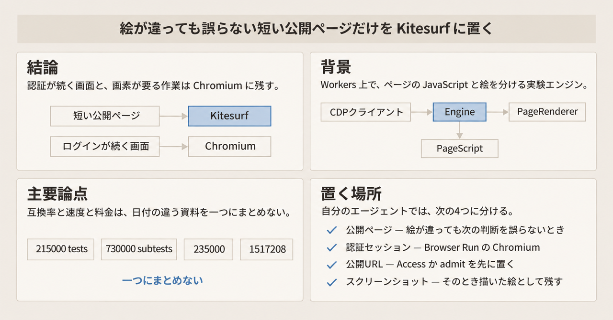
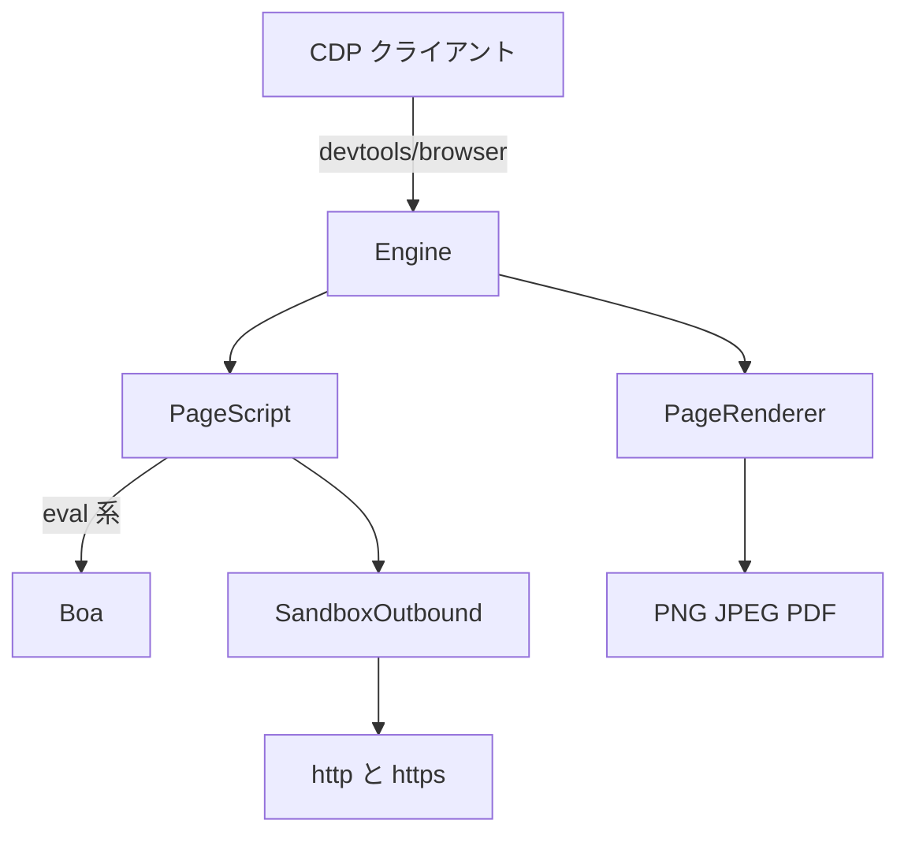

Cloudflare Kitesurf は、エージェントがページを読むための実験的なブラウザエンジンです。HTML、CSS、JavaScript、スクリーンショットを、Cloudflare Workers 上で扱います。公開の操作面は Chrome DevTools Protocol（CDP）の WebSocket です。CDP は、ブラウザを外から操作する手順です。2026年11月13日の Cloudflare Blog で Apache-2.0 のソースが公開され、実装は GitHub の [cloudflare/kitesurf](https://github.com/cloudflare/kitesurf)、製品としての入口は Browser Run です。Browser Run は、アカウントの資格情報で Cloudflare 側のブラウザに繋ぐ入口です。

この文章で分けるのは、画面の証拠が要るのか、ページ内の JavaScript を実行するのか、その実行場所を Workers にするのか、です。説明は、同日のオープンソース記事、開発者ドキュメント、main のコミット `4a2903813a22b08d4f3cc64a4b35339d0293a5d1`（2026-11-13T12:13:48Z）までです。


*この記事の全体像。以下、順に解説します。*

## Kitesurfとは

Kitesurf の実行単位は、Workers 上の Engine、PageScript、PageRenderer です。HTML、CSS、JavaScript、スクリーンショットは、Chrome 本体やブラウザコンテナを置かず、Workers 上のアイソレートで扱います。アイソレートは、その Worker が動く実行単位です。

### Engine、PageScript、PageRenderer

公開面は Engine が持ちます。CDP の WebSocket、HTTP、その接続のセッション状態がここです。

PageScript は、ページごと、および out-of-process iframe ごとに立つ Dynamic Worker です。out-of-process iframe は、ページ本体とは別のプロセスで動く iframe です。Dynamic Worker は、実行中にコードを載せて起動する Worker です。PageScript は DOM と、そのページの JavaScript を持ちます。

ページの通常スクリプトは、PageScript のアイソレートで動きます。`Runtime.evaluate`、`eval`、`new Function`、計算された `import()` は、開発時も本番も、そのアイソレート内の Boa（Wasm）で動きます。Boa は、この eval 系を動かす Wasm です。Wasm は、Workers 上でも動くバイナリ形式です。[AGENTS.md](https://github.com/cloudflare/kitesurf/blob/4a2903813a22b08d4f3cc64a4b35339d0293a5d1/AGENTS.md) は、PageScript を載せている親の Worker には、JavaScript の eval をネイティブに許すフラグを渡さない、と書きます。

PageRenderer は、シーンを PNG、JPEG、PDF に描きます。シーンは、PageRenderer が絵にする描画の単位です。状態を持たず、落ちても Worker から呼び直してやり直せます。途中フレームはレンダラ側で合成され、CDP クライアントには完成フレームが渡ります。完成フレームだけを渡す扱いの例外が、ターミナル向けのシーンの流れです。その流れが完成フレーム以外の何を渡すかは、この記述にはありません。実装は `packages/engine/src/rbi.ts` にあります。

外向きのネットワークに触れるのは SandboxOutbound だけ、と 2026年8月6日の紹介記事が書きます。SandboxOutbound は、クッキー jar、CORS、ブラウザ型のヘッダを持つ外向きの経路です。

端末向けのクライアントは、`brew install cloudflare/cloudflare/kitesurf` の `kitesurf` です。表示は、画像を出せる端末 Kitty のグラフィクス、または文字だけの ANSI です。この端末クライアントの説明は、PageRenderer を利用者の端末側に置き、PageScript はサーバに残す構成です。

### 一つの接続の中の流れ

1 つの CDP 接続が、ページの JavaScript と、絵のラスタを分けて持ちます。



`Page.navigate` のたびに、名前を付けない `env.LOADER.load` で新しい PageScript が載ります。これは、そのナビゲーション用の Dynamic Worker を新しく載せる呼び出しです。前の Worker は落とされます。名前付きの `LOADER.get` は、同じ Worker を再利用する経路で、navigate では使いません。AGENTS.md がそう書きます。新しいターゲットは、クライアントが遷移前に evaluate できるよう、中身の無い `about:blank` の PageScript を `ensurePageScript` で先に持ちます。`history.pushState` は、URL を変えても同じ文書に留まるブラウザの操作です。`?ks_refetch_on_pushstate=1` が無い限り、Kitesurf では同じ文書の中に残ります。

Puppeteer は `/devtools/browser` に繋ぎます。Puppeteer は、CDP 経由でブラウザを操作するライブラリです。`/devtools/page/<id>` に直接繋ぐと、そのページだけの接続になり、配下のページを別のターゲットとして知らせません。AGENTS.md がそう書きます。

セッションは Durable Object に置きません。Durable Object は、接続の外に状態を残せる Cloudflare の置き場です。既定のセッションストアは `MemorySessionStore` で、接続をまたいで残りません。

### 手元とマネージドの入口

ローカルの OSS エンジンは `pnpm run dev` で起動します。CDP は `ws://127.0.0.1:8787/devtools/browser` です。ポートは `KITESURF_PORT` で変わります。発見は `/json/version`、ヘルスは `/health` です。

```bash
pnpm install --frozen-lockfile
pnpm run dev
```

マネージドの CDP は、次の WebSocket に Bearer トークンを付けます。Bearer トークンは、アカウントの資格情報です。

```text
wss://api.cloudflare.com/client/v4/accounts/<ACCOUNT_ID>/browser-run/devtools/browser?browser=kitesurf
```

スクリーンショットの Quick Action は、短い HTTP の呼び出しです。`POST .../browser-run/screenshot?browser=kitesurf` です。Worker からは、次の形です。

```js
env.BROWSER.quickAction("screenshot", { url, browser: "kitesurf" })
```

`wrangler dev` で binding の `browser: "kitesurf"` を使うときは、設定 `remote: true` が要ります。wrangler は、Workers を手元と Cloudflare 上で動かすコマンドです。この設定が手元と Cloudflare のどちらを呼ぶかは、製品ドキュメントのその行には書かれていません。Chromium 側の remote の要否は、通常の Browser Run のままです。その要否の中身は、この表には書いていません。

### 土台、ライセンス、起動

スタックの土台は三つです。Blitz は HTML、DOM、layout、paint で、ライセンスは MIT OR Apache-2.0 です。Stylo は CSS で、MPL-2.0 です。三つ目は Boa です。

リポジトリの説明は「Workers 上で動く実験ブラウザ」です。homepage は [https://kitesurf.dev/](https://kitesurf.dev/) です。2026年11月14日時点のスターは約 500、フォークは約 16 です。アーカイブされていません。default branch は main です。任意ブランチへの pushedAt は 2026-11-13T16:11:21Z で、main の最新コミット時刻とは別です。GitHub リポジトリの createdAt は 2026-09-30T08:51:43Z です。紹介記事は、当時 12 週で、最初のコミットは 2026年5月だ、と書きます。

日付は資料ごとに違います。紹介記事は 2026年8月6日、更新記事は 2026年9月28日です。changelog のポスト日付は 2026年11月12日です。オープンソース記事の schema `datePublished` は 2026-11-13T20:20:21.646Z です。

ライセンスは Apache-2.0 です。パッケージには、Engine に対応する engine、PageScript に対応する page-script、PageRenderer に対応する page-renderer、端末クライアントの kitesurf-cli があります。

ローカル実行の前提は、[README](https://github.com/cloudflare/kitesurf/blob/4a2903813a22b08d4f3cc64a4b35339d0293a5d1/README.md) では Bazelisk を `bazel` とし、Node 22 以上、pnpm 9.15.4、macOS では GNU tar です。Bazelisk は、Bazel を用意するコマンドです。`pnpm install --frozen-lockfile` のあと `pnpm run dev` です。Rust と Wasm の初回ビルドは遅い、と README が書きます。

## 注意点

製品ドキュメントが書く互換の到達は、そのページ自身の申告です。数字は、表と日付を分けて読みます。

### Web Platform Tests の四つの数字

Web Platform Tests（WPT）は、ブラウザが Web 標準のテストをいくつ通したかを公開している結果です。四つの数字は、別の引用です。tests と subtests は同じ語ではありません。subtests は、テストファイルの中の個別の検査です。

| 出典 | 日付 | 書き方 |
|---|---|---|
| [紹介記事](https://blog.cloudflare.com/kitesurf/) | 2026-08-06 | around 215,000+ WPT tests（tests という語） |
| [更新記事](https://blog.cloudflare.com/kitesurf-update/) | 2026-09-28 | 730,000+ subtests。ローンチより 500,000 多い、という自己申告 |
| [製品ドキュメント](https://developers.cloudflare.com/browser-run/kitesurf/) | 最終更新 2026-11-13 | As of the latest run, over 235,000 subtests |
| [https://kitesurf.dev/wpt](https://kitesurf.dev/wpt) | 2026-11-13 16:24 UTC | 登録サブテスト 1,517,208 / 1,543,968（98.3%） |

1,517,208 は 235,000 より大きいです。ドキュメントの "over 235,000" という不等式そのものは、このダッシュボードと衝突しません。「as of the latest run」を今の規模として読むことは、2026年9月28日の 730,000+ と、2026年11月13日のダッシュボードの両方と合いません。

98.3% は、登録して走ったサブテストの率です。テストファイルは 9,093 / 11,764（77.3%）です。スキップとして別に数えているのは 56,854 ファイルで、うち 56,823 は未登録、31 は SKIP です。未登録の 56,823 は、登録済みの 11,764 には入りません。encoding は 1,139,877 / 1,139,904 で、登録して走ったサブテスト 1,517,208 の約 4 分の 3 を占めます。encoding を除くと 377,331 / 404,064 で 93.4% になります。この 93.4% はダッシュボードの件数から計算した率であり、Cloudflare が掲げた率ではありません。

ドキュメントの領域表と、同じダッシュボードのフォルダ行は次のとおりです。領域パーセンテージは、フォルダ行と数値が一致しません。表の測定時刻はドキュメントにありません。

| 領域 | ドキュメント | 2026-11-13 16:24 UTC |
|---|---|---|
| DOM | 97% | 56,865 / 57,665 = 98.6% |
| HTML | 96% | 74,101 / 76,729 = 96.6% |
| Selection | 99% | 33,881 / 34,084 = 99.4% |
| SVG | 97% | 63 / 65 = 96.9% |
| Encoding | 99% | 1,139,877 / 1,139,904 = 100.0% |
| CORS | 95% | 224 / 231 = 97.0% |
| XHR | 95% | 220 / 221 = 99.5% |
| URL | 83% | 9,867 / 9,978 = 98.9% |

HTML と SVG は、四捨五入で説明できる余地があります。DOM、encoding、CORS、XHR、URL は、2026-11-13 16:24 UTC のダッシュボードと数値が一致しません。ダッシュボードには、ドキュメントの表に無い行もあります。css は 75,304 / 85,726 = 87.8% です。スキップ 131,567 は分母 85,726 より大きく、未登録が登録済みの外にあるというファイル数の関係は、この行には書かれていません。fetch は 2,084 / 2,818 = 74.0% です。shadow-dom は 524 / 771 = 68.0% です。domparsing は 205 / 378 = 54.2% です。製品ドキュメント自身が、このスナップショットは実サイトの描画能力ではない、と注記しています。

### ベンチマークは二枚ある

[製品ドキュメント](https://developers.cloudflare.com/browser-run/kitesurf/)（2026年11月13日のページにも残る）は、14 URL について Quick Action を 5 回した中央値を、温まった Chromium のプールと比べています。コーパスの URL は、2026年8月の紹介が `kitesurf.cloudflare.app/corpus.txt`、現行ドキュメントが `kitesurf.dev/corpus.txt` を指します。この表を、2026年11月13日の再計測としては扱いません。この表の壁時計は、描画にかかった時間の列です。クライアントとの往復を含まない、という定義は、次の 38 ページの計測ページにあります。14 URL の表に同じ但し書きがあるとは書かれていません。

| 指標 | Kitesurf | Chromium（温プール） | ドキュメントの相対 |
|---|---|---|---|
| CPU、スクリーンショット | 380 ms | 1,173 ms | 3.1 倍少ない |
| CPU、HTML | 229 ms | 877 ms | 3.8 倍少ない |
| メモリ、スクリーンショット | 57.8 MiB | 271.0 MiB | 4.7 倍少ない |
| メモリ、HTML | 39.4 MiB | 273.7 MiB | 7.0 倍少ない |
| 壁時計、スクリーンショット | 1,148 ms | 637 ms | 1.8 倍遅い |
| 壁時計、HTML | 820 ms | 472 ms | 1.7 倍遅い |

[https://kitesurf.dev/benchmarks](https://kitesurf.dev/benchmarks) の最終実行は 2026-11-13 02:28 UTC です。38 ページ、ウォームアップ 2 回のあと 5 回、既定は中央値です。比べている相手は Browser Run の Chrome と、冷えた Chrome です。14 URL の表とは混ぜません。この Kitesurf 列が、手元、セルフホスト、マネージドのどれかは書かれていません。

計測の定義は同ページにあります。壁時計はバックエンドの描画時間で、クライアントとの往復を含みません。Chrome cold のタイマーは CDP の準備ができた時点からで、起動時間を含みません。メモリは増分ではなく、捕捉時の絶対値です。Kitesurf は main Worker、page isolate、renderer の合計です。Browser Run の Chrome は再利用されるので、その表がメモリとして出している値が前のページを残しえます。

| | Kitesurf | Browser Run の Chrome | Chrome（cold） |
|---|---|---|---|
| スクリーンショットの典型値 | 壁時計 1.20 s、CPU 361 ms、54 MiB | 壁時計 820 ms、CPU 1.33 s、389 MiB | 壁時計 1.01 s、CPU 747 ms、329 MiB |
| HTML の典型値 | 壁時計 850 ms、CPU 239 ms、34 MiB | 壁時計 709 ms、CPU 1.21 s、375 MiB | 壁時計 888 ms、CPU 610 ms、317 MiB |

同じ実行の壁時計には、典型値から外れるページがあります。

| ページ | Kitesurf | Browser Run の Chrome | Chrome（cold） |
|---|---|---|---|
| https://www.elmundo.es/ | 9.86 s（p95 10.2 s） | 3.82 s | 2.68 s |
| https://www.theguardian.com/international | 6.30 s（p95 6.91 s） | 1.06 s | 1.28 s |
| https://trysansa.com/product/smart-model-routing | 7.68 s（p95 9.76 s） | 743 ms | 1.03 s |
| https://blog.cloudflare.com/ | 3.13 s | 848 ms | 979 ms |
| https://developers.cloudflare.com/ | 2.97 s | 975 ms | 1.04 s |

relic.so の行は逆です。Kitesurf は約 2.0 秒、Browser Run の Chrome は Render failed、冷えた Chrome は 2.51 秒から 2.91 秒、と同ページの計測行が並びます。

CPU とメモリの典型値は、Kitesurf が小さいです。壁時計の典型値は、Browser Run の Chrome や冷えた Chrome より長いページが多く、ニュースとプロダクトの一部は数倍になります。

### 無料ベータと、日付の違う価格表

2026年11月13日の製品ドキュメントと、2026年9月28日の更新記事は、ベータ中は無料で、アカウント上限の後ろにある、と書きます。上限のリンク先は Browser Run の limits です。「ベータ中は無料」は製品ページの自己申告であり、古い価格表の例外条項としては書かれていません。

[limits](https://developers.cloudflare.com/browser-run/limits/)（最終更新 2026-10-14）は、Browser Run の製品上限です。OSS エンジンの上限ではありません。429 と Retry-After が書かれています。keep_alive は、無操作でも接続を保つ指定です。

| | Workers Free | Workers Paid |
|---|---|---|
| ブラウザ時間 | 1 日 10 分 | 上限なし（pricing を見よ） |
| 同時 | 3 | 200 |
| 新規 | 20 秒に 1 | 3/秒 |
| 無操作 | 60 秒 | 60 秒（keep_alive で最大 20 分） |
| Quick Actions | 10 秒に 1 | 30/秒 |

[pricing](https://developers.cloudflare.com/browser-run/pricing/)（最終更新 2026-04-21）は、Paid に月 10 ブラウザ時間を含み、そのあと 1 時間 0.09 ドル、と書きます。同時に開いているブラウザの数（Browser Sessions）は、月平均で 10 まで料金に含まれ、超えた分は 1 ブラウザあたり月 2.00 ドルです。Free は 1 日 10 分、同時 3 です。limits の「時間上限なし / 同時 200」と、この価格表の「月 10 時間 / 月平均 10」は、日付の違う文書として併記します。新しい limits で、古い価格表を上書きしません。

セルフホストは、このブラウザ時間の表とは別の請求になります。README は、Dynamic Workers のために Workers Paid が要る、と書きます。[Dynamic Workers の価格](https://developers.cloudflare.com/dynamic-workers/pricing/)（最終更新 2026-06-11）は Paid のみです。月 1,000 unique Dynamic Workers を含み、追加は 1 Dynamic Worker あたり 1 日 0.002 ドルです。Requests は月 1,000 万のあと、100 万あたり 0.30 ドルです。CPU は月 3,000 万 CPU ミリ秒のあと、100 万ミリ秒あたり 0.02 ドルです。`.load(code)`、または ID を付けない呼び出しは、1 回につき 1 Dynamic Worker と書かれています。

AGENTS.md は、navigate ごとに `env.LOADER.load` と書きます。同じ価格ページは、同じ Worker へ複数回送るなら安定した ID の `.get()` を使え、と書きます。AGENTS.md の navigate は `env.LOADER.load` で、この `.get()` ではありません。したがってセルフホストでは、ナビゲーションが Dynamic Worker の作成カウントになりえます。これは価格ページのルールとコードからの解釈であり、Cloudflare が Kitesurf の単価として書いた文ではありません。Requests と CPU は、Workers の請求にも載ります。日次作成の課金は 2026年5月26日から、と同ページの Billing が書きます。2026年3月24日の [changelog](https://developers.cloudflare.com/changelog/post/2026-03-24-dynamic-workers-open-beta/) は、当時その課金はまだ有効ではない、と書いていました。利用データの表示は 2026年6月1日まで遡ります。

`wrangler.jsonc` の `cpu_ms` 300000 と `subrequests` 1000000 は、エンジン Worker の設定です。公開 SLA ではありません。

### Boa の位置づけは二文ある

上に書いた eval 系が PageScript 内の Boa で動く、というのは AGENTS.md の不変条件です。その文が名指しするのは、`Runtime.evaluate`、`eval`、`new Function`、計算された `import()` です。通常スクリプトがどの処理系で動くかは、その不変条件には書かれていません。通常スクリプトの文は、PageScript のアイソレートで動く、とだけ書きます。

オープンソース記事は、別に、Dynamic Workers で JavaScript を動かせないときの最終手段が Boa だ、とも書きます。eval 系の不変条件と、この記事の文は、別の文として読みます。二つを一つの実行系の説明にはまとめません。

### 自己申告のまま残すもの

互換の例として、TodoMVC（vanilla、React、Vue、Angular、Preact）、Wikipedia、Hacker News、Cloudflare Blog、ダッシュボードの多く、がドキュメントに挙がります。Playground には Paper.js、Doom の wasm canvas、tldraw があります。ドキュメントは、確かめるには試すことだ、と書きます。

WebMCP は 2026年9月28日に案内されています。書かれているのは、chrome-devtools-mcp のフラグ `--category-experimental-webmcp` と、Playground の例が Cloudflare Radar のツールであることまでです。Playground は、製品が例を置いている場所の名前です。このフラグは、実行場所の判断には使いません。

スター約 500、フォーク約 16 は、2026年11月14日時点の概数です。その後に増減します。公開の GitHub issue は、同日の検索 API（`is:issue is:open`）で 1 件でした。`open_issues_count` は PR を含めて約 35 です。Discussion は 0 件です。

日本語の解説（XenoSpectrum、homula、CHOTTO NEWS、赤神の Speaker Deck、オープンソース後の X 投稿）は、公式の数字か、認証に関する警告の再掲です。英語の一次資料に無い批判は、それらの解説にはありません。日本語版の Cloudflare Blog は照合していません。

2026年11月13日のオープンソース記事に対応する Hacker News のスレッドは、確認した範囲では見当たりません。次の発言は、2026年8月6日のスレッドのものです。いずれも掲示板の発言です。zuzululu は、ローカル実行と、指紋でのブロックのしやすさに触れています。celso（Cloudflare）は「すぐにオープンソースにする。今日ブロックできる。Kitesurf は隠さない」と書き、別コメントで Chromium と Kitesurf の Browser Run は bot として識別される、と書いています。buremba の「useless」は、Browser Run が Cloudflare の bot 対策を迂回するかという問いへの答えで、描画の再現ではありません。chrysoprace と echelon は、bot 対策の会社が bot 自動化を売ることへの批判です。dabinat は、Blitz が初期でも、エージェント専用の閲覧という用途では問題にならない、と書いています。celso の識別の話は、後の Browser Run FAQ と内容が合います。

### 公開ページに無い条項

網羅的なエラーコード一覧のページは、見当たりません。SLA、リージョン、データ所在地の専用条項も、読んだ公式ページにはありません。廃止日もありません。experimental のまま、2026年11月13日にソースが公開されています。契約でこれらの条項が要るなら、公開ドキュメント以外を見ます。

## 四つの実行場所

「ローカル」は二つあります。OSS を手元の workerd で動かす経路と、自分のアカウントの Workers に載せる経路です。workerd は、`pnpm run dev` が起動する Workers ランタイムです。マネージドも二つあります。Browser Run の Kitesurf と、Browser Run の Chromium です。消費者 Worker は、`env.BROWSER` でブラウザを呼ぶ側の Worker です。binding は、その呼び出しの設定です。表の「要否は書いていない」は、OSS とセルフホストの行が、その binding の要否を書いていない、という意味です。binding が無い、とは書いていません。ベータ無料の自己申告は、Browser Run の Kitesurf の列にだけ書いてあります。Chromium の列は、Browser Run の時間と同時数です。

| | OSS の `pnpm run dev` | セルフホストした Workers | Browser Run の Kitesurf | Browser Run の Chromium |
|---|---|---|---|---|
| 実行場所 | 手元の workerd | 自分のアカウントの Workers | Cloudflare の管理面 | Cloudflare の管理面 |
| 認証 | エンジン自身は無し。127.0.0.1 | Access か `EngineHost.admit` が要る | アカウントの Bearer | アカウントの Bearer |
| 課金 | 手元の CPU | Workers Paid と Dynamic Workers | ベータ無料の自己申告と、上の二枚の上限 | Browser Run の時間と同時数 |
| 画面 | シーンのラスタ | 同じエンジン | 同じエンジン。リクエストは bot 識別 | 実 Chromium |
| 消費者 Worker の binding | 要否は書いていない | 要否は書いていない | `wrangler dev` で `browser: "kitesurf"` は `remote: true` が要る | 通常の Browser Run の要否のまま |

### 公開 URL には認証を先に置く

デプロイの既定 URL は `kitesurf.<subdomain>.workers.dev` で公開される、と README が警告します。Cloudflare Access は、その公開 URL の前に置く認証です。Puppeteer から Access を通すヘッダは `CF-Access-Client-Id` と `CF-Access-Client-Secret` です。

手元の操作画面は、127.0.0.1 にだけ繋がります。デプロイ先では、エンジンに同梱した操作画面を使います。指定は `--config=devtools` で、デプロイでは常時です。`chrome://inspect` は、HTTPS のエンジンに届きません。`wrangler dev` でその指定が無いときは、Chrome が配っている操作画面へ戻ります。AGENTS.md は、その画面の commit を `1d17a2e2ee147bb7d6ae2ab6abdb3a2510c17775`、Chrome を 156.0.8078.47 と書きます。

[SECURITY.md](https://github.com/cloudflare/kitesurf/blob/4a2903813a22b08d4f3cc64a4b35339d0293a5d1/SECURITY.md) は、エンジン自身に認証もレート制限も無い、と書きます。到達できる URL は、閲覧と CDP と、そのアカウントの CPU と Dynamic Workers を使えます。`host.ts` は、`admit` が応答を返したときだけ拒否し、未設定ならすべてのリクエストを通す、と書きます。`EngineHost.admit` は、その拒否のフックです。`rate-limit.ts` は 429 のヘルパで、既定の入口 `index.ts` はそれを掛けていません。ヘルパがあることは、SECURITY.md の文を取り消しません。Browser Run 側の 429 は、上の limits の話です。

isolate からの脱出、オリジンやセッションをまたぐデータ、許可されないネットワーク、HTTP と CDP の認証バイパスは、公開 issue ではなく HackerOne と security@cloudflare.com に送れ、と SECURITY.md が書きます。NVD API 2.0 の `keywordSearch=kitesurf` は totalResults 0 です（応答時刻 2026-11-13T23:40:31.617）。GitHub の公開 security advisory も 0 件でした。「kitesurf」の検索は、Kiteworks や別の Kite プロジェクトに当たります。main の最新コミットは、doctype コメント走査の ReDoS を CodeQL の `js/redos` 向けに直した、というコード上の修正です。CVE ではありません。

公開 issue で、セキュリティ、クッキー漏洩、スクリーンショットの誤り、ローカルと本番の差を扱うものは、[#123](https://github.com/cloudflare/kitesurf/issues/123) 以外にはありませんでした。#127 は closed（2026-11-13、devatikulh）で、モバイルに埋め込めるエンジンの要望です。セキュリティ所見ではありません。

## クッキー、ファイル、外向き通信

ローカルの `pnpm run dev` もデプロイ先も、同じ Workers ランタイムのコード経路です。ノート PC に入っている Chrome のプロファイルではありません。

### クッキー

[`packages/engine/src/cookies.ts`](https://github.com/cloudflare/kitesurf/blob/4a2903813a22b08d4f3cc64a4b35339d0293a5d1/packages/engine/src/cookies.ts) の上限は、1 クッキー 4096 バイト、ホストあたり 180、jar 全体 3000 です。スキームは http と https だけで、それ以外は `urlParts` が null になります。Secure は、信頼できるホスト（https、localhost、.localhost、::1、127.x）に付きます。スクリプトから HttpOnly は付けられず、HttpOnly を覆い隠すこともできません。`document.cookie` は HttpOnly を返しません。opaque origin は、オリジンを特定できない文書です。その文書にクッキーストアはありません。

jar のキーは、接続と、その中でクッキーを分ける単位（ブラウザコンテキスト）です（`cookie-jar-registry.ts`）。既定ストアは、エンジンを載せる側が `createSessionStore` を返さない限り `MemorySessionStore` で、アイソレートのヒープ上の Map です（`session-store.ts`、`host.ts`）。コメントは、エンジンを載せる側がデータベースファイルのストアを渡せる、と書きます。リポジトリ内にその実装は無く、`pnpm run dev` の既定でもありません。接続のあいだ、jar は残ります。接続をまたいだ永続は、AGENTS.md が対象外にしています。ナビゲーションのたびにクッキーを消す、とは書きません。Web Storage をナビゲーションをまたいで残すことも、同じ対象外リストにあります。

未マージの [cloudflare/kitesurf#118](https://github.com/cloudflare/kitesurf/pull/118)（open、2026-11-11、LuisDuarte1）は、スクリプトから読める `document.cookie` と、次のリクエストに付くクッキーが別だ、と書きます。`document.cookie` はアイソレート内にキューされ、次の応答で jar に入ります。マウス、キー、`Input.insertText` の入力ハンドラは、その書き込みを捨てます。同意のクリックや、トークンを書いて `location.reload()` するチャレンジは、1 つの CDP セッションの中で、トークン無しの遷移になります。リロード後のページは `document.cookie` を、送ったかのように読める、とも書きます。ディスク永続の証拠ではありません。

### ファイルとフォント

ページのモジュールグラフは、`file:///bundle/`、`cloudflare:`、`node:`（`node:fs` を含む）を拒みます（`walk-module-graph.ts`）。ページコードが届くのは、自分の http と https のモジュールです。フォントは、ホストのディスクからではなく、assets binding の `FONT_ASSETS` から読みます。Workers に一般のファイルシステムはありません。ローカルの `pnpm run dev` も、wrangler 経由の Workers ランタイムです。

未マージの [cloudflare/kitesurf#125](https://github.com/cloudflare/kitesurf/pull/125)（open、2026-11-13、collaborator ruifigueira）は、既定フォントが Noto Sans で、`sans-serif` と `system-ui` の背後にいる、と書きます。ハングル音節 11,172 字は `.notdef` です。`.notdef` は字形が無いときの空きで、画面では豆腐として見えます。CJK のフェイスは Noto Sans SC だけで、日本語と繁体字の漢字が簡体字の字形で描かれる、と書きます。`macos` プロファイルは提案で、既定は `noto` のままです。ピクセル差分の数値は、この PR にありません。修正は main に入っていません。

### プライベートネットワークと fetch

`KITESURF_ALLOW_PRIVATE_NETWORK` は、`wrangler.jsonc` のトップレベルと、local という環境の設定の両方で空です。空のとき検査はオンで、ローカルエンジンでもページは信頼されない、とコメントが書きます。[`packages/engine/src/eval/private-network.ts`](https://github.com/cloudflare/kitesurf/blob/4a2903813a22b08d4f3cc64a4b35339d0293a5d1/packages/engine/src/eval/private-network.ts) の先頭は、分類対象がホスト名と IP リテラルであり、公開名が私設アドレスに解決される場合はこの検査が捉えない、と書きます。フラグが空であることと、名前解決後の私設アドレスまで止めることは、別の事実です。

`scripts/local-engine.mjs` が同フラグを 1 にするのは、上流の Playwright / Puppeteer スイート用エンジンだけです。`pnpm run dev` の経路ではありません。Playwright は、Puppeteer とは別の、ブラウザ操作のライブラリです。

`global_fetch_strictly_public` は、`wrangler.jsonc` のトップレベルにあります（`compatibility_date` は 2026-09-11）。[Workers の互換フラグ](https://developers.cloudflare.com/workers/configuration/compatibility-flags/)（公開 2026-09-18）は、グローバル fetch を公開インターネット上の経路として扱う、と書きます。workerd の compatibility-date コメントは、このフラグが workerd では効かず、Cloudflare 上で効く、と書きます。このコメントは、対象コミットにピンした確認ではありません。ローカルの wrangler とデプロイ先で、同じ Cloudflare ゾーン（サイトを置く単位）への fetch の経路が違うかどうかは、そのコメントだけでは確定しません。このフラグは、上のプライベートネットワーク検査ではありません。

ローカルとデプロイ先で、設定の値が違います。`KITESURF_ENV` は local と production です。ほかにも、ローカルだけ値が入っている設定があります。各設定が動作をどう変えるかは書かれていません。ローカルには、トレースの送信先 `http://localhost:4318/v1/traces` があります。ローカルには、FIXTURES という名前の service binding があります。service binding は、Worker から別の Worker へ繋ぐ設定です。FIXTURES が何のための接続かは書かれていません。

紹介記事は、ポリシー違反の取得を 403 と書きます。`outbound.ts` は、outbound filter と request blocker で 451 も返します。二つを一つのステータスにまとめません。

未マージの [cloudflare/kitesurf#120](https://github.com/cloudflare/kitesurf/pull/120)（open、2026-11-11、LuisDuarte1）は、トップレベル遷移に `Sec-Fetch-*` と `Upgrade-Insecure-Requests` が付かない、と書きます。[#119](https://github.com/cloudflare/kitesurf/pull/119)（open、同日、同じ著者）は、CDP が Referer を渡さない遷移で、行き先自身のオリジンを Referer にする、と書きます。どちらも main にマージされていません。

[Browser Run FAQ](https://developers.cloudflare.com/browser-run/faq/)（最終更新 2026-11-13）は、Browser Run のリクエストは Cloudflare に常に bot として識別される、と書きます。Quick Actions、Puppeteer、Playwright、CDP の bot detection ID は 119853733 です。bot detection ID は、そのリクエストに付く bot 判定の識別子です。許可リストは Enterprise の WAF カスタムルールが要る、と同ドキュメントが書きます。ヘッダの説明は [automatic request headers](https://developers.cloudflare.com/browser-run/reference/automatic-request-headers/) にあります。

## CDP が届く範囲

README は、Kitesurf が CDP エンドポイントを提供し、Chrome の全実装ではない、と書きます。一部の DevTools 機能はまだ動かない、とも書きます。AGENTS.md が対象外にしているものは、次です。接続やナビゲーションをまたぐ永続ストレージ、WebGL、WebGPU、WebAudio、WebRTC、MediaStream、同期 XHR、service worker、shared worker、bot 対策の指紋、ライブの SVG DOM、WebDriver です。

語の対応は次のとおりです。WebGL と WebGPU はページ内の 3D 描画です。WebAudio は音声です。WebRTC と MediaStream はカメラや通話です。同期 XHR は、応答までスクリプトを止める XMLHttpRequest です。service worker はページの裏で動くスクリプトで、shared worker は複数ページで共有する裏方です。ライブの SVG DOM は、描画したあとも触れ続ける SVG の文書です。WebDriver は、CDP とは別の自動操作の手順です。bot 対策の指紋は、相手が bot 判定に使うブラウザの特徴です。

これらが今は動く、と書いた一次の記述は、オープンソース記事、製品ドキュメント、AGENTS.md、README にはありません。

製品ドキュメントの「まだ向かないもの」は、動画、WebGL、本物の TLS 指紋が要る bot チャレンジ、永続状態が要る長い認証セッションです。そのときは Browser Run の Chromium を使う、とドキュメントが書きます。TLS 指紋は、接続の最初に相手が見る実装の特徴です。

未マージの [cloudflare/kitesurf#82](https://github.com/cloudflare/kitesurf/pull/82)（open、2026-11-09、BernardoPe）は、モジュールではない script が例外を出すと、後ろの script も止まる、と main の挙動として書きます。例は Apple のホームページと YouTube です。修正はマージされていません。

[#123](https://github.com/cloudflare/kitesurf/issues/123)（open、2026-11-13、報告者 arshzip）は、ローカルの `pnpm run dev`（wrangler 4.131.2、puppeteer-core 25.16.0、対照の Chrome 157）で、`crossorigin` 付き、または `type="module"` の `data:` スクリプトが CORS で実行されない、と書きます。プレーンな `data:` スクリプトは動きます。報告者は、Instagram のブートローダが `<script crossorigin src="data:…">` のため `requireLazy` が定義されず、スプラッシュのまま残る、と書きます。タイトルの本筋は手動確認、関連する `blob:` の記述は未確認、と投稿者自身が断っています。

## スクリーンショットを何の記録として残すか

一次の記事とドキュメントは、スクリーンショットを監査記録だとは書いていません。紹介記事と製品ドキュメントは、描画が pixel-perfect ではない、と書きます。pixel-perfect は、画素が一致する描画です。失敗は空白フレームか、要素の欠落に落ち、セッションは殺さない、と紹介記事が書きます。描画主体は PageRenderer のシーンラスタです。読んだソースに、署名付きの証明はありません。社内の visual regression（Puppeteer で Chromium と絵を比べる）には、紹介記事が触れます。それは製品の保証文ではありません。部分フレームをレンダラ内で合成し、CDP クライアントに見せない、という AGENTS.md の記述は、合成の場所の説明です。署名ではありません。

したがって、Kitesurf のスクリーンショットを「Chrome がそのとき見せたもの」や「オリジンが返したバイトの記録」としては扱いません。絵を手元に残すこと自体を、ソースが禁止しているわけではありません。保証がありません。

#123 の報告が正しければ、一枚絵でもスプラッシュのまま残ることがあります。#125 の記述が正しければ、ハングルは豆腐、日本語の漢字は簡体字の字形になりえます。どちらも未マージ、または未解決のままです。ベンチマークの空白フレームを「この URL は真っ白だった」と書いた一次の行は、benchmarks ページにはありません。relic.so では、Kitesurf がフレームを返し、Browser Run が Render failed でした。

## エージェントに置くときの基準

Kitesurf を使うのは、公開ページの短い読みで、絵が欠けても字形が違っても次の判断を誤らないとき、かつそのページが動くと分かっているときです。長い認証セッション、画素が合うこと、動画、WebGL、実在の TLS 指紋が要るときは、Browser Run の Chromium を使います。OSS エンジンを公開 URL に置くときは、Access か `EngineHost.admit` を先に置きます。スクリーンショットは監査記録にしません。

この範囲に収まる例は、字形の違いが次の判断を変えない公開ドキュメントの読みです。ログインが続く管理画面、動画、3D、相手が TLS 指紋で見るチャレンジは、Chromium 側です。ドキュメントが互換の例に挙げる TodoMVC や Wikipedia も、確かめるには試す、とドキュメントが書きます。

判断の材料は、次の一次の記述と計測です。

- 製品ドキュメントと AGENTS.md が、pixel-perfect、動画、WebGL、永続する認証セッション、完全な CDP を、今の到達点から外しています。
- 典型ページの CPU とメモリは、2026年11月13日の 38 ページのベンチマークで、Chromium より小さいです。壁時計は、重いページで冷えた Chrome の数倍になります。14 URL の表とは混ぜません。
- クッキーとファイルの既定は、メモリと http(s) のモジュールです。ディスクのクッキー DB は既定にありません。
- エンジンに認証もレート制限も無い、は SECURITY.md と `admit` のコードが一致します。公開の CVE 検索と公開 advisory は、上の検索では 0 件でした。
- スクリーンショットを監査証跡だという一次の文、完全な CDP という一次の文、`pnpm run dev` がプライベートネットワーク検査を切るという記述、動画や WebGL がもう動くという一次の文は、上に挙げた資料にはありません。

範囲を狭める材料は、次です。

- #123、#125、#118、#119、#120、#82 は、一回のスクリーンショットや一回の遷移でも、絵と JavaScript とヘッダが Chrome とずれる経路を、未解決または未マージのまま書いています。
- マネージド経路は bot detection ID 119853733 で識別されます。TLS 指紋のチャレンジより手前で分かれます。
- 98.3% は、encoding に引っ張られた登録サブテスト率です。ドキュメントの 235,000 と領域表を、最新実行の規模としては使いません。
- プライベートネットワーク検査はオンでも、公開名の解決先までは見ません。
- 価格は、2026年10月14日の limits、2026年4月21日の pricing、2026年6月11日の Dynamic Workers が並立しています。ナビゲーションごとの Dynamic Worker 件数は解釈です。請求画面で unique Dynamic Workers を見てから、予算に入れます。

自分のエージェントでは、次のように置きます。

1. 画面の証拠が欲しいだけか、ページ内 JavaScript を実行したいかを先に分けます。Kitesurf は両方を、Workers 上のサブセットとして渡します。
2. マネージドの Kitesurf は、公開ページで、絵が違っても次の判断を誤らない作業に限ります。bot として識別される前提で、チャレンジの手前で止まるページは対象から外します。
3. ログインが続くセッション、画素、動画、WebGL、相手が TLS 指紋で見るページは、Browser Run の Chromium に置きます。
4. OSS を自分のアカウントで動かすときは、Workers Paid と、Access または `admit` を同時に置きます。URL が公開されたままの検証はしません。`pnpm run dev` は、手元の Chrome の代わりにしません。
5. スクリーンショットは、そのエンジンがそのときラスタしたシーンとして残します。「Chrome はこう見えた」「オリジンはこう返した」には使いません。
6. 数字を書くときは、215,000 tests（2026-08-06）、730,000+ subtests（2026-09-28）、ドキュメントの over 235,000（2026-11-13 の文面）、ダッシュボードの 1,517,208 / 1,543,968（2026-11-13 16:24 UTC）を、一つの互換率に潰しません。ベンチマークも、14 URL の表と 38 ページの表を分けます。

採用するサイトでは、同意バナー、`data:` モジュール、日本語とハングルの字形を一回見ます。#123 の `blob:` 関連は、投稿者が未確認と書いています。

逆転条件は次です。#123 と #118 と #125 が main に入り、対象サイトで同意と字形と `data:` モジュールを確認できたとき、そのサイトに限って「短い公開ページ」の範囲を広げてよいです。接続をまたぐ永続、WebGL、動画、実 TLS 指紋が一次で「動く」と書かれるまでは、Chromium 側の条件は変えません。

## まとめ

Kitesurf は、Workers 上の PageScript と PageRenderer で、ページの JavaScript と絵を分ける実験的なブラウザエンジンです。操作面は CDP の WebSocket で、オープンソースの実行場所は手元の workerd、自分の Workers、Browser Run の Kitesurf です。実 Chromium が要る作業は、Browser Run の Chromium に残します。

WPT の 215,000、730,000+、235,000、1,517,208 / 1,543,968 は別の引用です。ベンチマークの 14 URL と 38 ページも別の計測です。ベータ無料は自己申告で、2026年4月21日の価格表と 2026年10月14日の limits は上書き関係にしません。

スクリーンショットは、そのエンジンがそのときラスタしたシーンです。監査の「Chrome はこう見えた」には使いません。公開 URL に OSS を置く前に、Access か `admit` を置きます。

この記事が少しでも参考になった、あるいは改善点などがあれば、ぜひリアクションやコメント、SNSでのシェアをいただけると励みになります！

## 参考リンク

- [オープンソース記事（2026-11-13）](https://blog.cloudflare.com/kitesurf-open-source/)
- [紹介記事（2026-08-06）](https://blog.cloudflare.com/kitesurf/)
- [更新記事（2026-09-28）](https://blog.cloudflare.com/kitesurf-update/)
- [changelog（2026-11-12）](https://developers.cloudflare.com/changelog/post/2026-11-12-kitesurf-open-source/)
- [Browser Run の Kitesurf](https://developers.cloudflare.com/browser-run/kitesurf/)
- [Browser Run FAQ](https://developers.cloudflare.com/browser-run/faq/)
- [automatic request headers](https://developers.cloudflare.com/browser-run/reference/automatic-request-headers/)
- [Browser Run limits](https://developers.cloudflare.com/browser-run/limits/)
- [Browser Run pricing](https://developers.cloudflare.com/browser-run/pricing/)
- [Workers の互換フラグ](https://developers.cloudflare.com/workers/configuration/compatibility-flags/)
- [Dynamic Workers の価格](https://developers.cloudflare.com/dynamic-workers/pricing/)
- [Dynamic Workers の changelog（2026-03-24）](https://developers.cloudflare.com/changelog/post/2026-03-24-dynamic-workers-open-beta/)
- [kitesurf.dev](https://kitesurf.dev/)
- [WPT ダッシュボード](https://kitesurf.dev/wpt)
- [ベンチマーク](https://kitesurf.dev/benchmarks)
- [cloudflare/kitesurf](https://github.com/cloudflare/kitesurf)
- [README（対象コミット）](https://github.com/cloudflare/kitesurf/blob/4a2903813a22b08d4f3cc64a4b35339d0293a5d1/README.md)
- [AGENTS.md（対象コミット）](https://github.com/cloudflare/kitesurf/blob/4a2903813a22b08d4f3cc64a4b35339d0293a5d1/AGENTS.md)
- [SECURITY.md（対象コミット）](https://github.com/cloudflare/kitesurf/blob/4a2903813a22b08d4f3cc64a4b35339d0293a5d1/SECURITY.md)
- [wrangler.jsonc（対象コミット）](https://github.com/cloudflare/kitesurf/blob/4a2903813a22b08d4f3cc64a4b35339d0293a5d1/packages/engine/wrangler.jsonc)
- [cookies.ts（対象コミット）](https://github.com/cloudflare/kitesurf/blob/4a2903813a22b08d4f3cc64a4b35339d0293a5d1/packages/engine/src/cookies.ts)
- [private-network.ts（対象コミット）](https://github.com/cloudflare/kitesurf/blob/4a2903813a22b08d4f3cc64a4b35339d0293a5d1/packages/engine/src/eval/private-network.ts)
- [Issue #123](https://github.com/cloudflare/kitesurf/issues/123)
- [Pull request #82](https://github.com/cloudflare/kitesurf/pull/82)
- [Pull request #118](https://github.com/cloudflare/kitesurf/pull/118)
- [Pull request #119](https://github.com/cloudflare/kitesurf/pull/119)
- [Pull request #120](https://github.com/cloudflare/kitesurf/pull/120)
- [Pull request #125](https://github.com/cloudflare/kitesurf/pull/125)
- [NVD keywordSearch=kitesurf](https://services.nvd.nist.gov/rest/json/cves/2.0?keywordSearch=kitesurf)
- [Hacker News item 49208393](https://news.ycombinator.com/item?id=49208393)
- [Hacker News item 49210248](https://news.ycombinator.com/item?id=49210248)
- [Hacker News item 49220316](https://news.ycombinator.com/item?id=49220316)
- [Hacker News item 49196184](https://news.ycombinator.com/item?id=49196184)
