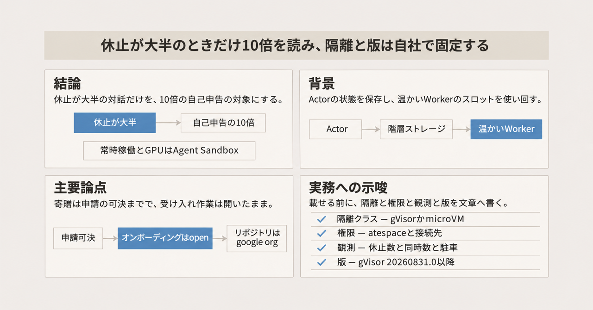
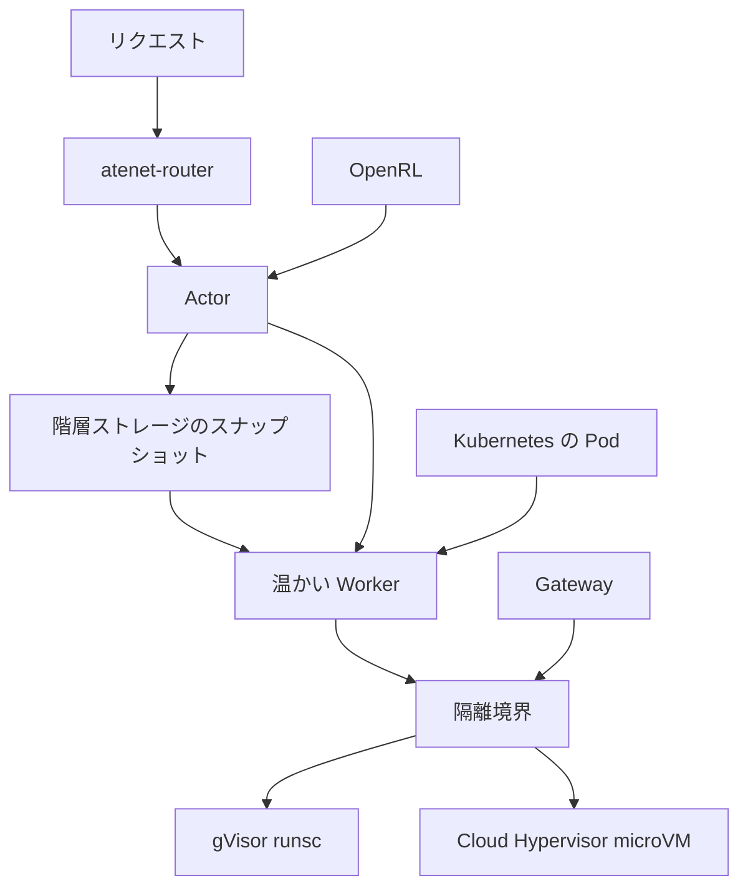

2026年11月、Google は Agent Substrate、gVisor、OpenRL の3つを CNCF Sandbox へ寄贈すると発表しました。Agent Substrate は、Kubernetes の上で多数のエージェントを動かす実行基盤です。gVisor は、その計算を担う場所で動くアプリケーションカーネルで、エージェントが生成したコードのシステムコールをユーザー空間で受けます。OpenRL は、同じ土台で事後学習を回す API です。事後学習は、ここでは強化学習のサンプル、更新、保存を指します。CNCF Sandbox は、CNCF がプロジェクトを受け入れる段階の名前です。

この記事は、Kubernetes にエージェントを載せる判断のために、測定条件、寄贈の進み具合、隔離と実行と学習の役割分担を整理します。

密度として並ぶ「10倍」は、比較条件の表が付いた公開の測定結果ではなく、Google のブログに書かれた自己申告です。

*この記事の全体像。以下、順に解説します。*

## Agent Substrate とは

Agent Substrate は、個々のエージェントの状態と、計算に使う入れ物を分けます。状態を持つ単位が Actor です。Actor はメモリ、ファイル、識別子を持ちます。計算は Worker が担います。Worker は使い回す Pod のスロットで、待っているあいだも温かいままプールに残します。入出力と秘密情報の注入は Gateway が行います。Gateway は、その注入をサンドボックスの外で行う入口です。

隔離の実装は2つです。1つは gVisor で、コマンド名は `runsc` です。gVisor は Go で書かれたアプリケーションカーネルで、エージェントが生成したコードのシステムコールをユーザー空間で受けます。もう1つは Cloud Hypervisor の microVM です。microVM は、小さな仮想マシンで隔離する実装です。Agent Substrate の README は、素の Linux コンテナを非対応と書いています。

公開 API は 1.0 です。README は、メジャー版を上げずに公開 API、CLI、設定形式を壊さない、と書いています。

### コードの所在

利用者クラスタへ載せるコードの正本は [agent-substrate/substrate](https://github.com/agent-substrate/substrate) です。ライセンスは Apache-2.0 で、2026-11-10 時点の star は約6,300です。

gVisor は 2018 年に Apache-2.0 で公開されました。2026-11-10 時点の正本は [google/gvisor](https://github.com/google/gvisor) で、star は約20,000です。

同じ発表には OpenRL が含まれます。OpenRL は、Kubernetes 上の自己ホスト型の事後学習 API です。担うのは、強化学習のサンプル、更新、保存です。密度のための多重化は、Agent Substrate の実行層が持ちます。

GKE には Agent Substrate on GKE があります。利用者クラスタへ載せる OSS と、GKE 向けの導入ツールは別リポジトリです。導入ツールは [ai-on-gke/substrate-gke](https://github.com/ai-on-gke/substrate-gke) です。

### 発表が置いた3層

発表が置いた3層は、隔離、エージェントの実行、学習のオーケストレーションです。密度の話は2層目の多重化です。1層目は、実行中のコードをホストカーネルから離す役です。

図の atenet-router は、入ってくる要求を受け、Actor の再開を待つルーターです。階層ストレージは、休止中の Actor のメモリとディスクの状態を戻す保存先です。隔離は WorkerPool ごとに1つです。WorkerPool は Worker をまとめたプールで、gVisor か Cloud Hypervisor のどちらかを選びます。OpenRL はこの図の外縁です。同じサンドボックスを、強化学習のロールアウトに使う層です。このロールアウトは、強化学習のサンプルをそのサンドボックスで走らせる実行です。

### 1回のターンの進み方

1回のターンは、次の順で進みます。

1. ルーターが Actor の再開を待つ。図の atenet-router がこのルーターです。
2. コントローラが、温かい Worker のスロットを割り当てる。
3. スナップショットからメモリとディスクを戻し、リクエストを届ける。待っているあいだの Actor は、階層ストレージへスナップショットされています。
4. ターンが終わると Actor を再びスナップショットし、スロットをプールへ返す。

この進み方は、専用の Pod を残すやり方と、リクエストのたびにゼロから起動するやり方のあいだにあります。Open Source Blog（2026-11-05）は、専用 Pod を残すとアイドルの計算を払い続け、サーバレスでゼロにすると、手元の Git リポジトリの取り直しを含む冷開始になり、その遅延は20秒を超えて対話が壊れる、と書いています。Agent Substrate は、Actor の状態をスナップショットにして Worker を返します。Kubernetes の API で Pod を毎秒大量に作らない、というのが制御プレーン側の主張です。

## 注意点

### 日本語の記事と発表文

[Publickey（2026-11-10）](https://www.publickey1.jp/blog/26/googlekubernetes10aiagent_sustrategvisorcncf.html) は、「10倍の密度」と「Agent Substrate と gVisor の寄贈」を報じています。見出しの製品名は “Agent Sustrate” で、本文の Agent Substrate と綴りが違います。記事の日付 2026-11-10 は、日本語記事の日付です。発表文のページ日付は、Open Source Blog が 2026-11-05、Cloud Blog の寄贈記事が 2026-11-06 です。Publickey は OpenRL を書いていません。

寄贈の見出しは、進み具合より先に出ています。Sandbox 申請は可決され、貢献契約のラベルが付いています。オンボーディングの issue は 2026-11-10 時点で open です。gVisor のリポジトリは google org のままです。Incubation と、組織単位の投票によるガバナンスは、2026-10-02 の gVisor 記事が「今後数か月」と書いた予定です。Incubation は、Sandbox のあと CNCF が置く次の段階です。プロジェクトごとの日付は、寄贈の節に表で置きます。

### 「10倍」は出典ごとに指すものが違う

「10倍」は、条件の表が付いていない自己申告が複数あり、同じ数を指していません。

| 文言 | 出典 | 読み方 |
| --- | --- | --- |
| 休止をストレージへ置き、500ms 未満で戻し、数百万サンドボックスをコンテナ比 10倍の密度で動かす | [Cloud Blog 2026-11-06](https://cloud.google.com/blog/products/containers-kubernetes/open-infrastructure-for-autonomous-agents-comes-to-cncf) の冒頭箇条書き | 1.0 かつ GKE GA の説明に含まれる自己申告。条件の表は無い |
| 1.0 は数百万サンドボックスを受け、標準コンテナランタイム比で 10倍、suspend/resume は毎秒 500 超 | 同じ記事の 1.0 の段落 | この文に 500ms 未満は無い。条件の表も無い |
| 1ホストに休止エージェント 1,000 超。従来計算比で 10倍 | [GKE 記事 2026-09-16](https://cloud.google.com/blog/products/containers-kubernetes/agent-substrate-available-on-gke) | 休止数の話。同時実行数ではない。ホスト機種は無い |
| 200,000 agents の benchmark validation で、500 activations/s、suspend/resume は 500ms 未満 | [Networking 記事 2026-10-29](https://cloud.google.com/blog/products/networking/gke-networking-dataplane-for-large-agentic-ai-workloads/) | 一次にある。条件の表は一文に無い |
| 約250 actor を 8 Pod に載せる。10–30倍のオーバーサブスクリプション | [README のデモ](https://github.com/agent-substrate/substrate/blob/main/README.md) | デモ。再現先は Counter Demo |
| 30–100倍の密度 | [cncf/sandbox#523](https://github.com/cncf/sandbox/issues/523) の “Benefit to the landscape” | いまある能力としての自己申告。条件の表は無い。ロードマップの項目ではない |
| p95 の activation latency を 100ms 未満へ到達させる | 同じ申請の Roadmap context | 未達の目標。冷開始の「起動」ではなく、復帰の遅延である |
| 対話セッションの 90–95% はモデル、外部 API、人の待ち | [Open Source Blog 2026-11-05](https://opensource.googleblog.com/2026/11/sandboxing-untrusted-ai-agents-at-scale.html) | この記事には 10倍も 200,000 も無い。サーバレスの冷開始は 20秒を超える、と対比している |

[docs/guides/benchmarking.md](https://github.com/agent-substrate/substrate/blob/main/docs/guides/benchmarking.md) は、Locust などで測る手順です。このファイルに、公開された 10倍の結果表はありません。10倍を偽とする反対実験も、公開された一次資料にはありません。信じてよい範囲は、「休止が大半のとき、専用 Pod を置きっぱなしにするより多く詰め込める、と Google が自己申告している」までです。

### まだ表が無いこと

10倍の比較相手、ホスト機種、actor のメモリは、ここまで挙げた一次資料のどれにも表がありません。KubeCon NA 2026（2026-11-09 から 12、Salt Lake City）のセッション資料が、あとから公開される可能性はあります。

200,000 の実験と、1ホスト 1,000 の休止と、デモの約250 actor を 8 Pod に載せる例が、同じ条件かは資料のあいだでつながっていません。

2026-09-16 の記事は本番を allowlist とし、2026-11-06 の記事は GA と書いています。契約 SLA のパーセントは、これらの記事からは確認できません。

OpenRL の申請 URL は gke-labs/open-rl です。2026-11-10 時点でその名前を引くと openrl-dev/openrl が返り、star は約120でした。改名を知らせる告知の有無は、ここで挙げた資料の範囲では確認できません。

## 10倍は何と比べた数字か

待ち時間に CPU を使わないことと、そのあいだ Pod を殺さないことは、別の要求です。倍率は、アイドルが 90% 台である、という説明と組になっています。Open Source Blog は、対話セッションの 90%から95% はモデル、外部 API、人の待ちだ、と書いています。常時動くエージェントは Worker を占有したままなので、同じ倍率の前提から外れます。

GKE のワークロード選択文書は、アイドルが少ない仕事、GPU または TPU、サイドカーを含む完全な Pod、Arm、Autopilot では、Pod 単位の Agent Sandbox を選ぶ条件にしています。Agent Sandbox は、Pod ごとにエージェントを隔離する、GKE 上の別の製品です。Agent Sandbox の復元は、同文書ではおよそ 3秒から5秒です。同じ文書は Substrate の復元を 1秒未満と書いており、これは別の数字です。Open Source Blog などの 500ms 未満とは出典が違います。Autopilot は、ノードの管理を GKE に任せるクラスタのモードです。

同時に生きているサンドボックス数には、別の上限があります。GKE の概要は、1ノードでおよそ 800 を超えると inotify と ARP neighbor の既定を超え、起動失敗や通信停止が起きうる、と書いています。inotify は、ファイルの変化を監視する Linux の枠です。ARP neighbor は、通信相手のアドレスを覚えるカーネルの表です。README は、1台の Linux ホストでおよそ 1,000 サンドボックスを超えるとき、neighbor table の `net.ipv4.neigh.default.gc_thresh1/2/3` を `4096/16384/32768` に上げる、と書いています。この3つは、その表の3段の閾値です。数百万は、休止中のスナップショットを含む規模の自己申告であり、1ノードの同時数ではありません。

Worker が尽きると、ルーターは要求を駐車します。駐車は、空きスロットができるまで要求を待たせることです。既定の予算は `--parked-request-budget` の 5秒、同時駐車は `--parked-request-max` の 1024 です。枠を超えると 503 になります。開いている TCP は suspend で残りません。データベースのセッションや MCP（Model Context Protocol）の接続は、エージェント側が復帰後に張り直します。

判断基準は次のとおりです。休止が大半の対話エージェントだけを、10倍の自己申告の対象にします。常時稼働、GPU、TPU、サイドカーを含む完全な Pod、Arm、Autopilot は、Agent Sandbox 側の条件として分けます。

## 寄贈はどこまで進んでいるか

2026-11-10 時点の進み具合は、次の表です。申請は閉じ、オンボーディングは開いたままです。表の gitvote/passed は、申請が可決された印です。

| プロジェクト | 申請 | 申請 issue | オンボーディング | 2026-11-10 のコードの所在 |
| --- | --- | --- | --- | --- |
| gVisor | closed。gitvote/passed。貢献契約のラベルあり。closedAt 2026-10-28。gVisor 記事は可決を 2026-09-28 と書く | [cncf/sandbox#521](https://github.com/cncf/sandbox/issues/521) | [#546 open](https://github.com/cncf/sandbox/issues/546) | google/gvisor。master の最新コミットは 2026-11-10 |
| Agent Substrate | closed。同じ可決ラベル。closedAt 2026-10-20 | [cncf/sandbox#523](https://github.com/cncf/sandbox/issues/523) | [#542 open](https://github.com/cncf/sandbox/issues/542) | agent-substrate/substrate。main の最新コミットは 2026-11-05 |
| OpenRL | closed。closedAt 2026-10-20。申請 URL は gke-labs/open-rl | [cncf/sandbox#518](https://github.com/cncf/sandbox/issues/518) | [#543 open](https://github.com/cncf/sandbox/issues/543) | `gh repo view gke-labs/open-rl` は openrl-dev/openrl を返した。約120 star |

gVisor の 2026-10-02 の記事は、今後数週間で Sandbox へ入り、ビルドを GitHub Actions と Buildkite へ移し、Google 以外のメンテナに merge 権限を足す、と書いています。今後数か月で Incubation の手順を進め、リポジトリを google org の外へ移し、組織単位の投票へ移す、とも書いています。短期の利用者体験は「あまり変わらない」とも書いています。Google は開発から手を引く意図は無い、と同じ記事が書いています。メンテナに加わると書かれているのは Ant Group、Modal、Tines です。OpenAI、Tencent、NVIDIA は貢献を続ける、と書かれています。

寄贈の理由として gVisor 側が書いている性能の話は、10倍とは別です。Google や Ant Group や Modal の内部には、gVisor の I/O をネイティブ Linux に近づける Linux カーネルのパッチがあります。Linux カーネルのメンテナは、単一ベンダー所有を理由に取り込みを断った、と 2026-10-02 の記事と 2026-11-06 の寄贈記事が書いています。寄贈は、そのパッチを Linux カーネルの上流へ出す道を開く、という未来形です。パッチがマージ済みとは書いていません。2026-10-02 の記事は、パッチの無い利用者では、一部の I/O の重い仕事で素の性能が落ちやすい、と書いています。I/O 全般が重い、とは書いていません。

ここまでの読み方は、保守主体が移り終わった、とは言えない、です。オンボーディングが open で、gVisor のリポジトリは google org のままです。Linux カーネルへの I/O パッチは未マージなので、寄贈は性能の完成を意味しません。

## 隔離と実行と学習の分担

3層の役割は、次のとおりです。役割分担の3層は Open Source Blog が明示しています。隔離クラスを選べることは、寄贈記事と README が明示しています。

| 層 | 名前 | 役割 |
| --- | --- | --- |
| 隔離 | gVisor、または Cloud Hypervisor | 信頼できないコードをホストカーネルから離す。gVisor は Go のアプリケーションカーネルで、システムコールをユーザー空間で処理する。メモリとプロセステーブルを自分で持つので、チェックポイントと復元の対象になる |
| 実行 | Agent Substrate | Actor を WorkerPool へ多重化し、アイドルをスナップショットする。ライフサイクルの API は隔離の実装をまたいで共通、と寄贈記事が書く |
| 学習 | OpenRL | 強化学習のサンプル、更新、保存を Kubernetes 上の Python で回す |

gVisor には、密度の別の説明があります。VM がメモリを固定ブロックで取るのに対し、gVisor はプロセスに合わせてメモリが増減します。これは詰め方の話です。アイドルをスナップショットして 10倍にする話とは段が違います。

syscall の被覆は部分集合です。完全な Linux 互換や、syscall が多い高 I/O は、GKE の選択文書が microVM 側に置いています。microVM の Worker は x86 で、nested virtualization かベアメタルが要ります。nested virtualization は、仮想マシンの中でさらに仮想マシンを動かすことです。Arm の microVM は、同文書の Substrate パスでは不可です。

gVisor プロジェクトは GPU、TPU、checkpoint を持つ、と寄贈記事が書いています。checkpoint は、実行中のメモリを保存してあとで戻す機能です。GKE 上の Agent Substrate は、actor コンテナへの GPU パススルーをせず、ライブの CUDA コンテキストはスナップショットできない、と概要文書が書いています。CUDA コンテキストは、GPU 上の計算の状態です。これは「gVisor を選べば、GPU を使う実行も休止できる」とは読めません。プロジェクトの機能と、GKE 上の Substrate が結線した範囲は分かれています。

WorkerPool の隔離は、gVisor か microVM かを指定します。寄贈のあとでも、この選択は残ります。寄贈は、ノード上の隔離クラスを CNCF が代わりに選ぶ、とは書いていません。

## 自社の文書に残す境界

共有ランタイムに乗ったあとでも、隔離クラス、atespace と egress、観測、版の追跡は、自社の文章に残します。10倍は条件付きの自己申告として扱い、常時稼働と GPU には使いません。

先に文章へ固定するのは、次の4つです。

1. サンドボックスクラス。gVisor か microVM か。syscall の被覆、起動の重さ、ネスト仮想化、Arm の可否がここで分かれます。
2. 名前空間と権限。単位は atespace です。atespace は、Agent Substrate が権限と分離の単位にしている名前です。Kubernetes の Namespace そのものではなく、それに当たる単位です。API の認可には OpenFGA を使います。OpenFGA は、その API 認可に使われているソフトウェアです。[security.md](https://github.com/agent-substrate/substrate/blob/main/docs/security/security.md) は、atespace をまたぐネットワークポリシーとクォータを未完了と書いています。秘密情報は egress gateway が外から注入します。egress gateway は、外向き通信の接続先を制限し、秘密情報をサンドボックスの外から注入する Gateway です。GKE では、スナップショットバケットへアクセスするサービスアカウント `ate-snapshot-transfer` と、Workload Identity の付与を、インストーラに任せるか自分で書きます。スナップショットバケットは、スナップショットを置くバケットです。ここで挙げた資料は、このバケットと階層ストレージを同じ保存先だとは書いていません。Workload Identity は、Pod に Google Cloud の権限を渡す GKE の仕組みです。
3. 観測点。休止中の Actor 数、ノード上の同時サンドボックス数、駐車（5秒と 1024）、復元が予算を超えて遅れること、スナップショットの失敗です。Managed OpenTelemetry for GKE は、概要文書がコネクタ非対応、Pod 数に比例するメモリ、TLS 非対応を書いています。約800同時の前後で、neighbor table などの sysctl を誰が入れるかも書きます。
4. ランタイムの版。CVE-2026-95702 は gVisor 20260831.0 未満です。通常のコンテナ権限で、サンドボックス内オーバーレイの use-after-free から、ホスト上の Sentry でコード実行できます。Sentry は、そのコード実行が届く、ホスト上の gVisor のプロセスです。NVD は、Sentry がホストの seccomp と namespace の外へ出るとは書いていません。seccomp は、プロセスが呼べるシステムコールを絞る仕組みです。公開は 2026-10-09、採番元（CNA）は Google、NVD の状態は分析待ち（Awaiting Analysis）です。詳細は [NVD の CVE-2026-95702](https://nvd.nist.gov/vuln/detail/CVE-2026-95702) です。

共有 Worker には、プロジェクト自身が未完了と書いている制御があります。security.md の Delete Guarantee（世代のあいだのローカル領域と Worker の scrub）は In Progress です。scrub は、次の Actor に渡す前に前の世代の残りを消すことです。Per-Actor Encryption、包括クォータ、actor 間認可、スナップショットの taint は Future です。包括クォータは、API の呼び出し、メモリと CPU、外向き通信の帯域の上限です。atespace をまたぐクォータとは、security.md 上は別の項目です。この taint は、危殆化した Actor の休止状態に付ける印です。ノードへ Worker を載せないための taint とは別です。Worker は `privileged: false` ですが、root のまま `SYS_ADMIN` と `NET_ADMIN` を持ち、user namespace は未、と書いています。user namespace は、コンテナ内のユーザー ID をホストのユーザー ID から分ける仕組みです。atespace を切っただけでは、分離が閉じたことにはなりません。

GKE に載せるときの追加の固定があります。

- Standard クラスタで、制御プレーンとノードは 1.37 以降です。Standard は、Autopilot ではない GKE クラスタのモードです。
- Autopilot は不可です。
- Extended チャネルのクラスタでは、beta API を明示するインストーラは使えません。Extended チャネルは、GKE のリリースチャネルの1つです。チャネル上で実行そのものが禁止だとは、概要文書は書いていません。
- E2 のような混在 CPU アーキテクチャは不可です。
- Agent Substrate のノードプールで GKE Sandbox を有効にすると、taint で Worker が乗りません。GKE Sandbox は、ノードプールに付ける別のサンドボックス機能です。同じクラスタの他の仕事には GKE Sandbox を使えます。

一次資料が支えているのは、次の点です。役割分担の3層と、隔離クラスを選べることと、Sandbox 可決と契約ラベルは、記事と issue の状態で確認できます。アイドル時に Pod を殺さず状態を残す、という問題設定は、Open Source Blog の「90%から95%」と 20秒超の対比で読めます。500 activations/s と 500ms 未満は、条件は薄いですが、networking 記事の 200,000 の文にもう一度出てきます。

狭めすぎない境界は、名前空間と権限と観測だけではありません。隔離クラスと版を足します。共有ノードの scrub、スナップショット暗号化、クォータは未完了です。20260831.0 未満の gVisor には、Sentry へのコード実行があります。版を追う仕事は残ります。

## 導入判断に先に書くこと

判断の文章には、次を先に書きます。

1. 休止が大半の対話エージェントだけを、10倍の自己申告の対象にする。常時稼働、GPU、TPU、完全な Pod、Arm、Autopilot は Agent Sandbox 側の条件として分ける。
2. WorkerPool の隔離は gVisor か microVM かを指定する。寄贈後もこの選択は残る。syscall の被覆が部分集合で足りるか、x86 の nested virtualization かベアメタルが要るか、Arm を使うかで分かれる。
3. atespace、egress の宛先、秘密情報を注入する主体、スナップショットバケットの権限を書く。egress の宛先は、egress gateway が外向きに許す接続先です。スナップショットバケットは、スナップショットを置くバケットです。ネットワークポリシーとクォータは未完了なので、atespace を切っただけでは分離が閉じたことにしない。
4. 観測は、休止数、ノードあたりの同時数、駐車、復元遅延を分ける。約800同時の前後で sysctl を誰が入れるかを書く。
5. gVisor のリリースが 20260831.0 以降かを、Worker イメージのピンで確認する。

導入そのものを急ぐ理由にはしません。Sandbox のオンボーディングは open で、Linux カーネルへの I/O パッチは入る前です。乗るとしたら、README が 1.0 で壊さないと書いた公開 API、CLI、設定形式の範囲で、隔離クラスを自分で選べるときに限ります。寄贈記事は、ライフサイクルの API が隔離の実装をまたいで共通だと書いています。その文は、この公開 API と同一だとは書いていません。

## まとめ

Agent Substrate は、Actor の状態をスナップショットし、温かい Worker のスロットを使い回す実行基盤です。隔離は gVisor か Cloud Hypervisor の microVM で、学習のオーケストレーションは OpenRL です。2026年11月の発表は、この3つを CNCF Sandbox へ寄贈するというものです。

10倍は、休止が大半のときの自己申告として読み、常時稼働と GPU には使いません。寄贈は Sandbox 申請の可決までで、オンボーディングは 2026-11-10 時点で open、gVisor のリポジトリは google org のままです。自社の文章には、隔離クラス、atespace と egress、観測、gVisor の版を残します。

この記事が少しでも参考になった、あるいは改善点などがあれば、ぜひリアクションやコメント、SNSでのシェアをいただけると励みになります！

## 参考リンク

- Publickey、2026-11-10。[Google、Kubernetesで10倍高密度にAIエージェントを実行可能にする「Agent Sustrate」と「gVisor」](https://www.publickey1.jp/blog/26/googlekubernetes10aiagent_sustrategvisorcncf.html)
- Google Open Source Blog、2026-11-05。[Sandboxing Untrusted AI Agents at Scale](https://opensource.googleblog.com/2026/11/sandboxing-untrusted-ai-agents-at-scale.html)
- Google Cloud Blog、2026-11-06。[Powering open infrastructure for autonomous agents](https://cloud.google.com/blog/products/containers-kubernetes/open-infrastructure-for-autonomous-agents-comes-to-cncf)
- Google Cloud Blog、2026-09-16。[Agent Substrate brings high-density, scalable, trusted infrastructure to GKE](https://cloud.google.com/blog/products/containers-kubernetes/agent-substrate-available-on-gke)
- Google Cloud Blog、2026-10-29。[How GKE networking scales to support high densities of concurrent AI agents](https://cloud.google.com/blog/products/networking/gke-networking-dataplane-for-large-agentic-ai-workloads/)
- gVisor、2026-10-02。[gVisor is being donated to CNCF](https://gvisor.dev/blog/2026/10/02/gvisor-cncf/)
- GKE 文書。[Agent Substrate on GKE](https://docs.cloud.google.com/kubernetes-engine/ai-ml/about-agent-substrate)
- GKE 文書。[Plan an architecture for AI agent workloads on GKE](https://docs.cloud.google.com/kubernetes-engine/docs/concepts/machine-learning/agent-workloads)
- [agent-substrate/substrate README](https://github.com/agent-substrate/substrate/blob/main/README.md)
- [docs/security/security.md](https://github.com/agent-substrate/substrate/blob/main/docs/security/security.md)
- [docs/concepts/request-parking.md](https://github.com/agent-substrate/substrate/blob/main/docs/concepts/request-parking.md)
- [docs/guides/benchmarking.md](https://github.com/agent-substrate/substrate/blob/main/docs/guides/benchmarking.md)
- NVD。[CVE-2026-95702](https://nvd.nist.gov/vuln/detail/CVE-2026-95702)
- CNCF Sandbox 申請。[gVisor #521](https://github.com/cncf/sandbox/issues/521)、[Agent Substrate #523](https://github.com/cncf/sandbox/issues/523)、[OpenRL #518](https://github.com/cncf/sandbox/issues/518)
