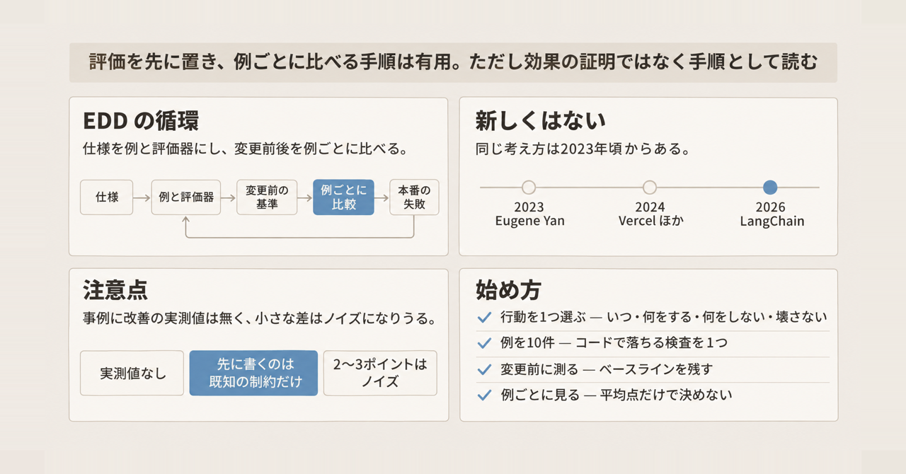
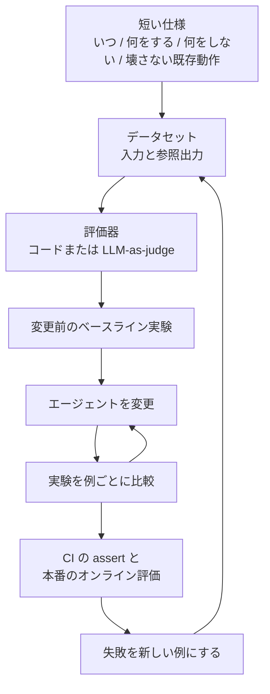

LLM エージェントを直したとき、「良くなったのか、悪くなったのか」を目視だけで判断するのは、例が増えるとすぐに難しくなります。LLM アプリ開発のフレームワークを提供する LangChain は 2026-11-09 のブログ記事 [What Is Eval-Driven Development?](https://www.langchain.com/blog/what-is-eval-driven-development) で、この問題への進め方を Eval-Driven Development（EDD）としてまとめました。

この記事では、次の 3 点を整理します。

- EDD の手順と、LangSmith のどの機能に当てはまるか
- 記事の主張をどこまで信じてよいか（先行事例、反対意見、費用の条件）
- 少人数のチームが明日から始める最小の手順

LangChain の記事は自社製品 LangSmith の使い方の説明を兼ねています。手順と製品を分けて読めるように書きます。

*この記事の全体像。以下、順に解説します。*

## Eval-Driven Development とは

### 概要

EDD は、エージェントの望ましい動作を先に文章と採点できる例にし、実装の前後で同じ例を測りながら改善する開発の進め方です。LangChain の記事は、これを次の 3 段階にまとめています。

1. 何が「良い」かを定義する
2. 評価（eval）を実装より先に書く
3. 変更したあと、平均点だけでなく例ごとに比べる

想定している読者は、エージェントの変更の良し悪しを目視では判断できなくなったチームです。記事は、この手順を LangSmith（LangChain の LLM アプリ向け観測・評価サービス）の dataset、experiment、evaluator、online evaluation に割り当てています。

用語は次のとおりです。

| 用語 | 意味 |
| --- | --- |
| dataset | 入力と参照出力（期待する答え）を持つ例の集合 |
| experiment | ある dataset に対して、エージェントの一つの版を走らせた結果 |
| evaluator（評価器） | 出力を採点する仕組み。コードで書くものと、LLM に採点させるもの（LLM-as-a-judge）がある |
| online evaluation | 本番のトレース（実行記録）の一部を自動で採点すること |
| annotation queue | 人が確認するためにトレースを積んでおく待ち行列 |

### 特徴

- **一回に一つの行動を扱います。** 行動とは「ある種類の依頼にエージェントがどう振る舞うか」の単位です。仕様は「いつ動くか」「何をするか」「何をしないか」「壊してはいけない既存の動作」の 4 つで書きます。
- **採点の単位は最終回答だけではありません。** 単一のステップ、ツール呼び出し、会話スレッド全体も採点対象になります。
- **評価器はコードと LLM の両方を使います。** LangSmith の評価概念のページは、採点者として人、コード、LLM-as-judge、2 つの出力を比べる方式（pairwise）などを挙げています。
- **変更前にベースラインを取ります。** 変更前の experiment を残し、変更後は同じ dataset で比べて、悪化した例と改善した例を分けます。
- **過学習を警戒します。** 小さなセットで全問正解に合わせると過学習しうる、と記事自身が書いています。調整に使わない held-out（取り置き）の例を別に見ます。
- **コードで書ける検査は CI で落とせます。** pytest や Vitest の assert として書くと、CI でテストを失敗させられます。LangSmith の pytest 連携を使うと、テストの入力は dataset の例として、合否は `pass` という名前の採点記録（LangSmith では feedback と呼びます）として LangSmith に同期されます。設定は後述の「個人・少人数チームの始め方」で触れます。
- **本番の失敗を次の例にします。** online evaluator がトレースの一部を採点し、失敗は annotation queue で人が確認して dataset に戻します。
- **始め方は小さくてよいとされています。** 評価概念のページは、重要な部品ごとに「良い」例を 5〜10 件作ることから始め、高品質な例は 10〜20 件を推奨の開始点としています。チャットボットのチュートリアルは、10〜50 件でも価値があると書いています。

### 全体の流れ

仕様が dataset と評価器になり、変更前の experiment が基準になります。変更のたびに例単位で比べ、通ったものは CI と本番へ進みます。本番での失敗は次の例になります。

dataset の例（オフラインの例）には参照出力がありますが、本番の実行には通常ありません。正解との照合が必要な検査は、失敗を dataset に戻してから行います。

### TDD との違い

LangChain の記事は、テスト駆動開発（TDD）との違いも説明しています。TDD は失敗するテストを先に書き、それを通すコードを書きます。EDD も評価を先に置きますが、LLM では同じ入力が同じ出力になるとは限りません。正解が複数あり、ツールの呼び出し順が違っても目的を達成できることがあります。

そのため EDD の合否は、文字列の完全一致ではなく、次の 2 つに分かれます。

| 採点方法 | 向いている検査 |
| --- | --- |
| コードの評価器 | 期待するツール呼び出しや出力形式など、性質として書けるもの |
| 校正した LLM-as-judge | 一つの正解が無い文章の品質 |

ここでの「校正」は、LLM の採点が人の合否と一致するかを確かめることです。

Anthropic の [Demystifying evals for AI agents](https://www.anthropic.com/engineering/demystifying-evals-for-ai-agents)（2026-01-09）も、特定のツール順を強制する採点は脆いと書いています。同じ記事は、1 回の試行の成功率が 75% なら 3 回すべて成功する確率は (0.75)^3、およそ 42% になる、という計算例を示しています。出力が毎回変わるため、1 回の成功だけでは安定して成功するとは言えません。

### 記事が挙げる失敗例

LangChain の記事は、著者自身の失敗として次を挙げています。

- 成功条件が曖昧（“helpful” は指標にならない）
- 修正を見てから eval を書く
- 平均点だけを見る
- 校正していない judge を信じる
- 1〜10 の点数で採点する（pass/fail の方が扱いやすい）

## 注意点

### 測定済みの改善ではなく、手順の説明として読む

LangChain の記事は、手順を説明するためにドキュメント検索エージェントの作例を使っています。ドキュメント検索とウェブ検索のツールを持つエージェントに、チケット作成ツールを追加する話です。追加後、VPN の設定手順を聞かれただけの場面でもチケットを作ってしまう回帰が見つかり、チケット作成ツールの説明文を狭めたら全例が通った、という筋書きです。

この作例は説明用のイラストです。「平均点が上がった」とは書かれていますが、その数値は本文にありません。記事自身が、小さなセットでの 100% は過学習のサインになりうると警告しています。

LangChain は、社内での評価の取り組みとして、次のベンチマークも紹介しています。いずれも、評価の仕組みは説明していますが、改善の実測値は出していません。

- **IssueBench**（[2026-07-20 の記事](https://www.langchain.com/blog/issuebench-how-we-evaluate-engine)）は、LangSmith の機能 LangSmith Engine を評価する社内ベンチマークです。15 タスクで構成されますが、精度や再現率は本文にありません。EDD の記事は IssueBench のデータを「real and synthetic（実データと合成データ）」と書く一方、IssueBench の記事は 15 の合成タスクと書いており、実データをどこで混ぜたかは読み取れません。
- **エージェント実装 Deep Agents のベンチマーク**（[How we benchmark Deep Agents](https://www.langchain.com/blog/how-we-benchmark-deep-agents)）は、機能や system prompt を削ってよいかを「このベンチマークで判断する」と書いていますが、削った後の悪化幅は出ていません。

また、LangChain の記事は評価の実行環境 Harbor を「Terminal-Bench（エージェントの業界ベンチマーク）の裏にあるハーネス」と紹介しています。Harbor の README は “Harbor is the official harness for Terminal-Bench-2.0” と書いており、Terminal-Bench 2.0 については裏付けがあります。LangChain の記述は版を書いていませんが、裏付けが確認できるのは 2.0 までで、それより新しい版については確認できていません。

### 名前も考え方も新しくはない

EDD という名前は 2026 年の造語ではありません。

| 時期 | 出典 | 内容 |
| --- | --- | --- |
| 2023-07 | Eugene Yan, [Patterns for Building LLM-based Systems & Products](https://eugeneyan.com/writing/llm-patterns/) | “Think of it as Eval Driven Development (EDD).” |
| 2024-03-11 | LangChain 掲載のゲスト記事（Devin Stein） | “Evaluation driven development (EDD)” と呼び、本番の失敗を例に足して再評価する 6 ステップを説明 |
| 2024-10-17 | [Vercel](https://vercel.com/blog/eval-driven-development-build-better-ai-faster) | eval-driven development。出力に効く PR に eval 結果を含める |
| 2024-11-21 | [arXiv:2411.13768](https://arxiv.org/html/2411.13768) | EDDOps。設計時と実行時の評価を一つのループにするプロセスモデル |
| 2026-01-09 | Anthropic | “eval-driven agent development” |

2026 年の LangChain の記事は、既にある評価ループを「一つの行動の仕様」と「LangSmith の実験比較」に当てはめた実務記事と読むのが妥当です。

### 「評価を先に書く」への反対意見

Hamel Husain と Shreya Shankar の [AI Evals FAQ](https://hamel.dev/blog/posts/evals-faq/) は、評価器を機能の実装前に書くやり方に “Generally no.” と答えています。理由は、LLM の失敗は事前に列挙しきれないためです。推奨は、まず error analysis（実際の出力を読んで誤りを分類する作業）を行い、発見した誤りに対して評価器を書くことです。

例外は「競合他社に言及しない」のように、成功条件が最初から文章になっている制約です。同じ FAQ は、例より先に採点基準（ルーブリック）を固定すると想定外の問題を見逃す、とも書いています。

LangChain の「先に書け」は、成功条件がすでに文章にできている行動に限って適用するのが安全です。

### 小さな改善はノイズの可能性がある

エージェントのベンチマークでは、平均点が実行のたびに揺れます。[arXiv:2602.07150](https://arxiv.org/abs/2602.07150) は、同じエージェント向けベンチマークで、1 回の試行で正解した割合（pass@1）が実行回によって 2.2〜6.0 ポイント動くと報告しています。公開ベンチマークの研究ですが、2〜3 ポイントの改善を 1 回の experiment で採用しない理由にはなります。

また [arXiv:2602.12413v2](https://arxiv.org/abs/2602.12413v2) は、held-out の問題と意味的に重複したデータで訓練すると、held-out の精度が最大 22 ポイント上がりうると書いています。モデルの訓練についての公開ベンチマークの研究ですが、held-out を分けただけで「見たことのない入力でも動く」とは言い切れない、という注意になります。

### LangSmith で回すときの保持と費用

LangSmith でこの循環を回すと、データ保持と費用の条件が付きます（2026-11-11 時点の [usage and billing](https://docs.langchain.com/langsmith/usage-and-billing) と [pricing](https://www.langchain.com/pricing)）。

トレースには、保持期間の短い base と長い extended の 2 つの区分があり、extended の方が費用がかかります。

| 項目 | 内容 |
| --- | --- |
| 保持期間 | base は 14 日、extended は 180 日 |
| experiment の実行記録 | extended が既定 |
| 新しい online evaluator | 既定で対象トレースを extended に上げる（opt-out 可）。保持期間と費用の両方が増える |
| dataset | 削除されない |
| Developer プラン | 席あたり月 0 ドル、1 席、月 5,000 件の base トレースを含み、その後は従量課金 |
| Plus プラン | 席あたり月 39 ドル、席数上限なし、月 10,000 件の base トレースを含む |

無課金の Developer は、トレースの送信量の 1 時間あたりの上限（500MB など）や、月 5,000 トレースを超えると、HTTP 429（リクエスト過多）で拒否されることがあります。これは評価専用の上限ではなく、トレース全体の上限です。

## どこまで採用すればよいか

### 判断の目安

| 状況 | 判断 |
| --- | --- |
| 成功条件を文章にできる行動がある | EDD の手順をそのまま採用できる |
| 失敗の種類をまだ一つも言語化できていない | 評価器より先に、実際のトレースを読む |
| 改善幅が 2〜3 ポイントしかない | 1 回の experiment で採否を決めない |
| 例ごとの差分を画面で残したい、テスト結果を dataset に同期したい、本番トレースを採点したい | LangSmith を足す |
| 比較 UI が要らない | 手元のテストランナー（pytest など）で足りる |
| 保持費用がトレース量に見合わない | online evaluator の対象とサンプリング率を絞る（公式の例は sampling rate 0.1 でトレースの 10%） |

手順そのものは特定の製品を前提にしていません。LangSmith の比較画面は、同じ dataset の experiment について悪化を赤、改善を緑で示し、出力の差分を例ごとに見られる点が利点です。ただし、何が「良い」かの定義は人が書く必要があります。

### 個人・少人数チームの始め方

次の順で進めます。

1. 次に直すエージェントの行動を一つ選び、「いつ / 何をする / 何をしない / 壊さない既存動作」を数行で書く
2. その行動の例を 10 件ほど作り、コードで落ちる検査を一つ付ける
3. 変更の前に一度走らせ、ベースラインを残す
4. 直したあと、落ちた例と通った例を一件ずつ確認する。平均点だけで採否を決めない
5. 調整に使った例とは別に held-out の例を置く
6. LLM-as-judge は、コードで検査できない品質だけに使い、人の合否と突き合わせてから信じる
7. 本番で見た失敗だけを次の例に足す。まだ失敗を見ていない機能に、想像で評価器を増やさない

pytest の場合、`langsmith` パッケージ（0.3.4 以上）の pytest 連携を使うと、assert をローカルで失敗させつつ、例と結果を LangSmith に残せます。合否の条件が書けない検査では、assert を呼ばずにスコアだけを LangSmith に記録できます。CI で変更を止めるのはテストランナーの失敗なので、止めたい検査は assert で書きます。

## まとめ

- Eval-Driven Development は、望ましい動作を先に採点可能な例にし、変更前後を例ごとに比べながら改善する進め方です
- LangChain の 2026-11-09 の記事は、この手順を「一つの行動の仕様」と LangSmith の dataset・experiment・online evaluation に当てはめた実務記事です。名前と考え方は 2023 年頃からあります
- 記事中の事例やベンチマークに改善の数値は無く、効果の証明ではなく手順の説明として読むのが妥当です
- 「評価を先に書く」は、成功条件を文章にできる行動に限るのが安全です。未知の失敗は、トレースを読んでから評価器にします
- LangSmith を使う場合は、experiment と online evaluator が保持期間を延ばす点を費用の前提に入れます

この記事が少しでも参考になった、あるいは改善点などがあれば、ぜひリアクションやコメント、SNSでのシェアをいただけると励みになります！

## 参考リンク

- Divya Santhanam, [What Is Eval-Driven Development?](https://www.langchain.com/blog/what-is-eval-driven-development), LangChain, 2026-11-09
- Devin Stein, [Iterating Towards LLM Reliability with Evaluation Driven Development](https://www.langchain.com/blog/iterating-towards-llm-reliability-with-evaluation-driven-development), LangChain, 2024-03-11
- Eugene Yan, [Patterns for Building LLM-based Systems & Products](https://eugeneyan.com/writing/llm-patterns/), 2023-07
- Hamel Husain, [Your AI Product Needs Evals](https://hamel.dev/blog/posts/evals/), 2024-03-29
- Hamel Husain, Shreya Shankar, [AI Evals FAQ](https://hamel.dev/blog/posts/evals-faq/), 2026-09
- Anthropic, [Demystifying evals for AI agents](https://www.anthropic.com/engineering/demystifying-evals-for-ai-agents), 2026-01-09
- Boming Xia ほか, [Evaluation-Driven Development and Operations of LLM Agents](https://arxiv.org/html/2411.13768), arXiv:2411.13768
- Malte Ubl ほか, [Eval-driven development: Build better AI faster](https://vercel.com/blog/eval-driven-development-build-better-ai-faster), Vercel, 2024-10-17
- Nick Bray, Arjun Nargolwala, [IssueBench: How We Evaluate Engine](https://www.langchain.com/blog/issuebench-how-we-evaluate-engine), LangChain, 2026-07-20
- LangChain, [How we benchmark Deep Agents](https://www.langchain.com/blog/how-we-benchmark-deep-agents)
- LangSmith docs: [evaluation concepts](https://docs.langchain.com/langsmith/evaluation-concepts), [pytest](https://docs.langchain.com/langsmith/pytest), [compare experiment results](https://docs.langchain.com/langsmith/compare-experiment-results), [usage and billing](https://docs.langchain.com/langsmith/usage-and-billing)
- LangChain, [Pricing](https://www.langchain.com/pricing)
- Harbor, [harbor-framework/harbor](https://github.com/harbor-framework/harbor)
- [On Randomness in Agentic Evals](https://arxiv.org/abs/2602.07150), arXiv:2602.07150
- [Soft Contamination Means Benchmarks Test Shallow Generalization](https://arxiv.org/abs/2602.12413v2), arXiv:2602.12413v2
