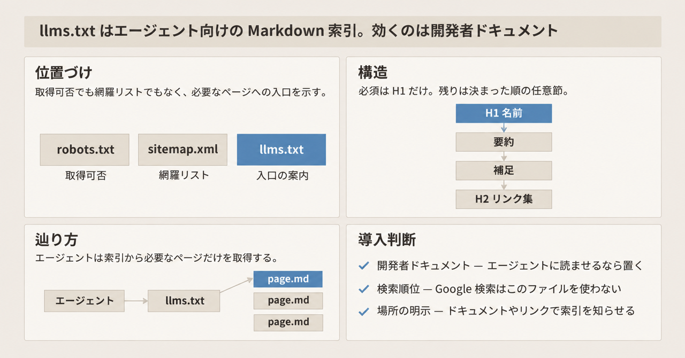
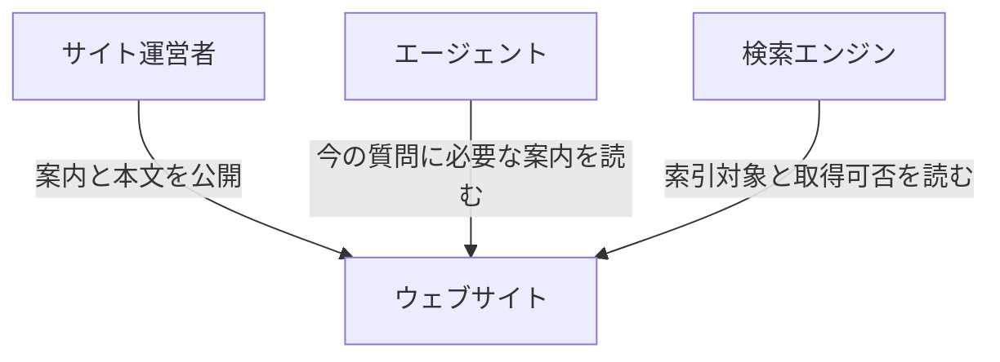
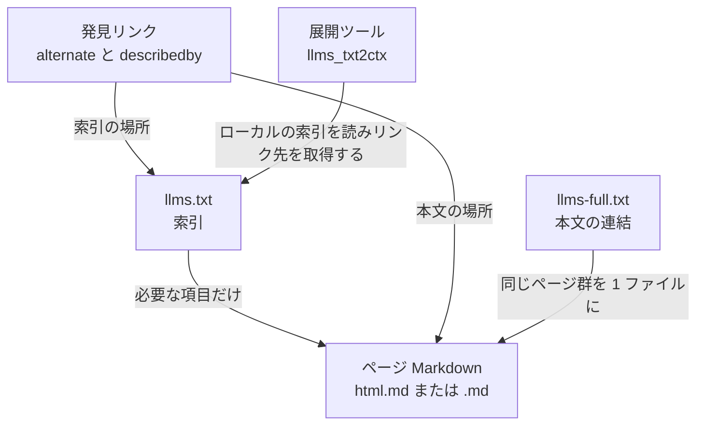
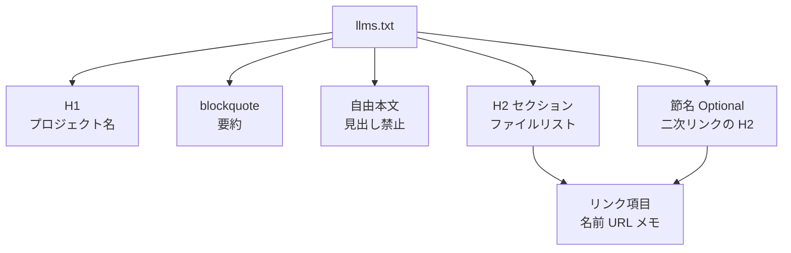
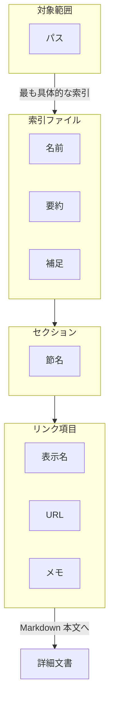
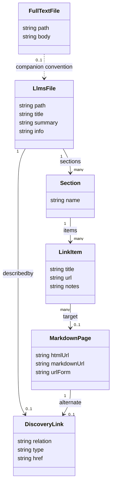

`llms.txt` は、ウェブサイトの内容を LLM と AI エージェントが読みやすい Markdown で案内するためのファイルです。この記事では、2026-08 に出た v2 提案に沿って、ファイルの構造、配置と発見の仕組み、生成ツール、公式 Python パーサの挙動、実際のアクセス計測までを 1 本で整理します。ドキュメントサイトを運営していて「置くべきか」「置くならどう作るか」を判断したい人に向けた記事です。

内容は 2026-11-03 時点の確認に基づきます。仕様の正本は Jeremy Howard による提案「The /llms.txt file, v2」（初版公開 2024-09-03、v2 は 2026-08）、実装の参照先は GitHub `AnswerDotAI/llms-txt` の `main` と PyPI `llms-txt` 0.0.7 です。


*この記事の全体像。以下、順に解説します。*

## llms.txt とは

`llms.txt` は、サイトやプロジェクトの要点と、詳細な Markdown 文書へのリンクをまとめた索引ファイルです。エージェントはこの索引を読み、今の質問に必要なリンクだけを辿ります。詳細はリンク先に置き、索引そのものはコンテキストに収まる大きさに保つ、という設計です。

- **置き場所**: サイトルートの `/llms.txt`、または任意のサブパス（例: `/docs/llms.txt`）
- **対象範囲**: 1 つのファイルは、そのパス以下の URL を対象にする。複数のファイルが重なるときは、最も具体的な（深い）パスのファイルを使う
- **中身**: 名前、短い要約、補足、詳細 Markdown へのリンク集
- **主な用途**: 推論時の参照。学習クローラが同じファイルを取得することもあり、提案は学習での利用を禁止していない

この提案は IETF、W3C、ISO の標準文書ではなく、コミュニティ提案です。GitHub リポジトリ `AnswerDotAI/llms-txt` が概要を版管理しています。2026-11-03 時点のメタデータは star 2675、fork 176、ライセンス Apache-2.0、最終 push 2026-09-24 です（star と fork は日々動きます）。

隣接する有名ファイルとの役割分担は次のとおりです。

| ファイル | 主な相手 | 役割 | アクセス制御 |
|---|---|---|---|
| `robots.txt` | クローラ | どのパスを取得してよいかを示す（RFC 9309） | 遵守するクローラに対して効く |
| `sitemap.xml` | 検索エンジン | 索引対象 URL を網羅的に列挙する | 列挙のみ |
| `llms.txt` | エージェント | 理解に必要なページを短く選んで Markdown で示す | 制御しない |
| `llms-full.txt` | 一括取り込みしたいクライアント | ページ本文を 1 ファイルにまとめるプラットフォーム慣行 | 制御しない |
| `AGENTS.md` | コーディングエージェント | リポジトリのビルド・テスト・規約を書く | 制御しない |

提案は、`sitemap.xml` では代わりにならない理由を 3 つ挙げています。LLM 向け版の URL が載らないこと、外部 URL を書けないこと、全体がコンテキストに収まらないことです。`robots.txt` が「取得してよいか」を示すのに対し、`llms.txt` は「許可された内容のうち、今の質問に必要な入口はどこか」を示します。

## 特徴

- **必須要素は H1 だけ**: H1 のプロジェクト名が唯一の必須要素です。要約の blockquote、見出し以外の自由本文、H2 のファイルリストは任意です。ただし公式の Python パーサは、H1 だけ、または H1 と H2 だけで要約も補足も無いファイルを読めません（後述の「注意点」を参照）。
- **記法は Markdown**: XML や JSON を使いません。言語モデルがそのまま読め、正規表現でも分割できるからです。
- **BOM は任意**: ファイルの先頭に BOM（バイト順マーク）を置いてもよく、無くても成立します。
- **リンク項目の形**: 提案では、ファイルリストは Markdown のリストで、各項目に `[名前](URL)` のリンクが必須です。続けて `: メモ` を書けます。公式 Python パーサは `-` で始まる行だけを読むため、パーサに通すなら `- [名前](URL)` の形にします。
- **`Optional` 節**: H2 の名前を `Optional` にすると、「短いコンテキストでは後回しにしてよい二次リンク」という慣行になります。v1 の提案には、索引のリンク先を取得して 1 つの文脈ファイルにまとめる展開ツール（Python CLI）が含まれ、このツールは `Optional` 節を機械的に落としていました。v2 ではこの特別な意味は外されましたが、現行の CLI は今も既定で `Optional` 節を落とします。
- **ページの Markdown 版**: 同じ URL に `.md` を足す形（`page.html.md`）か、拡張子を `.md` に替える形（`page.md`）です。ファイル名の無い URL は `index.html.md` または `index.md` を足します。
- **発見用のリンク関係（v2 で追加）**: `rel="alternate" type="text/markdown"` がページの Markdown 版を、`rel="describedby"` がそのページを覆う `llms.txt` を指します。HTML の `link` 要素と HTTP `Link` ヘッダのどちらでも書けます。
- **`/.well-known/` に限定しない**: Well-Known URI（RFC 8615 が定める、オリジン直下の `/.well-known/` 配下の予約パス）はオリジンのルートにしか置けません。GitHub Pages のプロジェクトサイトのように、パスだけを管理する著者も参加できるよう、配置を任意パスにしています。
- **生成の自動化**: 提案本文は、生成に対応する基盤として Mintlify、GitBook、Yoast SEO、AIOSEO、Wix、JavaScript 実装、`vitepress-plugin-llms`、`docusaurus-plugin-llms`、Drupal `llm_support`、`llms-txt-php`、VS Code PagePilot、`server-llm-txt` を挙げています。
- **大手の掲載例**: 提案は OpenAI（<https://developers.openai.com/llms.txt>）、Anthropic（<https://docs.anthropic.com/llms.txt>）、Gemini（<https://ai.google.dev/gemini-api/docs/llms.txt>）のドキュメントを例に挙げています。
- **Lighthouse の監査**: Chrome Lighthouse の Agentic browsing カテゴリに `llms.txt` の監査があります（ドキュメントの最終更新 2026-05-05）。ファイルが 404 なら監査は Not Applicable で、提供は任意です。指摘されるのはサーバーエラーのときだけです。

場面ごとの使い分けは次のとおりです。

| 場面 | 向くファイル | 理由 |
|---|---|---|
| API やライブラリのドキュメントをコーディングエージェントに渡す | パス付き `llms.txt` とページ単位の Markdown | 提案が最も厚く想定している利用。索引から必要な API ページだけを辿れる |
| ドキュメント全体を 1 回の取得で渡す | `llms-full.txt` | 仕様外の慣行。Mintlify や VitePress プラグインが生成する |
| Google 検索や AI Overviews に出したい | `robots.txt` と通常の HTML | Google Search の公式ガイドは、検索側が `llms.txt` を使わないと書いている |
| クロールや学習を止めたい | `robots.txt` | `llms.txt` は許可も拒否も表さない |
| リポジトリのビルド手順をエージェントに渡す | `AGENTS.md` | サイト索引とは別のファイル |

## 構造

`llms.txt` は単一の製品ではなく、ファイルの約束事です。以下の 3 つの図は、C4 モデル（システムを外側から順にコンテキスト、コンテナ、コンポーネント、コードの 4 段で描く図法）の上位 3 段の見出しを借りた説明図です。C4 本来の「コンテナ＝実行・保存の単位」「コンポーネント＝機能のまとまり」とは異なり、ここでは登場する役割、索引と発見の仕組みを構成するファイル、ファイル内部の節を、それぞれの段で示します。

### システムコンテキスト図



| 要素名 | 説明 |
|---|---|
| サイト運営者 | 案内、ページの Markdown、発見用リンクを公開する人 |
| エージェント | 推論の途中で案内を読み、必要な Markdown だけを取得するクライアント |
| ウェブサイト | 人間向け HTML と、エージェント向け Markdown を同じ情報から出す場 |
| 検索エンジン | 網羅リストと通常ページから索引を作る。取得可否は `robots.txt` を読む |

### コンテナ図



| 要素名 | 説明 |
|---|---|
| llms.txt | 提案が定義する索引。H1 が必須で、残りは決まった順の任意節 |
| ページ Markdown | 提案が定義する本文の置き場。2 種類の URL 形を認める |
| llms-full.txt | 提案本文には定義が無い連結ファイル。ドキュメント基盤が配る |
| 発見リンク | v2 で追加された link relation。HTML と HTTP ヘッダの両方で書ける |
| 展開ツール | v1 では提案に含まれ、v2 で提案から外れた Python CLI。ローカルの索引を読み、各リンク先を取得する |

### コンポーネント図



| 要素名 | 説明 |
|---|---|
| H1 | 唯一の必須節。サイトまたはプロジェクトの名前 |
| blockquote | 残りの節を読むための短い要約。公式パーサが取るのは `>` で始まる 1 行 |
| 自由本文 | H2 の前に置く段落や箇条書き。見出しを含まない |
| H2 セクション | 名前付きのファイルリスト。節名の一例が `Optional` |
| リンク項目 | `- [name](url)` と、任意の `: notes` |
| Optional | H2 の一種。二次情報を表す慣行名であり、すべての H2 の子ではない |

## データ

### 概念モデル

所有関係は入れ子、参照関係は矢印で表しています。



| 要素名 | 説明 |
|---|---|
| 索引ファイル | 1 パスに 1 つの `llms.txt` |
| 名前 | H1。必須 |
| 要約 | blockquote。無くてもファイルは成立する |
| 補足 | H2 より前の自由 Markdown |
| セクション | H2 見出しと、その下のリンクリスト |
| リンク項目 | 表示名、URL、任意のメモ |
| 対象範囲 | ファイルのディレクトリ以下。より深い索引が優先 |
| 詳細文書 | リンク先。提案は LLM 向け Markdown を推奨する |

### 情報モデル

属性は提案の節と、公式パーサ `parse_llms_file` が返すフィールドに揃えています。`llms-full.txt` は提案の型に含まれないため、別クラスとして慣行側に置きました。



| 要素名 | 説明 |
|---|---|
| LlmsFile.path | 図のための属性で、パーサの戻り値ではない。置き場所は仕様の文で決まる |
| LlmsFile.title | H1 の本文（パーサの戻り値）。正規表現は行末まで取る |
| LlmsFile.summary | `>` で始まる 1 行だけ。仕様の文言は blockquote で、複数行の扱いは細かく決まっていない |
| LlmsFile.info | 要約の後から最初の H2 の前まで（パーサの戻り値） |
| Section.name | H2 の見出し文字列。`Optional` との比較は大文字小文字を区別する |
| LinkItem.title | 角括弧内。パーサのキーは `title` |
| LinkItem.url | 丸括弧内。パーサのキーは `url` |
| LinkItem.notes | コロン以降。パーサのキー名は `desc` で、図の `notes` は同じ値の呼び名 |
| MarkdownPage.htmlUrl / markdownUrl / urlForm | 図のための属性で、パーサの戻り値ではない。仕様が認める URL 形を表す |
| DiscoveryLink | パーサの戻り値ではない。v2 が推奨する link relation を表す型。無くてもファイルは成立する |
| FullTextFile | 提案の情報モデル外。生成ツールが配る連結本文 |

公式パーサ `llms_txt/core.py` は、次の順でファイルを分割します。

1. `^##\s*` で、前文（最初の H2 より前の部分。H1、要約、補足）と節に分ける。節名は行末までで、見出しの後ろの空白は節名に残る。
2. 前文を `strip()` したあと、`^# タイトル`、空行、任意の `> 要約` 1 行、さらに空行と本文、に分ける。
   - H1 だけのファイルや、H1 と H2 だけで前文に本文が残らないファイルは、`strip()` で改行が消えて失敗する。
   - 補足本文を書かずに、要約の blockquote の直後で H2 を始めると、失敗はしないが引用は `summary` ではなく `info` に入る。
3. 各節を `\n+` で 1 行ずつ分け、`- [title](url)` と任意の `: desc` に分解する。
4. リンク形式でない行があると、`parse_link` がマッチに失敗する。

索引から XML の文脈を作る関数 `create_ctx` と、それを包む CLI `llms_txt2ctx` は、`optional` の既定が false です。このとき、節名が文字列 `Optional` と一致する節だけを出力から外します。

## 構築方法

### 最小ファイルを手で置く

ルートまたはドキュメントのパスに、UTF-8 の `llms.txt` を置きます。次は仕様の模擬例をもとにした最小構成です。

```markdown
# Title

> Optional description goes here

Optional details go here

## Section name

- [Link title](https://link.example/page.md): Optional link details

## Optional

- [Link title](https://link.example/extra.md)
```

書き方の手順は次のとおりです。

- H1 の次に、任意の blockquote を 1 つ置く。
- 見出しの無い補足を書き、その後に H2 のファイルリストを続ける。
- 各項目は `- [名前](URL)` とし、メモがあるときだけ `: notes` を足す。
- 二次リンクの節名は `Optional` にする。

実例として、FastHTML の <https://www.fastht.ml/docs/llms.txt> が参考になります。H1、blockquote、見出しの無い注意書き、Docs / API / Examples / Optional の H2、各項目の `: notes` が揃っており、リンク先の多くは `.html.md` です。

仕様は `Content-Type` を必須にしていません。ただし、外部から「ファイルがある」と判定する調査では、HTTP 200 に加えて本文が HTML でないことを見るのが一般的です。たとえば Ahrefs の 2026-05 の調査は、本文が Markdown であり HTML でないことを確認し、タイトルや本文に `404` や `Page not found` を含むものを除外しています。

### 公式 Python パッケージで読む

PyPI の配布名は `llms-txt`、import 名は `llms_txt` です。2026-11-03 に PyPI の JSON API で確認した最新版は 0.0.7（アップロード 2026-09-24）、Requires-Python は `>=3.10`、依存は `fastcore>=1.12.9`、`httpx`、`mistletoe` です。

```bash
pip install 'llms-txt==0.0.7'
```

- 再現性のため、版を `0.0.7` に固定します。
- import には `llms_txt` を使います。配布名のハイフンは import に使えません。

同じ日の `main` ブランチの `llms_txt/__init__.py` は `__version__ = "0.0.8"` でしたが、PyPI に出ているのは 0.0.7 までです。

### VitePress プラグインで生成する

`vitepress-plugin-llms` の README によると、ビルド出力に `llms.txt`、`llms-full.txt`、ページごとの `.md` が書き出されます。ページ frontmatter の `description` が、リンク項目のメモになります。

```ts
import { defineConfig } from 'vitepress'
import llmstxt from 'vitepress-plugin-llms'

export default defineConfig({
  vite: {
    plugins: [llmstxt()],
  },
})
```

- 開発依存として入れ、`.vitepress/config.ts` の `vite.plugins` に `llmstxt()` を足します。
- `<llm-only>` で囲んだ部分は LLM 向けファイルにだけ出て、人間向け HTML からは外れます。
- `<llm-exclude>` はその逆で、人間向けに残り、LLM 向けファイルへは出ません。
- README は llmstxt.org v2 に従うと書いています。

### Docusaurus プラグインで生成する

`docusaurus-plugin-llms` の README によると、本番ビルドでドキュメントを走査し、設定なしで `llms.txt` と `llms-full.txt` を出力します。ページごとの Markdown はオプションです。

```js
module.exports = {
  plugins: [
    'docusaurus-plugin-llms',
  ],
}
```

- プラグインは文字列 `'docusaurus-plugin-llms'` で登録します。
- ページごとの Markdown を出すオプション名は README が案内する `generateMarkdownFiles` です。設定一覧の正本は <https://rachfop.github.io/docusaurus-plugin-llms/docs/configuration> にあります。

### Mintlify で配る

Mintlify のドキュメント（2026-11-03 取得）によると、ホストされたドキュメントには次のように配置されます。

- ルートに `llms.txt` と `llms-full.txt` が自動で置かれ、同じ 2 ファイルが `/.well-known/llms.txt` と `/.well-known/llms-full.txt` にも置かれる。
- プロジェクトルートに同名ファイルを置くと、自動生成を置き換える。カスタムファイルを消すと自動生成に戻る。
- 認証付きサイトで、カスタムファイルが非公開ページへリンクしている場合、匿名の訪問者には自動生成の公開分が返る。
- `llms-full.txt` は各ページのタイトル、ソース URL、説明、Markdown 本文を連結したもので、ページ内で読み手を指定する `for` 属性のうち、`for="agents"` の部分を含め、`for="humans"` の部分を外す。
- 自動生成の索引が 100,000 文字を超えると、本体を目次にし、ページ群を `/_llms/` 以下の索引へ分ける。

既定は自動生成のままで十分です。カスタムファイルを置いた日以降は、その更新が運営者の作業になります。

### 発見用リンクを足す

v2 で追加された発見用リンクは、HTTP ヘッダでは次のように書きます。

```text
Link: </docs/page.html.md>; rel="alternate"; type="text/markdown", </docs/llms.txt>; rel="describedby"
```

HTML では、同じ関係を `link` 要素で書きます。

```html
<link rel="alternate" type="text/markdown" href="/docs/page.html.md">
<link rel="describedby" href="/docs/llms.txt">
```

- `rel="alternate"` の type は `text/markdown` です。
- `rel="describedby"` は、そのページを覆う `llms.txt` を指します。
- ヘッダ形式は Markdown の応答にも付けられます。ページ本体を改変せず、Web サーバーや CDN の設定だけで足せます。

## 利用方法

### エージェントが索引を辿る

v2 が期待するエージェントの手順は次のとおりです。

1. いま見ている URL に適用される、最も具体的な `llms.txt` を読む。
2. 節とメモから、質問に関係する項目を選ぶ。
3. その URL の Markdown を取得する。
4. 索引に書かれたページを全部は取得しない。

OpenAI Developers の実ファイル（2026-11-03 取得、53 行）は、この形をよく表しています。H1、blockquote、自由本文のあと、`## Documentation sets` が製品ごとのサブパスの `llms.txt` を、`## Common tasks` が `.md` ページを指しています。ルートの索引がサブパスの索引へリンクしているので、エージェントはそこから、その製品により具体的な索引へ進めます。

### ファイルを取得する

```bash
curl -fsSL -D - -o llms.txt https://developers.openai.com/llms.txt
```

ステータス、`Content-Type`、`Link` ヘッダ、本文の先頭が H1 であることを確認します。HTML が返った場合は、ソフト 404（存在しないページに対してエラーページを 200 で返す状態）の可能性があります。

大手の実ファイルは、仕様の形から少しずつ外れています（2026-11-03 取得）。

| 掲載 URL | 実際の様子 |
|---|---|
| `https://docs.anthropic.com/llms.txt` | 301 で `https://platform.claude.com/docs/llms.txt`、続けて 308 で `https://platform.claude.com/llms.txt` へ転送。本文は 924 行で、H1 のあとに blockquote が無く、H2 の下にリンク以外の散文と `###` がある |
| `https://ai.google.dev/gemini-api/docs/llms.txt` | 233 行（末尾改行なし）。リンク先の拡張子は `.md.txt`。H1 の直後は blockquote ではなく地の文 |

### パーサで構造を取る

```python
from pathlib import Path
from llms_txt import parse_llms_file

parsed = parse_llms_file(Path("llms.txt").read_text())
print(parsed.title)
print(parsed.summary)
print(list(parsed.sections))
```

- `list(parsed.sections)` は節名の一覧です。各節の値は、`title`、`url`、`desc` を持つ辞書のリストです。
- 空白だけの行は捨てられます。リンク行以外が混ざると、その行でマッチに失敗します。`- ` だけの行も失敗します。
- FastHTML の公開例はリンク行だけなので通ります。Anthropic の公開例は散文行を含むため、このパーサの前提と揃いません。

### v1 の展開 CLI を使う

`llms_txt2ctx` はローカルの `llms.txt` を読み、XML の `Project` 要素として標準出力へ出す CLI です。索引そのものの URL は取りに行きません。v2 の提案本文はこの展開を提案の一部から外しましたが、コマンドはパッケージに残っています。

```bash
llms_txt2ctx llms.txt > ctx.xml
llms_txt2ctx llms.txt --optional True > ctx-with-optional.xml
```

- 既定の `--optional` は false で、節名 `Optional` の節を外します。
- `--optional` の値は fastcore の `bool_arg` で解釈されます。真は `y`、`yes`、`t`、`true`、`on`、`1`、偽は `n`、`no`、`f`、`false`、`off`、`0` で、大文字小文字は問いません。
- 各リンク先は `httpx.get` で取得します。
- 特定の開発ツール（nbdev）のリポジトリ内で実行した場合だけ、ネットワークより先にローカルの生成済みファイルを読む分岐があります。通常の利用では気にしなくて構いません。
- HTML コメント行と、data URI の `img` は落とします。

### ページの Markdown を直接開く

仕様が認める Markdown URL の形は次の 4 つです。

| 人間向け URL | Markdown URL |
|---|---|
| `/docs/tutorials/by_example.html` | `/docs/tutorials/by_example.html.md` |
| `/docs/tutorials/by_example`（拡張子を替える実装） | `/docs/tutorials/by_example.md` |
| ディレクトリ URL | `index.html.md` を足す |
| ディレクトリ URL | `index.md` を足す |

FastHTML は 1 行目の形です。VitePress プラグインは出力ファイル名として `.md` を書きます。Gemini の公開索引が使う `.md.txt` は、この表の外です。

### コーディングエージェントへの渡し方

索引の URL は、リポジトリの説明やツール設定で明示します。Ahrefs が 2026-05 に計測した対象ドメインのログでは、存在しない `/llms.txt` を AI ボットが取得した例はありませんでした。少なくともこの計測の範囲では、AI ボットが当て推量で `/llms.txt` を探しに来る様子は見られていません。

## 運用

### 索引をページ公開と同じ変更に乗せる

手書きの `llms.txt` は、ページの追加、改名、削除のたびにリンクが古くなります。ドキュメント基盤の生成に寄せると、ナビゲーション順と frontmatter の `description` がそのまま索引とメモになります。Mintlify ではカスタムファイルが自動生成を隠すため、カスタムを選んだ時点で更新責任が運営者に戻ります。

生成物を確認するコマンドの例です。

```bash
test -s llms.txt
grep -n '^# ' llms.txt | head -n 1
```

あわせて、H1 が 1 つあること、H2 の前に別の見出しが無いこと、各項目が `- [名前](URL)` であることを確認します。

### 本番 URL が 200 の Markdown を返すか検査する

`vitepress-plugin-llms` の README は、ビルドが成功しても配信層のリダイレクトで壊れることがあるとして、`llms-txt-check` を紹介しています。

```bash
npx llms-txt-check https://docs.example.com
```

非ゼロで終了したら、索引または列挙された URL が配信されていない状態です。相対 URL はサイトのオリジンで解決されます。

### 取得ログで読み手を分ける

実際に誰が `llms.txt` を取りに来ているかは、Ahrefs の 2026-05 の計測が参考になります。母集団は同社 Web Analytics でトラフィックのあった 137,210 ドメインです。

- ルートで HTTP 200 の Markdown を返したドメインは約 38,000（28%）。
- そのうち 97% は、5 月のリクエストが 0 件。
- リクエストがあった約 1,100 ドメインに、約 22,000 リクエストが集中。
- リクエスト元はボットが 96%、人間が 4%（930 リクエスト）。

リクエスト元の内訳は次のとおりです。表中の GEO / AEO は、生成 AI の回答や回答エンジンに引用されることを狙う最適化（Generative / Answer Engine Optimization）のことです。

| 区分 | 割合 | 例 |
|---|---|---|
| SEO 監査ツール | 21.7% | SiteAuditBot、WebPageTest。うち Ahrefs 自社分が 10.6% |
| その他と未識別 | 14.9% | node、satoric-indexer |
| 一般ウェブクローラ | 13.1% | Googlebot、Amazonbot |
| 技術プロファイリング | 11.6% | BuiltWith、Dataprovider |
| エージェントと基盤 | 10.5% | Claude-Code、IbouBot |
| GEO / AEO ツール | 5.8% | CairrotReadinessBot |
| 訓練クローラ | 5.3% | GPTBot、ClaudeBot |
| llms.txt 探索ボット | 3.6% | LLMS-Txt-Scanner |
| サービスとソーシャル | 2.9% | Slackbot |
| 研究クローラ | 2.7% | `prompt-injection-survey/1.0` |
| アシスタント | 2.5% | ChatGPT-User、Claude-User |
| 検索取得ボット | 1.1% | OAI-SearchBot、PerplexityBot |
| 人間 | 4% | ブラウザからの取得 |

- 名前付きの AI（エージェント 10.5%、訓練 5.3%、アシスタント 2.5%、検索取得 1.1%）を合計すると約 19% です。
- GEO、探索ボット、研究の 3 区分は、Ahrefs の記事が「消費せずに調べている側」としてまとめ、約 12% としています。
- Ahrefs の記事は、GPTBot と statespace-indexer という 2 つのボットを除くと、Claude-Code が検索取得ボット、アシスタント、他の訓練クローラより多いとも書いています。GPTBot は訓練クローラの中で最大です。
- Googlebot の取得は約 900 回で、Ahrefs は通常の URL 発見として説明しています。
- Lighthouse 監査由来は 22 リクエストで、全体の約 1,000 分の 1 です。

自社のログで確認するときは、パスが `llms.txt` の行だけをユーザーエージェント別に数えます。取得は、本文が使われたことの証拠ではありません。Ahrefs も「fetched は read ではない」として、数字を上限として扱っています。

### コンテキスト長を索引と全文で分ける

索引はリンクと短いメモに留め、全文が必要なら `llms-full.txt` を別 URL で用意します。提案は、索引がコンテキストに収まり、詳細は必要なときだけ取得する、という前提で書かれています。連結ファイルはトークンを一度に消費します。Mintlify は全文側からも人間向けの断片を外す設定（`for="humans"` の除外）を持っています。

### 改ざんとプロンプト注入を前提に編集権を絞る

Ahrefs は、研究クローラ `prompt-injection-survey/1.0` が `llms.txt` を巡回していたと報告しています。エージェントが索引を信頼して読むなら、索引は手順書と同じ水準で編集を管理します。

- 生成元を Git で追い、本番だけを手で編集しない。
- 書く内容はリンクと説明に限る。
- リンク先は自組織が管理する URL に限る。
- 自動生成を採用した場合も、出力された Markdown をレビューする。

### robots.txt と sitemap を同時に保守する

`llms.txt` に書いた URL が `robots.txt` で拒否されていると、ルールを守るクライアントは本文を取得できません。sitemap には人間向け URL を載せ、索引には Markdown URL を載せます。両方に同じ URL を機械的に複製すると、提案が避けたかった「長すぎる網羅リスト」に戻ってしまいます。

学習の拒否も `llms.txt` では表せません。現行の Google の学習オプトアウトは、`robots.txt` でユーザーエージェント名 `Google-Extended` を Disallow する指定です。2026-10-30 の Google Search Central ブログは、`robots.txt` の共有 AI 学習トークンを 2027 年にサポートする計画を発表しましたが、そのトークンはまだ使えません。

### 検索向け最適化とドキュメント向け提供を分ける

Google の「Optimizing your website for generative AI features on Google Search」は、次のように書いています。

- LLMS.txt などの機械可読ファイルを作らなくても、Google 検索と生成 AI 機能に表示できる。
- Google Search 自身はそれらのファイルを使わない。作っても順位の助けにも害にもならない。
- 他のサービスのためにファイルを維持するのは構わない。

SE Ranking の 2026-10-15 の記事は、300,000 ドメインのうち 10.13% がファイルを持っていたとし、Spearman 相関、XGBoost、SHAP で AI 引用との関係を分析しています。XGBoost のモデルから LLMs.txt の変数を外したほうが精度が上がりました。つまりこのデータでは、ファイルの有無は AI での引用を予測する役に立っていませんでした。記事自身も、結果はそのデータセットの中での相対的な重要度として読むよう注記しています。

一方、コーディングエージェントにドキュメントを読ませる製品では、提案の想定用途と、Ahrefs のエージェント区分 10.5% が、検索での引用とは別の理由でファイルを置く根拠になります。

## ベストプラクティス

### 索引は地図、本文は Markdown ページに分ける

H1 と blockquote で「何の製品か」を 1 画面に収め、H2 は作業の種類で分けます。OpenAI の実ファイルは、製品ごとの索引と、よくある作業の `.md` 直リンクを分けています。全ページを 1 ファイルに並べるのは sitemap の役割です。

- 索引に置くのは名前、短い要約、リンク、メモ。
- 手順の本文はページの Markdown に置く。

### メモは frontmatter の description から生成する

VitePress プラグインは、frontmatter の `description` を `- [title](url): description` に写します。メモとページ本文が矛盾したら、ページ側を正として索引を再生成します。

- メモは 1 項目 1 文にする。
- ページ本文を索引のメモへ貼らない。

### 二次リンクは Optional にまとめる

短い文脈で落としてよい外部資料は、見出し文字列 `Optional` の節に置きます。現行パーサは、この文字列と完全一致したときだけ CLI の既定で落とします。見出しを `optional` や `その他` にすると、同じ CLI は落としません。

- 今の質問に必須のページは `Optional` へ置かない。
- 節名は大文字小文字まで `Optional` に固定する。

### 発見リンクをページ応答に付ける

Ahrefs の対象ログでは、存在しない `/llms.txt` を AI ボットが取得した例はありませんでした。場所を推測に任せず、HTML または `Link` ヘッダで `describedby` を返します。本文の Markdown には `alternate` を返します。

- ルートだけを公開しているサイトは、ルートのファイルを指す。
- サブパスに別の索引があるときは、そのパスのファイルを指す。

### 検索用サイトとドキュメントを同じ成功指標にしない

マーケティングサイトの成功は、Google のガイドに沿って、通常の索引と本文の質で見ます。`llms.txt` の有無を AI Overviews の順位要因として扱いません。開発者ドキュメントの成功は、エージェントが索引のリンクを 200 の Markdown として開けるかで見ます。

| 対象 | 完了条件 |
|---|---|
| 検索向けサイト | 通常ページが索引され、本文が読めること |
| 開発者ドキュメント | 索引のリンクが Markdown で 200 を返すこと |

### プラットフォーム生成を既定にし、カスタムは差分だけにする

Mintlify や、提案が挙げる Wix、Yoast SEO、AIOSEO はファイルを自動生成します。全ページの自動リストは保守が楽な代わりに、提案が想定する「短く選んだ案内」より sitemap に近づきます。カスタムファイルで重要ページだけを残す場合は、削除したページへのリンクを CI で検査します。

- 自動生成で足りる間は、カスタムファイルを置かない。
- カスタムにするときは、`llms-txt-check` で列挙 URL を検査する。

## 注意点

資料の記載と、実際の実装・配信の様子が食い違う点をまとめます。

| 対象 | 資料の記載 | 実態 | 読者への影響 |
|---|---|---|---|
| `llms-full.txt` | Mintlify の Anthropic 事例ページは、両社が `llms-full.txt` を作り、その後公式仕様に採用されたと書く | 2026-11-03 時点の `https://llmstxt.org/index.md` と `changes.md` に `llms-full.txt` の定義は無い | 連結ファイルはプラットフォーム慣行として扱い、仕様適合の必須ファイルにしない |
| `Optional` の意味 | v2 の変更点は、展開ツール向けの機械的な意味を外し、二次リンクの慣行として残すと書く | `llms_txt2ctx` と `create_ctx` は節名 `Optional` を既定で除外する | CLI の既定は提案の「機械的意味は無い」と一致しない。省略したい節の見出しは `Optional` に固定する |
| パッケージ版 | リポジトリ `main` の `__version__` は `0.0.8` | PyPI の最新リリースは 0.0.7（2026-09-24） | 再現する手順では `llms-txt==0.0.7` を入れる |
| Anthropic の実ファイル | 提案は <https://docs.anthropic.com/llms.txt> を掲載例にする | 2 段の転送で `platform.claude.com/llms.txt` に届き、blockquote が無く、H2 配下にリンク以外の行がある | 公式パーサの「全行リンク」前提では失敗する。掲載例であることと文法への適合は別 |
| Gemini のリンク先 | 仕様の Markdown URL は `.html.md` か `.md` | Gemini API の索引は `.md.txt` | 仕様の 2 形式だけを実装したクライアントは Gemini のリンクを取りこぼす |
| Lighthouse | 監査ドキュメント（最終更新 2026-05-05）はルートの `/llms.txt` を見て、404 は N/A と書く | v2（2026-08）はサブパスと最具体ファイルを定義する | 監査の合格はルートファイルの扱いの確認であり、v2 のサブパス設計の検証ではない |
| 採用率 28% | Ahrefs は 137,210 ドメインの 28% がファイルを公開していたと書く | 同記事が、Web Analytics 利用者は技術寄りで上限値だと注記している | ウェブ全体の採用率として引用しない |
| SE Ranking の機能説明 | 同記事の前半は、ファイルでクローラの許可と制限、ライセンス、レートを指定できると書く | 仕様はアクセス制御を持たない | 数値（300,000 ドメイン、10.13% など）は記事の計測として扱い、機能の説明は仕様を正とする |
| Google の二つの立場 | Lighthouse は、ファイルが無いとエージェントが構造把握に時間を使うと書く | Search Central の生成 AI ガイドは、Google Search がファイルを使わないと書く | 検索順位と、ブラウザ監査が勧めるエージェント向けファイルは別の主張 |
| star 数 | 固定値のように引用されやすい | 2026-11-03 の GitHub API では star 2675、fork 176 | ライブの指標として日付付きで読む |
| Mintlify の発見ヘッダ | 仕様の例は `rel="alternate"` と `rel="describedby"` | Mintlify の文書は `rel="llms-txt"`、`rel="llms-full-txt"`、`X-Llms-Txt` ヘッダを書く | 仕様の relation だけを探すクライアントは、Mintlify のヘッダを案内として読まない |
| 要約の行数 | 仕様は blockquote と書く | パーサが `summary` に取るのは `>` で始まる 1 行。H1 だけ、または H1 と H2 だけのファイルは失敗し、要約の直後に補足を書かず H2 を始めると要約が `info` に入る | 複数行の引用や H1 だけのファイルは、公式パーサに通してから公開する |
| BOM | 仕様は先頭の BOM を任意に認める | パーサは U+FEFF を外さず、先頭にあると前文のマッチに失敗する | 公式パーサへ渡すファイルは BOM 無しで保存する |
| `###` の扱い | 見出しの階層として残るように見える | 節分割の正規表現は `^##` なので、`###` も節として割れる | `###` を説明見出しに使わない。説明は H2 の前へ移す |

## トラブルシューティング

ファイルを公開し、エージェントやクローラに読ませるときに起きやすい症状です。

| 症状 | 原因 | 対処 |
|---|---|---|
| `parse_llms_file` がリンク行で失敗する | H2 の下に、リンク形式でない行がある。`- ` だけの行も失敗する | 各行を `- [名前](URL)` に戻す。説明文は H2 の前の自由本文へ移す |
| CLI が `Optional` のリンクを出さない | `llms_txt2ctx` の既定が `optional=False` | `--optional True` を付ける。残したい節は見出しを `Optional` 以外にする |
| エージェントが索引を読まない | 場所を知らせるリンクも指示も無い（計測では、当て推量の取得は見られていない） | `Link: rel="describedby"` を付ける。ドキュメントの入口に URL を書く |
| 索引の URL を開くと HTML の 404 ページが 200 で返る | ソフト 404。SPA のフォールバックなどが `llms.txt` を HTML にしている | そのパスだけ静的ファイルを優先し、`Content-Type` を text にする |
| Markdown リンクが 404 | 人間向け URL のまま、または仕様外の拡張子 | 配信されている実 URL に合わせる。仕様準拠のクライアント向けなら `.md` か `.html.md` を出す |
| 索引には載るが本文が取得できない | `robots.txt` が同じパスを拒否している | 索引から外すか、robots のルールを見直す。索引は拒否を上書きしない |
| サブパスの古い案内が使われる | クライアントが浅い `/llms.txt` を固定で読んでいる | クライアントは最も具体的なパスを選ぶ。浅いファイルからは深い `llms.txt` へリンクする |
| `llms-full.txt` がコンテキストを超える | 全ページの連結は索引よりずっと大きい | エージェントには索引を渡し、必要な節だけを取得させる |
| 生成ファイルが本番で古い | カスタム `llms.txt` が Mintlify の自動生成を隠している | カスタムを消して自動に戻すか、ページ変更と同じ PR でカスタムを更新する |
| ビルドは成功するが本番の相対リンクが死ぬ | ホストのリダイレクトやベースパス | デプロイ後に `npx llms-txt-check` を実行する |
| 索引を読んだエージェントが無関係な手順を実行する | 索引やリンク先に命令文が混ざっている | リンクと説明だけに戻し、編集権を絞る |
| Lighthouse がルートのファイル欠如を問題にしない | 404 は N/A。監査はサーバーエラーだけを見ている | サブパス運用の成否を Lighthouse の N/A で判断しない |
| Google 検索の表示が変わらない | Google Search はファイルを順位要因にしていない | 検索向けの作業は通常の技術要件と本文の質に戻す |
| `pip install llms-txt` 後に import できない | 配布名はハイフン、モジュール名はアンダースコア | `import llms_txt` を使う |
| Python 3.9 でインストールできない | 0.0.7 の Requires-Python は `>=3.10` | Python 3.10 以降で入れる |

### パーサが途中の行で止まる

- H2 以降はリンク行だけにします。
- メモのコロンは URL の閉じ括弧の直後に置きます。URL の中に空白を入れません。
- 節名の比較は、見出しの後ろの空白を含めた完全一致です。`Optional` の後ろに空白が残っていると、CLI の除外条件から外れます。

### 取得できるのに内容が HTML のまま

- `curl -D -` で、最終応答の `Content-Type` と本文の先頭を確認します。
- 転送先が別ホストのときは、掲載している URL と実際に配信している URL の両方を確認します。Anthropic の掲載 URL と `platform.claude.com` がその例です。
- SPA が未知のパスを `index.html` に落とす設定では、`llms.txt` を静的配信の例外にします。

### 生成プラグインの出力が仕様の順序と違う

- H1 が無い、blockquote が地の文になっている、H2 の前に別の見出しがある、の 3 点を生成物で確認します。
- プラグインの README が v2 対応と書いていても、出力を `parse_llms_file` に通して確かめます。
- `llms-full.txt` が欲しいという要件と、仕様に適合した `llms.txt` が欲しいという要件は、別の完了条件にします。

### ログに AI ボットが無い

- 自サイトのログでは、パスが `llms.txt` の行だけをユーザーエージェント別に数えます。
- サイト全体の AI クローラの件数と、このファイルへの件数を同じ母数で比べません。
- ログ上の取得が 0 件でも、ユーザーが索引の URL を直接渡したセッションでは、別の経路で読まれていることがあります。

## まとめ

- `llms.txt` は、サイトの要点と詳細 Markdown へのリンクを並べた、エージェント向けの索引です。必須は H1 だけで、残りは要約、補足、H2 のファイルリストという決まった順の任意節です。
- v2（2026-08）で、サブパス配置と「最も具体的なファイル」の規則、`alternate` / `describedby` の発見リンクが整理されました。`llms-full.txt` は仕様外の慣行です。
- VitePress、Docusaurus、Mintlify などが生成を自動化しています。生成物は公式パーサと `llms-txt-check` で確かめると、仕様とのずれを早く見つけられます。
- Google Search はこのファイルを使わず、ウェブ全体での取得もまだ少数のドメインに集中しています。効果を期待できるのは、コーディングエージェントに読ませたい開発者ドキュメントです。置くなら、索引の URL をドキュメントやツール設定から明示してください。

この記事が少しでも参考になった、あるいは改善点などがあれば、ぜひリアクションやコメント、SNSでのシェアをいただけると励みになります！

## 参考リンク

### 一次仕様

- [The /llms.txt file, v2](https://llmstxt.org/index.md)
- [Changes（v2、2026-08）](https://llmstxt.org/changes.md)
- [AnswerDotAI/llms-txt](https://github.com/AnswerDotAI/llms-txt)
- [llms_txt/core.py](https://github.com/AnswerDotAI/llms-txt/blob/main/llms_txt/core.py)
- [llms_txt/__init__.py](https://github.com/AnswerDotAI/llms-txt/blob/main/llms_txt/__init__.py)
- [PyPI llms-txt 0.0.7](https://pypi.org/pypi/llms-txt/0.0.7/json)

### 掲載例と生成ツール

- [FastHTML docs llms.txt](https://www.fastht.ml/docs/llms.txt)
- [OpenAI Developers llms.txt](https://developers.openai.com/llms.txt)
- [Anthropic 掲載 URL](https://docs.anthropic.com/llms.txt)
- [Gemini API llms.txt](https://ai.google.dev/gemini-api/docs/llms.txt)
- [Mintlify llms.txt](https://www.mintlify.com/docs/ai/llmstxt)
- [vitepress-plugin-llms](https://github.com/okineadev/vitepress-plugin-llms)
- [docusaurus-plugin-llms](https://github.com/rachfop/docusaurus-plugin-llms)
- [Chrome Lighthouse llms.txt 監査](https://developer.chrome.com/docs/lighthouse/agentic-browsing/llms-txt)

### 計測と検索の公式ガイド

- [Ahrefs: llms.txt のリクエスト計測（2026-05）](https://ahrefs.com/blog/llmstxt-study/)
- [SE Ranking: 300,000 ドメインの引用分析](https://seranking.com/blog/llms-txt/)
- [Google: 生成 AI 機能向け最適化ガイド](https://developers.google.com/search/docs/fundamentals/ai-optimization-guide)
- [Google: AI 機能とサイト](https://developers.google.com/search/docs/appearance/ai-features)
- [Google: 共有 AI 学習コントロール（2026-10-30）](https://developers.google.com/search/blog/2026/10/ai-training-control)

### 隣接標準

- [RFC 9309 Robots Exclusion Protocol](https://www.rfc-editor.org/rfc/rfc9309)
- [sitemaps.org Protocol](https://www.sitemaps.org/protocol.html)
- [RFC 8615 Well-Known URIs](https://www.rfc-editor.org/rfc/rfc8615)
- [AGENTS.md](https://agents.md/)
