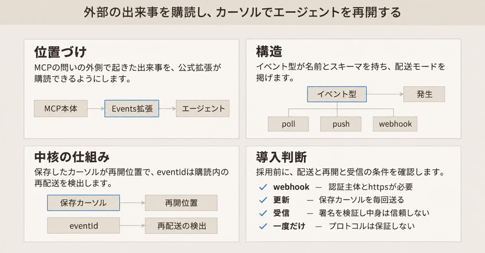
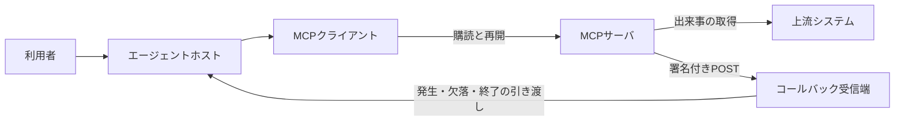
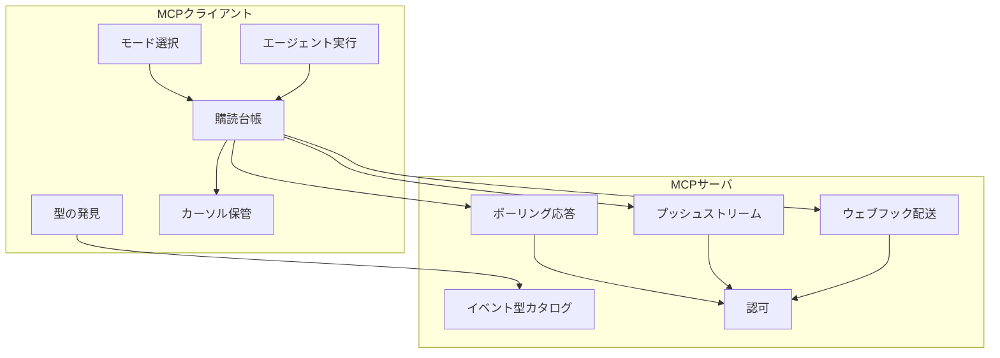
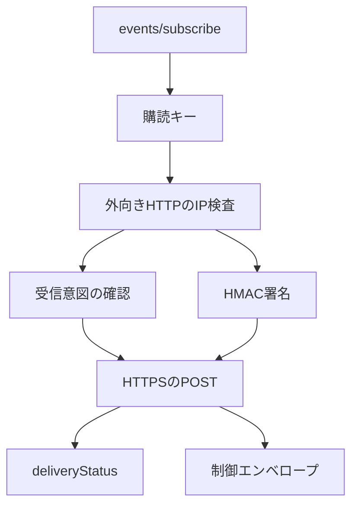
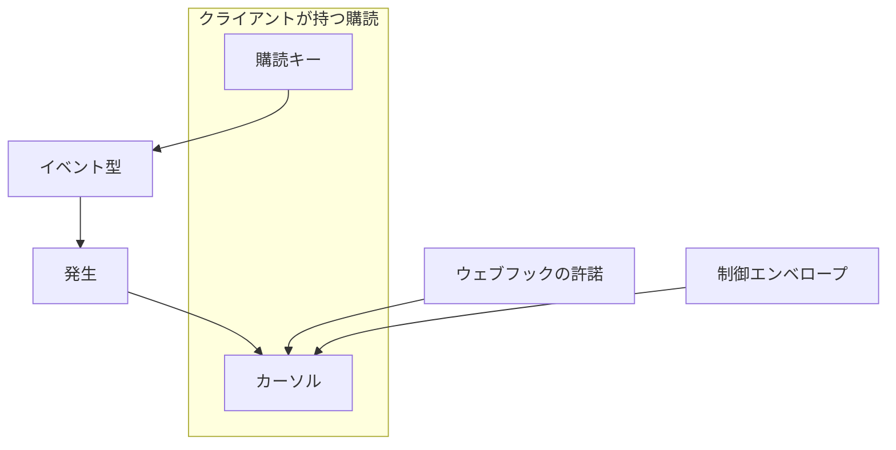
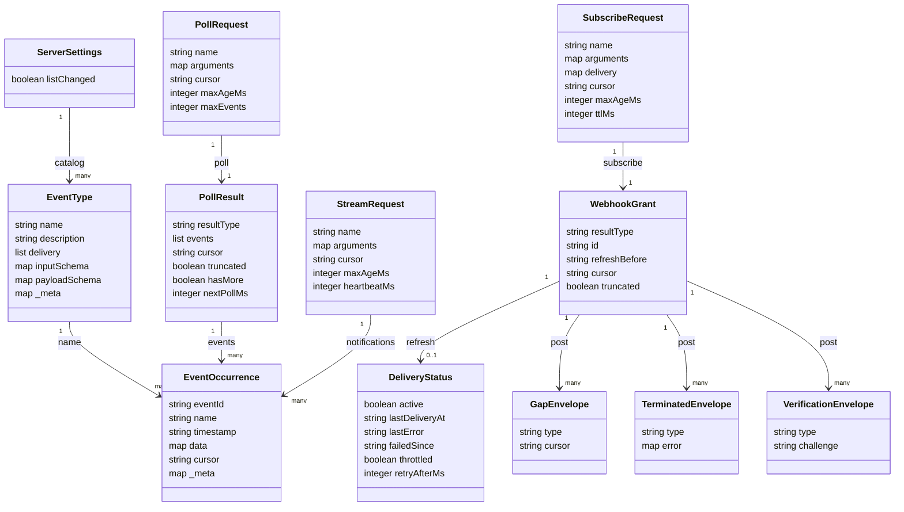
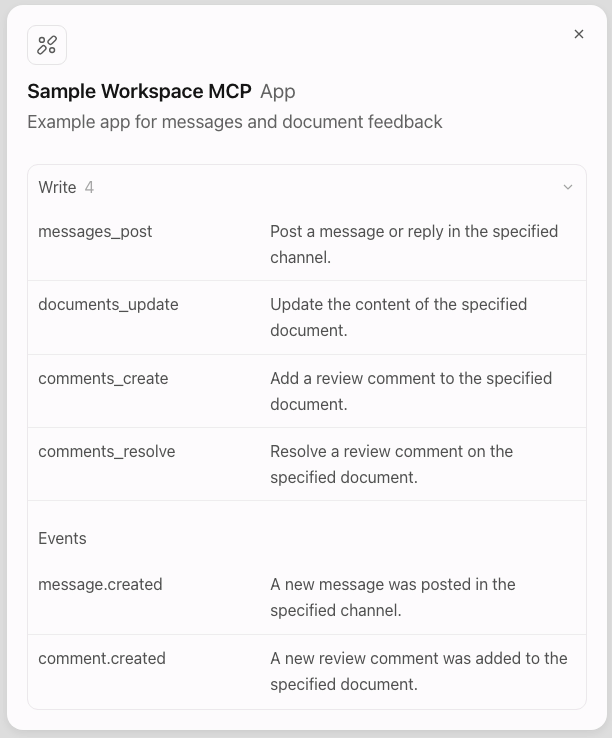

MCP Events は、MCP（Model Context Protocol）のクライアントが外部システムで起きた出来事を購読し、人がその場にいなくてもエージェントを起こせるようにする公式拡張です。MCP の仕様変更を提案・採択する文書である SEP のうち、この拡張を定める SEP-3415 が 2026年11月19日にマージされ、拡張の仕様は Beta 段階として公開されています。

この記事は、MCP サーバやエージェントホストを実装・運用するエンジニアに向けて、Events 拡張の構成要素、メッセージの形、3つの配送モードの使い分け、カーソルと認可の運用を、仕様の JSON 例に沿って整理します。記述は 2026-11-22 時点の beta 仕様 [`specification/beta/events/events.mdx`](https://github.com/modelcontextprotocol/ext-events/blob/main/specification/beta/events/events.mdx) に基づきます。


*この記事の全体像。以下、順に解説します。*

## MCP Events 拡張とは

MCP Events は、MCP クライアントが上流システムで起きた出来事を購読し、人がその場にいなくてもエージェントを起こすための公式拡張です。識別子は `io.modelcontextprotocol/events` です。プロトコル改訂 `2026-07-28` 以降で定義され、次の3つに依存します。

- リクエストごとに送るクライアント能力の宣言
- サーバが自分の能力を返す `server/discover`
- サーバからの通知を受け取るために開いておくリクエスト `subscriptions/listen`

MCP 本体は、利用者またはモデルが問い、サーバが答える仕組みです。Events が足すのは、その問いの外側で起きる出来事です。

サーバは `events/list` で**イベント型**を公開します。イベント型は購読できる出来事の種類で、名前、購読引数の JSON Schema である `inputSchema`、配送データの JSON Schema である `payloadSchema`、使える配送モードを持ちます。クライアントは名前と引数の組で購読し、`{eventId, name, timestamp, data, cursor}` の形をした**発生**（1つの出来事を1つの購読へ届けた記録）を受け取ります。

配送モードは3つで、どれも必須ではありません。イベント型は `poll`、`push`、`webhook` の空でない部分集合を掲げます。

| モード | 使うメソッド | 動き |
|---|---|---|
| poll | `events/poll` | クライアントが定期的に取りに行く |
| push | `events/stream` | 長寿命のリクエストでサーバが流し続ける |
| webhook | `events/subscribe` | クライアントが `https` のコールバックを登録し、サーバが [Standard Webhooks](https://github.com/standard-webhooks/standard-webhooks/blob/main/spec/standard-webhooks.md)（署名付き Webhook のヘッダと署名方式を定めた公開仕様）に沿った署名付き POST を TTL（有効期限）のもとで送る |

この拡張の結果はすべて標準の `Result` で、`resultType: "complete"` を載せます。所有は Tasks and Events Working Group です。Extension Maintainer は作業部会のリードで、2026-11-22 時点の仕様本文は Clare Liguori（@clareliguori）、Peter Alexander（@poita）、Luca Chang（@LucaButBoring）、Caitie McCaffrey（@CaitieM20）を名指しています。インキュベーションは `experimental-ext-triggers-events` リポジトリで行われ、Beta 入りは SEP-3415 を通りました。

## 特徴

- **購読引数を持てます。** リソース更新通知は、更新されたリソースの URI を伝えます。一覧変更通知は、クライアントが種別ごとのフラグで受信を選びます。どちらも型ごとの `inputSchema` やペイロードスキーマは持ちません。
- **切断後に再開できます。** **カーソル**は、サーバが定義する不透明な配送位置です。クライアントはこれを保持し、同じ購読をカーソル付きでやり直します。サーバがそこから配送できないときは `truncated: true` で欠落を知らせます。
- **再送はイベント型ごとに任意です。** 再送を持たない型では、サーバは配送の `cursor` を `null` にしてかまいません。典型は、番地付きの履歴が無い上流です。`null` を受け取ったクライアントはそれを保存せず、次も `null`（今から）で始めます。欠落した出来事はプロトコルでは戻りません。
- **配送は少なくとも1回になり得ます。** 耐久のある上流と、最後のカーソルからの再開が揃ったときです。これとは別に、SEP-3415 付録 A は相互運用の必須文ではなく SDK 向けの手引きです。その手引きが emit-only と呼ぶ一例は、プロセス内のリングバッファだけを読む poll で、カーソルはそのバッファの通し番号です。この一例では再起動でバッファは消え、クライアントは `truncated: true` と新しいカーソルを受け取ります。サーバ再起動をまたぐ保証は、この一例では高々1回です。
- **再配送は、購読単位の `eventId` で検出できます。** プロトコルは順序保証、正確に1回、トランザクション一貫性を持ちません。`eventId` の重複排除は再配送の検出であり、ツール実行後に処理済み記録を残す前に止まった場合の二重実行までは防ぎません。購読の内側では、poll と push はサーバが生成した順で届きます。webhook は発生ごとの再送が独立するので到着順はベストエフォートで、順序が要るクライアントは `timestamp` を使います。購読をまたぐ順序はどのモードにもありません。
- **購読台帳の正本はクライアントが持ちます。** サーバに購読一覧メソッドはありません。
- **イベントを受け取ったことは、ツールを呼ぶ許可になりません。** ここでのツールは、発生に載らない中身（メールなら本文）を、クライアントがサーバへ別途取りに行く呼び出しです。その呼び出しは通常の MCP 認可を通り、発生を受け取っただけでは許可されません。
- **ペイロードはツール結果と同じく信頼しない入力です。** プロンプトインジェクションを含み得ます。
- **ウェブフックだけが、クライアント指定 URL への外向き HTTP を持ちます。** SSRF（サーバに内部ネットワークなど意図しない宛先へリクエストを送らせる攻撃）対策、エンドポイント検証、HMAC 署名はこのモードに閉じます。
- **破壊的なスキーマ変更は、新しいイベント名で出すのが推奨です。** 同じ名前の上書きはしません。

隣接する仕組みとの違いは次のとおりです。

| 比較対象 | 何を知らせるか | 引数 | 再開 | 接続 |
|---|---|---|---|---|
| Events | 上流の出来事 | `inputSchema` がある | カーソル。再送は型ごと | poll / push / webhook |
| `notifications/resources/updated` と `list_changed` | URI または一覧の変化 | 型ごとの `inputSchema` は無い。リソース更新通知は更新された URI を伝える | カーソルが無い | 開いている `subscriptions/listen` だけ |
| Tasks | クライアントが自分で始めた長い処理の状態と結果 | タスク ID | この版はタスク状態のイベント型を定義しない。公開質問の予約名は `mcp.task.updated` | `tasks/get`、または開いている `subscriptions/listen` 上の `notifications/tasks` |

場面ごとに向くモードは次のとおりです。

| 場面 | 向くモード |
|---|---|
| サーバが購読者ごとの状態を持たない | poll |
| ローカルの stdio や、つなぎっぱなしのクライアント | push |
| 遠隔サーバで、クライアントが長寿命接続を持てない | webhook |
| クライアント自身が始めた処理の完了待ち | Tasks。状態は `tasks/get` か、開いている接続の `notifications/tasks` |

系譜は次の順です。長時間処理を扱う [SEP-1686](https://modelcontextprotocol.io/seps/1686-tasks.md)（Tasks、Status: Final）の Future Work は、タスク状態のサーバ起点通知を将来課題にし、実装候補としてウェブフック方式か永続的な通知チャネルを挙げました。ここでの Status: Final は、その SEP が採択済みであるという記録の状態で、拡張の段階ではありません。SEP-3415 の導入部は、その将来課題を一般の出来事通知へ広げるために Triggers and Events 作業部会（現在の Tasks and Events）が作られ、その定義が SEP-3415 だと書いています。

この版の `events.mdx` は、`notifications/resources/updated` や `list_changed` を既存の仕組みのまま残し、タスク状態のイベント型は定義しません。SEP-3415 の公開質問 4 は、予約名 `mcp.task.updated`（引数 `{taskId}`、ペイロードに状態）を例として示しています。[ext-events PR #2](https://github.com/modelcontextprotocol/ext-events/pull/2)（Task Event Sources）は、`CreateTaskResult.eventSource` でサーバがイベントを名指しする草案で、その固定名は定義していません。

## 構造

論理構造として読みます。システムコンテキスト図とコンテナ図は役割名だけを使い、コンポーネント図でプロトコル上の具体名を使います。ここでのコンテナは、クライアントとサーバの内側にある役割のまとまりです。

### システムコンテキスト図



| 要素名 | 説明 |
|---|---|
| 利用者 | 購読の意図と、起きたあとの行動方針をホストに渡す人 |
| エージェントホスト | 発生を受けて新しいターンを始める実行環境 |
| MCPクライアント | 拡張を宣言し、モードを選び、カーソルを永続化する側 |
| MCPサーバ | イベント型を公開し、認可し、選ばれたモードで配送する側 |
| 上流システム | メール、リポジトリ、インシデントなど、出来事の源 |
| コールバック受信端 | ウェブフックの POST を受ける HTTPS エンドポイント。クライアント本体と別でもよい。`verification` は受信端が応答し、`gap` と `terminated` は購読を管理するクライアントまで渡す |

### コンテナ図



| 要素名 | 説明 |
|---|---|
| 型の発見 | `events/list` で名前、スキーマ、配送モードを取る |
| モード選択 | 型が掲げる部分集合のうち、クライアントが実行できる1つを選ぶ |
| 購読台帳 | クライアントが持つ正本。サーバ側に一覧 API は無い |
| カーソル保管 | 購読ごとの最新位置。欠落した出来事はプロトコルでは戻らないので、必要ならツールで状態を読み直す判断に使う |
| エージェント実行 | 発生が空でないときにモデルへ渡す。空のポーリングではモデルを起こさない |
| イベント型カタログ | サーバが公開する型の集合。`listChanged` のとき変化を通知できる |
| 認可 | 購読時に検査し、配送中も再検査する |
| ポーリング応答 | リクエスト完結。サーバはプロトコル上の購読状態を持たなくてよい |
| プッシュストリーム | 購読ごとに1本の長寿命リクエスト。生存期間はリクエストと同じ |
| ウェブフック配送 | コールバック URL、秘密、TTL をサーバが持つ |

### コンポーネント図

ウェブフック配送の内部だけを掘り下げます。ポーリングとプッシュは、この外向き HTTP を持ちません。



| 要素名 | 説明 |
|---|---|
| events/subscribe | コールバック登録と、同じキーでの TTL 更新。ポーリングとプッシュはこれを使わない |
| 購読キー | `principal`（認証された主体）、`delivery.url`、イベント名、引数の組。引数は正規化 JSON の一致で比べる |
| 受信意図の確認 | チャレンジ、許可リスト、帯域外確認、`/.well-known/mcp-webhook-receiver.json` のいずれか |
| 外向きHTTPのIP検査 | チャレンジ POST、well-known の取得、通常配送の POST は、解決した IP を検査してからその IP へ接続する。リダイレクトは追わない。受信意図の確認が成功したあと、通常配送を始める |
| HMAC署名 | `webhook-id`、`webhook-timestamp`、生ボディに対する `v1,` 署名。秘密はクライアントが渡す |
| HTTPSのPOST | `Content-Type: application/json` と `X-MCP-Subscription-Id` を付ける |
| deliveryStatus | 更新応答に載ることがある。失敗カテゴリだけを返し、生の応答本文は返さない |
| 制御エンベロープ | `verification`、`gap`、`terminated` の3種。トップレベル `type` があるボディが制御で、無いボディが発生 |

## データ

### 概念モデル



| 要素名 | 説明 |
|---|---|
| イベント型 | 名前で識別する契約。`inputSchema`、`payloadSchema`、`delivery` を持つ |
| 購読キー | 誰が、どこへ、何を、どの引数で聴くか。ウェブフックの冪等更新の単位 |
| カーソル | サーバ定義の不透明な位置。クライアントが保管する。再送できない型では null |
| 発生 | 1つの上流出来事を1購読へ届けた記録。`eventId` は購読の内側で重複排除する |
| ウェブフックの許諾 | サーバが返す `id`、`refreshBefore`、水位のカーソル。水位は、確認済みかサーバが再試行を打ち切った位置まで進み、再試行中の発生は追い越さない |
| 制御エンベロープ | 発生ではない POST。欠落、終了、検証チャレンジ |

同じ `eventId` が別の購読に届くのは重複ではありません。ウェブフックで `eventId` による重複排除をする範囲は、その配送の `X-MCP-Subscription-Id` です。購読キーは `principal`、`delivery.url`、イベント名、引数なので、同じ出来事が2つの購読に届いたら、どちらも処理します。

### 情報モデル



| 要素名 | 説明 |
|---|---|
| EventType.delivery | `poll`、`push`、`webhook` の空でない部分集合 |
| EventType.inputSchema | 購読引数の JSON Schema。フィルタ、変換、その他のサーバ定義設定を含められる |
| EventType.payloadSchema | 発生の `data` の JSON Schema。`_meta` は対象外 |
| ServerSettings.listChanged | 省略時は false。true のとき `notifications/events/list_changed` を送れる |
| EventOccurrence.eventId | 必須。上流の安定 ID を使うのが推奨。サーバは著者が渡さないときだけ生成する |
| EventOccurrence.cursor | 任意。プッシュとウェブフックの発生に載る。ポーリングでは応答のトップレベルに載る |
| EventOccurrence.timestamp | 必須。ISO 8601。ウェブフックの順序付けに使う |
| PollResult.cursor | 応答側。再送できない型では null。リクエストの null は「今から」 |
| PollResult.hasMore | true のときクライアントは `nextPollMs` を待たず、更新カーソルですぐ再ポーリングする |
| PollResult.nextPollMs | サーバの推奨間隔。`hasMore` が true のときは無視する。クライアントはより遅くしてよい |
| StreamRequest.heartbeatMs | クライアントの提案。権威があるのは `notifications/events/active` の `heartbeatMs` |
| SubscribeRequest.delivery | `mode: webhook`、`url`、`secret`。秘密は `whsec_` のあとに、復号すると24から64バイトになる base64 を続ける |
| SubscribeRequest.ttlMs | 省略はサーバ既定。null は期限なしの要求。許諾の期限は `refreshBefore` が権威 |
| WebhookGrant.id | サーバがキーから決める。クライアントは送らない。ヘッダ `X-MCP-Subscription-Id` に出る |
| WebhookGrant.refreshBefore | 期限の ISO 8601、または期限なしの null。null を返せるのはクライアントが `ttlMs: null` を提案したときだけ |
| DeliveryStatus.active | サーバがいま配送しているか。false は繰り返し失敗による停止。その更新応答が再活性化する |
| DeliveryStatus.lastDeliveryAt | 応答例にある最終配送時刻。散文のフィールド定義には列挙されない |
| DeliveryStatus.lastError | 分類文字列か null。`connection_refused`、`timeout`、`tls_error`、`http_4xx`、`http_5xx`、`challenge_failed`。生ボディは含めない |
| DeliveryStatus.failedSince | 失敗例に出る時刻。散文のフィールド定義には列挙されない |
| DeliveryStatus.throttled | 任意。true は遅延中で、失敗でもイベント省略でもない |
| DeliveryStatus.retryAfterMs | 任意。`throttled` に添える再開までの目安 |
| GapEnvelope | `type` が `gap`。`cursor` は新しい水位 |
| TerminatedEnvelope | `type` が `terminated`。`error` は終了理由 |
| VerificationEnvelope | `type` が `verification`。`challenge` を受信側が `2xx` でエコーする |

`cursor` フィールドの欠落は、明示的な null と同じ意味です。送信側は null の代わりにフィールドを省略してかまいません。クラス図の `cursor` は文字列として描いていますが、省略と null の両方があり得ます。`_meta` は任意の拡張マップです。

`DeliveryStatus` は、更新時の `events/subscribe` 応答にだけ任意で付きます。散文が定義するのは `active`、`lastError`、任意の `throttled` と `retryAfterMs` です。`lastDeliveryAt` と `failedSince` は同じ節の応答例に ISO 8601 で出ます。`lastError` が null の例もあります。サーバはオブジェクトごと省略してかまいません。

制御の POST は3種類で、ボディに `type` が無いものは `EventOccurrence` です。

| type | ボディの中身 |
|---|---|
| `gap` | `type` と新しい `cursor` |
| `terminated` | `type` と `error`（`code`、`message`、`data`） |
| `verification` | `type` と `challenge` |

### 予約している名前

`events.mdx` の Reservations は、次をこの拡張の予約としています。

- メソッド接頭辞 `events/`
- 通知接頭辞 `notifications/events/`
- ラベル `io.modelcontextprotocol/events`
- `subscriptions/listen` のフィルタ項目 `eventsListChanged`
- HTTP ヘッダ `X-MCP-Subscription-Id`
- well-known パス `/.well-known/mcp-webhook-receiver.json`。例は `{"receivers":["/hooks/"]}` で、検証結果のキャッシュ単位は `(principal, url)`

## 構築方法

公式 SDK への取り込みは、2026-11-22 時点で未マージです。構築の正本は拡張リポジトリの beta 仕様で、以下の JSON は仕様が示すメッセージ例です。

### 前提にするプロトコル版

- 改訂 `2026-07-28` 以降で定義されます。`2025-11-25` 以前にこの拡張はありません。
- サーバは `server/discover` の `capabilities.extensions` に識別子を出します。
- クライアントは、拡張を理解していることを示すとき、リクエストの `_meta` に空の設定オブジェクトを出してかまいません。出さないことが未理解の証明になる、とは仕様は書いていません。
- 拡張を広告していないサーバへ `events/*` を送りません。未対応サーバは `-32601`（Method not found）を返します。
- `events/*` リクエストの外に出る通知は `notifications/events/list_changed` だけで、届くのはクライアントが `subscriptions/listen` で `eventsListChanged` を選んだときです。
- `notifications/subscriptions/acknowledged` は、サーバが同意した `eventsListChanged` をエコーします。サーバが `listChanged: true` を宣言していなければ、確認応答からその項目を落とします。

### 能力の宣言

サーバが `listChanged: true` を返す例です。空オブジェクトでも拡張のサポート宣言になり、そのときは一覧変化の通知を送りません。以下は `server/discover` の成功応答から `result.capabilities` だけを抜粋したもので、そのままの成功応答ではありません。

```json
{
  "result": {
    "capabilities": {
      "extensions": {
        "io.modelcontextprotocol/events": {
          "listChanged": true
        }
      }
    }
  }
}
```

クライアントがリクエストごとに出す宣言の例です。以下は `params._meta` の抜粋です。

```json
{
  "params": {
    "_meta": {
      "io.modelcontextprotocol/clientCapabilities": {
        "extensions": {
          "io.modelcontextprotocol/events": {}
        }
      }
    }
  }
}
```

### SDK と参照実装の状況

規範テキストは `specification/beta/events/events.mdx` の1ファイルです。SDK と適合試験は、2026-11-22 時点でいずれも未マージです。

| 実装 | 2026-11-22 の状態 | 範囲 |
|---|---|---|
| [TypeScript SDK PR 3209](https://github.com/modelcontextprotocol/typescript-sdk/pull/3209) | open かつ draft。タイトルは `feat: Events extension (SEP-3415)` | SEP 本文の紹介では、サーバとクライアントの poll、push、webhook を experimental な `ext/events` に置く |
| [Python SDK PR 3822](https://github.com/modelcontextprotocol/python-sdk/pull/3822) | open。draft ではない。更新は 2026-11-06 | タイトルは poll と webhook の実験的追加。push はタイトルの範囲に無い |
| `mcp-webhook-events` | SEP-3415 が Reference Implementation として名指す第三者実装。公式 SDK の PR ではない | `events/list`、`events/subscribe`、署名付きウェブフック。確認した版 `2a5a005` は `410` で購読行を削除する。beta 仕様は、その配送の再試行だけを止めて購読は残す |
| [conformance PR 521](https://github.com/modelcontextprotocol/conformance/pull/521) | open | サーバ側5シナリオ |
| [conformance PR 541](https://github.com/modelcontextprotocol/conformance/pull/541) | open。521 の上に積む、と SEP が書く | クライアント側 |

[拡張のクライアント行列](https://modelcontextprotocol.io/extensions/client-matrix)で Events 列に印があるのは、MCPJam（poll、push、webhook）と ChatGPT（Partial。ウェブフック配送だけ）だけです。Claude、Claude Code、Cursor、VS Code、Goose、MCP Inspector の Events 列は空です。確認した MCPJam SDK の版は `capabilities.events` が無いと未宣言と判定し、beta の `extensions["io.modelcontextprotocol/events"]` だけでは通りません。配備されている版が同じとは限りません。

### ウェブフックを提供する条件

- `events/subscribe` と `events/unsubscribe` には認証された主体が必須です。主体の無いサーバは poll と push を出せますが、webhook は出しません。
- コールバック URL は `https` です。それ以外は `InvalidParams` で拒否します。
- 秘密はサーバが生成しません。クライアントが `delivery.secret` で渡します。
- 短い TTL なら購読状態をメモリに置けます。長い有限 TTL または期限なしを付与するサーバは、付与した期間の購読を再起動後も保持します。期限なしでは、検証状態も再起動を越えて残します。
- SSRF 対策は配送のたびに行います。サーバはホスト名を解決し、解決した IP を IANA の IPv4 と IPv6 の特別用途レジストリに照らします。グローバルに経路できないアドレスは、明示の許可が無い限り拒否します。仕様の例は `127.0.0.0/8`、`10.0.0.0/8`、`172.16.0.0/12`、`192.168.0.0/16`、`169.254.0.0/16`、`::1`、`fc00::/7`、`fe80::/10` です。
- 接続先は検査済みの IP にし、`Host` と TLS の SNI には元のホスト名を残します。HTTP リダイレクトは追いません。

## 利用方法

仕様が示す操作を順に見ます。ホストのプロンプト文はプロトコルの一部ではありません。

この節の JSON の多くは拡張パラメータの抜粋で、改訂 `2026-07-28` のリクエストが必須とする `_meta["io.modelcontextprotocol/protocolVersion"]` と `_meta["io.modelcontextprotocol/clientCapabilities"]` を省いています。HTTP では `protocolVersion` が `MCP-Protocol-Version` ヘッダと一致する必要があり、不一致なら HTTP 400 と `HeaderMismatch`（`-32020`）です。両方が一致していても版が未対応なら、同じく HTTP 400 と `UnsupportedProtocolVersion`（`-32022`）です。空の `clientCapabilities` は、そのリクエストに任意能力が無いという意味で、サーバは前のリクエストから能力を推測しません。

抜粋ではない1件の形は次のとおりです。

```json
{
  "jsonrpc": "2.0",
  "method": "events/poll",
  "id": 1,
  "params": {
    "name": "email.received",
    "arguments": { "from": "*@example.com" },
    "cursor": null,
    "_meta": {
      "io.modelcontextprotocol/protocolVersion": "2026-07-28",
      "io.modelcontextprotocol/clientCapabilities": {}
    }
  }
}
```

### イベント型の一覧

`events/list` のパラメータは、任意のページング `cursor` だけです。Streamable HTTP は HTTP で JSON-RPC を運ぶ接続で、stdio（標準入力のリクエストと標準出力の通知）とは別です。サーバは `application/json` の単一応答か `text/event-stream` を返せ、クライアントは両方を受けます。長寿命の SSE 応答を使うのは `events/stream` です。この接続では `events/list` に `Mcp-Name` ヘッダを付けません。`events/list` の `Mcp-Method` には、メソッド名を載せます。`events/poll`、`events/stream`、`events/subscribe`、`events/unsubscribe` では、`Mcp-Name` の値を `params.name` にします。

```json
{
  "resultType": "complete",
  "events": [
    {
      "name": "email.received",
      "description": "Fires when a new email arrives in the inbox",
      "delivery": ["poll"],
      "inputSchema": {
        "type": "object",
        "properties": {
          "from": { "type": "string" }
        }
      },
      "payloadSchema": {
        "type": "object",
        "properties": {
          "messageId": { "type": "string" },
          "from": { "type": "string" },
          "subject": { "type": "string" }
        }
      }
    }
  ],
  "nextCursor": "optional-when-more-pages"
}
```

- 引数が `inputSchema` に合うかを購読前に確かめます。Streamable HTTP のクライアントは `x-mcp-header` も検査し、注釈名が大文字小文字を無視して重複するなど、トランスポートの制約に反するイベント型は一覧から除外します。
- スキーマは名前の寿命のあいだ加算で変えます。任意フィールドの追加はできます。既存フィールドの削除、改名、型変更、enum の縮小は避けます。
- 壊す変更は新しいイベント名で並走させ、移行のあと古い名前を消します。
- 型の削除は `NotFound` と `data.kind: "event"` で知らせます。その場の非互換変更を、古いカーソルから判別できるサーバは `Unsupported` を返してかまいません。`data.feature` は `payloadSchema` または `inputSchema`、`data.reason` は `schema_changed` です。判別しないサーバでは、クライアントが次の `events/list` で変更を知ります。どちらも `Forbidden` ではありません。

### ポーリング

最初の `cursor: null` が購読の開始で、別の subscribe はありません。購読ごとに1本のポーリングループを回します。`maxAgeMs` は再開位置の床です。古いカーソルと一緒に渡すと、サーバはカーソルと現在時刻からこのミリ秒を引いた時点のうち遅い方から再開します。下の例の `300000` は5分で、`cursor` が null のときと再送できない型では無視します。

```json
{
  "name": "email.received",
  "arguments": { "from": "*@example.com" },
  "cursor": null,
  "maxAgeMs": 300000,
  "maxEvents": 50
}
```

```json
{
  "resultType": "complete",
  "events": [],
  "cursor": "historyId_99842",
  "truncated": false,
  "hasMore": false,
  "nextPollMs": 30000
}
```

- `events` が空なのは通常系で、モデルは起こしません。
- `hasMore: true` のときは、更新カーソルですぐ次を取ります。
- クライアントは既定の下限 1000 ms を置き、異常な `nextPollMs` で密なループに入らないようにします。
- エラーは部分成功になりません。1リクエストが1購読です。

### プッシュ

上の一覧例は `email.received` の `delivery` を `["poll"]` だけにしていますが、ここからの `events/stream` の例は同じ名前を使う仕様の別例です。`delivery` に `push` が無い型へ `events/stream` を送ると、サーバは `Unsupported`（`-32026`）を返します。

`events/stream` は購読ごとに1本開きます。Streamable HTTP では POST の SSE 応答、stdio では stdin のリクエストと stdout の通知で運びます。

```json
{
  "jsonrpc": "2.0",
  "method": "events/stream",
  "id": 1,
  "params": {
    "name": "email.received",
    "arguments": { "from": "*@example.com" },
    "cursor": null,
    "maxAgeMs": 300000,
    "heartbeatMs": 15000
  }
}
```

- 最初に `notifications/events/active` が来て、以後 `notifications/events/event` が来ます。
- この `events/stream` 上の `notifications/events/*` は、`params._meta["io.modelcontextprotocol/subscriptionId"]` に親の `events/stream` の JSON-RPC `id` を載せます。`notifications/events/list_changed` は別経路で、クライアントが `eventsListChanged` を選んだ `subscriptions/listen` 上にだけ届きます。コアスキーマでは、そのときの `subscriptionId` は `subscriptions/listen` リクエストの `id` です。
- 復旧可能な失敗は `notifications/events/error` で、ストリームは開いたままです。終了は `notifications/events/terminated` だけです。
- 取消は、HTTP ならリクエストストリームの中断、stdio なら `notifications/cancelled` にその `requestId` を載せて行います。
- サーバ SDK は、`events/stream` を同時リクエスト数の一般上限から外します。
- 再接続の前にはランダムな待ちを入れます。
- Streamable HTTP では、`active` から数えて付与 `heartbeatMs` の3倍のあいだメッセージが無ければストリームを死んだとみなし、カーソルで繋ぎ直します。stdio のサーバ死亡は stdout の EOF で検知します。stdio のハートビートは主にカーソルを進めるためで、サーバは間隔を長くしてかまいません。
- サーバが自分からストリームを閉じるとき、空の `StreamEventsResult` を最終フレームにできます。中身は `resultType` と `_meta` の購読 ID だけで、意味のある内容はその前の通知にあります。クライアントはこのフレームの到着を前提にしません。`notifications/events/terminated` とは別の枠です。Streamable HTTP でクライアントが中断したときは結果を送れません。stdio では取消のあと、コアが取消済みリクエストへの応答を推奨しないため、省略が通常です。

### ウェブフック購読

```json
{
  "jsonrpc": "2.0",
  "method": "events/subscribe",
  "id": 2,
  "params": {
    "name": "incident.created",
    "arguments": { "severity": "P1" },
    "delivery": {
      "mode": "webhook",
      "url": "https://proxy.example.com/hooks/client123",
      "secret": "whsec_<base64-of-24-to-64-random-bytes>"
    },
    "cursor": null,
    "maxAgeMs": 300000,
    "ttlMs": 3600000
  }
}
```

```json
{
  "resultType": "complete",
  "id": "sub_a3f1c8e2b0d49f7e",
  "refreshBefore": "2026-02-19T16:30:00Z",
  "cursor": "cursor_start_001",
  "truncated": false
}
```

- 同じ購読キーで再度呼ぶと、TTL の更新と、秘密などの可変項目の置換になります。更新要求には、最後に保存した `cursor` を毎回載せます。購読が生きていれば配送はそのまま続き、失効や再起動のあとならその値が再開位置です。`null` は「今から」なので、停止中の出来事は戻りません。下の配送例を最後に受け取ったあとの更新なら、`cursor` は `cursor_xyz` です。
- 秘密をローテーションするときは新しい値を更新で渡します。サーバは短い猶予のあいだ新旧両方で署名するのが推奨です。
- クライアントは `refreshBefore` より前に同じキーで再度 `events/subscribe` します。期限なし許諾では、正しさがこの更新に依存しません。
- HMAC の鍵は、`delivery.secret` から `whsec_` を除いた残りを base64 復号したバイト列です。署名文字列そのものを鍵にしません。
- 配送 POST の署名は、その鍵で `webhook-id + "." + webhook-timestamp + "." + 生ボディ` の HMAC-SHA256 を計算し、結果を base64 にして `v1,` を付けたものです。ボディは再シリアライズ前の生バイトです。
- `webhook-id` はメッセージの ID で、`eventId` から導出しません。再送は同じ `webhook-id` を保ち、タイムスタンプと署名は作り直します。
- 受信側は、`webhook-timestamp` が5分より古い配送を拒否するのが推奨です。
- ボディが 256 KiB を超える配送を、受信側は `413` で拒否してかまいません。サーバは `413` をその配送の再送対象外にします。意図的な拒否は `410 Gone` です。beta 仕様に従うサーバでは、その配送の再試行だけが止まり、購読は残ります。確認した `mcp-webhook-events` の版 `2a5a005` は、`410` で購読行を削除します。

発生の POST 例は次のとおりです。ヘッダの `webhook-signature` は仕様の形を示したものです。この例はボディの発生時刻 2026-02-19 16:00 UTC に即時送信する形にし、`webhook-timestamp` を `1771516800` にしています。仕様本文の例は `1739980800`（2025-02-19 16:00 UTC）のままで、ボディの時刻と1年ずれています。署名値はプレースホルダです。`Content-Length` は、改行が LF で末尾改行の無いこのボディの 240 バイトです。

```http
POST /hooks/client123 HTTP/1.1
Host: proxy.example.com
Content-Type: application/json
Content-Length: 240
webhook-id: msg_2KWPBgLlAfxdpx2AI54pPJ85f4W
webhook-timestamp: 1771516800
webhook-signature: v1,<base64-hmac>
X-MCP-Subscription-Id: sub_a3f1c8e2b0d49f7e

{
  "eventId": "evt_789",
  "name": "incident.created",
  "timestamp": "2026-02-19T16:00:00Z",
  "data": {
    "incidentId": "INC-1234",
    "title": "Database connection pool exhausted",
    "severity": "P1"
  },
  "cursor": "cursor_xyz"
}
```

### 購読の解除

- poll はポーリングを止めます。
- push は、HTTP ならストリームを切り、stdio なら `notifications/cancelled` を送ります。
- webhook は `events/unsubscribe` に名前、引数、`delivery.url` を渡します。サーバが決めた `id` は入力に使いません。beta 仕様が empty `Result` と呼ぶ成功は、`result` が `{"resultType":"complete"}` で、ほかのフィールドは無いものです。`result: {}` ではありません。期限なし購読をクライアントから後始末する手段はこれだけです。

```json
{
  "jsonrpc": "2.0",
  "method": "events/unsubscribe",
  "id": 3,
  "params": {
    "name": "incident.created",
    "arguments": { "severity": "P1" },
    "delivery": { "url": "https://proxy.example.com/hooks/client123" }
  }
}
```

### すでに動いているホスト

公式のクライアント行列は、ChatGPT の Events を Partial としています。注記によると、Partial はウェブフック配送だけを指し、印のあるクライアントは3モードです。同じ注記は、これらの実装の多くが SEP-3415 の Final より前で、草案仕様を追っていると書いています。この Final は SEP の採択記録の状態で、拡張が Stable になったことではありません。

[ChatGPT の開発者文書](https://developers.openai.com/plugins/build/mcp-events)は、ウェブフックとコールバック検証を、Streamable HTTP の `initialize` か、プロトコル版 `2026-07-28` の MCP 2.0 HTTP という、その文書が前提に挙げる接続でサポートすると書いています。ポーリング、ストリーミング、草案の `gap` と `terminated` はこの連携の対象外です。プラグイン画面では、イベントがツールと並んで表示されます。



Streamable HTTP では、`events/poll`、`events/stream`、`events/subscribe`、`events/unsubscribe` に `Mcp-Name` ヘッダを付け、値は `params.name` にします。プレーン ASCII として安全に表せないイベント名は、Base64 センチネル形式で運びます。サーバはトランスポートの符号化規則のまま検証し、復号した値を `params.name` と比べます。欠落または不一致は HTTP 400 と `HeaderMismatch`（`-32020`）です。`inputSchema` の `x-mcp-header` は、値のある引数を `Mcp-Param-{Name}` ヘッダに写します。ウェブフック配送そのものには、このヘッダは付きません。

## 運用

### カーソルの保持

- 購読ごとに最後のカーソルを耐久保存し、再起動後にそれを渡します。
- null は保存しません。次も null で「今から」始めます。
- 静かな期間でもカーソルは進みます。poll は空応答の `cursor`、push はハートビートの `cursor`、webhook は更新応答の `cursor` です。webhook の水位は、受信端が確認した発生か、サーバが再試行を打ち切った発生まで進み、再試行中の発生は追い越しません。
- `maxAgeMs` を古いカーソルと一緒に渡すと、サーバはカーソルと `now - maxAgeMs` の遅い方から再開します。仕様の例は `300000`（5分）です。`cursor` が null のときと、再送できない型では無視されます。
- この床がカーソルを追い越したら、サーバは最初の応答で `truncated: true` を立てます。クライアントは再購読で応じず、新しいカーソルを保存します。必要ならツールで権威ある状態を読み直します。

### ハートビート

プッシュの生存確認は、SSE のコメントではなく、カーソルを運べる通知で行います。

```json
{
  "jsonrpc": "2.0",
  "method": "notifications/events/heartbeat",
  "params": {
    "cursor": "historyId_99850",
    "_meta": { "io.modelcontextprotocol/subscriptionId": 1 }
  }
}
```

- 提案が無いときの推奨既定は30秒です。権威があるのは、サーバが `active` で返す間隔です。
- サーバは、その間隔のあいだ他のメッセージが無ければハートビートを送ります。
- 仕様は、仲介のアイドル切断が60秒から100秒であることが多いと書いています。間隔はその内側に収めます。
- クライアントは `events/stream` に通常のリクエストタイムアウトを当てません。

### 取りこぼしの扱い

| モード | `truncated: true` の出どころ |
|---|---|
| poll | 結果ボディ。JSON-RPC エラーにはしない |
| push | `notifications/events/active`。同じストリームで配送を続ける |
| webhook | subscribe または更新の応答。更新のあいだに分かった欠落は `{"type":"gap","cursor":"<fresh>"}` |

再送できない型では `truncated` を false にするのが推奨で、クライアントはそれを無視します。

### 認可の再確認

- **購読時**: 認証されている呼び出しでは、その主体がその型と引数を購読できるかを確認します。仕様の例は、チャットのチャネルに利用者が入れるかです。
- **配送時**: サーバは定期的に権限を見直すのが推奨です。剥奪されたら、モードごとの終了信号を出します。
- **行動時**: 発生の受信は行動の認可になりません。ツール呼び出しは通常の MCP 認可を通ります。
- 監査の正本はクライアントの購読台帳です。サーバに一覧はありません。

### 購読の終了

終了のきっかけは、権限の剥奪、イベント型の削除、その場の非互換変更の3つで、エラーはきっかけで分かれます。

| きっかけ | エラー |
|---|---|
| 権限の剥奪 | `Forbidden`（`-32024`） |
| イベント型の削除 | `NotFound`（`-32023`）と `data.kind: "event"` |
| その場の非互換変更 | `Unsupported`（`-32026`）。`data.feature` が `payloadSchema` または `inputSchema`、`data.reason` が `schema_changed` |

push の終了通知と、webhook の制御 POST の例です。

```json
{
  "jsonrpc": "2.0",
  "method": "notifications/events/terminated",
  "params": {
    "error": {
      "code": -32024,
      "message": "Forbidden",
      "data": { "reason": "Access revoked" }
    },
    "_meta": { "io.modelcontextprotocol/subscriptionId": 1 }
  }
}
```

```json
{ "type": "terminated", "error": { "code": -32024, "message": "Forbidden", "data": { "reason": "Access revoked" } } }
```

- push は、ストリーム上の `notifications/events/terminated` で終わります。
- poll は、型の削除なら次の `events/poll` が `NotFound` です。その場の非互換変更は、サーバが古いカーソルを判別する実装なら `Unsupported`、それ以外は次の `events/list` で知ります。
- webhook は署名付きの `terminated` で終わり、その購読はサーバから消えます。次の更新は新規購読になります。
- `NotFound` と `Unsupported` は、再発見して購読し直す信号です。`Forbidden` は止める信号です。

### エラーコード

仕様が割り当てる番号です。`InvalidParams` は JSON-RPC の既存コードで、残り5つは MCP の仕様用帯域 `-32020` から `-32099` の次番号として説明されています。

| 名前 | コード | いつ使うか |
|---|---|---|
| InvalidParams | -32602 | 引数がスキーマに合わない、URL が https でない、秘密が `whsec_` の形でない |
| NotFound | -32023 | 未知のイベント名、または unsubscribe のキーが無い。`data.kind` は `event` または `subscription` |
| Forbidden | -32024 | 主体にその組の許可が無い、または剥奪された |
| ResourceExhausted | -32025 | サーバの上限。`data.limit` が名前、`data.max` が上限になり得る |
| Unsupported | -32026 | 形は正しいが、型がその配送モードを出していない等。例は `data.feature: deliveryMode` |
| CallbackEndpointError | -32027 | ウェブフックの検証失敗または到達不能。`data.reason` は `lastError` と同じ分類 |

### レートと再送の目安

- ポーリング頻度の動的な制御は `nextPollMs` で行います。
- ウェブフックの再送は発生ごとに独立で、指数バックオフです。推奨の上限例は、初回配送を含む試行3回から5回を10分から15分以内に収める、というものです。配送を止めていた時間はこの窓を消費しません。規範の上限値ではなく推奨文です。
- 配送停止の例として、仕様は60分の窓で失敗率95%超かつ最低100試行を実装ガイダンスとして挙げています。固定回数ではありません。
- 応答待ちのタイムアウトはプロトコルパラメータではなく、5秒程度が一般的だと仕様は書いています。受信側は永続化またはキューイングのあと、すぐ `2xx` を返します。
- `deliveryStatus.throttled` と `retryAfterMs` は遅延中の見える化で、失敗ではありません。イベントを省略する保護は、`gap` か `truncated: true` で知らせます。

## ベストプラクティス

### ペイロードを識別子に留める

- サーバはトリアージに足る項目だけを送ります。メールなら送信者、件名、メッセージ ID に留め、本文はツールで取りに行きます。
- 仕様は配送ボディを 256 KiB 以下に保つことを推奨しています。
- クライアントは発生をモデルへ渡す前に、ツール結果と同じ隔離をします。隔離は、信頼しない入力として、モデルが見る本文と分けて扱うことです。

### 配送失敗を権限と同じ境界で扱う

- 購読の認可、配送時の再認可、失敗、再送、取りこぼしを、ツール呼び出しと同じ主体の境界に載せます。
- ウェブフックの `lastError` は分類文字列だけを見ます。エンドポイントの生応答をログへ写して探索に使いません。
- 秘密は購読ごとに持ち、検証する側が保管します。サーバが秘密を生成する形にはしません。
- ゲートウェイが送信サーバを識別したいときは、任意の `v1a,`（ed25519 の非対称署名）を HMAC に足します。公開鍵は、対象の MCP 接続先と同一オリジンの Server Card（サーバが自分の接続先や能力を公開するメタデータ）から取ります。別オリジンのカードと、別オリジンへのリダイレクトで到達したカードの鍵は使いません。配送ボディやチャレンジからも取りません。Events 仕様は、公開鍵を `remotes[].extensionsInfo["io.modelcontextprotocol/events"].webhooks.signingKeys` に置くと書いています。

### 起床条件をプロンプトに置かない

- モデルが見るのは届いた発生だけです。モード選択とループはクライアント SDK が回します。
- 何を購読するか、どの引数か、カーソルをどこに置くか、`truncated` のあと権威ある状態を読み直すかは、ホストのポリシーと購読台帳に書きます。
- プロンプトに「この文章が来たら起きよ」と書いただけでは、配送の欠落と再送を検査できません。
- 発生と行動のあいだに、アプリケーション側のポリシー評価を置きます。ポリシー言語はプロトコルの外です。

### スキーマは加算で変える

- 既存の購読は、作られたときの `events/list` より長く生きます。
- 加算の変更で購読を終了させません。
- 名前を消すか非互換に変えるときだけ、モードごとの終了信号を出します。
- この版に `schemaVersion` はありません。SEP は、スキーマの指紋を `_meta` に載せる案を未決の追補として残しています。

### モードを配備に合わせる

- サーバレスで接続を保持できないなら poll を掲げます。
- NAT の内側でコールバックを受けられないクライアントのために、webhook を唯一のモードにしません。
- 1つのモードを必須にすると、履歴、長寿命接続、外向き HTTP のどれかを全実装に課すことになります。仕様はその必須化を採っていません。
- 1つの上流フィードが複数のイベント型を出す場合、この版では型ごとに購読とカーソルが分かれます。サーバ SDK が内側で上流接続をまとめるのは、プロトコル変更なしの選択肢として SEP の未決事項に残っています。
- プッシュの再接続には、poll の `maxEvents` と `hasMore` に相当するプロトコル上の件数上限がありません。SEP はこれを既知の隙間とし、TCP のバックプレッシャーとサーバのペースに委ねています。

### クライアント台帳を監査する

- 企業の実行環境は、クライアント SDK の購読台帳と、発生で始まった行動を記録します。
- キルスイッチはモードごとです。poll はループ停止、push はストリーム中断または `notifications/cancelled`、webhook は `events/unsubscribe` または更新停止です。
- 期限なし購読は、更新停止では消えません。明示の unsubscribe か、サーバが継続失敗のあと捨てる処理が要ります。

## 注意点

### 仕様の段階と規範の所在

- **段階の名前**: 「本日付で final」とまとめる投稿があり、概要ページも SEP-3415 が Final で拡張は Beta と両方を書いています。SEP ページの Status は Final ですが、注記は Final を採択時点の歴史記録とし、その後の変更は SEP に反映されないと書いています。`events.mdx` の Stage は Beta で、「実利用は歓迎し、破壊的変更は稀で文書化する」と書いています。Final は SEP の状態で、拡張が Stable や Core になったことではありません。実装が合わせる規範は `specification/beta/events/events.mdx` です。
- **リポジトリの自己説明**: `ext-events` の README 冒頭は Experimental で、内容は公式仕様や推奨を表さないと書いています。一方、同じ README の表は Events を Beta、仕様パスを `specification/beta/events/`、SEP を 3415 としており、文書サイトも Events を公式拡張の一覧に載せています。README の警告文と Beta 仕様ファイルの規範を混ぜず、実装判断は mdx を読んで行います。
- **エラー番号の所在**: `events.mdx` は、5つの新コードがコアスキーマに他のコードと一緒に記録されていると書き、番号は採択時に割り当て済みが `-32020` から `-32022` だけだったという仮定に基づくと書いています。2026-11-22 時点の [`schema/2026-07-28/schema.ts`](https://github.com/modelcontextprotocol/modelcontextprotocol/blob/main/schema/2026-07-28/schema.ts) にある仕様用コードは、`HEADER_MISMATCH` `-32020`、`MISSING_REQUIRED_CLIENT_CAPABILITY` `-32021`、`UNSUPPORTED_PROTOCOL_VERSION` `-32022` までで、`-32023` から `-32027` の定数はありません。拡張仕様の表をメッセージの意味の正とし、コアスキーマの定数がまだ無いことは未反映として扱います。
- **クライアント行列の時点**: 行列の注記は、印の付いた実装の多くが Final より前の草案を追っていると書いています。2026-11-22 時点で Events が CHECK なのは MCPJam だけ、Partial は ChatGPT だけです。CHECK は、poll、push、webhook の3モードが揃っている印です。公式 SDK の PR 3209 は draft の open、PR 3822 と conformance 521 / 541 も open です。「対応クライアントがある」は行列の2件のことで、公式 SDK のリリース済み機能ではありません。
- **概要と規範のモード選択**: 概要ページは、SDK はコールバックが使えるなら webhook、次に push、次に poll を好み、購読ごとに上書きできると書いています。規範本文は「クライアント SDK がモードを選び、ループを回す」と書くだけで、その優先順位を MUST にしていません。優先順位は概要の説明で、相互運用の必須順序ではありません。
- **作業部会の旧称**: SEP は、Triggers and Events が現在の Tasks and Events になったと書いています。現行の README 見出しと仕様の所有者表記は Tasks and Events で、リード4名は README と `events.mdx` で一致します。古い作業部会名で検索すると、インキュベーションのリポジトリ名 `experimental-ext-triggers-events` に当たります。
- **著者の表示**: SEP の Author は Peter Alexander（@poita）で、PR #3415 を開いたアカウントは `pja-ant` です。公開情報からは同一人物と断定できないため、引用するときは SEP の著者欄と PR の GitHub ログインを分けて書きます。

### ChatGPT 実装との差

ChatGPT の開発者文書と beta 仕様には、次の差があります。ChatGPT 向けのサーバと、beta 仕様だけを見るクライアントの両方に対応する場合は、どちらに合わせたかを実装ごとに固定します。

| 項目 | beta 仕様 | ChatGPT の開発者文書 | 影響 |
|---|---|---|---|
| 能力キー | `extensions["io.modelcontextprotocol/events"]` だけで宣言する。SEP は、草案がトップレベルの `events` 能力を広告し、少なくとも1つの配備済みクライアントがそれを読むが、そのキーはこの拡張の一部ではないと書く | `initialize` と `server/discover` の `capabilities.events` を空オブジェクトで広告する例を出す。プロトコル参照リンクは design sketch | 両方に出すかはホストごとの判断。beta 仕様はトップレベル `events` を要求しない |
| 検証失敗のエラー番号 | `CallbackEndpointError` は `-32027` | `-32015`（`CallbackEndpointError`）。この番号はコアスキーマが「仕様は定義しない」とする `-32000` から `-32019` の帯域に入る | ChatGPT 連携は `-32015`、beta 仕様の相互運用は `-32027` を見る。同じ整数を両方の意味に使わない |
| `webhook-id` | `eventId` から導出しない。再送の破棄キーと上流出来事の ID を分けるため | 署名節が、`webhook-id` をボディの `eventId` と同じ値にすると書く | 受信側の重複排除キーをどちらの文書に合わせたかを固定する |
| `resultType` | この拡張のすべての結果が `resultType: "complete"` を持つ | `events/list` と `events/subscribe` の成功例に `resultType` が無い。`events/unsubscribe` の成功例は `result: {}` | `2026-07-28` のクライアントが厳密に読むと、必須フィールド不足に見える |
| 解除要求の `delivery` | `delivery.url` だけを載せる | 解除要求の例は `delivery.mode: "webhook"` と `url` を載せる | beta の相互運用は `url` で購読キーを引く。`mode` を必須にしない |

### 読み違えやすい仕様上の点

- **Server Card の署名鍵**: Events 仕様は、任意の非対称署名の公開鍵を Server Card の `remotes[].extensionsInfo["io.modelcontextprotocol/events"].webhooks.signingKeys` に置くと書いています。[ext-server-card PR 55](https://github.com/modelcontextprotocol/ext-server-card/pull/55) は 2026-11-19 にマージされ、マージ後の `schema.ts` で `Remote.extensionsInfo` は `{ [key: string]: JSONObject }` の任意マップです。`signingKeys` は Events 仕様がマップの中に書くキーで、schema.ts に専用フィールドができたわけではありません。
- **既存のリソース通知**: Events が `notifications/resources/updated` を置き換えるとは書かれていません。`events.mdx` は、リソース更新と `list_changed` 系がコアの仕組みのまま残り、この拡張の影響を受けないと書き、SEP-3415 の Backward Compatibility も既存メッセージを変えないと書いています。リソース購読を `events/stream` へ載せ替えません。カーソル付きの再送が欲しい場合は、SEP の公開質問 2 にある未採択案として読みます。
- **タスク完了のイベント化**: SEP-1686 の Future Work はタスク状態の通知を将来足せると書き、SEP-3415 の公開質問 4 は予約名 `mcp.task.updated` を例示して、草案の所在を当時の `experimental-ext-triggers-events` の PR 2 としています。現在の ext-events PR #2 は `CreateTaskResult.eventSource` を定義するもので、会話本文に `mcp.task.updated` はありません。現行 `events.mdx` もタスク状態のイベント型を定義しません。クライアントが始めた処理の完了は Tasks の `tasks/get` か、開いている接続の `notifications/tasks` で見ます。公開質問の予約名を、固定された名前として実装しません。
- **1カーソルで複数の型**: SEP-3415 の公開質問 3 は、1購読の `name` を配列にして1カーソルを共有する案を、採用すればワイヤ互換を壊すと書いています。現行の購読はイベント名ごとに分かれるので、上流の1本のフィードは型の数だけ購読します。
- **エラー番号を畳む案**: SEP-3415 の公開質問 5 は、5つの新コードを `InvalidParams` の型付き `data` に畳む案を残しています。コアが resource-not-found の `-32002` を `-32602` に置き換えた例を引いています。意味の正は、`-32023` から `-32027` を割り当てる拡張本文の表です。
- **ウェブフック終了後の再購読**: 終了の表は、購読が消えたあとの更新は新規購読になり、終了理由が残っていれば `Forbidden` を返すと書いています。一方、型の削除の節はエラーを `NotFound` と `data.kind: "event"` とし、主体の権限は変わっていないので `Forbidden` ではないと書いています。poll はサーバ側に購読が無く、消えた名前への次の poll はすでに `NotFound` です。既存購読への終了通知は、型の削除なら `NotFound`、その場の非互換変更なら `Unsupported` です。そのあとの更新は新規購読なので、クライアントは `events/list` を取り直し、現行スキーマで再購読します。古い引数が無効なら `InvalidParams` です。引数がまだ有効なら、ほかの条件を満たせば購読できます。`Forbidden` は、権限の剥奪が残る再購読だけです。
- **非対称署名の識別子**: Events beta は任意の追加署名を Standard Webhooks の `v1a,`（ed25519）と書いています。2026-11-22 時点の Standard Webhooks の本文は、`v1a`（署名対象にエンドポイント ID を含めない、エンドポイントごとの鍵対）を非推奨とし、後継を `v2a` としています。Events beta は `v2a` を採用していないので、実装は beta の `v1a,` に合わせます。

### 2026-11-22 時点で確認できていない事項

- MCPJam の CHECK が、3モードの配送そのものを beta 本文に合わせているかは、確認した SDK の能力判定だけでは分かりません。配備版が同じとは限りません。
- `mcp-webhook-events` の確認した版 `2a5a005` は、`410` で購読行を削除します。それ以外の適合範囲と、作業部会 issue のフィールド報告は、SEP の記述としてのみ確認できます。

## トラブルシューティング

番号は beta 仕様の表に従います。ChatGPT 向けサーバの検証失敗（`-32015`）は、注意点の「ChatGPT 実装との差」を参照してください。

### メソッドが見つからない

- **症状**: `events/list` や `events/poll` が `-32601` を返します。
- **原因**: サーバが `server/discover` の `extensions` に `io.modelcontextprotocol/events` を出していないか、`events/*` を実装していません。
- **対処**: `server/discover` の能力を確認し、識別子が無いサーバへ `events/*` を送るのを止めます。要求したプロトコル版をサーバが未対応とする応答は別物で、`UnsupportedProtocolVersion`（`-32022`）です。改訂 `2026-07-28` より前の接続を `-32601` と同一視しません。

### プロトコル版が拒否される

- **症状**: Streamable HTTP では、ヘッダ不一致も未対応版も HTTP 400 です。本文のコードが `-32020` `HeaderMismatch` ならヘッダと `_meta` の不一致、`-32022` `UnsupportedProtocolVersion` なら要求した版が未対応です。
- **原因**: `_meta["io.modelcontextprotocol/protocolVersion"]` が `MCP-Protocol-Version` ヘッダと違うときは `-32020` です。両方が一致していても、サーバがその版を未対応とするときは `-32022` で、`data.supported` に対応版の配列、`data.requested` に要求した版を返します。
- **対処**: `-32020` ならヘッダと `_meta` を同じ版にそろえます。`-32022` なら `data.supported` から、双方が扱える `2026-07-28` 以降の版を選んで再試行します。拡張メソッドの有無とは分けて確認します。

### 引数が拒否される

- **症状**: `-32602` `InvalidParams` が返ります。
- **原因**: `arguments` が `inputSchema` に合わない、`delivery.url` が `https` でない、`delivery.secret` が「`whsec_` のあとに、復号すると24から64バイトになる base64」の形でない、のいずれかです。
- **対処**: `events/list` の現行スキーマで引数を組み直します。秘密はクライアント SDK が CSPRNG（暗号論的に安全な乱数生成器）で生成します。

### コールバック検証が失敗する

- **症状**: `events/subscribe` が `-32027` を返し、`data.reason` が `connection_refused`、`timeout`、`tls_error`、`http_4xx`、`http_5xx`、`challenge_failed` のいずれかです。
- **原因**: 検証 POST の `{"challenge":"<nonce>"}` を `2xx` で返していない、外向き HTTP の IP 検査で到達できない、または受信端や途中のゲートウェイが HTTP エラーを返しています。`http_4xx` と `http_5xx` は、その HTTP エラーです。
- **対処**: 受信側は署名を生ボディで検証し、合っていればチャレンジを `2xx` のボディでエコーします。定数時間の比較はサーバが行い、自分が発行した nonce とエコーが一致してから配送を始めます。初回は `X-MCP-Subscription-Id` がまだ未知なので、受信側は、購読ごとに検証する側が保管している秘密のうち、まだその ID と結び付いていないもので署名を確認します。プライベートアドレスとリダイレクトは、サーバが拒否します。`http_4xx` や `http_5xx` のときは、受信端と前段がチャレンジ POST に `2xx` を返すかを見ます。

### 再開位置が切れる

- **症状**: poll の結果、push の `active`、webhook の購読または更新応答で `truncated: true` になります。webhook の `gap` は `type` と新しい `cursor` だけで、クライアントはそれを欠落として扱います。
- **原因**: 保管カーソルが上流の保持期間の外に出た、`maxAgeMs` の床が追い越した、サーバ自身の再送上限に当たった、のいずれかです。原因はワイヤ上では区別されません。
- **対処**: 新しいカーソルを保存します。欠落が問題なら、ツールで権威ある状態を読み直します。再送できない型の null カーソルでは、隙間の出来事はプロトコルでは戻りません。

### ストリームが沈黙する

- **症状**: `events/stream` を開いたあと、発生もハートビートも来ません。
- **原因**: Streamable HTTP の接続が死んでいる、クライアントが通常のリクエストタイムアウトで切っている、付与間隔の3倍を超えて無通信である、のいずれかです。stdio では stdout が EOF になっています。
- **対処**: HTTP では `notifications/events/active` の `heartbeatMs` を正とし、3倍の無通信でカーソル付き再接続します。stdio の死活は EOF で見ます。

### ヘッダと本文が一致しない

- **症状**: Streamable HTTP が 400 と `HeaderMismatch`（`-32020`）を返します。
- **原因**: `Mcp-Name` が無いか `params.name` と違う、または `x-mcp-header` の引数と `Mcp-Param-*` が違います。
- **対処**: `Mcp-Name` は、トランスポートの規則で復号した値が `params.name` と一致するように送ります。プレーン ASCII として安全に表せない名前は Base64 センチネル形式にします。あわせて `events/list` を取り直し、現行の `inputSchema` が要求する `Mcp-Param-*` で送ります。`events/list` 自体には `Mcp-Name` を付けません。

### 権限が途中で消える

- **症状**: 動いていた購読が `Forbidden`（`-32024`）の終了信号で止まります。poll なら次の応答がエラーになります。
- **原因**: 主体の上流権限が剥奪され、配送時の再検査で落ちました。
- **対処**: 購読台帳から外します。同じ引数での再購読は、権限が戻るまで `Forbidden` のままです。スキーマ変更による終了（`NotFound` または `Unsupported`）と取り違えないようにします。

### ウェブフックが再送され続ける

- **症状**: 同じ発生が、間隔を空けて何度も POST されます。
- **原因**: 受信側が `2xx` 以外を返しています。再送は発生ごとに独立で、順序はベストエフォートです。
- **対処**: 永続化してから `2xx` を返します。再送の破棄は `webhook-id`、上流出来事の破棄は購読スコープの `eventId` で行います。beta 仕様に従うサーバでは、これ以上送ってほしくない1件に `410` を返すと、その配送の再試行だけが止まります。確認した `mcp-webhook-events` の版は、同じ `410` で購読行を削除します。

## まとめ

- MCP Events は、上流の出来事を購読してエージェントを起こすための公式拡張で、識別子は `io.modelcontextprotocol/events`、プロトコル改訂 `2026-07-28` 以降が前提です。
- イベント型は名前、`inputSchema`、`payloadSchema`、配送モードを持ち、配送は poll / push / webhook の3つから型ごとに選びます。どれも必須ではありません。
- 再開は不透明なカーソルで行い、欠落は `truncated: true` か webhook の `gap` で知らされます。再配送は購読単位の `eventId` で検出できます。プロトコルは正確に1回もトランザクション一貫性も保証しません。
- 発生の受信はツール呼び出しの許可にならず、ペイロードは信頼しない入力です。外向き HTTP を持つ webhook には、署名、受信意図の確認、チャレンジと配送の両方に効く SSRF 対策が付きます。
- 2026-11-22 時点で公式 SDK と適合試験は未マージで、規範は beta の `events.mdx` です。ChatGPT の実装とは能力キー、エラー番号、`webhook-id`、`resultType` に差があるので、対象ホストごとに合わせ先を固定します。

この記事が少しでも参考になった、あるいは改善点などがあれば、ぜひリアクションやコメント、SNSでのシェアをいただけると励みになります！

## 参考リンク

### 一次仕様

- [Events 概要](https://modelcontextprotocol.io/extensions/events/overview)
- [ext-events リポジトリ](https://github.com/modelcontextprotocol/ext-events)
- [beta 仕様 events.mdx](https://github.com/modelcontextprotocol/ext-events/blob/main/specification/beta/events/events.mdx)
- [SEP-3415 Events Extension](https://modelcontextprotocol.io/seps/3415-events-extension.md)
- [PR 3415](https://github.com/modelcontextprotocol/modelcontextprotocol/pull/3415)
- [プロトコル改訂 2026-07-28 の schema.ts](https://github.com/modelcontextprotocol/modelcontextprotocol/blob/main/schema/2026-07-28/schema.ts)
- [拡張のクライアント行列](https://modelcontextprotocol.io/extensions/client-matrix)
- [Tasks and Events 作業部会](https://modelcontextprotocol.io/community/working-groups/tasks-events)

### 系譜と隣接

- [SEP-1686 Tasks](https://modelcontextprotocol.io/seps/1686-tasks.md)
- [コアのサブスクリプション](https://modelcontextprotocol.io/specification/2026-07-28/basic/patterns/subscriptions)
- [インキュベーションリポジトリ experimental-ext-triggers-events](https://github.com/modelcontextprotocol/experimental-ext-triggers-events)
- [ext-events PR 2 Task Event Sources](https://github.com/modelcontextprotocol/ext-events/pull/2)
- [ext-server-card PR 55](https://github.com/modelcontextprotocol/ext-server-card/pull/55)
- [Standard Webhooks 仕様](https://github.com/standard-webhooks/standard-webhooks/blob/main/spec/standard-webhooks.md)

### 実装とホスト文書

- [TypeScript SDK PR 3209](https://github.com/modelcontextprotocol/typescript-sdk/pull/3209)
- [Python SDK PR 3822](https://github.com/modelcontextprotocol/python-sdk/pull/3822)
- [conformance PR 521](https://github.com/modelcontextprotocol/conformance/pull/521)
- [conformance PR 541](https://github.com/modelcontextprotocol/conformance/pull/541)
- [ChatGPT MCP Events](https://developers.openai.com/plugins/build/mcp-events)
