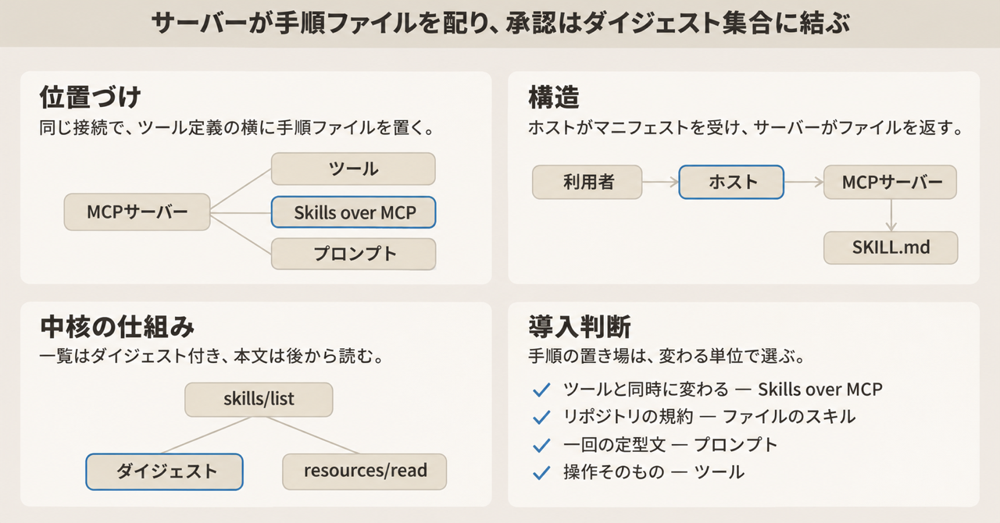
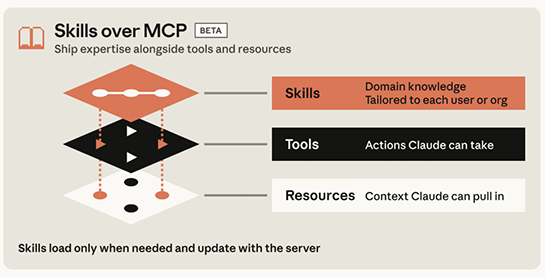
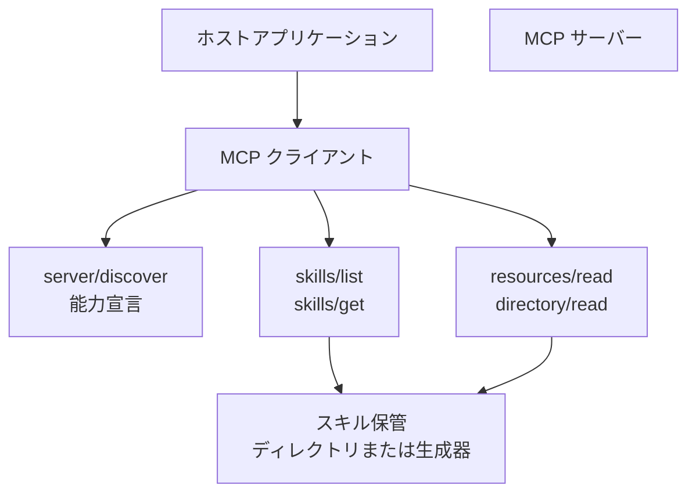
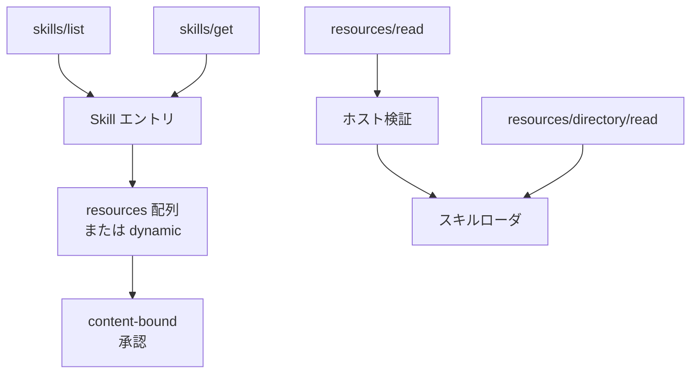
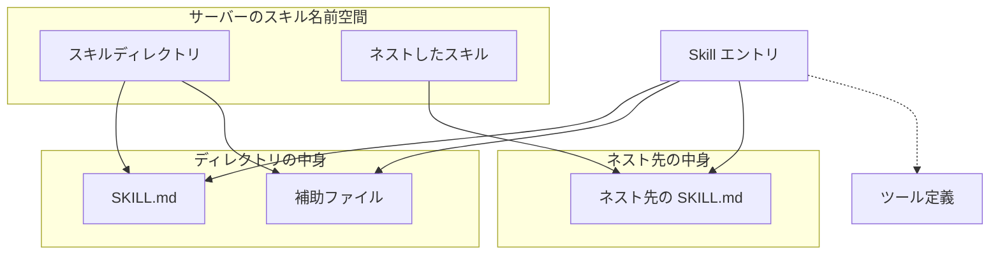
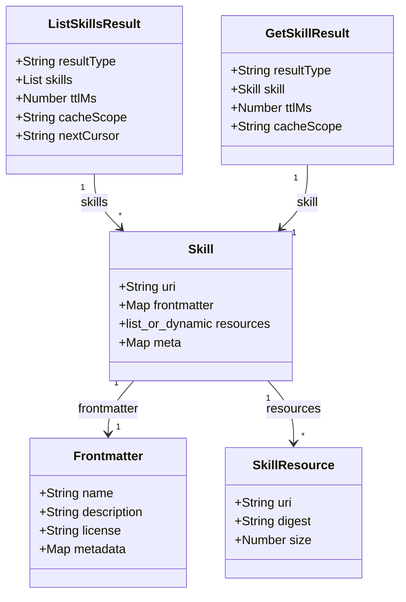
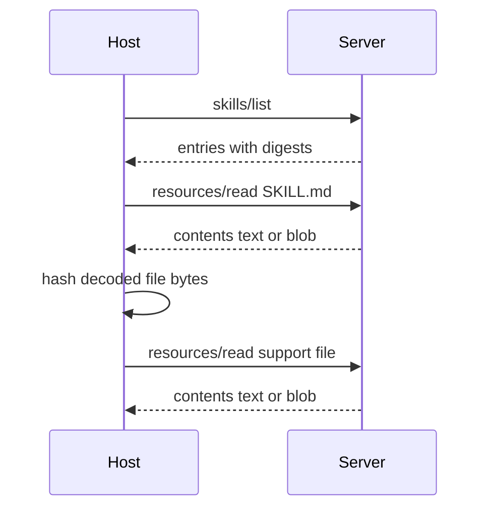

MCP（Model Context Protocol。ホストとサーバーがツールやデータをやり取りする手順）の拡張 Skills over MCP は、サーバーがツール定義と並べて Agent Skill を配る仕組みです。Agent Skill は、`SKILL.md` を入口にする手順ファイルの束です。識別子は `io.modelcontextprotocol/skills` です。この記事では、担当者の選び方を書いた `SKILL.md` と担当表 `routing.md` を同じサーバーから配る例で、ファイルの取得と更新後の再承認まで追います。FastMCP 4.2 での公開と、Claude Code での呼び出しも含みます。SEP-2640 の Final、拡張ライフサイクルの Beta、Claude の公開ベータは、日付も対象も別です。



*サーバーが手順ファイルを配り、承認はダイジェスト集合に結ぶ、という4つの観点です。*



*Anthropic が 2026-11-24 の記事で示した説明図です。Publickey の 2026-11-26 の紹介でも同じ図が使われています。3層はスキル、ツール、リソースです。*

## Skills over MCPとは

Skills over MCP は、MCP サーバーがツール定義と並べて Agent Skill を配る公式拡張です。仕様の正本は [ext-skills の `specification/beta/skills.mdx`](https://github.com/modelcontextprotocol/ext-skills/blob/main/specification/beta/skills.mdx) で、ベースプロトコル改訂 `2026-07-28` 以降に対して書かれています。SEP-2640 は 2026-09-13 にマージされ、状態は Final です。SEP は MCP の仕様提案です。拡張ライフサイクル上の段階は Beta です。公開済みの beta 改訂は、その場では書き換えません。変更は decision log の日付付き項目として提案し、受理されたものだけが次の改訂として出ます。

スキルのファイル形式は [Agent Skills](https://agentskills.io/specification) に委譲されています。この拡張が定義するのは輸送だけです。サーバーは各ファイルをリソースとして公開します。リソースは、URI で本文やファイルを渡す MCP の既存機能です。エントリは `skills/list` と `skills/get` が返し、本文は既存の `resources/read` が渡します。`resources/read` で `SKILL.md` を読んだだけではスキルは有効になりません。有効化は、ホストのスキル読み込み経路だけが行います。

ホストは、MCP クライアントを持ち、スキルをモデルのコンテキストへ載せるアプリケーションです。モデルのコンテキストは、その応答のときにモデルが見ているテキストです。MCP サーバーは、同じ接続でスキルのマニフェストとツール定義を公開する外部システムです。`resources` が配列のとき、マニフェストは全ファイルの URI、SHA-256、バイト長の一覧です。文字列 `"dynamic"` のエントリは、この一覧を持ちません。

Publickey は、技術記事を公開しているサイトです。Publickey は 2026-11-26 に、この仕組みを「ツールとの接続だけでなく使い方のスキルも MCP 経由で提供する」と紹介しました。図は Anthropic の 2026-11-24 記事の引用です。Anthropic は Claude と Claude Code を出す会社です。Claude は対話製品、Claude Code は端末や IDE から使うコーディングエージェントです。両者の公開ベータ告知は 2026-11-24 です。

関連する運び方は次のとおりです。

| 仕組み | 運ぶもの | 正本の置き場 | 読み込むタイミング |
|---|---|---|---|
| MCP tools | ツール名、説明、入力スキーマ | 接続先サーバーの `tools/list` | ホストがツールを探すとき |
| ファイルシステムの Agent Skill | `SKILL.md` と補助ファイル | 利用者のリポジトリや設定ディレクトリ | ホストが起動時にメタデータを読み、一致したとき本文 |
| Skills over MCP | 同じ `SKILL.md` 形式 | 接続先サーバー | 一覧のあと、ホストがスキルをロードしたとき本文 |
| MCP prompts | プロンプトテンプレート | 接続先サーバー | 利用者がコマンドとして呼んだとき |

## 特徴

サーバーは `SKILL.md` と補助ファイルを、ツールと同じ接続の上で配ります。スキルの識別は URI です。`name` はラベルで、サーバー内でも一意である保証はありません。ホストは、サーバー識別子と URI の組でスキルを区別します。サーバー識別子は、ホストがその接続先に付けた名前です。Claude Code のコマンドに出る `<server>` は、この名前です。

`resources` が配列の一覧エントリは、要約ではなく完全なマニフェストです。各ファイルの URI、SHA-256、バイト長を含みます。文字列 `"dynamic"` のエントリは、ファイル一覧もダイジェストも持ちません。`skills/list` が返す件数は、空や一部だけのことがあります。ホストは接続時、一覧時、承認時にファイルを先読みしません。`SKILL.md` はロード時、補助ファイルは参照時に読みます。

承認を永続化するホストは、承認時点の `resources` 集合に承認を結びます。この結びを content-bound 承認と呼びます。集合は、その時点の全 URI と全ダイジェストです。ダイジェストは `sha256:` に続く小文字 64 桁で、対象はファイルの生バイトです。

任意機能 `directoryRead` が真のときだけ、ホストは `resources/directory/read` を呼べます。これはディレクトリ直下の子を返すメソッドです。既定は偽です。1 スキルの適合上限は 512 ファイル、合計 16 MiB（16,777,216 バイト）です。`SKILL.md` を数に含めます。仕様は、サーバーがこの上限を超えないことを求め、適合ホストは上限までは読める必要があります。それより大きいスキルを読めるかはホスト次第です。

生成内容で安定したダイジェストを出せないスキルは、`resources` を文字列 `"dynamic"` にします。Claude Code は v2.1.331 以降の公開ベータで、コマンド名を `<server>:<skill>` として出します。`allowed-tools` は、`SKILL.md` の frontmatter に書く、そのスキルで使ってよいツールの指定です。ホストは、そのスキルについて利用者が当該ツール権限の付与を明示承認するまで、このフィールドを無視します。スキル本文が指示するホスト側のコード実行も、スキル単位の明示承認が要ります。Claude Code は、このフィールドを承認後も使いません。

新しいプリミティブではなく Resources に載せたのは、既存の `resources/read` でファイルを運べるようにするためです。一覧を要約にしないのは、承認と検証をエントリだけで結ぶためです。ディレクトリ読み取りを任意にしたのは、完全なマニフェストがあれば子の一覧を再取得しなくてよいためです。

## 構造

スキルは、利用者、ホスト、MCP サーバー、Agent Skills のファイル形式のあいだで動きます。ホストが選択と承認と検証を行い、サーバーがマニフェストとバイトを返します。

### システムコンテキスト図


| 要素名 | 説明 |
|---|---|
| 利用者 | スキルのロードを承認し、コマンド名でスキルを呼べる人 |
| ホスト | MCP クライアントを持ち、スキルをモデルコンテキストへ載せるアプリケーション |
| MCP サーバー | 同じ接続でスキルのマニフェストとツール定義を公開する外部システム |
| Agent Skills | `SKILL.md` の frontmatter とディレクトリ規約の正本。輸送の定義はサーバー側の拡張にある |

frontmatter は、`SKILL.md` 先頭の YAML です。`name` と `description` が必須です。

### コンテナ図

ホストアプリケーションの中の MCP クライアントが、発見、一覧、ファイル読み取りを別メソッドで送ります。スキルの実体は、固定ディレクトリ、利用者別の生成、オブジェクトストレージのいずれかです。



| 要素名 | 説明 |
|---|---|
| ホストアプリケーション | 選択、承認、検証、モデルへの注入を行う |
| MCP クライアント | JSON-RPC を送り、`_meta` にプロトコル改訂を載せる |
| MCP サーバー | 拡張と `resources` 能力を宣言し、宣言したメソッドを実装する |
| server/discover | `extensions` に `io.modelcontextprotocol/skills` を載せる発見応答 |
| skills/list と skills/get | エントリを返す。本文バイトは返さない |
| resources/read と directory/read | ファイルバイト、または直下の子の一覧を返す |
| スキル保管 | 固定ディレクトリ、利用者別の生成、オブジェクトストレージのいずれか |

JSON-RPC は、MCP がリクエストと結果を運ぶメッセージ形式です。`server/discover` は、サーバーが対応する能力と拡張を返す発見メソッドです。

### コンポーネント図

一覧と単体取得は同じ形の Skill エントリを返します。検証と承認のあとで、スキルローダが本文をモデルコンテキストへ載せます。



| 要素名 | 説明 |
|---|---|
| skills/list | ページング付きでスキル配列を返す。`ttlMs` と `cacheScope` が必須 |
| skills/get | `SKILL.md` の URI 1 件のエントリを返す。未知 URI は `-32602` |
| resources/read | 完了時は `result.contents[]` を返す。テキストは `text`、バイナリは Base64 の `blob`。ダイジェストは、`text` を UTF-8 にしたバイト、または `blob` をデコードしたバイトに対して計算する。これ単体ではスキルを有効化しない |
| resources/directory/read | ディレクトリの直下だけを返す。`directoryRead: true` の宣言が条件 |
| Skill エントリ | `uri`、verbatim な `frontmatter`、`resources` |
| resources 配列または dynamic | 完全なファイル一覧か、安定ダイジェストを出せない印 |
| ホスト検証 | バイト長、SHA-256、frontmatter のフィールド一致を見る |
| content-bound 承認 | 永続化する承認を、承認時点の URI とダイジェストの集合に結ぶ |
| スキルローダ | 検証と承認のあとで、本文をモデルコンテキストへ載せるホスト内部の経路 |

`-32602` は JSON-RPC の Invalid params です。未知のスキル URI や、ディレクトリではない URI に使います。サーバー内部障害は `-32603` です。`ttlMs` は、そのエントリを現行とみなしてよい時間のヒントです。`cacheScope` は、そのキャッシュを誰と共有してよいかの範囲です。どちらも、バイトがマニフェストと一致していることの保証ではありません。verbatim は、著者が書いた frontmatter をフィールドごとそのまま載せる、という意味です。

## データ

スキルの単位はディレクトリです。エントリは、そのディレクトリの `SKILL.md` を指す URI を持ちます。`resources` が配列のとき、その配列が全ファイルのマニフェストです。ツール定義は同じサーバーに並びますが、版番号は共有しません。

### 概念モデル

所有は、スキルディレクトリがファイルを含む関係です。呼び出しは、ホストがエントリを見てから `resources/read` する関係です。点線は、ツール定義が同じサーバー上に並ぶことを示します。



| 要素名 | 説明 |
|---|---|
| サーバーのスキル名前空間 | その接続先が公開するスキルの範囲。URI はサーバー識別子と組で一意 |
| スキルディレクトリ | `skill://` のパス。末尾セグメントが frontmatter の `name` と一致する |
| SKILL.md | 必須の入口ファイル。YAML frontmatter のあとに Markdown 本文 |
| 補助ファイル | `references/` や `scripts/` など。相対パスはスキル直下から解決する |
| ネストしたスキル | 子孫ディレクトリにある別の `SKILL.md`。親のマニフェストにもファイルとして入る |
| Skill エントリ | 一覧と単体取得が同じ形で返すレコード |
| ツール定義 | `tools/list` の結果。点線は同一サーバー上の並びを示し、共通の版番号は仕様に無い |

### 情報モデル

`resources` が配列のとき、各要素は URI、ダイジェスト、バイト長です。安定したダイジェストを出せないときは、配列の代わりに文字列 `"dynamic"` が入ります。



| 要素名 | 説明 |
|---|---|
| Skill | `uri` は `SKILL.md` のリソース URI。`resources` は配列か文字列 `dynamic`。拡張が定義する `_meta` キーは接頭辞 `io.modelcontextprotocol.skills/` を使う。中継は別の逆ドメイン接頭辞で注釈を載せてよい |
| SkillResource | `digest` は `sha256:` に続く小文字 64 桁。`size` はその同じ生バイトの長さ |
| Frontmatter | `name` と `description` は必須。著者が書いた他フィールドもそのまま入る |
| ListSkillsResult | `resultType` は `complete`。応答が完了した印で、返した件数で全スキルを網羅した印ではない。`ttlMs` と `cacheScope` は鮮度と共有範囲であり、バイトがマニフェストと一致していることの保証ではない |
| GetSkillResult | 単一の Skill。ページングカーソルは無い |

URI の形は `skill://<skill-path>/<file-path>` です。`skill://issue-triage/SKILL.md` の `issue-triage` はホスト名ではなくスキルのパスです。仕様はこの部分を権限部と呼び、DNS では解決しません。別スキームも許されます。ホストはスキームだけではスキルだと決めません。

版の単位は次の 4 つに分かれます。

| 版の名前 | 実体 | ツール定義との結び |
|---|---|---|
| プロトコル改訂 | リクエスト `_meta` の `io.modelcontextprotocol/protocolVersion`。この拡張の対象は `2026-07-28` 以降 | 接続の改訂であり、個々のスキルやツールの中身ではない |
| スキル内容の版 | `resources` 配列の URI と `digest` の集合 | 集合が変わると content-bound 承認は失効する。`tools/list` は自動では失効しない |
| ツール定義の版 | `tools/list` が返す各ツール定義 | スキルのダイジェスト集合とは別カタログ。共通の版トークンは仕様に無い |
| 著者メタデータ | frontmatter `metadata` の任意キー。例は Agent Skills の `version` | 輸送の版ではない。一覧に verbatim で載るだけ |

永続承認は、承認時点の全ファイル URI と全 digest の集合に結びます。`tools/list` の結果は別カタログで、スキルの集合が変わっても仕様上は失効しません。共通の版トークンはありません。`ttlMs` は鮮度ヒントであり、どちらの版でもありません。プロトコルは、このセッションがどのダイジェスト集合とどの `tools/list` 結果を実行したかを記録する項目を定義しません。

Agent Skills 側の discovery は、起動時に `name` と `description` だけを載せます。discovery は、ホストがスキルを探す手順です。約 100 トークンは、その起動時メタデータをモデルへ渡すときの大きさの目安です。`resources` が配列の一覧エントリは、frontmatter 全文と全ファイルのダイジェストを含むので、ホストが受け取るカタログはそれより重いです。ホストがモデルへ名前と説明だけを渡す場合、ダイジェスト一覧はモデルの入力には入りません。本文バイトは後から読みます。

## 導入

公開するサーバーは、ベースプロトコル `2026-07-28` 以降で、`resources` 能力と拡張の両方を宣言します。以下のサーバー例は、公開ドキュメントで手順が確定している FastMCP 4.2 を使います。FastMCP は、Python で MCP サーバーを書くライブラリです。確認したドキュメントの版は 4.2.0 で、取得日は 2026-11-27 です。

### 前提となる改訂

ベースプロトコルは `2026-07-28` 以降です。この改訂はステートレスで、要求はどのサーバーインスタンスでも処理できます。サーバーは `resources` 能力と、拡張 `io.modelcontextprotocol/skills` の両方を `server/discover` で宣言します。

宣言したサーバーは `skills/list` と `skills/get` を実装します。`directoryRead` を真にしたサーバーは `resources/directory/read` も実装します。すべてのリクエストは `params._meta` に、必須のプロトコル改訂 `io.modelcontextprotocol/protocolVersion` とクライアント能力 `io.modelcontextprotocol/clientCapabilities` を含めます。クライアント名 `io.modelcontextprotocol/clientInfo` は SHOULD で、例には載せます。SHOULD は、欠けてもエラーにはならないが、仕様が含めることを推奨する強さです。必須 2 項目が欠けると `-32602` です。

```json
{
  "capabilities": {
    "resources": {},
    "extensions": {
      "io.modelcontextprotocol/skills": {
        "directoryRead": true
      }
    }
  }
}
```

`directoryRead` を省略した空オブジェクトは、拡張には対応し、ディレクトリ読み取りには対応しない宣言です。

### SDKの選び方

2026-11-27 に取得した公式 `docs/implementations.md` から、公式 SDK と FastMCP の行だけを抜きました。この表は台帳全体ではありません。台帳はコミュニティが更新します。

| 実装 | 状態 | 2026-11-27 時点の版 |
|---|---|---|
| TypeScript SDK | beta | v2.4.0 の `ext/skills`。`loadSkills` とサーバーの `skills.attach`、クライアントの `SkillsClient` |
| C# SDK | beta | v2.4.0 の実験パッケージ `ModelContextProtocol.Extensions.Skills` |
| Rust SDK rmcp | beta | v3.9.0。ディレクトリローダは `skills-fs` として 3.10.0 以降 |
| Ruby SDK | beta | v1.9.0。ディレクトリまたはハンドラから配信し、クライアントは検証して読む |
| Python SDK | beta | マージ済みで、未リリース。ファイルシステムプロバイダは別 PR |
| FastMCP | beta | v4.2.0。`SkillCatalogProvider` とクライアントの `read_skill()` |
| Go / Java / Kotlin / PHP SDK | in progress | 公式 SDK の PR が開いている段階 |

言語を選ぶときは、その日の [実装台帳](https://github.com/modelcontextprotocol/ext-skills/blob/main/docs/implementations.md) を見ます。Python SDK の行は「マージ済み未リリース」と書かれていて、同じファイルの行は更新されます。

### スキルファイルの配置

ディレクトリ名の最後のセグメントは、frontmatter の `name` と一致させます。FastMCP 4.2.0 の `name` は、ASCII の `a`–`z`、`0`–`9`、ハイフンの 1〜64 文字です。先頭、末尾、連続ハイフンは使えず、`café` のような非 ASCII は拒否します。`description` は、空白だけを除いて 1〜1024 文字です。

`skills/issue-triage/SKILL.md` は次の内容です。

```markdown
---
name: issue-triage
description: Assign an incoming bug report to the team that owns it.
---
Check for duplicates. For a new issue, choose an owner from routing.md.
```

`skills/issue-triage/routing.md` は次の内容です。

```markdown
Login failures go to Identity. Invoice errors go to Billing.
```

公開 URI は `skill://issue-triage/SKILL.md` と `skill://issue-triage/routing.md` になります。

### FastMCPでの公開

FastMCP 4.2 はプロバイダ登録時に拡張を宣言します。ディレクトリごと載せる例です。`SkillsDirectoryProvider` は、指定ルート以下のスキルディレクトリを公開するプロバイダです。

```python
from fastmcp import FastMCP
from fastmcp.skills.provider import SkillsDirectoryProvider

mcp = FastMCP("Team skills", providers=[SkillsDirectoryProvider("skills")])
```

メモリ上で 1 スキルを組む例です。`instructions` が本文になり、`files` のキーが補助ファイルの相対パスになります。`SkillCatalogProvider` は、渡した `Skill` の集合をカタログとして公開するプロバイダです。

```python
from fastmcp import FastMCP, Skill
from fastmcp.skills.provider import SkillCatalogProvider

triage = Skill(
    name="issue-triage",
    description="Assign an incoming bug report to the team that owns it.",
    instructions="Check for duplicates. For a new issue, choose an owner from routing.md.\n",
    files={"routing.md": "Login failures go to Identity. Invoice errors go to Billing.\n"},
)
mcp = FastMCP("Issue tracker", providers=[SkillCatalogProvider([triage])])
```

確認コマンドは `fastmcp list server.py --skills --json` です。通常の表示は URI とバイト数だけで、ダイジェストは `--json` の `skills[].resources[]` に出ます。HTTP で動かすときは `fastmcp run server.py --transport http` です。クライアント例の接続先は `http://localhost:8000/mcp` です。

階層にするときは辞書でパスを渡します。最後のセグメントは `name` と一致させます。

```python
from fastmcp.skills.provider import SkillCatalogProvider

SkillCatalogProvider({"support/issue-triage": triage})
```

このとき入口 URI は `skill://support/issue-triage/SKILL.md` です。`name` は `issue-triage` のままです。

## 利用方法

ホストがスキルを使うときの順序は次のとおりです。

- 接続時に `server/discover` で拡張 `io.modelcontextprotocol/skills` と `resources` 能力を確認する
- 一覧は `skills/list`、既知 URI は `skills/get` で取り、本文は `resources/read` で読む
- `SKILL.md` の `resources/read` だけではスキルを起動しない。起動はホストのスキル読み込み経路だけが行う
- ディレクトリ一覧は `directoryRead` が真のときだけ `resources/directory/read` を送る

### カタログの取得

クライアントは能力宣言を見たあとで `skills/list` を送ります。仕様例の鮮度は 300000 ミリ秒、`cacheScope` は `public` です。`public` は仕様例の値です。共有の相手はベースプロトコルのキャッシュ属性に従い、この拡張はその値の意味を追加しません。

```json
{
  "jsonrpc": "2.0",
  "id": 4,
  "method": "skills/list",
  "params": {
    "_meta": {
      "io.modelcontextprotocol/protocolVersion": "2026-07-28",
      "io.modelcontextprotocol/clientInfo": {
        "name": "ExampleClient",
        "version": "1.0.0"
      },
      "io.modelcontextprotocol/clientCapabilities": {}
    }
  }
}
```

結果の `skills` 各要素が完全なエントリです。`nextCursor` があるとき、クライアントは `params.cursor` で次ページを取ります。1 件の `resources` はページをまたぎません。空の一覧は「スキルが無い」の証明にはなりません。サーバーは空または部分的な一覧を返してよく、配っているスキルは `skills/get` で取れます。

FastMCP クライアントは拡張を有効にしてから一覧します。`SkillsClientExtension` は、クライアントに `list_skills()` と `read_skill()` を足す拡張です。

```python
import asyncio

from fastmcp import Client
from fastmcp.skills import SkillsClientExtension


async def main() -> None:
    client = Client(
        "http://localhost:8000/mcp",
        extensions=[SkillsClientExtension()],
    )
    async with client:
        for entry in await client.list_skills():
            print(entry.uri, entry.frontmatter.description)


asyncio.run(main())
```

### 単一エントリの取得

URI がサーバー手順、別スキル、利用者のどれかから既に分かっているときは `skills/get` です。一覧に出ていないスキルでも、サーバーが配っているなら応答します。

```json
{
  "jsonrpc": "2.0",
  "id": 5,
  "method": "skills/get",
  "params": {
    "_meta": {
      "io.modelcontextprotocol/protocolVersion": "2026-07-28",
      "io.modelcontextprotocol/clientInfo": {
        "name": "ExampleClient",
        "version": "1.0.0"
      },
      "io.modelcontextprotocol/clientCapabilities": {}
    },
    "uri": "skill://issue-triage/SKILL.md"
  }
}
```

未知の URI は JSON-RPC `-32602` です。サーバー内部障害は `-32603` です。`ttlMs` は、そのエントリを現行とみなしてよい時間のヒントです。

### 本文の読み取り

本文は `resources/read` です。相対リンク `references/GUIDE.md` は、その `SKILL.md` があるディレクトリからの相対パスとして URI にします。

```json
{
  "jsonrpc": "2.0",
  "id": 3,
  "method": "resources/read",
  "params": {
    "_meta": {
      "io.modelcontextprotocol/protocolVersion": "2026-07-28",
      "io.modelcontextprotocol/clientInfo": {
        "name": "ExampleClient",
        "version": "1.0.0"
      },
      "io.modelcontextprotocol/clientCapabilities": {}
    },
    "uri": "skill://issue-triage/routing.md"
  }
}
```

`skills/get` のエントリでは、同じ `routing.md` が `result.skill.resources` の要素として次の形を持ちます。エントリには `SKILL.md` の要素も別に入ります。

```json
{
  "uri": "skill://issue-triage/routing.md",
  "digest": "sha256:ffa9583e41705cd1b6ae861cd38a2b82b3145da71b33162fbf6fdbf9de346e3d",
  "size": 61
}
```

この読み取りの完了応答は次のとおりです。`text` の末尾には改行があります。

```json
{
  "jsonrpc": "2.0",
  "id": 3,
  "result": {
    "resultType": "complete",
    "contents": [
      {
        "uri": "skill://issue-triage/routing.md",
        "mimeType": "text/markdown",
        "text": "Login failures go to Identity. Invoice errors go to Billing.\n"
      }
    ]
  }
}
```

この読み取りは輸送です。完了応答の本文は `result.contents[]` に入ります。上の `text` を UTF-8 にしたバイトが、マニフェストの `size` と `digest` の対象です。この文字列を UTF-8 にしたバイトは 61 バイトで、ダイジェストは `sha256:ffa9583e41705cd1b6ae861cd38a2b82b3145da71b33162fbf6fdbf9de346e3d` です。照合するのは JSON の文字列そのものではなく、このバイト列です。バイナリは `blob` を Base64 デコードしてから同じ照合をします。

ホストのスキルローダを通ったときだけ、承認と検証の窓が開きます。汎用のリソース閲覧で読んだ `SKILL.md` は、普通のリソース本文として扱います。

FastMCP の `read_skill()` は `skills/get` でマニフェストを取り、宣言サイズとファイル数を見てから各ファイルを取得し、バイト長と SHA-256 と frontmatter を照合します。結果の `files` は、その照合に使ったバイトをパスごとに保持します。別リクエストの `read_resource()` は、そのあいだにサーバーが更新されていると、保持した版と違うバイトを返し得ます。前の例の `async with client` の内側で、取得済みのバイトを使う例です。

```python
async def load(client) -> None:
    skill = await client.read_skill("skill://issue-triage/SKILL.md")
    routing = skill.files["routing.md"]
    print(skill.name, routing)
```

ロードの順序は次のとおりです。



### ディレクトリの読み取り

次の JSON は、`directoryRead: true` を宣言した仕様例のサーバーに対するリクエストです。前の FastMCP のディレクトリ公開は、この宣言がなくてもマニフェストに載ったファイルを読めます。`directoryRead: true` のサーバーに対してだけ、直下の子を取れます。URI の末尾スラッシュは付けません。子ディレクトリの `mimeType` は `inode/directory` です。`inode/directory` は、その子がファイルではなくディレクトリであることを示す MIME タイプです。

```json
{
  "jsonrpc": "2.0",
  "id": 4,
  "method": "resources/directory/read",
  "params": {
    "_meta": {
      "io.modelcontextprotocol/protocolVersion": "2026-07-28",
      "io.modelcontextprotocol/clientInfo": {
        "name": "ExampleClient",
        "version": "1.0.0"
      },
      "io.modelcontextprotocol/clientCapabilities": {}
    },
    "uri": "skill://code-review/references"
  }
}
```

`resources` が配列のスキルでは、ホストはディレクトリの中身をその配列から答えられます。ディレクトリ結果は、保持中のマニフェストを広げません。新しいファイルを承認済みスキルの一部にするには、`skills/get` でエントリを取り直し、承認を取り直します。FastMCP 4.2 は `directoryRead` を宣言しなくても、マニフェストに載ったファイルを読めます。

読み取り結果の必須フィールドは次のとおりです。

| メソッド | 必須の結果フィールド |
|---|---|
| `resources/read` | 完了した読み取りの `resultType` は `complete`。追加入力が要るときはベース仕様の `input_required`。`contents` は `uri` と、テキストなら `text`、バイナリなら `blob` を持つ。`mimeType` は Resource 定義では任意です。`SKILL.md` をリソースとして出すときの `text/markdown` は SHOULD です。完了結果に `ttlMs` と `cacheScope` を載せます |
| `resources/directory/read` | `resultType` は `complete`。`resources` は直下の子だけで、各要素は `uri` と `name`。ファイルの `mimeType` は任意。子ディレクトリを示すときは `mimeType` を `inode/directory` にする。結果に `ttlMs` と `cacheScope` を載せる。続きがあれば `nextCursor` |

### Claude Codeでの呼び出し

Claude Code の MCP スキルは公開ベータで、v2.1.331 以降が要ります。Claude Code は、端末や IDE から使うコーディングエージェントです。Pro、Max、Ultra で `/login` したセッションではオンです。Team と Enterprise の `/login` は、組織がオンにするまでオフです。Pro、Max、Ultra、Team、Enterprise のどれでも、long-lived token ではオンです。long-lived token は、対話ログインとは別に発行して長く使うトークンです。API キーと Console ログインはロールアウト中で、2026-11-27 時点の文書ではオフです。Console ログインは、Claude Console からのログインです。long-lived token を含むトークン、API キー、Console ログインでは、claude.ai コネクタは載りません。claude.ai コネクタは、Claude の画面から接続する登録済み MCP サーバーです。スキルは、それ以外の MCP サーバーから使います。

```text
claude mcp add --transport http triage http://localhost:8000/mcp
```

```text
/triage:issue-triage
```

前の FastMCP サーバーを名前 `triage` で足したときのコマンドは `/triage:issue-triage` です。接頭辞の形を見るための別例では、サーバー名 `docs` のスキル `pdf` は `docs:pdf` です。

コネクタは `claude_ai_Docs:pdf`、プラグイン `my-plugin` のサーバー `docs` は `plugin_my-plugin_docs:pdf` のように接頭辞が付きます。`<server>` では空白と、ハイフン以外の記号がアンダースコアになります。

プロンプトへコマンドを直接打ったとき、Claude Code はロードの追加確認を省きます。スキル本文が指示するコード実行は、別の権限判定です。モデルがスキルをロードするときは、権限モードで扱いが分かれます。

| モード | ロード時の扱い |
|---|---|
| auto | 分類器が本文を読まずにロード可否を決める。プロンプトは出ない |
| Manual または acceptEdits | プロンプトが出る。Allow this version は、サーバーがファイルを変えるまで再プロンプトと分類を省く |
| ask ルール、または Restrict to Ask | auto と bypassPermissions を含め、ロードのたびに承認 |
| plan | 許可済みの版でもプロンプトが出る。端末セッションに bypass がある場合を除く |

Allow this version は、そのダイジェスト集合に対するホスト側の再プロンプト省略です。分類器は、本文を読まずにロードしてよいかを決める Claude Code 側の判定です。`bypassPermissions` は、通常は確認を省く権限モードです。ask ルールか Restrict to Ask があると、このモードでもロードのたびに承認します。

### 権限ルール

Claude Code のルール例はサーバー名 `docs` です。`Skill(mcp__docs__*)` は v2.1.331 以降です。

```text
Skill(mcp__docs__*)
```

| 目的 | 種別 | ルール |
|---|---|---|
| そのサーバーのスキルを止める | deny | `Skill(mcp__docs__*)` |
| `pdf` だけ止める | deny | `Skill(docs:pdf)` |
| スキルとツールの両方を止める | deny | `mcp__docs` |
| ロードのたびに聞く | ask | `Skill(mcp__docs__*)` |
| すべての版を許可する | allow | `Skill(mcp__docs__*)` |

`allow` はユーザ設定か管理設定に置きます。対象はユーザスコープ、ローカルスコープ、管理サーバーです。ユーザスコープは `~/.claude.json` にあり、自分の全プロジェクトで読むサーバーです。ローカルスコープは同じファイルのプロジェクト別の欄にあり、追加したプロジェクトだけで読むサーバーです。管理サーバーは、組織の管理設定が配るサーバーです。コネクタ、`.mcp.json`、プラグインサーバーには効きません。`.mcp.json` はプロジェクトのルートに置いて共有するサーバー定義です。プラグインサーバーは、有効にしたプラグインが同梱する MCP サーバーです。プラグインは、Claude Code に追加する機能の束です。`deny` のあとでも通常のリソース読み取りは残ります。スキルの補助ファイルを含めてリソース読み取りを止めるときは `ReadMcpResourceTool` を deny します。

組織でコネクタ以外のスキルを止めるキーは `disableDirectMcpSkills` です。コネクタの未設定ツールへの既定は、管理画面の Restrict to Ask と Restrict to Blocked のどちらでも、そのコネクタのスキルと同じ制限になります。Restrict to Blocked は、そのコネクタのスキルを、打ったコマンドを含めてロードしません。個別のツール制限はスキルには効きません。

## 運用

運用の中心は、読む前のダイジェスト照合と、集合が変わったあとの承認の取り直しです。鮮度ヒントは、その照合の代わりにはなりません。

### ダイジェスト検証

ダイジェストはファイル生バイトの SHA-256 で、形式は `sha256:` と小文字 64 桁です。ホストは、マニフェストに載ったファイルを使う前に `size` と `digest` を照合します。バイト長が違う時点で不一致です。

`SKILL.md` を取ったあと、YAML frontmatter をエントリの `frontmatter` とフィールド単位で比べます。不一致のバイトは使いません。ホストは `skills/get` または `skills/list` で現行の集合を取り直します。

ディスクキャッシュは、モデルと他利用者から改変できない不変ファイルにするか、読むたびに検証します。キャッシュしたファイルは、ファイルシステムスキルの探索パスから外します。探索パスは、ホストがファイルシステムのスキルを探すディレクトリです。残すと、ホストがキャッシュをファイルシステムのスキルとして読みます。

`"dynamic"` のエントリでも、ホストは `SKILL.md` の frontmatter をエントリとフィールド単位で照合します。照合できても、永続承認を将来の任意の内容へ広げてはいけません。ダイジェストの一致は、配られたマニフェストとバイトが揃っていることであり、内容が信頼できることの証明ではありません。中継がマニフェストとバイトの両方を書き換えると、照合は通ります。別サーバーのファイルを読むときは、両サーバーを名指しした呼び出しごとの承認が要ります。

### 鮮度ヒント

`skills/list` と `skills/get` の `ttlMs` と `cacheScope` は、`tools/list` や `resources/list` と同じキャッシュ属性です。仕様例は `ttlMs` が 300000、`cacheScope` が `public` です。

この 2 フィールドは完全性を表しません。キャッシュが新しいあいだも、読むバイトはダイジェストで検証します。ホストは変更をポーリングしなくてよいです。行動中にバイトが変わっていれば、読んだ時点の検証が失敗します。ディレクトリ結果とエントリが同じスナップショットかは、共有の版トークンでは判定できません。正は保持中のマニフェストです。

### 更新後の再承認

永続化した承認は、承認時点の全 `uri` と全 `digest` に結びます。ファイルの追加、削除、中身の変更で集合が変わると、その承認は失効します。ロードと実行の前に承認を取り直します。ネスト先の 1 ファイルが変わると、そのファイルをマニフェストに含む親スキルの承認も失効します。

Claude Code の Allow this version は、サーバーがスキルのファイルを変えるまで再プロンプトを省くホスト側の規則です。端末では `/permissions` からその規則を消します。`"dynamic"` のスキルは内容に承認を結べません。ホストはロードを拒否できます。永続承認を、その後の任意の内容へ広げてはいけません。

FastMCP の `owners.json` 例は、データの変化で `routing.md` のバイトとダイジェストが変わる例です。呼び出し元ごとにバイトを変えるときは `get_access_token()` で利用者を分けます。`get_access_token()` は、その HTTP リクエストの検証済みアクセストークンを返す FastMCP の関数です。同じ URI でもダイジェストが違えば、前の承認集合とは別の版です。

```python
import json

from anyio import Path

from fastmcp import FastMCP, Skill
from fastmcp.skills.provider import SkillCatalogProvider


class TriageSkills(SkillCatalogProvider):
    async def load_skills(self) -> list[Skill]:
        owners = json.loads(await Path("owners.json").read_text())
        routing = "\n".join(
            f"- {service}: {team}" for service, team in sorted(owners.items())
        )
        return [
            Skill(
                name="issue-triage",
                description="Assign a new issue to its service owner.",
                instructions="Identify the affected service and assign its owner from routing.md.",
                files={"routing.md": routing},
            )
        ]


mcp = FastMCP("Issue tracker", providers=[TriageSkills()])
```

FastMCP は 1 リクエストの中でローダを 1 回評価します。発見とファイル読み取りは別リクエストです。同じデータのあいだは、発見時のダイジェストと読むバイトを一致させます。`owners.json` のキー順が変わってもバイトが変わらないよう、上の例はサービス名をソートしています。

### ネストしたスキル

親から見ると、ネスト先のファイルは補助ファイルです。親の `resources` に含めます。親の承認は、ネスト先 `SKILL.md` を本文として読むことまでです。frontmatter を発動させることにはなりません。ネスト先を独立したスキルとして有効にするには、そのスキルだけの新しい同意が要ります。これは拡張仕様上の挙動です。掲載した FastMCP 4.2.0 の `SkillsDirectoryProvider` は、`SKILL.md` を見つけたディレクトリの下を探索しません。`SkillCatalogProvider` は、親子のパスを同時に登録するとエラーにします。両方を独立して配るときは、兄弟ディレクトリに置きます。一覧はフラットです。親子は URI のパス接頭辞の共有で分かり、一覧に関係フィールドはありません。

### ホスト側の無効化

無効化の単位は接続ごと、スキルごと、ホストごとに違います。

| 単位 | どこで決めるか | 効果 |
|---|---|---|
| プロトコル上のスキル | ホストがエントリをロードしない | その URI の手順をモデルへ載せない |
| Claude Code の 1 スキル | `deny` の `Skill(docs:pdf)` | そのコマンドとロードを止める |
| Claude Code の 1 サーバーのスキル | `Skill(mcp__docs__*)` | そのサーバーのスキル群を止める。ツールは残る |
| Claude Code のサーバー全体 | `mcp__docs` | そのサーバーのスキルとツールを止める |
| 組織のコネクタ以外 | `disableDirectMcpSkills: true` | コネクタ以外の MCP スキルを切る |
| 組織の claude.ai コネクタ | `disableClaudeAiConnectors: true` | Claude Code が取得するコネクタのスキルとツールを止める |
| ファイルシステムのスキル | リポジトリの `.agents/skills` など | MCP サーバーの更新では変わらない |

公式 `implementations.md` が 2026-11-27 時点で beta と書くホストには、Claude、Claude Code v2.1.331 以降、VS Code 1.147 以降の GitHub Copilot、fast-agent、MCPJam Inspector、Enconvo 2.5.6 以降があります。VS Code 1.147 以降の GitHub Copilot では、Skills over MCP が既定で有効です。スキルの利用にはサーバーごとに同意します。同じ台帳は、ChatGPT と Codex の行を `planned` と書きます。プラグイン提出時のスキル取り込みは 2026 年 11 月にロールバックされ、両方の製品へ届くまで戻っていません。Codex は OpenAI のコーディングエージェントです。ChatGPT は OpenAI の対話製品です。

Claude Code が表示するスキルは 1 サーバーあたり 100 件までです。スキャン対象スキルの上限はテキスト 1 ファイル 100 KB、スキル全体 400 KB です。プロトコルの 512 ファイルと 16 MiB とは別のホスト上限です。スキャンは、Anthropic が一部のコネクタのスキルを検査する処理です。対象は、claude.ai の Directory から追加した第三者コネクタと、Enterprise で Skill and plugin security scanning が有効なあいだのカスタムコネクタです。`claude mcp add` で足したサーバーは、Directory に載っていてもスキャン対象外です。

### セッションが保持するもの

プロトコル改訂 `2026-07-28` はステートレスです。要求にセッション ID は要りません。ホストは、行動中のスキルについて、ロードに使ったエントリを保持します。期間は少なくとも、その `SKILL.md` がモデルコンテキストから外れるまでです。

保持するエントリにはサーバー識別子と URI の両方が要ります。URI だけではキーにしません。仕様は、サーバーやプロトコルに「このセッションが、このダイジェスト集合と、この `tools/list` 結果を実行した」という監査レコードを定義していません。実行の結びは、ホストが保持するエントリと、永続化した承認集合に残ります。監査が要るホストは、その 2 つを自分で記録します。

## ベストプラクティス

手順をどこに置くか、ツール定義とどう同時に出すか、マニフェストをどう完結させるかを分けて決めます。

### 手順の正本

サーバーのツールの使い方は、そのサーバーが配るスキルに置きます。利用者のリポジトリに複製すると、ツール更新と手順更新が分かれます。リポジトリ固有の規約は、ファイルシステムのスキルに残します。サーバーは利用者のリポジトリを知りません。

形式の正本は [agentskills.io](https://agentskills.io/specification) です。MCP 拡張は URI、メソッド、ダイジェスト、承認の結びだけを足します。一覧に載せる frontmatter は、配る `SKILL.md` の frontmatter と同一内容にします。

向く運び方は次のとおりです。

| 場面 | 向く運び方 |
|---|---|
| 手順がサーバーのツールセットと同時に変わる | Skills over MCP |
| 手順がリポジトリの規約で、サーバーを持たない | ファイルシステムの Agent Skill |
| 一回の定型文を会話へ注入する | MCP prompts |
| 外部システムの操作そのもの | MCP tools |

### ツール定義との同時出荷

ツールの入力が変わったリリースでは、そのツールを呼ぶ `SKILL.md` と補助ファイルを同じデプロイ単位に入れます。仕様は 2 つのカタログを 1 つの版番号で結びません。運用で結びます。リリースノートに、変わったツール名と変わったスキル URI を並べます。

スキルだけ変えたときは、ダイジェスト集合が変わるので、利用者の content-bound 承認は取り直しになります。ツールスキーマはそのままでも、手順の承認は新しくなります。ツールだけ変えたときは、スキル承認は仕様上そのままです。ホストが古い手順で新しいスキーマを呼ぶ窓が残るので、手順ファイルも同じ変更に含めます。

### 完全なマニフェスト

`resources` 配列には `SKILL.md` と全補助ファイルを 1 回ずつ入れます。512 ファイルまたは合計 16 MiB を超えるスキルは、適合ホストが読める保証がありません。超える前に参照を分けます。

ダイジェストは、`resources/read` が返す生バイトから計算します。改行や frontmatter の再シリアライズでバイトが変わると検証が失敗します。FastMCP の `SkillManifestProvider.read_file()` は、マニフェストの `size` と `digest` と同じバイトを返します。`SkillManifestProvider` は、ファイル本体を先に読まずマニフェストだけを返すための基底クラスです。

### 動的生成の境界

呼び出しのたびに本文が変わるスキルは、安定ダイジェストを出せるなら通常の配列にします。FastMCP の公式例は `get_access_token()` で利用者を選び、`routing.md` のバイトだけを分けます。安定したバイトなら通常のマニフェストになり、ダイジェスト配列として配れます。

安定ダイジェストを出せないときだけ `"dynamic"` にします。一部のホストはロードを拒否します。FastMCP のゲートウェイは `"dynamic"` のエントリを中継しません。ここでのゲートウェイは、別の MCP サーバーを同じプロセスに載せるか、リモートの MCP サーバーを中継する FastMCP です。`SkillsDirectoryProvider` や `SkillCatalogProvider` だけで公開するサーバーとは別です。同じ URI で利用者ごとにバイトが変わる場合、承認は利用者ごとのダイジェスト集合です。別利用者の承認を流用しません。

### 名前の衝突

ホストは `name` の一意性を仮定しません。同じ `refunds` でもパスが違えば別スキルです。別サーバーの同名スキルは、ホストが付けたサーバーラベルの名前空間で分けます。MCP 由来のスキルは、ファイルシステム上の同名スキルを黙って置き換えません。Claude Code は `<server>:<skill>` で出します。キャッシュディレクトリのパスにもサーバー識別子と URI を入れ、別サーバーの同 URI が同じファイルに落ちないようにします。

## 注意点

日付、上限、リクエスト例は、資料によって指しているものが違います。

| 対象 | 資料の記載 | 実態 | 読者への影響 |
|---|---|---|---|
| ベータの時点 | Publickey は 2026-11-26 に「MCP に β 版として追加」と書く。MCP 公式ブログの年表キャプションは「10 月に Skills over MCP beta」と読める | SEP-2640 は 2026-09-13 に Final。拡張ライフサイクルは Beta。Claude と Claude Code の公開ベータ告知は 2026-11-24 | 「仕様が 11 月にできた」と「クライアントが 11 月に公開ベータ」は別事件 |
| サイズ上限 | 二次記事が 100 スキル、400 KB を拡張の上限のように書くことがある | 仕様の適合上限は 1 スキル 512 ファイル、合計 16 MiB。100 件と 400 KB は Claude Code の表示上限とスキャン上限 | サーバー実装の上限と、Claude Code が載せる上限を同じ表に混ぜない |
| リクエスト例 | 公式 overview は簡潔さのため `_meta` を省略すると注記する | 仕様は全リクエストに `_meta` を必須とする。overview の注記もその必須を繰り返す | overview の JSON をそのまま送ると、必須メタデータが欠ける |
| 手順とツールの版 | 起点記事は「つねに最新のスキル」と書く | ダイジェストが示すのは、取得したエントリとバイトの一致です。今広告している版との違いは、エントリを取り直して比べます。ツール定義との共通版番号は無い | 監査が要るホストは、保持したエントリを自分で記録する |
| 一覧の軽さ | Agent Skills は起動時メタデータを約 100 トークンと説明する | `resources` が配列の一覧エントリは frontmatter 全文と全ファイルのダイジェストを含む。本文の遅延読み込みは残る | ホストが一覧全体をモデルへ載せる場合は重くなり得る。名前と説明だけを渡すホストでは、ダイジェストはモデルの入力に入らない |
| SDK の出荷 | implementations の冒頭は Python SDK を「マージ済み未リリース」と書く | 同じファイルの行は更新される。FastMCP 4.2.0 の公開ドキュメントは 2026-11-27 に取得できた | 言語を選ぶときは、その日の実装台帳を見る。行は更新される |
| Claude Code の frontmatter | 仕様は `allowed-tools` を、要求されたツール権限の付与を利用者が明示承認するまで無視すると書く | Claude Code のスキル文書は、MCP スキルで `allowed-tools`、`disallowed-tools`、`hooks`、`model`、`effort`、`context`、`agent`、`background`、`shell`、`paths`、`metadata` を無視すると書く。`!` コマンドは実行せず、`@` 参照はファイルを添付せず、`${CLAUDE_PROJECT_DIR}` と `${CLAUDE_SESSION_ID}` は置換しない | 一覧の frontmatter は verbatim のまま届く。Claude Code は、列挙したフィールドを機能としては解釈しない |
| 公式ブログの月 | 本文は Skills over MCP を beta とだけ書く。年表画像の説明文は 10 月としている | 画像説明と、SEP マージ日、Claude 公開ベータ日は一致しない | 月を 1 つに確定するときは、SEP、拡張リリース、クライアント告知のどれかを名指す |

## トラブルシューティング

症状から原因と対処へ進むときの入口です。

- 空の一覧は不在の証明にしない。URI が分かれば `skills/get` を送る
- 検証失敗のバイトは捨て、エントリを取り直す。集合が変わったら承認を取り直し、同じ集合のまま失敗するなら配信バイトを調べる
- `directoryRead` が偽のサーバーへ `resources/directory/read` を送らない
- Claude Code に出ないときは、版、モデル、組織設定、スキャン対象のコネクタかを分ける
- 同名スキルはサーバー接頭辞で区別し、URI だけではキャッシュしない

### 一覧が空に見える

| 症状 | 原因 | 対処 |
|---|---|---|
| `skills/list` の `skills` が空 | サーバーは空または部分一覧を返してよい。巨大カタログや生成カタログが該当する | URI が分かっていれば `skills/get` を送る。空一覧を不在の証明にしない |
| メソッドが未知になる | サーバーが拡張を宣言していない | `server/discover` の `extensions` に `io.modelcontextprotocol/skills` があるかを見る |
| FastMCP ゲートウェイにスキルが出ない | バックエンドの `resources` が `"dynamic"` | 安定ダイジェストの配列にする。ゲートウェイは `dynamic` を中継しない |

### 検証に失敗する

| 症状 | 原因 | 対処 |
|---|---|---|
| バイト長または SHA-256 が不一致 | エントリ取得後にファイルが変わった、または配信バイトとダイジェスト計算がずれた | 不一致のバイトは捨て、`skills/get` でエントリを取り直す。集合が変わったら承認を取り直す。同じ集合のまま失敗するなら、ロードを止めて配信バイトを調べる |
| frontmatter が不一致 | 一覧の `frontmatter` と `SKILL.md` 先頭の YAML が違う | サーバーは配るバイトから両方を作る |
| 承認した直後の補助ファイルが読めない | ディレクトリ結果だけを見て、マニフェスト外の URI を読んだ | 読む URI は保持中の `resources` に限定する |

### directoryReadを呼んで失敗する

| 症状 | 原因 | 対処 |
|---|---|---|
| `resources/directory/read` が未知メソッド | `directoryRead` が偽、または未宣言 | クライアントはこのメソッドを呼ばない。`resources` が配列なら、その配列から子を復元する。`"dynamic"` で `directoryRead` もなければ、子の一覧は取れない |
| `-32602` | URI が存在しない、またはディレクトリリソースではない | 末尾スラッシュを外し、実在するスキルパス上のディレクトリ URI にする |

### Claude Codeにスキルが出ない

端末は、`claude` を起動する対話セッションです。ローカルの Desktop セッションは、Claude のデスクトップアプリで、そのマシン上に始めるセッションです。スキルはこのセッションで使えます。Desktop のコネクタ、Desktop 拡張、`claude_desktop_config.json` は、同じアプリのチャット側に登録した MCP サーバーです。こちらにはスキルは出ません。`claude remote-control` のサーバーモードは、別の場所からこの端末セッションを操作される側です。このモードではスキルは出ません。VS Code 拡張は Claude Code の拡張です。台帳が beta と書く、VS Code 上の GitHub Copilot とは別で、ロールアウト中です。

| 症状 | 原因 | 対処 |
|---|---|---|
| コマンドが一覧に無い | v2.1.331 未満、対象外モデル、機能フラグ取得がオフ、クラウドセッション、`claude -p`、Agent SDK、HIPAA、ゼロデータ保持 | 端末の対話セッションで、Fable か Claude Opus 4.8、Sonnet 5、Haiku 5.5 以降を使い、`/status` の機能フラグ行を確認する |
| クラウドや Desktop の接続に出ない | `claude remote-control` のサーバーモード、GitHub Actions、Desktop のコネクタ、Desktop 拡張、`claude_desktop_config.json` | 対応するのは端末と、ローカルの Desktop セッション。VS Code 拡張はロールアウト中 |
| 別エンドポイントや別認証で出ない | クラウドプロバイダ、独自の `ANTHROPIC_BASE_URL`、`apiKeyHelper`、`ANTHROPIC_AUTH_TOKEN` | 機能フラグを取れる Anthropic 直結の認証にする |
| コネクタだけが組織設定で止まる | コネクタの CMEK | CMEK 対象のコネクタでは Skills over MCP は載らない |
| Team で全員に出ない | 組織が Skills over MCP をオンにしていない。組織の Skills 設定もオンである必要がある | コネクタは組織設定の Connectors と Skills。それ以外は管理設定の `disableDirectMcpSkills` を `false` にする |
| `Unknown command` | 初回の解釈に失敗した | 同じコマンドを再送する |
| 100 件目より後が無い | Claude Code は 1 サーバーの表示を 100 件までにする | サーバー側で配るスキルを絞る。プロトコル自体は一覧件数を上限にしていない |

`claude -p` は、プロンプトを 1 回渡して終了する非対話実行です。Agent SDK は、Claude Agent を組み込むための SDK です。クラウドプロバイダは、Anthropic の API へ直接つながず、別のクラウドの提供経路で Claude を呼ぶ接続です。`apiKeyHelper` は、API キーをコマンドから渡す設定です。Fable、Opus、Sonnet、Haiku は Claude のモデル名です。Claude Agent は、Agent SDK が組み込む Claude の実行主体です。HIPAA は医療情報の取り扱い規制に合わせた提供形態、ゼロデータ保持はプロンプトを保持しない契約上のモードです。CMEK は、顧客が管理する暗号鍵でコネクタのデータを守る設定です。デバッグログは `claude --debug=mcp` です。

### スキャンとファイル種別で載らない

| 症状 | 原因 | 対処 |
|---|---|---|
| Directory コネクタやカスタムコネクタの新版が載らない | Anthropic のスキャンを通過した版だけが載る。対象は Directory コネクタと、Enterprise でスキャンが有効なカスタムコネクタ。`claude mcp add` で足したサーバーは対象外 | コネクタと、自分で足したサーバーを分ける。カスタムコネクタは組織のスキャン設定を見る |
| スキャン対象のスキルが上限を超える | テキスト 1 ファイルが 100 KB を超える、またはスキル全体が 400 KB を超える | テキストを分割するか、スキルを分ける。PNG や PDF などスキャン対象外の形式は、この上限の計算から外れる |
| スキル全体がロードされない | アーカイブ、WebP、OTF、または `dist/` のようなフォルダのテキストを含む | そのファイルをスキルから外す |
| `allowed-tools` が権限にならない | Claude Code は MCP スキルのそのフィールドを無視する | ツール許可は Claude Code の権限ルールで別に書く |

OTF はフォントファイルの形式です。スキャン対象のスキルにアーカイブ、WebP、OTF、`dist/` 配下のテキストが入っていると、そのスキル全体がロードされません。

### 同名で別の手順が動く

| 症状 | 原因 | 対処 |
|---|---|---|
| リポジトリのスキルと違う手順になる | サーバースキルが `<server>:<skill>` で並ぶ | コマンドのサーバー接頭辞を確認する。URI 単独ではサーバーを区別できない |
| 別サーバーの `skill://refunds/SKILL.md` が混ざる | ホストが URI だけでキャッシュした | キャッシュパスにサーバー識別子を含める |

## まとめ

Skills over MCP は、Agent Skills の `SKILL.md` と補助ファイルを、MCP の Resources としてサーバーから配る拡張です。一覧と単体取得は各エントリのメタデータを返します。`resources` が配列なら全ファイルのマニフェストを含み、文字列 `dynamic` なら内容をダイジェストに結び付けられません。本文は `resources/read` の `contents` で後から届きます。永続する承認は、承認時点の全 URI と全ダイジェストに結び、ファイルが変われば取り直します。ツール定義とは版を共有しないので、手順とスキーマは同じデプロイに入れます。

サーバーのツールと一緒に変わる手順は、この拡張で配ります。リポジトリ固有の規約はファイルシステムのスキルに残します。一回の定型文は MCP prompts、操作そのものは MCP tools です。Claude Code で使うときは v2.1.331 以降の公開ベータと、プラン、認証、組織設定の境界を先に確認します。

この記事が少しでも参考になった、あるいは改善点などがあれば、ぜひリアクションやコメント、SNSでのシェアをいただけると励みになります！

## 参考リンク

### 仕様と設計

- [Skills 拡張 overview](https://modelcontextprotocol.io/extensions/skills/overview)
- [仕様正本 skills.mdx](https://github.com/modelcontextprotocol/ext-skills/blob/main/specification/beta/skills.mdx)
- [SEP-2640](https://modelcontextprotocol.io/seps/2640-skills-extension)
- [拡張の設計根拠](https://github.com/modelcontextprotocol/ext-skills/blob/main/docs/rationale.md)
- [実装台帳](https://github.com/modelcontextprotocol/ext-skills/blob/main/docs/implementations.md)
- [Working Group charter](https://modelcontextprotocol.io/community/working-groups/skills-over-mcp)
- [Agent Skills 仕様](https://agentskills.io/specification)

### クライアントとサーバー手順

- [Claude Code の MCP スキル](https://code.claude.com/docs/en/mcp)
- [FastMCP 4.2 Skills](https://gofastmcp.com/servers/skills)
- [MCP 2 年の公式ブログ](https://blog.modelcontextprotocol.io/posts/mcp-turns-two/)
- [Anthropic の公開ベータ記事](https://claude.com/resources/articles/skills-over-mcp-tasks-and-more)

### 起点

- [Publickey 2026-11-26](https://www.publickey1.jp/blog/26/mcpskills_over_mcpmcp.html)
