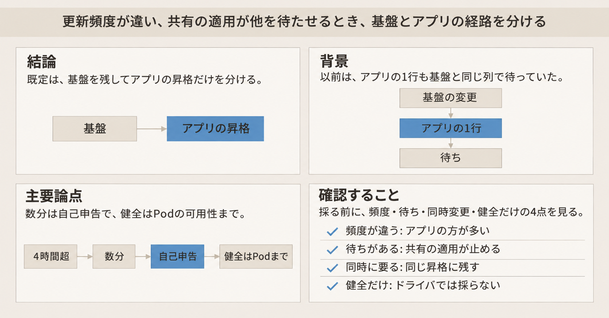
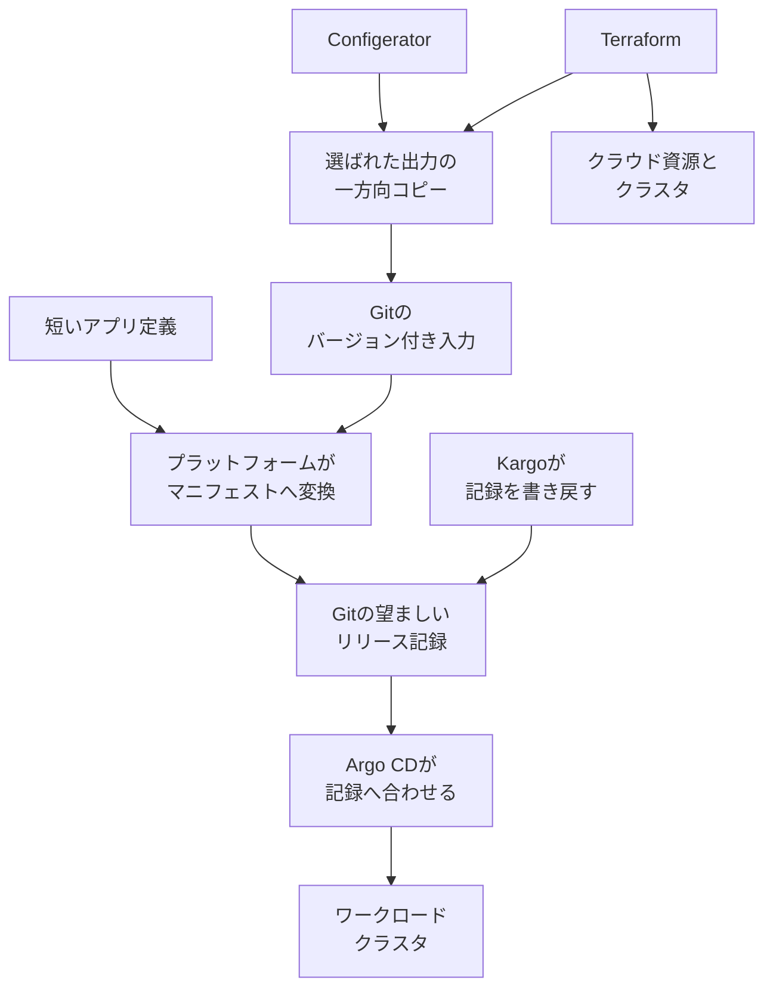

Meta の Cloud Foundation は、複数のクラウドと複数のアクセラレータ種別の上で、AI の研究と推論に使う Kubernetes クラスタを運用しています。担当は 15 人超、対象は約 100 クラスタです。以前は Terraform が、クラウドとクラスタの準備に加えて、Kubernetes 上のアプリケーションの配備も担っていました。いまの設計では、Terraform は基盤を持ち続け、Argo CD が Git 上の望ましい状態へクラスタを合わせ、Kargo が環境間の昇格を進めます。このアプリ側の経路が、ここでいう GitOps です。

この記事では、その役割分担の中身と、同じ分け方を AI 基盤の変更権限とリリース経路としてどこまで採るかを決める材料を説明します。時間と回復についての記述は、CNCF が掲載した Meta の事例と発表に基づきます。

*この記事の全体像。以下、順に解説します。*

## Meta のアプリ配備の役割分担とは

Cloud Foundation が分けたのは、基盤の準備と、その上のアプリケーション配備です。アプリケーションの配備は Helm で行います。Helm は、Kubernetes へ入れるアプリケーション一式と、その設定値をまとめる仕組みです。

アプリの更新は、基盤の更新より頻繁です。以前は、Helm の values（配備時に渡す設定値）の 1 行でも、設定の生成、社内のビルドと検証、Terraform の plan、共有のテストロールアウト、昇格を通っていました。共有のテストロールアウトの中身は、事例が書いていません。Terraform は、ID、シークレット、コンプライアンス、社内のレビュー、ビルド、ロールアウトと既に繋がっていました。少人数のチームは、その経路をアプリ配備にも使っていました。

同じ Terraform workspace を共有して配備された Helm のアプリケーション（release）は、互いの配備に依存します。workspace は、Terraform が状態と適用をまとめる作業単位です。止まった 1 本が、他の数十本を遅らせ得た、と事例は書いています。

いまの分担は、次の三つです。

- Terraform は、クラウド資源とクラスタという基盤を持ち続けます。
- Argo CD は、Git 上の望ましい状態へクラスタを合わせます。継続的デリバリのツールで、クラスタを記録の側へ引き戻す役です。
- Kargo は、環境のあいだの昇格を進めます。いまの昇格では、アプリと対象クラスタごとの望ましいリリースの完全な記録を Git に書き戻します。Argo CD はその記録にクラスタを合わせます。

### 入力からマニフェストまで

実行時設定の責任は、Configerator が持ち続けます。Configerator は、Meta の実行時設定のシステムです。事例がリンクする論文は、2015 年 10 月 4 日の SOSP 論文 "Holistic configuration management at Facebook" です。この記事では、その論文の実験数値は使いません。

選ばれた Configerator の出力と、Terraform が持つ基盤情報を、一方向の同期で Git にコピーします。コピー元へは書き戻しません。

Git の実体は、Meta のソース管理サーバ Mononoke 上の専用リポジトリです。Mononoke は標準の Git インタフェースを持ちます。リポジトリには、アプリ定義、層状の設定、生成された Argo CD と Kargo のマニフェストを置きます。

設定コンパイラが、共有デフォルト、アプリ固有の設定、クラスタ固有の設定、取り込みデータを組み合わせて、クラスタ向けの Helm values を作ります。取り込みデータの出所は、事例が書いていません。コンテナイメージと Helm chart（アプリケーション一式をレジストリへ出す単位）は、社内ビルドが OCI レジストリへ出します。

アプリチームが書く短い定義には、所有、成果物、バージョン規則、配備先、ロールアウト方針、検証チェックが含まれます。プラットフォームがこれを Argo CD と Kargo のマニフェストへ変換し、入力が揃っているかの確認と、配備の標準を掛けます。短い定義にある検証チェックは、その確認ではなく、昇格で見たい事実を Kargo のマニフェストへ落とす入力です。設定コンパイラと、このプラットフォームが同じ仕組みかは、事例が書いていません。

導入時は、ワークロードクラスタごとに Argo CD を置きました。事例の執筆時点では、ワークロードクラスタの外にある集中管理の Argo CD へ移している途中です。新しいクラスタは、自前の Argo CD を持たず、共有サービスに接続する想定です。

事例ページの Projects used は、Kubernetes、Helm、Argo です。一覧の Argo はプロジェクト名の表記で、クラスタを合わせる役として本文が書くのは Argo CD です。本文は、Kargo も使うと書いています。

### 編集の正本とクラスタが見る記録

いまの設計では、人が編集する正本と、クラスタが見る記録は別です。

Configerator の選ばれた出力と、Terraform の基盤情報は、一方向コピーで Git のバージョン付き入力になります。Terraform は別に、クラウド資源とクラスタを作ります。短いアプリ定義と、その Git の入力を、プラットフォームがマニフェストへ変換します。変換の結果と、Kargo が書き戻す記録が、Git の望ましいリリース記録になります。Argo CD は、ワークロードクラスタをその記録へ合わせます。

コピーは一方向です。Git から Configerator や Terraform へ戻す矢印は、事例にはありません。

## 注意点

### 更新時間

事例の Executive Summary は、クラスタスタックの定常更新が、モノリシックな Terraform では 4 時間超だった、と書いています。クラスタスタックとは、その定常更新のまとまりで、ドライバ、スケジューラ、Helm の values を含みます。どの製品のドライバか、どのスケジューラかは、事例が書いていません。このドライバは、のちの節で、DaemonSet の Healthy だけでは昇格条件にしない対象です。DaemonSet は、複数の Pod の更新数と可用性で health が決まる Kubernetes の資源です。Impact は、以前 4 時間超だった定常更新が、検証済みで健全なリリースに数分で到達する、と書いています。クラウド資源が変わらない Helm values の 1 行も、同じ 4 時間超の経路に乗っていた、と本文にあります。

分の値、パーセンタイル、試行回数、移行済みアプリの割合、イメージビルドを数分に含めるかは、発表にも事例にもありません。独立した計測も、2026-11-12 時点では見つかっていません。4 時間超と数分は、Meta の自己申告として読みます。

短縮の対象として事例が挙げているのは、ドライバ、スケジューラ、Helm values のようなクラスタスタックの更新です。GPU の調達時間や、学習ジョブの実行時間を測った数字としては書かれていません。約 100 は対象クラスタの規模であり、そのすべてを測った母数とは書かれていません。

### 回復

発表文は、versioned release records that improve deployment traceability and recovery、と現在形で書いています。事例の Future Plans は、release isolation（リリースの分離）、recovery（復旧）、drift repair（ドリフト修復）を、これからさらに検証する対象にしています。この三つの手順は、事例に書かれていません。プラットフォームは開発中であり、集中 Argo CD も構築中です。発表の現在形を、復旧手順が検証済みである、という読みにはしません。

初期の Kargo は、リリース設定をライブの Argo CD 設定へ直接書いていました。Git だけではリリースを再構成できず、復旧はライブ設定と Kargo の履歴に依存した、と事例は書いています。その後、望ましいリリースの完全な記録を Git に書き戻す形に変えました。公開された範囲の復旧手段は、この記録の置き場所の変更までです。悪いドライバを戻す手順書は、事例にありません。

### 日付

発表 URL と、検索上の公開、事例の Published は November 11, 2026 です。発表本文の日付行は November 10, 2026 です。PR Newswire 転載の日付行は、取得できた本文では「SALT LAKE CITY, Nov. 11, 2026」でした。同じ転載の再取得は HTTP 403 で、本文を再確認できていません。CNCF の投稿 ID から計算した時刻は、2026-11-11 17:18 UTC と一致します。Phong Nguyen と Shaun Hopper がその場で説明した、という文面は、再取得できなかった投稿に基づきます。講演の録画 URL は確認できていません。配布日は、発表本文と URL・事例の Published のあいだで 1 日ずれています。

### 健全性の三層

ここでの三層は、Kargo が昇格の前に行う検証、Argo CD の Application の health、DaemonSet の health 実装です。

Kargo の公式手順では、検証は任意で、利用者が定義します。Promotion（昇格の実行）が成功すると、Stage（環境の一段）は Verifying に入り、AnalysisRun（検証の実行）が成功するまで Freight（運ぶリリースのまとまり）は下流へ進みません。検証に成功しても、次の環境へ進むには、auto-promotion か手動の操作が要ります。

同じ手順は、検証と、公式が pipeline と呼ぶ処理を、Freight の手動承認で迂回できる、と書いています。pipeline の中身は、この文以外には書かれていません。soak（次へ進む前に置いておく時間）も、必要な soak time が経過したかにかかわらず、手動承認で飛ばせます。手動承認は、Promotion を自動では作りません。承認には、昇格と同等の権限が要ります。Stage が Freight の origin（どの上流から来たか）を要求しているときは、その条件を欠くと承認は失敗します。

明示的な検証が無く、Promotion が Argo CD の Application を参照する Stage では、Application が Healthy になることを暗黙の検証成功にします。Application を参照しない Stage へは、この暗黙の条件を一般化できません。

Argo CD の安定版マニュアルは、Deployment、ReplicaSet、StatefulSet、DaemonSet について、observed generation（反映済みの世代）が desired（望む世代）と一致し、updated replicas（更新済みの数）が desired と一致する、と説明しています。Application の health は、直接の子の最悪値です。優先順位は、健全な側から Healthy、Suspended、Progressing、Missing、Degraded、Unknown です。子の health は、親へ自動では継承されません。公式の例では、Deployment が Healthy のまま、その下の Pod が Unhealthy であり得ます。Unhealthy は、この例が Pod に使う語で、上の優先順位の名前ではありません。Application CR は、Argo CD の Application というリソース自体です。1.8 で外れたのは、そのリソース自身の health 評価です。いま Application が Healthy かどうかは、その評価ではなく、直接の子の最悪値で決まります。根拠の issue は argoproj/argo-cd#3781 で、2020-10-29 に close しています。子を health から外す注釈 `argocd.argoproj.io/ignore-healthcheck: "true"` があります。カスタムの Lua health check も定義できます。

2026-11-12 に取得した master の、DaemonSet の health を返す `getAppsv1DaemonSetHealth` は、マニュアルの 2 条件より多いです。generation が observedGeneration より新しければ、Progressing です。更新戦略が OnDelete（Pod を自動では置き換えず、削除されたときに新しい Pod へ入れ替える方式）のときは、全 Pod の更新前でも Healthy を返します。メッセージには、updated と desired の数が残ります。それ以外では、UpdatedNumberScheduled が DesiredNumberScheduled 未満なら Progressing、NumberAvailable が DesiredNumberScheduled 未満なら Progressing、それ以外は Healthy です。見ているのは、Pod の可用性です。GPU が allocatable（そのノードで Pod へ割り当てられる GPU があること）か、ドライバが機能するか、ノードの condition は、この関数の条件にありません。

したがって、ドライバの昇格条件を「DaemonSet が Healthy」だけにすると、OnDelete では更新完了前に通過します。Rolling は、ここでは OnDelete 以外の更新です。更新済みの Pod 数が desired に達するかを見ますが、GPU が使えることは見ません。GPU を条件にするなら、その事実を測る検証を、短いアプリ定義の検証チェックへ明示します。

### ライブ更新と Git

Kargo の `argocd-update` は、名前またはラベルで選んだライブの Application を更新できます。公式は、Git に裏付けのないライブ更新を、実 GitOps ではない、と注意しています。Application を消すと記録が残らない、という注意もあります。`git-commit` と `git-push` は別ステップです。よくある並びは、commit、push、そのあと `argocd-update` で desiredRevision（合わせる対象の版）を揃える、です。これは Kargo の公式例であり、Meta がそのステップ名を使っている、という記載は事例にありません。

Application を Kargo が更新するには、注釈 `kargo.akuity.io/authorized-stage` に `<project-name>:<stage-name>` が要ります。この注釈は、その Stage が Application を更新してよい、という同意です。Git への push 権限を自動では与えません。`argocd-update` の既定タイムアウトは 5 分です。sync window（同期してよい時間帯）を守るときは、Argo CD v2.11.0 以上と、最長の deny window（同期を拒む時間帯）以上のタイムアウトが要る、と公式は書いています。

Meta の初期設計（ライブの Argo CD だけを更新し、Git に完全な記録が無い形）は、この注意と同じ形をしています。事例が採用したのは、その後の、Git に完全な記録を書き戻す側です。

### 基盤とアプリを同時に出す場合

Terraform の apply は、失敗時に、それまでに変わった state を残し、ロックを外して終了します。公式は、部分的に終わった apply を Terraform が自動では戻さない、と書いています。VM の中でソフトが落ちたことは、Terraform が直接見る対象の例として、別ページが挙げています。`check` ブロックは警告であり、apply を止めません。

Akuity の 2026-10-29 の記事は、インフラとアプリの分離は、両者が別のスケジュールで変わるあいだは成り立つ、と書き、しばしば同時に変わると続けています。Akuity は、その記事の出し手です。これはベンダーの記事であり、事例の一次計測ではありません。記事が案内する `tf-apply` は、OpenTofu の適用ステップです。OpenTofu は、直前の Terraform の apply とは別に、その記事が案内する適用ツールの名前です。公式ページは、このステップを Akuity Platform の Kargo v1.9 以上に限り、Promotion Controller の pod ベースの promotion が要る、と書いています。pod ベースの promotion が他の実行とどう違うかは、この条件以外には書かれていません。Promotion Controller は、Kargo が昇格を実行するコンポーネントの名前です。OSS の手順として案内しません。OSS リポジトリの全コードを検索したわけではありません。

### 集中 Argo CD と公開 issue

速度の前後として事例が書いている導入は、クラスタごとの Argo CD です。集中化は、アップグレード対象を減らすための、移行中の変更です。集中化の完了を、数分の条件にはしません。

argoproj/argo-cd#28558 は、2026-11-12 時点で open です。作成は 2026-07-03 です。ラベルは bug と triage/pending です。投稿者は、consistent hashing（担当を安定して割り振る方式）を使っており、クラスタを削除したあと、一部クラスタのアプリがどの controller shard（制御を分割した担当）にも割り当てられず、再調停されないことがある、と書いています。バージョンは本文で 3.4.3 としています。再現手順は簡単ではない、とも書いています。これは Meta の事故ではなく、Meta が集中 Argo CD を本番で動かしている証拠でもありません。

### 上流の公開状態

2026-11-12 に `gh repo view` で取得した star は、akuity/kargo が約 3.8k、argoproj/argo-cd が約 2.5 万です。どちらも archived ではありません。Kargo の default ブランチ先頭は、2026-11-12T01:31:42Z の `e0740d2` です。Argo CD の master 先頭は、2026-11-11T22:57:42Z の `502a751` です。pushedAt は、任意のブランチへの push を含みます。CNCF の Argo ページにある star 表示は、この `gh` の値と一致しないため使いません。

https://www.cncf.io/projects/kargo/ は、2026-11-12 に開くと 404 でした。Kargo が別 URL の CNCF プロジェクトである可能性まで、この 404 は否定しません。Argo のプロジェクトページは、Incubating を 2020-03-26、Graduated を 2022-12-06 としています。

この事例を独自に測った日本語の一次資料は、2026-11-12 の検索では見つかりませんでした。CNCF の転載は、独立の計測に数えません。採用した CVE 番号はありません。見つからなかったことは、脆弱性が無いことの証明ではありません。

## 三つの経路の違い

採れる経路は、次の三つです。

| 基準 | 同じ Terraform workspace | 基盤とアプリで経路を分ける | 適用と同期を同じ昇格に束ねる |
|---|---|---|---|
| 無関係な更新が同じ列に並ぶか | 並ぶ。Helm の 1 行もインフラの列に乗る | アプリごとに昇格と記録を分ける、と事例は書く | 同時に出す変更は同じ列に残る |
| 成功条件 | apply の完了。アプリの健全性は別 | 検証を定義すれば AnalysisRun。未定義で Application を触る Stage は Healthy | apply の成否と同期の成否が同じ昇格に入る |
| 復旧時に Git だけで再構成できるか | state と、apply に含まれる設定に依存する | 望ましいリリース記録を Git に書き戻す現設計なら、その記録までは再構成できる | 記録の置き場所は、採用したステップ次第 |
| 基盤の出力とアプリが同時に要るか | 同じリリースに入る | コピーの遅れと、別経路の待ちが出る | 同じ昇格に残せる |
| 公開手順として案内できるか | Terraform の通常の使い方 | Argo CD と Kargo の公開手順。Meta のコンパイラと一方向コピーは非公開 | `tf-apply` は Akuity Platform の Kargo v1.9 以上 |

三つ目は、インフラの適用とアプリの同期を、同じ昇格に束ねる経路です。

## 経路を分けるときの判断

更新頻度が違い、共有の Terraform workspace で無関係なリリースが待たされているとき、既定は二つ目（基盤とアプリで経路を分ける）です。昇格の通過条件は、見たい事実を測る明示的な検証にします。望ましいリリースの記録は Git に残します。数分という時間と、集中 Argo CD は、採用の理由にしません。

事例が書いている遅さの機構は、アプリがインフラ用の workspace に相乗りし、1 本の停止が他を止めることです。クラウド資源が変わらなくても、経路全体で 4 時間超だった、と書いています。この時間は、前節のとおり自己申告です。

事例に載る Shaun Hopper（Production Engineer, Meta）の発言は、緑の apply は Terraform が成功したことしか示さず、自分たちの変更が入っていたかは常に明確ではなかった、という趣旨です。基盤の配備が一等で、アプリ配備はそれに乗っていた、とも述べています。

Terraform の公式は、部分的に終わった apply を自動では戻さない、と書いています。VM の中のソフト故障は、Terraform が直接見ない例として別ページにあります。事例は、ライブの Argo CD だけを更新した初期設計では Git からリリースを再構成できなかった、と書き、記録を Git に戻す設計へ変えたと書いています。Kargo の公式は、Git に裏付けのないライブ更新を実 GitOps ではない、と注意しています。短いアプリ定義に検証チェックがあり、プラットフォームがマニフェストを生成する、と事例は書いています。Kargo は、AnalysisRun が成功するまで下流へ進めない、と公式が書いています。

同じ分離をすれば他の組織も数分になる、という読みは、測定条件が無いので確信度を低く見ます。回復、リリース分離、ドリフト修復は、事例本文ではなお検証予定です。Healthy は、Pod の可用性までの組込み条件です。ドライバの機能試験としては足りません。OnDelete の DaemonSet は、更新完了前に Healthy を返し得ます。手動承認は、検証と soak を飛ばせます。誰が承認できるかは、権限の設計そのものになります。

Terraform の出力（エンドポイント、IAM、ノードプール）とアプリが同じリリースでなければ動かない変更は、分離すると新しい待ちを生みます。その場合は、三つ目の経路を残します。Git は、クラスタが見る記録であり、編集の唯一の正本ではありません。一方向コピーの遅れは、事例が障害として書いた事案ではありません。運用上の空きとして残ります。15 人超のプラットフォームがマニフェストを生成しています。三つのツールだけを入れて、コンパイラと一方向コピーを欠くと、事例と同じ結果にはなりません。#28558 は、条件付きの公開バグ報告です。Meta の集中 Argo CD が同じ症状を起こす確率は、この issue からは出ません。

公開された範囲では、次は決まっていません。

- 数分に、イメージと Helm chart の社内ビルドが含まれるか。
- 約 100 クラスタのうち、新しい経路に乗っている割合と、アプリの種類。
- ドライバとスケジューラで、検証チェックが何を見ているか。GPU の allocatable を見ているかは非公開です。
- 復旧の検証が終わる前の、いまの戻し方。
- 一方向コピーが遅れたとき、Git と Terraform のどちらが新しいかを、どうやって知るか。
- 集中 Argo CD が本番のどの範囲に入り、障害の範囲がクラスタごとに置いた Argo CD と比べてどう変わるか。
- Kargo による Git への書き戻しが、人の commit と同じレビューを通るか。

## 採る前に分ける権限と確認

既定は、基盤とアプリで経路を分ける側です。条件は二つあります。アプリの更新頻度が基盤と違うこと。そして、共有の Terraform workspace が、無関係なリリースを実際に待たせていることです。

やること:

1. Terraform を変更できる人と、短いアプリ定義を変更できる人と、昇格を承認できる人を分けます。承認は検証と soak を飛ばせるので、承認者は経路の例外口になります。
2. 変更が、Terraform の出力（エンドポイント、IAM、ノードプール）を同じリリースで要るかを先に見ます。要るものだけ、適用と同期を同じ昇格に束ねる側に残します。OSS の `tf-apply` を、その手段として書きません。
3. 昇格条件は、Argo CD の組込み Healthy に任せません。ドライバなら、GPU が allocatable であることを検証チェックに書きます。OnDelete の DaemonSet は、更新数を別の条件にします。
4. 望ましいリリースの記録は Git に残します。ライブの Application だけを更新する昇格は、事例が捨てた初期設計と同じ形になります。
5. 一方向コピーを使うなら、コピー元と Git のどちらが新しいかを、リリースの前提として確認します。

採用しないものは、次の三つです。

- 数分を、自組織の目標時間にしません。測定条件が無い自己申告だからです。
- 集中 Argo CD を、速度のための必須条件にしません。
- Meta が使っている Kargo や Argo CD のバージョンを、事例に無いのに決めません。

次のときは、この既定をひっくり返します。

- 無関係なリリースが、共有 workspace で待たされていません。頻度が同じなら、分離は調整を増やします。
- ほとんどの変更が、基盤の出力とアプリを同時に要ります。
- 検証を書く人がおらず、Healthy だけが通過条件になります。ドライバの配備では、この条件で経路の分離を採用しません。
- Git への書き戻しが、レビューを迂回して望ましい状態を上書きします。その場合は、書き戻しの権限を直すまで採用しません。

直近では、次の三つを確認します。

1. 直近の Helm 変更が、Terraform の列で何を待っていたかを 1 件取り出します。
2. その変更の成功条件を、操作の完了、Application の Healthy、見たい事実の検証、のどれにするか決めます。
3. 承認者と、Terraform を変える人と、アプリ定義を変える人の名前を分けます。

## まとめ

Meta の Cloud Foundation は、約 100 クラスタの AI 基盤で、Terraform に基盤を残し、アプリの望ましいリリース記録を Git に置いて Argo CD と Kargo に合わせています。人が編集する正本は Configerator と Terraform と短いアプリ定義であり、クラスタが見るのは Git に書き戻した記録です。

4 時間超と数分は、測定条件の無い自己申告です。復旧手順の検証は、事例自身がこれからの対象にしています。DaemonSet の Healthy は、Pod の可用性までであり、OnDelete では更新完了前に通り得ます。共有の Terraform workspace が無関係なリリースを待たせていて、アプリの更新頻度が基盤と違うときだけ、経路を分ける側を既定にします。同時に出さなければ動かない変更は、同じ昇格に残します。

この記事が少しでも参考になった、あるいは改善点などがあれば、ぜひリアクションやコメント、SNSでのシェアをいただけると励みになります！

## 参考リンク

- [CNCF 発表（本文の日付行は November 10, 2026。URL は 2026-11-11）](https://www.cncf.io/announcements/2026/11/11/meta-wins-cncf-end-user-case-study-contest-for-accelerating-ai-infrastructure-deployments-from-hours-to-minutes/)
- [CNCF 事例（Published: November 11, 2026）](https://www.cncf.io/case-studies/meta/)
- [PR Newswire 転載（取得できた日付行は SALT LAKE CITY, Nov. 11, 2026。再取得は HTTP 403）](https://www.morningstar.com/news/pr-newswire/20261111dc87018/meta-wins-cncf-end-user-case-study-contest-for-accelerating-ai-infrastructure-deployments-from-hours-to-minutes)
- [CNCF の投稿（ID から 2026-11-11 17:18 UTC）](https://x.com/CloudNativeFdn/status/2120566883305013580)
- [Akuity の投稿（keynote stage という記述。ベンダーの投稿）](https://x.com/akuityio/status/2120615788960788824)
- [Mononoke の README（事例がリンク）](https://github.com/facebook/sapling/blob/main/eden/mononoke/README.md)
- [Configerator の論文ページ（SOSP、October 4, 2015）](https://research.facebook.com/publications/holistic-configuration-management-at-facebook/)
- [Kargo の検証](https://docs.kargo.io/user-guide/how-to-guides/verification)
- [Kargo の Freight と手動承認](https://docs.kargo.io/user-guide/how-to-guides/working-with-freight)
- [Kargo の argocd-update](https://docs.kargo.io/user-guide/reference-docs/promotion-steps/argocd-update)
- [Kargo の tf-apply（Akuity Platform v1.9 以上）](https://docs.kargo.io/user-guide/reference-docs/promotion-steps/tf-apply)
- [Argo CD の Resource Health](https://argo-cd.readthedocs.io/en/stable/operator-manual/health/)
- [DaemonSet の health 実装（master、2026-11-12 取得）](https://raw.githubusercontent.com/argoproj/argo-cd/master/gitops-engine/pkg/health/health_daemonset.go)
- [argoproj/argo-cd#3781（closed、2020-10-29）](https://github.com/argoproj/argo-cd/issues/3781)
- [argoproj/argo-cd#28558（open、作成 2026-07-03）](https://github.com/argoproj/argo-cd/issues/28558)
- [Terraform apply](https://developer.hashicorp.com/terraform/cli/commands/apply)
- [Akuity の一体昇格の記事（2026-10-29。ベンダーの記事）](https://akuity.io/blog/promote-terraform-kubernetes-changes-kargo)
- [Kargo の CNCF プロジェクト URL（2026-11-12 時点で 404）](https://www.cncf.io/projects/kargo/)
