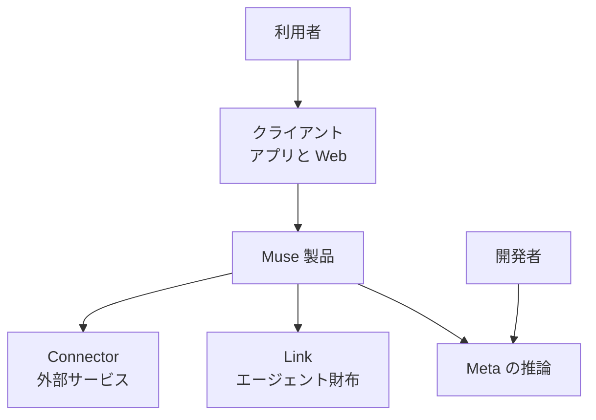
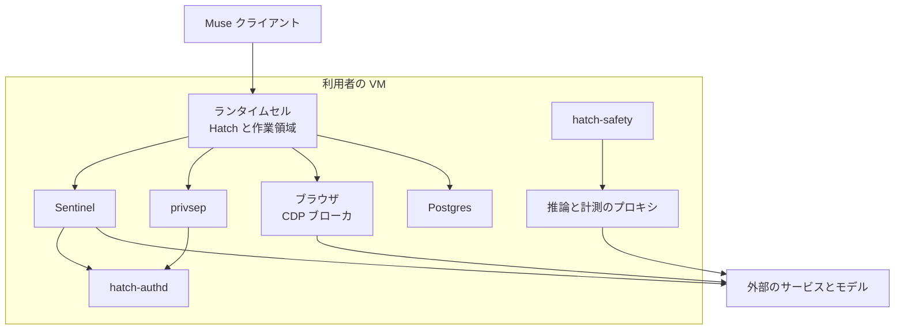
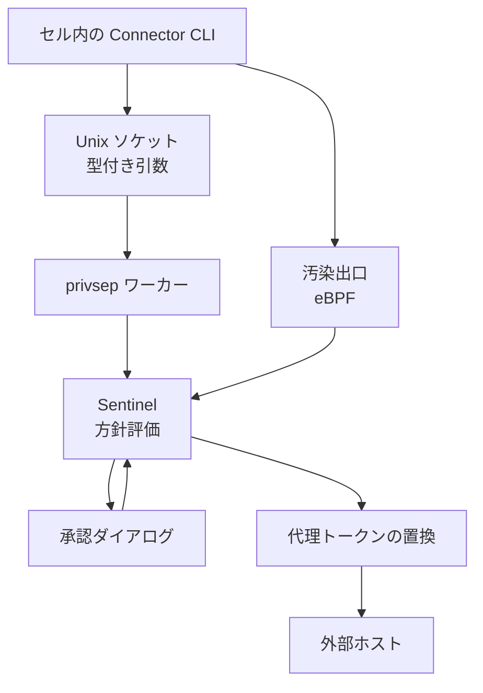
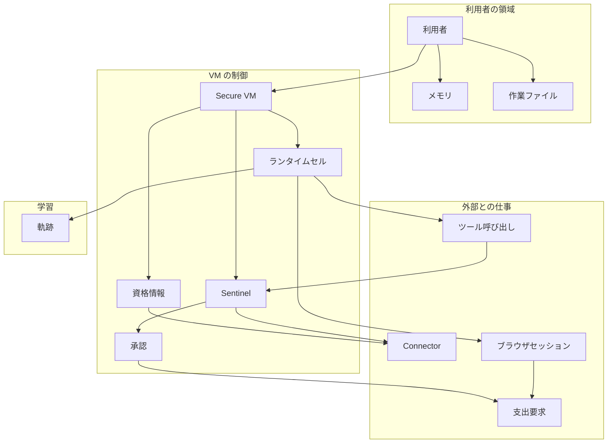
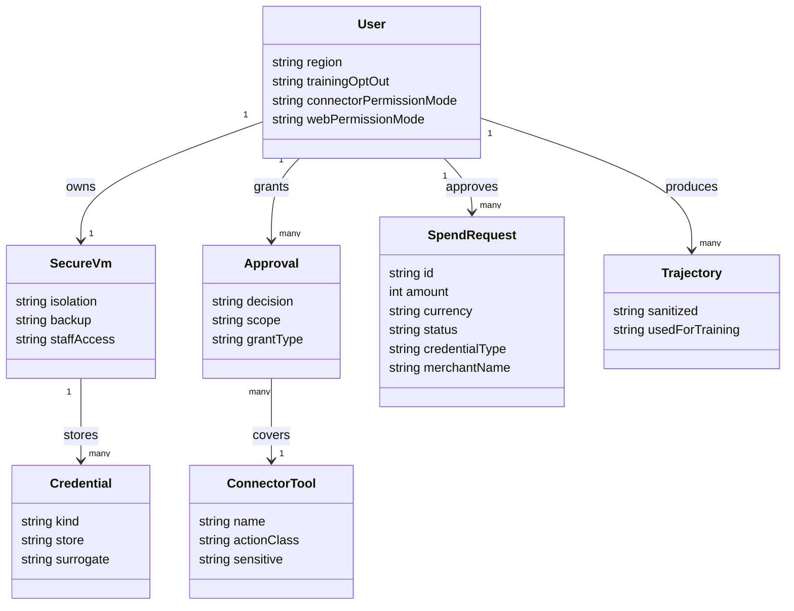

Muse は、Meta が 2026 年 9 月 8 日に公開した個人エージェントです。質問に答えるだけでなく、メール、予定、ブラウザ、購入のように、利用者の代わりに手を動かします。この記事では、Muse がどのような仕組みで動き、どんなデータを持ち、利用者と開発者が何を設定するのかを、構造とデータの両面から読み解きます。あわせて、同じ Muse 系統を開発者が自分のアプリから呼ぶ Meta Model API も扱います。

公開されている情報は 2026 年 9〜10 月時点のもので、一部は起動時点の設計説明です。本文の仕様値は、調査日 2026 年 10 月 27 日に確認した一次資料に基づきます。


*この記事の全体像。以下、順に解説します。*

## Muse とは

Muse は、利用者の代わりに作業する個人エージェントです。Meta Newsroom は 2026 年 9 月 8 日に、米国向けの iOS、Android、[muse.ai](https://muse.ai) での展開を発表し、WhatsApp からも話しかけられると説明しています。AI グラスへの搭載は、その時点では近日対応とされています。

各利用者には、クラウド上の専用 Linux 仮想マシンが 1 台割り当てられます。エージェント、作業ファイル、接続したサービスの資格情報は、その VM が正本です。この公開版の実行環境を Muse Secure VM と呼びます。同じ箱の上で、エージェント本体とは別の **Sentinel**（外部への出口と、Connector（メールや予定など外部サービスへの接続口）操作の許可を一手に握る番人）が動きます。

会話のモデル側には Muse Spark 系統が使われます。2026 年 9 月 8 日の安全性記事は、ブラウザ操作とプロンプトインジェクション耐性の説明で Muse Spark 1.3 を名指ししています。2026 年 10 月 12 日の Newsroom は、より新しい Muse Wonder が Muse 製品の体験へ順次入る予定であり、まず加入者からだと書いています。

開発者向けの Meta Model API は、製品とは別の入口です。ここでは Muse Wonder だけが preview で、Muse Spark は従量課金のモデル ID として案内されています。基底 URL は、OpenAI 互換クライアント向けが `https://api.meta.ai/v1`、Anthropic 互換の Messages API 向けが `https://api.meta.ai` です。認証は環境変数 `MODEL_API_KEY` の Bearer トークンです。

支払いは Stripe の Link を使います。2026 年 9 月 8 日の Stripe Newsroom は、Link を受け付ける事業者では保存済みの支払い方法で即時チェックアウトし、それ以外では承認済みの購入に紐づく単回の仮想カードを発行すると説明しています。Muse がカードの本番号を見ることはありません。

| 面 | 何をするか | 誰が使うか | データの置き場 |
|---|---|---|---|
| Muse 製品 | 会話、Connector、ブラウザ、購入 | 利用者 | 利用者ごとの Muse Secure VM |
| Meta Model API | チャット、ツール、画像、音声認識、分割 | 開発者 | 呼び出し元のアプリと Meta の推論 |
| Muse Code | 端末上のコーディングエージェント | 開発者 | ローカル作業と Model API |
| Private Processing | グラスなどのオフロード推論 | グラス利用者 | TEE（ハードウェアで隔離された信頼実行環境）内。Muse の VM とは別 |

## 特徴

Muse の設計は、信頼しないデータと本物の資格情報を同じ VM 内で厳しく分離することに重心があります。主な特徴は次のとおりです。

- 利用者ごとに隔離された Linux VM が、エージェントとデータの置き場になります。
- エージェントは `systemd-nspawn` のランタイムセル内で動き、セル内の root はホストの root ではありません。以降に出てくる `io_uring`、`CAP_SYS_PTRACE`、`SO_PEERCRED`、`eBPF` などの識別子は、いずれも Linux の隔離・権限制限の仕組みで、細部は読み飛ばしても趣旨は追えます。
- Sentinel は、Connector 操作とネットワーク出口の唯一の許可主体です。
- 資格情報は `hatch-authd`（VM 内の資格情報ストアとトークン発行を担うデーモン）が VM 内に保管し、エージェントが見るのは代理トークンです。
- 本物の秘密は、Sentinel が出口で許可したリクエストにだけ差し込まれます。
- ブラウザは Chromium 系で、操作役は生の DOM ではなくアクセシビリティツリーを見ます。
- パスワード入力と、利用者自身のブラウザ操作中は、エージェントが停止します。
- メール Connector は、ワンタイムコード、パスワード再設定リンク、マジックリンクをフィルタします。
- 読み取りと書き込みは分かれます。購入やメール送信のような機密書き込みは、毎回の承認が要ります。
- 承認ダイアログは会話の中ではなく、クライアント UI から Sentinel へ直接戻ります。
- 作業ファイル、メモリ、資格情報は VM 内にあり、利用者はファイルを閲覧、編集、ダウンロードできます。
- VM は継続的にバックアップされます。
- 会話と VM 内データは、Meta の広告システムへ共有されません。ブラウズは本人の閲覧に見えるため、広告へ間接的に影響し得ます。
- 推論に使う軌跡は、個人を特定しやすい情報を落としてから学習に使われます。設定で学習利用を止められます。
- バグバウンティは公開されており、有効な報告に最大 300,000 ドル、1 利用者に影響するプロンプトインジェクションに最大 130,000 ドルです。
- モデル API の Muse Spark と Muse Wonder は、入力 1,048,576 トークンの窓を持ちます。長文脈の追加単価はありません。
- ホストされたモデルとは別に、Muse Spark Open と Muse Glimmer はオープンウェイトで、手元のハードウェアへ載せられます。

用途ごとに、どの面を使うかの目安は次のとおりです。

| 場面 | 向く面 |
|---|---|
| 自分の受信箱や予定を代理人に扱わせる | Muse 製品と Connector |
| 店舗のサイトで承認付きの購入をする | Muse 製品と Link |
| 自分のサービスから Muse Spark や Muse Wonder を呼ぶ | Meta Model API |
| 手元の GPU で同系統のオープンウェイトを動かす | Muse Spark Open または Muse Glimmer |
| グラス上の翻訳などを Meta からも見えない計算で行う | Private Processing |

## 構造

### システムコンテキスト図

利用者はクライアントから自分の Muse へ話しかけます。Muse は接続先のサービス、Link、推論基盤へ出ます。開発者は、同じ推論基盤を Model API から直接呼びます。



| 要素名 | 説明 |
|---|---|
| 利用者 | Muse に仕事を頼み、承認し、権限を見直す人 |
| 開発者 | Model API または Muse Code からモデルを呼ぶ人 |
| クライアント | iOS、Android、Web。WhatsApp からも話しかける |
| Muse 製品 | 利用者ごとの Secure VM 上で動く個人エージェント |
| Connector | メール、予定、Meta アプリ、第三者 API への公式または自作の接続 |
| Link | 承認済みの支出に対して支払い資格情報を返す Stripe の財布 |
| Meta の推論 | Muse Spark や Muse Wonder などのホストされたモデル |

公式の構成図は、利用者の操作、隔離されたランタイム、ホスト側の安全サービス、Sentinel、外部サービスを 1 枚にまとめています。


### コンテナ図

図やユニット名にある Hatch は、Muse の内部コード名です。1 台の VM の中に、信頼しないデータを処理するランタイムセルと、セルの外の安全サービスが同居します。セルと外のサービスは Unix ドメインソケットで話し、カーネルの `SO_PEERCRED` と相手 ACL で送り主を確認します。ブラウザの CDP（ブラウザを外部から操作するプロトコル）ブローカと推論プロキシの外向き通信は、Connector の秘密を出口で差し替える経路とは別です。秘密の置換は、Sentinel が許可したリクエストに限ります。



| 要素名 | 説明 |
|---|---|
| ランタイムセル | Hatch デーモン、作業ファイル、エージェントが実行するバイナリ。`systemd-nspawn`。システムコールは絞られ、`io_uring` は使えず、`CAP_SYS_PTRACE` と `CAP_NET_ADMIN` は持たない |
| Sentinel | Connector とネットワーク出口の許可主体。決定は許可、拒否、利用者へ確認のいずれか |
| hatch-authd | OAuth トークンなどの保管と、代理トークンの発行 |
| privsep | 組み込み Connector の実処理。資格情報の許可リストはワーカー単位 |
| hatch-safety | 推論の入出力を見る独立した分類器。セルの中からは止められない |
| Postgres | セルとも資格情報ストアとも分かれた永続状態 |
| ブラウザ | 仮想化層の向こうの Chromium。CDP はセルの外のブローカが持つ |
| 推論と計測のプロキシ | VM の外へ出る推論と計測の経路を限定する |

### コンポーネント図

出口の 1 リクエストは、セル内の提案、Sentinel の判定、authd の秘密、必要なら利用者の承認、という順で進みます。



| 要素名 | 説明 |
|---|---|
| セル内の Connector CLI | 引数を解釈し、既に読めるファイルのデスクリプタをソケットへ渡す。秘密そのものは持たない |
| privsep ワーカー | cgroup で識別され、自分の許可リストにある資格情報だけを authd に求める |
| Sentinel | 利用者の Connector 方針と、宛先、メソッド、経路、復号した中身を見る |
| 汚染出口 | ツールプロセスは初期状態では清浄。利用者データを読むと汚染され、自動許可から外れる |
| 承認ダイアログ | クライアント上に出る。答えはモデルの会話を通さず Sentinel へ戻る |
| 代理トークンの置換 | 許可の後に、出口でだけ本物の資格情報へ置き換わる |

## データ

### 概念モデル

所有は入れ子、利用は矢印で表します。名前は製品の概念で、特定の店舗名は置いていません。



| 要素名 | 説明 |
|---|---|
| 利用者 | 権限、Connector、学習スイッチを持つ人 |
| メモリ | Muse が利用者について保持し、VM 内で閲覧できる記録 |
| 作業ファイル | VM が正本とするファイル。閲覧、編集、ダウンロードができる |
| Secure VM | 利用者専用の Linux マシン。バックアップされる |
| ランタイムセル | 信頼しない入力を処理する隔離領域 |
| Sentinel | 許可状態の正本 |
| 資格情報 | セルの外。代理トークン経由でのみ使われる |
| 承認 | 1 回、タスク、サイト、継続、拒否のいずれかに束ねられた能力 |
| Connector | 読み取り、書き込み、機密書き込みに分類されるツール群 |
| ツール呼び出し | セルが提案し、Sentinel が裁く 1 操作 |
| ブラウザセッション | チェックアウト検知とフォーム入力を含むブラウザ作業 |
| 支出要求 | Link 上の 1 件の購入意図。金額、販売者、承認状態を持つ |
| 軌跡 | 会話、ツール、サブエージェントの引き継ぎ。学習前に個人情報を落とす |

### 情報モデル

次のクラス図の属性名は、API や設定ファイルのキーではありません。画面と公開資料にある概念を型にしたものです。



| 要素名 | 説明 |
|---|---|
| User.region | 製品の初期展開は米国。Link のエージェント支払いは米国とカナダの消費者 |
| User.trainingOptOut | ヘルプは、改善への利用が初期状態でオンであり、オフにすると過去の対話にも及ぶと説明する |
| User.connectorPermissionMode | Ask for some actions か Always ask |
| User.webPermissionMode | Settings の Web access defaults。選択肢の文言は、今回開いた承認ヘルプ本文には無い |
| SecureVm.staffAccess | 公開版は運用ポリシー。暗号的な排除は Confidential VM（利用者の鍵で暗号化し Meta も中身を読めない VM）の予定 |
| Credential.kind | OAuth トークン、ブラウザ用のパスワード、Link の単回カード |
| Credential.store | VM 内の隔離ストア。中央の Meta インフラではない |
| Credential.surrogate | セルとワーカーが見る代理。本物は出口で置換 |
| Approval.decision | Allow once、Allow for this task、Allow for this site、Always allow、Deny |
| Approval.grantType | 1 回、セッション、タスク、期限付き、継続。機密書き込みは Always allow にできない |
| ConnectorTool.actionClass | Read、Write、Sensitive write |
| SpendRequest.amount | 最小通貨単位。3500 は 35.00 USD |
| SpendRequest.status | pending_approval、approved、denied、expired など |
| SpendRequest.credentialType | card、shared_payment_token、link_pay_token |
| Trajectory.sanitized | 学習前に主要な個人情報を除去する |

## 導入

Muse 製品に、利用者がインストールするサーバはありません。用意するのは、アカウント、権限、Connector です。自分のアプリからモデルを呼ぶ場合だけ、API キーと SDK を用意します。

### 利用者の前提

- iOS、Android、または Web の Muse を開きます。
- 初期の Newsroom は、米国での展開を書いています。
- 低リスクの仕事から始め、Connector は後から足します。
- パスワードと支払い手段は、エージェントに文で渡さず、専用の入力へ入れます。

### 権限の初期値

- 設定の Permissions を開きます。
- Connector を Ask for some actions にすると、すべての書き込みと重要な読み取りの前に確認します。
- Always ask にすると、あらゆる操作の前に確認します。
- Web の確認範囲は、Settings の Web access defaults で選びます。
- メールのように、読み取りだけを許し、送信を別にする Connector があります。

### Connector の追加

- 会話で「Connect my Gmail」のように頼むか、Settings の Connectors から Connect を押します。
- Facebook、Instagram、Threads は、同じ Accounts Center にあれば自動でつながります。
- 一覧に無いサービスは、その API または CLI から Muse が自作 Connector を書けます。事業者が指針に沿って提出する公式 Connector の審査とは別です。
- 公式 Connector を提供する事業者は、[Connector 指針](https://platform.muse.ai/docs) に沿って提出します。

### 開発者向け API キー

Model API のダッシュボードで鍵を発行し、`MODEL_API_KEY` に置きます。OpenAI SDK なら `base_url` を `https://api.meta.ai/v1` にします。鍵は、クライアント側のコードやプロンプトへ置きません。

```python
import os
from openai import OpenAI

client = OpenAI(
    base_url="https://api.meta.ai/v1",
    api_key=os.environ["MODEL_API_KEY"],
)
```

```shell
curl -X GET "https://api.meta.ai/v1/models" \
  -H "Authorization: Bearer $MODEL_API_KEY"
```

### モデル ID の選択

- 新しいエージェント作業の例は `muse-spark-1.3` です。
- 長いコーディングやサブエージェントの例は `muse-wonder-1.0` です。
- 学習への提供と引き換えに単価を下げる場合は `muse-spark-1.3-contributor` です。
- `muse-spark-1.1` は Standard のみです。Wonder の Contributor は Model API にはありません。
- 音声入力の品質が要るときは `muse-spark-1.2` か `muse-voice-transcribe-1.0` を使います。1.3 の音声理解は完全ではないと書かれています。

## 利用

### 会話で仕事を頼む

- アプリまたは WhatsApp で、メール、旅行、目標の計画を文章で頼みます。
- 長い仕事は、アプリを閉じた後も続き、変化か承認が要るときに戻ってきます。
- 画面上部の分身（エージェントの状態を示すアバター表示）が、作業中、作成中、メモリ更新中などの状態を出します。
- 分身を開くと、Activity log と Upcoming があります。
- より深い記録は System Files にあります。

### Connector ツールの必須区分

操作の前に、ツールの分類と承認の選択肢を確認します。

| 分類 | いつ確認するか | 利用者が選べること |
|---|---|---|
| Read | 初回の後、Always allow を選ばない限り都度 | Allow once、Always allow、Deny |
| Write | 初回の後、Always allow を選ばない限り都度 | Allow once、Always allow、Deny |
| Sensitive write | 毎回 | Allow once、Deny |

- Allow once は、その場に表示された内容だけを覆います。
- 価格、宛先、範囲が承認後に変わったら、新しい承認が要ります。
- 機密書き込みは、設定に保存しても Always allow になりません。
- ヘルプが挙げる Allow for this task と Allow for this site は、クライアントの承認選択肢です。Connector 指針の表は、Allow once と Always allow と Deny を中心に書いています。対応は注意点に置きます。

### ブラウザでの購入

- 支払い情報が既に店舗へ保存されているサイトでは、チェックアウト画面を検知し、購入内容つきの承認を毎回出します。
- Link を受け付ける事業者では、保存済みの支払い方法でチェックアウトします。それ以外のカード入力欄では、承認済みの購入に紐づく単回の仮想カードを使います。初めての店舗かどうかだけでは決まりません。
- カードは、店舗、金額、有効期限に束ねられます。
- Shop Pay は、安全性記事の時点で近日対応です。
- 1Password 連携は、製品ページで近日対応とされています。

### チャット補完を呼ぶ

開発者が Muse 製品の中を操作する API は公開されていません。公開されているのは、モデルへの補完です。`model` と `messages` を送ります。

```python
response = client.chat.completions.create(
    model="muse-spark-1.3",
    messages=[
        {
            "role": "user",
            "content": "What are three differences between TCP and UDP?",
        },
    ],
)
print(response.model_dump_json(indent=2))
```

```shell
curl -X POST "https://api.meta.ai/v1/chat/completions" \
  -H "Authorization: Bearer $MODEL_API_KEY" \
  -H "Content-Type: application/json" \
  -d '{
  "model": "muse-spark-1.3",
  "messages": [
    {"role": "user", "content": "What are three differences between TCP and UDP?"}
  ]
}'
```

### Messages API を呼ぶ

Anthropic SDK では、基底 URL をホスト直下にし、`max_tokens` を必ず付けます。

```python
import os
from anthropic import Anthropic

message_client = Anthropic(
    base_url="https://api.meta.ai",
    auth_token=os.environ["MODEL_API_KEY"],
)
message = message_client.messages.create(
    model="muse-spark-1.3",
    max_tokens=1024,
    messages=[
        {"role": "user", "content": "What is the capital of France?"},
    ],
)
```

### Link の支出要求を作る

これは Muse アプリの隠しコマンドではなく、Link Agent Wallet を自分のエージェントへ組み込む開発者向けの手順です。事前に OAuth の scope `payment_methods.agentic` が要ります。`--amount` と `--context` は必須で、仮想カードでは `--merchant-name` と `--merchant-url` も必須です。`--context` は 100 文字以上にします。

```bash
link-cli spend-request create \
  --amount 3500 \
  --context "Purchasing Working in Public from press.stripe.com. The customer initiated this purchase through the shopping assistant." \
  --merchant-name "Stripe Press" \
  --merchant-url "https://press.stripe.com" \
  --line-item "name:Working in Public,unit_amount:3500,quantity:1" \
  --total "type:total,display_text:Total,amount:3500" \
  --idempotency-key "purchase-attempt-a1b2c3d4"
```

承認待ちは `pending_approval` です。利用者は 30 分以内に応答し、それを過ぎると `expired` になります。

```bash
link-cli spend-request retrieve lsrq_abc123 --interval 2 --max-attempts 300
```

## 運用

### 権限を定期的に見直す

- Settings の Permissions で、Connector ごとの許可を見ます。
- Allowed websites で、サイト単位の許可を取り消します。
- Artifacts and scheduled tasks で、予定された仕事の承認を見直します。
- 読み取りに慣れてから、書き込みを足します。

### 活動を監査する

- Activity log は、実行した操作と与えた許可の時系列です。
- Upcoming は、予定されたタスクとリマインダーです。
- See task details は、承認の前に仕事の中身を出します。
- System Files は、メモリを含む VM 内のファイルです。
- 出典を尋ねると、応答の根拠を出させられます。

### 学習への利用を止める

- Settings の Data controls に切替があります。
- 英国向けヘルプは、この設定が最初はオンであり、オフにすると Meta の AI 改善へ対話を使わないと説明しています。
- 変更は、過去の対話にも適用されます。
- 研究記事は、学習に回す軌跡から主要な個人情報を除くとも書いています。

### 切断、取り消し、リセット

- Connector の切断は、その後の新しい操作を止めます。
- それ以前の会話とメモリに残った内容は、切断だけでは消えません。
- チャットで止められるのは、サイトの閲覧や価格比較のような仕事です。
- 送信済みのメールのように、自分でやっても戻せない操作は、Muse でも戻せません。
- Reset は、情報、チャット履歴、ファイル、進行中のタスクを恒久的に消します。

```bash
link-cli spend-request cancel lsrq_abc123
```

- 上の取り消しは、まだ使っていない支出要求か、繰り返しカードの今後の利用を止めます。
- 販売者側の購読契約そのものは、この取り消しでは終わりません。

### カード番号を記録に残さない

カード番号を残さないときは、`--output-file` で権限 0600 のファイルへ書きます。`--include card` だけで取り出すと、番号は標準出力へ出ます。

```bash
link-cli spend-request retrieve lsrq_abc123 \
  --include card \
  --output-file /tmp/link-card.json \
  --format json
```

既存ファイルは `--force` が無いと上書きしません。標準出力に残るのは、brand、last4、有効期限と、ファイルのパスです。

### レート制限を見る

制限は、鍵ごとではなくチームごとで、毎分リクエスト数（RPM）と毎分トークン数（TPM）で管理されます。成功したトークン課金の応答には、次のヘッダが付きます。

| ヘッダ | 意味 |
|---|---|
| x-ratelimit-limit-tokens | 現在の窓のトークン予算 |
| x-ratelimit-remaining-tokens | 残りトークン |
| x-ratelimit-limit-requests | 現在の窓のリクエスト予算 |
| x-ratelimit-remaining-requests | 残りリクエスト |

429 のときは、短い待ちから始めて指数的に伸ばし、揺らぎを足します。`Retry-After` があれば、少なくともその秒数待ちます。

残量ヘッダは、トークン課金が発生したチャット補完などの応答に付きます。次のモデル一覧の呼び出しは、API の疎通とモデル ID を確かめる例で、残量そのものは表示しません。

```python
listed = client.models.list()
print(listed.model_dump_json(indent=2))
```

2026 年 10 月 27 日に確認した標準枠の例では、`muse-spark-1.3` と `muse-wonder-1.0` が毎分 3,000 リクエスト、毎分 4,000,000 トークンです。`muse-spark-1.3-contributor` は毎分 150 リクエスト、毎分 3,000,000 トークンです。背景応答の新規投入は、チームあたり毎分 600 です。

### 単価を確認する

100 万トークンあたりの標準単価は、Muse Spark がキャッシュ入力 0.15 ドル、入力 1.25 ドル、出力 4.25 ドルです。Muse Wonder はキャッシュ入力 0.20 ドル、入力 4.00 ドル、出力 20.00 ドルです。Contributor の Muse Spark はキャッシュ入力 0.002 ドル、入力 0.10 ドル、出力 0.20 ドルです。Web 検索グラウンディングは、1,000 クエリあたり 2.50 ドルがトークン代に加算されます。

### インシデントとバグバウンティ

- Connector 事業者は、利用者データに関わるセキュリティ事故を 48 時間以内に vendor-incident@meta.com へ知らせます。
- 製品の脆弱性は [バグバウンティ](https://bugbounty.meta.com) へ出します。
- Confidential VM の初期検証は muse-security@meta.com です。
- 内部コード名は Hatch です。利用者向けの名前は Muse のままです。

## ベストプラクティス

### 読み取りから書き込みへ広げる

- 予定の衝突検出のように、読むだけの仕事で挙動を見ます。
- OAuth が粗くても、Muse 側で設定の閲覧などを外せることがあります。Gmail の読み取りスコープに付く設定アクセスを外す例が、研究記事にあります。
- メールのワンタイムコードをエージェントに扱わせないフィルタは、そのまま残します。

### 機密操作は表示された内容だけを許可する

- 購入、送信、予約は Allow once にします。
- 承認画面の金額、通貨、税、キャンセル条件を読んでから許可します。
- 承認後に金額が変わるチェックアウトは、Link では `spend-request update` のあと再承認します。差額ではなく、新しい合計を渡します。

### 購入の再試行を同じ意図に束ねる

- 支出要求の idempotency key は、その購入意図の UUID にします。
- 別の商品に同じ鍵を使い回しません。
- 鍵に個人情報やカード番号を入れません。長さは 1 から 255 バイトです。
- 状態が `denied` の要求は再実行せず、必要なら新しい要求を作ります。
- `requires_action` では `resolution` を見ます。`auto_resume` だけが、同じ要求の継続です。

### モデルに秘密を渡さない

- API キー、OAuth の client secret、Link の refresh token はサーバ側に置きます。
- カード取得は `--output-file` を付けます。
- カスタム Connector のツール説明に、規則を無視させる文を書きません。
- ツール応答で秘密、無関係な広告利用、学習利用をしないことが、Connector 指針の条件です。

### 製品と API のモデル世代を固定する

- 例示コードのモデル ID を、本番の呼び出しでも明示します。
- 音声が要る経路を、1.3 の劣化注記のままにしません。
- 製品本体が Spark 1.3 を使っている記述と、Wonder が加入者から入る予定である記述を、同じ「今の既定モデル」として 1 つにまとめません。
- Muse Code の権限プロファイルは、コンシューマ Muse の Settings とは別物です。

## 注意点

発表文とヘルプ、研究記事、Connector 指針の間には、読み違えやすい差があります。主なものを整理します。

| 対象 | 資料の記載 | 実態 | 読者への影響 |
|---|---|---|---|
| Secure VM と Confidential VM | 発表文は専用コンピュータとプライバシーを並べて書く | 研究記事は、公開版が運用ポリシーによる制限であり、Meta が支援、安全、運用のためにデータへ到達し得ると明記する。利用者鍵の Confidential VM は試験利用と年内予定 | 今日の製品を、Meta が技術的に読めない暗号境界だとは扱えない |
| Private Processing | グラスのプライバシー発表が Muse と同じ時期にある | 2026 年 9 月 23 日の Engineering 記事は、グラス向けを TEE 上の別インフラとして説明する。Muse の Sentinel や Hatch は出てこない | グラスの処理経路を、Muse Secure VM の図へ重ねない |
| 承認の Always allow | ヘルプは Always allow を承認の選択肢に含める | Connector 指針は機密書き込みを毎回確認にし、Always allow を禁止する。研究記事はチェックアウトを毎回承認にする | メール送信や購入を常時許可できる設定だとは読まない |
| 製品のモデル | 安全性記事は Muse Spark 1.3。10 月の Newsroom は Wonder が Muse へ入ると書く | Wonder は 2026 年 10 月 12 日時点で Model API と Muse Code にあり、製品への投入は加入者からこれから、という書き方 | 全利用者の既定が Wonder になったとは、まだ読めない |
| 提供地域 | Newsroom は米国での展開。Stripe のエージェント支払いは米国とカナダの消費者 | カナダの Muse 製品自体が公式ドキュメントの 1 ページで一般提供と書かれているかは、今回開いた一次ページでは閉じていない | カナダの利用者向け手順を、米国の発表だけから断定しない |
| パラメータ数 | Muse Spark Open は 816B MoE（総パラメータ 816B のうち推論時に約 42B だけ動く Mixture of Experts 構成）、活性 42B | この数字はオープンウェイトの節にある。ホストされた `muse-spark-1.3` のパラメータ数は Models のページに無い | API のモデルサイズを、オープンウェイトの数字で代用しない |
| 学習の既定 | 研究記事はオプトアウトの切替と書く | 英国向けヘルプは、改善への利用が最初はオンだと書く | 既定で学習に回らないとは書かない |
| 共有リンク | 二次情報に、会話共有 URL が発見可能だったという報告がある | 今回の公式ヘルプと研究記事には、その停止の記述が無い | 共有機能の現状は、公式の再確認が要る |
| 完了済み購入の取消 | Connector 指針は、サービスが取消を提供するなら Connector も取消を実装するよう求める | ヘルプは、送信済みメールのように戻せない操作があると書く。Link の cancel は未使用の支出要求と繰り返しカードの今後を止める | 店の注文が確定した後の返金は、店と Link の保護条件に従う |
| 購入承認の画面 | Stripe Newsroom は、合計をチャット画面で直接承認すると書く | 安全性記事は、承認ダイアログを会話ではなくクライアント UI に出し、回答は Sentinel へ直接戻ると書く | 購入確認がチャット本文の中に出る前提で、手順を書かない |

### ドキュメントと実装の乖離

公開された研究記事は、2026 年 9 月 8 日の起動時構成です。記事自身が、脅威に合わせて変えると書いています。ユニット名 `hatch-safety`、`privsep`、`hatch-authd` は、その記事の説明です。利用者が編集する設定ファイルとして配布されているわけではありません。

### 資料間の食い違い

承認 UI の語彙は、ヘルプ、Connector 指針、研究記事で粒度が違います。機密書き込みを毎回承認にする点は、指針と購入の節が一致しています。Always allow をすべての操作へ広げて読むと、指針と衝突します。

Model API のドキュメントは更新が速く、Spark 1.1 の導入記事と、現行の Models ページの世代一覧は並存します。コード例の正は、調査日に開いた `dev.meta.ai` の Models、料金、チャット補完のページです。

### 調査時点の未確認事項

- Confidential VM が 2026 年 10 月 27 日に一般提供へ切り替わった公式告知は、今回開いた一次ページにはありませんでした。
- Muse 製品の全利用者に対する現行モデル ID を返す公開 API は、見つけていません。
- 会話共有リンクの不具合と停止については、公式の一次ページを今回は確認していません。
- 決算通話の登録者数、買い物比率、平均購入額は、一次の製品ドキュメントへは戻していません。

## トラブルシューティング

症状は、Muse または Model API を使うときに、画面と API で見えるものに限っています。

| 症状 | 原因 | 対処 |
|---|---|---|
| メール送信や購入の前に毎回止まる | 機密書き込みは毎回の承認が仕様 | Allow once でその内容だけを許可する。Always allow は選べない |
| 承認したのに金額が違う | 承認後に税や送料が変わった | 新しい合計で承認を取り直す。Link では update のあと request-approval |
| 支出要求が expired | 承認待ちは 30 分 | 同じ購入意図で新しい要求を作る。拒否済みの ID は再利用しない |
| カード番号がログに残った | `--include card` を標準出力へ出した | `--output-file` を付けて取り直し、残ったログを破棄する |
| 429 が返る | チーム単位の RPM または TPM を超えた | 残量ヘッダを見て待つ。背景応答は毎分 600 投入が別枠 |
| 音声の応答が悪い | Spark 1.3 の音声理解は完全ではない | 1.2 か Voice Transcribe へ切り替える |
| Connector を外しても過去の話に内容が残る | 切断は今後の操作を止める | メモリとファイルを確認する。全部消すなら Reset |
| 送信したメールを取り消せない | 外のサービスで完了した操作 | 受け手とサービスの手順で対処する。権限の既定を Always ask に戻す |
| Messages API が失敗する | 基底 URL や max_tokens が違う | ホストは `https://api.meta.ai`。`max_tokens` を付ける |
| チャット補完が見つからない | `/v1` が抜けている | OpenAI 互換は `https://api.meta.ai/v1` |

### 承認ダイアログが出ない

- Ask for some actions では、情報を共有し得る操作や、見知らぬサイトへの訪問で確認が出ます。Web access defaults をそれより緩い範囲にしていると、該当しない操作は通過します。
- 清浄な出口で、狭い自動許可に合うリクエストは、利用者へ聞きません。
- 利用者データを読んだプロセスは汚染され、自動許可から外れます。
- ダイアログは、チャット本文ではなく、クライアントの確認 UI に出ます。

### 購入が二重になる

- 失敗後に新しい支出要求を無条件で作ると、二重に払うことがあります。
- 同じ idempotency key で再送すると、サーバは最初の応答を返します。
- 実行前に、元の予約や支払いの状態を確認するよう、Connector 指針が求めています。
- `submitted` と `succeeded` は完了側です。`failed` は終端なので、理由を読んでから新しい要求にします。

### モデルが秘密を聞こうとする

- 研究記事の設計では、本物のトークンはセルに入りません。
- ブラウザのパスワードは、専用 UI から authd へ直接入ります。
- エージェントに秘密を貼らせる指示がページにあっても、出口の置換は Sentinel の許可の後です。
- 秘密が見えた場合は、バグバウンティの対象として扱います。

### リセットしたあとに仕事が残る

- Reset は、Muse 側の履歴、ファイル、進行中タスクを消します。
- 外のメールや店の注文は、Reset では取り消されません。
- Link 側の未使用の支出要求は、別途 cancel します。

### Contributor と Standard を取り違える

- `muse-spark-1.3` は、内容を学習に使わない標準単価です。
- `muse-spark-1.3-contributor` は単価が下がり、内容が将来のモデル学習に使われ得ます。
- Muse Code の加入は、既定が Contributor だと料金ページが説明しています。設定で切れます。
- Wonder を Contributor のモデル ID で呼ぶ経路は、Model API にはありません。

## まとめ

Muse は、利用者ごとの Secure VM を土台に、信頼しないデータと本物の資格情報を分離する設計の個人エージェントです。要点は次のとおりです。

- 実行環境は利用者専用の Linux VM で、Sentinel が出口と Connector 操作の許可を一手に握ります。
- 本物の資格情報はセルの外にあり、Sentinel が許可したリクエストの出口でだけ差し込まれます。
- 機密書き込みは毎回承認で、承認は会話ではなくクライアント UI から Sentinel へ戻ります。
- 開発者は、OpenAI 互換と Anthropic 互換の 2 つの基底 URL から Muse Spark と Muse Wonder を呼べます。
- 公開版の Secure VM は運用ポリシーによる制限で、暗号境界の Confidential VM は別物として扱います。

この記事が少しでも参考になった、あるいは改善点などがあれば、ぜひリアクションやコメント、SNSでのシェアをいただけると励みになります！

## 参考リンク

### 公式 Newsroom

- [Introducing Muse](https://about.fb.com/news/2026/09/introducing-muse-personal-ai-agent/)
- [Introducing Muse Wonder and Muse Wonder Full](https://about.fb.com/news/2026/10/introducing-muse-wonder-models/)

### 研究記事

- [How We Built Safety Into Muse](https://research.meta.ai/blog/security-and-safety-for-ai-agents-our-approach-with-muse)
- [How We Designed Muse](https://introducing.muse.ai/)
- [Private Processing for Meta AI glasses](https://engineering.fb.com/2026/09/23/security/private-processing-meta-ai-glasses/)

### 製品ページとバウンティ

- [Muse 製品ページ](https://ai.meta.com/muse/)
- [Introducing Muse Spark 1.1](https://ai.meta.com/blog/introducing-muse-spark-meta-model-api/)
- [Meta バグバウンティ](https://bugbounty.meta.com)

### 利用者向けヘルプ

- [How Muse works with your guidance and approval](https://www.meta.com/help/artificial-intelligence/1385290430137537/)
- [How Muse works with Connectors](https://www.meta.com/help/artificial-intelligence/1687253048996149/)
- [How Muse handles your privacy, safety and security](https://www.meta.com/en-gb/help/artificial-intelligence/1047255454427887/)
- [Muse Terms](https://agent.meta.ai/terms)

### Connector

- [Connector guidelines](https://platform.muse.ai/docs)
- [Connector Terms](https://platform.muse.ai/terms)

### 開発者向けモデル

- [Models](https://dev.meta.ai/docs/models)
- [Pricing and rate limits](https://dev.meta.ai/docs/pricing-rate-limits)
- [Quickstart](https://dev.meta.ai/docs/quickstart)
- [Create a chat completion](https://dev.meta.ai/docs/api-reference/chat-completions/create-chat-completion)
- [List models](https://dev.meta.ai/docs/api-reference/models/list-models)
- [Messages API](https://dev.meta.ai/docs/protocols/messages)
- [Muse Code permissions](https://dev.meta.ai/docs/muse-code/permissions)
- [Geographic Use Policy](https://dev.meta.ai/legal/geographic-use-policy)

### 支払い

- [Stripe helps Muse shop with Link](https://stripe.com/newsroom/news/stripe-helps-meta-muse-shop-with-link)
- [Link purchase protections for agents](https://stripe.com/blog/helping-personal-agents-shop-more-intelligently-and-reliably-with-link)
- [Link Purchase Protections terms](https://link.com/terms/purchase-protections)
- [Enable agents to spend](https://docs.stripe.com/agentic-commerce/agents/link-agent-wallet/use-link-wallet-pay-online)
- [Authorize your agent with Link](https://docs.stripe.com/agentic-commerce/agents/link-agent-wallet/oauth)
