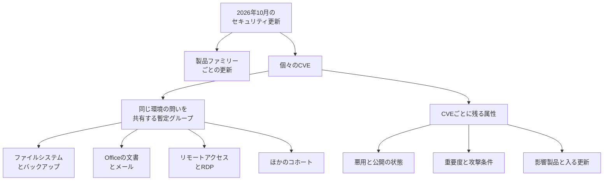

2026年10月13日、Microsoftは月例のセキュリティ更新とあわせて、リスクコホートという整理を公開しました。リスクコホートは、顧客の環境について同じ問いを共有するCVE（共通脆弱性識別子）の暫定的な束です。この記事では、コホートの中身、件数の定義、既知の悪用との対応、検証の順番を、Microsoft、Tenable、CISAの公開資料に沿って整理します。Tenableは月例の件数を集計した記事の発行元、CISAは既知の悪用カタログの発行元です。数値の突き合わせは、2026年10月21日に公開資料を取得した結果です。

*この記事の全体像。以下、順に解説します。*

## リスクコホートとは

文書名は “Using risk cohorts to prioritize security updates” です。Microsoft Security Response Center（MSRC）のブログは、2026年10月13日にこの整理を公開しています。コホートが共有するのは、顧客環境への一つの問いです。展開場所、露出、信頼境界について、CVEごとに同じ問いを繰り返さずに済む出発点として示されています。信頼境界を含むこれらの観点が何を指すかは、この節の表の各行がそのまま問いです。

ブログは、この整理を探索的な位置づけで公開しています。Security Update Guide（Microsoftが脆弱性と更新を案内する公開サイト）には、コホートとCVEの関係を出していません。製品機能として提供する時期も約束していません。フィードバック先は CVE@microsoft.com です。ブログの末尾は、AIを使った調査が発見に寄与するにつれて、この整理がより有用になり得る、と将来の話として書いています。

月例の更新は、これまでどおり製品ファミリーごとのパッケージに入ります。コホートは、その中のCVEを環境の問いで束ねた分析用のラベルです。悪用の有無、重要度、攻撃経路、必要な権限、ユーザー操作、影響する製品、入る更新は、CVEごとの属性として残ります。一つの更新、一つの回避策、一つの緩和が、コホート内のすべてのCVEに届くとは、ブログは書いていません。

ブログの表は15コホートで、行の合計は1,118件です。件数は表の値です。

| コホート | 件数 | 共有する問い |
|---|---:|---|
| Windows filesystems, storage and backup | 136 | どのファイルシステム、保管、バックアップが、信頼できないローカル入力を扱うか |
| Windows graphics, media and content processing | 131 | どの資産が、信頼できないコンテンツやローカルコードを描画・再生するか |
| Office document and mail clients | 135 | どのOfficeが入り、信頼できない文書やメールが届くか |
| Windows core and kernel privilege boundaries | 109 | 低い権限のコードが、どのカーネル境界に届くか |
| Windows installation, deployment and update services | 103 | どの導入・更新サービスに、低い権限のコードが触れるか |
| Windows device, peripheral and print surfaces | 76 | どのデバイス、ドライバ、印刷機能に、信頼できない入力が届くか |
| Remote-access and RDP deployments | 65 | どのホストがクライアント、ゲートウェイ、サーバで、どの経路が許されるか |
| Windows authentication, credentials and cryptography | 61 | どの認証・資格情報・暗号機能に、誰が届くか |
| Windows networking and protocol stack | 53 | 露出したWindowsで、どのプロトコルが有効か |
| DNS, DHCP and network-address infrastructure | 76 | どの名前・アドレスサービスに、信頼できない機器が触れるか |
| Virtualization, container and isolation hosts | 45 | どこで、信頼できないゲストやワークロードが動くか |
| Directory, federation and certificate infrastructure | 24 | どのディレクトリ、フェデレーション、証明書サービスが届くか |
| Network file and resource sharing | 39 | どのSMB、NFS、WebDAVが、信頼できない利用者に届くか |
| Endpoint management and security controls | 38 | どの管理・セキュリティ機能の方針を、誰が変えられるか |
| Windows web, RPC and messaging services | 27 | どのWeb、RPC、メッセージングが有効で、どのサービスIDで動くか。サービスIDが名前なのか実行アカウントなのかは、ブログの表だけでは書いていない |

一覧PDFには、表に無い16番目として Browser and web-content clients があります。中身は CVE-2026-83741 の1件です。PDFの一意なCVEは1,119件です。

CVE-2026-83741 は Internet Explorer（IE）の案内で、重要度は Important です。Exploitation Less Likely（Microsoftが、悪用される可能性は相対的に低いと記す区分）です。認証済みのローカルでの権限昇格（EoP）で、攻撃条件の複雑さは高い（AC:H）です。競合状態に勝つ必要があり、権限昇格の内容は、低い整合性レベルから中程度の整合性レベルへ上がることです。影響製品は Windows 本体の各エディションです。IEという別製品がインストールされていない、という切り方ではこのCVEの対象外だと切れません。

リリースノートが名指しで再度載せているのは1件です。Notable の2件とは別で、Cisco Talos の CVE-2026-21413（Raw Image Extension、Critical）です。PDFの graphics コホートにあります。

## 注意点

日経クロステックは2026年10月20日、市川大地（AI・データラボ）の記事で、この月例とリスクコホートを紹介しています。無料で読めるリードは、2026年10月13日の月例で脆弱性1,407件を修正した、9月の964件から増え、前年同月167件の約8.4倍、過去最多、と書いています。図の注は、各月の数は Tenable の集計だと書いています。1,407÷167は約8.42で、約8.4倍という丸めと合います。この比は、Tenableの見出し同士の比です。

同じ月を、別の定義で数えると次のとおりです。取得日は2026年10月21日です。CVRFは、Microsoftが機械可読形式で出すセキュリティ更新の文書です。その各レコードには Note（注記）と RevisionHistory（改訂履歴）があります。1,408件は、Noteのタイトルが Microsoft で、改訂履歴の最古日が2026年10月13日のレコードです。1,456件は、Noteのタイトルが Microsoft のレコード全件です。コホート表の1,118件やPDFの1,119件と、月例の1,407件や1,453件は、数えている母集団が違うので引き算しません。

| 数 | 何を数えたか | 重要度 |
|---|---|---|
| 1,407 | Tenableの2026年10月記事（2026-10-13） | Critical 69、Important 1,337、Moderate 0、Low 1 |
| 1,453 | MSRCリリースノートの見出し。CVRFの CurrentReleaseDate は 2026-10-21T01:44:10 | 製品ファミリー表の合計。Windows 1,105を含む |
| 1,408 | CVRFで、注記のタイトルが Microsoft、かつ改訂履歴の最古日が 2026-10-13 のレコード | Tenableの1,407に近い。重要度の内訳は1,407と一致しない |
| 1,456 | CVRFで、注記のタイトルが Microsoft のレコード全件 | Important 1,365、Critical 88、重要度なし 3。重要度なしは、CVEとは別の番号 ADV260001 と、CVE-2026-83831、CVE-2026-85898。この3件を除くと1,453 |

1,408は1,407と1件差ですが、Tenableの Critical 69件とは重要度の切り方が違います。同一のリストとしては扱いません。

Tenableの2025年10月記事は、167件から27件を除いたと明記しています。内訳は Chromium 14、MITRE 3、GitHub 1、CERT/CC 1、10月9日のクラウドCVE 8です。2026年10月の記事の冒頭には、同じ除外の注記は見当たりません。2025年10月の記事には「Update October 24」があり、WSUSの CVE-2025-59287 の追記があります。見出しの167は、その追記の前からある数です。2026年10月のTenable集計が、2025年10月と同じ除外規則かは、記事の注記だけでは閉じていません。

リリースノートの Notable は2件です。CVE-2026-96951 が Exploitation Detected（悪用を確認した、という区分）、CVE-2026-108398 が Publicly disclosed（公開済み）です。Tenableの2026年10月記事も “two zero days, including one that was exploited in the wild” と書いています。この文は、直前の2件、つまり悪用を確認した1件と公開済みの1件を指します。Tenableの2025年10月記事が “three zero-day” と書いているのは、2025年10月の話です。CVRF上、Noteのタイトルが Microsoft の集合で Exploited:Yes なのは CVE-2026-96951 だけです。

AIを、2026年10月の件数の原因とする文は、MSRCブログにも日経の無料リードにもありません。ブログのAIの文は将来の話です。CVE-2026-96951 の謝辞には “Benoit Sevens using Claude with Anthropic” があります。これはこの1件の発見手段であり、1,407件全体の原因説明には使えません。

日経の図注は、2026年上半期は月54〜198件だったと書いています。この範囲は図注の記述であり、各月のTenable記事をこの記事では開き直していません。

ブログの表と本文で、件数が一致しない箇所があります。本文は、RDPの例を64件、Officeの例を119件（Critical 23、ユーザー操作不要 17）と書いています。PDFの実数は表と同じで、RDPが65件、Officeが135件です。本文の64件と119件は、表とPDFのどちらとも一致しません。台帳として固定するなら表とPDFです。Critical 23件とユーザー操作不要 17件は、本文の119件に紐づく数です。135件の内訳としては使えません。

コホートを、根本原因が同じ束、またはCVSS（共通脆弱性評価システム）の点数が同じ束だと読むと、ブログの定義からずれます。コホートに入っていることが、既知の悪用や Exploitation Detected を包含する、という一次資料もありません。コホートの撤回告知は、確認した公開資料の範囲では見つかっていません。見つからないことは、撤回が無いことの証明にはなりません。

サポート終了は、Tenableの2026年10月記事が10月13日で終わったと書いている製品です。Windows Server 2012 / 2012 R2 の拡張セキュリティ更新プログラム（ESU）最終年、Windows 10 Enterprise 2016 LTSB と IoT Enterprise LTSB 2016、Windows Server 2022 のメインストリーム（延長は2031年10月14日までと同記事）、Office 2021 一式、Skype for Business LTSC 2021、Windows 11 Home and Pro 24H2 です。終了日の根拠は Tenable の記事であり、Microsoft Learn のライフサイクルページとは突き合わせていません。

Tenableの2026年10月記事は、過去の Windows Shell の悪用として CVE-2026-21510（2026年2月）と CVE-2026-32202（2026年4月）を挙げています。この2件は Tenable の記述であり、各CVEの一次案内は開いていません。

CISAの Binding Operational Directive（BOD）26-04 は、2026年6月10日の指令です。連邦文民行政機関向けに、露出、既知悪用、悪用の自動化、技術的影響で更新の期限を切ります。日数の表は画像のため、セルの数値はこの記事では引用しません。KEV（Known Exploited Vulnerabilities。米CISAが既知の悪用を載せるカタログ）がこの指令への準拠を求めていることまでは、CVE-2026-96951 の項目で確認しています。

SharePoint、SQL、Exchange について、PDFから外れているCVEの総数は確定していません。個別に確認したのは、後述の Exchange の CVE-2026-70571 がPDFに無いことまでです。

## 更新は製品ファミリーのパッケージで届く

CVRFの製品ファミリーは、顧客が受け取る更新の単位を示しています。合計は1,453件、更新の種類は227です。

| ファミリー | 件数 | 更新数 | 型 |
|---|---:|---:|---|
| Windows | 1,105 | 39 | 累積 |
| Office | 164 | 11 | 累積 |
| Developer Tools | 64 | 103 | 混在 |
| SharePoint Server | 37 | 1 | 累積 |
| Other | 35 | 33 | 個別 |
| SQL Server | 22 | 8 | 累積 |
| Azure | 15 | 20 | 個別 |
| Exchange Server | 7 | 8 | 累積 |
| Defender | 4 | 3 | 自動 |
| Edge | 0 | 1 | 自動 |

Windowsの累積更新は、そのパッケージに入ったCVEを分けて配る形にはなっていません。分析の優先度を下げることと、パッケージを配らないことは別です。Exchange、SQL、SharePoint、Azure は、Windowsの累積更新とは別の行にあります。Developer Tools の型「混在」と、Edge の件数0・更新1が何を指すかは、この表の列名以上には書いていません。配る順の判断には使いません。

## 既知の悪用はコホートの外にもある

CISA KEVの catalogVersion は 2026.10.20 です。時刻は 2026-10-20T19:00:31.8765Z、件数は1,754です。2026年10月に追加された Microsoft のCVEは CVE-2026-96951 だけです。このCVEはコホートPDFにありません。2026年10月に追加された Microsoft 分とPDFの交差は0件です。

| CVE | 公式の位置 | コホートPDF | 顧客がやること |
|---|---|---|---|
| CVE-2026-96951 Windows Shell | Important。Exploited:Yes。Exploitation Detected。CVSS 3.1は8.8、`AV:N/AC:L/PR:N/UI:R`。弱点区分は CWE-77。Mark of the Web（MOTW。インターネット由来のファイルにWindowsが付ける印）の回避。強制はできず、リンクのクリックや悪意のある添付など利用者の操作が必要。影響には Windows Shell と Outlook.com がある。Outlook.com は、利用者が Windows 累積更新を当てて直す対象ではない。参照した資料は、Outlook.com 側の顧客作業をそれ以上は書いていない | 無し | KEV追加 2026-10-13、期限 2026-10-16。requiredAction は BOD 26-04。2026年10月21日時点で期限は過ぎている。カタログの欄として、ランサム利用は Unknown、forensicTriage は Yes。どちらも欄の値であり、顧客が実施する作業の指示ではない。Yes の意味は、この値以上には展開していない |
| CVE-2026-108398 .NET Framework | Important。公開済み。Exploited:No。Exploitation Less Likely。認証済みのローカルで Windows Defender Application Control（WDAC。実行を許可したコードに限る制御）を回避 | 無し | 公開済みとして個別に見る。KEVには無い |
| CVE-2026-70571 Exchange | Critical。Exploitation More Likely。Exploited:No。認証不要のネットワーク経由のリモートコード実行（RCE）。AC:H。ユーザー操作不要。対象ビルドは Exchange Server 2016 の累積更新 CU23、2019 の CU14 と CU15、SE の RTM（正式リリースの版）。SE がどの製品名の略かは、参照した一覧では展開されていない | 無し | Exchangeの更新として扱う。Windows累積更新では届かない |
| CVE-2026-70229 Active Directory Domain Services（AD DS） | Critical。Exploitation More Likely。認証不要のネットワーク。AC:H | directory, federation and certificate infrastructure にある | コホートの問いに載せたうえで、More Likely を個別に残す |
| CVE-2026-83741 IE | 前節のとおり | Browser and web-content clients の1件。ブログの15行表には無い | 影響製品は Windows 本体の各エディション |

`AV:N/AC:L/PR:N/UI:R` は、CVSSの攻撃条件です。ネットワークから到達でき、条件の複雑さは低く、権限は不要で、利用者の操作が必要、という並びです。

CVE-2026-77900（Azure App Service for Linux）、CVE-2026-88131（Dataverse）、CVE-2026-96207（Partner Center）は Critical で、Revisionの最古日は2026年10月8日、PDFにはありません。FAQはいずれも、Microsoftが緩和済みで、利用者の作業は無い、と書いています。一覧の穴ではあります。顧客がパッチを待っている列には足しません。

## 分析の優先度を下げる条件

Microsoftが書いている下げ方は、分析の優先度です。リモートデスクトップ（RDP）の例では、役割が外から届くならサーバ側を先に見ます。管理端末がRDPクライアントなら、クライアント側を見ます。RDPがVPN、または Zero Trust（境界の内側を信頼し切らない前提）の奥にあり、インターネットへ直接出ていなければ、そのコホートの一部は即時対応の優先度を下げ得ます。その直後に、悪用済み、認証不要、攻撃経路が違うものは別、と書いています。

この条件を、パッケージを配らない判断へ広げる材料は、ブログにありません。

優先度を下げられるのは、次のときです。

1. その製品、役割、機能が環境に無いとき。Windows累積更新に同梱されるCVEは、役割が無いことだけではパッケージから外れません。IEコホートの実体は Windows 本体の各エディションです。CVE-2026-96951 の影響には Outlook.com もあります。Outlook.com は、利用者が Windows 累積更新を当てて直す対象ではありません。これは、悪用確認済みのこのCVEを配る順の先頭から外す、という意味ではありません。参照した資料は、Outlook.com 側で顧客が行う作業をそれ以上は書いていません。
2. 共有する問いへの答えが「その経路は無い」のとき。下げるのは、その問いに乗るCVEの分析順です。悪用済み、公開済み、認証不要、経路が違うもの、Critical、Exploitation More Likely は残します。
3. クラウドCVEのFAQが、緩和済みで利用者の作業は無い、と書いているとき。

露出が狭いときの優先度下げは、ブログ自身がRDPの例で書いています。「製品が環境に無いときだけ下げる」と読むと、この例より狭くなります。

検証の人手が足りないとき、保留そのものを禁止する一次資料は見つかっていません。保留するなら、どのパッケージを、いつまで、誰が止めるかを先に書きます。2026年9月のリモートデスクトップサービス（RDS）の不具合は、その保留を Windows 全体へ広げる理由にはなりません。Microsoft Learn は、2026年9月のセキュリティ更新のあと RDS が不安定になり得る、Windows 365 と Azure Virtual Desktop は対象外、対処は9月14日の定例外累積更新かそれ以降の累積更新、9月の更新を消してから入れ直す必要は無い、と書いています。Learnの対処は、より新しい累積更新を入れることです。保留の根拠にすると、結論が弱くなります。役割を限った確認の必要性までは残ります。

## 配る順の決め方

アプリケーションが依存するライブラリの更新と、Windows や Office の月例は、同じ順番で扱いません。ライブラリ側の順番は、参照した資料には書いていません。月例を配る順は、既知の悪用、公開済み、環境が「届く」と答える問い、Critical かつ Exploitation More Likely、検証できる量、です。CVSSの高い順だけを唯一の順にはしません。コホートは分析の束です。KEVの代わりでも、更新を止める許可でもありません。

ブログは、個別評価を残し、コホートだけでは優先度が決まらないと書いています。唯一のKEVである CVE-2026-96951 は Important で、PDFにありません。CVSSの高い順でも、コホートの順でも、先頭に残す理由は悪用の確認側にあります。Exchange の CVE-2026-70571 は Critical かつ Exploitation More Likely で、PDFにありません。別パッケージです。

順は次のとおりです。

1. 既知の悪用を先に置きます。ベンダーが Exploitation Detected としたもの、CISA KEVに入ったものです。重要度が Important でも、コホートPDFに無くても、ここから外しません。CVE-2026-96951 がこの月の実例です。KEVの期限は2026年10月16日で、2026年10月21日には過ぎています。この期限の拘束は、BOD 26-04 が向けた連邦文民行政機関の話です。
2. 公開済みをその次に置きます。CVE-2026-108398 がこの月の実例です。
3. 環境が「届く」と答えた問いの束を見ます。RDPが外から届く、信頼できない Office 文書が届く、Exchange を自分で運用している、といった問いです。届かない束は分析順を下げます。パッケージを分割できる製品だけ、配る順も下げます。
4. Critical かつ Exploitation More Likely は、コホートの有無と別に残します。この月は AD DS の CVE-2026-70229 と、Exchange の CVE-2026-70571 です。
5. 検証の枠が足りない更新は、配る前に保留の責任者、対象パッケージ、再開日を書きます。Windows累積更新を、件数が多いことだけを理由に全体停止しません。9月のRDSの対処は、新しい累積更新を入れることでした。
6. FAQが「緩和済み、利用者の作業は無い」と書くクラウドCVEは、顧客の検証キューに足しません。

この順をひっくり返す条件は、二つあります。Microsoftがコホートを Security Update Guide の正式な関係として出し、更新ガイダンスも変えたときです。または、コホート所属が KEV や Exploitation Detected を包含すると一次資料で示されたときです。現時点のブログは、そのどちらも約束していません。

## まとめ

2026年10月の月例は、数える定義で1,407件、1,453件、1,408件、1,456件に分かれます。日経の無料リードが使う1,407件は Tenable の集計で、MSRCリリースノートの見出しは1,453件です。リスクコホートは、同じ環境の問いを共有する暫定的な束で、ブログの表は15コホート・1,118件、PDFは1,119件です。探索的な整理であり、Security Update Guide の関係としては出ていません。

既知の悪用は CVE-2026-96951 の1件で、コホートPDFの外にあります。公開済みの CVE-2026-108398、Exchange の CVE-2026-70571 もPDFの外です。配る順は、悪用の確認、公開済み、環境が届くと答えた問い、Critical かつ Exploitation More Likely、検証できる量、の順です。役割が無いことだけでは、Windows累積更新のパッケージからは外れません。

この記事が少しでも参考になった、あるいは改善点などがあれば、ぜひリアクションやコメント、SNSでのシェアをいただけると励みになります！

## 参考リンク

- 日経クロステック、市川大地（2026.10.20）: https://xtech.nikkei.com/atcl/nxt/column/18/00001/12105/
- MSRC “Using risk cohorts to prioritize security updates”（2026-10-13）: https://www.microsoft.com/en-us/msrc/blog/2026/10/using-risk-cohorts-to-prioritize-security-updates/
- コホートPDF: https://cdn-dynmedia-1.microsoft.com/is/content/microsoftcorp/microsoft/msrc/images/partner-images/2026cves.pdf
- MSRC October 2026 release notes: https://msrc.microsoft.com/update-guide/releaseNote/2026-Oct
- CVRF 2026-Oct: https://api.msrc.microsoft.com/cvrf/v3.0/cvrf/2026-Oct
- Tenable 2026年10月（2026-10-13）: https://www.tenable.com/blog/microsofts-october-2026-patch-tuesday-addresses-1407-cves-cve-2026-96951
- Tenable 2026年9月（2026-09-08）: https://www.tenable.com/blog/microsofts-september-2026-patch-tuesday-addresses-964-cves-cve-2026-81963-cve-2026-85880
- Tenable 2025年10月（2025-10-14、Update October 24）: https://www.tenable.com/blog/microsofts-october-2025-patch-tuesday-addresses-167-cves-cve-2025-24990-cve-2025-59230
- CISA KEV JSON（catalogVersion 2026.10.20）: https://www.cisa.gov/sites/default/files/feeds/known_exploited_vulnerabilities.json
- CISA KEVの CVE-2026-96951: https://www.cisa.gov/known-exploited-vulnerabilities-catalog?field_cve=CVE-2026-96951
- BOD 26-04（2026-06-10）: https://www.cisa.gov/news-events/directives/bod-26-04-prioritizing-security-updates-based-risk
- Microsoft Learn、2026年9月更新後のRDS（更新日 2026-09-28）: https://learn.microsoft.com/en-us/troubleshoot/azure/virtual-machines/windows/troubleshoot-rds-instability-september-2026-windows-updates
