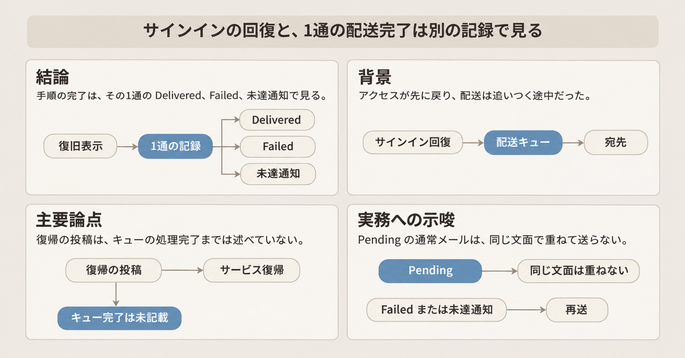
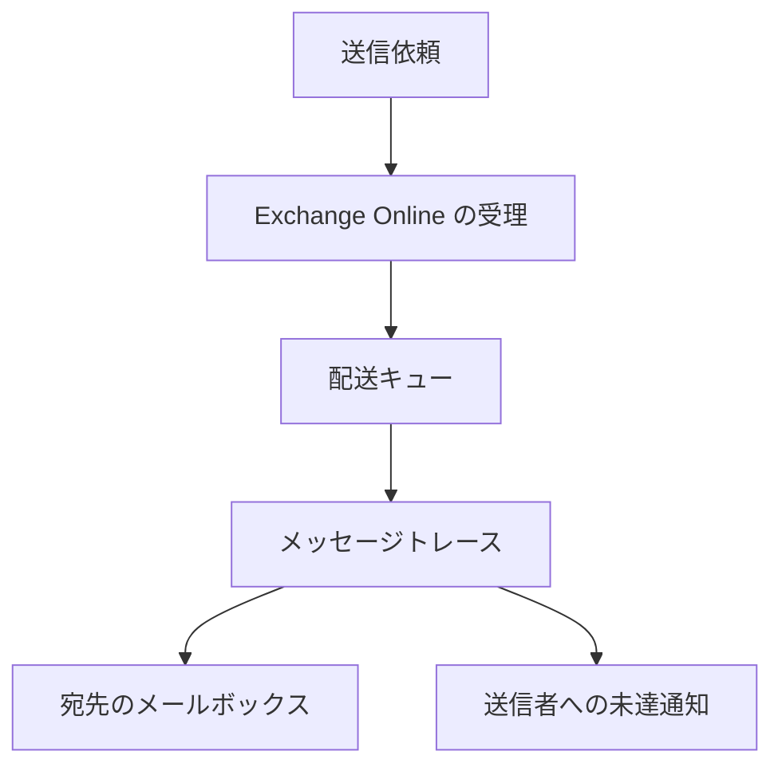
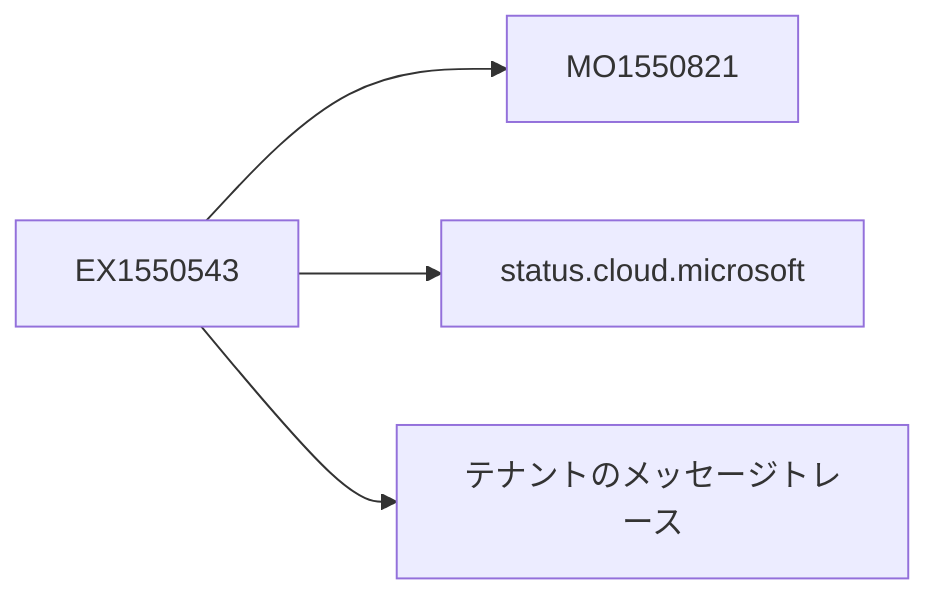

2026年11月12日 17:54 UTC（日本時間13日 02:54）から、Microsoft は Exchange Online のメールボックス接続の障害を公開しています。Exchange Online は、Microsoft 365 のクラウド上でメールボックスを提供するサービスです。この障害の番号は EX1550543 です。Microsoft 365 全体の状況は MO1550821 にまとめられます。MO1550821 の続きが置かれる画面が、Microsoft 365 管理センターです。管理センターが開かないときの公開ページは status.cloud.microsoft です。

この記事では、公開された状況投稿と、learn.microsoft.com の説明から、次を整理します。

- 公式投稿が述べている対応、原因、サインインと配送の時間差
- 組織の環境の中で、1通ごとに残るメッセージトレースの状態
- メール送信の結果を完了条件にしている業務手順が、どの記録を見てよいか

管理センター MO1550821 の最終文と、予告された事後報告書の本文は、2026年11月15日時点の公開記録では確認できていません。記述はその範囲に限ります。

*この記事の全体像。以下、順に解説します。*

## Microsoft 365復旧後に残るメールの遅配と未達とは

対象は、EX1550543 のあとで残るメール配送の状態です。公式投稿は、サインインやアクセスが先に良くなっても、配送と処理は追いつく途中だと説明しています。遅配は、受理されたメールが宛先へ届くまでに配送キューへ残る状態です。未達として扱うのは、トレースが Failed になったメールと、送信者へ未達通知が返ったメールです。

公開の起点は、米州の利用者が複数の接続方法で Exchange Online のメールボックスへアクセスできない、という調査投稿です。投稿 ID は 2120938282204688468 です。

### 公式が述べた対応

公式が挙げた対応には、トラフィックの再配分、影響を受けたサーバの再起動、自動ヘルスチェックに失敗するサーバへの構成変更の試験、少数の直近構成更新を戻すかどうかの検討、以前の構成での一部サーバの再構築があります。自動ヘルスチェックは、サーバが正常かを自動で確かめる処理です。2026年11月12日 19:12 UTC の投稿は、自社の展開をすべて止めたと述べています。ここでの展開は、Microsoft 自身が行うサービスの配備です。原文は “We've paused all deployments” です。

メールのタイムアウトは、遅れたメッセージが期限切れになるまでの時間です。この事象のあいだ、その時間は 48 時間へ延ばされています。同じ 48 時間の延長は、2026年11月13日 09:24 UTC の投稿で述べられ、10:28 UTC と 12:09 UTC の投稿でも維持されています。

2026年11月13日 18:05 UTC の投稿は、以前のネットワーク容量増強の際の問題が、直近のネットワーク変更のあとで表面化した技術問題だと述べています。この時点の文は、残る顧客と地域への復旧を続ける、です。事後報告書は、レビューが終わってから全文を出すと予告されています。原文は “once our review is complete” です。

### 時刻ごとの公式投稿

| 時刻 (UTC) | 公式投稿が述べたこと |
| --- | --- |
| 2026-11-12 17:54 | 調査開始。米州の利用者が複数の接続方法でメールボックスへアクセスできない |
| 2026-11-12 19:12 | 自社の展開をすべて停止 |
| 2026-11-12 19:50 | 自動ヘルスチェックに失敗するサーバへの構成変更を試験 |
| 2026-11-12 20:19 | 影響開始と相関する直近変更は未特定 |
| 2026-11-12 21:40 | 特定した少数の直近構成更新を戻すと復旧が早まるかを検討 |
| 2026-11-13 09:24 | 遅れたメールを守るため、この事象のあいだタイムアウトを 48 時間へ延長 |
| 2026-11-13 18:05 | 容量増強の問題が、直近のネットワーク変更のあとで表面化した。事後報告書を予告 |
| 2026-11-13 20:05 | キューはまだ排出の途中。サインインが先に良くなっても、配送は追いつく途中。全面復旧の見込み時刻は無い。結びの原文は “Service access can recover before mail flow fully normalizes.” |
| 2026-11-13 21:55 | この事象で溜まったメールのバックログを監視し、すべて処理できてから解決済みとみなす。原文は “all process successfully” |
| 2026-11-14 06:09 | 根本原因への対処を終え、残る影響顧客と地域へサービスを戻した。日本時間では 15:09。続きは管理センターの MO1550821 |

バックログとは、この事象のあいだに溜まり、まだ処理を終えていないメールのたまりです。

### サービス状態と1通の記録

公開記録は、サービス状態の投稿と、テナント内の1通ごとの記録に分かれます。テナントは、1つの組織が使う Microsoft 365 の環境です。送信依頼は Exchange Online が受理し、配送キューを経て、メッセージトレースに状態が付きます。そこから宛先のメールボックスへ届くか、送信者への未達通知へ分かれます。

EX1550543 は Exchange Online の障害番号です。MO1550821 は Microsoft 365 全体の状況番号です。公式投稿は両方を案内します。テナントのメッセージトレースは、そのテナントの中の1通の記録です。

### メッセージトレースの状態

メッセージトレースは、サービスがそのメッセージを受信し、拒否し、延期し、配送したかを状態で示します。状態の説明が載っているのは、新しい管理センターです。これは、メッセージトレースを説明する Exchange の管理画面です。導入で述べた、MO1550821 の続きが置かれる Microsoft 365 管理センターと同一かは、公開された説明では突き合わせていません。新しい管理センターの説明に沿うと、主な状態は次のとおりです。

| 状態 | 公式の説明 |
| --- | --- |
| Delivered | 意図した宛先へ配送できた |
| Pending | 配送を試行中、または再試行中。10日未満の検索で使える |
| Failed | 配送できなかった |
| Getting status | 受信した直後で、ほかの状態がまだ無い。数分後に再確認する |
| Quarantined / Filtered as spam | 検疫、またはスパムとして拒否。10日未満の検索で使える |

「10日未満の検索で使える」は、状態が消える期限ではありません。検索する期間が 10 日より短いときに、その状態を使える、という説明です。10 日以上の検索でその状態が出るかは、公開された説明には書かれていません。Quarantined は検疫です。Filtered as spam は、スパムとしての拒否です。迷惑メールフォルダーや検疫へ入ったメールでも、状態は Delivered になり得ます。

Deliver は、状態名の Delivered とは別の、トレースに残る操作の記録です。その Deliver は、メールボックスへの配送です。Send は、サービスがそのメッセージを送ったことです。

### 送信 API が返す受理

Microsoft Graph の `sendMail` は、指定したユーザーとしてメール送信を依頼する API です。成功したときの応答は `202 Accepted` で、応答本文は空です。Microsoft の説明では、これは受理であり、処理の完了を示すものではありません。

## 注意点

復旧や未達の言い方は、出典が述べる範囲を超えると別の事実になります。

### サービス復帰とキューの処理完了

2026年11月14日 06:09 UTC の公式投稿が述べるのは、残る顧客と地域へのサービス復帰です。この文は、障害中のメールキューが処理し終えたことまでは述べていません。その前の 21:55 UTC は、バックログが処理できてから解決済みとみなす、と述べています。二つの文を、一つの「全面復旧でキューも終わった」にまとめません。

20:05 UTC の文は途中経過です。06:09 UTC のあとまで遅配が続く、と公式は書いていません。全面復旧のあとにもすべてのメールが届かない、とまでは公式文から言えません。公式投稿は、企業向けに「メールは失われていない」とも書いていません。失われた通数は公開されていません。通数は書きません。

### 個人向けの収束を、企業向けの同じ時刻へ広げない

個人向けについて、2026年11月13日 16:10 UTC（日本時間14日 01:10）に滞留メールを処理して収束した、という記述は通信社と産経の報道です。個人向けステータスページの原文は、この記事の材料に入っていません。“processed” は、すべてが宛先へ届いた、という意味までは書かれていません。期限切れや未達通知を含み得ます。企業向けの「復旧後も残る」を、個人向けの同じ時刻へ広げません。

### 二次情報の時刻と原因

日本経済新聞は、接続状況ページの復旧報告を日本時間14日午後2時半すぎ、X の完了報告を午後3時すぎ、と書いています。X の 15:09 とは近い時刻です。ページ側の時刻は同紙の観察です。

公開リードは、有料の本文の前に出ている導入です。日経クロステックの公開リードは、この Microsoft 365 の障害を 2026年11月13日未明の出来事として名指ししたうえで、メール関連の障害では復旧後も後着や最終的な未達があり得る、と一般の形に広げています。図のキャプションは、IIJ への取材を基に日経クロステックが作成した、とあります。有料の本文は、ここでは扱っていません。公開リードに通数はありません。このリードを、EX1550543 で失われた通数の実測としては使いません。

ITmedia（2026年11月13日 06:41 JST）は、少数の構成変更が確認され、これらが障害の一因になった可能性がある、と書いています。同じ頃の公式投稿（2026年11月12日 21:40:38 UTC、日本時間13日 06:40）は、特定した少数の直近構成更新を戻すと復旧が早まるかを検討している、と述べます。一因だとは書いていません。その前の 20:19 UTC は、影響開始と相関する直近変更は未特定、です。その後の公式原因文は、以前のネットワーク容量増強の際の問題が、直近のネットワーク変更のあとで表面化した、と述べます。ITmedia の一因という読みは、途中の要約として扱います。同じ 18:05 UTC の投稿は、この事象がサイバーや AI / agents とは関係がない、と述べています。

利用者報告の件数と、第三者ミラーの開始時刻の例である 10:05 UTC は、公式の公開調査開始 17:54 UTC と揃いません。この記事の時刻表には入れていません。

### 48時間は、この事象のあいだの延長である

48 時間は “during this event” の延長です。テナントの管理者が、自分の環境の設定として 48 時間へ伸ばす項目ではありません。12 時間から 24 時間まで、はテナント側の設定範囲です。障害中の 48 時間は、この設定を 48 時間にした、という意味ではありません。その範囲が書いてあるのが、クラウドの Exchange Online 向けの `Set-TransportConfig -MessageExpiration` です。`MessageExpiration` は、メッセージが期限切れになるまでの時間です。既定は 1 日（`1.00:00:00`）です。延長をいつ戻したかは、公開された公式投稿では確認できていません。

### Delivered が示さないもの

Delivered は、人が読んだことまでは示しません。メッセージトレースの FAQ は、迷惑メールフォルダーまたは検疫へ入っても状態が Delivered になり得ること、宛先へ届いたあと見られる前に削除され得ることを書いています。外部の次のサーバでは、Send がその先の人の受信箱を示すわけではありません。

報告と実際の配送状態には 5 分から 10 分の遅れがあり得ます。これは新しい管理センターの説明にあります。Getting status と Pending は、まだ結果が確定していない状態です。検索結果が空であることは、この遅れの説明には使いません。空だったときに次に何を見るかは、公開された説明には書かれていません。

Enhanced summary report と Extended report は、新しい管理センターからダウンロードするレポートです。これらのレポートでは、アーカイブデータの直近 24 時間は通常手に入りません。この制限は、ダウンロードするレポートの話です。画面で見る 1 通の Delivered や Failed が、直近 24 時間は見えない、とは書いていません。10 日未満を対象にする Summary report は、この直近 24 時間の一文の対象ではありません。アーカイブデータがどの保管を指すかは、公開された説明では定義されていません。

IP レピュテーションは、送信元 IP の評判によってメッセージが拒否される仕組みです。これで拒まれたメッセージはトレースできない、とメッセージトレースの FAQ にあります。代わりにどの記録を見るかは、公開された説明には書かれていません。検索の送信者は、ヘッダーの From ではなく SMTP の MAIL FROM です。MAIL FROM は、封筒に書く送信者であり、受信者の画面に見える From とは別です。SMTP は、サーバ間でメールを渡す手順です。

### トレースを開く権限

メッセージトレースの手順ページが求めるのは、Organization Management、または Global Administrator / Exchange Administrator です。この三つは、メッセージトレースを開くために手順ページが名指しする管理者の役割です。三つの差は、手順ページでは説明されていません。送信者本人や、送信権限だけの実行主体では、この画面を開く前提になりません。

Microsoft が止めたのは自社の展開です。公式投稿は、顧客に次の停止を求めていません。メールフロー規則を止めること、コネクタを止めること、送信権限だけの実行主体が再送を止めることです。メールフロー規則は、テナントの中で通るメールに掛ける規則です。コネクタは、テナントの外とメールをやり取りする経路の設定です。

### 状況更新を装うリンクと、まだ出ていない文書

障害のあと、EX1550543 を名乗るフィッシングが確認されています。保留メールを 24 時間以内に消すのでリンクを押せ、という文面は Microsoft の状況更新ではありません。確認先として [Microsoft Threat Intelligence の投稿](https://x.com/MsftSecIntel/status/2121491564161581148) が指定するのは、Microsoft 365 管理センターです。状況の一次には、あわせて @MSFT365Status の公式投稿を使います。@MSFT365Status は、ここまで引用している状況投稿の公式アカウントです。2026年11月14日 22:14 UTC には、Defender によるブロックと検疫についての投稿があります。Defender は、その投稿が名を挙げている Microsoft の機能です。この投稿は、1通の配送状態を確認する先には使っていません。

事後報告書は、サービス復帰の完了後、とは書いていません。2026年11月15日時点で、その本文は確認できていません。管理センターの最終文も、ここでは取得できていません。

公開記録だけでは決まらないことが残ります。

障害窓は、EX1550543 のあいだに送ったメールの範囲です。公開記録上の始まりは、2026年11月12日 17:54 UTC の調査開始です。2026年11月14日 06:09 UTC の復帰投稿は、この範囲の終わりを、キューの処理完了としては述べていません。

- 管理センター MO1550821 の最終文が、06:09 UTC の投稿の先で、キュー完了を含めて閉じているか
- 予告された事後報告書が、2026年11月15日時点でどこに出ているか
- 48 時間の延長がいつ戻ったか
- 日経クロステックの有料本文に、この障害についての IIJ の具体があるか
- 個人向けステータスページの “processed” の原文が何か
- 自テナントの障害窓のメッセージのうち、Pending のままのものが残っているか

最後の一点は、公開情報では決まりません。

## 完了の信号は、その1通の記録である

障害の途中では、アクセス復帰と配送の平常化がずれ得る、という公式文は維持できます。[20:05 UTC の投稿](https://x.com/MSFT365Status/status/2121333700591857878)は、アクセスが戻る時刻と、配送が平常に戻る時刻がずれ得ると述べています。[09:24 UTC の投稿](https://x.com/MSFT365Status/status/2121172248241348867)は、遅れたメールを守るために、この事象のあいだタイムアウトを 48 時間へ延ばしたと述べています。[21:55 UTC の投稿](https://x.com/MSFT365Status/status/2121361358004400637)は、この事象のバックログが処理できてから解決済みとみなす、と述べています。[06:09 UTC の投稿](https://x.com/MSFT365Status/status/2121485746334777593)は、残る顧客へのサービス復帰を述べ、キュー完了は述べません。

作業手順が使う完了信号は、サービス全体の復旧表示ではありません。その1通の Delivered、Failed、または送信者への未達通知です。Graph の `202 Accepted` は受理であり、処理完了ではありません。Microsoft 365 Copilot を使う手順でも、完了を送ったメールに置いているなら、見る記録は同じ1通です。

権限があるテナントでは、障害窓のメールの最も近い記録はメッセージトレースです。権限が無いときは、送信者への未達通知と、Graph の 202 が受理でしかないことを並べます。届かなかった通数は公開されていないので、通数を完了条件にしません。

## 障害窓の通常メールは、状態が確定してから再送する

復旧の投稿を見たら、障害窓に送った通常メールを一覧にします。キーは Message-ID と、SMTP の MAIL FROM です。Message-ID は、そのメールを識別するヘッダーです。

管理者がトレースできるなら、その一覧の状態を見ます。すでに状態が出ているときは、報告と実際のあいだに 5 分から 10 分の遅れがあり得るので、その幅を見てイベント詳細を読みます。Getting status は、数分後に再確認します。Delivered のときはイベント詳細で、迷惑メール、検疫、外部への Send を分けます。迷惑メールや検疫でも状態が Delivered なら、Failed か未達通知が出るまで、同じ文面の再送はしません。外部への Send は、その先の人の受信箱に入ったことにはしません。

通常の業務メールは、Pending のあいだ同じ文面で再送しません。再送のきっかけは Failed、または送信者への未達通知です。Pending と Getting status のあいだに同じ文面を重ねて送ると、遅れて届いた原メールと重なります。

たとえば、請求の PDF を送ったメールが Pending のままなら、同じ PDF をすぐ重ねません。Failed になるか、送信者の受信箱に未達通知が着いてから、同じ用件を送ります。

ワンタイムパスワード、会議の開始、期限のある承認は、この待ちから外します。中身の期限が来る前に、新しいコードや新しい案内として送り直します。新しいコードの送信は、同じメールの再送とは別です。確認コードが数分で無効になる手続きを、配送の Failed まで待つと、届いたときにはコードの期限が終わっています。会議の開始案内も、開始時刻の前に新しい案内として送り直します。

## トレースを開けない手順に残る記録

ここでのエージェントは、メールの送信権限はあるが、管理者としてメッセージトレースを開けない実行主体です。原因の文にある “AI / agents” とは別の語です。トレースを開けないエージェントは、送信した側が残す「送信済み」と Graph の 202 を、相手の受信完了として扱いません。残る記録は、送信者への未達通知です。管理者権限が無いエージェントには、トレースだけを正しい記録にはできません。

Outlook が接続できなかった時間の、デスクトップの送信トレイは、サーバが受理した記録とは別です。画面上の送信済みと、Exchange Online の受理は、別の段です。

## 変えてよい経路と、止めない規則

自テナントの対象メールが Pending でなくなるまで、コネクタ、MX、送信経路を変えません。MX は、そのドメイン宛てのメールを受け取るサーバを示す DNS のレコードです。送信経路は、テナントから外へ出すときの通り道です。遅配と、自分の変更が混ざります。顧客側で変更を止めるなら、コネクタ、MX、送信経路に限ります。

セキュリティ規則は、フィッシング用ドメインを拒否する規則を含みます。この規則と、期限のある再送は止めません。顧客の規則を広く凍結しても、公式が述べた原因の復旧は速くなりません。原因は、Microsoft 側の容量増強と、その後のネットワーク変更です。セキュリティ規則まで止めると、フィッシング用ドメインの拒否も遅れます。EX1550543 を名乗る「保留メールを復元する」リンクは開きません。確認は管理センターで行います。

## 公開の復帰投稿だけでは照合は終わらない

レビュー完了後の事後報告書が出たら、原因文と、48 時間延長の終了時刻を突き合わせます。原因文は、容量増強の問題が、直近のネットワーク変更のあとで表面化した、というものです。

照合が終わる条件は二つです。管理センターの最終文が、企業向けについてもバックログの処理完了を明示していること。自テナントのトレースが、障害窓の対象をすべて Delivered または Failed で埋めていること。Quarantined と Filtered as spam は、この終了条件には入っていません。その状態のまま残るメールを照合の終わりに数えるかは、公開された説明では決まっていません。公開の復帰投稿だけでは、この条件は満たせません。

## まとめ

EX1550543 の公開記録では、サインインやアクセスの回復と、メール配送の平常化は、別の時刻になり得ます。06:09 UTC の投稿は残る顧客へのサービス復帰を述べ、キューが処理し終えたことまでは述べていません。通数は公開されていません。

業務手順の完了は、サービス全体の表示ではなく、その1通の Delivered、Failed、または送信者への未達通知で見ます。通常メールは Pending のあいだ同じ文面で再送せず、期限のあるコードと案内は期限の前に新しいものとして送り直します。コネクタ、MX、送信経路は、対象が Pending でなくなるまで変えません。

この記事が少しでも参考になった、あるいは改善点などがあれば、ぜひリアクションやコメント、SNSでのシェアをいただけると励みになります！

## 参考リンク

- [Microsoft 365 Status、調査開始（2026-11-12 17:54:26 UTC）](https://x.com/MSFT365Status/status/2120938282204688468)
- [Microsoft 365 Status、展開停止（2026-11-12 19:12:31 UTC）](https://x.com/MSFT365Status/status/2120957934607700161)
- [Microsoft 365 Status、ヘルスチェック失敗への構成変更の試験（2026-11-12 19:50:31 UTC）](https://x.com/MSFT365Status/status/2120967496303858112)
- [Microsoft 365 Status、開始と相関する直近変更は未特定（2026-11-12 20:19:33 UTC）](https://x.com/MSFT365Status/status/2120974801388904932)
- [Microsoft 365 Status、少数の直近構成更新を戻す検討（2026-11-12 21:40:38 UTC）](https://x.com/MSFT365Status/status/2120995209261514827)
- [Microsoft 365 Status、48時間延長（2026-11-13 09:24:08 UTC）](https://x.com/MSFT365Status/status/2121172248241348867)
- [Microsoft 365 Status、原因と謝罪（2026-11-13 18:05:19 UTC）](https://x.com/MSFT365Status/status/2121303408313303423)
- [Microsoft 365 Status、アクセスとメールフロー（2026-11-13 20:05:41 UTC）](https://x.com/MSFT365Status/status/2121333700591857878)
- [Microsoft 365 Status、バックログを見てから resolved（2026-11-13 21:55:35 UTC）](https://x.com/MSFT365Status/status/2121361358004400637)
- [Microsoft 365 Status、残る顧客への復帰（2026-11-14 06:09:51 UTC）](https://x.com/MSFT365Status/status/2121485746334777593)
- [Microsoft Threat Intelligence、フィッシング（2026-11-14 06:32:58 UTC）](https://x.com/MsftSecIntel/status/2121491564161581148)
- [Microsoft Threat Intelligence、Defender のブロックと検疫（2026-11-14 22:14:04 UTC）](https://x.com/MsftSecIntel/status/2121728397093032307)
- [Set-TransportConfig の MessageExpiration](https://learn.microsoft.com/en-us/powershell/module/exchangepowershell/set-transportconfig?view=exchange-ps)
- [新しい管理センターのメッセージトレース](https://learn.microsoft.com/en-us/exchange/monitoring/trace-an-email-message/message-trace-modern-eac)
- [Message Trace FAQ](https://learn.microsoft.com/en-us/exchange/monitoring/trace-an-email-message/message-trace-faq)
- [Graph sendMail](https://learn.microsoft.com/en-us/graph/api/user-sendmail?view=graph-rest-1.0)
- [日経クロステック、公開リード](https://xtech.nikkei.com/atcl/nxt/column/18/00001/12176/)
- [ITmedia NEWS（2026-11-13 06:41 JST）](https://www.itmedia.co.jp/news/article/2611/13/2000003161/)
- [日本経済新聞（2026-11-14）](https://www.nikkei.com/article/DGXZQOUC141CH0U6A111C2000000/)
- [産経デジタル（2026-11-14 14:46）](https://www.sankei.com/article/20261114-BDS65QZRORM6JBHXUHTX74DNHI/)
