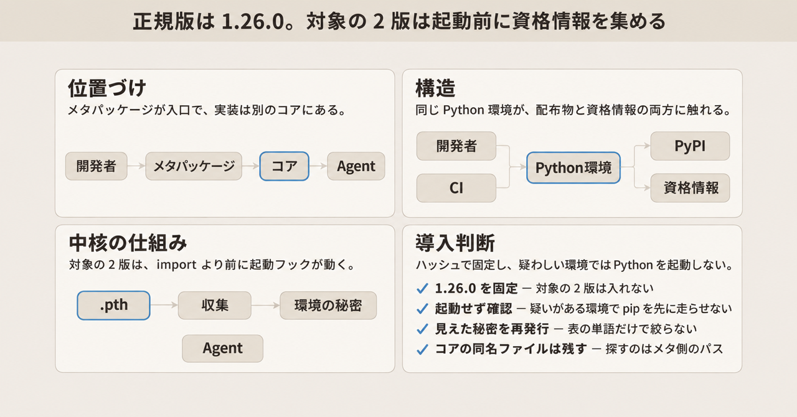
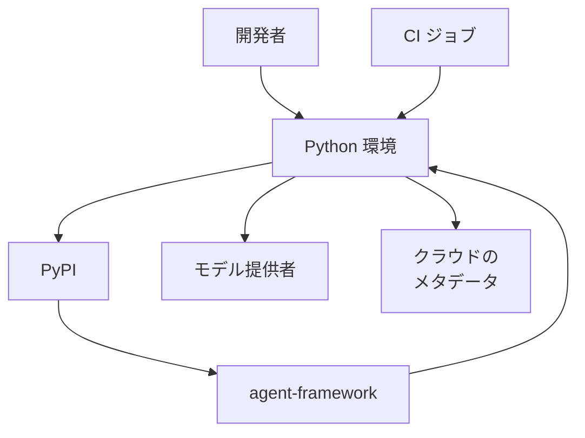
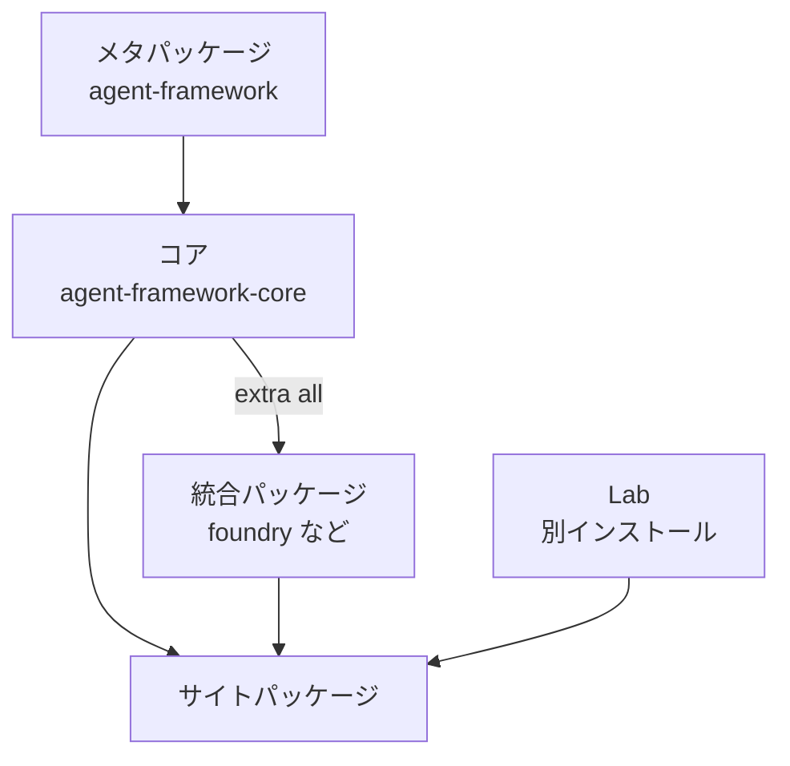
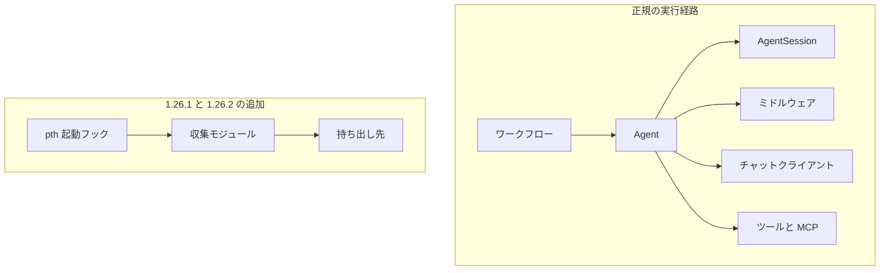
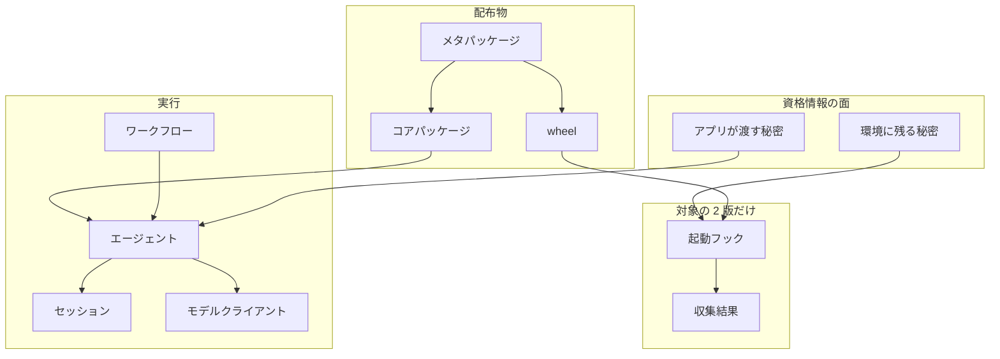
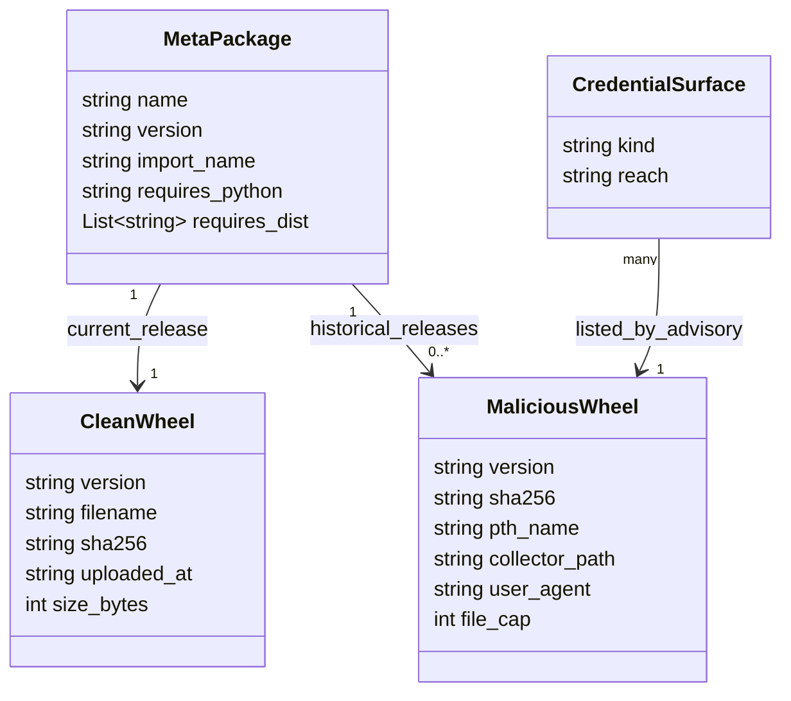

Microsoft Agent Framework は、Semantic Kernel と AutoGen（いずれも前身のエージェント基盤）の後継として、同じ開発チームが .NET、Python、Go 向けに公開しているエージェント基盤です。Python の入口は PyPI のメタパッケージ `agent-framework` です。メタパッケージとは、本体と標準的な統合をまとめて入れる配布物のことです。エージェントの実装は、別配布の `agent-framework-core` にあります。

この記事では、2026-11-20 時点の正規の構成と、同じ配布名で 2026-11-17 に公開された 1.26.1 と 1.26.2（GitHub Advisory Database の [GHSA-764m-3ppc-5m73](https://github.com/advisories/GHSA-764m-3ppc-5m73)、OSV の [MAL-2026-20101](https://osv.dev/vulnerability/MAL-2026-20101)）の見分け方を扱います。見出しは構成、導入、利用、運用、注意点の順です。OSV は、オープンソースの脆弱性と悪性パッケージを公開するデータベースです。対象版を入れた環境では、どの資格情報を再発行の範囲に入れるかまでを扱います。既存の環境を調べるときは、その環境の Python を起動せず、導入の「導入履歴の確認」からファイルを見ます。


*この記事の全体像。以下、順に解説します。*

## Microsoft Agent Framework とは

Microsoft Agent Framework は、個別のエージェント、長時間の実行、手順の分岐、モデルやツールとの接続を、ひとつの基盤にまとめたライブラリ群です。Python では `agent-framework` が入口になります。2026-11-20 時点の PyPI JSON は、このメタパッケージの最新版として 1.26.0 を返します。依存は `agent-framework-core[all]==1.26.0` にピンされています。`[all]` は、コアが用意する extra で、標準の統合を含める指定です。

2026-11-17 に、同じ配布名で 1.26.1 と 1.26.2 が公開されました。GitHub Advisory Database の GHSA-764m-3ppc-5m73 は、この 2 版が最終クリーン版 1.26.0 に無い credential stealer（資格情報を集めて外へ送るコード）を足した、と書いています。GHSA が wheel のみと書くのは 1.26.1 です。wheel は、インストール時に展開されるビルド済みの配布物です。1.26.2 は wheel の公開時刻とハッシュまで確認できます。OSV の `affected.versions` は `1.26.1` と `1.26.2` だけです。1.26.0 は最終クリーン版です。

通常の Python 起動では、標準ライブラリの `site` がサイトパッケージの `.pth` を処理します。`.pth` は、インタプリタ起動時にサイトパッケージから読まれるパス設定ファイルです。そのため、アプリケーションが `agent_framework` を import する前に、追加コードが動きます。CWE は CWE-506（埋め込まれた悪性コード）です。CWE は、脆弱性の種類を分類する共通の番号体系です。

到達するのは、エージェントの引数として渡した API キーだけではありません。同じ OS ユーザーの環境変数、資格情報ファイル、他プロセスの環境、Azure のインスタンスメタデータ、CI がジョブに注入する OIDC 用の変数までが、アドバイザリの収集対象に含まれます。OIDC は、短命のトークンを外部の ID 基盤に要求する仕組みです。1.26.1 または 1.26.2 を入れた環境は、露出した資格情報を再発行する前提で扱います。

## 特徴

Microsoft の公式ドキュメントである Learn の 4 領域は、個別のエージェントを作る Agents、長時間タスクを扱う Harness、実行順序と分岐を定める Workflows、モデルやツールを接続する Integrations です。

Python のメタパッケージ `agent-framework` は、コアと標準的な統合をまとめて入れます。実験的な Lab は `agent-framework-lab` を別に入れます。2026-11-20 の PyPI では、`agent-framework`、`agent-framework-core`、`agent-framework-foundry` の安定版に `--pre` は不要です。`agent-framework-copilotstudio` はプレビューのままです。公式の導入例は `--pre` を付けます。

現行メタパッケージの `Requires-Python` は `>=3.11` です。分類子は Python 3.11 から 3.15、開発状態は Production/Stable、ライセンス分類子は MIT です。1.0.0 の wheel は `Requires-Python: >=3.10` でした。Go 実装は公開プレビューで、Go 1.26 以降が要ります。宣言的エージェント、CodeAct、関数型ワークフローは Go にはありません。フレームワークは `.env` を自動では読みません。

悪性版は、正規の中身に足す形です。依存ピンは `agent-framework-core[all]==1.26.0` のままです。このアドバイザリは、コアの実装そのものを差し替えたとは書いていません。利用アプリケーションの動作試験結果は載っていません。

1.26.1 の追加ファイルは `agent_framework_meta.pth` と `agent_framework_meta/_telemetry.py` です。1.26.2 は `af_runtime_diag.pth` と `af_runtime_diag.py` に名前を変えています。アドバイザリが挙げる収集ファイルは `agent_framework_meta/_telemetry.py` と `af_runtime_diag.py` です。正規コア 1.26.0 の wheel（PyPI の sha256 と一致するファイル）には、別パスの `agent_framework/_telemetry.py` があります。検出に使うのはメタ側のパスだけです。コア側の同名ファイルは、このアドバイザリがハッシュを付けた対象ではありません。

持ち出し先は両版で同じ webhook.site の URL です。webhook.site は、外部からの HTTP リクエストを受け取って確認できるサービスです。User-Agent だけが版で違います。URL の全文は GHSA-764m-3ppc-5m73 を正とします。

| 技術 | 位置づけ | 状態の持ち方 | 複数処理の進め方 |
|---|---|---|---|
| Semantic Kernel | 前身。企業向けの型、フィルタ、テレメトリ | セッション | オーケストレーション用パッケージ |
| AutoGen | 前身。単体と複数エージェントの抽象 | 会話の抽象 | 複数エージェントのパターン |
| Agent Framework | 両者の後継。ワークフローを追加 | セッションと、長い実行の状態 | グラフまたは関数型の明示経路 |

| 場面 | 向く使い方 |
|---|---|
| 対話とツール呼び出しが中心 | 単体のエージェント |
| 手順が決まっている | ワークフロー |
| 関数で書ける | エージェントにしない |
| 依存を絞りたい | `agent-framework-core` と必要な統合だけ |
| CI やクラウドの資格情報と同じ環境へ未検証の版を入れたくない | 1.26.0 のハッシュ固定。1.26.1 と 1.26.2 は入れない |

## 構造

正規の利用者、ビルド環境、PyPI、モデル提供者、クラウドのメタデータが、同じ Python 環境を介してメタパッケージに触れます。

### システムコンテキスト図

開発者と CI ジョブは、同じ Python 環境へ依存と資格情報を置きます。その環境が PyPI から `agent-framework` を受け取り、モデル提供者とクラウドのメタデータへ接続します。



| 要素名 | 説明 |
|---|---|
| 開発者 | エージェントを書き、API キーやクラウド資格情報を環境へ置く人 |
| CI ジョブ | 同じランナー上で依存を入れ、短命トークンやシークレットを環境へ注入する処理 |
| Python 環境 | サイトパッケージと、起動時に読む `.pth` を持つインタプリタ |
| PyPI | `agent-framework` の配布元。2026-11-20 の JSON では最新が 1.26.0 |
| agent-framework | メタパッケージ。コア一式を依存としてピンする |
| モデル提供者 | Foundry、Azure OpenAI、OpenAI、Anthropic、Ollama など、エージェントが呼ぶ推論先 |
| クラウドのメタデータ | Azure IMDS や App Service の IDENTITY_ENDPOINT。実行環境に付く資格情報の出元 |

IMDS は、クラウドの計算資源が自分に付いた資格情報を問い合わせるリンクローカルの窓口です。`IDENTITY_ENDPOINT` は、App Service などが同じ目的で公開する環境変数です。

### コンテナ図

メタパッケージはコアを引き、コアの extra `all` が統合パッケージを引きます。Lab は別インストールです。いずれもサイトパッケージへ展開されます。



| 要素名 | 説明 |
|---|---|
| メタパッケージ | 配布名 `agent-framework`。利用者が書く import はコアの `agent_framework`。`agent_framework_meta` はメタパッケージ側の名前で、PyPI の project URL 表記から読んだもの |
| コア | 配布名 `agent-framework-core`。公開 import は `agent_framework`。`requires_dist` は `agent-framework-openai>=1.18.2,<2` と `agent-framework-foundry>=1.16.2,<2` を宣言し、どちらも `extra == "all"` のときだけ適用する。説明も追加インストールを案内する |
| 統合パッケージ | PyPI のメタパッケージ `agent-framework` 1.26.0 は `agent-framework-core[all]==1.26.0` を要求する。`all` はコア側の extra で、標準の統合を含める指定 |
| Lab | `agent-framework-lab`。標準インストールの外 |
| サイトパッケージ | wheel が展開される場所。`.pth` は `site` を初期化する通常起動で読まれる。`python -S` では自動処理されない |

### コンポーネント図

1.26.1 と 1.26.2 の wheel は、1.26.0 と同じ正規部分に、起動フックと収集モジュールを足しています。正規の実行経路と、この 2 版だけの追加は別の枝です。



| 要素名 | 説明 |
|---|---|
| Agent | 指示、クライアント、ツール、ミドルウェアをまとめて `run` する正規クラス |
| AgentSession | 会話の状態を持つ正規のセッション |
| ミドルウェア | 実行の前後を挟む正規の層。Learn はテレメトリ層もこの段に置く |
| チャットクライアント | Foundry や OpenAI など、推論呼び出しの正規クライアント |
| ツールと MCP | 関数ツールと MCP サーバー接続。MCP は、ツールやデータを外部プロセスとして渡す接続規格 |
| ワークフロー | エージェントと関数を明示的な経路でつなぐ正規機能 |
| pth 起動フック | 1.26.1 は `agent_framework_meta.pth`。1.26.2 は `af_runtime_diag.pth`。import より前に動く |
| 収集モジュール | 1.26.1 は `agent_framework_meta/_telemetry.py`。1.26.2 は `af_runtime_diag.py` |
| 持ち出し先 | 両版共通の webhook.site URL。全文は GHSA-764m-3ppc-5m73 を正とする |

## データ

正規の配布物と、その上に載った悪性 wheel は別の実体です。資格情報の面は、エージェントの引数と、実行環境に元からある秘密の両方を含みます。

### 概念モデル

エージェントの実装はコアの wheel にあります。対象 2 版で起動フックが追加されたのは、メタパッケージの wheel です。図の `core` からエージェントへ、`wheel` から起動フックへ、という矢印はこの分担です。アプリが渡す秘密はエージェントへ入り、環境に残る秘密は起動フック側の収集に入ります。



| 要素名 | 説明 |
|---|---|
| メタパッケージ | PyPI 名 `agent-framework`。クリーン 1.26.0 も対象 2 版も、依存宣言はコア 1.26.0 の extra `all`。対象 2 版のメタ自身の版番号はコアと違う |
| コアパッケージ | エージェント、セッション、クライアント、ワークフローの実装を持つ |
| wheel | 実際に展開される成果物。1.26.0 は wheel と sdist の両方がある。sdist は、ソース形式の配布物 |
| エージェント | モデルとツールを使う実行単位 |
| セッション | 1 会話分の状態 |
| モデルクライアント | 推論 API への接続。資格情報オブジェクトは呼び出し側が所有する |
| ワークフロー | 複数のエージェントや関数の経路 |
| アプリが渡す秘密 | コンストラクタや環境変数でクライアントへ渡す API キー |
| 環境に残る秘密 | 他プロセス、ホームの資格情報ファイル、IMDS、CI が注入した OIDC 変数 |
| 起動フック | `.pth` と、それが import する収集モジュール。1.26.0 には無い |
| 収集結果 | 圧縮して base64 にしたあと HTTP POST する塊 |

### 情報モデル

2026-11-20 の公開 JSON と、アドバイザリが記録した履歴リリースを、次の 4 つに分けます。現在のリリースはクリーンな wheel 1 件で、履歴として悪性 wheel が 2 件あります。資格情報の面は、その悪性 wheel を挙げたアドバイザリに紐づきます。



| 要素名 | 説明 |
|---|---|
| MetaPackage | 2026-11-20 の JSON。name は `agent-framework`、version は `1.26.0`、requires_python は `>=3.11`。`import_name` は JSON の独立キーではなく、`project_urls.source` の表記から読んだ派生ラベルで `agent_framework_meta`。`requires_dist` は配列で、要素は `agent-framework-core[all]==1.26.0` の 1 件 |
| CleanWheel | ファイル名 `agent_framework-1.26.0-py3-none-any.whl`。sha256 は `14267ec8e6929c139015f8ec918adc638a71c7656901413426bb30ab199b6d71`。upload は `2026-11-12T18:25:37Z`。サイズは 6681。yanked は、PyPI がその版を通常の解決から外したかを示す値で、false は外していないという意味 |
| MaliciousWheel | 同じ配布名の履歴リリースが 2 件。version は 1.26.1 と 1.26.2。どちらも依存はコア 1.26.0。sha256 は下表。1.26.2 だけ GitHub Actions の OIDC 変数と `/home/runner` を足し、file_cap を 60 から 80 に上げる |
| CredentialSurface | 環境変数の名前部分一致、資格情報ファイル、他プロセスの environ、IMDS、Azure DevOps の OIDC、1.26.2 では GitHub Actions の OIDC |

| 版 | wheel SHA-256 | 起動ファイル | User-Agent | 公開 |
|---|---|---|---|---|
| 1.26.0 | `14267ec8e6929c139015f8ec918adc638a71c7656901413426bb30ab199b6d71` | 追加フックなし | 該当なし | 2026-11-12 18:25:37Z |
| 1.26.1 | `d27fa34414e6201d5e03e559ef634f020057554d7b3f4898dd5d7cd3e989e110` | `agent_framework_meta.pth` と `agent_framework_meta/_telemetry.py`。`__init__.py` にもフック | `af-runtime-diagnostics/1` | 2026-11-17 20:35 UTC。wheel のみ |
| 1.26.2 | `3d20a8bc91351a9a16b6db243b848ceca0206b7a8623b02d2af553a9c9f7e0a9` | `af_runtime_diag.pth` と `af_runtime_diag.py`。メタの `__init__.py` は 1.26.0 と同じ | `runtime-diagnostics/1` | 2026-11-17 21:08 UTC |

1.26.1 のファイルダイジェストは OSV の indicators にあります。`agent_framework_meta/_telemetry.py` は `39fa329f2a93f734b0bb8f5adb203ea3331d1ae479832a5015a54cb17aabd663`、`agent_framework_meta.pth` は `21f28e8517a10ffe431f8d68f5875c85eca4001ae6d118322b0a41873998eb5e` です。

sdist `agent_framework-1.26.0.tar.gz` の sha256 は `b20870b77f237bcf52b6abbab86364f7fcbb23d41d217fd0d643556d19462167`、upload は `2026-11-12T18:24:57Z`、サイズは 14301 です。

| 面 | アドバイザリが挙げる到達先 | どの版か |
|---|---|---|
| プロセス自身 | ホスト名、ユーザー、作業ディレクトリ、引数。アドバイザリが挙げる名前の部分一致。TOKEN、SECRET、PASSWORD、KEY、AZURE、AWS、GITHUB、HF_、OPENAI、NPM、PIP、CI_。この一覧は抜粋で、再発行対象の全条件ではない | 両版 |
| 他プロセス | `/proc/*/environ` | 両版 |
| ファイル | `~/.azure`、`.npmrc`、`.netrc`、`.git-credentials`、`.docker/config.json`、Hugging Face のトークン、Azure DevOps エージェントの `.credentials`、`.env` | 両版。ファイル数の上限は 1.26.1 が 60、1.26.2 が 80 |
| Azure | IMDS `169.254.169.254` と `IDENTITY_ENDPOINT`。audience は、マネージド ID のトークンが要求する Azure API の呼び出し先。OSV の Amazon Inspector 記述は management.azure.com、vault.azure.net、graph.microsoft.com と、ホスト名まで書いていない storage などを挙げる。これらは持ち出し先の URL ではない | 両版 |
| Azure DevOps | `SYSTEM_ACCESSTOKEN` と `SYSTEM_OIDCREQUESTURI` | 両版 |
| GitHub Actions | `ACTIONS_ID_TOKEN_REQUEST_URL`、`ACTIONS_ID_TOKEN_REQUEST_TOKEN`、`ACTIONS_RUNTIME_TOKEN` と `/home/runner`（GitHub Actions のランナー上のホーム）を、追加分として挙げる | 追加分は 1.26.2。変数名に TOKEN を含むものは両版 |

Amazon Inspector は、同じ OSV レコードに併記された別の発見者の記述です。上の audience は、その記述が挙げるトークンの呼び出し先です。

名前に TOKEN を含む環境変数は、両版が収集します。上の 3 つの `ACTIONS_*` 変数名には、いずれも TOKEN が含まれます。1.26.2 の追加は、これらの変数を収集対象に加えることに加え、OSV が書く GitHub Actions の OIDC トークンの取得です。調べるのは、環境変数の文字列だけでなく、そのジョブが要求できたトークンと連携先での利用です。版が分からないときは、実行時に見えていた資格情報を両方の範囲で洗います。再発行の一覧は、表の単語だけでは絞りません。

持ち出しは zlib 圧縮のあと base64 にし、HTTP POST します。URL は両版同じで、wheel 内では `_ENC` という base64 リテラルです。環境変数 `_AF_TEL` は再入防止の印です。バックグラウンド実行の方式は、後の注意点にある「起動の実装」を参照します。1.26.2 はモジュール自身が import 時に `_start()` を呼び、引き金は `.pth` だけです。

## 導入

正規版の導入と、入ってしまった悪性版の検出を分けます。検出コマンドは、ファイル名と版の確認だけです。

### 前提

- Python は 3.11 以降です。PyPI の説明は 3.11 から 3.15 を対応プラットフォームに挙げます。
- OS は Windows、macOS、Linux です。悪性版の `/proc` と `/home/runner` は Linux のパスです。
- 宣言的エージェント用の `agent-framework-declarative` 1.5.1 は、Python 3.14 と 3.15 でも入ります。Power Fx の式を担う `powerfx` は、`python_version < "3.14"` のときだけ依存に入ります。`=` で始まる YAML 値は評価されず警告になります。通常の `agent-framework` 導入の条件ではありません。
- フレームワークは `.env` を自動読込しません。使うならアプリケーション側で `load_dotenv()` するか、シェルで環境変数を渡します。

```bash
python3 --version
```

### メタパッケージの導入

開発時の標準はメタパッケージです。2026-11-20 の PyPI 説明では `--pre` は付けません。次のコマンドは、クリーンな新規環境向けです。対象版が入った疑いのある環境では実行しません。その環境の Python を起動すると、入れ替えの前に `.pth` が動きます。調べるときは「導入履歴の確認」を先に行います。

```bash
python3 -m pip install "agent-framework==1.26.0"
```

このコマンドは `agent-framework-core[all]==1.26.0` を同じ解決に含めます。実験的な Lab が要るときだけ、別のコマンドで `agent-framework-lab` を入れます。

### 選択導入

統合を絞るときは、コアと使う統合を別々に入れます。2026-11-20 のコア 1.26.0 は、OpenAI と Foundry を `extra == "all"` のときだけ要求します。コアの説明も、Foundry と OpenAI は追加の `pip install` と案内しています。Foundry の公開版は 1.16.2、OpenAI 統合の公開版は 1.18.2 で、メタパッケージの 1.26.0 とは版番号が違います。

```bash
python3 -m pip install "agent-framework-core==1.26.0"
python3 -m pip install "agent-framework-openai==1.18.2"
python3 -m pip install "agent-framework-foundry==1.16.2"
```

Copilot Studio 連携はプレビューです。PyPI の説明は `agent-framework-copilotstudio` に `--pre` を残しています。

### 版の固定

ハッシュ固定は、名前と版が同じでも中身が差し替わった wheel を拒否します。pip の `--require-hashes` は、そのファイルに書くすべての配布物へハッシュが要ります。次はメタパッケージの wheel 1 行です。

```text
agent-framework==1.26.0 --hash=sha256:14267ec8e6929c139015f8ec918adc638a71c7656901413426bb30ab199b6d71
```

sdist も許可するなら、上の sdist sha256 を同じ行の 2 個目の `--hash` に足します。コアや推移依存にも同じ方式を広げます。

### 導入履歴の確認

対象版が入った疑いのある環境では、その環境の Python を起動しません。`python -m pip` も同じインタプリタの起動です。信頼できる別環境から、展開済みの `*.dist-info/METADATA`、ロックファイル、イメージ内のファイルを読みます。PyPI JSON は 2026-11-20 時点で 1.26.1 と 1.26.2 のリリースキーを持ちません。過去に解決したロックや、ビルド済みイメージは、レジストリから消えたあとも残ります。

次の `.venv` は例です。検査するディレクトリは、その環境のサイトパッケージに置き換えます。ユーザー領域や、システム側を参照する仮想環境も、同じファイル名で探します。

```bash
find .venv -path "*/agent_framework-*.dist-info/METADATA" -exec grep -H -e "^Name:" -e "^Version:" {} +
```

`Name: agent-framework` かつ `Version: 1.26.1` または `Version: 1.26.2` なら、その環境は GHSA の対象です。パスは `agent_framework-` の直後がハイフンの dist-info に限ります。コアの `agent_framework_core-` は入りません。1.26.0 でも、一度でも対象版を入れた同じホームディレクトリやランナーは、ファイルとトークンの到達範囲を洗います。復旧時の一致確認は「版の固定」のハッシュです。

## 利用方法

ここは正規 API です。コードは 2026-11-20 に取得した Learn の概要と、PyPI の 1.26.0 説明に沿っています。

### 最小のエージェント

`Agent` にチャットクライアントと指示を渡して `run` します。`Agent` は、クライアント、指示、ツールをまとめて 1 回の実行にするクラスです。

```python
import asyncio
from agent_framework import Agent
from agent_framework.openai import OpenAIChatClient

async def main():
    agent = Agent(
        client=OpenAIChatClient(),
        instructions="Answer in one short sentence.",
    )
    result = await agent.run("Name the largest city in France.")
    print(result)

asyncio.run(main())
```

汎用の OpenAI クライアントは、明示的な Azure 引数、`OPENAI_API_KEY`、Azure の環境変数、の順で接続先を決めます。`OPENAI_API_KEY` があると Azure へは倒れません。Azure へ固定するときは `credential` や `azure_endpoint` を渡します。PyPI の `agent-framework-openai` 1.18.2 の説明では、`model` を渡さない `OpenAIChatClient` は `OPENAI_CHAT_MODEL`、次いで `OPENAI_MODEL` を見ます。`OPENAI_API_KEY` だけではモデル名は決まりません。Azure 側の例は `AZURE_OPENAI_ENDPOINT` と `AZURE_OPENAI_CHAT_MODEL` です。

### Foundry のクライアント

Learn の概要は Foundry を次の形で示します。Foundry は、Azure 上のエージェント向けプロジェクトにモデルを接続するクライアントです。エンドポイントとモデル名は自分のリソースに置き換えます。

```python
from agent_framework import Agent
from agent_framework.foundry import FoundryChatClient
from azure.identity import AzureCliCredential

agent = Agent(
    client=FoundryChatClient(
        project_endpoint="https://your-foundry-service.services.ai.azure.com/api/projects/your-foundry-project",
        model="gpt-5.4-mini",
        credential=AzureCliCredential(),
    ),
    name="HelloAgent",
    instructions="You are a friendly assistant. Keep your answers brief.",
)
```

上の例の `azure.identity.AzureCliCredential` は同期版で、Learn 概要の Python 例と一致します。非同期の `async with` で寿命を囲む公式例が使うのは `azure.identity.aio.AzureCliCredential` です。どちらも呼び出し側の所有物で、クライアントを閉じても資格情報オブジェクトは閉じません。非同期の資格情報は、それを使うエージェントの外側に置きます。

### ツール

関数を `tools` に渡すと、モデルがツール呼び出しを返せます。次は PyPI 説明の形を短くしたものです。

```python
from typing import Annotated
from pydantic import Field
from agent_framework import Agent
from agent_framework.openai import OpenAIChatClient

def get_weather(
    location: Annotated[str, Field(description="City name")],
) -> str:
    """Return a short weather sentence."""
    return f"Weather for {location} is sunny."

agent = Agent(
    client=OpenAIChatClient(),
    instructions="Use tools when the user asks about weather.",
    tools=[get_weather],
)
```

### チャットクライアントの直接利用

エージェントを挟まず、`get_response` でメッセージ配列を送れます。

```python
from agent_framework import Message
from agent_framework.openai import OpenAIChatClient

async def ask():
    async with OpenAIChatClient() as client:
        response = await client.get_response(
            [Message("user", ["Write one sentence about agents."])]
        )
        print(response.messages[0].text)
```

コンテキストマネージャを使わない場合、PyPI の説明は終了時に `await client.close()` を呼ぶ、としています。接続を共有するときは SDK クライアントを外で作り、各チャットクライアントへ渡します。

### ワークフローの使い分け

Learn のワークフロー概念は、全 SDK がグラフを持ち、Python は実験的な関数型 API も持つ、と書いています。グラフはエッジと条件、関数型は Python の `if` や `asyncio.gather` です。人の入力は、関数型が `ctx.request_info()`、グラフが `RequestInfoExecutor` です。どちらも同じ実行モデルの結果を返します。

PyPI の説明が示す逐次の複数エージェントは、`writer.run` の結果を次の `reviewer.run` の入力にする形です。グラフ API のクラス名は、ここで示した範囲以外は断定しません。

### 資格情報の寿命

資格情報は、アプリがクライアントに渡したものと、実行ユーザーや CI ジョブの権限で読めるものに分けて確認します。同じ API キーが両方に含まれることがあります。後者には、クライアントが使わなかった環境変数、ホームの資格情報ファイル、IMDS 経由の資格情報、CI の OIDC 要求用変数も含まれます。

- クライアントのコンストラクタへ渡したキーは、そのプロセスのメモリと、元になった環境変数の両方にあり得ます。
- `AzureCliCredential` は、ログイン済みの Azure CLI にトークンを要求します。CLI の構成ディレクトリは既定ではホーム配下で、`AZURE_CONFIG_DIR` で変えられます。エージェントのソースに書いていなくても、同じユーザーの Python から届きます。
- CI がジョブに注入したトークンは、アプリケーションが `Agent` に渡さなくても、プロセス環境にあります。
- Azure 上の計算資源に付いたマネージド ID は、IMDS か `IDENTITY_ENDPOINT` へ届く範囲にあります。マネージド ID は、その計算資源に Azure が割り当てる資格情報です。

対象版の `.pth` は、この 4 つを「エージェントの引数」より広い面として扱います。到達先の表は、データの節にあります。

## 運用

稼働後に見るのは、いま解決される版、ディスクに残るフック、再発行の範囲です。

### インストール済み版の確認

定期ジョブでは、ロックに書いた版と、展開済みメタデータの版を両方見ます。レジストリの最新が 1.26.0 でも、イメージ内の site-packages は古い解決のままです。確認は、その環境の Python を起動せず、METADATA とファイル一覧で行います。コマンド中の `.venv` は例で、検査するディレクトリに置き換えます。

```bash
find .venv -path "*/agent_framework-*.dist-info/METADATA" -exec grep -H -e "^Name:" -e "^Version:" {} +
```

`Name: agent-framework` かつ `Version` が 1.26.1 または 1.26.2 のディレクトリの隣が、次の探索の起点です。コアの `agent_framework_core-` はパスが違うので入りません。

### 起動フックの探索

両版とも、`site` を初期化する通常起動では `.pth` が処理され、アプリケーションの `import agent_framework` より先に動きます。1.26.1 は `agent_framework_meta.pth` とメタパッケージの `__init__.py` の両方にフックがあり、収集モジュールは `agent_framework_meta/_telemetry.py` です。1.26.2 の起点は `af_runtime_diag.pth` のみで、収集モジュールは `af_runtime_diag.py`、メタパッケージの `__init__.py` は 1.26.0 と同じです。OSV がパスとハッシュを付けた収集ファイルは `agent_framework_meta/_telemetry.py` です。正規コア 1.26.0 の wheel には別パスの `agent_framework/_telemetry.py` があります。存在は、PyPI の sha256 と一致する wheel のファイル名一覧で分かります。GitHub のタグツリーとの 1 対 1 照合は、リポジトリ HTML が 404 のため未確認です。検出コマンドにはメタ側のパスだけを入れます。`.venv` は例です。

```bash
find .venv \( -name "agent_framework_meta.pth" -o -name "af_runtime_diag.pth" -o -name "af_runtime_diag.py" -o -path "*/agent_framework_meta/_telemetry.py" \) -print
```

ヒットしたら、その環境のインタプリタを起動しません。版とファイル名を記録してから、ディスク上のフックを除きます。`.pth` が残ったままでは、その後の `python -m pip` も起動時に同じフックを処理します。資格情報の再発行は、フックを除いたあと、そのホストの Python を使わない端末で行います。

### ロックとイメージ

- ロックファイル、制約ファイル、コンテナイメージの層、社内ミラー、pip キャッシュを、版文字列 `1.26.1` と `1.26.2` で検索します。
- ミラーが悪性 wheel をキャッシュしたままなら、上流から消えても再インストールで戻ります。該当オブジェクトをミラーから外します。
- 採用するファイルは、そのファイル名に対応する SHA-256 と照合します。wheel と sdist は別の値です。1.26.0 の wheel だけを基準にすると、正規の sdist まで不一致になります。
- PyPI の所有者ロールは、2026-11-20 の JSON で `microsoft` と `vibiret` です。どちらの資格情報で公開されたかは、取得したアドバイザリには書いてありません。

### 到達した資格情報の再発行

1.26.1 または 1.26.2 をインストールした、またはその環境で Python を起動したホストは、露出扱いです。

- そのユーザーの環境変数に載っていたトークン、クラウド鍵、GitHub トークン、OpenAI 鍵、npm や pip の資格情報を再発行します。
- ホームの Azure プロファイル、git 資格情報、Docker 設定、Hugging Face トークン、Azure DevOps の `.credentials` を無効化して作り直します。
- 同じマシンの他プロセスが持っていた環境も対象です。CI では、そのジョブに注入された秘密と、その時点の権限で取得できた秘密が再発行の範囲です。別ジョブの秘密は環境変数としては自動では継承されません。共有の自己ホストランナーでは、実行ユーザー、ワークスペースの使い回し、ジョブ間の隔離を見て、残ったファイルまで範囲に入れます。
- Azure のマネージド ID をその計算資源から使っていたなら、見直すのは IMDS や `IDENTITY_ENDPOINT` で取れたトークンの呼び出し先（データの表の audience）と、そのロールです。ユーザー割り当て ID は複数の資源で共有できるので、その ID に付いた権限の共有先も範囲に入れます。マネージド ID の内部資格情報を利用者が入れ替える手順は、ここでは書きません。発行済みトークンを期限前に消す手順も、書いていません。
- GitHub Actions のランナーで対象版を起動したなら、実行時に見えていた TOKEN を含む変数は両版の収集対象です。1.26.2 は、OIDC の要求変数の収集に加え、そのジョブの権限で ID トークンを要求し得ます。調べるのは、要求できたトークンと連携先での利用です。`ACTIONS_RUNTIME_TOKEN` の到達先と、連携先の信頼ポリシーも洗います。
- パッケージを除去したあとも、ホスト上の残存プロセスを確認します。切り離しの記述の差は、注意点の「起動の実装」です。

### CI の資格情報境界

エージェントのコードへ渡す鍵と、ジョブ環境へ注入する鍵を同じシェルに置かない運用が、この事象の境界です。

- 依存インストール用のジョブには、本番のクラウド権限を付けません。
- GitHub Actions の OIDC は、必要なジョブだけが `id-token: write` を持ちます。インストール専用ジョブには付けません。
- Azure のビルドエージェントがマネージド ID を持つなら、その ID のロールはビルドに必要な範囲へ下げます。
- 自己ホストランナーは、対話ユーザーの `~/.azure` や `.git-credentials` が見えるアカウントで回しません。
- ピンとハッシュが無い `pip install agent-framework` は、公開から隔離までの間に対象版を引き得ます。隔離後もミラーとキャッシュが残ります。

### 観測

- プロキシや出口フィルタでは、ホスト名 `webhook.site` と、アドバイザリが示すパスで POST を探します。クエリまで保存するログは、パス文字列との完全一致だけでは取りこぼします。ドメイン全体の正当な利用と、このパスを分けます。URL の全文は GHSA-764m-3ppc-5m73 を正とします。
- User-Agent `af-runtime-diagnostics/1` と `runtime-diagnostics/1` は、この事象の標識です。
- 環境変数 `_AF_TEL` は、アドバイザリが再入防止の印として挙げる名前です。業務アプリケーションが正規に定義する変数ではありません。
- OSV の iocs に `169.254.169.254` が入っています。これは Azure IMDS のリンクローカルで、攻撃者のサーバーアドレスではありません。
- 正規のエージェントテレメトリと、この持ち出しは別です。OpenTelemetry のスパンが増えたことだけでは、この事象の有無は決まりません。

## ベストプラクティス

### 依存のピン

- メタパッケージとコアを同じ版で固定します。現行の依存宣言は `agent-framework-core[all]==1.26.0` です。
- 浮動の `>=` だけで CI を回し続けません。公開直後の版を取るジョブが、今回の窓になります。
- Copilot Studio の公式導入例は `pip` に `--pre` を付けます。`--pre` はその呼び出し全体に効くので、安定版と混ぜる解決では、プレリリース版を明示して `--pre` を外します。

### 配布物の検証

- 採用する wheel の sha256 を、PyPI JSON の `digests.sha256` と突合します。1.26.0 の値はデータの表です。
- 名前と版が一致しても、ファイルサイズとハッシュが表と違う wheel は捨てます。
- 署名や SLSA provenance が付いていても、中身のレビューの代わりにはなりません。SLSA provenance は、ビルドの出所を示す証明です。正規の CI から出た悪性物にも証明は付き得ます。今回のアドバイザリは、証明の有無を判定条件にしていません。
- 配布物は PyPI JSON の SHA-256 と照合します。ソースツリーとの照合状況は、注意点の「ソースリポジトリ」にあります。

### エージェントへ渡す秘密と環境に残る秘密

- モデル用の鍵は、そのプロセスだけが見る環境に置きます。対話ユーザーのシェル初期化ファイルへ恒久的に書きません。
- ツールが必要とするトークンと、クラウド全体の管理者資格情報を同じ環境に並べません。
- 資格情報オブジェクトの寿命はクライアントより外側で管理します。閉じ忘れと、閉じたつもりでキャッシュが残ることを分けます。
- エージェントに渡していない秘密でも、同じ UID のファイルと、同じジョブの環境変数は到達範囲に入ります。再発行の一覧は、ソースコードの参照箇所ではなく、ホストとジョブの権限から作ります。

### ランナーの分離

- パッケージのインストールと、本番トークンを要求するデプロイを、別ジョブに分けます。
- 短命なホストでインストールし、次のステージへ渡します。渡すものに、対象版が入った仮想環境やイメージを含めません。含める場合は、特権のあるジョブでその Python を起動する前に、メタデータとフックを外から確認し、検証済みの 1.26.0 から作り直します。ホームディレクトリのキャッシュを次のジョブへ引き継ぎません。
- 自己ホストランナーを使うなら、ジョブごとにワークスペースを捨て、ユーザーの資格情報ディレクトリをマウントしません。

### メタパッケージとコアの使い分け

- 標準の統合が要る開発環境はメタパッケージです。
- 本番で依存面を減らすなら、コアと使う統合だけをピンします。メタを入れない構成は、今回の `.pth` の配布物そのものを引きません。コア単体が別インシデントを持たないことは、この GHSA の範囲では「依存ピンが 1.26.0 のまま」としか言えません。
- .NET の `Microsoft.Agents.AI` と Go モジュールは、この GHSA の affected package ではありません。Python のメタパッケージを入れた環境だけを、この文書の対象にします。

## 注意点

公開資料のあいだで、文言が食い違う箇所です。対処の判断は、右端の「読者への影響」に寄せます。

| 対象 | 資料の記載 | 実態 | 読者への影響 |
|---|---|---|---|
| 修正版 | GHSA の Patched versions は None | 同じ文書が、1.26.0 とそれ以前は対象外で、最後のクリーンは 1.26.0 だと書く | 後継の修正リリースは無い。対処は対象 2 版の除去と 1.26.0 への固定 |
| 起動の実装 | OSV 本文は `os.fork` と `os.setsid`。同レコードの Amazon Inspector 文は background thread | どちらも 2026-11-17 の OSV 本文に併記されている | プロセスが残る前提で扱う。スレッドだけ、と決めてプロセス探索を省略しない |
| 影響版の範囲 | osv.dev の HTML は `1.*` という行も出した | API `affected[0].versions` は `1.26.1` と `1.26.2` だけ。GHSA もこの 2 版 | `1.*` を全版対象と読まない。1.26.0 をハッシュ付きで残す |
| IMDS の IP | OSV iocs.ips に `169.254.169.254` | Azure IMDS のリンクローカル。攻撃者の待ち受けではない | 遮断先は持ち出し URL。IMDS 自体を攻撃者 IP として全体遮断すると正規のマネージド ID が壊れる |
| テレメトリのファイル名 | 同名ファイルがコアにもある、と検索結果が示すことがある | 正規コア 1.26.0 の wheel に `agent_framework/_telemetry.py` がある。OSV がハッシュを付けた悪性パスは `agent_framework_meta/_telemetry.py`。1.26.2 は `af_runtime_diag.py`。GitHub ツリーとの突合は未確認 | コア側の同名ファイルを、このアドバイザリの悪性物として消さない |
| ダウンロード数 | 二次記事は月次や週次のダウンロードを挙げる | 2026-11-20 の PyPI JSON は `downloads.last_month` などが -1 | 影響台数を一次の数値としては書かない |
| 隔離の分単位 | 二次記事の検索結果は隔離時刻が互いにずれる | GHSA が示す wheel の公開時刻は、1.26.1 が 2026-11-17 20:35 UTC、1.26.2 が同日 21:08 UTC。両版はその後 PyPI から除去された。除去時刻と分数は GHSA 本文に無い | 窓の長さを分で断定しない。キャッシュとミラーは除去後も残る |
| ソースリポジトリ | PyPI と Learn は `https://github.com/microsoft/agent-framework` を案内 | 2026-11-20 の HTML は 404。同日の再取得でも HTML は 404。REST API はレート制限の 403 で、404 かどうかは再確認できなかった | ツリーとの一致は未確認。配布物の検証は PyPI のハッシュを正にする |
| キャンペーン名 | OSV の kam193 由来に `2026-11-compr-agent-framework` | GHSA 本文は既知のキャンペーンへの帰属は無い、と書く | ラベルは悪性パッケージの束ね名。攻撃者の特定ではない |
| 公開権限 | PyPI JSON の Owner は `microsoft` と `vibiret` | どちらの資格情報で 1.26.1 と 1.26.2 が載ったかは、取得した GHSA と OSV に無い | 個人名で原因を断定しない。そのプロジェクトの公開トークンは再発行の候補に含める |
| 証明の有無 | 二次記事には provenance が無かった、という記述がある | GHSA 本文は証明の有無を書いていない | 証明が無いことだけを、確定事実にしない |

### ドキュメントと実装の乖離

OSV がパスとハッシュを確認している収集ファイルは `agent_framework_meta/_telemetry.py` です。正規コア 1.26.0 の wheel には別パスの `agent_framework/_telemetry.py` があります。確認したのは、PyPI の sha256 と一致する wheel のファイル名一覧だけです。GitHub のタグツリーとの突合は未確認です。悪性側のハッシュは OSV の evidence_files を採用します。

### 資料間の食い違い

fork と thread、Patched versions の None とクリーン版 1.26.0、OSV HTML の `1.*` と API の 2 版、は上の表のとおりです。構造とデータの数値は、GHSA、OSV API、PyPI JSON、Learn に揃えています。

### 調査時点で未確認のこと

- 無許可の公開に使われた資格情報と、その取得経路。Owner の一覧は、どちらの資格情報で公開されたかの証拠にはなりません。
- 対象版を入れた環境の実数。
- GitHub 上の 1.26.0 タグのツリーと、PyPI wheel のファイル一覧の突合。
- .NET と Go の配布物に、別の改ざんが無いか。この GHSA は PyPI の `agent-framework` だけを affected にしています。
- 1.26.2 の個別ファイル SHA-256 と sdist の有無。OSV indicators に載っているファイルハッシュは 1.26.1 の 2 ファイルです。wheel 全体の SHA-256 は GHSA に両版あります。
- 対象版を入れたアプリケーションが、追加コードとは別に従来どおり動き続けるか。GHSA が示すのは追加ファイルと依存ピンの維持までです。

## トラブルシューティング

利用者がインストールや実行で出会う症状です。

| 症状 | 原因 | 対処 |
|---|---|---|
| アプリケーションは `agent_framework` を import していないのに、通常起動のたびに外向き通信がある | `site` がサイトパッケージの `.pth` を import より前に処理する。`python -S` ではこの自動処理は無い。対象は 1.26.1 と 1.26.2 | そのインタプリタを止め、版とフックのファイル名を確認し、資格情報を再発行する |
| アンインストールしたあともホストから同じ User-Agent の通信が出る | GHSA は `os.fork` と `os.setsid` で切り離すと書く | パッケージ削除だけで終了扱いにしない。ホスト上の残プロセスを含めて露出扱いとし、秘密を再発行する |
| ロックやイメージが 1.26.1 を指したまま解決される | PyPI から消えても、ミラーとキャッシュが wheel を保持する | キャッシュを捨て、ミラーから該当ハッシュを外し、1.26.0 の sha256 で入れ直す |
| Azure 上のジョブが対象版を起動した | IMDS と IDENTITY_ENDPOINT は環境に付属する | その計算資源のマネージド ID が届くロールを見直し、必要な資格情報を再発行する |
| GitHub Actions で対象版を起動した | 名前に TOKEN を含む変数は両版が収集する。1.26.2 は OIDC 要求変数と `/home/runner` を追加で挙げる | 実行時に見えていた資格情報を洗い、`id-token` を要求したジョブの連携先を更新する |
| `pip install agent-framework` が今日は成功し、中身が 1.26.0 とは限らないように見える | 浮動範囲は公開窓の版を取る | `==1.26.0` と wheel の sha256 を要件ファイルに書く |
| コアの `agent_framework/_telemetry.py` を消したあと正規機能が壊れた | 正規コア 1.26.0 の wheel にそのパスがある。OSV の悪性パスは `agent_framework_meta` 配下 | コア側は戻す。探す名前は `agent_framework_meta.pth`、`af_runtime_diag.pth`、`af_runtime_diag.py`、メタ側の `_telemetry.py` |

### 明示的に読み込んでいない

- 仮想環境を作ったジョブと、後でその環境を再利用するジョブは、両方とも通常起動のたびに `.pth` を処理します。`python -S` では `site` が自動では動きません。
- テストランナーや linter が同じサイトパッケージを使うなら、エージェントのエントリポイントでなくても対象です。
- `python -c` や管理スクリプトも同じです。

### アンインストール後も挙動が残る

- wheel のファイルはアンインストールで消えても、切り離されたプロセスと、既に送られた秘密は残ります。
- `__pycache__` と、コピーしたサイトパッケージが別のパスに残ることがあります。METADATA の隣以外も探します。
- ベースイメージに対象版が入っていると、アプリケーションの requirements を直しても次の層で戻ります。

### 解決結果が 1.26.1 になる

- 制約ファイルのどこかが `==1.26.1` または未固定の範囲を残しています。
- 社内インデックスが、隔離前に取った wheel を最新として配信しています。
- ハッシュ無しのロックは、同じファイル名の差し替えを表現できません。今回 GHSA が記録しているのは、1.26.0 のあとに 1.26.1 と 1.26.2 が新規公開され、その後 PyPI から削除されたことです。既存ファイルの置換を示す証拠は、取得したアドバイザリにはありません。

対象環境の Python を、`.pth` が残ったまま起動してアンインストールしません。シェルの `find` でフックのファイルを確認し、版とファイル名を記録してからディスクから除きます。入れ直しはクリーンなインタプリタから行います。コマンド中の `.venv` は例です。再発行は、そのホストの Python を使わない端末で行います。

```bash
find .venv \( -name "agent_framework_meta.pth" -o -name "af_runtime_diag.pth" -o -name "af_runtime_diag.py" -o -path "*/agent_framework_meta/_telemetry.py" \) -print
```

入れ直しても、到達済みの秘密は失効しません。再インストールは配布物の除去です。失効または期限切れを確認するまで、その秘密は使えるものとして再発行します。

### Azure のマネージド ID を使っていた

- 対象版を動かした計算資源から、IMDS へ届く ID は収集対象です。
- ユーザー割り当て ID を複数の資源で共有していると、1 台の露出が他の資源の権限に広がります。
- ビルド用と実行用で ID を分けると、次の同じ事象で実行環境の権限まで巻き込みません。

### GitHub Actions の OIDC を使っていた

- 1.26.1 のアドバイザリ本文は、GitHub Actions の OIDC 変数を追加分として書いていません。1.26.2 が追加です。名前に TOKEN を含む変数は、見えていれば両版が収集します。
- どちらの版かログから分からないときは、実行時に見えていた資格情報を両方の範囲で洗います。
- インストール用ジョブでは、`GITHUB_TOKEN` の `contents` を read にし、`id-token: write` を付けません。次の YAML が示すのは、その内容権限です。キャッシュの読み書きは、この `permissions` とは別の設定です。

```yaml
permissions:
  contents: read
```

OIDC が要るデプロイジョブだけが、そのジョブの `permissions` に `id-token: write` を持ちます。権限の単位はワークフローまたはジョブで、ステップ単独には付けられません。そのジョブでは未固定の `pip install agent-framework` を走らせません。

## まとめ

Microsoft Agent Framework の Python 入口は、PyPI の `agent-framework` です。2026-11-20 時点の最新は 1.26.0 で、`agent-framework-core[all]==1.26.0` をピンします。正規の実行は `Agent`、セッション、チャットクライアント、ツール、ワークフローです。

同じ配布名の 1.26.1 と 1.26.2 は、GHSA-764m-3ppc-5m73 の対象です。依存ピンはコア 1.26.0 のまま、`.pth` と収集モジュールが足されています。通常起動では import より前に動きます。モデル用の鍵も、環境変数や資格情報ファイルにあれば収集対象です。アプリケーションがメモリ上だけに渡した値を読む経路は、アドバイザリの収集対象には書かれていません。加えて、同じユーザーのファイル、他プロセスの環境、IMDS、実行時に見えていた CI の変数が対象です。名前に TOKEN を含む変数は両版が収集します。1.26.2 は GitHub Actions の OIDC トークンの取得と `/home/runner` を追加します。

対処は、対象 2 版の除去と、1.26.0 の wheel SHA-256 による固定です。後継の修正版は GHSA 上ありません。対象版を起動したホストの秘密は再発行し、コア側の `agent_framework/_telemetry.py` は悪性物として消しません。配布物の検証は PyPI のハッシュを正にします。

この記事が少しでも参考になった、あるいは改善点などがあれば、ぜひリアクションやコメント、SNSでのシェアをいただけると励みになります！

## 参考リンク

### アドバイザリ

- [GHSA-764m-3ppc-5m73](https://github.com/advisories/GHSA-764m-3ppc-5m73)
- [OSV MAL-2026-20101](https://osv.dev/vulnerability/MAL-2026-20101)
- [OSV API MAL-2026-20101](https://api.osv.dev/v1/vulns/MAL-2026-20101)
- [OpenSSF malicious-packages の OSV JSON](https://github.com/ossf/malicious-packages/blob/main/osv/malicious/pypi/agent-framework/MAL-2026-20101.json)

### 配布物

- [PyPI project agent-framework](https://pypi.org/project/agent-framework/)
- [PyPI JSON agent-framework](https://pypi.org/pypi/agent-framework/json)
- [PyPI JSON agent-framework-core 1.26.0](https://pypi.org/pypi/agent-framework-core/1.26.0/json)
- [PyPI JSON agent-framework-foundry 1.16.2](https://pypi.org/pypi/agent-framework-foundry/1.16.2/json)
- [PyPI JSON agent-framework-openai 1.18.2](https://pypi.org/pypi/agent-framework-openai/1.18.2/json)
- [Python site](https://docs.python.org/3/library/site.html)
- [aka.ms/agent-framework](https://aka.ms/agent-framework)

### 正規の製品文書

- [Microsoft Learn Agent Framework 概要](https://learn.microsoft.com/en-us/agent-framework/overview/)
- [Microsoft Learn 導入概要](https://learn.microsoft.com/en-us/agent-framework/overview/agent-framework-overview)
- [Agent concepts](https://learn.microsoft.com/en-us/agent-framework/concepts/agents/)
- [Agent pipeline](https://learn.microsoft.com/en-us/agent-framework/concepts/agents/agent-pipeline)
- [Workflow concepts](https://learn.microsoft.com/en-us/agent-framework/concepts/workflows/)

### ソースの案内先

- [microsoft/agent-framework](https://github.com/microsoft/agent-framework)

この URL の HTML は 2026-11-20 時点で 404 です。同日の再取得でも HTML は 404 でした。REST API は 403 で、404 かどうかは再確認できていません。案内そのものは PyPI と Learn に残っています。
