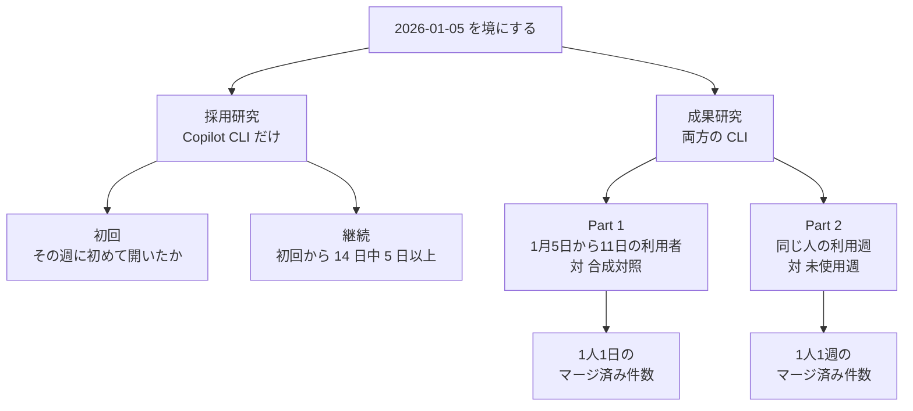

2026年7月1日、Microsoft 所属の Emerson Murphy-Hill、Jenna Butler、Alexandra Savelieva が、社内で CLI のコーディングエージェントを広げたときの利用と産出を推定した原稿を arXiv に置きました（[arXiv:2607.01418v1](https://arxiv.org/html/2607.01418)）。対象の道具は Anthropic の Claude Code と GitHub の Copilot CLI です。観察の窓は 2026年1月5日から4月29日までです。原稿は preprint の v1 であり、採録した会議や学術誌の名前は原稿にも arXiv の書誌にもありません。

原稿は、誰が最初に試し、誰が使い続け、マージ済みプルリクエストがどれだけ増えたかを、利用ログと人事データで別々に推定しています。ここでは、その推定が置いた母集団と分子、三つの比率の定義、初回と継続の係数、評価の欄へ写すときの分岐を整理します。

*この記事の全体像。以下、順に解説します。*

## CLIコーディングエージェントの社内測定とは

原稿の題は “Adoption and Impact of Command-Line AI Coding Agents” です。人数は要旨の “tens of thousands” だけで、本文に正確な人数はありません。

入口の母集団と、出口の件数は、別の式です。採用の研究は Copilot CLI だけを見ます。成果の研究は Claude Code と Copilot CLI の両方を見ます。

初回利用は、その週に Copilot CLI を初めて開いたかどうかです。継続は、初回から 14 日のうち 5 日以上に活動があることです。成果の分子は、作成から 28 日以内にマージされたプルリクエストの件数です。プルリクエストの取得元は Azure DevOps だけです。

早期コホートは、2026年1月5日から11日にどちらかの CLI を使った人です。この人たちの、事後 115 日における 1 人 1 日あたりのマージ済み件数は、合成対照と比べて +24.0% です。95% 信用区間は +14.5% から +33.7% です。Copilot CLI だけを使う人の、その週に 1 度でも使った週は、同じ人の未使用週と比べて +24.9% です。信用区間は +23.0% から +26.8% です。Claude Code だけを使う人の利用週は +11.4% です。信用区間は +9.4% から +13.6% です。

初回利用のオッズは、同じ上司の上司を持つ同僚の 25% 以上が直近 14 日に Copilot CLI を使っていると +216% です。直属の上司が使っていると +82% です。レビューを交す相手の 25% 以上が使っていると +54% です。係数の表は後の節に置きます。

### 母集団の切り方

採用研究から外す人は、次のとおりです。Claude Code を広く配った 2 部門、部門外の個人ライセンス、ライセンスを失った人、2026年1月5日より前に Copilot CLI を使った人です。採用研究は、ロールアウト前のマージ件数では母集団を切りません。事前の作成件数 0 は、予測子の参照です。

成果研究の「エンジニア」は職名で切っていません。開発に近い他の役割が混ざりえます。成果研究の Part 1 と Part 2 だけが、ロールアウト前 4 週にマージ済みプルリクエストが 2 件以上の人に限ります。事前件数の上下 5% も落とします。

### 測定の並び

## 三つの比率の定義

三つの比率は、分子の時間単位、比べる相手、含む道具が違います。

| 比率 | 分子 | 誰の、いつの行動か | 比べる相手 | 原稿の位置 |
|---|---|---|---|---|
| +24.0%（+14.5% から +33.7%） | 1 人 1 日のマージ済み件数 | 2026-01-05 から 01-11 にどちらかを使った人。事後 115 日 | どちらも使ったことがない人から作った 10 本の日次平均（CausalImpact） | 第 5.1 節 |
| +24.9%（+23.0% から +26.8%） | 1 人 1 週のマージ済み件数 | Copilot CLI だけを使う人の、その週に 1 度でも使った週 | 同じ人の、道具を開いていない週 | 第 5.2.2 節 |
| +11.4%（+9.4% から +13.6%） | 同上 | Claude Code だけを使う人の利用週 | 同上 | 第 5.2.2 節 |

+24.0% の事前期間は 2024年10月1日から2026年1月4日です。長さは 461 日です。採用研究の予測子を作る事前期間は 2025年10月1日から2026年1月4日です。長さは 13 週です。二つの窓は別です。

Copilot CLI の一般提供は 2026年2月25日です。Microsoft はそれより前のプレビューで使っていた、と本文が書いています。分析上の境目は、利用が社内で広がり始めた 2026年1月5日に著者が置いた日付です。製品の一般提供日ではありません。

2.2 倍は、+24.9 を +11.4 で割った比です。

## 初回利用と継続の係数

予測子はオッズの変化です。参照は「その要因が無い人」です。本文が有意と書くものを表に置きます。継続のレビュー相手については、同方向とだけ書き、点推定が本文にありません。

| 予測子 | 初回利用のオッズ | 継続のオッズ |
|---|---|---|
| skip-level の 25% 以上が直近 14 日に利用 | +216% | +66% |
| 直属上司が利用 | +82% | +22% |
| レビュー相手の 25% 以上が利用 | +54% | 本文に点推定なし |
| IDE Copilot を事前 60 日以上 | +83% | -12% から -15% の範囲（3 段階とも負） |
| IDE Copilot を事前 1–14 日 | +49% | 同上の範囲 |
| 事前に週 2 件以上の PR | +34% | +31% |
| 事前に週 1 件まで | +19% | +13% |
| IC2（IC4 比） | -13% | 雑音が大きい。IC2 だけ有意と書く |
| IC3（IC4 比） | -14% | 有意ではない |
| IC5（IC4 比） | 約 +22% | ゼロ付近 |
| 在籍 1 年未満（5–15 年比） | +11% | 有意ではない |

事前に IDE の Copilot を多く使った人ほど CLI を試し、定着は低い、と本文は書いています。論文の解釈は、IDE に戻れる人は CLI の習慣を作らなくて済む、というものです。

在籍とマネージャ職は、初回も継続もほとんど動きません。論文が「誰であるかより、何をしているか」と言うときの「何」は、同僚の利用、既存の AI 利用、PR の頻度です。

社内の “Agentic Engineering Day” に出た人の自由記述が 609 件あります。利用率の母集団から無作為に引いた標本ではありません。

## 注意点

### 報道が一つにまとめた比率

[ITmedia NEWS の 2026年10月16日 12:00 の記事](https://www.itmedia.co.jp/news/article/2610/16/2000002277/)（山下）は、論文の三つの比率を「生産性」という一つの語にまとめています。記事本文の 24% は、導入初週に使った人が「使わなかった場合」より完了した仕事が平均 24% 増えた、と書きます。

論文の +24.0% は、その週に活動があった早期コホートの 1 人 1 日あたりマージ済み件数を、使わなかった人から作った合成対照と比べた事後 115 日の平均です。「使わなかった週」との比較ではありません。

同じ記事の図説は、11.4% と 24.9% を「ツールを使わなかった週と比べて」と書いています。こちらは論文の Part 2 と一致します。24% と 24.9% は、分子の時間単位も、比べる相手も、含む道具も違います。

図 6 のキャプションは single-tool adopters と書きます。第 5.1 節のデータセットは、併用者を含む、と書きます。上の表の +24.0% は、データセットの文に従います。キャプションの「単一ツール」には従いません。

### オッズと、4か月の点推定

オッズの +216% は、試す確率が 3.16 倍になったという意味ではありません。ロジスティック回帰のオッズが参照カテゴリの 3.16 倍になった、という係数です。基準の試行確率が小さい週では、確率の差はオッズの倍率より小さいです。

効果は 4 か月「安定して持続した」と ITmedia の記事は書きます。論文は、2 月の +29.4%（+17.7% から +44.4%）と 3 月 1 日から 4 月 29 日の +20.0%（+7.4% から +35.9%）の信用区間が重なるので、点推定の低下は標本誤差と区別できない、と書きます。ゼロを下回る減衰は、このバケットの解像度では見えない、という主張です。点推定が 29.4 から 20.0 へ動いていない、という主張ではありません。

### 件数は価値そのものではない

原稿はマージ済み件数を産出の代理と呼び、それが届けた価値と同じではない、と要旨で断っています。結論は、品質を測る合意された尺度がまだ無く、追加の件数が良いソフトウェアかを未解決のまま残しています。

2.2 倍は、二つの道具を同じ仕事で無作為に割り当てた差ではありません。論文の議論は、仕事の中身が道具ごとに違う可能性と、GitHub を所有する組織では Copilot CLI の側が社内の作業の仕方に合いやすい可能性を、仮説として並べています。どちらが優れた道具かは識別していません。

### 二次記事が足している説明

二次記事の [byteiota](https://byteiota.com/microsoft-study-ai-coding-agents-lift-pr-throughput-24/)（2026年7月19日公開のページ）は、この原稿を “largest peer-reviewed field study” と呼び、Claude Code のライセンスをトークン費用のために取り消した、と書きます。peer-reviewed は書誌と矛盾します。

ライセンスについては、論文が書くのは「窓の直後に、ほとんどのエンジニアへ約 1 か月後の停止を知らせ、Copilot CLI へ移すよう指示した」までです。部門名、約 5,000 人、月額 500 ドルから 2,000 ドル、費用が理由だという説明は論文本文にありません。

同じ二次記事は、便益の “C” 字をキャリアステージの話として書きます。論文が “C” 字と書くのは在籍年数の図です。キャリアステージについては、下位の個人貢献者と上位のマネージャの伸びが IC4 より大きい、とだけ書きます。

「期待した補完と違った」という説明は論文にありません。継続の 5 日という閾値は任意です。3 日と 7 日でもモデルは当てはまる、と妥当性の節が書きます。三つの閾値の係数表は本文にありません。609 件の自由記述は、定量の係数を説明したことにはなりません。

### 用量と職級の傾き

用量反応の +15.0%（週 3 日）と +50.1%（週 5 日以上）は、同じ人のゼロ日の週との差です。論文は、利用が多い週ほど仕事が軽かった可能性を捨てられないので、これは関連であり原因ではない、と妥当性の節に書きます。1 日、2 日、4 日の点推定は本文に無く、図の中だけにあります。

IC4 の +21.3% は、週 3 日を線形の傾きで読んだ値です。バケットの週 3 日（+15.0%）と並べる値ではありません。論文自身が、曲線が凸なので線形の方が高く出る、と注意しています。この一文だけ “PRs they created” と書き、節の定義であるマージ済み件数と語が揃っていません。

### 本文に数が無いもの

正確な人数、部門別の利用率、トークン支出は本文にありません。費用対効果は計算できません。レビュー相手の継続オッズの点推定は本文にありません。品質、差し戻し、レビュー待ち時間は未測定です。16 週より長い減衰は見えない、と著者自身が書きます。窓の中の道具選択が、窓の外で公表された移行方針とどれだけ独立かは本文から閉じません。他社で同じ合成対照を組んだときの符号は、この原稿からは分かりません。

Cui らの 2024 年と 2025 年の原論文について、点推定の数表はこの記事では確認していません。使うのは、本原稿が「有意にならない実験がある」と要約している範囲だけです。

## 因果として読める範囲

Part 1 は、2026 年前半の早期利用者のマージ済み件数を、使わなかった場合の合成対照と比べています。Part 2 は、同じ人の利用週と未使用週のあいだに、マージ済み件数の関連を認めています。Part 2 は、使わなかった場合の因果効果としては読んでいません。全社員の生産性が 24% 上がったことでも、Copilot CLI が Claude Code より優れた道具であることでもありません。

### 一次資料が支えていること

支持として一次にあるものは、次のとおりです。

- 早期コホートの +24.0% は信用区間が 0 を含まず、裾確率は p < 0.001 です。
- 介入日を 2025年10月6日にずらしたプラセボは -1.1%（-10.6% から +8.6%）で、0 を含みます。
- 同一人物の設計は、人と週の固定効果を入れ、採用者と非採用者の素質の差では説明しません。
- 単一ツールの週次差は、Copilot CLI も Claude Code も 0 を含みません。
- 著者は、PR が価値そのものではないこと、品質が未測定であること、自社が GitHub を所有することを本文に書いています。

### 結論を弱める条件

結論を弱めるものも一次にあります。

- Part 1 の人は自分で使い始めました。合成対照は、採用者と非採用者が一緒に受ける衝撃しか吸収しません。製品出荷のような採用者側だけの衝撃は残ります。プラセボはその一部を見ています。
- 社会的露出は、同僚の影響と、似た人の集まり（homophily）を分けられません。論文は Aral らの 2009 年 PNAS を引いてこれを書いています。
- 2026年10月17日時点で、元データを再解析した外部の反論文と、PubPeer 上の技術的反論は確認されていません。見つかった外部コメントは、著者が既に書いた限界の再掲が中心で、独立した再推定ではありません。見つからなかったことは、批判が無いことの証明ではありません。
- 用量反応は原因として読んでいない、と著者自身が書きます。
- ツール差は併用者を除いたあとの関連です。観察窓の直後に Claude Code から Copilot CLI への移行方針が出ているので、窓の中の道具選択も方針と無関係とは限りません。本文は窓の外のアナウンスを理由に窓を閉じた、と書くだけで、窓の中の選択が方針と独立だったとは書いていません。
- 件数は Azure DevOps だけなので、他のホスティングで働く人は分母からも分子からも落ちます。
- 28 日でマージされない仕事は分子に入りません。小さく分けたプルリクエストは分子を増やします。
- 著者は測定対象の道具の一方を作る会社の社員です。質問と解釈がその位置から離れていない可能性を、著者自身が書いています。

### 完了時間は別の分子である

別の成果指標では符号が逆だった先行があります。Becker らの RCT（[arXiv:2507.09089v2](https://arxiv.org/abs/2507.09089)、2025年7月）は、経験のあるオープンソース開発者 16 人が 246 タスクを行い、2025年2月から6月の AI を許すと完了時間が 19% 長くなった、と要旨に書きます。道具は主に Cursor Pro と Claude 3.5 または 3.7 Sonnet です。これはマージ済み件数ではありません。

METR は 2026年2月24日の更新で、2025年前半の減速は今の影響を表さない、と書き、後続実験の速度推定は選択で解釈が難しい、としています（[更新のページ](https://metr.org/blog/2026-02-24-uplift-update/)）。したがって、19% の減速は「2026年の CLI では件数が増えない」の反証にはなりません。「自己申告や件数と、完了時間は別の分子だ」という反証にはなります。

論文が関連研究として束ねるフィールド実験は、マージ済み件数に有意な変化が無いものと、有意な増加があるものに割れている、と本文が書きます（Butler らの “Dear Diary”、Cui らの 2024 年と 2025 年）。本原稿の「有意にならない実験がある」という要約だけを、ここでの支持に使います。

別企業の事例（[arXiv:2607.01904v1](https://arxiv.org/html/2607.01904v1)）は、802 人と 196,212 件の別データです。人のレビューを受けた割合が 89% から 68% へ落ちた、という数字は、そちらの本文（図 6 と第 IV 節）にあります。要旨には「レビュー負荷がおよそ 2 倍になり、自動レビューが人のレビューを上回った」とあります。Microsoft の CLI 原稿の結果ではありません。[TechRepublic の 2026年7月13日の記事](https://www.techrepublic.com/article/news-ai-coding-agents-microsoft-pull-requests/)は、二つの原稿を “alongside” と分けて置いています。

## 評価制度に載せる前の分岐

評価制度へ入れる値は、分子と母集団を論文と同じ粒度で観測できるものに限ります。観測できない枠は、入力から外します。

| 枠 | 論文が置いた母集団 | 自社で同じものが取れるときの使い方 | 取れないときの扱い |
|---|---|---|---|
| 試す人 | Copilot CLI をまだ使え、Claude Code を持たないソフトウェアエンジニア | 初回のハザード。同僚利用率と一緒に見る | 「導入率」という単一の割合にしない |
| 使い続ける人 | 試した人のうち、14 日中 5 日以上 | 試行と定着を分けた率 | ライセンス配布数を定着と呼ばない |
| 早期の件数差 | 境目の週に使った人で、事前 4 週にマージが 2 件以上 | 合成対照か、それに近い非利用者系列があるときだけ +24% 型の比較を置く | 全社員の生産性目標に +24% を書かない |
| 利用週の件数差 | 同じ人の利用週と未使用週 | 人の固定効果を入れた週次パネルがあるとき | 利用者と非利用者の平均差で代用しない |
| 道具の差 | 片方だけを使う人 | 社内の仕事の割り当てが道具間で揃っていると別証拠があるときだけ順位に使う | Copilot が 2.2 倍良い、という評価項目にしない |
| 品質 | 測っていない | 欠陥、差し戻し、レビュー時間を別指標として新設する | 件数の増加を品質の代理にしない |

個人の評価点に組織レベルの +24.0% を配る設計は、論文の推定単位と合いません。推定はコホートの日次系列か、人の週次の関連です。個人が「24% 分を出した」とは識別していません。

同僚の利用が見えることは、論文が展開の中心に置く要因です。ただし係数は影響と homophily の合成なので、「上司が使えば部下の定着が 82% 上がる」という運用規則にはできません。+82% は初回のオッズであり、継続は +22% です。

コピーするのは比率そのものではなく、切り方です。試行、定着、早期コホートの反事実、同一人物の利用週、品質を、五つの別欄にします。自社のログが欄を埋められないものは、その期の評価入力から外します。

## まとめ

この原稿は、CLI のコーディングエージェントを社内で広げたときの試行、定着、マージ済み件数を、別の式で推定しています。+24.0% は早期コホートの 1 人 1 日のマージ済み件数です。+24.9% と +11.4% は、同じ人の利用週と未使用週の週次の関連です。+216% は初回利用のオッズです。

評価に接続するなら、この比率を目標値として写しません。観測できる欄だけを入力に残し、品質は件数とは別の指標にします。

この記事が少しでも参考になった、あるいは改善点などがあれば、ぜひリアクションやコメント、SNSでのシェアをいただけると励みになります！

## 参考リンク

- Murphy-Hill, E., Butler, J., Savelieva, A. Adoption and Impact of Command-Line AI Coding Agents. arXiv:2607.01418v1, 2026-07-01. https://arxiv.org/html/2607.01418 https://doi.org/10.48550/arXiv.2607.01418
- 山下（Seamless）. Microsoft、社内エンジニア数万人を対象に「Claude Code」「Copilot CLI」導入の影響を分析. ITmedia NEWS, 2026-10-16. https://www.itmedia.co.jp/news/article/2610/16/2000002277/
- Becker, J., Rush, N., Barnes, E., Rein, D. Measuring the Impact of Early-2025 AI on Experienced Open-Source Developer Productivity. arXiv:2507.09089v2. https://arxiv.org/abs/2507.09089
- METR. We are Changing our Developer Productivity Experiment Design. 2026-02-24. https://metr.org/blog/2026-02-24-uplift-update/
- TechRepublic Staff. Microsoft Study Finds AI Coding Agents Lift Pull Requests by 24%. 2026-07-13. https://www.techrepublic.com/article/news-ai-coding-agents-microsoft-pull-requests/
- byteiota. Microsoft Study: AI Coding Agents Lift PR Throughput 24%. https://byteiota.com/microsoft-study-ai-coding-agents-lift-pr-throughput-24/
- AI Writes Faster Than Humans Can Review（別企業の事例）. arXiv:2607.01904v1. https://arxiv.org/html/2607.01904v1
