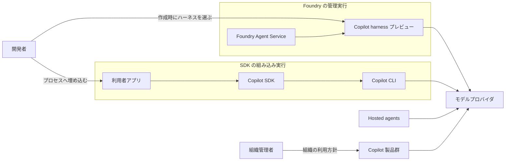
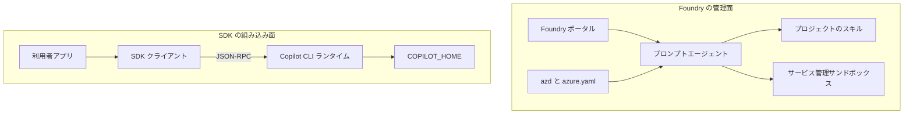
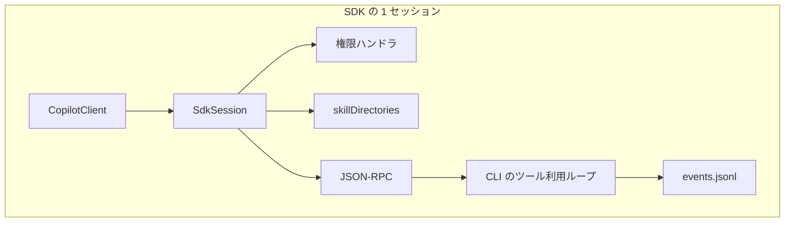
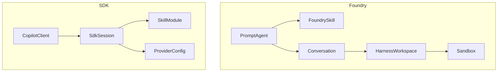
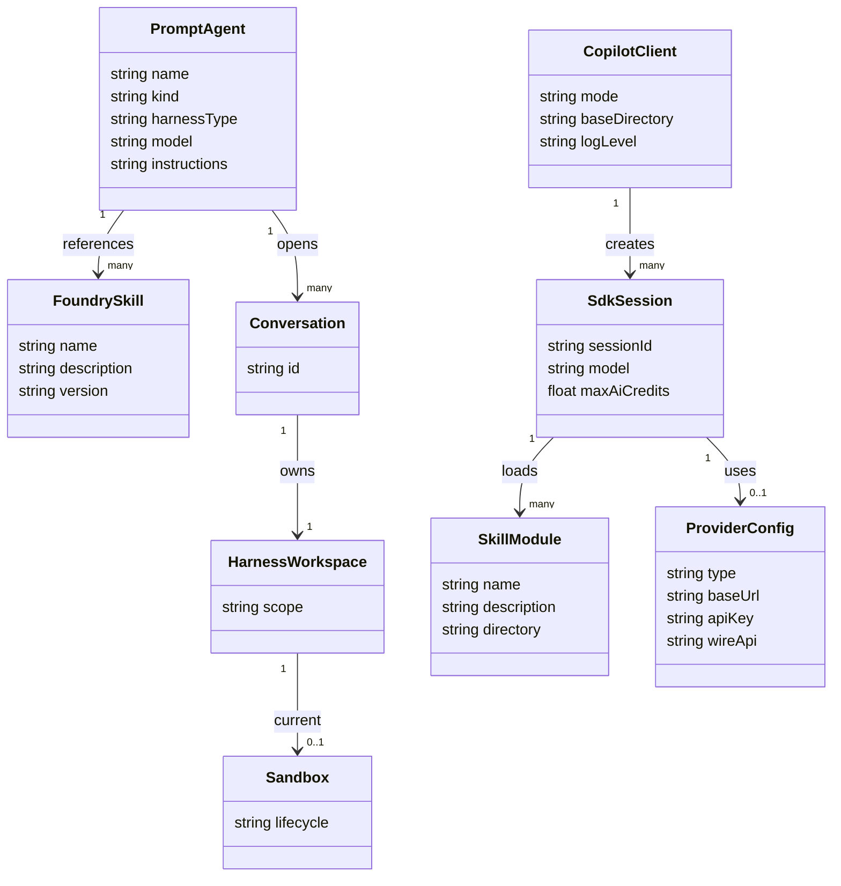

Microsoft は 2026年10月28日、GitHub のエンジニアリングチームが作り、全社の Copilot 体験へ採用した実行基盤 Microsoft Copilot harness を公開しました。同じ日に、この基盤を Microsoft Foundry の Foundry Agent Service でパブリックプレビューとして外へ開き、GitHub Copilot SDK を Microsoft Copilot SDK へ改名すると告知しています。この記事では、Foundry がエージェントループを持つ管理実行と、アプリが SDK をプロセスへ埋め込む実行の二つについて、構成、データの置き場所、導入、呼び出し、運用を整理します。Copilot Studio の比較数値は、2026年10月の社内評価と本番テレメトリに脚注で範囲が限られています。


*この記事の全体像。以下、順に解説します。*

## Microsoft Copilot harnessとは

Microsoft Copilot harness は、モデルの外側にあるオーケストレーション層です。[公式ブログ](https://blogs.microsoft.com/blog/2026/10/28/introducing-the-microsoft-copilot-harness-unlocking-the-potential-of-truly-multi-model-agentic-work/)の定義では、エージェントに指示、文脈、実行環境、制御を渡し、MCP（Model Context Protocol）、エージェントスキル、エージェントプラグインを載せる層です。エージェントスキルは、`SKILL.md` を持つ手順のまとまりです。エージェントプラグインは、同じブログがスキルと並べてこの層に載せると書く拡張の名前です。

Foundry Agent Service は、Microsoft Foundry 上でプロンプトエージェントを管理実行するサービスです。Microsoft Foundry は、このサービスを提供する製品の名前です。プロンプトエージェントは、定義の `kind` が `prompt` のエージェントです。Foundry のプレビューでは、Microsoft がエージェントループとサンドボックスを運用し、利用者は指示、スキル、ツール、モデルを持ち込みます。ここでのサンドボックスは、Foundry が会話ごとに割り当てる実行環境です。

同じ発表で、GitHub Copilot SDK は Microsoft Copilot SDK へ名を変えます。[GitHub Changelog](https://github.blog/changelog/2026-10-28-github-copilot-sdk-is-becoming-microsoft-copilot-sdk/)は、SDK を Microsoft Copilot harness のプログラマブルなインターフェースへ広げる方針だと説明しています。2026年10月29日 22:28:58 UTC 時点のリポジトリは `github/copilot-sdk` のままで、パッケージ名と名前空間は段階移行の途中です。

この記事が扱う実行面は、次の表の二つです。

| 実行面 | 成熟度（2026-10-30 時点） | 誰がループを持つか | 主な定義の置き場所 |
|---|---|---|---|
| Foundry Agent Service の Microsoft Copilot harness | パブリックプレビュー | Foundry がループとサンドボックスを運用する | Foundry プロジェクトのプロンプトエージェントとスキル |
| Microsoft Copilot SDK（リポジトリ名 copilot-sdk） | README が generally available と記載 | アプリが SDK クライアントを持ち、Copilot CLI ランタイムがツール利用ループを回す | アプリプロセスと `COPILOT_HOME` 配下のセッション状態 |

`COPILOT_HOME` は、セッション状態と設定の基準ディレクトリです。未設定時の既定は `~/.copilot` です。Hosted agents は、フレームワークとエージェントループを利用者が持ち、ホスティングだけを Foundry に任せる経路です。表の二つの実行面とは使い分けが違います。選択の表は特徴の節にあります。

## 特徴

全社共通化の対象は、公式ブログが名指しする Copilot Code、Copilot Studio、GitHub Copilot アプリ、CLI、Visual Studio Code です。末尾は「and more」で、列挙は閉じていません。

[Foundry ブログ](https://devblogs.microsoft.com/foundry/microsoft-copilot-harness-in-foundry/)が書くプレビューの構成要素は四つです。再利用できるスキル、認証と承認を明示したツール接続、ファイルとコードの実行および組み込みサブエージェントへの委譲、ソース管理できるエージェント定義です。

公式ブログは、ランタイムを Rust へ移植した結果として、セッションのオーバーヘッドと最初のトークンまでの時間の短縮を述べています。短縮幅の数値は同じ記事にありません。

公式ブログは、20 を超えるフロンティアモデルと BYOK（Bring Your Own Key）を、全社ハーネスの性質として述べています。BYOK は、利用者が自分の鍵でモデルを呼ぶ方式の名前です。Foundry プレビューのモデル条件は別ページで、「推論とツール呼び出しに対応し、プロジェクトのリージョンでプロンプトエージェントに使えるモデル」です。

SDK の公式言語は Node.js / TypeScript、Python、Go、.NET、Rust、Java の六つです。[README](https://github.com/github/copilot-sdk/blob/main/README.md) は一般提供でセマンティックバージョニングに従うと書いています。SDK は Copilot CLI と同じエンジンを JSON-RPC で呼び出します。Node.js、Python、.NET は CLI を同梱し、Go、Java、Rust は既定で別途 PATH 上の `copilot` を使います。

[Copilot Studio のブログ](https://www.microsoft.com/en-us/copilot/blog/copilot-studio/the-github-copilot-harness-in-copilot-studio-is-now-the-microsoft-copilot-harness/)は、既存エージェントの能力と課金が名称変更後もそのまま継続すると書いています。用語の更新は数週間かけて製品内に出ます。

Foundry の初期プレビューでは、ハーネスはエージェント作成時に選びます。[Learn](https://learn.microsoft.com/azure/foundry/agents/how-to/use-tools-skills-copilot-harness) は、既存エージェントへ切り替えられず、別バージョンを作ってもハーネスは変わらないと書いています。Foundry ブログは、作成後の切り替えはまだ非対応だと書いています。

課金の起点は Foundry ブログの注記です。ハーネスのランタイムは 2026年12月1日より前は無料で、同日以降サンドボックスのコンピューティングが 1 vCPU 時間あたり 0.0994 米ドル、メモリが 1 GiB 時間あたり 0.0118 米ドルです。モデル推論と、別料金のツールおよび接続サービスは期間を問わず各料金に従います。価格はリージョンと契約で変わり得ます。

Studio ブログの比較は、基準を Standard harness と置いています。Standard harness は、その記事が比較対象に使う既存ハーネスの名前です。数値は脚注ごとに母集団が違います。

| 指標 | 記事本文の値 | 脚注が限る範囲 |
|---|---|---|
| 同じタスクの合格率 | OpenAI モデルで 10.8 ポイント、Anthropic モデルで 22.1 ポイント、Standard harness より高い | 脚注 1。2026年10月の評価データ。成功した評価実行の結果。日、ビルド、モデル、構成で変動する |
| ツール呼び出し失敗後も解き続けた割合 | 84% から 91% のあいだ。Standard harness は 7% 未満。失敗したツールの後からの再試行成功は、Standard harness のエージェントと比べて 7 倍を超える | 脚注 2。本番テレメトリの社内分析。失敗したツール呼び出しの後の行動を、Microsoft Copilot harness と Standard harness で比べている。全体タスクの成功を意味しない。シナリオ、モデル、チャネルで変動する |
| 入力処理の正味コスト | モデル呼び出しの回数は Standard harness のほぼ 2 倍になる一方、キャッシュ後の入力処理の正味コストは Standard harness より 15% から 21% 低い | 脚注 3。脚注 1 と同じく、成功した評価実行に限る。比較相手は Standard harness |
| 人手なしの解決率 | Customer Service and Support の動的解決エージェントが、2026年8月に 35% 超 | 合格率の脚注とは別の文。2026年8月の別事例 |

どの実行面に置くかは、ループの所有者で分かれます。

| 場面 | 向く面 | 根拠 |
|---|---|---|
| スキル、ファイル、シェル、サブエージェントを Foundry に任せる | Foundry のプロンプトエージェントに `microsoft_copilot_preview` を付ける | Learn の選択表と Foundry ブログの四要素 |
| フレームワークとエージェントループを自前で持ち、ホスティングだけ Foundry に任せる | Hosted agents | Foundry ブログの選択表。長期実行のレジリエンスは同週に一般提供 |
| 自社アプリのプロセスから Copilot のランタイムを呼ぶ | Microsoft Copilot SDK | README のアーキテクチャ。CLI サーバへ JSON-RPC |
| GitHub Actions や GitHub App から組織名義で Copilot を呼ぶ | SDK のサーバ間認証 | `docs/auth/server-to-server-tokens.md` |
| Copilot サブスクリプションを使わず、プロバイダの API キーでモデルを呼ぶ | SDK の BYOK | README の FAQ と `docs/auth/byok.md` |

## 構造

### システムコンテキスト図

開発者は Foundry では作成時にハーネスを選び、SDK ではアプリのプロセスへクライアントを埋め込みます。組織管理者は、GitHub 組織の Copilot 利用方針と GitHub App の権限を管理します。モデルプロバイダは、Copilot 経由のモデル、または SDK の BYOK で使う OpenAI 互換、Azure、Anthropic です。



Hosted agents のホスティングを Foundry に任せる関係は、この図には辺として描いていません。図が示す Hosted agents の接続は、モデルプロバイダへの矢印です。

| 要素名 | 説明 |
|---|---|
| 開発者 | Foundry では作成時にハーネスを選ぶ。SDK ではアプリのプロセスへクライアントを埋め込む |
| 組織管理者 | GitHub 組織の Copilot 利用方針と、GitHub App の権限を管理する |
| Foundry Agent Service | プロンプトエージェントの管理実行を提供する |
| Copilot harness プレビュー | Foundry がループとサンドボックスを持つ公開プレビュー。作成時に選ぶ |
| 利用者アプリ | SDK を埋め込むプロセス。Foundry のプロンプトエージェントとは別経路 |
| Copilot SDK | セッションと権限のクライアント。Copilot CLI へ JSON-RPC する |
| Copilot CLI | SDK 面でツール利用ループを回すランタイム |
| Hosted agents | フレームワークとループを利用者が持つ別経路。ハーネスプレビューではない |
| Copilot 製品群 | 公式ブログが挙げる Copilot Code、Copilot Studio、GitHub Copilot アプリ、CLI、VS Code |
| モデルプロバイダ | Copilot 経由のモデル、または SDK BYOK の OpenAI 互換、Azure、Anthropic |

### コンテナ図

Foundry の管理面では、ポータルまたは `azd` と `azure.yaml` からプロンプトエージェントを作ります。`azd` は Azure Developer CLI です。エージェントは同じプロジェクトのスキルを参照し、サービス管理サンドボックスでファイルとコマンドを実行します。SDK の組み込み面では、利用者アプリの SDK クライアントが JSON-RPC で Copilot CLI ランタイムを呼び、ランタイムが `COPILOT_HOME` を読み書きします。



| 要素名 | 説明 |
|---|---|
| Foundry ポータル | 新規 Foundry 体験でエージェントを作り、ハーネスを選ぶ |
| azd と azure.yaml | エージェント定義をアプリのコードと並べてデプロイする |
| プロンプトエージェント | 作成時にハーネス型を指定する。`kind` は `prompt` のまま |
| プロジェクトのスキル | 同じ Foundry プロジェクト内のバージョン付きスキル |
| サービス管理サンドボックス | 会話ごとのワークスペースでファイルとコマンドを実行する |
| 利用者アプリ | SDK を埋め込むプロセス |
| SDK クライアント | セッション、権限、ツール、イベントの API |
| Copilot CLI ランタイム | ツール利用ループのオーケストレータ |
| COPILOT_HOME | セッション状態と設定の基準ディレクトリ。既定は `~/.copilot` |

### コンポーネント図

SDK の 1 セッションは、`CopilotClient` が `createSession` で作る `SdkSession` です。ツール実行の前に権限ハンドラが承認、拒否、保留を返します。`skillDirectories` は `SKILL.md` を読むディレクトリ指定です。CLI のツール利用ループは、1 回の LLM 呼び出しを 1 ターンとして、ツール要求がある間繰り返します。ターンの計数に使うイベントログは `events.jsonl` です。



| 要素名 | 説明 |
|---|---|
| CopilotClient | ランタイム接続、認証、ログ、`COPILOT_HOME` を持つクライアント |
| SdkSession | `createSession` で作る会話。`sessionId` とモデルを持つ |
| 権限ハンドラ | ツール実行の前に承認、拒否、保留を返す |
| skillDirectories | `SKILL.md` を読むディレクトリ指定 |
| JSON-RPC | SDK と CLI サーバの間の伝送 |
| CLI のツール利用ループ | 1 回の LLM 呼び出しを 1 ターンとして、ツール要求がある間繰り返す |
| events.jsonl | `~/.copilot/session-state/<sessionId>/` 配下でターンを数えるイベントログ |

## データ

### 概念モデル

Foundry 側の会話はターンをまたぐ対話履歴です。ハーネス利用時の応答要求は会話を必要とします。HarnessWorkspace は会話ごとのファイルと実行状態で、通常のアイドル、再開、置換を越えて残ります。Sandbox は Foundry が割り当て、アイドル、再開、置換する実行環境です。SDK 側の `SdkSession` は、CLI が履歴とツール状態を持つ会話です。`ProviderConfig` は SDK BYOK のプロバイダ設定で、セッションへ再接続するとき再指定します。



| 要素名 | 説明 |
|---|---|
| PromptAgent | Foundry のプロンプトエージェント。ハーネス型を定義に持つ |
| FoundrySkill | 同一プロジェクトのスキル参照。不変バージョンへ解決する |
| Conversation | ターンをまたぐ対話履歴。ハーネス利用時の応答要求は会話を必要とする |
| HarnessWorkspace | 会話ごとのファイルと実行状態。通常のアイドル、再開、置換を越えて残る |
| Sandbox | Foundry が割り当て、アイドル、再開、置換する実行環境 |
| CopilotClient | SDK プロセス側の接続と既定モード |
| SdkSession | CLI が履歴とツール状態を持つ会話 |
| SkillModule | ディレクトリ内の `SKILL.md` 一つ |
| ProviderConfig | SDK BYOK のプロバイダ設定。セッションへ再接続するとき再指定する |

### 情報モデル

定義に載る識別子と、ディスクに残るものの境界は次のとおりです。クラス図の `harnessType` は、YAML の `harness.type` と Python の `MicrosoftCopilotHarness()` をまとめた概念上の名前であり、API のフィールド名そのものではありません。`azure.yaml` では `microsoft_copilot_preview`、Python 定義では `MicrosoftCopilotHarness()` です。Foundry のスキル名は小文字、数字、ハイフンで、最大 64 文字、プロジェクト内で一意です。参照は正の不変バージョンへ解決し、トップレベル参照は 50 までです。



| フィールド | 内容 |
|---|---|
| PromptAgent.kind | 手順書の確認条件は `prompt` |
| PromptAgent.harnessType | 概念上の名前。`azure.yaml` では `harness.type: microsoft_copilot_preview`。Python 定義では `harness=MicrosoftCopilotHarness()` |
| FoundrySkill.name | 小文字、数字、ハイフン。最大 64 文字。プロジェクト内で一意 |
| FoundrySkill.version | 参照は正の不変バージョンへ解決する。トップレベル参照は 50 まで |
| HarnessWorkspace.scope | Learn は conversation-scoped と書く |
| Sandbox.lifecycle | 現在割り当て中の実行環境。置換されても HarnessWorkspace は残る。CPU、メモリ、ライフサイクルは利用者の設定項目ではない |
| CopilotClient.mode | `copilot-cli` が既定。マルチユーザのサーバでは `empty` |
| CopilotClient.baseDirectory | 設定すると子ランタイムの `COPILOT_HOME` になる。未設定時の既定は `~/.copilot` |
| SdkSession.maxAiCredits | `sessionLimits.maxAiCredits`。会計ウィンドウのソフトキャップ |
| SkillModule.directory | `skills/<name>/SKILL.md`。`name` を省略するとディレクトリ名が識別子 |
| ProviderConfig | 非 BYOK のセッションでは無い。BYOK のときだけ `createSession` と `resumeSession` に渡す |
| ProviderConfig.type | `"openai"`、`"azure"`、`"anthropic"`。既定は `"openai"` |
| ProviderConfig.apiKey | BYOK の鍵。ローカルプロバイダでは任意。ディスクには残さない |
| ProviderConfig.wireApi | `"completions"` または `"responses"`。Anthropic は Messages API 固定 |

SDK セッションのディスク配置は、[永続化ガイド](https://github.com/github/copilot-sdk/blob/main/docs/features/session-persistence.md)が次の形で示しています。

```text
~/.copilot/session-state/
└── user-123-task-456/
    ├── checkpoints/
    ├── plan.md
    └── files/
```

| データ | 永続化 | 補足 |
|---|---|---|
| 会話履歴 | する | チェックポイントの JSON |
| ツール結果 | する | 文脈用に残る |
| 計画 | する | `plan.md` |
| セッション成果物 | する | `files/` |
| プロバイダの API キー | しない | 再開時に再指定する |
| `session.idle` | しない | エフェメラル。再開時に再生しない |
| `session.task_complete` | する | モデルが明示したとき。任意の `summary` を持つ |
| `events.jsonl` | 計数パスとして記載 | 永続化ガイドの木には無い。エージェントループ文書の計数パスは `<sessionId>/events.jsonl` |
| `permissions.json` | 条件付き | カスタム `sessionFs` の `sessionStatePath` 配下。`locations.tool_approvals` と `allowed_directories` |
| `settings.json` | 条件付き | 同じプロバイダ配下。`allowedUrls` と `sandbox`。Foundry のサービス管理サンドボックスとは別物 |
| `config.json` | 条件付き | 同じプロバイダ配下。`trustedFolders` と `sandboxOnboardingShown` |

`session.idle` は処理が止まったことを示す機械的な合図です。`session.task_complete` は、モデルがタスク完了とみなした合図です。`settings.json` の `sandbox` は CLI の保存設定であり、Foundry が管理する実行環境ではありません。

## 構築方法

### CLI とランタイムの前提

SDK が起動する実行ファイル名は `copilot` です。Node.js、Python、.NET はバンドルされたランタイムを使い、別インストールを必須にしません。Go、Java、Rust は既定で CLI を同梱しません。PATH 上の `copilot` を使います。ルート README は、Go と Rust にアプリケーション単位の同梱機能があると書いています。そのオプション名は、2026年10月30日時点で各言語 README をこの記事では確認していません。Java の同梱機能は、ルート README が名指ししていません。

Node の API 参照は、子プロセス接続の `path` または環境変数 `COPILOT_CLI_PATH` でバンドルを上書きすると書いています。

```bash
copilot --version
```

### 公式 SDK の導入

2026年10月30日に npm registry を確認した `@github/copilot-sdk` の `latest` は `1.0.28` です。他言語のレジストリ版は、同じ日に取り直していません。パッケージ名は製品名の変更後も GitHub 側の識別子のままです。Changelog は、既存利用者への即時変更は不要だと書いています。import 名は、TypeScript の例だけ `@github/copilot-sdk` からの import をこの記事に載せています。

| 識別子 | 2026-10-30 時点の値 | 版 |
|---|---|---|
| 製品名 | Microsoft Copilot SDK | 段階移行。即時変更は Changelog が不要と書く |
| リポジトリ | `github/copilot-sdk` | 2026-10-29T22:28:58Z の push。Microsoft 組織への移動は告知済み |
| npm | `@github/copilot-sdk` | `1.0.28`（2026-10-30 に registry を確認） |
| PyPI | `github-copilot-sdk` | 未確認 |
| NuGet | `GitHub.Copilot.SDK` | 未確認 |
| Go | `github.com/github/copilot-sdk/go` | 未確認 |
| crates.io | `github-copilot-sdk` | 未確認 |
| Maven | `com.github:copilot-sdk-java` | 未確認 |

```bash
npm install @github/copilot-sdk
```

```bash
pip install github-copilot-sdk
```

```bash
go get github.com/github/copilot-sdk/go
```

```bash
dotnet add package GitHub.Copilot.SDK
```

```bash
cargo add github-copilot-sdk
```

```xml
<dependency>
  <groupId>com.github</groupId>
  <artifactId>copilot-sdk-java</artifactId>
</dependency>
```

npm 以外は、導入コマンドのパッケージ名を README に合わせ、版ピンは各レジストリで取り直します。

### Copilot CLI の同梱差

Node の API 参照では、子プロセス接続の `path` または `COPILOT_CLI_PATH` があると、同梱ランタイムよりそちらを起動します。Python の `cli_path`、.NET の `CliPath`、Java の `setCliPath`、Go の `StdioConnection.Path` は、デバッグガイドの別言語例です。

`RuntimeConnection.forUri` は、既に動いているランタイムへ接続します。この接続は `gitHubToken` および `useLoggedInUser` と同時に使えません。`RuntimeConnection.forInProcess` は実験的なプロセス内ホストです。この輸送ではクライアント単位の `env`、`telemetry`、`workingDirectory` を拒否します。

### Foundry 側のプレビューフラグ

Learn は `azd` 1.37.0 以降と、Foundry 拡張 `azure.ai.agents` 1.0.0-beta.22 以降を前提にしています。TypeScript で Foundry の手順を追う場合、Node.js 22 以降です。ハーネス用のエージェントコマンドの前に、シェルごとに次を設定します。

```bash
export AZD_ALPHA_ENABLE_AGENTS_MANAGED_HARNESS=true
```

対応リージョンは、Learn の [Limits and quotas](https://learn.microsoft.com/azure/foundry/agents/concepts/limits-quotas-regions) にある Copilot harness の節が列挙する Australia East、Canada Central、Central US、Germany West Central、Japan East、Sweden Central、UK South、West Europe、West US です。プロンプトエージェント一般より、ネットワーク、ツール、サービスの対応は狭くなり得ます。

### エージェント定義の配置

Foundry ブログの例は、スキル本文を `skills/research-brief/SKILL.md` に置き、`azure.yaml` で `azure.ai.project`、`azure.ai.skill`、`azure.ai.agent` の三つに分けます。スキル側の `host` は `azure.ai.skill`、エージェント側の `host` は `azure.ai.agent` です。ハーネス型は `microsoft_copilot_preview` です。

```yaml
name: research-brief
services:
  ai-project:
    host: azure.ai.project
    endpoint: ${FOUNDRY_PROJECT_ENDPOINT}
  research-brief-skill:
    host: azure.ai.skill
    uses:
      - ai-project
    archive: ./skills/research-brief
  research-brief:
    host: azure.ai.agent
    project: .
    uses:
      - ai-project
      - research-brief-skill
    kind: prompt
    name: research-brief
    harness:
      type: microsoft_copilot_preview
    model: ${MODEL_DEPLOYMENT_NAME}
    skills:
      - research-brief-skill
```

初期プレビューでは、ハーネスは作成時にだけ選べます。Learn は、別バージョンを作ってもハーネスは変わらないと書いています。Foundry ブログは、作成後の切り替えはまだ非対応だと書いています。同じ例は、この定義に `instructions` と、`web_search` および `code_interpreter`（`container.type: auto`）の `tools` を続けます。デプロイ後、定義に `kind: prompt` と `harness.type: microsoft_copilot_preview` があることを確認してからツールを足します。

## 利用方法

### SDK セッションの作成

非 BYOK では GitHub Copilot のサブスクリプションが必要です。README は料金ページに無料枠があると案内しています。認証の経路は、CLI のログイン済みユーザ、OAuth GitHub App のユーザトークン、環境変数 `COPILOT_GITHUB_TOKEN` / `GH_TOKEN` / `GITHUB_TOKEN`、BYOK です。

再開するセッションには、呼び出し側が `sessionId` を渡します。永続化ガイドは、SDK が採番したランダム ID では後から再開できないと書いています。次の `approveAll` は、権限要求をまとめて承認するヘルパです。

```typescript
import { CopilotClient, approveAll } from "@github/copilot-sdk";

const client = new CopilotClient();
const session = await client.createSession({
  sessionId: "user-123-task-456",
  model: "gpt-5",
  onPermissionRequest: approveAll,
});
```

### プロンプトの送信と待機

`session.send` はキュー投入後に戻ります。Node の API 参照では、ローカルの `sendAndWait` はその要求の応答完了を待ちます。リモートセッションは、Node の API 参照がローカルの応答完了待ちと書き分けている側の名前です。別の機械かどうかは、参照した記述には書かれていません。同じ API 参照は、その側の待ちを、非オートパイロットの `session.idle`、または相関する `session.autopilot_stopped` だと書いています。非オートパイロットは、直後に書くオートパイロットではない側の呼び方です。`session.autopilot_stopped` は、そのリモートの待ちに並ぶもう一方のイベントです。何と相関するかは、参照した記述には書かれていません。`assistant.idle` は `session.idle` とは別のイベント名です。`assistant.idle` と `session.task_complete` は、その片方だけでは待ちを終えません。

オートパイロットは、ツール利用ループが `task_complete` なしで終わったとき、CLI が合成したユーザメッセージを挿入してループを再開する動きです。インタラクティブモードは、エージェントループ文書が `session.task_complete` を任意とする側の呼び方です。どの呼び出しがリモート、オートパイロット、インタラクティブのどれに入るかは、参照した記述には入口が書かれていません。

エージェントループ文書は、`sendAndWait` が `session.idle` を待つと書きます。Node の API 参照が書くローカルの応答完了待ちとは、文書の間で違います。ローカルの完了待ちと、リモートの `session.idle` 待ちは、注意点で分けて扱います。

1 ターンは 1 回の LLM API 呼び出しで、イベントは `assistant.turn_start` と `assistant.turn_end` の対です。

```typescript
const response = await session.sendAndWait({ prompt: "Fix the bug" });
```

### SDK の BYOK

BYOK は GitHub 認証を経由せず、プロバイダの鍵でモデルを呼びます。型の値は `"openai"`、`"azure"`、`"anthropic"` です。Microsoft Foundry と Azure OpenAI は、`/openai/v1/` なら `"openai"`、ネイティブな Azure エンドポイントなら `"azure"` です。Ollama、Foundry Local、vLLM、LiteLLM は、SDK の BYOK で OpenAI 互換として `"openai"` につなぐ接続先です。Foundry Local は、Foundry Agent Service の実行面とは別の名前です。`baseUrl` は必須です。`apiKey` は Ollama のようなローカルプロバイダでは任意です。

次の例は API キー方式です。Foundry ハーネスの Bring your own model ではありません。Bring your own model は、Learn がこのハーネスでは現在サポートしないと書く、モデルデプロイの持込です。Foundry 側の非対応は Learn にあります。

```typescript
const baseUrl = process.env.OPENAI_COMPAT_BASE_URL;
if (baseUrl === undefined) {
  throw new Error("OPENAI_COMPAT_BASE_URL is required");
}
const session = await client.createSession({
  model: "gpt-5.2-codex",
  onPermissionRequest: approveAll,
  provider: {
    type: "openai",
    baseUrl,
    apiKey: process.env.OPENAI_COMPAT_API_KEY,
  },
});
```

README の FAQ は、BYOK が鍵ベースであり、Microsoft Entra ID、マネージド ID、サードパーティ IdP をサポートしないと書いています。同じリポジトリの [Azure Managed Identity の手順](https://github.com/github/copilot-sdk/blob/main/docs/setup/azure-managed-identity.md)は、Azure Identity SDK の `DefaultAzureCredential` で取ったトークンを `bearerTokenProvider` に渡し、API キーの環境変数は不要だと書いています。Rust の例は `DeveloperToolsCredential` と `ManagedIdentityCredential` です。FAQ の非対応と、トークンコールバックの手順は一つの認証方式にまとめません。

### ディレクトリ型スキル

スキルは `SKILL.md` を含む名前付きディレクトリです。フロントマターの `name` が識別子です。省略時はディレクトリ名です。`description` は短い説明です。ディレクトリ型では、本文がセッション文脈へ入ります。

`docs/features/skills.md` の構造の節は、`skillDirectories` が親ディレクトリを指し、直下のサブディレクトリから `SKILL.md` を発見すると書いています。同じファイルの読み込み例は、`./skills/code-review` と `./skills/documentation` のように子ディレクトリを列挙します。親を一つ渡す例と、スキルディレクトリを列挙する例が同じ文書に同居します。

```typescript
const session = await client.createSession({
  model: "gpt-5.4",
  skillDirectories: ["./skills"],
  onPermissionRequest: async () => ({ kind: "approve-once" }),
});
```

上の配列は、構造の節が書く親ディレクトリ一つの例です。同じ文書には、子ディレクトリを列挙する読み込み例もあります。

### Foundry のプロンプトエージェント

Learn の Python 例は `azure.ai.projects` の `AIProjectClient` と `PromptAgentDefinition` を使います。クライアントは `allow_preview=True` です。定義の `harness` は `MicrosoftCopilotHarness()` です。次の三つの名前は、Learn の例が呼び出し側の値として渡す識別子です。

```python
from azure.ai.projects import AIProjectClient
from azure.ai.projects.models import MicrosoftCopilotHarness, PromptAgentDefinition
from azure.identity import DefaultAzureCredential

project = AIProjectClient(
    endpoint=FOUNDRY_PROJECT_ENDPOINT,
    credential=DefaultAzureCredential(),
    allow_preview=True,
)
agent = project.agents.create_version(
    agent_name=FOUNDRY_AGENT_NAME,
    definition=PromptAgentDefinition(
        model=FOUNDRY_MODEL,
        instructions="You are a helpful assistant.",
        harness=MicrosoftCopilotHarness(),
    ),
)
```

Learn の呼び出し例は `azd ai agent invoke --new-conversation` です。この例は、応答要求に新しい会話を添えます。返る `mcp_approval_request` には、その同じ会話で `mcp_approval_response` を返します。データの Conversation は、会話がターンをまたぐ履歴である、という置き方です。2 回目以降にフラグを外して同じ会話へ続ける呼び出しは、Learn の例としては書かれていません。組み込み能力はファイルの読み書き、シェル、Web、サブエージェントで、サービスと組織のポリシーの下で既定有効です。

Learn は、プレビュー中のハーネス組み込みツールの承認をサービスが管理し、顧客設定の MCP ツールには `require_approval`（例は `always`）が効くと書いています。Foundry Memory は、このハーネスの対象外として Learn が書くストアとメモリツールの名前です。会話履歴とワークスペース内ファイルは、そのストアとは別です。

エージェント定義に置かない項目と、応答リクエストに置かない項目は次のとおりです。

| 置かない場所 | 項目 |
|---|---|
| エージェント定義 | `temperature`、`top_p`、`tool_choice`、`text.format`、`text.verbosity` |
| 応答リクエスト | `max_output_tokens`、`max_tool_calls`、`parallel_tool_calls`、`truncation`、`context_management`、`top_logprobs`、`safety_identifier`、`prompt_cache_key`、`prompt_cache_retention`、`service_tier`、`user` |

Learn は、このハーネスで Bring your own model を現在サポートしないと書いています。

### 組織名義のサーバ間認証

GitHub Actions では、組織所有リポジトリの `GITHUB_TOKEN` に `copilot-requests: write` を付けます。組織ポリシー「Allow use of Copilot CLI billed to the organization」を有効にします。

```yaml
permissions:
  contents: read
  copilot-requests: write
```

Actions 以外では、GitHub App の組織権限 Copilot Requests を Read-only にし、インストールトークン作成時の権限は `organization_copilot_requests: read` です。[サーバ間トークンの手順](https://github.com/github/copilot-sdk/blob/main/docs/auth/server-to-server-tokens.md)の取得順は次のとおりです。

1. GitHub App を作り、組織権限 Copilot Requests を Read-only にする。
2. 課金先の組織へインストールする。
3. インストールアクセストークンを、権限 `organization_copilot_requests: read` で作る。
4. 返る `ghs_` トークンを `gitHubToken` に渡す。既に起動しているランタイム URI へ付けるときは、ランタイムプロセスの `COPILOT_GITHUB_TOKEN` に置く。

トークンは 1 時間で期限切れです。プレフィックスは `ghs_` です。`useLoggedInUser: false` は、`COPILOT_GITHUB_TOKEN` を含む環境変数の自動発見を止めます。インストールトークンは `gitHubToken` で明示します。次の例の `token` は、上の手順で作ったインストールトークンです。Actions 内では `GITHUB_TOKEN` を使います。

```typescript
import { CopilotClient, RuntimeConnection } from "@github/copilot-sdk";

const token = process.env.INSTALLATION_TOKEN;
const client = new CopilotClient({
  connection: RuntimeConnection.forStdio(),
  gitHubToken: token,
  useLoggedInUser: false,
});
```

## 運用

### セッションの再開

再開 API は `resumeSession` です。プロバイダ設定を使ったセッションは、再開時に同じ設定を再指定します。API キーはディスクに残りません。`session.idle` は処理停止の機械的な合図です。`session.task_complete` はモデルがタスク完了とみなした合図です。ターン数は、イベントログの `assistant.turn_start` の件数と一致すると、エージェントループの文書が書いています。

```typescript
const baseUrl = process.env.OPENAI_COMPAT_BASE_URL;
if (baseUrl === undefined) {
  throw new Error("OPENAI_COMPAT_BASE_URL is required");
}
const resumed = await client.resumeSession("user-123-task-456", {
  onPermissionRequest: approveAll,
  provider: {
    type: "openai",
    baseUrl,
    apiKey: process.env.OPENAI_COMPAT_API_KEY,
  },
});
```

```bash
grep -c "assistant.turn_start" "$HOME/.copilot/session-state/user-123-task-456/events.jsonl"
```

### デバッグログ

`logLevel` は `"none"`、`"error"`、`"warning"`、`"info"`、`"debug"`、`"all"` です。省略時のランタイム既定は、Node API 参照が現時点で `"info"` と書いています。`copilot-cli` モードのプロセス外ランタイムは、Copilot home の `logs` に `process-<timestamp>-<pid>.log` を書きます。ログディレクトリの変更は CLI 引数 `--log-dir` です。

```typescript
const client = new CopilotClient({
  logLevel: "debug",
});
```

### AI Credits のセッション上限

AI Credits は、`sessionLimits.maxAiCredits` が現在の会計ウィンドウに対して数える利用量です。この値はソフトキャップです。使用量の確認はモデル呼び出しの戻り後です。1 応答が上限を超えてから、次のモデル呼び出しを止める動きになります。

観測イベントは `session.session_limits_changed`、`session.usage_checkpoint`、`session_limits_exhausted.requested`、`session_limits_exhausted.completed` です。`session.usage_checkpoint` の主なフィールドは `totalNanoAiu` と任意の `totalPremiumRequests` です。

```typescript
const session = await client.createSession({
  onPermissionRequest: approveAll,
  sessionLimits: { maxAiCredits: 30 },
});
```

### Foundry サンドボックスの課金

課金の起点は Foundry ブログの注記です。価格はリージョンと契約で変わり得ます。2026年12月1日より前、ハーネスのランタイム使用量は無料です。同日以降、サンドボックスのコンピューティングは 1 vCPU 時間あたり 0.0994 米ドル、メモリは 1 GiB 時間あたり 0.0118 米ドルです。モデル推論と、別料金のツールおよび接続サービスは、無料期間中も各料金の対象です。

CPU、メモリ、アイドル設定は利用者が構成する項目ではありません。Foundry が割り当て、アイドル、再開、置換を行います。会話のワークスペースは、通常の置換を越えて残ります。重要な出力は、会話のワークスペースとは別の永続サービスへ置きます。Foundry ブログが挙げる例が Foundry Files です。

直接の外向き通信を絞る場合は、RAI ポリシーの Network 規則をハーネスの実行環境に付けます。RAI は Responsible AI です。この制御はプレビューです。宣言済みの Foundry ツールは、それぞれのサービスのネットワーク境界を維持します。

### SDK の権限ファイル

カスタム `sessionFs` を使うと、永続的な権限はプロバイダの `sessionStatePath` に置きます。`permissions.json` は `locations` の下に `tool_approvals` と `allowed_directories` を持ちます。`settings.json` は `allowedUrls` と `sandbox` を持ちます。この `sandbox` は CLI の保存設定であり、Foundry のサービス管理サンドボックスではありません。`config.json` は `trustedFolders` と `sandboxOnboardingShown` を持ちます。

URL 承認の読み取り元は `settings.json` です。`config.json` に残る旧 `allowedUrls` は無視します。同じバッキングファイルを共有するセッションは、記憶した選択を共有します。テナントを分けるにはプロバイダの名前空間を分けます。`sessionFs` が無いとき、SDK はホスト側の永続化を維持します。ホストの URL 許可リストは、新しい SDK セッションが自動では読みません。

## ベストプラクティス

### 二つの実行面を分ける

Foundry の `microsoft_copilot_preview` と、プロセスに埋め込む Copilot SDK は、ループの所有者が違います。Foundry 側のモデル選択は、プロジェクトのリージョンでプロンプトエージェントに使える推論モデルです。SDK 側の BYOK は、アプリが `ProviderConfig` でエンドポイントと鍵を渡す経路です。長期の自前フレームワークは Hosted agents です。プロンプトエージェントのハーネスプレビューとは別の選択です。

### スキルの配布主体を分ける

SDK のディレクトリ型スキルは、アプリのリポジトリか実行ホストのファイルシステムが配布元です。発見単位は `SKILL.md` を持つディレクトリです。実験的なスキルプロバイダは、アプリ自身のストレージからカタログへ出します。再開のたびに同じプロバイダを渡します。永続化の対象ではありません。ディレクトリ型は読み込み時に本文がセッション文脈へ入り、実験的プロバイダはモデルが `skill` ツールで必要時に本文を読みます。

README が述べるインストール API は、`skills.planInstall` と `skills.applyInstall`、対応するアンインストールと `skills.installations` の列挙、回復、状態、キャンセル、有効化です。レビュー対象の `SKILL.md` は 256 KiB までです。

Foundry のスキルは、同じプロジェクトのリソースです。`azd` の例ではアーカイブの `host` が `azure.ai.skill` で、エージェント定義が名前で参照します。スキル本文のレビュー責任は、SDK ではアプリが実装する確認ハンドラに残ります。Foundry の MCP ツール承認は `require_approval` です。スキル本文の承認に使うキー名は、抜粋した一次情報に無く、`require_approval` をそのキーとして流用しません。ハーネスのランタイム改善は Microsoft 側の継続作業です。

### セッション ID を所有単位にする

永続化ガイドは `user-{userId}-{taskId}` や `tenant-{tenantId}-{workflow}` の形を、監査しやすい ID として挙げています。ランダムな短い ID は、後から所有者を追跡する鍵になりません。コンテナでは `~/.copilot/session-state/` を永続ボリュームにします。

### 完了判定に session.idle を使う

完了の判定を `session.idle` 一つには寄せません。待ちとタイムアウトの基準は `session.idle` と `session.error` です。`session.error` は、その基準に `session.idle` と並べるイベント名です。中身のフィールドは、参照した記述には書かれていません。コーディングタスクの意味的な完了は `session.task_complete` です。インタラクティブモードでは出ないことがあります。リモートセッションは、レガシーの非オートパイロット `session.idle`、または相関する `session.autopilot_stopped` を待ちます。ここでのレガシーは、Node の API 参照が非オートパイロットの `session.idle` 待ちに付ける呼び方です。使ってはならない、とは参照した記述には書かれていません。`assistant.idle` と `session.task_complete` の片方だけでは待ちを終えません。

### ツール実行の前に権限ハンドラを置く

既定で載るツールの範囲は、CLI の `--allow-all` に似たファーストパーティツールです。各実行の承認は、権限ハンドラが決めます。ハンドラを省略すると、権限要求はイベントとして残り、手動解決まで保留です。`approveAll` は、マネージド設定が無効なときに承認し、`enableManagedSettings` が真のときは例外にします。マネージド設定の既定がどちらかは、参照した記述には書かれていません。インストール確認は `"confirm"`、`"decline"`、`"cancel"` のいずれかを、人間の明示的な判断の後に返します。ハンドラが無い `installations.confirm` は拒否として扱われます。

## 注意点

### ドキュメントと実装の差

読者が同じ資料を開いたときに、どの記述を実行例にするかを分けます。

| 対象 | 資料の記載 | 一次情報で確認した内容 | 読者への影響 |
|---|---|---|---|
| Node の CLI パス | `docs/troubleshooting/debugging.md` は `new CopilotClient({ cliPath: "/usr/local/bin/copilot" })` を示す | `nodejs/README.md` の API 参照に `cliPath` という文字列は無い。上書きは接続の `path` と `COPILOT_CLI_PATH` | Node の現行コンストラクタ例は API 参照側を優先する |
| skillDirectories の指す段 | `docs/features/skills.md` の構造節は、親ディレクトリを指し直下を発見すると書く | 同じファイルの読み込み例は `./skills/code-review` と `./skills/documentation` を配列で渡す | 親を一つ渡す例と、スキルディレクトリを列挙する例が同じ文書に同居する |
| ProviderConfig のフィールド名 | `docs/auth/byok.md` の表は `type`、`baseUrl`、`apiKey`、`azure.apiVersion` | `docs/features/session-persistence.md` の再開例は `endpoint` と `deploymentId` を持つオブジェクトを渡す | 再開例のキーを、BYOK 参照表のキーと同一視しない |
| スキル本文の注入時期 | `docs/features/skills.md` の概要は、読み込み時に本文がセッション文脈へ入ると書く | 同じファイルの実験的プロバイダ節は、モデルが `skill` ツールで必要時に読むと書く | ディレクトリ型とプロバイダ型で、本文がいつ文脈に入るかを分けて書く |
| サポート範囲 | Changelog は「Support for the Copilot SDK remains the same」と書き `SUPPORT.md` を指す | `SUPPORT.md` は GitHub Issues と、GitHub スタッフおよびコミュニティによる対応に限定する。同時に「under active development」と書く。README は generally available と書く | Microsoft の製品サポート契約へ自動で移った、とは一次情報に無い |
| セッション木と events.jsonl | 永続化ガイドの木は `checkpoints/`、`plan.md`、`files/` | エージェントループ文書は `~/.copilot/session-state/<sessionId>/events.jsonl` をターン計数に使う | 木に無いファイルを、永続化ガイドの掲載物として扱わない |

### 資料間の食い違い

同じ語でも、資料が指す経路が違います。

| 対象 | 資料の記載 | 一次情報で確認した内容 | 読者への影響 |
|---|---|---|---|
| 製品名とパッケージ名 | Changelog と README は Microsoft Copilot SDK への移行を宣言する | 2026-10-29T22:28:58Z 時点のリポジトリは `github/copilot-sdk`。説明文は「Multi-platform SDK for integrating GitHub Copilot Agent into apps and services」。識別子は構築方法の表と同じ | 配布主体の組織移動は告知済みで、識別子は段階移行の途中。既存利用者に即時変更は不要、と Changelog が書いている |
| BYOK と Foundry の BYOM | 公式ブログは全社ハーネスについて 20 超のモデルと BYOK を述べる | Foundry Learn は、このハーネスの Bring your own model を非対応とする。SDK の `docs/auth/byok.md` は鍵と `baseUrl` による BYOK を説明する | 同じ BYO という語でも、Foundry プレビューのモデル持込と SDK のプロバイダ鍵は別経路 |
| BYOK の ID 基盤 | README FAQ は、BYOK が鍵ベースで、Entra ID、マネージド ID、サードパーティ IdP をサポートしないと書く | `docs/auth/byok.md` は `bearerToken` と `bearerTokenProvider` を載せる。`docs/setup/azure-managed-identity.md` は `DefaultAzureCredential` のトークンを `bearerTokenProvider` に渡し、API キー環境変数は不要だと書く | FAQ の非対応と、トークンコールバックの手順を一つの認証方式にまとめない。API キー方式だけを BYOK の唯一の対処にしない |
| サンドボックスという語 | Foundry Learn は、CPU とメモリとライフサイクルを Foundry が管理するサンドボックスと書く | SDK の永続化文書は、`settings.json` の `sandbox` と `config.json` の `sandboxOnboardingShown` を CLI の保存設定として書く | Foundry の実行環境と、CLI の設定キーを同じ境界として扱わない |
| 著者名の綴り | Foundry ブログの本文は「Vladimir Federov」と書く | 公式 Microsoft Blog の検索取得テキストは「Vladimir Fedorov, CTO, GitHub」 | 固有名の引用は公式ブログの綴りを優先し、Foundry 記事の綴りは別表記として残す |
| Studio の数値 | 本文は合格率、再試行、入力処理コスト、35% 超の解決率を並べる | 合格率は脚注 1、再試行は脚注 2 の本番テレメトリ、入力処理コストは脚注 3。35% 超は 2026年8月の別事例 | 脚注を一つにまとめず、全体タスクの成功や SLA として扱わない |
| sendAndWait の待ち | エージェントループ文書は `session.idle` を待つと書く | Node の API 参照は、ローカルでは要求の応答完了、リモートでは非オートパイロットの `session.idle` または相関する `session.autopilot_stopped` | ローカルの `sendAndWait` を、リモートのレガシー待ちと同じ実装として書かない |

### 幅が未掲載の項目

次は、一次情報に数値が無い、または 2026年10月30日時点で版を固定できない項目です。

| 対象 | 資料の記載 | 一次情報で確認した内容 | 読者への影響 |
|---|---|---|---|
| Rust 移植の性能 | 公式ブログはセッションオーバーヘッドと最初のトークンまでの時間の短縮を述べる | 同じ記事に倍率やミリ秒は無い | 短縮の事実と、幅が未掲載であることを分けて書く |
| スター数 | 公開ページの星は時刻で動く | 2026-10-30 の GitHub API は stars 10615、forks 1515、license MIT、default branch `main` | この組は 2026-10-30 のライブ値であり、固定の公式定数ではない |
| npm 以外の版 | README は六言語の導入コマンドを載せる | npm の `1.0.28` だけを 2026-10-30 に確認した。PyPI、NuGet、crates.io、Maven、Go の版は未確認 | 導入コマンドのパッケージ名は README どおり。版ピンは各レジストリで取り直す |
| Foundry のスキル承認キー | Foundry ブログは、認証と承認を明示したツール接続を四要素の一つに数える | MCP ツールの `require_approval` は Learn にある。スキル本文の承認キー名は、抜粋した一次情報に無い | `require_approval` をスキル本文の承認キーとして流用しない |
| 言語固有の CLI 同梱名 | ルート README は、Go と Rust にアプリケーション単位の同梱機能があると書く | 各言語 README のオプション名は、2026-10-30 時点でこの記事では確認していない。Java の同梱機能はルート README が名指ししていない | Go と Rust の機能の有無と、オプション名の未確認を分けて書く |

## トラブルシューティング

症状は、SDK 利用者がデバッグガイドとセッション上限の文書で案内されているものに限ります。

### CLI が見つからない

症状は `CLI not found` または `Copilot: command not found` です。Go、Java、Rust のように CLI を同梱しない SDK で、PATH に `copilot` が無いときに起きます。Node では、明示した `path` や `COPILOT_CLI_PATH` が実行ファイルを指していないときも同じです。CLI を導入し `copilot --version` で確認します。Node では接続の `path` または `COPILOT_CLI_PATH` を明示します。他言語のコンストラクタ名はデバッグガイドの例に従い、Node の環境変数へ寄せません。

### 未認証

症状は `Not authenticated` です。非 BYOK で、保存済み OAuth もトークンも無いときに起きます。`copilot auth login` を実行するか、`gitHubToken` を渡します。API キー方式の BYOK は `baseUrl` と `apiKey` を渡します。マネージド ID 方式は `docs/setup/azure-managed-identity.md` の `bearerTokenProvider` を使い、API キーは渡しません。

### セッションが見つからない

症状は `Session not found` です。デバッグガイドは、破棄済みか存在しないセッションを原因にします。再開では、ID が `~/.copilot/session-state/` に無いことや、`baseDirectory` が作成時と違うこともあります。`disconnect()` の後にそのセッションを使いません。再開前に `listSessions()` で ID を確認します。作成時の `sessionId` と `COPILOT_HOME` を再開側と揃えます。API キーはディスクに残らないので、プロバイダ設定は再開の引数で再指定します。

### 接続が拒否される

症状は `Connection refused` または `ECONNREFUSED` です。サブプロセスの CLI が起動に失敗した、または外部サーバが待受していないときに起きます。既定の stdio はローカルのサブプロセスです。複数クライアントは TCP です。既に起動済みのランタイムへは `RuntimeConnection.forUri` を使います。CLI を単体で起動してから、SDK の接続方式を合わせます。

```bash
copilot --version
```

### セッション予算に達した

症状は `session_limits_exhausted.requested` です。`maxAiCredits` に対する使用量が、モデル応答の戻り後の検査で上限フローに入ったときに起きます。イベントの `requestId`、`maxAiCredits`、`usedAiCredits` を表示し、`session_limits_exhausted.completed` で `response.action` を返します。1 応答がソフトキャップを超えた後に次の呼び出しを止めるため、上限ちょうどで切れる前提にはしません。

## まとめ

Microsoft Copilot harness は、モデルの外側で指示、文脈、実行環境、制御を渡すオーケストレーション層です。2026年10月28日の公開では、Foundry Agent Service のパブリックプレビューと、Microsoft Copilot SDK への改名が同時に告知されました。

Foundry の `microsoft_copilot_preview` は、作成時に選び、ループとサンドボックスを Foundry が持ちます。作成後の切り替えは、Learn と Foundry ブログがまだできないと書いています。SDK はアプリのプロセスにクライアントを置き、Copilot CLI がツール利用ループを回します。パッケージ識別子は 2026年10月30日時点で GitHub 側の名前のままです。

セッションを後から開くには、呼び出し側が `sessionId` を所有し、BYOK のプロバイダ設定は再開の引数で再指定します。ローカルの `sendAndWait` は、Node の API 参照ではその要求の応答完了を待ちます。リモートセッションは、非オートパイロットの `session.idle`、または相関する `session.autopilot_stopped` を待ちます。待ちとタイムアウトの基準としてベストプラクティスが並べるのは、`session.idle` と `session.error` です。どの呼び出しがどの待ちに入るかの入口は、参照した記述には書かれていません。ツール実行の前には権限ハンドラを置きます。Foundry サンドボックスのコンピューティング課金は 2026年12月1日からで、それより前でもモデル推論と別料金のツールは各料金の対象です。

この記事が少しでも参考になった、あるいは改善点などがあれば、ぜひリアクションやコメント、SNSでのシェアをいただけると励みになります！

## 参考リンク

### 一次発表

- [Introducing the Microsoft Copilot harness](https://blogs.microsoft.com/blog/2026/10/28/introducing-the-microsoft-copilot-harness-unlocking-the-potential-of-truly-multi-model-agentic-work/)
- [GitHub Copilot SDK is becoming Microsoft Copilot SDK](https://github.blog/changelog/2026-10-28-github-copilot-sdk-is-becoming-microsoft-copilot-sdk/)
- [Introducing the Microsoft Copilot harness in Foundry Agent Service](https://devblogs.microsoft.com/foundry/microsoft-copilot-harness-in-foundry/)
- [The GitHub Copilot harness in Copilot Studio is now the Microsoft Copilot harness](https://www.microsoft.com/en-us/copilot/blog/copilot-studio/the-github-copilot-harness-in-copilot-studio-is-now-the-microsoft-copilot-harness/)

### SDK

- [github/copilot-sdk](https://github.com/github/copilot-sdk)
- [Azure Managed Identity with BYOK](https://github.com/github/copilot-sdk/blob/main/docs/setup/azure-managed-identity.md)
- [SDK README](https://github.com/github/copilot-sdk/blob/main/README.md)
- [SUPPORT.md](https://github.com/github/copilot-sdk/blob/main/SUPPORT.md)
- [BYOK](https://github.com/github/copilot-sdk/blob/main/docs/auth/byok.md)
- [Server-to-server tokens](https://github.com/github/copilot-sdk/blob/main/docs/auth/server-to-server-tokens.md)
- [Custom skills](https://github.com/github/copilot-sdk/blob/main/docs/features/skills.md)
- [Session persistence](https://github.com/github/copilot-sdk/blob/main/docs/features/session-persistence.md)
- [The agent loop](https://github.com/github/copilot-sdk/blob/main/docs/features/agent-loop.md)
- [Session limits](https://github.com/github/copilot-sdk/blob/main/docs/features/session-limits.md)
- [Debugging](https://github.com/github/copilot-sdk/blob/main/docs/troubleshooting/debugging.md)
- [@github/copilot-sdk on npm](https://www.npmjs.com/package/@github/copilot-sdk)

### Foundry

- [Use the Microsoft Copilot harness with prompt agents](https://learn.microsoft.com/azure/foundry/agents/how-to/use-tools-skills-copilot-harness)
- [Limits, quotas, and regions](https://learn.microsoft.com/azure/foundry/agents/concepts/limits-quotas-regions)

### 起点の報道

- [窓の杜: Microsoft、「Copilot harness」を発表](https://forest.watch.impress.co.jp/docs/news/2152248.html)
