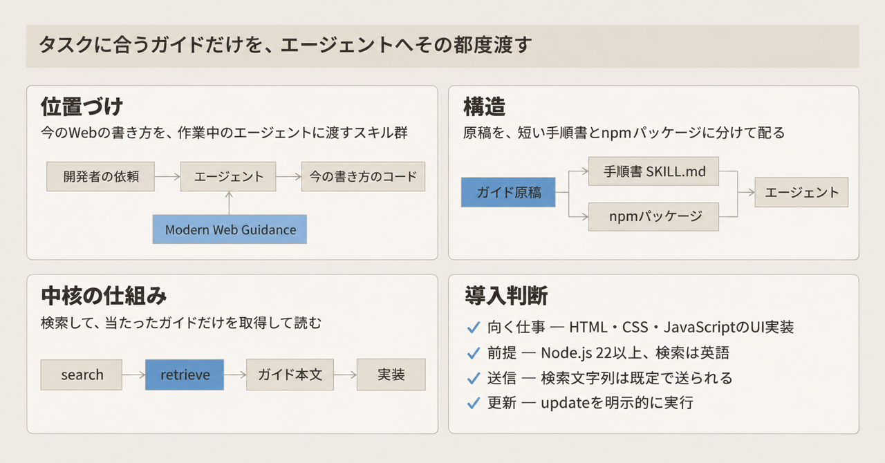
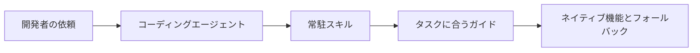
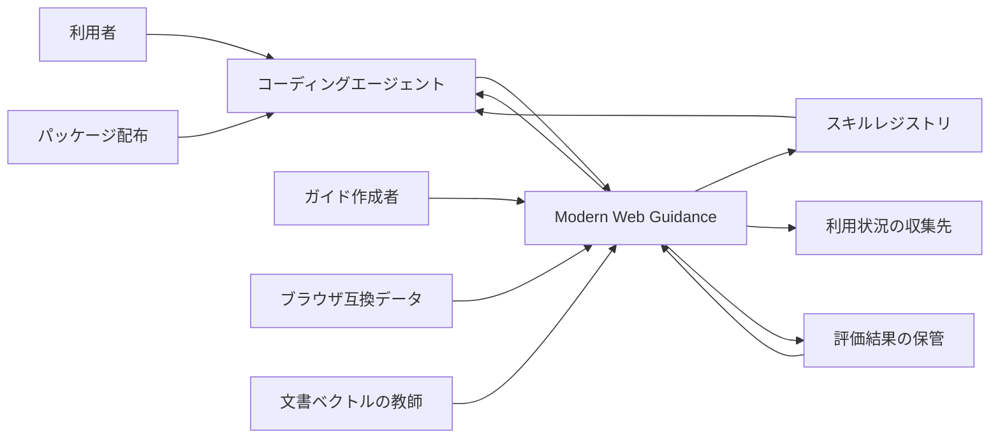
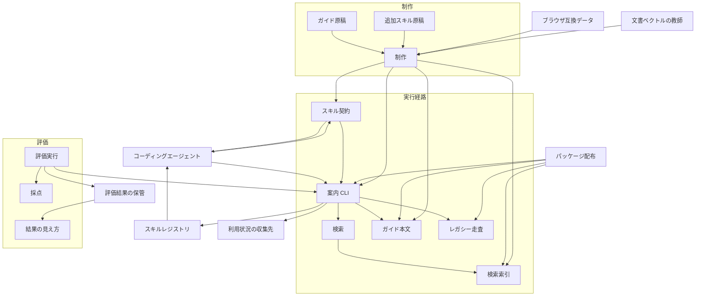
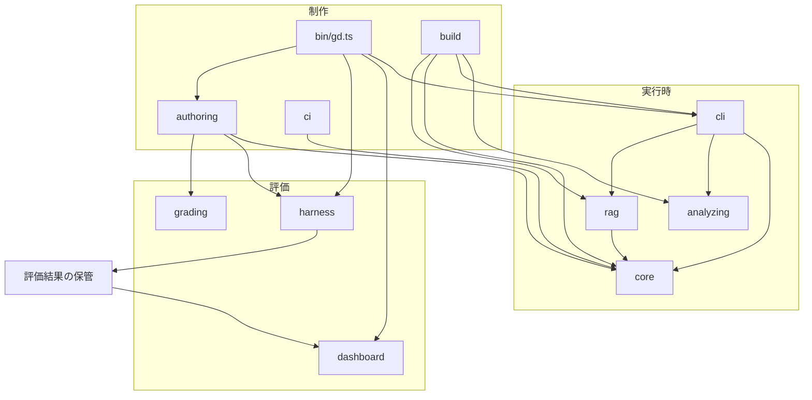
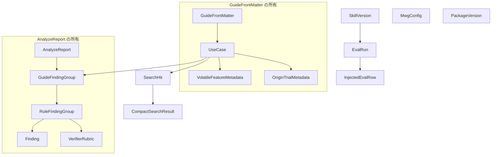
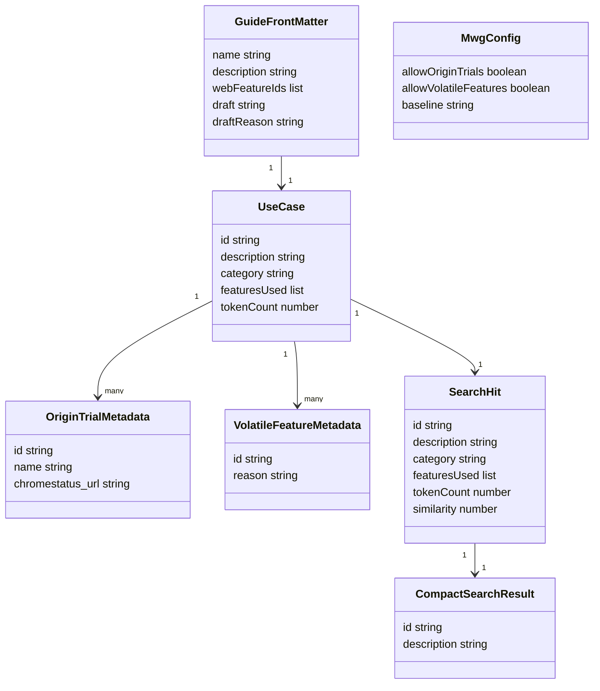
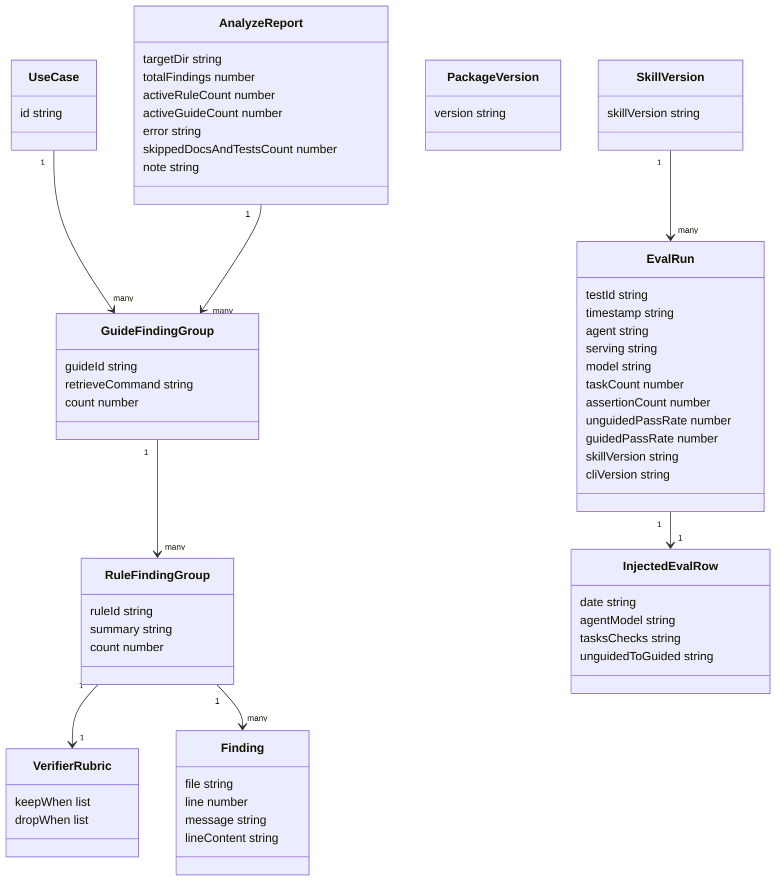
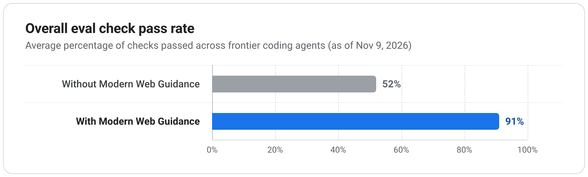

Modern Web Guidance は、Google Chrome が公開している、コーディングエージェント向けのスキル群です。この記事では、2026-11-15 時点のバージョン 1.0.0 について、仕組み、データの形、導入、コマンドの使い方、運用までを整理します。読み終えると、自分のプロジェクトへ導入し、エージェントにどう使わせるかを判断できます。


*この記事の全体像。以下、順に解説します。*

## Modern Web Guidanceとは

Modern Web Guidance は、ウェブプラットフォームの実装知識とブラウザ互換データを、コーディングエージェントの作業中に渡すスキル群です。スキルは、エージェントに導入しておく手順書（`SKILL.md`）とその付属ファイルのまとまりです。エージェントは、HTML、CSS、クライアント側 JavaScript を書くときに、今のプラットフォーム機能と、その機能向けのフォールバックを読めます。

Google Chrome は 2026 年 5 月の Google I/O で早期プレビューを示しました。2026 年 11 月 10 日にバージョン 1.0 が stable として公開されました。ガイドの維持には Chrome、Edge、Firefox、MDN が加わります。

配布は 2 つのリポジトリに分かれます。

| リポジトリ | 役割 |
| --- | --- |
| [GoogleChrome/modern-web-guidance](https://github.com/GoogleChrome/modern-web-guidance) | 公開スキルの配布先。利用者が導入する対象 |
| [GoogleChrome/modern-web-guidance-src](https://github.com/GoogleChrome/modern-web-guidance-src) | ガイド本文、CLI、評価の実装正本。issue と pull request の受付先 |

以降、前者を「公開リポジトリ」、後者を「正本」または「src」と呼びます。正本のガバナンスでは、オーナー席が Google Chrome、Microsoft Edge、Mozilla Firefox / MDN、独立のウェブプラットフォーム専門家に分かれます。

利用者向けの入口は、プロジェクト直下の `npx modern-web-guidance@latest install` です。既に入れているスキルの更新入口は `npx modern-web-guidance@latest update` です。

依頼からコードまでの流れは次のとおりです。常駐スキルは、エージェントに導入しておくスキルのうち、コンテキストに常に載る紹介情報です。大きさは公式 README の表示で約 205 トークンで、手順書（`SKILL.md`）の本文やガイド本文は含みません。エージェントは、ウェブ UI を実装する作業のときだけ `SKILL.md` の本文を読み、その手順に従って CLI でガイドを検索し、タスクに合うガイドだけを取得して読みます。この記事で「スキルを起動する」と書くときは、この検索と取得を始めることを指します。



| 項目 | 2026-11-15 時点 |
| --- | --- |
| 安定版 | npm `modern-web-guidance` 1.0.0。レジストリの published は 2026-11-10T03:29:19.190Z |
| 実行環境 | 公開パッケージの `engines.node` は `>=22.0.0`。`engines.vscode` は `^1.90.0` |
| コマンド実体 | `bin.modern-web-guidance` は `skills/modern-web-guidance/modern-web.mjs` |
| リポジトリ宣言 | 公開パッケージの `repository` は正本 `GoogleChrome/modern-web-guidance-src` |
| 常時載る紹介情報の大きさ | 公式 README の表示で、`modern-web-guidance` が約 205 トークン、Chrome 拡張向けの `chrome-extensions` が約 175 トークン。`SKILL.md` の本文は起動時に別途読む |
| 公開 list | npm 1.0.0 の `list` は 208 個の id を返す |
| 正本の原稿 | `guides/**/guide.md` は main の再帰ツリーで 252 ファイル |
| GitHub の規模 | 公開リポジトリが stars 15102、forks 549。正本が stars 6006、forks 401 |

公開 README には、エージェントごとの評価表が載ります。値は、ガイドなしとガイドありで同じタスクを実行したときのチェック合格率です。チェックは採点の判定項目で、1 つのタスクに複数あります。2026-11-08 の行では、claude_code（opus-5-5）が 215 タスク、1801 チェックで 57% から 88% です。表の読み方と直近 10 件は「運用」の節にあります。

1.0 の発表では、次の導入事例が紹介されました。表の LCP は、ページの主要コンテンツが表示されるまでの時間を測る性能指標です。

| 事例 | 使い方 | 測っているもの | 発表された結果 |
| --- | --- | --- | --- |
| Pensionbazaar | Modern Web Guidance と Chrome DevTools for agents | 所要時間と UI バグ | 新規ページの所要が約 4 日から数時間。新規画面の UI バグが 90% 超減少 |
| Policybazaar | Chrome DevTools for agents による性能監査 | 手作業の監査工数 | 約 30 の着地ページで 92% 減 |
| WeTV | CI 上の性能診断と、ガイドが渡す修正方針 | 失敗した性能チェックと切り分け時間 | 失敗した性能チェックの 90% を自動で診断し解消。4 時間から 30 分 |
| note | 自社デザインシステムと併用 | 自社コードのモダンウェブチェックと LCP 指定 | 本番 180 run で 61% から 94%。マージ済み 431 PR で LCP 画像の優先度指定が 28% 増 |
| MetaMask | オープンソース拡張の pull request を 3 行のプロンプトでレビュー | レビュー件数と修正までの時間 | 最初の 5 週で約 480 件を確認し、64 件にコメント。43 件が修正され、中央値は 15 分 |

## 特徴

- 常時コンテキストに載る情報は短く保たれます。エージェントは依頼のたびに、タスクに合うガイドだけを読んでから実装します。
- ガイドは、体験、CSS レイアウト、性能、フォーム、アクセシビリティ、オンデバイス AI、セキュリティ、プライバシー、PWA、WebMCP などを扱います。
- 推奨は、同じ見た目を長い JavaScript で再現するより、ブラウザが持つ HTML と CSS を優先します。ダイアログ、ポップオーバー、スクロール、コンテナクエリ、ビュー遷移が典型です。
- 各ガイドは、ビルドの時点の Baseline の状態を本文へ折り込みます。Baseline は、ある機能が主要ブラウザ間で相互運用できるかを示すラベルです。段階は、Limited availability、Newly available、Widely available の順に進みます。プロジェクトがブラウザ方針を書いていないときの既定は、Widely available です。
- Widely available に達していない機能には、プログレッシブエンハンスメントか、条件付きの短いフォールバックが付きます。プログレッシブエンハンスメントは、対応ブラウザだけが追加の体験を得て、非対応ブラウザでも基本機能が動く作り方です。
- Origin Trial と volatile 機能のガイドは、検索結果には出ますが、利用者が明示的に許可したときだけ本文を返します。Origin Trial は、Chrome が実験中の機能を期間限定で試せる仕組みです。volatile 機能は、単一エンジンだけが実装し、出荷から 3 か月以内か、まだ安定していない機能です。
- 1.0 のガイドは、領域ごとのテクニカルリードが確認します。利用者向けガイドは、支援技術を日常的に使う専門家がレビューし、実機の支援技術でテストします。
- モダン化ワークフローは、既存の HTML、CSS、JavaScript、`package.json` から置き換え候補を見つけます。照合用の決定的なルールを持つガイドは、全ガイドの約 20% です。
- ガイドを適用した応答の末尾には `### Modern Web Guidance` を残します。適用したガイド ID、選んだ API やフォールバック、根拠にした規則の短い引用が入ります。
- Chrome 拡張向けの第二スキルパック（`chrome-extensions`）は、Manifest V3、バックグラウンドワーカー、拡張 API、Chrome Web Store への公開を扱います。
- 書く前の知識と、書いた後の確認は分かれます。Modern Web Guidance が実装の型を渡し、Chrome DevTools for agents が性能トレース、アクセシビリティツリー、メモリ、アニメーション録画を見ます。
- 公式が第一に勧める導入経路は `modern-web-guidance` CLI です。Vercel の skills CLI や各社プラグインは、同じスキルを配る別経路です。

### 類似手段との比較

| 手段 | 主な役割 | エージェントへの入り方 | 向く仕事 |
| --- | --- | --- | --- |
| 素のエージェント | 学習済みのパターンで実装する | モデルとエージェント本体だけ | モデルが既に安定して通す定番作業 |
| web.dev / MDN を人が選んで貼る | 人間向けの仕様解説 | 人が該当ページをコンテキストへ渡す | 人が 1 件の仕様を確認してから実装する |
| Lighthouse | 実行後の品質計測 | レポート、または CI の結果 | LCP、INP、CLS などの性能指標の現状把握 |
| Baseline（web-platform-dx） | 主要ブラウザ間の相互運用ラベル | Modern Web Guidance がガイドへ埋め込むデータ | その機能を今の方針で使ってよいかの判断 |
| skills CLI（Vercel） | エージェントスキルの追加 | `npx skills add GoogleChrome/modern-web-guidance` | 配布経路を Vercel の skills に揃える |
| Modern Web Guidance | タスク単位のガイドとフォールバック | 常駐スキルが検索し、該当ガイドだけを読む | ウェブ UI を、今のプラットフォームの書き方で書かせる |

## 構造

ガイド作成者が原稿を正本へ書き、制作（ビルド）がスキル契約と実行パッケージへ分けて出します。コーディングエージェントはスキル契約を読み、実行パッケージの案内 CLI からガイド本文を受け取ります。図の要素名と実物の対応は次のとおりです。

| 図の要素名 | 実物 |
| --- | --- |
| スキル契約 | スキルの `SKILL.md`。公開リポジトリに置かれる |
| 実行パッケージ、パッケージ配布 | npm パッケージ `modern-web-guidance` |
| 案内 CLI | `modern-web-guidance` コマンド |
| スキルレジストリ | `skills` CLI など、スキルをエージェントへ導入する仕組み |
| レガシー走査 | `legacy-scan` コマンド |

### システムコンテキスト図

利用者とガイド作成者はシステムの外にいます。互換データと文書ベクトルの教師は、制作のときに中へ折り込みます。



| 要素名 | 説明 |
| --- | --- |
| 利用者 | ウェブ画面の実装をコーディングエージェントに頼む人 |
| ガイド作成者 | ガイド原稿と、ブラウザ上で観測できる期待（評価の採点の元）を正本へ書く人 |
| コーディングエージェント | スキル契約を読み、案内 CLI を起動し、返ったガイドでコードを書く外部の実行役 |
| Modern Web Guidance | ガイドの制作、検索と取得、レガシー走査、評価をまとめたシステム。成果はスキルレジストリとパッケージ配布へ渡す |
| スキルレジストリ | 公開リポジトリのスキル契約をエージェントへ導入する外部の導入役 |
| パッケージ配布 | 案内 CLI、ガイド本文、検索索引を一つの実行パッケージで渡す外部の配布面 |
| ブラウザ互換データ | 制作時にガイドへ折り込む互換状況の外部データ |
| 文書ベクトルの教師 | 公開前に文書側のベクトルを作る外部の埋め込みモデル |
| 利用状況の収集先 | 検索語、取得したガイド、導入の成否を受け取る外部の収集先 |
| 評価結果の保管 | ガイドありとガイドなしの評価結果を置く外部の保管 |

### コンテナ図

実行時にエージェントが触るもの、原稿からそれを作るもの、効きを測るものを分けています。ガイド本文は公開リポジトリと実行パッケージの両方に入ります。取得が読むのは実行パッケージ側です。



| 要素名 | 説明 |
| --- | --- |
| スキル契約 | エージェントが最初に読む手順書。案内 CLI を検索と取得に使うよう命じる |
| 案内 CLI | 検索、一覧、取得、レガシー走査、導入と更新と削除、機能ゲートの許可、ベースライン目標の記録を振り分ける |
| 検索 | 問い合わせを静的な語テーブルでベクトル化し、BM25 と順位融合で候補を返す |
| 検索索引 | 文書ベクトル、語テーブル、チャンク本文を実行パッケージへ同梱したデータ |
| ガイド本文 | 取得が返すビルド済みの Markdown |
| レガシー走査 | コードを決定的に照合し、残す条件と捨てる条件をエージェントへ渡す |
| ガイド原稿 | カテゴリ別のガイド、主スキル（`modern-web-guidance`）の定義、機能ゲートの台帳 |
| 追加スキル原稿 | 主スキルとは別に公開する追加スキル（`chrome-extensions`）の原稿 |
| 制作 | 原稿をガイド本文、検索索引、案内 CLI に束ねる。スキル契約は公開リポジトリへ、実行ファイルはパッケージ配布へ出す |
| 評価実行 | 題材アプリ上で、ガイドありとガイドなしのエージェント実行を隔離して走らせる |
| 採点 | 期待から作った判定。見本が通り、未改変のアプリが落ちるよう校正してからエージェント出力を見る |
| 結果の見え方 | 保管された評価結果をローカルと静的サイトの両方で見せる |

機能ゲートは、Origin Trial と volatile 機能のガイド本文を、プロジェクトが許可するまで返さない仕組みです。

### コンポーネント図

コンポーネントは正本の `src` ディレクトリです。`bin/gd.ts` は `src` の外にあり、作成者向けの入口として制作と評価を呼びます。



| 要素名 | 説明 |
| --- | --- |
| cli | 利用者向けの振り分け、導入時のスキルレジストリ呼び出し、利用状況の送信 |
| rag | 検索と取得。`search.ts` は静的な語テーブルと BM25 を使う |
| analyzing | レガシー走査の静的照合と、実行時にエージェントへ渡す検証条件 |
| core | プロジェクト設定、機能ゲート、互換状況の解決、ガイド検証。実行時と制作で共有する |
| bin/gd.ts | ガイドごとの評価用タスク一式の生成、評価の実行、結果の表示、互換状況の照会を起動する作成者向け入口 |
| authoring | golden 解答（見本の正解）、タスクのプロンプト、採点を生成し、校正のあと評価実行を呼ぶ |
| build | ガイド原稿をスキル契約と実行パッケージの二種類の成果へ束ね、検索索引用の文書ベクトルキャッシュを同梱する |
| ci | ブラウザ互換データの更新後に、仮の機能 ID とガイド参照が上流とずれたかを検査する |
| harness | 隔離した実行環境でエージェントをガイドありとなしで走らせ、実行の記録を残す |
| grading | ブラウザ上の観測で採点し、見本と素のアプリの両方で校正する |
| dashboard | 保管された結果をローカルサーバと静的サイトで見せる |

検索の実行経路は `src/rag/search.ts` です。検索は、意味の近さで探す密ベクトル検索と、語の一致で探す BM25 の 2 系統を組み合わせます。

- 問い合わせの埋め込みは、gemini-embedding-001 から蒸留した静的な語テーブル（StaticEmbedder）です。正本の README は、次元は 256、問い合わせの埋め込みは約 30 マイクロ秒と書きます。
- 文書ベクトルは公開前に同じ系列のモデルで作り、`src/rag/gen/` のキャッシュとして同梱します。
- 語彙ファイル `query-words.json` は約 314KB で 29165 語、量子化テーブル `query-words.i8` は約 7.5MB です。
- 順位は、密ベクトルと Okapi BM25 を RRF（k=60）で融合します。RRF は、複数の検索結果の順位を足し合わせて 1 つの順位にする手法です。上位は 10 件です。

密ベクトル側には、コサイン類似度 0.30 の下限があります。

| 密ベクトルの top-1 | BM25 の件数 | 結果 |
| --- | --- | --- |
| 0.30 未満 | 0 件 | 空配列 |
| 0.30 未満 | 1 件以上 | 融合に入るのは BM25 側だけ |
| 0.30 以上 | 問わない | 個々のコサインが 0.30 未満でも、密ベクトルの順位は融合に残る |

公開パッケージの検索は、機械学習のランタイムを同梱せずに動きます。`src/rag/transformers-embedder.ts` は `@huggingface/transformers` を import します。`search.ts` はそのファイルを import しません。公開 npm 1.0.0 の package.json に dependencies は無く、tarball 280 ファイルに `node_modules`、`huggingface`、`onnx` は含まれません。

ガイド本文中のブラウザ対応状況の記述は、`src/core/baseline.ts` が、ビルド時に `web-features` と `@mdn/browser-compat-data` を読んで本文へ折り込みます。retrieve は互換データを再問い合わせしません。プロジェクトに保存した baseline が `newly`、`limited`、または年のときだけ、ビルド済み本文の先頭にフォールバックを省くバナーを足します。未設定と `widely` はバナーを出しません。

## データ

この節は、CLI の出力をパースする人や、正本へ貢献する人に向けた内部データの整理です。公開スキルのガイド本文、正本の front matter、検索の内部結果、legacy-scan の JSON、評価の 1 run、二つの版識別子（npm パッケージの版と SKILL.md の版）を分けます。利用者が直接触るのは、プロジェクト設定 `.mwgrc` の 3 キーと、`search` や `legacy-scan --json` の出力です。

### 概念モデル

枠は所有、矢印は利用です。プロジェクト設定（MwgConfig）と npm パッケージの版（PackageVersion）は、ほかのレコードと関連を持たない独立したレコードです。注入表は、README に自動で差し込まれる評価結果の表です。

- GuideFrontMatter と UseCase の 1 対 1 は、公開索引に入った原稿に限ります。draft の guide.md は UseCase を持ちません。
- 252 は原稿ファイル数、208 は公開された UseCase 数です。
- SearchHit は、1 回の検索に載った 1 つの UseCase です。
- InjectedEvalRow は、README に選ばれた 1 つの EvalRun です。



| 要素名 | 説明 |
| --- | --- |
| GuideFrontMatter | 正本 `guides/<category>/<id>/guide.md` の YAML。公開スキルの md は加工後の本文だけで、この枠を持たない |
| UseCase | ビルドが `guides.json` に書く 1 ガイド 1 件の索引。`id` は front matter の `name` |
| OriginTrialMetadata | UseCase が持つ Origin Trial の付帯。空ならキー自体が無い |
| VolatileFeatureMetadata | UseCase が持つ単一エンジン機能の付帯。空ならキー自体が無い |
| MwgConfig | プロジェクトの `.mwgrc`。祖先とはマージしない |
| SearchHit | `searchUseCases` の 1 件。類似度を持つ |
| CompactSearchResult | `search` と `list` が stdout に出す 1 件。類似度は落とす |
| AnalyzeReport | `legacy-scan --json` のトップオブジェクト |
| GuideFindingGroup | レポート内のガイド単位の束 |
| RuleFindingGroup | そのガイドのルール単位の束 |
| VerifierRubric | ルールに付く残す条件と捨てる条件 |
| Finding | ファイルと行の 1 件 |
| PackageVersion | 正本 `package.json` の `version`。skill の版文字列とは別 |
| SkillVersion | `SKILL.md` の最終コミット日から作る文字列。npm の `version` とは別 |
| EvalRun | `eval-results-summary.json` の 1 run |
| InjectedEvalRow | README の注入表に出る 1 行。全 run のうち選定後だけ |

### 情報モデル

属性名はソースに合わせています。YAML キーにハイフンがあるものは、図のフィールド名をキャメルケースにし、表にソースのキーを書きます。多重度は `1` と `many` だけです。図の `1` は、その関連が存在するときの件数です。

- draft の guide.md は UseCase を持ちません。
- ある検索に載らない UseCase は SearchHit を持ちません。
- `list` の行は CompactSearchResult であり、SearchHit を要しません。
- README に選ばれない EvalRun は InjectedEvalRow を持ちません。

最初の図は、ガイド、検索結果、プロジェクト設定です。



次の図は、レガシー走査のレポートと評価のレコードです。GuideFindingGroup は `guideId` で前の図の UseCase を指します。



| 要素名 | 説明 |
| --- | --- |
| GuideFrontMatter.name | ガイドの識別子。公開後の UseCase.id になる |
| GuideFrontMatter.description | 検索に載る説明 |
| GuideFrontMatter.webFeatureIds | YAML キーは `web-feature-ids`。web-features の id の list。無いガイドは空配列 |
| GuideFrontMatter.draft | `stub`、`wip`、`blocked` のいずれか。省略すると公開対象。レガシー入力の `true` は `wip` |
| GuideFrontMatter.draftReason | YAML キーは `draft-reason`。`draft` が `blocked` のとき必須 |
| UseCase.id | `name` と同じ文字列。front matter のキーとしては置かない |
| UseCase.category | ガイドのディレクトリ名 |
| UseCase.featuresUsed | `web-feature-ids` を表示名へ写した list |
| UseCase.tokenCount | 本文のトークン数。埋め込みが無ければ語数の近似 |
| UseCase.originTrials | 要素は OriginTrialMetadata。長さ 0 のときキーを書かない |
| UseCase.volatileFeatures | 要素は VolatileFeatureMetadata。長さ 0 のときキーを書かない |
| MwgConfig.allowOriginTrials | 任意の boolean。キーが無いことは `true` ではない |
| MwgConfig.allowVolatileFeatures | 任意の boolean。明示の `false` は、未設定より強い拒否文面になる |
| MwgConfig.baseline | 任意。保存値は `widely`、`newly`、`limited`、または 4 桁の年 |
| SearchHit.similarity | そのガイドの最良チャンクの dense cosine。小数 4 桁。stdout には出さない |
| CompactSearchResult | stdout に残すのは `id` と `description` だけ |
| AnalyzeReport.guides | GuideFindingGroup の list。失敗時は空。`error` は失敗時だけ付く |
| AnalyzeReport.skippedDocsAndTestsCount | 0 より大きいときだけ付く |
| AnalyzeReport.note | ガイド絞り込み無しの既定モードのときだけ付く |
| GuideFindingGroup.retrieveCommand | `npx modern-web-guidance retrieve` に guideId を足した文字列 |
| VerifierRubric.keepWhen | 残す条件の list。ガイド直下には置かず、ルールに付く |
| VerifierRubric.dropWhen | 捨てる条件の list |
| Finding.lineContent | 行の文字列。元が無ければ空文字 |
| PackageVersion.version | 正本 package.json の `1.0.0`。パッケージ名は `modern-web-guidance-src` |
| SkillVersion.skillVersion | `YYYY_MM_DD` とハイフンと短縮 SHA。公開 SKILL.md の search 例は `2026_11_09-5bcc021b`。比較は日付だけで、SHA の桁は見ない |
| EvalRun.taskCount | タスク数。注入表のスラッシュの左 |
| EvalRun.assertionCount | チェック数。注入表のスラッシュの右。要約 JSON のフィールド名 |
| EvalRun.serving | 2026-11-15 時点の要約 JSON では `skills_cli` |
| EvalRun.skillVersion | その run が記録した skill 版。要約の先頭付近は `2026_11_06-909bc374` |
| EvalRun.cliVersion | その run の CLI 版。直近側は `0.0.204` と `0.0.203`。10 件には `0.0.199`、`0.0.197`、`0.0.196` もある |
| InjectedEvalRow.tasksChecks | 正本 README のヘッダ `Tasks / Checks` のセル。公開 README のヘッダは `Tasks / Assertions` |
| InjectedEvalRow.unguidedToGuided | README ヘッダ `Unguided → Guided (Uplift)` のセル |

SkillVersion の文字列は、SKILL.md に対する次のコマンドで生成されます。

```shell
git log -1 --abbrev=8 --date=format:%Y_%m_%d --pretty=format:%cd-%h
```

`MwgConfig` の解決は、開始ディレクトリから親へ歩き、`.mwgrc` または `.git` があるディレクトリで止まります。そこより上は読みません。ルートまでどちらも無いときだけ、ホームに `.mwgrc` があればそれを使い、無ければ開始ディレクトリの `.mwgrc` を返します。ファイルが無い読み取りは空オブジェクトです。JSON がオブジェクトでなければ `Invalid .mwgrc at <path>` になります。

公開側のガイド（`skills/modern-web-guidance/guides/css/css.md` など）には front matter がありません。正本の `guides/css/css/guide.md` などには `name`、`description`、`web-feature-ids` があります。正本の `guides/forms/button-group/guide.md` には `draft` と `draft-reason` もあります。ビルドの `writeBuiltGuide` は、加工後の本文だけを公開ファイルへ書きます。

## 構築方法

使う側が入れるのは公開リポジトリと npm パッケージです。CLI とガイド生成の正本は src リポジトリで、issue と pull request もそちらです。

- 公開パッケージの実行要件は Node.js メジャー 22 以上です。
- スキルの追加は `install` が `npx -y skills add` を起動します。
- ソースの開発要件は Node.js 22.18.0 以上と pnpm です。
- 週次の公開が npm の latest と公開リポジトリの main を更新します。

### 配布物の置き場所

2026-11-15 時点の `https://registry.npmjs.org/modern-web-guidance/latest` は、`version` が `1.0.0`、`gitHead` が `544c250575f7811d87fef8b1c064bc9571cbfb80` です。`dist-tags` の `latest` と `next` は、その時点ではどちらも `1.0.0` です。

公開パッケージの `engines` は `node: ">=22.0.0"` と `vscode: "^1.90.0"` です。`license` は `Apache-2.0` です。`bin.modern-web-guidance` は `skills/modern-web-guidance/modern-web.mjs` です。公開 CLI の `ensureNodeVersion` は、メジャー番号が 22 以上かどうかだけを見ます。

正本の `package.json` と `CONTRIBUTING.md` は Node.js `>=22.18.0` です。`packageManager` のピン `pnpm@10.30.3` は `package.json` だけにあります。そのため、たとえば Node.js v22.17.0 では、公開パッケージの `-h` は動作しますが、正本の engines は満たしません。

```shell
node -v
npm view modern-web-guidance@latest version engines gitHead
```

### スキルを入れる

ドキュメントと公開 README の推奨入口は、プロジェクトで次を実行することです。Chrome 拡張のスキルも選ぶときは `--choose` を付けます。検索、取得、スキャンは、インストールせずに実行できます。下の 3 行目以降は、2026-11-15 に `modern-web-guidance@1.0.0` で終了コード 0 を確認しています。

```shell
npx modern-web-guidance@latest install
npx modern-web-guidance@latest install --choose
npx -y modern-web-guidance@1.0.0 search "animate a dialog modal backdrop"
npx -y modern-web-guidance@1.0.0 retrieve "animate-to-from-top-layer"
npx -y modern-web-guidance@1.0.0 legacy-scan -h
```

`install` は、検出したエージェント名を環境変数 `AI_AGENT` に載せて `npx` を起動します。通常時の引数は次です。

```shell
npx -y skills add GoogleChrome/modern-web-guidance --skill modern-web-guidance
```

`--choose` を付けたときだけ `--skill modern-web-guidance` を外します。`-y` は残ります。`install` より後ろの引数は転送し、転送時に `--choose` だけ取り除きます。配布タグが `next` のビルドでは、追加先が `https://github.com/GoogleChrome/modern-web-guidance/tree/next` になります。通常の `latest` は `GoogleChrome/modern-web-guidance` です。

### エージェントごとの導入

マーケットプレイスは、各エージェントがプラグインを取得する配布元です。Modern Web Guidance のマーケットプレイス名は `googlechrome` です。Claude Code への導入手順は、公開 README ではセッション内のスラッシュコマンド、公式ドキュメントの導入ページでは `claude` 実行ファイルのサブコマンドとして書かれています。公式ドキュメントには、Antigravity の設定画面、Gemini CLI、JetBrains WebStorm の Skill Manager、Goose もあります。

```shell
npx skills add GoogleChrome/modern-web-guidance
gh skill install GoogleChrome/modern-web-guidance
agy plugin install https://github.com/GoogleChrome/modern-web-guidance
gemini extensions install https://github.com/GoogleChrome/modern-web-guidance --auto-update
goose plugin install https://github.com/GoogleChrome/modern-web-guidance --auto-update
grok plugin install https://github.com/GoogleChrome/modern-web-guidance --trust
```

```shell
claude plugin marketplace add GoogleChrome/modern-web-guidance
claude plugin install modern-web-guidance@googlechrome
```

```markdown
/plugin marketplace add GoogleChrome/modern-web-guidance
/plugin install modern-web-guidance@googlechrome
/plugin
/reload-plugins
```

```shell
codex plugin marketplace add GoogleChrome/modern-web-guidance
codex plugin add modern-web-guidance@googlechrome
```

Copilot はセッション内で Claude と同じ `/plugin` コマンドを使います。Kimi は `/plugins install` です。

```markdown
/plugin marketplace add GoogleChrome/modern-web-guidance
/plugin install modern-web-guidance@googlechrome
```

```markdown
/plugins install https://github.com/GoogleChrome/modern-web-guidance
```

Claude Code には、更新が止まった旧マーケットプレイス `claude-plugins-official` から入れた利用者向けの切替案内があります。この案内は、正本の main ブランチ（以降「正本 main」）にだけ実装されています。正本 main は 1.0.0 の公開後に進んだコードで、変更は週次の公開で npm へ出ます。`npx` で 1.0.0 を使う限り、この分岐には当たりません。`@latest` を指定している場合は、今後の公開で正本 main の挙動に替わり得ます。正本 main の `maybeEmitUpdateMessage` は、次の条件がすべて揃うと、切替手順を stderr に出します。

- 呼び出し元が Claude である
- 渡された skill version の日付が 2026-10-12 以前である
- 通常の更新警告が出る状態である

コードのコメントが示す凍結点は `claude-plugins-official` の `v0.0.194`（`2026_10_12-dacb5911`）です。npm 1.0.0 の `modern-web.mjs` にはこの分岐が無く、切替手順は出しません。切替は次の 3 行です。

```markdown
/plugin uninstall modern-web-guidance@claude-plugins-official
/plugin marketplace add GoogleChrome/modern-web-guidance
/plugin install modern-web-guidance@googlechrome
```

WebStorm は Settings、AI Assistant、Skills の Skill Manager で対象スキルを開き、Install で現在の IDE へ入れます。Antigravity アプリは導入フロー、または Settings、Customizations、Build with Google Plugins で `modern-web-guidance` を有効にします。

### ソースから作る

正本の開発セットアップは `CONTRIBUTING.md` の手順です。`pnpm build` は `node src/build/build-guides.ts --target=skills-cli` のあと `pnpm run build-dist` を実行します。`pnpm preflight` は配布物のビルド、型検査、lint、ユニットテストまでをまとめて実行します。正本の開発用コマンド名は `gd` です。公開 npm のコマンド名は `modern-web-guidance` です。

```shell
git clone https://github.com/GoogleChrome/modern-web-guidance-src.git
cd modern-web-guidance-src
pnpm install
pnpm link --global && gd setup-completion
pnpm typecheck && pnpm lint
pnpm preflight
pnpm build
```

週次の公開は、GitHub Actions が毎週月曜 14:50 UTC に npm の `latest` と公開リポジトリの `main` を更新します。`next` は手動の `workflow_dispatch` です。latest の公開処理は、next タグも同じ版へ寄せます。公開時の除外が js、mjs、索引バイナリを公開リポジトリの git ツリーから外し、npm の tarball がそれらを持ちます。

## 利用方法

2026-11-15 時点の正本 `printUsage` と、help の外にある実装を含め、引数は次のとおりです。値を確認した実行は `npx -y modern-web-guidance@1.0.0` です。

`search`、`list`、`retrieve`、`legacy-scan` は、主にエージェントが SKILL.md の指示に従って実行します。この節でコマンドの使い分けとして書く規則は、SKILL.md がエージェントに課しているものです。`install`、`update`、`set-allow-*`、`set-baseline` は人が実行します。表の use case は、公開されたガイド 1 件のことです。`search` と `list` が返す `id` は、そのまま `retrieve` に渡せます。

| コマンド | 受け付ける値 | 省略したとき |
| --- | --- | --- |
| `search <query>` | 位置引数を空白で連結する | クエリが空なら stderr `No search query provided.` で終了コード 1 |
| `list` | なし | 全 use case を JSON 配列で stdout へ出す |
| `retrieve <ids>` | カンマ、空白、セミコロン区切り。前後の引用符を外し、`-` で始まる語は捨てる | ID が 0 件なら stderr `No IDs provided for retrieve.` で終了コード 1 |
| `legacy-scan [path]` | ディレクトリまたはファイル。別名 `analyze`。`--json`、`--guide <guideId>`、`--include-docs-and-tests`、`-h` | path はカレントディレクトリ。ドキュメント、例、デモ、テストは除外 |
| `set-allow-origin-trials` | 人間の TTY で `y` または `yes` | エージェント検出時と非 TTY は終了コード 1。拒否は `Aborted.` で終了コード 1 |
| `set-allow-volatile-features` | 上と同じ | 上と同じ |
| `set-baseline <target>` | `widely`、`newly`、`limited`、4 桁の年 | 解釈できない値は終了コード 1 |
| `install [options]` | `--choose`。それ以外は `skills add` へ転送 | `modern-web-guidance` スキルだけを追加する |
| `uninstall` | なし | CLI に隣接し `SKILL.md` があるディレクトリ名を `skills remove` へ渡す |
| `update` | なし | 同じ隣接スキル名を `skills update` へ渡す |
| `-h` / `--help` | なし | help を出して終了コード 0。引数なしは同じ文面で終了コード 1 |
| `-v` / `--version` | なし | パッケージ版を出して終了コード 0。1.0.0 で確認済み |
| `--skill-version <version>` | `YYYY_MM_DD-短SHA` を想定 | 呼び出し中の SKILL.md 版として更新判定と計測に使う |

### 共通オプション

`-h` は `printUsage` を出します。`-v` は `getVersion` の結果だけを出します。`--skill-version` はエージェントが自分の SKILL.md 版を渡す内部オプションです。help には `Internal use` と書かれています。公開リポジトリの現行 SKILL.md は、検索時に `--skill-version 2026_11_09-5bcc021b` を付ける例になっています。

SKILL.md は、実行環境ごとの呼び出し方も指定しています。

| 環境 | 呼び出し方 |
| --- | --- |
| pnpm がある | `pnpx modern-web-guidance@latest` を優先する。`pnpx` に `-y` は付けない |
| Windows | `npx.cmd` を使う |
| サンドボックス | 最初の実行前に `npx -y modern-web-guidance@latest` へネットワークを許可する |
| ホームの npm キャッシュが読めない | `NPM_CONFIG_CACHE=/tmp/npm-cache` を付ける |
| オフラインで止まった | `npx --offline` で再実行する |

```shell
npx -y modern-web-guidance@1.0.0 -h
npx -y modern-web-guidance@1.0.0 -v
npx -y modern-web-guidance@latest search "light dismiss dialog" --skill-version 2026_11_09-5bcc021b
export DISABLE_TELEMETRY=1
```

### search

クエリは英語の、2 語から 5 語程度の動作です。フレームワーク名や画面固有の名詞は外し、1 機能ずつに分けます。stdout は上位 10 件の JSON 配列です。要素は `id` と `description` だけです。`animate a dialog modal backdrop` では先頭が `animate-to-from-top-layer` でした。

検索の埋め込みと BM25 はパッケージ内で完結し、検索語のための API キーは要りません。既定では検索のたびに、Google の利用状況収集先である Clearcut へ、検索文字列とヒットを送ります。止めるのは `DISABLE_TELEMETRY` が `1` または `true` のときです。パッケージ取得のネットワークとは別です。

npm 1.0.0 で日本語のクエリ `search "ダイアログ"` を実行すると、stdout は `[]`、stderr は空、終了コードは 0 です。

```shell
npx -y modern-web-guidance@1.0.0 search "animate a dialog modal backdrop"
```

次は、10 件の出力のうち先頭 1 件です。

```json
[{"id":"animate-to-from-top-layer","description":"Animate elements such as dialogs, popovers, and tooltips as they're entering/exiting the top layer."}]
```

### list

`list` は登録済み use case の `id` と `description` を JSON 配列として stdout へ出します。一致する ID が既にあるときは `list` を重ねません。検索が `[]`、または説明が無関係なときだけ、語を変えて検索し、それでも広さが必要なら `list` を 1 回使います。`modern-web-guidance@1.0.0` の `list` は 208 個の `id` を返します。stderr は空で、終了コードは 0 です。

```shell
npx -y modern-web-guidance@1.0.0 list
```

次は、208 件の出力のうち 1 件です。

```json
[{"id":"accessibility","description":"Actionable coding guidelines for building accessible web applications, covering semantic HTML, focus management, forms, media, and testing. Use this skill when auditing or implementing accessibility features, keyboard navigation, or ARIA."}]
```

### retrieve

ID は検索結果の `id` をそのまま渡します。複数はカンマ、空白、セミコロンのどれで区切っても同じ配列になります。各ガイドの前に区切り行が付きます。1 件でも失敗すると、取得できた本文を出したうえで終了コード 1 になります。

連結した本文が 9500 バイトを超え、かつ stdout がファイルでなければ、一時ファイルへ退避します。ファイル名は `mwg-guide-<pid>-<時刻>.md` で、最初の候補は OS の一時ディレクトリ、次が `/tmp` です。

- 端末へ直接出した `retrieve "animate-to-from-top-layer"` は、10.7 KB、244 行として退避されました。
- 同じコマンドの stdout をファイルへリダイレクトすると、退避せず本文をそのファイルへ書きました。サイズは 10988 バイトです。
- 退避メッセージは、ファイル読み取りで全行を読むよう指定しています。

```shell
npx -y modern-web-guidance@latest retrieve "animate-to-from-top-layer"
npx -y modern-web-guidance@latest retrieve "html, dialog; css"
npx -y modern-web-guidance@1.0.0 retrieve "animate-to-from-top-layer" > /tmp/mwg-guide.md
```

```markdown
--- Guide for animate-to-from-top-layer ---
```

### legacy-scan

`legacy-scan` は、既存コードから古い書き方を静的に見つけるコマンドです。通常の UI 実装、修正、特定コンポーネントの監査では実行しません。スキル契約の通常フローは、search、retrieve、ガイドとの突き合わせ、適用したガイドの開示（応答末尾の `### Modern Web Guidance`）の 4 段です。対象機能が指名されていない、コードベース全体のモダン化のときだけスキャンを使います。

スキャン対象は決定的ルールを持つガイドで、案内文によると全ガイドの約 20% です。`analyze` は同じ処理の別名です。`--json` はエージェント向けの JSON です。`--guide` は 1 つの guide ID に絞ります。単一ファイルがスキャナの上限バイトを超えると、その path はエラーになります。`--fix` はありません。

```shell
npx -y modern-web-guidance@latest legacy-scan PATH --json
npx -y modern-web-guidance@latest legacy-scan PATH --guide GUIDE_ID
npx -y modern-web-guidance@latest analyze .
```

手順は次の 4 段です。

1. `legacy-scan PATH --json` でレガシーな Web プラットフォームのパターンを検出します。
2. 各 finding（検出 1 件）の `keepWhen`（残す条件）と `dropWhen`（捨てる条件）を読み、フォールバック、別ファイルの補助、ベンダーコード、見た目だけの類似を落とします。
3. 残った finding と、編集するなら方針を報告します。スキャンはルールを持つ一部のガイドだけだと明記します。
4. モダン化を頼まれているときだけ、finding の guide ID を `retrieve` し、ガイドが求める既存ライブラリのフォールバックは残して置き換えます。変更したファイルに対して再実行します。静的スキャンに残る安全なコードは、件数を 0 にするために編集しません。

### ゲートと Baseline

Origin Trial と volatile feature のガイドは `search` では見つかります。ゲート対象の id は、プロジェクトが許可するまで本文を返しません。複数 id を渡したときは、通った本文を先に出し、終了コードは 1 です。拒否は `FeatureGateError` です。エージェントが `.mwgrc` を書き換えたり、ディスク上の生 Markdown を読んだりして迂回してはいけません。

許可は人間が自分の端末で実行します。プロンプトは `Enable <label> for this project (<path>)? [y/N]` です。合意すると `.mwgrc` に `true` を書き、共有するならそのファイルをコミットします。書き込み先は、カレントから親へ向かって最初の `.mwgrc` または `.git` があるディレクトリです。どちらも無いとき、ホームに既存の `.mwgrc` があればそこ、無ければカレントに作ります。

`set-baseline` は同じファイルの `baseline` を更新します。入力は、前後の空白を無視し小文字化したあと、次のように正規化されます。

| 入力 | 保存される値 |
| --- | --- |
| `widely`、`baseline widely available` | `widely` |
| `newly`、`baseline`、`baseline newly available` | `newly` |
| `limited`、`limited availability` | `limited` |
| 4 桁の年、`baseline` 付きの 4 桁年 | その年 |
| それ以外 | エラー。stderr は `Invalid baseline target` で始まり、`Expected one of: widely, newly, limited, or a 4-digit year` が続く |

保存した値によって、retrieve が返す本文の先頭に付く指示が変わります。

| `baseline` の値 | retrieve の挙動 |
| --- | --- |
| 未設定 | Widely available として扱う。バナーは出ない |
| `widely` | 値は保存される。バナーは出ない |
| `newly` | Newly と Widely の機能でフォールバックを省く指示を先頭に足す |
| `limited` | フォールバック節を省く指示を先頭に足す |
| 年 | Baseline since（その機能が Baseline に入った日）がその年の 12 月 31 日以前の機能で、フォールバックを省く指示を足す |

次の例は、許可 2 件のあと `set-baseline baseline` を実行した場合です。最後のコマンドは `newly` を書きます。同じファイルへ続けて `set-baseline 2024` を実行すると、値は `2024` になります。

```shell
npx modern-web-guidance@latest set-allow-origin-trials
npx modern-web-guidance@latest set-allow-volatile-features
npx modern-web-guidance@latest set-baseline baseline
```

```json
{
  "allowOriginTrials": true,
  "allowVolatileFeatures": true,
  "baseline": "newly"
}
```

### エージェントの手順

エージェントは、HTML、CSS、クライアント側 JavaScript の実装や更新の前に、このスキルを起動します。バックエンド、CI、Docker、リンタ設定、単なるリネームでは起動しません。検索が当たったら、その ID と、必要なら `html` や `css` などの分野ガイドを `retrieve` します。コードを返したターンの末尾に見出し Modern Web Guidance を置き、適用した ID ごとに 1 箇条書きで、ガイドの規則を短く引用します。

```shell
npx -y modern-web-guidance@latest search "confirmation modal dialog" --skill-version 2026_11_09-5bcc021b
npx -y modern-web-guidance@latest retrieve "dialog"
```

```markdown
### Modern Web Guidance

- dialog: Use `<dialog>` opened as a modal, with `command="show-modal"` or from script with `showModal()`. Do not add `role="dialog"` or `aria-modal`.
```

## 運用

公開物は [GoogleChrome/modern-web-guidance](https://github.com/GoogleChrome/modern-web-guidance) です。2026-11-15 時点の npm `latest` は `1.0.0` です。ガイド本文、CLI、評価の正本は [GoogleChrome/modern-web-guidance-src](https://github.com/GoogleChrome/modern-web-guidance-src) です。公開リポジトリの `CONTRIBUTING.md` は、自分は publish target であり、issue と pull request は src へ、と書きます。

利用者向け CLI は Node.js のメジャー 22 以上です。正本を開発する側の要件は「貢献」の節に分けます。

### 更新

`npx modern-web-guidance@latest install` で入れたスキルは、同じ経路で更新します。

```shell
npx modern-web-guidance@latest update
```

このコマンドは、隣接する `SKILL.md` を持つスキルに対して `npx -y skills update` を実行します。プラグインのマーケットプレイスから入れた場合は、各エージェントの更新手順に従います。Claude Code ではマーケットプレイスを追加し、`/plugin` で GoogleChrome を選び、AutoUpdate を有効にして `/reload-plugins` します。

```shell
npx modern-web-guidance@latest uninstall
npx -y skills update modern-web-guidance
npx -y skills remove modern-web-guidance
```

インストール済みの SKILL.md は、検索時に `--skill-version YYYY_MM_DD-<短縮 SHA>` を CLI へ渡します。CLI は同梱の `skill-version.txt` と日付部分だけを比べます。経過日数は、二つの版の差ではなく、呼び出し側の版の日付から現在までです。判定は `src/cli/skill-version.ts` の `getSkillUpdateLevel` が行い、結果は `none`、`warn`、`insist` の 3 段階です。`--skill-version` が無い、または日付が読めないときは `none` です。

| 状態 | 判定 | 標準エラー |
| --- | --- | --- |
| 呼び出し側の日付がパッケージ以上、または呼び出し側の日付から 5 日以内 | `none` | 出さない |
| 呼び出し側が古く、その日付から 6 日から 59 日 | `warn` | `Warning: a new SKILL.md is available for modern-web-guidance. Please update.` |
| 呼び出し側が古く、その日付から 60 日以上 | `insist` | Warning に加え `PROBLEM DETECTED` |
| 正本 main で、Claude かつスキル日付が 2026-10-12 以前で、上の `warn` または `insist` になる | `insist` に上がる | `PROBLEM DETECTED` とマーケットプレイス切替の 3 行。Warning も続く |

最後の行は正本 main だけの分岐です。CLI は `/plugin update` では直らないと案内し、`claude-plugins-official` からの 3 行の切替を出します。日付が 2026-10-12 より新しい Claude 向けスキルには、この切替文は付きません。5 日以内は、凍結日以前の版でもメッセージ自体が出ません。npm 1.0.0 は凍結日以前でも切替 3 行を出さず、60 日未満なら Warning だけです。

### テレメトリ

実装は `src/cli/telemetry/clearcut-logger.ts` と `src/cli/telemetry/types.ts` です。既定は有効です。

- `DISABLE_TELEMETRY` が `1` または `true`（大文字小文字を問わない）のとき送りません。`0` や空文字では止まりません。
- `NODE_TEST_CONTEXT` が付いているテスト実行でも送りません。
- オプトアウト案内を stderr に出すのは `install` と `install --choose` のときだけです。

```shell
export DISABLE_TELEMETRY=1
```

送る本体は `ChromeModernWebGuidance` です。共通で OS（Windows / macOS / Linux）、CLI 版、`skill_version`、エージェント名、成功可否、遅延が付きます。遅延は 5、15、50、100、250、500、1000、2500、5000、10000 ミリ秒のバケツです。

| 操作 | 追加フィールド |
| --- | --- |
| search | 検索文字列そのもの、ヒットした `guide_id` と `similarity` |
| retrieve | `guide_id` |
| install / install --choose / update / uninstall / list / legacy-scan | `command_type` 1 から 6。順に INSTALL、INSTALL_CHOOSE、UPDATE、UNINSTALL、LIST、LEGACY_SCAN |

ガイド本文や、retrieve が返した Markdown は載せていません。検索クエリは `search` に渡した文字列そのものです。その文字列に利用者の文が混ざっていれば、その文字列は送信されます。取り扱いは [Google プライバシー ポリシー](https://policies.google.com/privacy) です。

### 評価の見方

評価は、採点役（グレーダー）を先に校正してからエージェントを比べます。

- ガイドとデモから、題材アプリ `daily-grind` と `devtools-times` 向けのタスク、golden 解答（見本の正解）、Playwright グレーダーを作ります。プロンプトは API 名を書きません。
- 校正では、golden 解答が 100% pass、未改変の base app が 0% pass になることを目標にします。これはエージェントの成績ではありません。
- 同じタスクを guided（ガイドあり）と unguided（ガイドなし）で走らせます。opportunity は 100% から unguided を引いた値、uplift は guided から unguided を引いたパーセントポイントです。

ダッシュボードは [https://googlechrome.github.io/modern-web-guidance-src/](https://googlechrome.github.io/modern-web-guidance-src/) です。pass rate は checks passed を checks run で割った値です。インフラエラーや採点前タイムアウトの試行と、その対になる試行は分母から外します。アクセシビリティ自動チェックは別集計で、WCAG 全体の合否ではありません。

README のスナップショットは `src/build/eval-results-summary.json` と一致し、2026-11-08 までの直近 10 ジョブです。

- 左はタスク数、右は guided 側のチェック数です。
- 同じ日付でもエージェントごとに別 run で、タスク数はその run の記録値です。
- 列ヘッダは、正本 README が `Tasks / Checks`、公開 README が `Tasks / Assertions` です。下表は正本に合わせます。
- 各 run の CLI 版は `0.0.196` から `0.0.204` で、npm の 1.0.0 ではありません。

| 日付 | エージェントとモデル | Tasks / Checks | Unguided → Guided |
| --- | --- | --- | --- |
| Nov 8 | antigravity_cli（gemini-4-argon） | 214 / 1673 | 58% → 94%（+36pp） |
| Nov 8 | codex_cli（gpt-6.1-sol） | 215 / 1795 | 54% → 82%（+28pp） |
| Nov 8 | claude_code（opus-5-5） | 215 / 1801 | 57% → 88%（+31pp） |
| Nov 6 | codex_cli（gpt-6.1-sol） | 212 / 1773 | 53% → 86%（+33pp） |
| Nov 6 | claude_code（opus-5-5） | 212 / 1773 | 56% → 90%（+34pp） |
| Nov 6 | antigravity_cli（gemini-4-argon） | 212 / 1722 | 60% → 96%（+36pp） |
| Nov 4 | codex_cli（gpt-6.1-sol） | 209 / 1743 | 52% → 85%（+33pp） |
| Nov 4 | claude_code（opus-5-5） | 209 / 1743 | 57% → 90%（+33pp） |
| Nov 4 | antigravity_cli（gemini-4-argon） | 207 / 1722 | 60% → 96%（+36pp） |
| Nov 2 | codex_cli（gpt-6.1-sol） | 205 / 1729 | 55% → 82%（+27pp） |

### ゲート設定

ゲート対象の台帳は `features/origin-trials.json` と `features/volatile-features.json` です。台帳のファイルが無いときの読み取りは空オブジェクトです。検索はゲートしません。

許可は人が対話端末で実行します。エージェント環境や非 TTY では、コマンド自体が理由を書いて終了コード 1 になります。確認に `y` または `yes` と答えると、解決したパスの `.mwgrc` に対応キーを `true` で書き、コミットして共有するよう案内します。

両方を許可し、baseline を `newly` にしたプロジェクトは次の JSON です。

```shell
npx modern-web-guidance@latest set-allow-origin-trials
npx modern-web-guidance@latest set-allow-volatile-features
npx modern-web-guidance@latest set-baseline newly
```

```json
{
  "allowOriginTrials": true,
  "allowVolatileFeatures": true,
  "baseline": "newly"
}
```

年で方針を固定し、volatile を拒否する別のプロジェクトは次の JSON です。

```json
{
  "allowOriginTrials": true,
  "allowVolatileFeatures": false,
  "baseline": "2024"
}
```

壊れた JSON、配列、`null`、オブジェクトでない値は `Invalid .mwgrc at <path>` で失敗します。その状態では gate の書き込みも失敗します。ファイルが無い場合は例外ではなく空オブジェクトです。

### オフラインとキャッシュ

サンドボックスでは、初回実行の前にネットワーク付きの許可が要ります。`~/.npm` が読めないときはキャッシュ先を変えます。パッケージがキャッシュ済みで、オフラインのために `npx` が止まったら `--offline` を付けます。

```shell
NPM_CONFIG_CACHE=/tmp/npm-cache npx -y modern-web-guidance@latest search "light dismiss dialog"
```

```shell
npx --offline modern-web-guidance@latest search "light dismiss dialog"
```

エージェントのコマンド許可リストは `npx -y modern-web-guidance@latest *` のようにコマンドを限定します。素の `npx *` は許可しません。`retrieve` の標準出力が 9500 バイトを超え、標準出力がファイルではないとき、一時ファイルのパスと行数だけを出します。そのファイルはファイル読み取りで最後まで読みます。

### 貢献

- 手順の入口は src の [CONTRIBUTING.md](https://github.com/GoogleChrome/modern-web-guidance-src/blob/main/CONTRIBUTING.md) です。役割と決定の仕方は [GOVERNANCE.md](https://github.com/GoogleChrome/modern-web-guidance-src/blob/main/GOVERNANCE.md) です。
- ガイド本文、大きなリファクタ、新しい仕組みは、先に issue で範囲を合わせます。誤字と小さな修正は pull request からで構いません。
- 新規ガイドの執筆は、原則として Peer（ガバナンスが定める執筆者の役割）です。Content ATL（分野ごとのリード役）か Owner が許可した場合を除きます。誰でも、既存ガイドの改善や use case の提案はできます。
- マージには Google CLA（個人または法人）が要ります。行動規範は [Google Open Source Community Guidelines](https://opensource.google/conduct/) です。
- 開発環境は Node.js `>=22.18.0` と pnpm です。`pnpm install` のあと `pnpm preflight` を通します。
- 貢献の種類は、ガイド本文（`guides/CONTRIBUTING.md`）、分野の ATL（`docs/ATLS.md`）、ツールと評価（`src/harness/README.md` と `docs/EVALS.md`）、ガバナンス（`GOVERNANCE.md`）に分かれています。
- Owner は Chrome、Edge、Firefox / MDN、独立の専門家です。意見が割れれば Owner の多数決です。
- src へマージされた変更は、週次で公開リポジトリと npm へコンパイルして出ます。

## ベストプラクティス

この節の規則は、SKILL.md とガイドがエージェントに求めている振る舞いです。人がエージェントの出力をレビューするときの観点としても使えます。

### クエリの書き方

- 検索は英語の 2 語から 5 語で、1 つの UI またはプラットフォーム能力にします。形は「動詞 + UI またはプラットフォームの対象」です。
- フレームワーク名、ライブラリ名、製品名、ファイル名は入れません。複数機能は検索を分けます。
- 利用者が部品名を言わないときは、意図を部品名に訳します。確認してから消す、は `confirmation modal dialog` です。日付を選ぶ、は `date picker input` です。
- 結果の `description` が合えば、その `id` を `retrieve` します。空や無関係なら、HTML、CSS、UI の名詞で 1 回だけ言い換えてから、広い監査のときだけ `list` を使います。
- 特定の機能を足す、直す、調べる作業では `legacy-scan` を使いません。スキャンは、対象機能を名指ししないコードベース全体のモダン化だけです。

### Baseline ポリシー

- 既定では、Baseline の Widely available はフォールバックなしで使います。それ以外はガイドのフォールバックに従います。
- 利用者がブラウザ方針を書いていれば、ガイド内の互換データでフォールバックを省けるか判断します。`Baseline YYYY` は、その機能の Baseline since が `YYYY` 以前なら目標を満たします。
- 制限の強いランタイム、特定ブラウザの除外、ポリフィルの大きさへの懸念が出たら、方針を `AGENTS.md` か `CLAUDE.md` に書くよう提案します。
- リポジトリ全体で retrieve の文言を変えるときは、人が `set-baseline` で `.mwgrc` の `baseline` を書きます。バナーは、保存値が `newly`、`limited`、または年のときだけ付きます。
- 未設定の既定へ戻す値は `widely` です。裸の語 `baseline` は `newly` として保存されます。

### フォールバック

- 足すだけで古いブラウザが無視できるものと、ダイアログやネットワーク送信のように欠けては困るものとを分けます。
- 後者は、その場向けの短いフォールバックか、条件付きで読むポリフィルにします。重い第三者バンドルは使いません。
- `legacy-scan` の各所見には `keepWhen` と `dropWhen` があります。意図したフォールバック、`@supports`、別目的の似たコード、ベンダーコードは落とします。
- モダン化のあと再スキャンして、直した箇所が消えたかを見ます。残してよいフォールバックは、静的スキャンに再びマッチします。0 件にするために安全なコードを消しません。
- 単一コンポーネントを名指しした依頼は、スキャンではなく通常の search と retrieve です。

### フレームワーク適応

- ガイドは素の HTML、CSS、JS です。フレームワークへ写すとき、モダンな機能自体は残します。
- 型に無い新しい属性は、spread やキャストで残します。属性を消したり、`@types/react` をその場で混ぜたりしません。
- SSR では `window` と `HTMLElement` をガードします。ポリフィルはクライアント側の dynamic import にします。
- `showModal()` や `moveBefore()` は、仮想 DOM が管理しないノードの ref で呼びます。`anchor-name` や id はインスタンスごとに分けます。
- `:root` と `@starting-style` はスコープの外、トップレベルに置きます。

### 開示と skill version

- 検索コマンドに埋め込まれた `--skill-version` が、インストール済みスキルの版です。パッケージ側の `skill-version.txt` より日付が古く、その日付から 5 日を超えていると、stderr の Warning が出ます。
- `npx modern-web-guidance@latest update` か、マーケットプレイスの更新で SKILL.md を取り直します。6 日から 59 日の Warning も更新対象です。
- `PROBLEM DETECTED` と `claude-plugins-official` の切替が同時に出たときだけ、`/plugin update` を繰り返さず GoogleChrome マーケットプレイスへ移します。
- ガイドを適用したターンの末尾には見出し Modern Web Guidance を置きます。適用した id ごとに、非自明な API、上書き、フォールバックと、防いだ落とし穴を 1 箇条書きにし、ガイドの該当規則を短く引用します。
- 記憶で id や引用を作らず、会話履歴が圧縮されたあとは search と retrieve をやり直します。検索したが適用が無いときは、見た題目と適用しなかった理由を 1 文にします。

## 注意点

この節の表は、次の資料名を使います。

| 資料名 | 指すもの |
| --- | --- |
| get-started | 公式ドキュメントの[導入ページ](https://developer.chrome.com/docs/modern-web-guidance/get-started) |
| モダン化ドキュメント | 公式ドキュメントの[モダン化ワークフロー](https://developer.chrome.com/docs/modern-web-guidance/modernization-workflow) |
| 1.0 発表 | Chrome for Developers の[バージョン 1.0 の発表記事](https://developer.chrome.com/blog/modern-web-guidance-v1) |
| recap | 2026-11-13 の[ふりかえり記事](https://developer.chrome.com/blog/modern-web-guidance-recap) |
| beyond-code-generation | Chrome for Developers の[ブログ記事](https://developer.chrome.com/blog/beyond-code-generation) |
| 2026-11-11 の解説記事 | Philip Walton 氏による、評価結果を紹介した解説記事 |

### ドキュメントと実装の乖離

| 対象 | 資料の記載 | 実態 | 読者への影響 |
| --- | --- | --- | --- |
| 導入の対話 | 公開 README と get-started は `npx modern-web-guidance@latest install` を対話ウィザードと書く | `src/cli/modern-web.ts` の通常経路は `npx -y skills add GoogleChrome/modern-web-guidance --skill modern-web-guidance`。`--choose` でも `-y` は残り、外すのは `--skill` だけ | 対話の有無は、移譲先の skills CLI 側の挙動として読む |
| 自動更新 | get-started は CLI 導入で automatic updates が有効になると書く | 更新処理は `update` が `npx -y skills update` を起動する明示コマンド。README の Updating もそのコマンドを案内する | CLI 導入のあとも `update` を実行する |
| set-baseline | 正本 main の `printUsage` と npm 1.0.0 の `-h` にコマンドが無い。README の `.mwgrc` 表は `allowOriginTrials` と `allowVolatileFeatures` だけ | `set-baseline` 分岐はあり、`widely` / `newly` / `limited` / 4 桁年を `.mwgrc` の `baseline` へ書く | help の Commands だけをコマンド一覧にしない |
| 裸の baseline | get-started と SKILL.md は、未設定なら Widely available | `set-baseline baseline` の正規化先は `newly`。未設定の既定値ではない | 既定へ戻すときは `widely` を渡す |
| 英語クエリの help | 正本 main の help は `Search use cases by English query` | npm 1.0.0 の `-h` は `Search use cases by query` | 1.0.0 の help 文面と、main の help 文面を混ぜない |
| 非 ASCII の stderr | 正本 main は、非 ASCII 文字があり、かつ結果が 0 件または語数が 1 以下のとき、`Note: Search queries must be in English` を stderr へ出す | npm 1.0.0 の `search "ダイアログ"` は stdout が `[]`、stderr は空、終了コード 0 | 1.0.0 では空配列だけを見てクエリを直す。main からビルドした CLI では stderr の Note も出る |
| search の JSON | get-started の例は `category`、`featuresUsed`、`tokenCount`、`similarity` を含む配列で、先頭が `light-dismiss-a-dialog` | CLI の stdout は `id` と `description` のみ。同じクエリの 1.0.0 は 10 件で先頭が `animate-to-from-top-layer`。類似度はテレメトリ用の `guide_id` と `similarity` に残る | 例の JSON をパース仕様にしない |
| オプトインの即時性 | README の表はコマンドが `.mwgrc` のキーを立てると読める | 実装はエージェントまたは非 TTY を拒否し、人間の TTY で y または N のあとキーを書く | エージェントに `set-allow-*` を代行させない |
| 類似度の床 | `src/rag/README.md` は、BM25 が当たれば床未満の dense 候補も rescue として残すと書く | `search.ts` は、top-1 が 0.30 未満なら dense 側の順位を RRF に入れない。残るのは BM25 の順位 | README の rescue を、床未満の dense 順位が残ることと読まない |
| ゼロ依存 | 公開 README は、CLI がオフラインで動き、追加依存が無く、検索時のネットワーク呼び出しは無いと書く | 検索の計算はパッケージ内で完結する。既定のテレメトリは検索文字列とヒットを外へ送る。正本の dependencies には `@huggingface/transformers` があり、文書ベクトルの作成時は教師モデルを呼ぶ。初回の `npx` はネットワークを使う | 検索計算、テレメトリ、正本の依存、文書ベクトルの作成、パッケージ取得を分けて考える |
| Baseline の鮮度 | README は Baseline のリアルタイム互換データと書く | `src/core/baseline.ts` がビルド時に互換データを読み、本文へ折り込む。取得はバナーを足すだけで互換データを再照会しない | ガイド本文の Baseline は、そのパッケージをビルドした時点の値 |
| 公開 git の bin | 公開リポジトリの package.json は bin を `modern-web.mjs` に向ける | main の `skills/modern-web-guidance` にあるのは SKILL.md と guides で、mjs は git ツリーに無い。mjs は npm tarball 側 | 公開リポジトリを clone しただけでは CLI は揃わない |
| テレメトリの範囲 | README は installation counts、エージェント名、retrieve の guide id、検索クエリを挙げ、生プロンプトは収集しないと書く | 実装は加えて検索の `similarity`、`command_type`、OS、CLI 版、`skill_version`、成功可否、バケツ化した遅延を送る | README の 4 項目を全フィールドと読まない。検索に渡した文字列は送信される |
| DISABLE_TELEMETRY | README の例は `1` | 実装は `true`（大文字小文字を問わない）も無効にする。`0` は無効にならない | `1` または `true` を export する |
| 凍結案内 | README と docs の導入節に切替手順が無い | 切替 3 行は正本 main だけが出す。npm 1.0.0 には分岐が無く、60 日未満は Warning だけ、60 日以上は `PROBLEM DETECTED` と Warning だけ | 1.0.0 で切替 3 行が無いことを、旧マーケットプレイス由来ではない証拠にしない |

### 資料間の食い違い

| 対象 | 資料の記載 | 実態 | 読者への影響 |
| --- | --- | --- | --- |
| スター数 | 記事や発表が引用する値は時点ごとに異なる | 2026-11-15 の 1 日のうちにも、公開リポジトリは 14968 から 15102 へ動いた | スター数とフォーク数はライブ指標。固定の公式値として再利用しない |
| 件数 | README の折りたたみは 250 modern web features。2026-11-11 の解説記事は 200 超のユースケース。get-started は 100 超 | web-features へのリンクが 250。npm 1.0.0 の `list` は 208 id。正本の `guide.md` は 252 ファイル | 250 は機能 ID の一覧。208 は公開された use case。252 は原稿ファイル。100 超は下限の表現 |
| 評価の分母 | 2026-11-11 の解説記事の本文は、ガイドなし約 50%、ガイドあり約 90%。同記事の図は 2026-11-09 時点の、最先端のコーディングエージェントの平均 52% と 91%。beyond-code-generation は約 1,000 eval runs の checks が約 60% から約 80–90%、custom select は 44% 対 92% | README の行はエージェント別のチェック合格率。導入事例の 90% は工数、UI バグ、性能チェックで、評価の合格率ではない。golden 100% と base 0% はグレーダー校正の目標 | 平均、図、run 集計、エージェント別の行、導入事例、校正目標を一つの 90% にまとめない |
| WeTV | 1.0 発表は、失敗した性能チェックの 90% | 2026-11-13 の recap は、再発する CLS 退行の 90% と要約する | この記事の事例表は 1.0 発表の「失敗した性能チェック」を使う |
| 注入表のヘッダ | 公開 README は `Tasks / Assertions` | 正本 README の注入ヘッダは `Tasks / Checks`。JSON フィールド名は `assertionCount` | 公開面と正本でヘッダが違う。数は同じチェック数 |
| Node の下限 | 公開パッケージとランタイム検査はメジャー 22 以上（`>=22.0.0`） | 正本の package.json と CONTRIBUTING は Node.js `>=22.18.0` | 公開 CLI を動かす要件と、正本を開発する要件を分ける |
| ライセンス | GitHub API の `license.spdx_id` と npm の `license` は Apache-2.0 | 正本 README は、ソフトウェアを Apache-2.0、`guides/` の文書を CC-BY 4.0 と分ける。MDN、W3C、WHATWG、IETF 由来の部分を含む | API の 1 値をガイド本文のライセンスにしない |
| 導入コマンドの掲載面 | README の代替節は skills、GitHub CLI、Antigravity CLI、Copilot、Claude のスラッシュ、Grok、Kimi、Codex | get-started は加えて Gemini CLI、Goose、WebStorm、Antigravity の設定画面があり、Claude は `claude plugin` サブコマンド | 両文書を合わせて読む |
| 二つのタグ | dist tag `next` は公開リポジトリの `next` ツリーを導入先にする | 2026-11-15 のレジストリでは `latest` と `next` がどちらも 1.0.0。latest 公開時に next も同じ版へ寄せる | タグ名の差と、その日の中身の差を分ける |

次の図は、2026-11-11 の解説記事に載った平均値です。README のエージェント別の行とは別の集計です。



### 公開資料で確定しない点

| 対象 | 資料の記載 | 確定しない理由 | 読者への影響 |
| --- | --- | --- | --- |
| 週次公開の時刻 | 公開手順は月曜の定期実行。workflow の時刻は 14:50 UTC | 実行日のずれや手動 dispatch との前後は、その週の run を見ないと分からない | 14:50 UTC を「必ずその分に公開される」保証とは読まない |
| legacy-scan の精度 | モダン化ドキュメントは、未見コードで静的精度 80% 以上、検証後 90% 以上と書く | 公開物だけでは、その閾値を満たすルール集合を再計測できない | 精度の数値は、ルールを採用するときの資格条件として読む |
| CI 連携 | モダン化ドキュメントは CI 統合を開発中と書く | 1.0.0 の公開物に、利用者向けの完成した CI レシピは無い | スキャンを CI の必須ゲートとして手順化しない |

## トラブルシューティング

症状は、利用者が CLI やスキルを動かしたときに出るものです。対処は、公開パッケージ 1.0.0 と、正本 main の実装の両方を含みます。

- 終了コードと stderr の先頭行で行を選びます。
- ゲートに掛かった id の本文は返しません。複数 id を渡したときは、通った本文を先に出し、終了コードは 1 です。許可は人が対話端末で行います。
- 更新警告が無いことは、スキルが最新である証拠にはしません。

### 症状から対処を選ぶ

| 症状 | 原因 | 対処 |
| --- | --- | --- |
| stderr に `Warning: a new SKILL.md is available` と、自分の版・最新版が出る。`PROBLEM DETECTED` は無い | 呼び出し側スキルの日付から 6 日から 59 日 | `npx modern-web-guidance@latest update`。プラグイン導入なら、そのエージェントの更新手順 |
| `PROBLEM DETECTED` と Warning が出る。切替 3 行は無い | 呼び出し側スキルの日付から 60 日以上。npm 1.0.0 では、旧マーケットプレイス由来かどうかは分からない | `npx modern-web-guidance@latest update` |
| `PROBLEM DETECTED` と、`claude-plugins-official` からの切替 3 行と、Warning が出る | 実行中の CLI が正本 main で、Claude と判定され、スキル日付が 2026-10-12 以前 | `/plugin update` は使わない。uninstall、`marketplace add GoogleChrome/modern-web-guidance`、`install modern-web-guidance@googlechrome` |
| 古いスキルなのに更新警告が出ない | `--skill-version` が無い、日付が読めない、呼び出し側日付がパッケージ以上、または 5 日以内 | スキルファイルを更新経路で入れ直す |
| `modern-web-guidance requires Node.js >= 22` で終了コード 1 | メジャーが 22 未満 | Node.js 22 以上へ上げる。正本の開発参加は `>=22.18.0` |
| `npx` がサンドボックスでタイムアウトする、または `~/.npm` に書けない | 初回のパッケージ取得に外向き通信が要る。キャッシュディレクトリが読み取り専用 | 実行前にネットワークを許可する。`NPM_CONFIG_CACHE=/tmp/npm-cache` を付ける |
| オフラインで `npx` が止まったままになる | レジストリを見にいっている | キャッシュがある状態で `npx --offline modern-web-guidance@latest` |
| 1.0.0 の search が `[]` を返し、stderr は空 | クエリが短すぎる、複合、フレームワーク名入り、または非 ASCII | 英語の 2 語から 5 語に変える。無関係な id は retrieve しない |
| 正本 main からビルドした CLI が `Search queries must be in English` を stderr に出す | 非 ASCII 文字があり、結果が空、または英数字トークンが 1 個以下 | stdout の JSON は別に出ている。クエリを英語の動作に変える |
| `retrieve` が CAUTION と `FeatureGateError` で終了コード 1 | そのガイドの機能がゲート対象で、`.mwgrc` の対応キーが `true` ではない | 人が対話端末で `set-allow-origin-trials` または `set-allow-volatile-features` を実行し、`y` で書いてコミットする |
| `set-allow-origin-trials` が human developer, not an AI agent で終了コード 1 | エージェント環境変数、または非 TTY | 外部の対話端末で人が実行する |
| `Invalid .mwgrc at <path>` | JSON が壊れている、空、配列、`null`、オブジェクトでない | オブジェクトの JSON に直す |
| `Invalid baseline target` と `Expected one of: widely, newly, limited, or a 4-digit year` | `set-baseline` の値が 4 種に正規化できない | 値を直す。既定の Widely に戻すなら `widely` |
| ガイドどおり直したのに `legacy-scan` の再実行で同じ行が残る | 残したフォールバックと、検証で落とした所見は静的パターンにマッチし続ける | `keepWhen` と `dropWhen` で落とす。0 件にするために安全なフォールバックを消さない |
| retrieve が本文を出さず、一時ファイルのパスと行数だけ出る | 結合結果が 9500 バイトを超え、標準出力がファイルではない | 案内されたパスをファイル読み取りで全行読む |
| 複数 id の retrieve で、一部のガイドのあとに終了コード 1 | どれか 1 つがゲート拒否か未知 id。成功分は先に出る | stderr の id を見る。未知 id は search の id をそのまま使う |
| 公開リポジトリに issue を出したが、案内が src を指す | 公開リポジトリは配布物 | [src の issue](https://github.com/GoogleChrome/modern-web-guidance-src/issues) を使う |
| `DISABLE_TELEMETRY=0` を付けても送信が止まらない | 無効になるのは `1` と `true` のみ | シェルの起動ファイルに `export DISABLE_TELEMETRY=1` を置く |

## まとめ

Modern Web Guidance は、短い常駐スキルと検索・取得の CLI で、タスクに合うガイドだけをコーディングエージェントへ渡す仕組みです。導入を判断するときの材料は次のとおりです。

| 観点 | 内容 |
| --- | --- |
| 向く仕事 | HTML、CSS、クライアント側 JavaScript の UI を、今のプラットフォーム機能とフォールバックで書かせる作業。バックエンド、CI、リンタ設定などでは起動しない |
| 効果の目安 | 公開されている評価では、ガイドありのチェック合格率が、ガイドなしより 27 から 36 ポイント高い |
| 前提 | Node.js 22 以上。初回の `npx` はネットワークを使う。検索クエリは英語 |
| 導入前に決めること | 検索文字列を送るテレメトリを止めるか（`DISABLE_TELEMETRY=1`）。Baseline の方針と実験的機能の許可を `.mwgrc` に書くか |
| 運用で押さえること | 更新は明示的な `update`。評価値は資料ごとに集計単位が違う |

導入そのものは `npx modern-web-guidance@latest install` の 1 行です。

この記事が少しでも参考になった、あるいは改善点などがあれば、ぜひリアクションやコメント、SNSでのシェアをいただけると励みになります！

## 参考リンク

### 公式ドキュメント

- https://developer.chrome.com/docs/modern-web-guidance
- https://developer.chrome.com/docs/modern-web-guidance/get-started
- https://developer.chrome.com/docs/modern-web-guidance/guides
- https://developer.chrome.com/docs/modern-web-guidance/modernization-workflow
- https://developer.chrome.com/blog/modern-web-guidance-v1
- https://developer.chrome.com/blog/top-10-things-ai-gets-wrong-in-web-dev
- https://developer.chrome.com/blog/modern-web-guidance-recap
- https://developer.chrome.com/blog/beyond-code-generation
- https://developer.chrome.com/docs/devtools/agents
- https://codelabs.developers.google.com/codelabs/modern-web-guidance-101
- https://policies.google.com/privacy
- https://opensource.google/conduct/
- https://www.youtube.com/watch?v=PsrHq5F_BAc

### リポジトリとレジストリ

- https://github.com/GoogleChrome/modern-web-guidance
- https://github.com/GoogleChrome/modern-web-guidance-src
- https://github.com/GoogleChrome/modern-web-guidance-src/issues
- https://registry.npmjs.org/modern-web-guidance/latest
- https://registry.npmjs.org/modern-web-guidance
- https://googlechrome.github.io/modern-web-guidance-src/

### 実装の一次ファイル

- https://github.com/GoogleChrome/modern-web-guidance/blob/main/README.md
- https://github.com/GoogleChrome/modern-web-guidance/blob/main/package.json
- https://github.com/GoogleChrome/modern-web-guidance/blob/main/skills/modern-web-guidance/SKILL.md
- https://github.com/GoogleChrome/modern-web-guidance-src/blob/main/src/cli/modern-web.ts
- https://github.com/GoogleChrome/modern-web-guidance-src/blob/main/src/cli/skill-version.ts
- https://github.com/GoogleChrome/modern-web-guidance-src/blob/main/src/cli/telemetry/types.ts
- https://github.com/GoogleChrome/modern-web-guidance-src/blob/main/src/cli/telemetry/clearcut-logger.ts
- https://github.com/GoogleChrome/modern-web-guidance-src/blob/main/src/core/mwgrc.ts
- https://github.com/GoogleChrome/modern-web-guidance-src/blob/main/src/core/feature-gates.ts
- https://github.com/GoogleChrome/modern-web-guidance-src/blob/main/src/core/baseline.ts
- https://github.com/GoogleChrome/modern-web-guidance-src/blob/main/src/rag/search.ts
- https://github.com/GoogleChrome/modern-web-guidance-src/blob/main/src/rag/guides.ts
- https://github.com/GoogleChrome/modern-web-guidance-src/blob/main/src/analyzing/cli.ts
- https://github.com/GoogleChrome/modern-web-guidance-src/blob/main/src/analyzing/schema.ts
- https://github.com/GoogleChrome/modern-web-guidance-src/blob/main/src/build/eval-results-summary.json
- https://github.com/GoogleChrome/modern-web-guidance-src/blob/main/CONTRIBUTING.md
- https://github.com/GoogleChrome/modern-web-guidance-src/blob/main/GOVERNANCE.md
