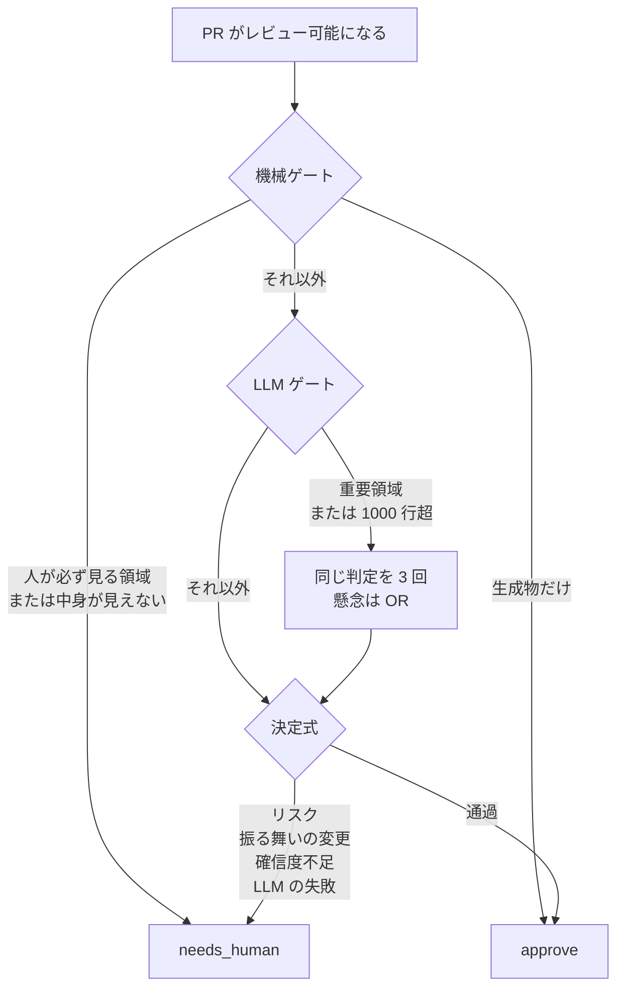

PR を bot が承認してよいか、人が見るべきかを、どの層で決めるか。newmo は 2026-10-27 の技術ブログで、社内の PR 判定器 riskjudge の設計を公開しました。riskjudge とは、PR ごとに approve（bot が承認する）か needs_human（人がレビューする）かを返す仕組みです。

この記事では、判定の順番、人が必ず見る領域、差分が見えないときの扱い、承認のやり直し、レビュー待ちの数え方を、その公開記事の範囲で整理します。設計の説明は newmo の技術ブログ 1 本に基づき、実装のソースは公開されていないため、効果の数字の読み方は仕組みのあとの注意点で扱います。

*この記事の全体像。以下、順に解説します。*

## riskjudge とは

riskjudge は、レビューできる状態になった PR を、approve と needs_human の二つに振り分けます。段は計算の軽いものから順に評価し、引っかかった時点で needs_human になり、後ろは評価しません。生成物だけの PR は、最初の機械ゲートで approve になります。それ以外で approve を返すのは、最後の決定式だけです。

### 機械ゲート

最初の段は機械ゲートです。パスと差分の形だけを見ます。認証、認可、個人情報、本番の DB マイグレーション、決済、インフラ、CI 設定に触れる PR は、ここで needs_human になり、LLM には回りません。

パスだけでは止めすぎる、として例外があります。GraphQL と Protocol Buffers では、意味のある行の削除と、input 型（入力の型）へのデフォルトなし非 null フィールドの追加を止めます。何を意味のある行と数えるかは、記事に書いていません。Protocol Buffers 側で、その input 型がどの宣言を指すかも、記事に書いていません。出力型へのフィールド追加、enum 値の追加、description の文言変更は、GraphQL と Protocol Buffers の両方で通します。CI の YAML は、コメント以外の変更を止め、コメントだけの変更は通します。この例外は GraphQL、Protocol Buffers、CI の YAML について書いてあり、決済などのパスへも効くとは書いていません。YAML のコメントかどうかは、diff の行では見ません。base と head の全文をパースし、コメントを除いた構造を比べます。`run: |` の中の `#` はシェルであり、YAML のコメントではない、と記事は理由を書いています。

自動生成物は LLM への入力から外します。生成物の定義は正規表現ではなく、`.gitattributes` の `linguist-generated` です。これは GitHub が「このファイルは生成されたものだ」と扱うための印です。付いているかは `git check-attr` で引きます。生成物だけの PR は、機械ゲートで approve になります。

機械ゲートが決めるフラグは、除外パス、テスト変更、テストかドキュメントだけ、設定かデータだけ、変更行数、重要領域、作成者がその領域のコードオーナーでないか、です。除外パスは、あとの決定式が needs_human を返す条件の一つです。認証や決済などの「人が必ず見る」一覧と、このフラグが同じ集合かは、記事は対応づけていません。テスト変更、テストかドキュメントだけ、設定かデータだけは、機械ゲートが立てるフラグとして並びます。掲載された決定式の順には、これらの名前は出てきません。何をテスト変更や設定やデータと数えるかも、記事に書いていません。重要領域は、記事では配車や決済を指します。コードオーナーとは、その領域の変更を見る責任者として登録された人です。変更行数の定義は、生成物、テスト、ドキュメントを除いた行数、と構造体のコメントにあります。

### LLM ゲート

機械ゲートを通過した差分は、LLM が中身を読み、JSON で返します。項目は、業務ロジックが変わったか、その理由、確信度、リスクの配列と severity（重大さの段階）です。確信度は、LLM が自分の判定に付ける 0 から 1 の値です。

業務ロジックは二段で問います。まず、本番の振る舞いが変わるかです。テスト、ドキュメント、見た目、文言、ログ、振る舞いを変えないリファクタは、変わらないとします。次に、変わるとして単純で定型的かです。既存パターンの踏襲で分岐の意味を変えず、金額や認証に触れないものだけを単純とします。単純に見えても、テストを伴わない変更や重要領域は人に回す、と記事は書いています。決定式の掲載順には、重要領域そのものや、テストの有無そのものの段はありません。重要領域は、このあとの 3 回判定と確信度 0.95 の側にもあります。人への固定と、閾値を超えた approve のどちらが勝つかは、記事は書いていません。

プロンプトは二つに分かれます。system instruction（モデルへの固定の指示）には、信頼境界、迷ったら人に回すこと、JSON スキーマだけを置きます。信頼境界が、どの入力を信用しない線なのかは、記事には書いていません。判定基準はユーザープロンプト側にあり、差分のフェンスより前に置きます。フェンスとは、ここから先は差分である、と区切る印です。フェンスより後ろは差分として扱います。注入の試みは、リスクとして報告させます。注入とは、差分の側に判定を操る指示を紛れ込ませる試みです。信頼境界と、このフェンスが同じものかどうかは、記事は書いていません。

配車や決済などの重要領域と、変更行数が 1,000 行を超える PR は、同じ判定を 3 回行います。この 1,000 行が、さきの変更行数（生成物、テスト、ドキュメントを除いた行数）と同じかは、記事だけでは確定しません。記事は決済を、機械ゲートで LLM に回さない対象と、ここで 3 回判定する重要領域の例の両方に挙げています。重なった PR をどの段で止めるかは書いていません。集約は多数決ではありません。1 票でも懸念があれば懸念ありとします。1 回の判定の懸念が、リスクの配列なのか、業務ロジックの変化なのか、確信度なのかは、記事は分けて書いていません。確信度は最小値を取ります。判定結果が一つも返らないときは、確信度 0 として人に倒れる、と掲載コードのコメントにあります。空なのが 3 回分の結果なのか、リスクの配列なのかは、このコメントの範囲では書いていません。1,000 行超を複数回に回す理由として、記事は、人のコメント率が判定結果より PR の大きさに相関し、200 行未満で 13〜27%、1,000 行超で 60% だった、と書いています。

### 決定式

approve か needs_human かを決めるのは、Go の純粋関数です。同じ入力なら同じ結果を返し、外部の状態は読みません。掲載の順序では、次の 1 から 5 に当たった時点で needs_human を返し、どれにも当たらなければ approve です。

1. 除外パス
2. LLM の結果が無い
3. 止めに相当するリスク
4. テストとドキュメント以外で業務ロジックが変わる
5. 確信度が 0 以上 1 以下でない、または閾値未満

止めに相当するリスクについて、掲載コードのコメントは「warning 以上」、本文は「suggestion 以外はすべて止める」と書いています。warning と suggestion は重大さの呼び名ですが、並びは載っておらず、両者が同じ集合かは分かりません。

確信度の閾値は、既定 0.80、重要領域 0.95 です。作成者がその領域のオーナーでなければ、0.10 を足します。承認の可否は、PR コメントの文字列ではなく、プロセスの終了コードで CI に渡します。掲載の関数は、どのゲートで決まったかの記録を省いたもの、と記事が書いています。

本判定のあと、別のプロンプトで三つの所見を評価します。戻しやすさ（easy か difficult か）、本番での検知（visible か gap か）、検証証拠（present か needs_evidence か）です。どれにも unknown と not_applicable があります。入力は差分とパスだけで、CI や監視は渡しません。結果は PR コメントの所見であり、今は approve か needs_human かには使いません。失敗やタイムアウトは unknown で、判定は変わりません。

### ラベルと、見えない変更

needs_human と判定した PR、および判定に失敗した PR には、`needs_human` ラベルを付けます。approve に変わったときと、レビュー自体が不要な PR では外します。レビュー自体が不要な PR がどれかは、記事に書いていません。データ基盤がラベルを取り込み、needs_human の PR 数と、人に回したのに指摘なしで merge された PR をダッシュボードで追います。ゲートごとに判定を記録している、とも書いています。

差分の中身が見えないときの扱いは、表になっています。

| 状態 | 扱い |
|---|---|
| 生成物を除いた差分が 512KB を超える | LLM に回さず needs_human |
| GitHub API が patch を返さない巨大ファイルやバイナリ | needs_human |
| 中身を変えないファイル移動 | 空の差分が正しいので、移動の見出しに置き換えて判定を続ける |
| LLM の呼び出し失敗 | needs_human にし、再判定してよい印を付け、次の push で判定し直す。印がラベルなのか別の記録なのかは、記事に書いていない |

判定は `pull_request_target` で動かします。これは GitHub Actions のイベントで、PR の head ではなく、マージ先である base のワークフロー定義と権限で動きます。記事は、PR のコードは実行せず、main の判定プログラムと GitHub API の差分を使う、と書いています。承認した PR に push があると承認は取り消されるので、新しい内容で判定し直します。人がレビューした PR と、人が bot の承認を取り消した PR は、自動では承認し直しません。

最初のモデルは Gemini 2.5 Flash で、提供終了に合わせて別のモデルへ移した、とあります。後継の名前は記事にありません。LLM ゲートの手前に速い判定を置くことは検討中で、まだ置いていません。

振り分けの全体は、次の順です。図の「人が必ず見る領域」は機械ゲートの矢印です。決済のように重要領域にも挙がるものが、この矢印と 3 回判定のどちらに乗るかは、図は分けていません。決定式の除外パスは、図の needs_human 側の矢印には名前がありません。掲載の決定式では、除外パスは needs_human です。戻しやすさなどの補助評価は、この分岐が終わったあとの所見で、図の分岐には入りません。ラベルは、needs_human になった結果を、リポジトリの外から数えるための印です。

## 注意点

記事の設計説明と、効果や運用の到達は分けて読みます。

### 効果の数字

効果の数字は、すべて newmo の記事 1 本の自己申告です。件数も、割合の分母もありません。200 行未満の人のコメント率 13〜27% と、1,000 行超の 60% も同じです。本番で 2 か月ほど、という期間が、Gemini 2.5 Flash から移す前か後か、混ざっているかも書いていません。

approve した PR がリリース後の不具合の原因になった割合は、needs_human の半分ほど、とあります。直後に、needs_human には大きな変更や重要領域が集まるので単純には比べられない、と記事自身が書いています。LLM がリスクを指摘して止めた PR は、レビューで不具合を指摘された割合が approve の 2 倍強です。一方、「業務ロジックの振る舞いが変わる」で止めた PR は approve とあまり差がなく、テスト付きの普通の機能追加まで止めていた、とあります。同じモデルで判定し直した一致は 85% ほどで、一致率は品質の指標にしない、と記事が明記しています。これらの比率を、ゲートが安全だと証明した数字としては使えません。

見逃した不具合の多くは、呼び出し先や別ファイルの SQL など、差分の外を読まないと分からないものだった、とあります。判定器の入力が差分とパスである限り、この型の見逃しは、期間を延ばしても同じ入力のまま残ります。

サンプル数、approve の割合、不具合の絶対率は、記事にありません。

### 生成物だけの承認

「見えないものはすべて needs_human」には、記事の図の中に例外があります。生成物だけの PR は機械ゲートで approve し、LLM は読みません。512KB の上限も、生成物を除いた差分です。生成された SQL や、生成器のバグが差分の外にある場合、記事が書いた見逃しの型に重なります。

`git check-attr` が base と head のどちらを見るかは、記事にありません。head なら、PR が `linguist-generated` を足してこの経路に入れる余地があります。生成物だけの approve と、認証などの「必ず人」のパスが同じ PR で重なったとき、どちらが先かも記事にありません。

掲載コードのコメントは「warning 以上のリスク」、本文は「suggestion 以外はすべて止める」と書いています。severity の並びは載っておらず、両者が同じ集合かは分かりません。YAML のパースに失敗したときの扱いも、記事にありません。1,000 行の「変更行数」が、生成物・テスト・ドキュメントを除く `ChangedLines` と同じかも、記事だけでは確定しません。512KB のほうは、生成物を除く、と表に書いてあります。記事は 512KB で暗黙の切り捨てを避ける、と書いています。それより小さい入力でモデルの内部が差分を切ることがあるかは、この記事には観測としてありません。

### 確信度の加算

コードオーナーでない作成者は、人に固定されるのではありません。確信度の閾値に 0.10 を足すだけです。既定は 0.80、重要領域は 0.95 です。足したあとを 1 で頭打ちにしないなら、重要領域かつ非オーナーは、確信度 1 以下では approve に届かない、という読み方ができます。掲載の `decide` は `thresholdFor(flags)` を呼ぶだけで、加算の実装は載っていません。頭打ちの有無は分かりません。掲載コードには省略があり、本番の分岐が記事と同じ順かも分かりません。

### レビュー待ちの件数

レビュー待ちでエージェントの新規着手を止める、は newmo の運用事実としては書いていません。記事の動詞は「使えます」「数えられるので、こうした停止条件も組み立てられる」「条件にできる」です。図の注記は、ダッシュボードを人が眺めている、と描写します。これは newmo の記事の図の話で、この記事の図ではありません。

引用元の [addyosmani/factory](https://github.com/addyosmani/factory) の `template/docs/factory/CHARTER.md` は、2026-10-28 に取得した内容で `CHARTER_STATUS: incomplete` のひな型でした。`STOP_IF` は着手を止める条件の欄で、その一例が `More than 3 items are already awaiting human review` です。`NEVER_AUTOMATE` は自動化しない項目の欄で、そこには `Merge decisions` があります。この 3 は、newmo が本番で強制した件数ではありません。

`needs_human` ラベルが、決めたゲートの名前を含むかは記事にありません。ゲートごとの記録は、ラベルとは別に存在する、と記事は書いています。補助の三項目（戻しやすさ、本番検知、検証証拠）は、速度や精度の制御にはまだ入っていません。記事は、承認条件に加えるかは所見を見ながら検討している、と書いています。

### 承認の取り消し

「承認した PR に push があると承認は取り消される」は、記事の記述です。GitHub の ruleset（リポジトリのルール集）では、古くなった承認を消す dismiss stale reviews は任意です。対象は、差分に影響する push です（[Available rules for rulesets](https://docs.github.com/en/repositories/configuring-branches-and-merges-in-your-repository/managing-rulesets/available-rules-for-rulesets)、2026-10-28 閲覧）。差分が変わらない push は、そのオプションの対象外です。newmo がそのオプションをオンにしているかは、ruleset が公開されていないので分かりません。人がレビューした PR と、人が bot 承認を取り消した PR を自動で承認し直さない、は記事が明記しています。これは ruleset のオプションとは別の、アプリ側の条件です。

### pull_request_target

`pull_request_target` で「PR のコードは実行しない」は、設計の自己申告です。ワークフロー YAML は公開されていません。GitHub の説明では、このイベント自体は base のワークフローと権限で動き、危険になるのは信頼できない head を checkout したあとで、ビルドやテストなどとして実行する場合です（[Securely using pull_request_target](https://docs.github.com/en/actions/reference/security/securely-using-pull_request_target)、2026-10-28 閲覧）。同じページは、公開リポジトリ向けの既定ポリシーが `pull_request_target` を止める方向で、いまは evaluate（実行は続き、強制後に止まるものを識別できる）だと書いています。2026-12-02 に、一般提供前からこの既定ポリシーを使っていた対象リポジトリへ強制する、とも書いています。private と internal には適用されません。newmo の対象リポジトリが公開かどうかは、記事にありません。

### 2025 年の公開スクリプト

2025 年の記事「Devinが作るPull Requestのセルフマージを禁止する」は、main へのマージには 1 人以上の承認、Devin（AI が PR を書く製品）が作った PR には 2 人以上の人間、2 人未満は commit status（チェックの成否）を failure にして branch protection（ブランチの保護ルール）で止める、と本文に書いています。同じページの掲載スクリプトは、状態が `approvalCount >= 2 ? 'success' : 'pending'` で、本文の failure と違います。AI の除外リストは `vars.AI_USER_DEVIN` だけです。`requiredApprovals` は `author` を参照して計算しますが、掲載範囲では `author` の定義が無く、その変数は比較に使われず、比較は定数 2 です。この食い違いは、公開断片をそのまま運用事実にしない理由になります。

riskjudge の bot 承認が、このカウンタに今も 1 人分として入るかは、現行の workflow が公開されていないので分かりません。GitHub の ruleset にある「未帰属の Copilot PR には設定より 1 人多く承認を求める」は public preview で、Copilot が人に帰属しない PR を開いた場合の話です。Devin や自前の bot へ、自動では広がりません。

### モデルの移設と、他社の数字

Gemini 2.5 Flash をやめた理由は、記事では「提供終了に合わせて」です。Gemini API の廃止表を 2026-10-28 に開くと、`gemini-2.5-flash` の Shutdown date は "No shutdown date announced" でした（[Gemini deprecations](https://ai.google.dev/gemini-api/docs/deprecations)）。どの API や製品の提供終了に合わせて移したかは、一本に確定していません。後継モデル名は記事にありません。

比較に使う他社の数字も、各社の自己申告です。Meta の RADAR（低リスクの差分を、メインラインへ取り込む landing まで自動で進める仕組み。[arXiv:2605.30208](https://arxiv.org/abs/2605.30208)、提出 2026-05-28、v2 は 2026-06-12）の abstract は、535K 超をレビューし 331K 超を landed、Diff Risk Score（差分の危険度スコア）の閾値を 25 パーセンタイルから 50 パーセンタイルへ緩めると approve rate が 60.31%、RADAR 対象の revert rate は非 RADAR の 1/3、Production Incident rate は 1/50、median time to close は 330% 超の短縮、review wall time は 35% 減、と書いています。この「330% 超の短縮」が所要時間を何倍にしたのかは、abstract の表現以上には換算しません。revert と Production Incident の比較は、RADAR がレビューした diff と非 RADAR の比較であり、自動で通した 331K 超だけではありません。全 diff の無作為比較でもありません。会議採録のメタデータは、arXiv の概要ページでは確認できなかったので付けていません。

Will Larson の small-change は、Imprint（その記事が書いている組織）での仕組みです。早い結果として約 10% が該当し、結果を言うには早い、と著者自身が書いています（[lethain.com/small-changes](https://lethain.com/small-changes/)）。次の比較表にある Imprint の列は、この small-change と同じ仕組みです。

公開実装が無いので、記事の設計と、いま動いているコードの一致は外部から確認できません。一致しない可能性を、穴が無いこととしては扱いません。

## 承認枠を埋めるかどうかが、移せる範囲を分ける

移せるかを見るときの違いは、bot が承認枠を埋めるかどうかと、待ち行列を着手の条件にしているかどうかです。Claude Code チームは、Anthropic が 2026-10-15 に公開した社内のコードレビュー運用です。公開プロダクトの Code Review は所見を出し、承認は人の判断のままです。自社のリポジトリでは、低リスクの一部を自動チェックだけで merge できます。

| 観点 | newmo riskjudge | Claude Code チーム（2026-10-15） | Imprint の small-change | Meta RADAR | factory のひな型 |
|---|---|---|---|---|---|
| 何を見て分けるか | パス、差分の形、LLM の所見、確信度 | 変更の危険度。作成者の信頼リストは、軽い経路の条件 | CI チェック。1,000 行未満、自動レビューの p1 と p2（どちらも重大な指摘。違いは分けていない）がない、そのサービスへの 10 件以上の merge、触るサービス数の上限 | 著者と出所、通してよいかの条件、静的な規則、ML の Diff Risk Score、LLM、結果が手続きで決まる検証 | 同じ項目でゲートが 2 回連続 red（通過しない。項目と red の中身は例以上に無い）、負荷の定義が無いパス、400 行超、待ち 3 件など。未完成の例 |
| 誰が承認枠を埋めるか | approve なら bot が承認する | エージェントの承認は人の枠を埋めない。低リスクは、信頼された作成者に限り、自動レビューとセキュリティが緑なら人 0 人になりうる | 人ではなく、approve か ignore かを返す自動のスキル。コメントはしない。ignore のとき PR をどう残すか、および approve が人の承認枠を埋めるかは、引用の範囲に無い | 条件を満たした低リスク diff を自動で landing に進める | `NEVER_AUTOMATE` に Merge decisions がある |
| 人を外さない領域 | 認証、認可、個人情報、本番 DB マイグレーション、決済、インフラ、CI。一部は中身を見て例外 | オーナーが敏感と書いたパスと、CI の workflow ファイルは常に人 | 共有ライブラリは対象外。`.small_change` で、資金移動などをパス単位で外せる | 通してよいかを分ける条件。abstract の一段要約より長い | 負荷の定義が無いパスに触れる修正は STOP |
| 再承認 | 記事は、push で承認を取り消し、人のレビューと人の dismiss は自動で承認し直さない、と書く。GitHub 側の dismiss は任意 | 承認は 1 コミットに紐づく。システムが保証できない新しい commit では承認をやり直す。何を保証できないかは、この文以上には書いていない | 再承認の手順は、引用の範囲には無い。軽い承認の資格は、CI チェックが独立に見る | abstract の範囲では未引用 | ひな型はマージ判断を自動化しない |
| 待ち行列 | ラベルで数える。停止条件にできる、と書く。本番で件数停止しているとは書いていない | 人の待ち時間は測る。revert や incident が増えたら承認を締める回路は、まだ無い、と書く | 約 10% が軽い承認の対象。結果はまだ早い | レビュー待ちの短縮を、選定された低リスク diff の前後で報告 | 待ちが 3 件を超えたら新しい実装を始めない、という例文 |
| 数字の性質 | 自己申告、分母なし。単純には比べられない、と記事が認める | チーム自己申告。6 月から 9 月で merged PR は倍以上、revert の割合は 40% 超低下（相対か差分かは、引用以上に決めていない） | 著者自身が「まだ早い」 | Meta の abstract。低リスク選定の上での比較 | 本番の実績値ではない |

newmo の bot 承認は、必要承認数が 1 のリポジトリでは、その 1 枠を埋めます。Claude Code チームが「エージェントの承認は人の枠を埋めない」と書いている点とは、ここが違います。

Agent Baseline の参照アーキテクチャは、"the agent proposes, policy authorizes, and infrastructure enforces" と書いています（[reference-architecture](https://agentbaseline.org/reference-architecture)、2026-10-28）。newmo の決定式は、この文の policy authorizes に、LLM ではなく Go の関数を置いています。Addy Osmani の "Software Factories, Light and Dark" は、"You can only hand a loop as much autonomy as you can cheaply and reliably verify, and not one inch more." と書いています（[addyosmani.com/blog/software-factories](https://addyosmani.com/blog/software-factories/)、2026-10-28）。検証を安く確実にできる範囲だけ自律を渡し、それ以上は渡さない、という文です。newmo の記事は、この考え方を PR の承認に当てた、と書いています。

設計の型として読むなら、次が記事と掲載の `decide` から取れます。掲載の `decide` は、除外パス、LLM 失敗、リスク、業務ロジック、確信度の順で needs_human を返し、最後だけが approve です。本文は、LLM の役割を「差分を読んで所見を返すところまで」と書いています。終了コードで CI に渡す、とあるので、差分の中の文字列を承認の印にしない、という意図が書かれています。`needs_human` ラベルと、ゲートごとの記録は、記事が公開しています。人がレビューした PR と、人が bot 承認を取り消した PR を自動で承認し直さない、も記事が明記しています。

業務ロジックのゲートが、レビュー指摘率を分けられていなかった、という自己申告は、効いていないゲートを外すか直す、という使い方の根拠になります。見逃しが呼び出し先と別ファイルの SQL に寄っていた、という自己申告は、判定器に渡す文脈の範囲を広げる検討の根拠になります。

一方で、待ち件数での停止は、newmo では「組み立てられる」までです。factory の 3 は未完成テンプレートの例で、同じファイルがマージ判断の自動化を禁止しています。半分、2 倍強、85%、13〜27%、60% は分母がない自己申告で、半分については、needs_human に大きな変更や重要領域が集まるので単純には比べられない、と記事が認めています。生成物だけは読まずに approve できます。非オーナーは人に固定されず、閾値へ 0.10 を足すだけです。重要領域でその加算を 1 で頭打ちにしないなら、確信度 1 以下では approve に届かない、という読み方も残ります。push で承認が消えること、PR のコードを実行しないこと、2025 年の「人間 2 人」と bot 承認が衝突しないことは、ruleset と YAML が公開されていないので監査できません。補助の三項目は、承認に接続されていません。

結論の強さは、設計の型として移す範囲では高いです。効果の大きさや、待ち件数で速度が制御できている、という範囲では低いです。

## 自分のリポジトリで先に確認すること

採用するのは、次の分け方です。newmo の 0.80 や 0.95 や、factory の 3 は、自分のリポジトリの検証なしには写しません。

1. 承認してよいかはコードが決めます。LLM には、差分を読んだ所見と、確信度と、リスクの種別の名前だけを返させます。これは GitHub の `needs_human` ラベルではありません。コメント文面の中の印では承認しません。
2. どのゲートで needs_human になったかを、ラベルと、あとから集計できる記録の両方に残します。二値のラベルだけでは、業務ロジックゲートのように効いていない段を後から見分けられません。newmo はゲートごとの記録を持っている、と書いています。ラベルがそのゲート名を運ぶかは分からないので、自分の実装ではゲート名をクエリできる列にします。
3. レビュー待ちの件数は、エージェントが新しい実装を始める前の条件にできます。止める件数は、自分のリポジトリで人がレビューに戻るまでの時間を見て決めます。factory の 3 と、newmo の 0.80 / 0.95 / +0.10 は写しません。
4. 差分が無い、patch が取れない、判定器が失敗した、のときは承認しません。生成物だけの差分を、生成器のソースが同じ PR に無い状態で自動承認するかどうかは、SQL や呼び出し先の見逃しが記事の中心だったことを踏まえて、初期は人に残します。
5. 人がレビューした PR と、人が bot の承認を取り消した PR は、次の push が自動で承認し直しません。GitHub の dismiss stale reviews は任意なので、アプリ側の条件と、ruleset のオプションを両方置きます。差分が変わらない push は、GitHub のそのオプションだけでは消えません。
6. エージェントが書いた PR に、人の承認を 2 つ求めるルールが残っているなら、判定 bot の Approve をその人数から除外します。除外しないと、bot 1 と人 1 で、人間 2 人の意図を満たしたことになります。GitHub の Copilot 向け追加承認は、自前 bot には効きません。
7. 判定器に渡す文脈は、差分の中だけにしません。記事が見逃しの中心とした、呼び出し先と、別ファイルの SQL を、初期の追加文脈にします。広げたあとの誤検知は測ってから、次のファイル種別に進みます。
8. 「業務ロジックが変わる」だけを理由に人へ戻すゲートは、レビューで見つかる不具合を分けられていたかを見てから残します。newmo の自己申告では、分けられていませんでした。

bot の Approve を、差分の外まで安全だという証明にはしません。待ち件数で着手を止めることを、newmo が本番で証明したこととしても扱いません。

直近で見る場所は、次の四つです。

1. いまのリポジトリで、承認の可否を出している場所が、LLM の文面か、終了コードかを確認します。
2. needs_human に相当する状態を、ゲート名つきで残せるかを確認します。
3. レビュー待ちが何件を超えると、人の待ち時間が伸びるかを、自分の件数で見ます。3 は仮の初期値にしません。
4. エージェント著者の PR を数える workflow が、bot の Approve を人に数えていないかを確認します。

逆転するのは、必要承認が 0 で bot の承認がマージ条件にならないリポジトリ、または、差分の外を読むコストがレビュー待ちより大きいと自分の計測で分かったときです。その場合でも、読んでいない差分の自動承認と、人の dismiss の上書きは残しません。

## まとめ

riskjudge は、機械ゲート、LLM の所見、Go の決定式の順で、PR を approve と needs_human に分けます。承認の可否はコードが決め、LLM は所見を返します。needs_human はラベルになり、ゲートごとの記録とあわせて、レビュー待ちを数える材料になります。

効果の比率は分母のない自己申告で、ゲートの安全性の証明には使えません。待ち件数で新しい作業を止めることは、newmo の記事では「条件にできる」までです。移すときは、承認枠を bot が埋めるか、生成物だけを読まずに通すか、人の dismiss を上書きしないか、を先に固定します。閾値と件数は、自分の待ち時間から決めます。

この記事が少しでも参考になった、あるいは改善点などがあれば、ぜひリアクションやコメント、SNSでのシェアをいただけると励みになります！

## 参考リンク

- newmo 技術ブログ（2026-10-27）「プルリクエストのリスクを判定する仕組み」 https://tech.newmo.me/entry/2026/10/27/100000
- newmo 技術ブログ「Devinが作るPull Requestのセルフマージを禁止する」 https://tech.newmo.me/entry/ai-pull-request-protection
- GitHub Docs, Securely using pull_request_target（2026-10-28 閲覧） https://docs.github.com/en/actions/reference/security/securely-using-pull_request_target
- GitHub Docs, Available rules for rulesets（2026-10-28 閲覧） https://docs.github.com/en/repositories/configuring-branches-and-merges-in-your-repository/managing-rulesets/available-rules-for-rulesets
- Google AI for Developers, Gemini deprecations（2026-10-28 閲覧） https://ai.google.dev/gemini-api/docs/deprecations
- Addy Osmani, Morgan Westlee Lunt, Qing Wang（2026-10-15）How the Claude Code team does code review https://claude.dev/blog/solving-code-review-at-anthropic/
- Will Larson, Speeding up code review with small-change https://lethain.com/small-changes/
- Chris Adams ほか, Automating Low-Risk Code Review at Meta: RADAR. arXiv:2605.30208（提出 2026-05-28、v2 は 2026-06-12） https://arxiv.org/abs/2605.30208
- Agent Baseline, The Secure Software Factory: A Reference Architecture https://agentbaseline.org/reference-architecture
- Addy Osmani, Software Factories, Light and Dark https://addyosmani.com/blog/software-factories/
- addyosmani/factory, template/docs/factory/CHARTER.md（2026-10-28 に取得。`CHARTER_STATUS: incomplete`） https://github.com/addyosmani/factory/blob/main/template/docs/factory/CHARTER.md
