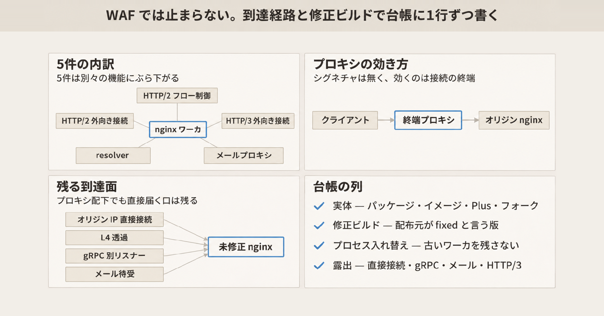
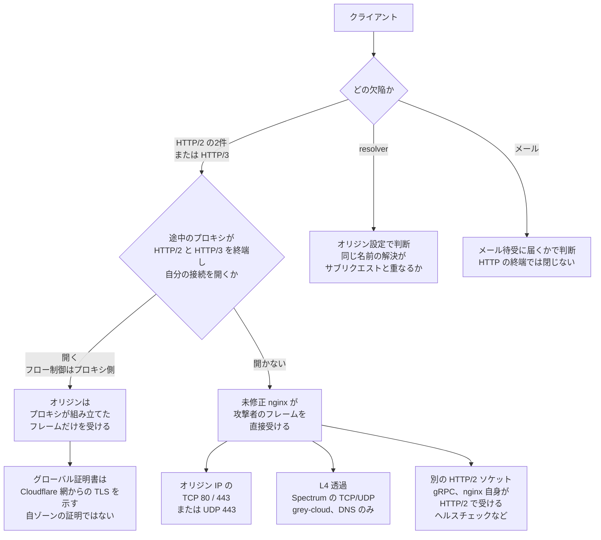

2026年11月18日、F5 と nginx.org は nginx のセキュリティ修正を公開しました。研究組織 Xint（Theori）が「nginx2root」と名付けた5件の脆弱性で、いずれも nginx のワーカプロセス（実際にリクエストを処理する子プロセス）のメモリ破壊です。報道や社内の会話では「未認証でコード実行」「修正までは WAF でしのぐ」といった言い方も出ています。

この記事は、nginx を運用する組織で脆弱性対応を担当する人が、修正版を入れるまでの間に何で守れるか、そして脆弱性台帳にこの5件をどう書くかを決めるための材料を、公開された一次資料から整理したものです。ここでの「台帳」は、パッケージやコンテナイメージなどの実体ごとに、修正状況と外部からの到達経路を1行で記録する管理表を指します。nginx2root の中身、5件の対象範囲、言い過ぎになりやすい言い方、WAF とプロキシで塞がるものと残るもの、修正済みの見分け方、同じ週に出た PHP と Ruby の扱い、台帳の列を順に扱います。

記載は2026年11月21日時点の公開情報に基づきます。

*この記事の全体像。以下、順に解説します。*

## nginx2rootとは

nginx2root は、2026年11月18日に公開された nginx の5件の脆弱性に、発見した Xint が付けた呼び名です。5件はどれもワーカプロセスのメモリ破壊で、条件が揃うと未認証の遠隔攻撃者がコードを実行できる、と F5 の CVE レコードは書いています。

- 修正版: オープンソース版の stable（安定系列）1.30.7 と、mainline（開発系列）1.31.9
- 深刻度: nginx.org は5件のうち2件を major、3件を medium と分類
- スコア: F5 が CNA（CVE 番号を割り当てて内容を記載する機関）として付けた値は、5件とも CVSS 3.1 で 8.1、CVSS 4.0 で 9.2

### 5件は別々の機能にぶら下がる

5件は1つの欠陥ではなく、それぞれ別の機能を使っているときにだけ経路になります。

- HTTP/2 のフロー制御（送受信できるデータ量を窓の大きさで調整する仕組み）
- HTTP/2 で受けたリクエストをバックエンドへ転送する外向き接続を持ち、実行時にワーカの空き接続が少ないとき
- HTTP/3（QUIC）で受けたリクエストをバックエンドへ転送する外向き接続を持ち、実行時にワーカの空き接続が少ないとき
- `resolver`（nginx が実行時に DNS で名前を解決する機能）を使い、本リクエストとサブリクエスト（1つのリクエストの処理中に nginx が内部で発行する追加のリクエスト）が同じ名前を同時に解決するとき
- メールプロキシとして動く待受

コード実行についての CNA レコードの文は、「ASLR（メモリ配置をランダム化して攻撃を難しくする OS の仕組み）が無効か、攻撃者が ASLR を回避できた場合」という条件付きです。ワーカのクラッシュとメモリ破壊は、ASLR の条件を付けずに書かれています。

### 公開されている実証

公開されている実証は2つあり、出所と条件が異なります。

- Rapid7 の公開 PoC は、CVE-2026-123007 でコード実行を狙う手法で、相手は起動直後のローカル Docker（linux/amd64、nginx 1.31.8、HTTP/2 と TLS）です。送る平文の合計は約 119 GiB（約 128 GB）で、TLS のオーバーヘッドは別です。この環境で、ヒープと glibc のアドレス（ASLR を回避する手がかりになる情報）を取得した、と書いています。失敗しやすい条件は後の節で扱います。
- Xint は、自分が管理する AWS 上のサーバへ、公開 IP 経由で実証を動かしたと書いています。対象は自分のサーバで、第三者のサーバや、Cloudflare のプロキシを経由する構成は含みません。

### 名前の「root」の部分

nginx2root という名前には、nginx の欠陥とは別に、Linux カーネルの SCTP（TCP や UDP とは別のトランスポートプロトコル）実装にある use-after-free が含まれます。Cloudflare の2026年11月20日の記事の時点で詳細は伏せられており、カーネルの修正は11月18日時点で出ていない、と書かれています。2026年11月21日時点の公開資料でも、カーネル側の修正状況は確認できません。台帳では、nginx の行とは別にカーネルの行として扱います。

### どの欠陥が、どこまで届くか

Cloudflare は、プロキシしているホスト名ではクライアントの HTTP/2 と HTTP/3 が Cloudflare のエッジで終端し、オリジン（利用者側の nginx）が受け取るのは Cloudflare が組み立て直したリクエストだ、と説明しています。エッジの実装は Rust で書かれた FL2 で、社内に残っていた nginx のフォークも公開前に関連する経路を閉じた、と同じ記事にあります。

この説明を踏まえると、5件は「攻撃者のフレームが未修正の nginx まで届くか」で分かれる HTTP 系の3件と、オリジン側の設定や待受で決まる2件に分けて考えられます。

図の用語を補足します。Spectrum は Cloudflare の転送製品で、TCP/UDP をそのまま転送する型のほか、HTTP/HTTPS を扱う型もあります。grey-cloud は Cloudflare の DNS 設定でプロキシを通さない（DNS 解決だけを返す）状態です。グローバル証明書は、後述する Authenticated Origin Pulls で全アカウントが共有する証明書です。ゾーンは、Cloudflare に登録したドメインの単位です。図の右下のノードは、プロキシ経由の接続でもグローバル証明書だけでは「自分のゾーンを通った接続」と区別できない、という意味で、直接接続を閉じた証拠にはなりません。

オリジン IP への直接接続、L4 での透過、別ソケットは、プロキシ配下のサイトが1つあっても残る到達面です。

## 5件の対象バージョンと構成

範囲は nginx.org の記載、スコアは F5 の CNA が公開した CVE JSON（2026年11月18日）に基づきます。NGINX Plus（F5 の商用版）の影響範囲は CVE ごとに違い、1つの下限に揃えられません。

| CVE | nginx.org | OSS の対象範囲 | 経路になる構成 | NGINX Plus（CNA 記載） |
|---|---|---|---|---|
| CVE-2026-123007 | major | 1.9.5〜1.30.6、および 1.31.0〜1.31.8 | HTTP/2。フロー制御の窓が閾値を超え、ヒープのあふれのあとワーカが segfault。影響はデータプレーン（トラフィックを処理する側）に限られる | 37.1.0 以上 37.3.0.1 未満、37.0.0 以上 37.0.8.1 未満。旧系列の起点は R33 |
| CVE-2026-123633 | medium | 1.19.7〜1.30.6、および 1.31.0〜1.31.8 | HTTP/2 かつバックエンドへの外向き接続、かつ実行時にワーカの空き接続が少ない。設定値 `worker_connections` が小さいこと自体は条件ではない | 37.1.0.1 以上 37.2.0.1 未満、37.0.0.1 以上 37.0.7.1 未満。旧系列の起点は R33。範囲が 123007 と違う |
| CVE-2026-121810 | medium | 1.25.0〜1.30.6、および 1.31.0〜1.31.8 | HTTP/3（QUIC）かつバックエンドへの外向き接続、かつ実行時にワーカの空き接続が少ない。平常時に空きがあることは対象外の判定に使わない。F5 は攻撃者の制御外の条件にも依存すると書く | アドバイザリの行を個別に見る |
| CVE-2026-123634 | medium | 0.6.18〜1.30.6、および 1.31.0〜1.31.8 | `resolver` を使い、本リクエストとサブリクエストが同じ名前を同時に解決する。変数を使った `proxy_pass` と、サブリクエストを発行する mirror（リクエストの複製送信）/ SSI（サーバサイドインクルード）は確認済みの例。`proxy_pass` が無いだけでは対象外にしない | 個別に見る |
| CVE-2026-113425 | major | 0.5.33〜1.30.6、および 1.31.0〜1.31.8 | メールプロキシとして動作し、その待受に届く。メールプロキシモジュールの use-after-free。`proxy on` と `auth_http` は Cloudflare が挙げる例で、その文字列が無いだけでは対象外にしない。HTTP のリバースプロキシには載らない | 個別に見る |

NGINX Plus 列の「以上〜未満」は CNA が記載した影響範囲で、「未満」側の値はその系列の修正版の候補です。値が CVE ごとに違うため、たとえば 37.2.0.1 は CVE-2026-123633 の範囲を外れても、CVE-2026-123007 の範囲には残ります。5件すべてを直すビルドは、5件分の F5 アドバイザリを突き合わせて決めます。

表の「R33」は、37.x より前の旧系列で使われていた NGINX Plus のリリース番号です。CNA の記載では、CVE-2026-123007 と CVE-2026-123633 の影響は旧系列の R33 から始まります。F5 のアドバイザリ K000163926 と K000163928 では、R34〜R36 は影響範囲にあり、その系列の中に修正版が出ていないとされています。R 番号と 37.x の番号の対応や移行先は、F5 のアドバイザリ本文で自分のリリースの行を確認してください。CVE-2026-121810 の CVE JSON は下限を "1.25.09" と記載していますが、nginx.org の 1.25.0 を採りました。

### バージョンの比較は系列ごとに行う

OSS の対象範囲は系列で切ります。1.30.7 は stable 系列の修正版なので、1.31.0〜1.31.8 の mainline 系列はまだ対象です。修正の条件は「1.30 系は 1.30.7 以上、1.31 系は 1.31.9 以上」です。`>= 1.30.7` という単純な比較は、未修正の 1.31.0〜1.31.8 を合格にしてしまいます。

### 外向き接続は proxy_pass に限らない

CVE-2026-123633 と CVE-2026-121810 の「外向き接続」は `proxy_pass` だけを指しません。nginx 互換の Angie 1.12.5 の変更履歴は、リクエスト処理が外向き接続を必要とすること（例としてプロキシ先）と書いています。Xint は `proxy_pass`、`fastcgi_pass`、`grpc_pass` を例に挙げています。

### CVE-2026-123007 に必要な流量

CVE-2026-123007 を突くには大量の送信が必要で、見積もりには出典によって幅があります。Cloudflare は約 112 GB、約86億回の WINDOW_UPDATE（HTTP/2 で受信側が送信側に窓を広げてよいと伝えるフレーム）で、窓の値が 2^64 付近に達すると書いています。Rapid7 は TLS のオーバーヘッドを除いた平文の合計を約 119 GiB（約 128 GB）とし、10 Gbit/s で約2分、1 Gbit/s で約17分と見積もっています。どちらの見積もりでも、100 GB を超える送信が必要です。

Rapid7 の PoC の説明は、並行するクライアント、使い込まれたヒープ、遅い経路、フレームを書き換えるプロキシがあると失敗しやすい、と書いています。今のところ別のコード実行の手法は知らない、とも書いています。インターネット全体を走査してデータを公開している Censys は、壊れたフロー制御状態まで届く 5.69 MB の平文キャプチャを公開した、と Cloudflare が引用しています。

### ディストリビューションごとの差

Ubuntu の CVE-2026-123633 のページは、Ubuntu 16.04〜22.04 では、`ssl` を伴わない平文（TLS を使わない）HTTP/2 の待受 `listen ... http2` だけがこの経路で、TLS 上の HTTP/2 は同じ欠陥に当たらない、と書いています。14.04（nginx 1.4.6）は HTTP/2 を持たないので Not affected です。24.04 以降は上流の範囲に従います。

### 同じ日に出た隣接の CVE

2026年11月18日の nginx.org のお知らせには、nginx2root 以外の修正も並んでいます。

- CVE-2026-118899: TLS 1.3 でリクエストボディを読むときの無限ループ。nginx.org は major、対象は 1.13.0〜1.30.6 と 1.31.0〜1.31.8。CNA のスコアは CVSS 3.1 で 7.5、CVSS 4.0 で 8.7 で、影響は可用性のみ。CNA のバージョン記載が乱れているため、範囲は nginx.org を採ります
- CVE-2026-120993: PROXY protocol v2（ロードバランサが元のクライアントのアドレスを後段へ渡すためのヘッダ形式）の NULL 参照。nginx.org は minor、対象は 1.31.4〜1.31.8 で、修正は 1.31.9 以上のみ

## 注意点

nginx2root については、一次情報より広い言い方が出回っています。2026年11月21日時点で書いてよい範囲を並べます。同じ週に公開された PHP（CVE-2026-126714）と Ruby（CVE-2026-132825 ほか）の脆弱性も一緒に語られることが多いため、その言い方も含めます。PHP と Ruby の詳細は後の節で扱います。

| よくある言い方 | 一次情報で書いてよい範囲 |
|---|---|
| 5件とも既定構成で未認証の遠隔コード実行 | nginx.org の分類は major が2件、medium が3件。コード実行の文は ASLR の条件付き。該当機能を使っていなければ、その CVE は経路にならない |
| WAF が修正までの隙間を埋める | Cloudflare は「WAF ルールは関係ない」と書いている。AWS Security Bulletin 2026-192 も、完全な HTTP リクエストになる前の HTTP/2 の問題なので WAF では実質的に止められない、と書いている |
| nginx だけで root が取れる | root は、詳細が伏せられたカーネル SCTP の欠陥と連鎖させた話。2026年11月21日に確認した Xint と Cloudflare の公開資料では、SCTP 欠陥の CVE 番号は見当たらない。SCTP カーネルモジュールの読み込みを止める modprobe の設定 `install sctp /bin/false` は、読み込み済みのモジュールやカーネル組み込みの SCTP を止めない |
| 日本のサイトの6割超が nginx | Web 技術の利用率を調査している W3Techs の値。サーバ所在地を日本と判定し、Web サーバを識別できたサイトのうち Nginx は 62.9%。`.jp` ドメインでは 53.6%、日本語コンテンツでは 58.6%。サイト数であり、トラフィックや組織数ではない。CDN の向こうにあるオリジンの製品は常に識別できるわけではない |
| インターネット上の nginx の 98.9% が影響を受ける | Cloudflare が Xint の Shodan（インターネットに接続した機器を検索できるサービス）での調査（2026年11月10日）を引用した値。`product:nginx` 約5670万件のうち、バージョンが見えた約1194万件の 98.9%。Censys は11月19日時点で、HTTP/2 を話し影響を受け得るバージョンのサービスを約880万件としている。バージョン文字列はバックポートを見落とす |
| グローバルの Authenticated Origin Pulls を入れれば直接接続は消える | Cloudflare の公式ドキュメントは、グローバル証明書は全アカウントで共有され、接続が Cloudflare のネットワーク発であることしか保証しない、と書いている |
| Rails の既定構成で遠隔コード実行が公式に確定 | Ruby 公式は、一部に RCE を示す PoC がある、と書いている。Rails や Sinatra の名前は出していない。CVE-2026-132825 の CNA のベクタはローカル（AV:L） |
| CISA KEV に載っている | Cloudflare の記事は11月19日時点で、5件とも KEV（CISA が公開する、実際に悪用が確認された脆弱性のカタログ）に無く、悪用の報告も見ていない、と書いている。2026年11月21日に参照した KEV カタログ（catalogVersion 2026.11.20）にも、5件と CVE-2026-126714、CVE-2026-132825 は無い。KEV に無いことは、プロキシ経路が安全であることの証明にはならない |

公開されている2つの実証は、どちらも実運用の環境で無条件にコード実行へ届くことを示したものではありません。対応の緊急度は、CVE レコードの「条件付きでコード実行に至る」という記載と、ASLR の条件なしで起き得るワーカのクラッシュの両方で見積もります。

国内報道の見出しにも幅があります。日経 xTECH の見出しは「6割超の日本サイトが使う nginx に危険な脆弱性、AI活用で複数組織が発見」（2026年11月19日）です。日経本紙は「およそ6割とされる」と伝聞で書いています。ITmedia（2026年11月19日）は5件すべてではなく、HTTP/2 の2件を「緊急」、CVSS v4 で 9.2 として伝え、国家サイバー統括室が更新を呼び掛けたと書いています。国家サイバー統括室の公式の呼びかけとして確認できるのは、X アカウント `@cyber_forecast` の投稿（日本時間2026年11月19日 01:04）で、Wiz のブログへリンクしています。官房長官は11月19日の会見で、関連する被害の報告は受けていないと述べた、と ITmedia の続報が伝えています。

## WAFとプロキシで塞がるもの、残るもの

前節のとおり、この5件にはシグネチャで一致させる WAF ルールがありません。Cloudflare はマネージドルールを出していません。プロキシで塞がると言えるのは、HTTP/2 と HTTP/3 の接続そのものをプロキシ側で終わらせる場合です。

### 塞がると言ってよい条件

次の3条件がすべて揃ったときだけ、HTTP/2 と HTTP/3 の3件はプロキシで塞がっていると言えます。

1. そのホスト名へのクライアント接続は、HTTP/2 と HTTP/3 を終端するプロキシで終わる
2. プロキシは自分の接続をオリジンへ開き直す。Cloudflare がオリジンへ HTTP/2 で接続する場合も、フロー制御を持っているのは Cloudflare 側だ、と Cloudflare は書いている
3. 実際に設定された HTTP/2 と HTTP/3 の待受すべてに、プロキシの外から直接届かない。TCP 80/443 と UDP 443 は代表例で、QUIC の公式の設定例には `listen 8443 quic` もある

メールの CVE-2026-113425 は、この3条件とは別に、メール待受へ届くかで判断します。

この条件で効いているのは接続の打ち切りであり、シグネチャの一致ではありません。他社の CDN も同じように終端する、とは一般化できません。Cloudflare の HTTP プロキシが攻撃者のフレームを CVE-2026-123007 や CVE-2026-123633 の形でオリジンへ転送した実証は、2026年11月21日時点で公開資料には見当たりません。

### プロキシ配下でも残る面

| 面 | 何が残るか |
|---|---|
| オリジン IP への直接接続 | プロキシの外にある。HTTP/2 を交渉できれば CVE-2026-123007 の経路 |
| Spectrum の TCP/UDP、L4 ロードバランサ、Kubernetes の hostPort（Pod がノードのポートを直接使う設定）、TCP をそのまま通す Ingress | フレームをそのまま通すため終端していない。Spectrum の HTTP/HTTPS 型は、製品名ではなく実際に L7 で終端しているかで判定する |
| grey-cloud、DNS のみ、内部の未プロキシ nginx | Cloudflare の記事が保護の対象外と書いているもの |
| メールプロキシ | HTTP 用のプロキシはメールを運ばないため、CVE-2026-113425 は残る |
| resolver と、同じ名前を同時に解決するサブリクエスト | Cloudflare は「難しくはなるが完全には守らない」と書く。ログの "could not cancel ... resolving" は、未修正版では alert、修正版 1.31.9 では debug レベルで出る。Cloudflare が未修正の兆候とするのは alert レベル。文字列が無いことは影響が無いことの証明にならず、名前が CNAME（別名）経由で解決される場合は出ないこともある |
| `mirror_request_body`（mirror で複製するリクエストに本文を含めるかの設定） | Xint の実証は `off` の構成で動いた。既定の `on` ではその実証は止まったが、ほかのサブリクエストの経路まで止まるわけではない。`on` にしても resolver の CVE は残る |
| gRPC | `grpc_pass` は HTTP/2 モジュールを必要とし、公式の設定例は `http2 on`。サイト本体をプロキシしていても、gRPC 用の別リスナーが HTTP/2 のままなら別の経路 |
| ヘルスチェック、stub_status（nginx の接続数などを返す状態ページ）、Plus API（NGINX Plus の管理用 API） | コミュニティ版 ingress-nginx（Kubernetes 向けの nginx ベースの Ingress コントローラ）のヘルスチェックとメトリクス用の 10254 番ポートは、コントローラの Go の HTTP サーバで nginx のワーカではないため、開いていること自体は5件の経路ではない。nginx 自身が受ける stub_status や Plus API は別の行として扱う |
| HTTP/3 | Cloudflare はオリジンへ HTTP/3 を話さない、と書く。オリジンが自分で UDP 443 を開けていれば CVE-2026-121810 は残る。Debian 12 の nginx 1.22 はこの CVE の範囲外。Ubuntu では 26.04 と 26.10 だけが HTTP/3 の対象 |
| グローバル AOP | 共有証明書は、TLS の相手が Cloudflare のネットワークであることだけを示し、自ゾーンからの接続であることは保証しない。Cloudflare の IP 許可リストも共有アドレスなので同じ。自アカウントに絞るには、ゾーン単位またはホスト名単位の証明書をオリジンで検証することが前提になる。ただし、オリジンが発行元 CA を信頼する設定だけでは、同じ CA や同じ証明書を使う別ゾーンからの接続も受け入れる。「自ゾーンに限った」と記録するには、オリジンが受け入れる資格情報の利用範囲がそのゾーンに限られている証拠が別に要る |

AOP は Authenticated Origin Pulls の略で、Cloudflare がオリジンへ接続するときにクライアント証明書を提示し、オリジン側でそれを検証する仕組みです。グローバル証明書は公開されていますが、公開されているのは証明書で、秘密鍵ではありません。攻撃者がその証明書を提示して HTTP/2 フレームを注入できる、という意味ではありません。ただし全アカウントで共有されるため、有効化しただけでは「直接接続を閉じた」とは言えません。

Xint の露出確認の手順は、CDN 経由の試験はプロキシにしか届かないので、nginx へ直接も試す、というものです。

### http2 off で一時退避するときの条件

`http2` ディレクティブは nginx 1.25.1 以降にあり、既定値は off です。ただし、古い書式の `listen ... http2` が残っていれば、そのリスナーでは HTTP/2 が有効になります。`http2 off` は、そのリスナーの CVE-2026-123007 と CVE-2026-123633 を止める候補にはなりますが、次の点に注意が必要です。

- `http2 off` は、設定に残っている古い書式の `listen ... http2` を自動では消さない。実効設定は `http2 on` と `listen ... http2` の両方を見る
- ブラウザは HTTP/1.1 に落ちる
- resolver、HTTP/3、メールの3件には効かない
- gRPC が依存するリスナーでは、その gRPC が止まる

このため、一括で `http2 off` を入れるのは避け、そのリスナーの実効設定、同居するバーチャルホスト、HTTP/2 を必要とするクライアントを確認したあとに限ります。

止めたことの確認にも段階があります。新規接続が HTTP/1.1 になったという観測だけでは、新規の HTTP/2 を止めたことになりません。クライアントが HTTP/2 を提示しなかった場合も同じ結果になるからです。また reload が失敗すると、nginx は古い設定のまま動き続けます。

- 「新規の HTTP/2 を止めた」と書けるのは、設定の適用が成功し、対象の待受で HTTP/2 対応のクライアントが新規に HTTP/2 を確立できないことの両方を記録したあと
- 「退避済み」と書けるのは、それに加えて、そのリスナーの既存の HTTP/2 接続が終わったか、古いワーカが終了したことを確認したあと

HUP シグナルによる reload だけでは、古いワーカが処理中の接続を抱えたまま残ります。

## 修正済みをどう見分けるか

`nginx -v` が表示する上流のバージョン番号は、修正済みかどうかの判定に足りません。ディストリビューションは上流の番号を保ったまま修正を取り込む（バックポートする）ことがあり、1.30.7 未満の番号でも修正済みの場合があります。逆に 1.30.7 以上でも、フォークや別製品は別に確認が要ります。

修正版を入れたあとは、プロセスの入れ替えも確認します。HUP（reload）は新しい設定を読むだけです。実行ファイルの入れ替えは nginx.org の制御手順では USR2 シグナルで行い、古いワーカは古いバイナリのまま残ります。入れ替えのあと古いマスタプロセスを終了させる手順が公式に用意されています。

### 2026年11月21日時点のパッケージ

| 系統 | 5件に対する状態 |
|---|---|
| nginx.org OSS | 1.30 系は 1.30.7 以上、1.31 系は 1.31.9 以上。単純な `>= 1.30.7` は使わない |
| NGINX Plus | CVE ごとに影響範囲が違う。前節の表と5件分の F5 アドバイザリを突き合わせ、すべての範囲を外れるビルドを台帳に書く |
| Ubuntu USN-9159-1（2026-11-19） | 5件を修正した改訂。26.10 は `1.30.4-7ubuntu1.2`、26.04 は `1.28.3-2ubuntu1.13`、24.04 は `1.24.0-2ubuntu7.20`、22.04 は `1.18.0-6ubuntu14.23`。20.04 以前は Ubuntu Pro（ESM、標準サポート終了後の延長セキュリティ保守）の範囲で扱われる |
| Ubuntu USN-9182-1（2026-11-20） | 翌日の別アドバイザリで、対象は5件とは別の CVE-2026-125283、CVE-2026-123640 と、前述の CVE-2026-118899。26.10 は `1.30.4-7ubuntu1.3`、26.04 は `1.28.3-2ubuntu1.14`、24.04 は `1.24.0-2ubuntu7.21`、22.04 は `1.18.0-6ubuntu14.24`。5件の初回修正ではないが、台帳に書く現行のパッケージはこちら |
| Debian | bookworm（Debian 12）のセキュリティ更新の配布元（security）は `1.22.1-9+deb12u11`（DLA-4918-1）。このビルドで fixed と確認できるのは CVE-2026-123007 で、ほかの CVE は Debian のトラッカーで CVE ごとに確認する。trixie（Debian 13）の security は `1.26.3-3+deb13u11`（DSA-6642-1、2026-11-19、5件を含む）。開発版 sid の `1.30.6-4` は fixed。次期版 forky の `1.30.6-3` は vulnerable。security を経由しない trixie の `1.26.3-3+deb13u7` は vulnerable |
| Amazon Linux | ALAS2023-2026-3494（2026-11-18）で `nginx-1.30.7-1.amzn2023.0.1`（x86_64 と aarch64、モジュールも同版）。更新は `dnf update nginx --releasever 2023.12.20261118` または `dnf update --advisory ALAS2023-2026-3494 --releasever 2023.12.20261118`。AL2 の nginx1 extra は ALAS2NGINX1-2026-018（2026-11-19）で fixed |
| Angie | 1.12.5（2026-11-20）。英語の変更履歴が5件を nginx 1.31.9 からの移植として名指ししている。Angie のバージョン番号は nginx の番号とは別 |
| OpenResty | 2026年11月21日時点の最新タグは `v1.31.8.1` で、nginx 1.31.8 までの CVE の修正を含むもの。1.31.9 で直った5件はまだ含まない。対応を追う issue #1166 は OPEN（2026-11-20 更新）。GitHub の latest release は `v1.27.1.2`（2025-10-08）で、最新タグとは別 |
| `kubernetes/ingress-nginx` | リポジトリは archived。修正の取り込みは期待できない。同梱の nginx の版は確認できていない |
| Red Hat | errata は上流のバージョン番号を保ったまま修正する（例: RHEL 10 の `nginx-2:1.26.3-16.el10_3.3`）。一方で、OpenShift Pipelines のイメージ、3scale の `apicast-gateway-rhel8`、Hardened Images の nginx は、2026年11月21日時点で Affected のまま erratum が出ていない。Red Hat の CVE ページで最新の状態を確認する |

### 機能の棚卸し

どの CVE が経路になるかは、使っている機能で決まります。棚卸しに使うのは、既存の設定ファイルと include 先の読み取り、および `nginx -V`（ビルド時のモジュール構成を表示するコマンド）です。

`nginx -T` は設定を全部表示しますが、設定テストを兼ねており、PID ファイルが無い環境ではファイルを作ることがあります。ファイルの作成を許さない棚卸しでは使いません。

見る項目は次のとおりです。

- HTTP/2（`http2 on` と `listen ... http2`）
- HTTP/3（`listen ... quic`）
- `resolver` とサブリクエスト（変数を使った `proxy_pass`、mirror、SSI）
- メールプロキシ（`mail` ブロック）

生成された構成や、長く触っていないリバースプロキシも含め、パッケージ、コンテナイメージ、アプライアンス、OpenResty、Angie、Ingress のイメージ、NGINX Plus に分けて1行ずつ書きます。

## 同じ週のPHPとRubyは別の行にする

同じ週に、PHP のファイルセッションの欠陥（phpAfterShell、CVE-2026-126714）と、Ruby の正規表現と大文字小文字変換の欠陥（このうち CVE-2026-132825 が ruby2shell と呼ばれる）も公開されました。3つの共通点は、同じ週の緊急更新として同じ台帳に載ることだけで、欠陥の形も WAF の効き方も違います。行を分けて書きます。

| 行 | 一次情報で言えること | 修正 | WAF で埋まるか |
|---|---|---|---|
| nginx2root の HTTP/2・HTTP/3 | フレームが未修正の nginx に届くとメモリ破壊。コード実行は ASLR の条件付き | ベンダーまたはディストリビューションの修正ビルドへ、プロセスごと入れ替える | シグネチャは無い。終端するプロキシと、オリジンへの直接接続の封鎖で対処する |
| phpAfterShell（CVE-2026-126714） | PHP の GHSA-fm2m-fjf5-v3cp（2026-11-19）。既定の files セッションが、中断した書き込みで2つのシリアライズ結果を1ファイルにつなぎ、後でオブジェクトを復元し得る。公式の RCE 条件は、攻撃者がセッションのバイトに影響でき、中断が有用な位置で起き、アプリにガジェットチェイン（復元時に連鎖して危険な処理を呼ぶクラスの組み合わせ）があるとき。チェインが無くてもセッションは壊れ得る。files 以外のセッションハンドラは対象外。CVSS 4.0 は 9.2 で、攻撃に前提条件が要ることを示す AT:P が付く | 8.2.36、8.3.37、8.4.28、8.5.13。8.6.0 の ChangeLog にも同じ修正がある。8.1 以前の上流リリースは無い | リクエストの形で判定するフィルタがセッションのバイトを消すとは限らない。Cloudflare は、10月の PHP 向けルールが公開前からパターンの一部に一致しており、11月19日に検知を phpAfterShell へ広げたと書く。既定アクションは Block で、Cloudflare WAF の無料プラン向けと有料プラン向けのマネージドルールセット（Free Managed Ruleset と Managed Ruleset）の両方にある。パッチの代わりではない |
| Ruby の同時修正7件 | Ruby 公式は、Regexp と文字列の大文字小文字変換で7件、一部は RCE を示す PoC がある、と書く。Rails や Sinatra の名前は出していない。影響は 3.3.13 以前、3.4.0〜3.4.12、4.0.0〜4.0.9。CVE-2026-132825 は CNA の CVSS 3.1 が 7.4、ベクタは `AV:L/AC:H` | Ruby 4.0.10、3.4.13、3.3.14。上流は 3.2 以前の修正版を出さない | AWS Security Bulletin 2026-193 は、既定のリクエスト処理で Rails と classic Sinatra に届き得ると書く。AWS WAF のマネージドルールグループ Known Bad Inputs の 1.29 版にある3ルールは CVE-2026-132825 の悪用試行が対象で、7件全部の暫定対応ではない。初期アクションは Count で、Block の前に一致を確認する、と AWS は書く |

PHP の `session.upload_progress.enabled = 0` は、アプリ自身が攻撃者のデータをセッションへ書く経路を消しません。また、Cloudflare は、発見者の depthfirst が未公開の別の PHP ネイティブクラスのメモリ破壊と連鎖させてコード実行に達した、と書いています。この第二の欠陥が11月19日のリリースで直ったかは、公開資料からは確認できません。

Ruby の CVE-2026-132825 が CNA のベクタで `AV:L`（ローカル）であることは、遠隔から届かないという意味には使えません。AWS をはじめ、Veria Labs、Semgrep、Cloudflare も既定の Rails に届き得ると書いています。

GitLab、GitHub Enterprise Server、Mastodon などに同梱された Ruby のバージョンは日々変わります。台帳には、導入方式と、実際に動いている Ruby を供給したパッケージまたはイメージの修正ビルドを書きます。上流の 4.0.10 / 3.4.13 / 3.3.14 を含むかだけを見ると、配布元のバックポートを見落とします。

## 台帳に何を書き、自動化に何を許すか

修正そのものは台帳の1行として管理します。nginx の行に必要な列は次のとおりです。

| 列 | 書く内容 |
|---|---|
| 実体 | パッケージ、コンテナイメージ、NGINX Plus、フォーク（OpenResty、Angie など） |
| 修正ビルド | ベンダーまたはディストリビューションが fixed と言うビルド。`nginx -v` の数字や `>= 1.30.7` だけでは書かない |
| プロセス入れ替え | 新しいバイナリで動くワーカへ入れ替えたか |
| 露出 | プロキシ終端のみ / 直接接続 / gRPC / メール / HTTP/3 / resolver。複数に該当する場合は並べて書く |
| resolver | 要求処理中に同じ名前の解決がサブリクエストと重なるか。判別できない構成は未確認のまま残す |

棚卸しを AI エージェントや自動化スクリプトに任せる場合は、読む操作と設定を変える操作の許可を分けます。

- 読んでよいもの: 既存の設定ファイルと include 先、`nginx -V`、パッケージの版、イメージのラベル、待受とファイアウォールの設定。`nginx -T` を使うなら、PID ファイルを作り得る設定テストとして、副作用ごと許可に書く
- 書いてよいもの: 台帳の1行と、人が既に許可したパッケージ更新の実行記録
- 一括の `http2 off` は許可しない。一時退避は、前節の確認を人が済ませたリスナーに限る
- グローバル AOP の有効化を「直接接続を閉じた」と記録しない。Cloudflare の IP 許可リストは、露出の列に「Cloudflare のネットワークからの接続に限った」と書く根拠にだけ使い、「プロキシ終端のみ」の根拠にはしない。「自ゾーンに限った」と記録する条件は、前節のグローバル AOP の行のとおり、ゾーン単位の証明書の検証に加えて、受け入れる資格情報の利用範囲がそのゾーンに限られている証拠があること

### 判定を見直す条件

次のどちらかが起きたら、保護の判定を見直します。

- 終端するプロキシが、攻撃者の HTTP/2 フレームをそのまま転送すると分かったとき
- KEV への掲載や、被害の報告が出たとき

ただし、プロキシ経由の行の判定を「保護されていない」へ変えるには、対象の CVE がその終端プロキシを経由してオリジンに影響したという裏付けが要ります。プロキシを使っている、という情報だけでは判定を反転しません。2026年11月21日時点では、そうした実証も KEV への掲載も公開資料では確認できません。

## まとめ

- nginx2root は nginx の5件のメモリ破壊で、HTTP/2 のフロー制御、HTTP/2 と HTTP/3 の外向き接続、resolver とサブリクエスト、メールプロキシという別々の機能にぶら下がります。コード実行は ASLR の条件付きです
- WAF のシグネチャでは止まりません。HTTP/2 と HTTP/3 の3件を塞ぐのは、プロキシでの接続の終端と、オリジンへの直接接続の封鎖が揃ったときだけです。resolver とメールはプロキシでは閉じません
- 修正済みかは、`nginx -v` の番号ではなく、ベンダーやディストリビューションが fixed と言うビルドと、プロセスの入れ替えで判断します。比較は 1.30 系と 1.31 系で分けます
- 台帳には、実体、修正ビルド、プロセス入れ替え、露出、resolver の重なりを1行ずつ書きます。同じ週の PHP と Ruby は WAF の効き方が違うので別の行にします

この記事が少しでも参考になった、あるいは改善点などがあれば、ぜひリアクションやコメント、SNSでのシェアをいただけると励みになります！

## 参考リンク

- [Cloudflare Blog: nginx2root](https://blog.cloudflare.com/nginx2root/)
- [Xint: nginx2root remote code execution](https://xint.io/blog/nginx2root-remote-code-execution)
- [Rapid7: CVE-2026-123007 critical nginx HTTP/2 integer underflow](https://www.rapid7.com/blog/post/ve-cve-2026-123007-critical-nginx-http-2-integer-underflow-leads-to-rce-fixed/)
- nginx.org security advisories（2026年11月18日の5件と隣接 CVE）
- [nginx: Controlling nginx](https://nginx.org/en/docs/control.html)
- [Cloudflare Docs: Authenticated Origin Pulls](https://developers.cloudflare.com/ssl/origin-configuration/authenticated-origin-pull/)
- [AWS Security Bulletin 2026-192](https://aws.amazon.com/security/security-bulletins/2026-192-aws/)
- [AWS Security Bulletin 2026-193](https://aws.amazon.com/security/security-bulletins/2026-193-aws/)
- [Ubuntu USN-9159-1](https://ubuntu.com/security/notices/USN-9159-1)
- [Ubuntu USN-9182-1](https://ubuntu.com/security/notices/USN-9182-1)
- [Ubuntu CVE-2026-123633](https://ubuntu.com/security/CVE-2026-123633)
- [Debian Security Tracker: CVE-2026-123007](https://security-tracker.debian.org/tracker/CVE-2026-123007)
- [Debian Security Tracker: DSA-6642-1](https://security-tracker.debian.org/tracker/DSA-6642-1)
- [Amazon Linux: CVE-2026-123007](https://alas.aws.amazon.com/cve/html/CVE-2026-123007.html)
- [Amazon Linux: ALAS2023-2026-3494](https://alas.aws.amazon.com/AL2023/ALAS2023-2026-3494.html)
- [Angie: Changes in open source version](https://en.angie.software/angie/docs/oss_changes/)
- [OpenResty issue #1166](https://github.com/openresty/openresty/issues/1166)
- [W3Techs: サーバ所在地が日本のサイトの Web サーバ](https://w3techs.com/technologies/segmentation/sl-jp-/web_server)
- [W3Techs: .jp ドメインの Web サーバ](https://w3techs.com/technologies/segmentation/tld-jp-/web_server)
- [W3Techs: 日本語コンテンツの Web サーバ](https://w3techs.com/technologies/segmentation/cl-ja-/web_server)
- [Ruby: Multiple vulnerabilities in Regexp and String](https://www.ruby-lang.org/en/news/2026/11/18/multiple-vulnerabilities-in-regexp-and-string/)
- [PHP: GHSA-fm2m-fjf5-v3cp](https://github.com/php/php-src/security/advisories/GHSA-fm2m-fjf5-v3cp)
- [PHP ChangeLog 8](https://www.php.net/ChangeLog-8.php)
- [Cloudflare Blog: phpAfterShell WAF protection](https://blog.cloudflare.com/phpaftershell-waf-protection/)
- [Cloudflare Blog: ruby2shell WAF protection](https://blog.cloudflare.com/ruby2shell-waf-protection/)
- [ITmedia NEWS（2026年11月19日）](https://www.itmedia.co.jp/news/article/2611/19/2000003325/)
- [日本経済新聞（2026年11月19日）](https://www.nikkei.com/article/DGXZQOUA1937J0Z11C26A1000000/)
