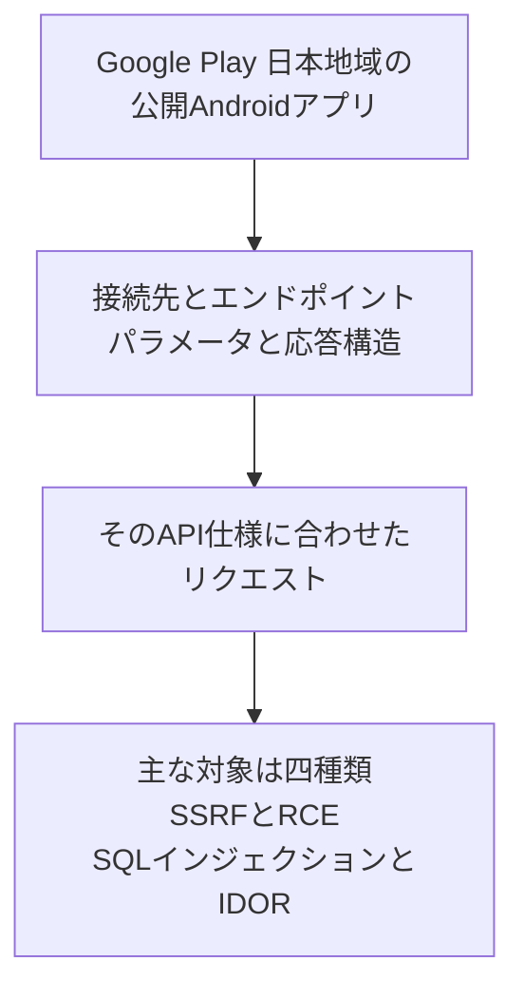
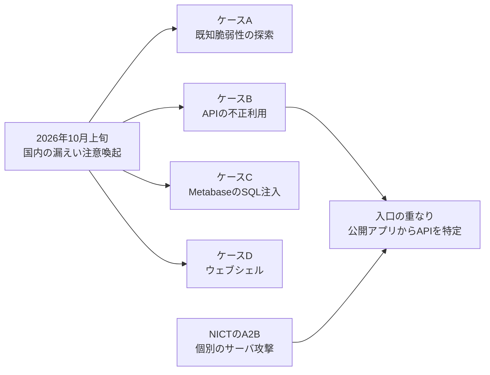

2026年10月13日、NICTサイバーセキュリティネクサス（CYNEX）の脅威情報分析チームLETTICEは、一般に公開されているAndroidアプリを解析し、そのアプリが通信するバックエンドサーバを攻撃する手法をA2B（App-to-Backend Attack）と名付けて注意喚起しました。正本は同日15:00のPDF Rev 1.1です。同日14:00のRev 1.0から、Rev 1.1は表現の修正です。文書は、LETTICEが独自に調査し、確認した手法と推奨対策をまとめたものです。

この記事では、文書が説明する攻撃の流れ、確認された脆弱性、点検と暫定の緩和、発注側が委託先に確認する境界を順に整理します。同日の掲載は、[CYNEXライブラリ](https://cynex.nict.go.jp/library/261013-01.html)と[NICTのプレスリリース](https://www.nict.go.jp/press/2026/10/13-1.html)からも辿れます。

*この記事の全体像。以下、順に解説します。*

## A2Bとは

A2Bは、公開されているアプリが通信するバックエンドサーバへの攻撃です。第1節が書く手順は、Google Playの日本地域向けアプリから、APIの接続先、エンドポイント、パラメータ、応答データの構造を集め、個々のサーバの構成とAPIの仕様に合わせたリクエストで脆弱性を探索し、悪用する、というものです。第1節は、アプリに脆弱性がなくても、バックエンドAPIの認証、認可、入力値の検証に不備があれば、個人情報の漏えいや不正アクセスにつながり得る、と書いています。対象には、認証不要のAPIに加え、利用者アカウントで認証したあとに使うAPIも含まれます。第5節は、同様の問題がiOSアプリやWebサービスのバックエンドAPIでも起こり得る、と書いています。

LETTICE（Leading Expert Team for Threat Intelligence Collection and Evaluation）は、CYNEXで2024年2月に発足した脅威情報の共同分析チームです。名称A2Bの定義は、2026年10月13日のこの注意喚起にあります。

### 公開アプリから個別のサーバへ

第2節が挙げる特徴は、公開アプリの解析で得た情報を使い、対象サーバごとに攻撃内容を変える点です。第1節と第2節は、プログラム解析や脆弱性探索にAIが使われると、個々のシステムに合わせた攻撃がより多くのシステムへ及ぶ可能性に注意を促しています。

NICTが図1で示す流れは、公開アプリの解析から、そのサーバ向けのリクエスト、そして探索と悪用の主な対象へ向かいます。

### 四種類の脆弱性と点検項目

第3節が「今回確認された攻撃」で主に狙われたものとして挙げるのは、次の4種類です。

| 名称 | 文書上の呼び方 | サーバ側で起きること |
|---|---|---|
| SSRF | Server-Side Request Forgery | サーバが、呼び手の代わりに意図しない先へアクセスする |
| RCE | Remote Code Execution | 呼び手の入力が、サーバ上のコード実行になる |
| SQLインジェクション | SQL injection | 入力が、データベースへの命令として解釈される |
| IDOR | BOLAとも呼ぶ | 識別子の指定で、他の利用者や他テナントの対象を読み書きする |

第4節(2)が点検を求める項目は、この4種類とは別の層です。点検側には、認証とセッション、固定された認証情報や暗号鍵、NoSQLインジェクション、Amazon S3、Google Cloud Storage、Firestoreなどのクラウド設定、危険なデシリアライズ、任意ファイルの書き込み、不適切な管理機能の公開が加わります。

### 確認、点検、暫定の緩和

事業者向けの推奨は、三つの塊です。侵害の確認、脆弱性の点検、暫定的な緩和策です。

侵害の確認では、アプリが使うAPI、サブドメイン、旧バージョンのAPI、検証環境、クラウド上の公開サービスを含むホストの列挙を求めています。ログは2026年8月以降を優先し、可能ならそれ以前も見ます。

恒久の対策として第4節の末尾と第5節が書くのは、攻撃者がアプリを介さずにAPIを直接操作できる前提で、サーバ側の認証、認可、入力値の検証を行うことです。第5節は、解析を完全に防ぐことは困難であり、APIの仕様が知られてもサーバが安全であるように設計し、運用する、と書いています。

暫定策として挙がるのは、国外や不要なアクセス元の制限、不要な公開APIと管理機能と検証環境の停止、レート制限とWAF、資格情報の無効化と再発行、修正です。レート制限は、公開APIへの暫定の制御として書かれています。直ちに修正できない重大な不備があり、暫定の制限でも許容できない場合は、該当API、機能、必要ならサービス全体の一時停止を、第4節(3)が検討項目にしています。

関連するIoCとして、第6節はIPアドレスを3件示します。注意喚起はオクテットのあいだに角括弧を入れて掲載しています。ログと突き合わせるときは、角括弧を外した次の3件です。

- 69.10.51.162
- 210.149.87.120
- 207.241.172.54

第6節は、これらを参考情報とし、アドレスの一致だけでは侵害を断定できない、と書いています。

## 注意点

見出しと本文で、読者が受け取る強さが変わる箇所があります。件数、AIの使用、攻撃の新しさは、文書が置いた範囲のまま読みます。

### 強く読まれやすい箇所

| 受け取りやすい読み | 一次が書く範囲 | 置ける線 |
|---|---|---|
| AIで高度化した攻撃である | 第1節は懸念、第2節は可能性への注意 | 今回の攻撃でAIの使用を確認した、とは書いていない |
| 国内漏えいの原因である | 原因の一つであり、不正取得が確認された | 被害組織数、アプリ数、漏えい全体に占める割合は無い |
| 新しい攻撃の種類である | 2026年10月13日にA2Bという名称を使っている | 公開アプリの解析からAPIを直接呼ぶ入口は、5日前のJPCERT/CCと、2023年のOWASP API Securityにある |
| 管理画面のURL埋め込みが中心である | 点検項目に不適切な管理機能の公開がある | 観測の中心として、管理画面URLの埋め込みは挙げていない |
| 示されたIPに一致すれば侵害である | 第6節は参考情報である | 一致だけでは断定できない。ログの中身と合わせて判断する |

ITmedia NEWS（梅林日奈子、2026年10月13日20:28）は、NICTの三つの対策、三つのIP、iOSとWeb、AIの可能性を要約しています。件数は足していません。日経クロステック（久富早織、2026年10月14日、シリーズ「緊急特集 相次ぐ情報漏洩」第4回）は有料壁があります。公開リードは、原因の一つを特定したこと、Androidアプリの解析からバックエンドを攻撃すること、AIによってより多くのシステムへ実施される可能性を書いています。有料の本文は、この記事の根拠にしていません。

PDFの参考文献には、個人情報保護委員会（2026年10月7日）、国家サイバー統括室（2026年10月9日）、総務省（2026年10月9日）が、同時期の注意喚起として挙がっています。この記事では、それらをA2Bという名称の裏付けには使いません。

4種類の脆弱性が、それぞれ何件だったかはPDFにありません。NICTの文書は、個別の企業名をA2Bと結び付けていません。この記事も、特定企業の公表をA2Bへ割り当てません。

### 命名の五日まえにある入口

JPCERT/CCの注意喚起（JPCERT-AT-2026-0030、公開2026年10月8日、更新2026年10月9日）は、直近の不正アクセスを一つの手法にまとめていません。JPCERT/CCは、すべての事案で同一の手法が使われたことを示すものではない、と明記しています。

- ケースAは、既知の脆弱性の探索と、環境設定ファイルやバックアップファイルの窃取を試みた可能性です。
- ケースBは、APIの不正利用です。(a) が、一般公開のスマホアプリを解析してエンドポイントやキーを特定する、と書いています。
- ケースCは、MetabaseのSQLインジェクションです。
- ケースDは、2026年10月9日の更新で追加された、WARやJSPによるウェブシェルです。

NICTの3つのIPは、ケースBの掲載IPに含まれます。先頭の2件は当初からあり、207.241.172.54は10月9日の追記です。JPCERT/CCは、掲載IPについて、調査時点では正規利用の可能性もある、と書いています。

公開アプリの解析からAPIを特定する入口は、ケースBとA2Bで重なります。A2Bという名称は2026年10月13日の文書で使われ、ケースBの(a)はその5日前に、同じ入口を別の注意喚起が書いています。

### マクニカの筆者集計

マクニカの瀬治山豊が2026年10月7日15:23に公開したブログは、NICTのPDFが参考文献に挙げる文章です。ここに出る件数は、筆者自身の集計であり、A2Bの件数ではありません。

母集団は、2024年1月から2026年10月6日までに公表された、国内法人のWebシステム経由の個人情報窃取と漏えいです。非公開の事案は含みません。同一の委託先は1件に数えます。ランサムウェア、予約サイトへのフィッシング、リスト型攻撃、筆者が無関係と判断した塊は除きます。筆者集計は、2024年62件、2025年84件、2026年10月6日時点119件、合計265件です。119件のうち約68%にあたる81件が2026年7月以降で、265件の約31%です。

その81件について、公表された原因の内訳は次のとおりです。

| 公表された原因 | 件数 | 81件に占める割合 |
|---|---|---|
| 製品、CMS、プラグイン、分析ツールなどの脆弱性 | 9 | 11.1% |
| 認証情報 | 4 | 4.9% |
| 設定やアクセス制御 | 3 | 3.7% |
| 説明不足 | 65 | 80.2% |

説明不足の65件の中にA2Bがどれだけ含まれるかは、この集計からは分かりません。「国内漏えいの多くがA2Bである」は、NICTの文書にもこの集計にも、件数としてはありません。

同じブログの第6節は、対応業務の中で、スマホアプリを解析してAPIキーを取り出し、正規のアクセスに見える形でAPIを呼ぶケースを見ている、と書いています。命名より前の観察です。同じ節は、AIによるゼロデイの発見と悪用を断定できるログや痕跡は確認されていない、とも書いています。第10節は、一連の事案でAIが使われたと断定できるログや痕跡は確認されていない、と書き、手作業では説明しにくい規模の探索があるため、AI利用の可能性は排除できない、とも書いています。

### 別経路であるMetabase

ケースCのCVE-2026-72898は、A2Bの定義の中心ではありません。JPCERT-AT-2026-0023（最終更新2026年8月14日）は、Metabaseが2026年8月6日（日本時間）に公表した、と書いています。条件は、認証なしの遠隔リクエストで、Metabaseのアプリケーションデータベースに不正なSQLを実行し、管理者権限を取得し得る、というものです。

JPCERT/CCがMetabaseの説明として転記する影響範囲は、次のとおりです。58系より前は影響を受けません。Metabase Cloudは修正済み、と同注意喚起は書いています。

| 系列 | 影響を受ける範囲 |
|---|---|
| 63系 | x.63.5 より前 |
| 62系 | x.62.9 より前 |
| 61系 | x.61.11 より前 |
| 60系 | x.60.17 より前 |
| 59系 | x.59.21 より前 |
| 58系 | x.58.24 より前 |

ベンダー側の参照先として、JPCERT/CCはMetabaseのセキュリティ更新と、GitHub Security Advisory GHSA-vwf4-m7j8-wcjfを示しています。版の範囲は、この転記を採ります。

### アドレスの一致が断定しないこと

207.241.172.54を、Internet Archiveのアドレスとしては扱いません。bgp.toolsが表示するInternet Archive（AS7941）のプレフィックス207.241.224.0/20に、このアドレスは入りません。確認した時点は2026年10月15日です。登録組織は、この記事では特定しません。

NICTとJPCERT/CCは、いずれも、IPの一致だけでは侵害を断定できない、と書いています。ログで見るのは、一致の有無だけではありません。認証なしの大量取得、連続する識別子、他会員の閲覧や変更、トークンの不審な発行、管理機能の利用を、アクセスログ、APIログ、認証ログの中身と合わせます。

LETTICEがA2Bと判定した事案の数、業種、漏えいしたデータの種類は、公開されていません。件数は「どの程度の割合か」に答えます。点検の要否には答えません。文書は、アプリを公開している事業者に点検を推奨しています。件数の公表を待ってから一覧を作る、という順序は、文書の推奨と合いません。

難読化や証明書ピンニングは、解析を遅らせる補助にはなり得ます。PDFは、解析の阻止を完全な対策とは書いていません。

## 発注側はどこを境界にするか

発注側が見る境界は、委託先のサーバ一覧だけではありません。ストアや配布物に載ったアプリも、接続先、鍵、管理機能の在りかが外に出る面です。サーバの認証は、アプリを持っていることでは切りません。呼んだ利用者と、触るオブジェクトごとに権限を切り、漏れたトークンと埋め込まれた鍵は失効させます。

この切り方は、名称が付く前から、公開の基準にあります。OWASP API Security Top 10 2023のAPI1は、オブジェクトIDの操作による認可不備（Broken Object Level Authorization）です。NICTがIDORをBOLAとも呼ぶのは、この項目と対応します。同じ一覧のAPI7はSSRFです。OWASP MASVSのRESILIENCEは、難読化などの不在を、それ自体の脆弱性とはせず、サーバ側の検証の代わりにはならない、と書いています。

したがって、委託先の「アプリは難読化している」「ピンニングしている」は、API一覧、オブジェクト単位の認可、管理機能がインターネットから届くか、の三つの代わりになりません。アプリの画面に出ていない内部のAPIも、アプリを解析すれば呼び得る前提で、サーバ側の検査に含めます。

## 委託先に何を求めるか

次の確認は、自社でアプリを解析して断定するための手順ではありません。委託先へ依頼する項目です。

1. 公開中のアプリが呼ぶAPIホスト、旧API、検証環境、サブドメイン、クラウドのバケットとデータベースを一覧にします。アプリに書いたホスト、鍵、管理機能のURLは、公開物として扱います。
2. 各APIで、識別子を変えたときに他の利用者や他テナントの読み書きができないかを、サーバ側の検査として確認します。画面に出ていないAPIも対象に含めます。
3. 管理機能と検証環境が、インターネットから到達できる状態になっていないかを確認します。不要なものは止めるか、到達元を制限します。
4. 2026年8月以降のアクセスログ、APIログ、認証ログを見ます。前節の3つのIPとの一致に加え、認証なしの大量取得、連続する識別子、他会員の閲覧や変更、トークンの不審な発行、管理機能の利用を見ます。一致だけでは侵害と断定しません。可能なら8月より前も見ます。
5. 埋め込まれた鍵やトークンの漏えいが疑われる場合は、無効化して再発行します。直ちに修正できない重大な不備があり、暫定の制限でも許容できない場合は、該当API、機能、必要ならサービス全体の一時停止を、PDF第4節(3)の検討項目として扱います。
6. 委託先へは、APIの一覧、オブジェクト単位の認可の有無、管理機能がインターネットから届くかの3点を文書で求めます。難読化やピンニングの有無は、この3点の代替にしません。

暫定の制限は、恒久の認可の代わりではなく、修正が終わるまでの制御です。国外や不要なアクセス元の制限、不要な公開面の停止、公開APIへのレート制限とWAF、資格情報の再発行は、そのあいだの手段です。ここでのレート制限は、製品が定める上限ではなく、公開APIへの暫定の制御です。

## まとめ

A2Bは、2026年10月13日のNICT LETTICE注意喚起が付けた名称です。中身は、公開されたAndroidアプリの解析で接続先とAPIの形を集め、対象サーバごとにリクエストを変えて、バックエンドの認可不備や入力検証の不備を悪用する、という手法です。今回確認された主な対象は、SSRF、RCE、SQLインジェクション、IDOR（BOLA）の4種類です。点検リストは、認証情報、クラウド設定、管理機能の公開などを含む、より広い層です。

AIの使用、被害の件数、漏えい全体に占める割合は、この文書からは決まりません。同じ入口は、5日前のJPCERT/CCケースBにも書かれています。三つのIPは参考情報であり、一致だけでは侵害と断定しません。207.241.172.54は、Internet Archiveの207.241.224.0/20には入りません。マクニカの265件と81件は、筆者集計であり、A2Bの件数ではありません。MetabaseのCVE-2026-72898は別経路です。

発注側が先に分ける境界は、アプリを持っていることではなく、サーバが利用者とオブジェクトごとに認可しているかです。委託先へ文書で求めるのは、APIの一覧、オブジェクト単位の認可、管理機能がインターネットから届くかの3点です。難読化とピンニングは、この3点の代わりになりません。

この記事が少しでも参考になった、あるいは改善点などがあれば、ぜひリアクションやコメント、SNSでのシェアをいただけると励みになります！

## 参考リンク

- [NICT LETTICE「相次ぐ情報漏洩、その原因の一つは『アプリ解析からのサーバ攻撃』」PDF Rev 1.1（2026-10-13 15:00）](https://cynex.nict.go.jp/pdf/library/lettice/261013-01.pdf)
- [CYNEXライブラリ、同文書のページ（2026-10-13）](https://cynex.nict.go.jp/library/261013-01.html)
- [NICTプレスリリース（2026-10-13）](https://www.nict.go.jp/press/2026/10/13-1.html)
- [ITmedia NEWS、梅林日奈子「相次ぐ情報漏えいの一因に『A2B攻撃』」（2026-10-13 20:28）](https://www.itmedia.co.jp/news/article/2610/13/2000002230/)
- [日経クロステック、久富早織（2026-10-14）。公開リードのみ](https://xtech.nikkei.com/atcl/nxt/column/18/03790/101400005/)
- [JPCERT/CC「直近で相次いでいる国内組織における不正アクセスに関する注意喚起」JPCERT-AT-2026-0030（公開 2026-10-08、更新 2026-10-09）](https://www.jpcert.or.jp/at/2026/at260030.html)
- [JPCERT/CC、Metabaseの脆弱性に関する注意喚起 JPCERT-AT-2026-0023（最終更新 2026-08-14）](https://www.jpcert.or.jp/at/2026/at260023.html)
- [Metabase security update（JPCERT/CCが参照）](https://www.metabase.com/blog/security-update)
- [GitHub Security Advisory GHSA-vwf4-m7j8-wcjf（JPCERT/CCが参照）](https://github.com/metabase/metabase/security/advisories/GHSA-vwf4-m7j8-wcjf)
- [マクニカ、瀬治山豊「相次ぐ WEB システムからの情報漏洩事案について」（2026-10-07 15:23）](https://security.macnica.co.jp/blog/2026/10/web-incidents2026.html)
- [OWASP API Security Top 10 2023、API1 Broken Object Level Authorization](https://owasp.org/API-Security/editions/2023/en/0xa1-broken-object-level-authorization/)
- [OWASP API Security Top 10 2023 の一覧（API7 は SSRF）](https://owasp.org/API-Security/editions/2023/en/0x11-t10/)
- [OWASP MASVS、MASVS-RESILIENCE](https://mas.owasp.org/MASVS/11-MASVS-RESILIENCE/)
- [bgp.tools、Internet Archive AS7941 の 207.241.224.0/20（2026-10-15 時点）](https://bgp.tools/prefix/207.241.224.0/20)
