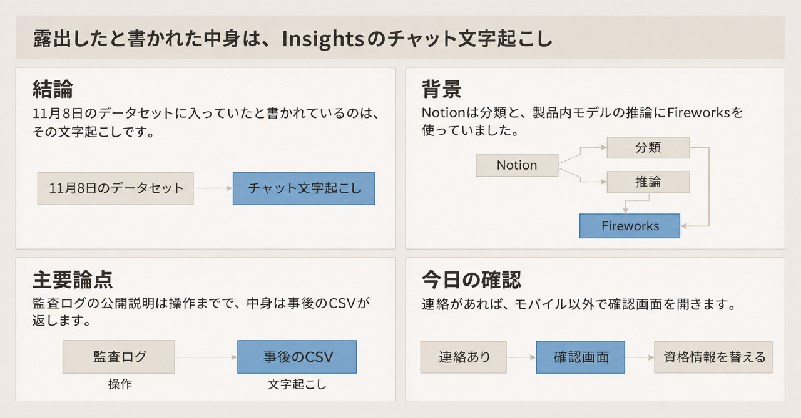
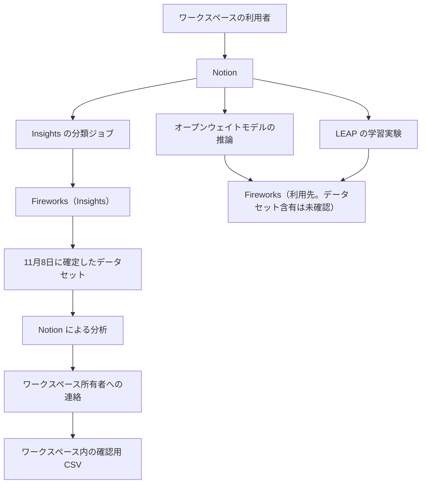

Notion（顧客がページなどのデータを保存するサービス）は、AI の委託先である Fireworks AI のセキュリティインシデントについて、2026年11月10日更新のセキュリティアドバイザリとヘルプセンターで通知しています。通知が置いている範囲は、Notion のワークスペースのうち 1% 未満が影響を受けた可能性と、11月8日に確定したデータセットに Insights（利用者自身の AI 利用状況を把握する機能）のチャット文字起こしが含まれていたことです。この記事では、その境界、ワークスペース所有者が開く確認画面、発注側が次の契約と自社の記録で分ける経路を、同日までに公開された公式の文に沿って整理します。日付の無い記述は、2026年11月11日に取得した公式ページの文言に合わせています。

*この記事の全体像。以下、順に解説します。*

## Notionが通知したFireworks AIのインシデントとは

Insights は、利用者自身の AI 利用状況を把握するための Notion の機能です。Notion は、その分類処理に Fireworks を使い、製品内のオープンウェイトモデルを提供する推論先としても Fireworks を使っていた、と書いています。オープンウェイトモデルという語の定義は、この通知にはありません。通知が指しているのは、製品内で Fireworks 経由で出していたモデルです。

### 通知が書いている範囲

アドバイザリの更新版は November 10, 2026 です。Notion は、この更新は体裁と明確化であり、既報の事実は変えていない、と書いています。規模の文言は「<1% of Notion workspaces」です。整数の件数は、アドバイザリにもヘルプにもありません。

11月8日のデータセットの分析結果として、Insights 用の Notion AI チャット文字起こしが含まれていました。アドバイザリは、影響を受けたワークスペースの vast majority（大半）では unattributable だった、と書いています。unattributable の定義は、誰が書いたか、どのワークスペースかを示すラベルが無く、文字起こしにツール呼び出しの結果が無い、です。ツール呼び出しの結果の例として、英語ヘルプは Notion のページ内容と、Notion AI が取り込んだ外部データを挙げています。文字起こしの文言以外に、ワークスペース、ユーザー、会社へ結び付ける情報は無い、と書いています。他の Notion 機能は影響なし、とアドバイザリは書いています。英語ヘルプは、ワークスペース内のその他のデータは影響を受けていない、と書いています。調査は継続、とも書いています。

Insights は調査のため無効です。設定ヘルプは「Insights is temporarily paused」と書き、ユースケースと会話数は今は見られない、と書いています。この設定ヘルプの対象は、Business プランまたは Enterprise プランのワークスペース所有者です。無効化の文そのものは、この二つのプランに限るとは書いていません。オープンウェイトモデルを Fireworks 経由で提供するのも止めています。

顧客がアップロードした個人データについて、プライバシーヘルプは次のように書いています。顧客が管理者（処理の目的と手段を決める側）または処理者であるとき、その個人データについて Notion が処理者（顧客の指示で処理する側）です。Customer Data は、顧客が Notion のサービスに保存するデータです。個人情報を含み得ます。アナリティクス（プライバシーヘルプが中身を列挙していないデータ）と Account Information は Customer Data に含みません。Account Information は、氏名、ユーザー名、パスワード、電話、メール、ワークスペースのメタデータ、サポートとの通信、請求、利用情報など、アカウントの作成と管理のために顧客が渡す情報です。チャット文字起こしが Customer Data かアナリティクスかは、プライバシーヘルプでは分かれていません。

### 日付の流れ

アドバイザリの表は、次の順です。

| 日付 | アドバイザリが書いた内容 |
|---|---|
| 11月2日夜 | Fireworks が、少数のデータへのアクセスを Notion に通知した。調査の結果、そのデータセットは Notion AI の合成テストデータで、顧客データは含まれない |
| 11月3日朝まで | Notion が Fireworks との接続を切り、Fireworks 上のデータを削除し、通信を止めた |
| 11月6日 | Fireworks が、顧客データへのアクセスの可能性を通知した。Notion は別の社内調査を始めた |
| 11月8日 | Fireworks が、最終的な影響データセットを確定した |
| 11月9日 | Notion が、影響を受けた顧客へ連絡した |

ヘルプの FAQ は、11月3日時点でデータとトラフィックの送信を止め、学習処理も止めた、と書いています。

Fireworks の第1報は、2026年10月6日 9am PDT（太平洋夏時間）に、内部資格情報の不正使用を特定した、と書いています。評価ジョブの環境変数に、限定された顧客アカウントでアクセスがありました。その時点の調査では、顧客モデル、データセット、学習データ、個人情報、推論トラフィックへの不正アクセスは、Fireworks の境界内では検出していない、と書いています。

Fireworks の更新（Last updated November 9, 2026）は、その後にアカウントと課金情報への影響が分かった、と書いています。限定されたアカウントでは、シークレット、データセット、未完成モデルへの影響も分かった、と書いています。支払カード番号は保存しておらず、影響は無い、と書いています。同じ更新は、証拠が示す先を、経済的動機を持ち、不正アクセスで得た LLM のトークンを許可されていない中継へ売る集団だ、と書き、その行為を LLMJacking と呼んでいます。

同じ更新は、R&D マシンをホストする第三者クラウドの事件を 10月23日、開発マシンへの到達と追加の顧客データ影響を 10月24日、としています。10月25日以降、顧客が使うプラットフォームへの成功した不正アクセスは検出していない、と書いています。Inference、Training SDK、Nexus は、Fireworks の更新が製品名として並べているものです。各製品の中身は、その更新には書かれていません。Notion が製品内の推論先として使っていた、という文とも別です。これらは既定でゼロデータ保持（ZDR）であり、これらへの影響は検出していない、と書いています。ZDR について Fireworks の Zero Data Retention 文書は、オープンモデルのプロンプトと生成を、明示の opt-in が無い限り永続保存しない、と書いています。このオープンモデルは、その文書の語です。Notion が書くオープンウェイトモデルと同じものとは書かれていません。プロンプトと生成はリクエストの間だけ揮発メモリにあり、永続ストレージへは記録しない、という説明です。調査は継続し、追加情報が出ることがある、とも書いています。

### 文字起こしの区分

文字起こしに何が含まれるかは、Notion がデータセットを分析したあとの説明として、次のように分かれます。

| 区分 | Notion が書いた内容 |
|---|---|
| データセットに含まれていた | Insights 用チャット文字起こしの文言 |
| ヘルプが、分析した文字起こしに無かったと書いたもの | ツール呼び出しの結果（ページ内容や、取り込んだ外部データ） |
| アドバイザリが vast majority の unattributable の定義に含めたもの | 発言者とワークスペースのラベルが無いこと。ツール呼び出しの結果が無いこと |
| 影響なしと書いた | 文字起こし以外の、ワークスペース内のその他のデータ。他の Notion 機能 |

Enterprise の注釈付き CSV は、露出していないユーザー紐付けを Notion が後から足したものです。追加フィールドは `__metadata` または `__analysis` です。

### 所有者が開く画面

影響を受けたワークスペースの所有者は、サイドバーの `?` から確認画面を開きます。英語ヘルプの名前は「Security incident review」です。日本語ヘルプの名前は「セキュリティインシデントのレビュー」です。英語ヘルプは desktop browser、日本語ヘルプはデスクトップアプリまたは Web ブラウザ、と書いています。開くクライアントは、二つの公式文で揃っていません。両方に共通して書かれているのは、モバイルからは開けない、ということです。

Enterprise プランで、ワークスペースのメンバーを管理している場合、所有者は二つを見られます。一つは、影響データの CSV です。もう一つは、各文字起こしにユーザーを足した注釈付き CSV です。この二つの CSV は、どちらも所有者だけが見られます。注釈とメタデータは、このインシデントでは露出していません。英語ヘルプは、この資源は managed members（メンバーを管理している状態）がある場合だけ、と書いています。メンバー管理が無い Enterprise プランの所有者に、二つの CSV が出るか、共有リンクのページが出るかは、ヘルプには書かれていません。

それ以外のプランの所有者には、影響を受けたメンバーが自分の分だけを見るための共有リンクを含むページが出ます。共有されたメンバーが得る CSV は、そのメンバー自身の分だけです。

英語のアドバイザリは、影響を受けた顧客に、このデータを露出したものとして扱うよう勧めています。日本語ヘルプは、流出したものとして扱うよう書いています。対象期間中にパスワード、API キー、その他の資格情報を Notion AI へ貼っていた場合は、ローテーションするよう書いています。期間の開始日と終了日は、アドバイザリもヘルプも日付を書いていません。英語は「the timeframe of the incident」「this timeframe」、日本語は「この期間」です。

連絡の有無について、アドバイザリは、連絡が無ければまだ影響とは特定していない、今は対応不要、調査は継続しており、後から分かれば連絡する、と書いています。英語ヘルプと日本語ヘルプは、所有者にも本人にも連絡が無ければ、そのワークスペースは影響を受けておらず、今は対応不要、と書いています。

### 保持、所在地、サブプロセッサ、監査ログ

サブプロセッサは、Trust Center（Notion が委託先の一覧を公開しているページ）が、Notion とその関連会社が Customer Personal Data の処理を委ねる第三者と説明している語です。Customer Personal Data は、その説明で使われている語です。先に書いた Customer Data との違いは、一覧の文には書かれていません。2026年11月11日時点の一覧では、Fireworks の目的は「Compute infrastructure for serving large language models and powering AI services」、所在の欄は Global です。Global がどの地域を指すかは、一覧に書かれていません。

Notion AI の保持は、セキュリティ実務ページではプランとモデルで分かれます。

- Enterprise はモデルにより ZDR です。ZDR は、応答を作るためだけに処理し、その後は何も残さない、という意味で書かれています。ZDR でない少数のモデルは既定オフです。ワークスペース所有者が opt-in（明示してオン）したときだけ、応答を届ける目的で限られた期間、プロバイダが保持し得ます。
- Free、Plus、Business は、AI プロバイダが 30 日以内に保持してから削除します。
- 一部の AI 機能は、データを保持する LLM を必要とすることがあります。その場合、Notion はワークスペース設定を用意し、管理者がその LLM をオンにできるようにする、と書いています。

データ所在地は Enterprise プランの機能です。ページ本文、アップロードファイル、検索インデックス、Notion に保存される第三者メッセージの、AWS 上の保存場所を選びます。第三者メッセージは、第三者が作った、またはボットが生成した、Notion に保存されるメッセージとファイルです。サブプロセッサが処理するデータは、選んだリージョンの外に置かれ得ます。データ所在地の FAQ は、Enterprise の LLM プロバイダは ZDR なので、LLM プロバイダにはデータが保存されない、と書いています。

Enterprise プランの監査ログの公開イベント一覧には、少なくとも次があります。AI エージェント（この一覧のイベント名が指す、Notion 上のチャット機能）のチャット作成、閲覧、削除。ワークスペースでの Notion AI のオンオフ。LEAP 設定の切り替え。エージェントが使ってよいモデル一覧の更新。各説明は、その操作が起きたことまでです。LEAP は Learning and Early Access Program です。参加者は、新しい AI 技術の試験のために自らデータを提供します。ヘルプ FAQ は、過去にそのデータで Fireworks 上のタスク別モデル学習を実験した、と書いています。

### 通知が分けている三つの経路

分類、推論、過去の学習実験は、Notion の文書上は別の用途として並びます。データセットの分析結果として書かれているのは、そのうち Insights の文字起こしです。

## 注意点

ここから先は、公式の文をどこまで一般化してよいかの境界です。

アドバイザリは「自社システムの侵害ではない」と書いています。同時に、委託先のデータセットに顧客のチャット文字起こしがあった、と書いています。前者は Notion の本番への侵入を否定する文です。後者は、委託先に処理のために渡ったデータがあった、という文です。両方を残します。

「1% 未満」は Notion の規模表現です。ワークスペース数の分母と、影響の定義（文字起こしがデータセットに入ったこと、または悪意ある者がそれを読んだこと）は、公開された文では分解されていません。

「vast majority は unattributable」は、全員の文字起こしにラベルが無かった、という意味ではありません。ヘルプの分析段落は、ラベルとツール呼び出しの結果が無かった、と vast majority を付けずに書く箇所があります。少数側で何がラベル付きだったかの件数は、公開された文にありません。少数側の文字起こしにツール結果があった、とも書かれていません。

ヘルプの「連絡が無ければ影響なし、今は対応不要」と、アドバイザリの「未特定、調査継続、後から分かれば連絡する」は、2026年11月11日時点で両方が公開されています。連絡の有無を、監査ログ上の陰性証明として読みません。

11月2日の「顧客データは含まれない」は、その夜に渡されたデータセットについての文です。11月8日の最終データセットについての文ではありません。最初の通知だけで範囲を閉じません。

Fireworks が「Inference、Training SDK、Nexus への影響は検出していない」と書くことは、オープンウェイト推論のプロンプトがデータセットに無いことの証明ではありません。Notion が露出したと書いた対象は Insights の文字起こしです。推論を使っていた、という利用経路の記述と、露出した中身の記述は、別の文です。調査継続の文が両方にあります。

対象期間は「this timeframe」「the timeframe of the incident」「この期間」とだけ書かれ、チャットの開始日と終了日はありません。Fireworks が書く 10月6日、10月23日、10月24日、10月25日は、同社の資格情報と開発マシンの記述です。Notion のチャット期間としては書かれていません。

データ所在地の FAQ、セキュリティ実務ページ、今回の通知は、同時に公式にあります。FAQ は、Enterprise の LLM プロバイダは ZDR なので保存されない、と書きます。セキュリティ実務ページは、Enterprise でもモデルにより保持が違い、ZDR でないモデルは opt-in だ、と書きます。今回の通知は、Insights の文字起こしが Fireworks のデータセットに入っていた、と書きます。「Enterprise なら委託先に残らない」とは読みません。

Fireworks の Zero Data Retention 文書は、Response API では `store=True` が既定で、プロンプト、応答、モデルが呼んだツールを最大 30 日保持し得る、と書いています。この保持は Response API に限る、とも書いています。Response API は、その保持方針が書かれた Fireworks の API です。Notion がその API を使ったかは、公開された文にありません。

LEAP の学習実験は過去形で書かれています。その学習データが 11月8日のデータセットに入ったとは書かれていません。入っていない、とも書かれていません。

サブプロセッサ一覧の目的文は「LLM をサーブする計算基盤」です。通知文にある分類ジョブ、オープンウェイト推論、過去の学習実験は、一覧の一行には分解されていません。

現行の Data Processing Addendum（DPA。顧客データの処理条件を定めた追加契約）の本文は、2026年11月11日の確認では条項まで辿れていません。2023年2月22日廃止版にある通知期限は、現行の期限として使いません。

公開された監査ログイベントの説明に、プロンプト本文、ツール結果、委託先名を記録する、という文はありませんでした。説明に無いフィールドがエクスポートに無い、とまでは断定しません。

CVE 番号は、この通知の公式ページにはありません。

## 中身を戻す経路は監査ログと事後のCSVで分かれる

公開された監査ログのイベント説明からは、今回の露出本文と送付先を再構成できるとは確認できません。実際のエクスポート項目は未確認です。今回、中身をワークスペースへ戻しているのは、Fireworks が 11月8日に渡したデータセットを Notion が分析し、所有者へ連絡したうえで、ワークスペース内の CSV として見せる経路です。

監査ログの公開イベントは、チャットの作成や閲覧、AI のオンオフ、LEAP、許可モデル一覧の更新を、操作として記録します。説明文はそこまでです。本文、文書、ツール結果、送付先が Fireworks であることまでは書いていません。一方で「監査ログに AI の痕跡が無い」は強すぎます。操作イベントはあります。足りないのは中身と送付先です。

Enterprise の注釈付き CSV は、露出データに無かったユーザー紐付けを Notion が後から付けて渡す、とヘルプが書いています。紐付けの主体は顧客の監査ログではありません。「誰も再構成できない」も強すぎます。Notion は、少なくとも Enterprise かつメンバー管理がある所有者に、ユーザーを足した CSV を渡す、と書いています。その他のプランは、メンバーが自分の分を見るリンクです。全顧客が同じ粒度ではありません。

| 基準 | 標準の監査ログ | 事後の CSV と委託先データセット | 経路ごとの契約 |
|---|---|---|---|
| 今回、中身を見せる主体 | 公開イベントの説明は操作の事実まで。エクスポートの全項目は未確認 | Notion が分析し、所有者経由で返す | 事前に、返す義務の有無を書く |
| 誰に紐付くか | 操作したユーザーはイベントの対象になり得る。文字起こし本文との対応は説明に無い | Enterprise かつメンバー管理では、露出していない紐付けを注釈として足す。他プランは本人分の CSV | 一覧の目的文が一行だと、分類と推論と学習が分かれない |
| ツール結果 | 公開説明には無い | ヘルプは、分析した文字起こしには無かった、と書く。アドバイザリでは、その否定は vast majority の unattributable の定義の内側にある | 送る種別にツール結果を含めるかを、経路ごとに書ける |
| 調査が更新されたとき | 顧客側のログ定義は変わらない | 11月2日のセットには顧客データが無かった。11月8日のセットには文字起こしがあった | 初報と最終データセットを分ける条項が要る |
| プラン差 | Enterprise の機能 | 注釈付き CSV は Enterprise かつメンバー管理がある場合 | プランで保持日数が変わることを、契約側にも写す |

事後の CSV は、今回の通知を読む手段です。次の委託の受け入れ条件そのものではありません。標準の監査ログは、AI を有効にしたか、チャットを開いたか、を残します。経路ごとの契約は、サブプロセッサ一覧の一行では代替できません。

「委託先は何も残さない」は、セキュリティ実務ページのプラン別保持と、Fireworks の Response API の既定保持と両立しません。今回の経路が Response API だったかは未確認です。「オープンウェイトのプロンプトも同じデータセットに入っていた」は、Notion の分析文の範囲を超えます。Fireworks の未検出も、入っていない証明ではありません。ヘルプの「連絡が無ければ影響なし」は、アドバイザリの「未特定、調査継続」より強い文です。監査ログで陰性を確定した、という意味ではありません。

## 発注側が分ける三つの判断

発注側は、委託先の侵害を次の三つに分けて切ります。

1. 今回の Notion ワークスペースについては、公式の案内に沿います。連絡が無いかを所有者に確認します。連絡があれば、モバイル以外の確認画面を開きます。開くクライアントは英語ヘルプと日本語ヘルプで揃っていないので、英語は desktop browser、日本語はデスクトップアプリまたは Web ブラウザ、と各ページに従います。渡されたデータは露出したものとして扱います。この期間に Notion AI へ貼ったパスワード、API キー、その他の資格情報は替えます。期間の開始日と終了日は公式に無いので、自社で日付を切って対象外にはしません。ヘルプの「影響なし」と、アドバイザリの「未特定」は両方読み、連絡が無いことを監査の終了とは扱いません。
2. 次の契約では、サブプロセッサの目的を「LLM の提供」の一行で受けません。分類、推論、学習、データセットとしての保存のどれに、プロンプト、文書、ツール結果のどれを出すかを経路ごとに書かせます。保持は、Enterprise のモデル別 ZDR、opt-in、Free から Business の 30 日以内、のようにプラン差がある前提で書かせます。侵害時には、委託先が渡したデータセットの範囲と、ベンダ側で再結合した帰属を、ワークスペース所有者へ返すことを書きます。返す期限の時間数は、現行 DPA をこの記事では確認できていないので、廃止版の数字で埋めません。
3. 自社で動かすエージェント（委託先へ何を送ったかを自分で残す側）では、標準の操作ログと、送付台帳を分けます。操作ログは、チャットを開いたか、機能を有効にしたか、を残します。送付台帳は、ワークスペース単位で、どの経路が、どの委託先へ、プロンプト、文書、ツール結果のどれを出したかを残します。今回の公開イベント一覧は、前者までは書き、後者は書いていません。送付台帳が無い場合、侵害通知のあとで「送ったか」の説明は、委託先が返す調査結果への依存が高まります。

逆転条件は次のとおりです。

- 公式が、チャットの日付範囲と、オープンウェイト推論および LEAP 学習データの含有を、データセット単位で公開した場合は、1 の待ちをやめてその範囲に合わせます。
- 公開監査ログ、またはそのエクスポート仕様が、プロンプト本文と委託先名をイベントとして含むと確認できた場合は、3 の「公開イベント一覧の説明では再構成できると確認できない」を、その製品については外します。
- Fireworks が、推論トラフィックへの影響を、未検出から検出ありへ更新した場合は、Insights の文字起こしだけを露出範囲とする読みをやめます。

## 公式がまだ閉じていない点

次は、2026年11月11日の公式ページでは閉じていません。

- 対象チャットの開始日と終了日。資格情報のローテーションは「この期間」とだけ書かれています。
- vast majority 以外で、何がラベル付きだったかの件数。
- 現行 DPA の侵害通知の期限と、サブプロセッサが失敗したときの Notion の義務の条文。
- LEAP の学習データが、11月8日のデータセットに含まれるか。
- Notion が Fireworks の Response API（`store=True` が既定）を使ったか。
- 監査ログのエクスポートに、公開説明へ出ていない本文フィールドがあるか。
- Fireworks と Notion の両方とも、調査は継続と書いています。11月2日から 11月8日のように、範囲の記述が後から増える余地があります。

これらは、今日の「連絡の有無を見て、来ていればモバイル以外で確認し、この期間に貼った資格情報は替える」という公式の案内を止めません。止めるのは、対象期間を日付で確定することと、出ていない経路まで露出したと説明することです。

## まとめ

Notion の通知が露出したと書いた中身は、Insights 用のチャット文字起こしです。分類、オープンウェイト推論、LEAP の過去の学習実験は、利用経路としては並びますが、11月8日のデータセットの中身として書かれているのは文字起こしです。連絡があれば、モバイル以外の確認画面を開き、渡されたデータは露出したものとして扱います。連絡が無いことは、ヘルプでは「影響なし」、アドバイザリでは「未特定で調査継続」です。監査ログの公開説明は操作の事実までで、本文と送付先は事後の CSV が返しています。

次の契約では、出すデータの種別を経路ごとに書きます。自社で動かすエージェントでは、操作ログと送付台帳を分けます。期間の日付、推論と LEAP の含有、現行 DPA の通知期限は、公式が閉じるまで埋めません。

この記事が少しでも参考になった、あるいは改善点などがあれば、ぜひリアクションやコメント、SNSでのシェアをいただけると励みになります！

## 参考リンク

取得日はすべて 2026年11月11日です。

- [Notion, "Fireworks AI incident"（更新 November 10, 2026）](https://www.notion.com/security/advisories/security-incident-involving-a-third-party-ai-vendor)
- [Notion Help, "Notice about the Fireworks AI incident that may impact some Notion workspaces"](https://www.notion.com/help/security-incident-involving-a-third-party-ai-vendor)
- [Notion ヘルプ「一部のNotionワークスペースに影響を与える可能性があるFireworks AIのインシデントに関するお知らせ」](https://www.notion.com/ja/help/security-incident-involving-a-third-party-ai-vendor)
- [Fireworks AI, "Fireworks October 2026 security incident"](https://fireworks.ai/security/bulletins/october-2026-security-incident)
- [Fireworks AI, "Update on October 2026 security incident"（Last updated November 9, 2026）](https://fireworks.ai/security/bulletins/october-2026-security-incident-update)
- [Fireworks AI Docs, "Zero Data Retention"](https://docs.fireworks.ai/guides/security_compliance/data_handling.md)
- [Notion Help, "Notion AI security & privacy practices"](https://www.notion.com/help/notion-ai-security-practices)
- [Notion Help, "Privacy practices at Notion"](https://www.notion.com/help/privacy)
- [Notion Help, "Data residency for Notion"](https://www.notion.com/help/data-residency)
- [Notion Help, "Notion AI settings overview"](https://www.notion.com/help/notion-ai-settings-overview)
- [Notion Developers, "Audit log events"](https://developers.notion.com/compliance/audit-log-events)
- [Notion Trust Center, subprocessors](https://trust.notion.com/subprocessors)
- [Notion, Data Processing Addendum（この記事の確認では条項本文まで辿れていません）](https://www.notion.so/notion/Data-Processing-Addendum-361b540101274b1fa7e16b90402b0d99)
