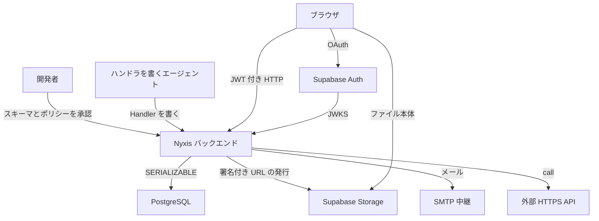
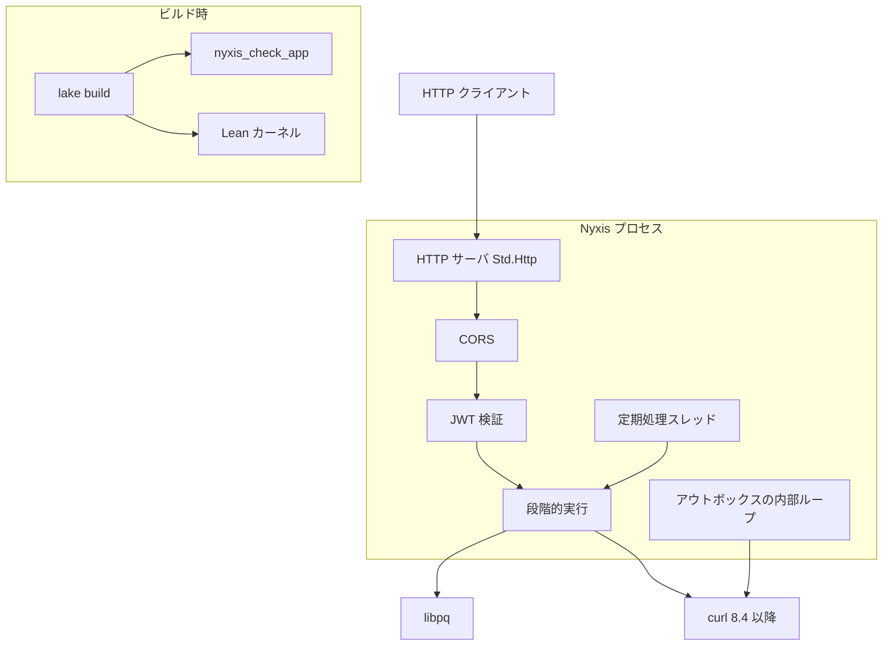
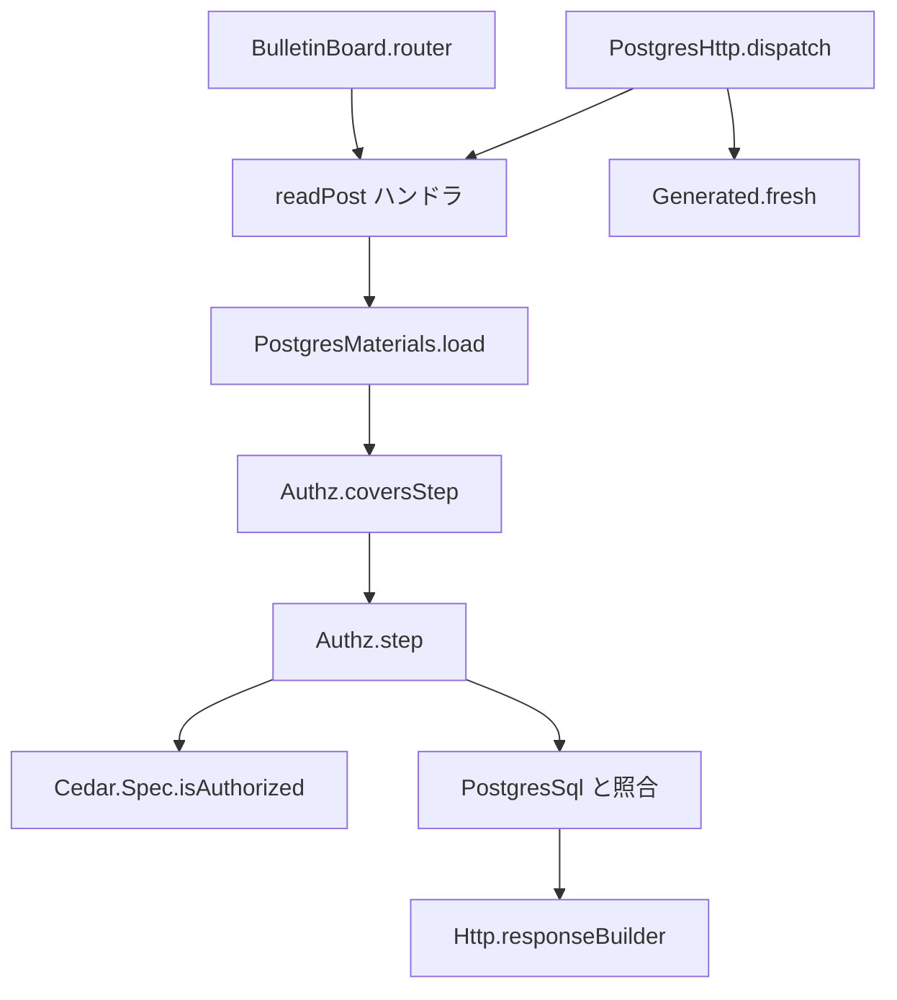
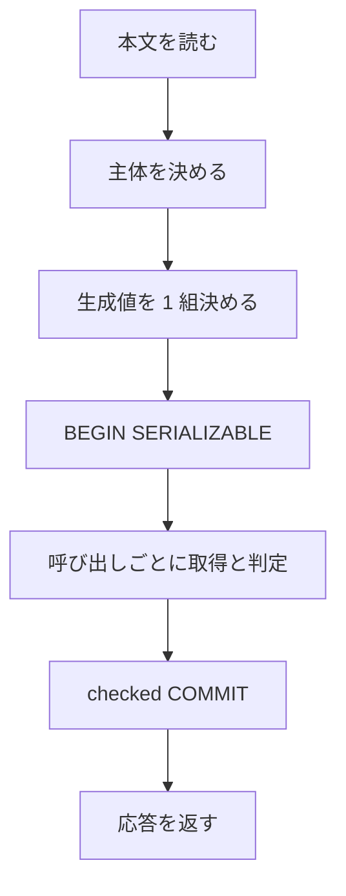
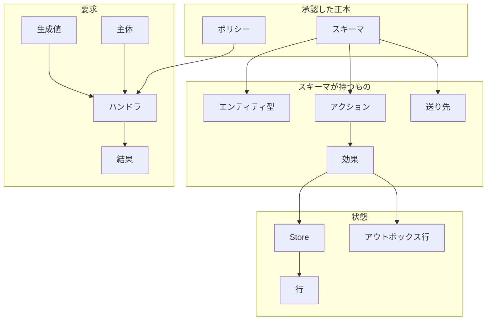
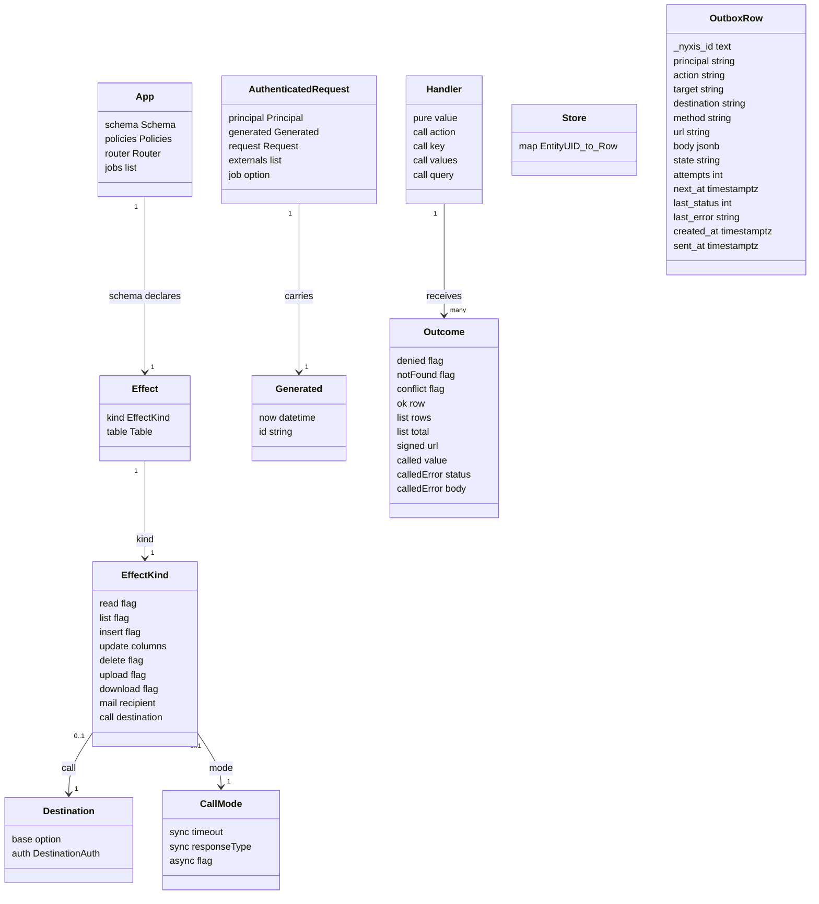

Web バックエンドの認可は、ハンドラのコードを一行ずつ読まないと「どのデータに誰が触れるか」が確定しません。Nyxis は、認可の正本を Cedar のスキーマとポリシーに寄せ、ハンドラが発行する DB 操作がそのポリシーの範囲に収まることを、ビルドのたびに Lean のカーネルで検査するフレームワークです。

この記事では、MIT ライセンスで公開されている [NyxFoundation/nyxis](https://github.com/NyxFoundation/nyxis) の v0.1.1 を対象に、Nyxis が何を保証し何を保証しないのか、どんな構造とデータモデルで動くのか、どう構築して使うのかを整理します。Nyxis のドキュメントは日本語版が正で、英語版は翻訳です。この記事も日本語のドキュメントと現行ソースを根拠にしています。

想定読者は、Lean や形式手法そのものは初めてでも、Web バックエンドの認証・認可を書いた経験があるエンジニアです。Nyxis 固有の用語は初出で説明します。


*この記事の全体像。以下、順に解説します。*

## Nyxisとは

Nyxis は、Cedar のスキーマとポリシーを正本にして HTTP バックエンドを組む、Lean 4 製のフレームワークです。Lean は数学的な証明を機械が検査するプログラミング言語で、小さな信頼できる検査器（カーネル）が証明の正しさを確かめます。テストと違い、述べた定理に反例があればビルドが通らないのが特徴です。Cedar は AWS が公開する認可ポリシー言語で、「誰がどのリソースにどのアクションを許可されるか」を宣言的に書けます。Nyxis はこの Cedar を判定器として埋め込み、スキーマのエンティティ型をそのままテーブル、属性を列、エンティティ ID を主キーとして扱います。写像用の別 DSL はありません。

各アクションは Nyxis が定義する「効果」をちょうど 1 つ持ちます。効果とは、そのアクションが許可されたときに発行してよい DB 操作や外部通信の種類のことです。ハンドラは `Nyxis.Handler` 型で書き、ハンドラが起こせる効果は認可層へのアクション呼び出しだけに限られます。

Nyxis の中心にあるのは、`lake build`（Lean のビルドコマンド）のたびに Lean カーネルが検査する主定理 `Nyxis.Runtime.authorization_safety` です。検査の対象は、任意の App、初期状態の `Store`、認証済み要求の列です。要求列には HTTP リクエストと定期処理が含まれ、各要求は主体（principal）と、その要求のために Nyxis が決めた生成値（現在時刻と一意 ID）を伴います。JWT の検証に失敗した要求と JWT が無い要求は、どちらも匿名主体 `Anonymous::"anonymous"` として同じ要求列に入ります。

### 主定理が述べる9項

主定理が何を保証するかは、リポジトリの `ASSUMPTIONS.ja.md` に「定理が述べること」として 9 項が並びます。要約すると次のとおりです。

1. 発行した DB 操作は、その主体と生成値について、承認済みポリシーが permit した効果の範囲内に収まる。ハンドラは主体・時刻・ID を偽れない。
2. `Store`（状態）は記録された操作だけで変わり、各判定はその時点の状態に対して行われる。
3. ハンドラへ渡る（主キー, 行）は、同じ要求で permit されたその主キーの読み取りが指す行である。
4. 一覧の件数と返す行は、絞り込みに合い permit された行だけから決まる。
5. 記録される各アクションは、ハンドラの呼び出しか、`@references`（ある行が別の行を参照することをスキーマに書く注釈。親行を消すと参照元の子行も明示的な DELETE で連鎖削除される）の連鎖削除のいずれかである。
6. 記録された外部効果は、対象行の読み取りと同じ判定材料で permit され、内容は宣言された列と生成値から決まる。
7. ハンドラへ渡った署名付き URL には、その呼び出しの外部効果の記録がある。
8. 記録された `call`（`sync` と `async`）は permit され、送り先・メソッド・パスは正本から、本文は行の列と提案値から決まる。
9. ハンドラへ渡った外部 API の応答値は、その呼び出しの判定を変えない。応答値が DB に入る経路は、ハンドラが別アクションで提案する値だけである。

逆に、この定理は次を述べません。HTTP・JWT・SQL との対応、生成値の一意性と時計、署名付き URL の中身と Storage、メールと `async` の配送、外部 API の応答値の正しさ、`sync` 送信後に COMMIT が失敗したときの送り先側の副作用、サービス主体の ID と設定、そして無条件の非干渉（どんな場合でも入力が出力に漏れないという性質）です。つまり純粋なモデルの中で閉じた保証であり、現実の配線や外部システムの振る舞いは別の前提（Assumption）として扱われます。

### 保証の層と前提

どこまでを定理で保証し、どこからを人間が信頼する前提に置くかは、層として整理されています。

| 層 | この版で信頼する範囲 |
|---|---|
| 純粋モデル | 上の 9 項。取得が判定材料を覆う（`Authz.coversStep` に通る）なら、部分取得での判定は全体状態での判定と一致する |
| 接続コードの証明済み | 主体を JWT の成功から作る配線、BEGIN から COMMIT の順、認可済み操作からの SQL、結果列からの応答再生、記録された内容についてだけ外部効果の送信処理を呼ぶこと。`sync` の 2xx が宣言型に合わないときは COMMIT せず、取り消しのあと固定の 502 を返す（curl による送信の内部と `async` の配送そのものは Assumption 1） |
| Assumption 1 | 未証明の接続コード。点検索と WHERE 付き SELECT が現在行と絞り込みの全行であること、HTTP 本文の復号と送信、SQL の分離性と永続化、curl・libpq・JSON・乱数の内部、定期処理スレッド、CORS 装飾後の応答、アウトボックスの INSERT と内部ループ。加えて固定した Lean ツールチェーン、FFI、暗号 |
| Assumption 2 | Supabase Auth が本人の `sub`（JWT の主体 ID）だけに JWT を出すこと、専用ロール以外から Postgres へ届かないこと、Storage が発行 URL を検証すること、前段が要求を改変しないこと、SMTP と外部 API が記録どおりに扱うこと、経路の TLS、時計と乱数 |
| Assumption 3（正本） | デプロイするスキーマとポリシーが、人間が承認した 2 ファイルと同一であること |
| Assumption 3（アプリ） | 証明を迂回したりネイティブ実装へ差し替えたりする Lean の抜け道（`unsafe`、`@[implemented_by]`、`@[extern]`、`sorry`）が無く、ビルド時 IO が秘密や検査を触らないこと。監査 `nyxis_check_app` の禁止リストの網羅性は未証明 |
| Assumption 3（配置と秘密） | `lake build` で検査した成果物だけを配置し、接続文字列・service_role（Supabase の管理者権限キー）・SMTP・`NYXIS_EXT_*`・サービス主体をプロセスと運用者以外へ出さないこと |

実行時の認証は Supabase Auth の JWT（ES256、audience は `authenticated`）、永続化は PostgreSQL（想定は Supabase）です。Supabase は PostgreSQL・認証（Auth）・ファイル保管（Storage）をまとめて提供するホスティング基盤です。クライアントは JWT を付けて HTTP で呼び、フロントエンドは Nyxis の外にある通常の HTTP クライアントです。公式サンプルは、掲示板（Next.js 画面つき）と、組織内文書共有の team-docs（バックエンドのみ）の 2 つです。

Nyxis は認可ポリシー言語そのものではなく、ブラウザから Postgres へ直接届く Data API でもありません。行の到達制御を Postgres の RLS（Row Level Security）に置く構成と比べると、判定の場所と保証の形が違います。

| 観点 | Nyxis v0.1.1 | Cedar（cedar-spec の Lean モデル） | Supabase の Data API と RLS |
|---|---|---|---|
| 開発者が承認する正本 | `.cedarschema` と `.cedar`。スキーマがテーブル定義を兼ねる | ポリシーとスキーマ。永続化の枠は持たない | SQL の GRANT と RLS ポリシー |
| 判定の実行場所 | バックエンドの `Authz.step`。評価器は `Cedar.Spec.isAuthorized` | ポリシーエンジン | Postgres がクエリごとにポリシーを足す |
| ハンドラの効果 | `Handler` の `pure` と `call` だけ | 該当なし | クライアントが SQL 相当の API を呼ぶ |
| 認証 | Supabase Auth の JWT（ES256、audience `authenticated`） | 主体は呼び出し側が渡す | Supabase Auth の JWT を Data API がロールへ写す |
| 形式的な主張 | `authorization_safety` を `lake build` で検査 | cedar-lean の検証器・評価器・slicing（判定に関わる部分だけ取り出す技法） | 公式ドキュメントが SQL ポリシーの意味を説明 |

向く場面は、AI エージェントにハンドラを書かせつつ、人間が読む範囲はスキーマとポリシーに寄せたい個人開発の Web API です。画面、TLS 終端、添付ファイルの中身の検査は Nyxis の外にあります。

## 特徴

- スキーマのエンティティ型がテーブル、属性が列、エンティティ ID が主キーです。写像用の別 DSL はありません。
- 効果は 1 アクションに 1 つです。種類は `read`、`list`、`insert`、`update`（更新列を明示）、`delete`、`upload`、`download`、`mail`、`call` の 9 つです。
- ハンドラの構成子は `pure` と `call` です。主体・時刻・一意 ID・効果の中身はランタイムが埋めます。
- 要求 1 本は、新規接続 1 本の `SERIALIZABLE` トランザクションです。判定材料は主キーの点検索と、絞り込みを WHERE にした SELECT で取ります。
- 一覧の件数と返す行は、判定時点で絞り込みに合い permit された行だけから決まります。`limit` と `offset` はその候補に対して掛かります。
- 外部効果（署名付き URL、メール、外部 API）は DB 行を変えず、permit された記録についてだけ送ります。
- `call` の `sync` はトランザクションの中で送り先の結果をハンドラの `Outcome` へ渡します。成功時の HTTP 応答は checked COMMIT の後です。`async` は同じトランザクションでアウトボックス表 `_nyxis_outbox` に書き、COMMIT 後に内部ループが送ります。COMMIT が失敗すればその行も残りません。
- 定期処理はサービス主体 `Service::"<id>"` で、HTTP と同じ段階的経路に流れます。HTTP の JWT からはサービス主体になりません。
- 承認した正本は `nyxis_approved` でビルド時に埋め込み、最終モジュール末尾の `nyxis_check_app` がアプリ定数を監査します。
- 依存は固定します。Cedar は Git リビジョン、lean-pq と JWT 関連依存はリビジョンと SHA256 付きアーカイブで固定します。コアの全定理が `propext`、`Classical.choice`、`Quot.sound` 以外の公理に依存しないことは `Test/Axioms.lean` が `lake build` で検査します。

公式サンプルが示す使い方は次のとおりです。

| 場面 | 公式サンプルが示す使い方 |
|---|---|
| 公開と下書き、管理者の付与 | `examples/bulletin-board`。Google OAuth と Next.js 画面 |
| 組織・ロール・一覧の絞り込み・添付・メール・外部 API | `examples/team-docs`。バックエンドと統合テスト |
| ポリシーの妥当性確認 | `cedar validate --schema … --policies … --deny-warnings` |
| ローカルの Auth と DB | `python3 scripts/local-supabase.py` |

## 構造

リポジトリは、コア `Nyxis/`、検査 `Test/`、準備と統合検査 `scripts/`、公式サンプル `examples/`、説明 `docs/`、ローカル Supabase 設定 `supabase/` に分かれます。ここでは C4 モデルの視点（システムコンテキスト、コンテナ、コンポーネント）と、要求 1 本の処理フローで背骨を押さえます。

### システムコンテキスト図

Nyxis バックエンドと、その外側にある人・システムの関係です。



| 要素名 | 説明 |
|---|---|
| 開発者 | `.cedarschema` と `.cedar` を読み、`nyxis_approved` で宣言する |
| ハンドラを書くエージェント | `Nyxis.Handler` の範囲でエンドポイントを書く |
| ブラウザ | Supabase Auth で JWT を取り、Nyxis の HTTP を呼ぶ。添付の本体は Storage と直接やりとりする |
| Nyxis バックエンド | 認可、SQL、外部効果の送信を行う Lean プロセス |
| Supabase Auth | OAuth の本人確認と JWT 発行。JWT の署名を検証する公開鍵の一覧（JWKS）の提供元 |
| PostgreSQL | 正本のテーブルとアウトボックス `_nyxis_outbox` の置き場 |
| Supabase Storage | 署名付き URL の発行先。ファイル本体は Nyxis を通らない |
| SMTP 中継 | `mail` 効果の配送先 |
| 外部 HTTPS API | `@external` で宣言した送り先 |

添付ファイルの本体はブラウザと Storage が直接やりとりし、Nyxis を通りません。Nyxis が担うのは署名付き URL の発行までです。

### コンテナ図

Nyxis プロセスの内部と、ビルド時の検査系です。



| 要素名 | 説明 |
|---|---|
| HTTP サーバ Std.Http | ポート待受。本文の上限は 1 MiB |
| CORS | `NYXIS_CORS_ORIGINS` に完全一致した Origin だけ Allow-Origin を付ける。OPTIONS は空の 204 |
| JWT 検証 | 要求のたびに JWKS を取り、ES256 を承認済み JOSE 実装で検証する |
| 段階的実行 | 呼び出しごとに材料を取得し、`Authz.step` のあと SQL と外部効果を行う |
| 定期処理スレッド | `App.jobs` をサービス主体で固定間隔に流す |
| アウトボックスの内部ループ | 正本に `async` があるときだけ起動し、`pending` 行を送る |
| lake build | 正本の埋込み、監査、定理検査を同時に行う |
| nyxis_check_app | 信頼済みモジュール以外の定数を検査する |
| Lean カーネル | `authorization_safety` を検査する |
| curl 8.4 以降 | JWKS、Storage、外部 API、SMTP の輸送。起動時に版を確認する |
| libpq | lean-pq 経由の PostgreSQL クライアント |

ビルド時に正本の埋め込み・監査・定理検査が同時に走り、通ったものだけが実行時のバイナリになります。

### コンポーネント図

掲示板サンプルの `GET /posts/{id}` を例に、要求 1 本の中で動く部品を示します。



| 要素名 | 説明 |
|---|---|
| BulletinBoard.router | メソッドとパスからハンドラを選ぶ。該当が無ければ 404 |
| readPost ハンドラ | `callAction` で `Action::"readPost"` を主キーに対して呼ぶ |
| PostgresHttp.dispatch | 認証のあと生成値を 1 組決め、段階的実行へ渡す |
| Generated.fresh | `IO.getRandomBytes` の 16 バイトから UUID 版 4 を作り、時計の値と組にする |
| PostgresMaterials.load | 判定に必要な行だけを点検索、または WHERE 付き SELECT で取る |
| Authz.coversStep | 取得が判定材料を覆うかを検査する。通れば全体状態での判定と一致する |
| Authz.step | 効果の範囲、Cedar の判定、連鎖、一覧、外部効果の記録を行う |
| Cedar.Spec.isAuthorized | cedar-spec の Lean モデルそのもの。別実装の評価器は使わない |
| PostgresSql と照合 | 発行した操作だけをパラメータ付き SQL にし、状態更新の期待と照合する |
| Http.responseBuilder | Content-Type、Cache-Control、ETag、Location の妥当な値だけを載せる |

判定器 `Cedar.Spec.isAuthorized` は cedar-spec の Lean モデルそのものを使い、独自に書き直した評価器は使いません。これが「Cedar の意味論で判定している」ことの根拠になります。

### 要求 1 本の処理

HTTP 要求が入ってから応答を返すまでの段階です。



| 要素名 | 説明 |
|---|---|
| 本文を読む | 1 MiB 以内の UTF-8。超過と非 UTF-8 は 400 でハンドラを呼ばない |
| 主体を決める | 単一の Bearer を検証できたときだけ利用者型の ID にする。JWT 無しと検証失敗は `Anonymous::"anonymous"` のまま、同じ入口から BEGIN へ進む |
| 生成値を 1 組決める | 現在時刻と一意 ID。要求の項目からは決めない |
| BEGIN SERIALIZABLE | 要求ごとに新規接続。失敗した接続は再利用しない |
| 呼び出しごとに取得と判定 | `sync` の結果は、このトランザクションの中で `Outcome.called` または `calledError` としてハンドラへ渡る。復号失敗だけは取り消しのあと固定の 502。`async` は送信せず行を書く |
| checked COMMIT | 照合に通った成功だけを確定する。失敗は rollback で、同じトランザクションのアウトボックス行も残らない |
| 応答を返す | 成功時の HTTP 応答はこの確定の後。`async` の実送信は、成功した COMMIT の後の内部ループ |

## データ

Nyxis のデータモデルは、承認した正本・実行時の要求・DB の状態の 3 つの世界をつなぎます。

### 概念モデル

正本（スキーマとポリシー）、要求、状態がどう関係するかです。



| 要素名 | 説明 |
|---|---|
| スキーマ | テーブル、効果、制約、`@external` の送り先を宣言する |
| ポリシー | Cedar の permit。判定は cedar-lean の評価器が行う |
| エンティティ型 | 通常の型はテーブル。`Anonymous` と `Service` と `@external` の型はテーブルではない |
| アクション | `appliesTo` の主体・対象・`context` と、効果 1 つを持つ |
| 効果 | 許可されたときに発行してよい操作の種類と対象テーブル |
| 送り先 | `base` と認証方式。鍵の値は環境変数 |
| 主体 | JWT の `sub`、匿名、またはサービス主体 |
| 生成値 | その要求の現在時刻と一意 ID |
| ハンドラ | アクション名、主キー、提案値、一覧の問い合わせを渡す |
| 結果 | ハンドラが次の分岐に使う値 |
| Store | エンティティ UID（テーブルと主キー）から行への有限写像 |
| 行 | 列名から Cedar 値への写像。主キーはエンティティ ID |
| アウトボックス行 | permit された `async` の記録。アプリのポリシーからは見えない |

### 情報モデル

コアの主な型とその関係です。



| 要素名 | 説明 |
|---|---|
| App | スキーマ、ポリシー、ルータ、定期処理の列。定期処理は空でもよい |
| Effect | `kind` と対象 `table`。更新列、メールの宛先と本文列、`call` の引数は `EffectKind` が持つ |
| EffectKind | `Nyxis/Db.lean` の帰納型。外部効果は `upload`、`download`、`mail`、`call` |
| Destination | `base` が無い送り先は `url: 列` の呼び出しだけで使える |
| CallMode | `sync` は全転送秒と応答のレコード型。`async` は応答型を持たない |
| AuthenticatedRequest | HTTP では `job` は `none`。定期処理では `some i` |
| Generated | 1 要求に 1 組。複数行の挿入で同じ ID を主キーに使えるのは 1 行 |
| Handler | `call` の続きは `Outcome` を受け取る。主体と効果はフィールドに無い |
| Outcome | `ok row` は読み取りの行。挿入・更新・削除、メール、`async` の成功は `ok none` で行を返さない。添付の成功は `signed`、`sync` の 2xx は `called`、2xx 以外は `calledError` |
| Store | 証明が述べる純粋な状態。キーはテーブルと主キーを組にしたエンティティ UID。予約テーブル `_nyxis_outbox` はこの写像の外 |
| OutboxRow | 主キー列は `_nyxis_id`（text）で、値は `<要求の一意 ID>-<番号>`。状態は `pending`、`sent`、`failed`。鍵は書かない |

アウトボックスの `last_error` のカテゴリは `status`、`transport`、`config`、`attempts` です。部分索引 `_nyxis_outbox_pending_idx (next_at) WHERE state = 'pending'` が置かれます。アプリのポリシーはこの表を読めません。

ハンドラが読める要求ヘッダは Accept、Accept-Language、Content-Type、If-None-Match、If-Match です。応答ヘッダは Content-Type、Cache-Control、ETag、Location です。Content-Type が無ければ `text/plain; charset=utf-8` になります。

## 構築方法

### 前提

- Lean 4 は elan で入れます。版は `lean-toolchain` の `leanprover/lean4:v4.34.1` です。
- Python 3.12 以降、OpenSSL CLI、C コンパイラ、pkg-config、libpq と libcrypto の開発ファイルが必要です。
- macOS では Homebrew の libpq が keg-only なので、`PKG_CONFIG_PATH` に libpq の pkgconfig を足します。
- 実行時は PostgreSQL と Supabase Auth が必要です。ローカル検査の確認環境は Docker Desktop、Docker CLI、Supabase CLI 2.90.0 です。
- 起動時に PATH の curl が 8.4 以降であることを `ApprovedServer.serve` が確認します。

```sh
brew install libpq
export PKG_CONFIG_PATH="$(brew --prefix libpq)/lib/pkgconfig:${PKG_CONFIG_PATH:-}"
```

### 固定依存の取得

`scripts/dependencies.json` が、lean-jose、jose-libcrypto、lean-libcrypto、lean-json、leancrypto、lean-pq のリビジョンと SHA256 を固定します。準備スクリプトは git を実行せず、HTTPS で取得したアーカイブを照合して `.lake/vendor/` に置きます。Cedar は Lake の git require で cedar-spec の特定リビジョンの cedar-lean を使います。lean-pq には所有権と資源解放を直す `scripts/patches/lean-pq-ownership.patch` だけを当てます。

```sh
python3 scripts/prepare-dependencies.py
lake build
sh scripts/check-installed-jwt.sh
```

`.lake/vendor/` を移動したあとは、macOS では実行ファイルに lean-libcrypto の dylib の絶対パスが残ります。`.lake/build/bin` と lean-libcrypto の build ディレクトリを消して再ビルドします。

### アプリケーションパッケージ

Nyxis の checkout で上の準備を済ませてから、アプリの `lakefile.lean` で path require します。libpq のリンク引数は require 先へ伝わらないので、ルート `lakefile.lean` の `postgresLinkArgs` をアプリ側にも置きます。

```lean
require nyxis from "<path to your Nyxis clone>"
```

掲示板サンプルの承認宣言は次のとおりです。パスは `BulletinBoard/Approved.lean` から見た相対パスです。

```lean
nyxis_approved sources from "../schema.cedarschema" and "../policies.cedar"
```

Lake の `input_file` と `needs` に 2 ファイルを登録し、変更が再ビルドへ伝わるようにします。全アプリモジュールを import した最終モジュールの末尾に `nyxis_check_app` を置きます。掲示板では `BulletinBoard.lean` の末尾です。起動処理 `Main.lean` は、引数・起動情報・Nyxis の起動に限る、という Assumption 3 の使い方です。

### ローカルSupabase

`scripts/local-supabase.py` は作業木を変更せず、既存の `supabase/config.toml` を使います。API 55321、DB 55322、Mailpit の HTTP API 55324、SMTP 55326 です。Docker Desktop が止まっていれば起動し、最大 120 秒待ちます。全体の内部期限は 540 秒です。自動 seed と Studio、Realtime、Edge、Analytics は無効で、API の公開 schema は空です。

```sh
python3 scripts/local-supabase.py
```

接続情報は呼び出し元のシェルへ export されません。子プロセスへ渡すときは `--exec` を使います。DB URL は localhost の 55322 番・postgres DB だけを受け入れます。

### テーブルの作成

テーブル構築は HTTP サーバとは別の実行ファイルです。`PostgresInit.provision` が全 `CREATE TABLE` の計画を接続前に検査し、新規接続の `SERIALIZABLE` で実行します。既存テーブルがあると失敗します。移行と初期データは作りません。

| 実行ファイル | 呼ぶ場所 | 失敗するとき |
|---|---|---|
| `initSampleDatabase` | `examples/bulletin-board/backend` のビルド成果物 | 同名テーブルが既にある |
| `initTeamDocsDatabase` | `examples/team-docs/backend` のビルド成果物 | 同名テーブルが既にある |

掲示板の起動スクリプトは、一意名の隔離 DB に対してだけ `initSampleDatabase` を呼びます。既存 DB は初期化しません。アプリの `lakefile.lean` は、ルートと同じ `postgresLinkArgs` を自分の `moreLinkArgs` に置きます。

```sh
lake build --dir examples/bulletin-board/backend
cd examples/team-docs/backend
lake build
```

## 利用方法

### 正本の書き方

ハンドラから先に書くと、ポリシーが後付けの検査になります。先に正本へ、テーブルをエンティティ型として、列を属性として、主キーをエンティティ ID として書きます。アクションには効果を 1 つだけ付け、許可する主体と資源を `appliesTo` に書きます。禁止したい経路は、対応する許可が無いことで閉じます。

`Anonymous` は、JWT が無いか検証に失敗した主体 `Anonymous::"anonymous"` のための予約型で、テーブルにはなりません。

```cedar
entity User = { "admin": Bool };
entity Post = { "author": User, "title": String, "body": String, "published": Bool };
entity Anonymous;

@effect("update Post(title, body)")
action "editPost" appliesTo { principal: [User], resource: [Post] };
```

効果の文字列は 9 種です。行の操作は `read <Table>`、`list <Table>`、`insert <Table>`、`update <Table>(列, …)`、`delete <Table>` です。外部効果は `upload <Table>`、`download <Table>`、`mail <Table>(宛先列; 内容列, …)`、`call` です。効果の無いアクション、スキーマに無いテーブルや列は、待受後の 403 ではなくビルド時に拒まれます。

ポリシー例は、作者または管理者だけが編集・公開・削除できる、という掲示板の宣言です。

```cedar
@id("manage-post")
permit (
  principal is User,
  action in [Action::"editPost", Action::"publishPost", Action::"deletePost"],
  resource is Post
) when { resource.author == principal || principal.admin };
```

`call` は、送り先・メソッド・パス・本文に載せる列・`sync` または `async` を効果の文字列で宣言します。`GET` と `DELETE` に本文の列は書けません。パスの `{key}` だけを主キーで埋め、`?` と `#` は拒みます。`base` が無い送り先は `url: <列>` で、対象行の `https://` で始まる String 列を URL にします。`base` と `url:` の併用は拒みます。認証は `bearer <環境変数>`、`header <ヘッダ名> <環境変数>`、`none` の 3 つです。次は `docs/external-calls.md` に載る文法例です。

```cedar
@external("base: https://api.stripe.com; auth: bearer NYXIS_EXT_STRIPE")
entity Stripe;

@effect("call Stripe POST /v1/charges T(amount, currency) sync -> { id: String, status: String }")
action "chargeOrder" appliesTo {
  principal: [User],
  resource: [Order],
  context: { "values": { "amount": Long, "currency": String }, "id": String }
};
```

team-docs の実体は送り先 `Summarizer`（sync）と `Audit`（async）です。

### ハンドラ

ハンドラが渡せるのは、アクション、主キー、提案値、一覧の問い合わせだけです。提案値とは、ハンドラが挿入・更新しようと差し出す列の値で、そのまま確定するのではなくポリシーの判定を通って初めて書き込まれます。主体と効果はハンドラのフィールドにありません。

```lean
def callAction (action : EntityUID) (key : Db.Key) (values : Db.Row := Cedar.Data.Map.empty) :
    Handler Outcome :=
  .call action key values {} .pure
```

一覧は `callList` で問い合わせます。`denied` は 403、`notFound` は 404、`conflict` は 409 です。投稿の作者は、本文からではなくその要求の主体から決めます。

`sync` の 2xx は、宣言したレコード型へ寛容に復号します。宣言したキーの欠落と型違いだけを拒み、余分なキーは捨てます。復号に失敗するとトランザクションを取り消したあと固定の 502 です。2xx 以外は `calledError` として状態コードと本文がハンドラに渡り、トランザクションは続きます。team-docs の要約はこの 2xx 以外を 424 に写しています。

### 掲示板のHTTP

実行ファイルは `examples/bulletin-board/backend/.lake/build/bin/sample` です。引数なしの待受ポートは 8080 です。`NYXIS_DATABASE_URL` と `NYXIS_SUPABASE_ISSUER` が必須です。issuer は `https://ホスト[:port]/auth/v1` の形だけを受け入れます。

| メソッドとパス | アクション | 成功 |
|---|---|---|
| `GET /posts` | `listPosts` | 200 と配列 |
| `GET /posts/{id}` | `readPost` | 200 と行 |
| `POST /posts/{id}` | `createPost` | 201 |
| `PATCH /posts/{id}` | `editPost` | 204 |
| `POST /posts/{id}/publish` | `publishPost` | 204 |
| `POST /posts/{id}/unpublish` | `publishPost` | 204 |
| `DELETE /posts/{id}` | `deletePost` | 204 |
| `POST /users/{id}` | `registerUser` | 201 |
| `GET /users/{id}` | `readUser` | 200 と行 |
| `PUT /users/{id}/admin` | `setAdmin` | 204 |

`GET /health` は DB に触れず固定の 200 です。

```sh
python3 scripts/local-supabase.py --exec python3 scripts/run-sample-frontend-backend.py --oauth
```

`Ready: http://127.0.0.1:8080` と `OAuth ready` のあと、別端末でフロントエンドを起動します。画面は `http://127.0.0.1:3000` です。ローカル issuer は起動スクリプトが `https://localhost:55325/auth/v1` にします。55325 はローカル Auth の公開 JWKS を中継する一時 TLS です。最初の管理者は、起動した端末に `admin UUID` と入力します。この操作は隔離 DB の 1 回だけで、画面の `/admin` 以降の付与とは別です。

### team-docsのHTTP

リポジトリ直下で依存とコアを準備したあと、`examples/team-docs/backend` で `lake build` します。実行ファイルは `backend/.lake/build/bin/teamDocs [port]` で、引数なしの待受ポートは 8080 です。

| 変数 | team-docs での扱い |
|---|---|
| `NYXIS_DATABASE_URL` | 掲示板と同じく必須。専用ロールの接続文字列 |
| `NYXIS_SUPABASE_ISSUER` | 掲示板と同じく必須。`https://ホスト[:port]/auth/v1` |
| `NYXIS_SERVICE_PRINCIPAL` | 定期処理を宣言しているので必須。無ければ起動拒否 |
| `NYXIS_EXT_SUMMARIZER` | 送り先 `Summarizer` の鍵。無ければ起動拒否 |
| `NYXIS_EXT_AUDIT` | 送り先 `Audit` の鍵。無ければ起動拒否 |

`NYXIS_JOB_INTERVAL_SECONDS` を渡さなければ、このサンプルの `Main` は 60 を渡します。

| メソッドとパス | 主なアクション | 成功 |
|---|---|---|
| `POST /orgs` | `createOrg` と editor / viewer の組 | 201 と `{id}` |
| `GET /docs` | `listDocs` | 200 と `{rows, total}` |
| `PATCH /docs/{id}` | `editDoc` と async の `announceDocUpdate` | 204 |
| `POST /docs/{id}/summary` | `summarizeDoc` と `recordSummary` | 200 と `{summary}` |
| `POST /docs/{id}/attachment` | `attachDoc` と `uploadAttachment` | 200 と `{url, object}` |
| `GET /docs/{id}/attachment` | `downloadAttachment` | 200 と `{url}` |
| `PUT /docs/{id}/shared` | 共有の更新と、購読者ごとのメール | 204 |

一覧の問い合わせ項目は `org`、`title`、`titleFrom`、`titleTo`、`since`、`before`、`sort`、`dir`、`limit`、`offset` です。添付のオブジェクトパスは `Doc/<文書>/<一意 ID>` です。ダウンロード URL の期限はコア定数 `StorageSign.expiresIn` の 600 秒で、要求からは変えられません。

### 画面

掲示板のフロントエンドは Next.js App Router です。Node.js 22 以上で、依存は `package-lock.json` に固定です。資格情報なしの依存取得と型検査は次のとおりです。

```sh
cd examples/bulletin-board/frontend
npm ci --cache /tmp/nyxis-frontend-npm --no-audit --no-fund
NEXT_TELEMETRY_DISABLED=1 npm run build
npm run typecheck
```

Google でログインするときは、Git 除外の `.env` に Google OAuth のクライアント ID とシークレットを書きます。シークレットは `NEXT_PUBLIC_` に置きません。JWT と更新トークンは同じタブの `sessionStorage` に保持します。Auth は PKCE で、乱数と SHA-256 はブラウザの Web Crypto に委ねます。`/login?next=` の戻り先は外部 URL を受け付けません。team-docs の画面はリポジトリにありません。README はバックエンドだけが現物だと書いています。

## 運用

### プロセスの起動と停止

稼働中に見る点は次の 3 つです。

- `GET /health` が 200 なら待受は生きています。この経路は DB を開きません。
- 起動拒否は環境変数の不足です。添付やメールだけの 503 とは分けます。
- 停止はサンプルのプロセスと、その実行が作った隔離 DB だけを対象にします。

サンプルの `main` はポート、接続文字列、issuer、CORS を読んで `Server.serve` を呼びます。`serve` は curl の版確認、定期処理の起動、`async` があるときのアウトボックスループの起動のあと、宣言から組んだ App だけを HTTP に載せます。掲示板の起動スクリプトは Ctrl-C で sample と JWKS 中継を止め、その実行が作った隔離 DB と一時 TLS 素材だけを消します。Supabase 自体と Auth の Google 利用者は残します。

```sh
curl -sS -o /dev/null -w "%{http_code}\n" http://127.0.0.1:8080/health
```

### 環境変数

| 変数 | 役割 | 既定と拒否 |
|---|---|---|
| `NYXIS_DATABASE_URL` | 専用ロールの接続文字列 | 必須。空と NUL は拒否 |
| `NYXIS_SUPABASE_ISSUER` | `https://ホスト[:port]/auth/v1` | 必須。形が違うと拒否 |
| `NYXIS_CORS_ORIGINS` | カンマ区切りの origin 完全一致 | 未設定・空は不許可。不正値は起動拒否 |
| `NYXIS_STORAGE_URL` | Storage の `https://ホスト[:port]` | 添付に 3 つ揃えて渡す |
| `NYXIS_STORAGE_BUCKET` | 非公開バケット名 | 同上 |
| `NYXIS_STORAGE_SERVICE_KEY` | Supabase の管理者権限キー（service_role） | 標準入力の curl 設定で渡す |
| `NYXIS_SMTP_URL` | SMTP(S) の中継 | メールに `NYXIS_MAIL_FROM` と揃える |
| `NYXIS_MAIL_FROM` | 差出人 | 長さ 1〜254。`@` が 1 つで先頭・末尾でない。印字可能 ASCII で、空白や記号の一部を含まない |
| `NYXIS_SERVICE_PRINCIPAL` | サービス主体の ID | 定期処理を宣言したアプリでは必須 |
| `NYXIS_JOB_INTERVAL_SECONDS` | 定期処理の間隔 | コアは 1〜86400 秒だけ受け、既定を持たない。team-docs の `Main` は未設定なら 60 |
| `NYXIS_EXT_<名前>` | 送り先ごとの鍵 | `auth` が名指す名前は必須 |
| `NYXIS_CALL_CONNECT_TIMEOUT` | 外部 API の接続秒 | 3 |
| `NYXIS_CALL_MAX_TIME` | 全転送秒 | 10。効果の秒がこれより長くてもビルドは通り、実行時は `min` でこの値を超えない |
| `NYXIS_CALL_MAX_RESPONSE_BYTES` | 応答本文の上限 | 65536 |
| `NYXIS_OUTBOX_INTERVAL_SECONDS` | 内部ループの間隔 | 5 |
| `NYXIS_OUTBOX_MAX_ATTEMPTS` | 最大試行 | 8 |
| `NYXIS_OUTBOX_BACKOFF_BASE_SECONDS` | `base × 2^attempts` の底 | 10 |

添付の 3 変数が無いとき、team-docs では添付の発行だけが 503 になり、他の操作は動きます。メールの 2 変数が無いと、送信を伴う共有が 503 になります。

### 外部効果の送り方

Storage の発行 URL は `{NYXIS_STORAGE_URL}/storage/v1/object/[upload/]sign/{バケット}/{パス}` です。パス要素は英数字、`-`、`_` だけです。輸送は HTTPS のみ、リダイレクト非追従、接続 3 秒、全転送 5 秒、本文 64 KiB です。メールは curl の SMTP で、`--proto =smtp,smtps`、接続 5 秒、全転送 20 秒です。本文は所有者が読める一時ファイルに書いて送信し、送信後に消します。

`async` のループは READ COMMITTED で、`FOR UPDATE SKIP LOCKED` により 1 行ずつ取ります。2xx は `sent`、4xx は即 `failed` です。送り先の鍵が無い、または URL が HTTPS でないときはカテゴリ `config` で即 `failed` になり、再送しません。5xx・その他の状態コード・輸送失敗は試行回数を増やして再送し、上限で `failed` のまま残します。応答本文は捨てます。送信のあと状態更新が失敗した行は `pending` のまま再送されるので、配送は少なくとも 1 回です。

```sh
python3 scripts/local-supabase.py --exec python3 scripts/check-outbox.py
python3 scripts/local-supabase.py --exec python3 scripts/check-external-calls.py
```

### 証明と検査の回し方

主定理の 9 項は `docs/proofs.md` の目録に、述べることと述べないことが分かれています。接続コードのうち証明済みの等式（BEGIN から COMMIT の順、SQL が認可済み操作から生成されること、応答が結果列から再生できること）も同じ目録にあります。統合テストの成功は形式証明の代わりになりません。

```sh
python3 scripts/local-supabase.py --exec python3 scripts/check-sample-jwt-db.py --local-auth
python3 scripts/local-supabase.py --exec python3 scripts/check-team-docs.py
python3 scripts/local-supabase.py --exec python3 scripts/check-materials-scale.py
```

`check-materials-scale.py` は、定義済みの要求列を、基準となるデータの状態と、User だけに 10 万行を足した状態、User と Post の両方に 10 万行を足した状態で実行し、読んだ行数と応答時間の中央値を比べます。この検査は、その要求列の一覧以外の要求について、読み取り行数を 16 以下、応答時間の中央値（12 回の計測）を基準データのみの状態の 2 倍以内に収めることを合格条件にします。公理の検査はコアの `Test/Axioms.lean` に加え、サンプルの `Main.lean` が主定理と起動定理を 3 つの許容公理以外で拒否します。

### 配置で固定するもの

Linux へ出すときは curl、OpenSSL、CA、libpq の版を配置先で固定し、その環境で `scripts/check-jwks-fetch.py` を回します。デプロイするものは、承認した正本と監査を通したコードから `lake build` で証明検査を通したものだけにします。

```sh
cedar validate --schema examples/team-docs/backend/schema.cedarschema --policies examples/team-docs/backend/policies.cedar --deny-warnings
```

`cedar validate` は Cedar 自身によるスキーマ整合の検査で、Lean の主定理とは別の段です。

### 秘密とクラウド側の設定

DB 接続文字列、Storage の service_role、SMTP 資格情報、`NYXIS_EXT_<名前>`、サービス主体の設定、Supabase の署名鍵は、Nyxis のプロセスと運用者以外へ出さない、という Assumption 3 の使い方です。鍵はプロセス引数、アウトボックス、応答、例外へ書きません。Supabase Auth は OAuth のみにし、email と phone の認証を無効にします。Data API を無効化し、他ロールの資格情報を配りません。HTTP のポートは前段以外へ公開しません。添付バケットは非公開にし、anon キー（Supabase の匿名アクセス用の公開キー）から Storage へ届かないようにします。

`sync` で副作用のある API を呼ぶアプリは、要求の一意 ID `context.id` を冪等キーとして本文に載せ、送り先がそれを尊重する、という仮定の上で使います。送信のあと COMMIT が失敗すると、DB は戻り、外の効果は残ります。

## ベストプラクティス

### 正本を人間が読む単位にする

- スキーマとポリシーをリポジトリで管理し、変更は人間が承認します。
- `nyxis_approved` の 2 ファイルを Lake の `input_file` と `needs` に登録します。
- 新しいアプリモジュールは、`nyxis_check_app` がある最終モジュールから import します。検査の後に宣言を足しません。
- ハンドラには主体・効果・URL・認証ヘッダを組ませず、アクション名と提案値だけを渡します。
- 外部 API の応答値を DB へ入れるときは、別アクションの提案値として通常の判定を通します。team-docs の `recordSummary` がこの形です。

### 生成値と制約をポリシー側で見る

- 提案値がサーバー時刻や要求 ID と一致することは、ポリシーが `context.values.x == context.now` または `== context.id` と書いて判定します。
- 主キーに生成 ID を使うことは Cedar の式から参照できないので、ハンドラの作りと統合テストで保ちます。
- 一意性と参照整合の違反は、permit された操作についてだけ `conflict`（409）になり、操作は発行されません。
- 連鎖削除は `@references` の宣言に沿い、深い行から明示的な DELETE を発行します。DB の CASCADE は使いません。1 行でも permit されなければ要求全体が拒否されます。

### 外部効果を宣言の範囲に収める

- 送り先のベース URL と認証方式の種類は正本に書き、鍵の値は環境変数だけにします。
- 不特定の `url: 列` は `async` を推します。`sync` も文法上は書けます。
- 副作用のある `sync` は `context.id` を冪等キーにします。
- 添付のウイルス検査とサイズ制限は Storage とアプリの責務です。Nyxis を通るのは署名付き URL の発行だけです。
- アウトボックスの `failed` 行を Nyxis は消しません。読む運用は SQL で直接見ます。

### 検査を証明の代わりにしない

- `lake build` が通った成果だけをデプロイします。
- ローカルの Auth 発行 JWT と実 DB の検査は `check-sample-jwt-db.py --local-auth` と `check-team-docs.py` です。
- 依存導入の JWT 検査 `checkJwtDependency` は、有効 JWT・署名不正・改変 sub・期限境界・期限切れ・発行者違い・audience 違い・`alg: none` 2 件・未知 kid・exp 欠落の 11 件を一時鍵で見ます。本体経路の証拠には別の検査を使います。
- 禁止リストの網羅性と、検査に到達する前のビルド過程の IO は Assumption 3 として信頼します。監査はビルドのサンドボックスではありません。

## 注意点

ドキュメント・バッジと現行実装の間には、読者が取り違えやすい差があります。いずれも現行ソースを採るのが安全です。

| 対象 | 資料の記載 | 実態 | 読者への影響 |
|---|---|---|---|
| 版番号 | README のバッジ画像は `v0.1.0`。v0.1.1 のコミットメッセージはバッジも上げたと書く | ルート `lakefile.lean` と GitHub Release は v0.1.1。同じコミットの README バッジ URL は `version-v0.1.0` のまま。掲示板と team-docs のパッケージ `version` はどちらも v0.1.0 | バッジとコミットメッセージを現在のコアの版と読まない |
| 英語の仮定 | `ASSUMPTIONS.md` が英語で読める | ファイル冒頭が、日本語版が正で検査は日本語版に対して走ると書く | 食い違ったら `ASSUMPTIONS.ja.md` を採用する |
| 開発者と Lean | README は、開発者が書くのはスキーマとポリシーで Lean は書かなくてよいと述べる | 公式サンプルのハンドラ、`nyxis_approved`、`Main` は Lean ソースとしてリポジトリにある | エージェントが Lean を書く前提で、人間の承認単位は 2 ファイルと読む |
| スター数 | README のバッジが GitHub stars を表示する | スターはライブ指標で変動する | 本文の件数を固定値として引用しない |
| Issue 件数 | API の `open_issues_count` が未解決 Issue 数に見える | `open_issues_count` は未解決の Issue と PR を合算した値で、pull request を含む | 件数をそのまま未解決 Issue と数えない。Issue と PR を取り違えない |
| team-docs の画面 | サンプル README が `frontend/` を将来の構成として言及する | 調査時点のツリーに team-docs のフロントエンドは無い | 画面つきの現物は掲示板だけ |
| 設計メモの日付 | `docs/external-calls.md` は実装前の旧 `webhook` を書く | 現行ツリーに `WebhookSend.lean` は無く、`call` の `async` が後継。接続コードは `CallSend.lean` と `Outbox.lean` | 第 1 節の旧表を現行の効果と読まない |
| 参照経路 | `PostgresRun.handle` は全テーブルを読んで `Store` を復元する | 実起動は `handleStaged`。`handle` はコア検査が別 DB で期待値を照合する経路 | 本番の 1 要求が全行スナップショットだと読まない |
| 取得の覆い | `coversStep` が通れば部分取得と全体状態の判定は一致する、と証明される | `PostgresMaterials.load` が必要な絞り込みをすべて取ることは、定理も実行時検査も無いと `docs/proofs.md` が書く | 点検索が現在行であることは Assumption 1 の信頼として残る |
| 言語のドキュメント | README は README と ASSUMPTIONS 以外の文書は日本語だと書く | `docs/*.md` とサンプル README の手順は日本語。英語の入口は README と `ASSUMPTIONS.md` | 手順の正は日本語文書 |

## トラブルシューティング

利用者の操作で戻る状態です。ローカル検査スクリプトの終了コード 75 は、設定紛失・依存欠落・起動失敗・疎通失敗のときに `local-supabase.py` が出します。CLI の生出力は接続情報を含むためログへ出しません。

| 症状 | 原因 | 対処 |
|---|---|---|
| 起動直後に curl の版で止まる | PATH の curl が 8.4 未満 | 8.4 以降を入れ、`ApprovedServer.serve` が確認できる PATH で起動する |
| `NYXIS_DATABASE_URL is required` または `invalid` | 未設定、空、NUL | 専用ロールの接続文字列を環境変数で渡す |
| issuer が invalid | `https://ホスト[:port]/auth/v1` でない | ローカル掲示板は起動スクリプトが中継する `https://localhost:55325/auth/v1` を使う |
| `NYXIS_CORS_ORIGINS is invalid` | オリジンの形式が違う | HTTP(S) のオリジンをカンマ区切りの完全一致で渡す。空は許可オリジンなし |
| 定期処理や外部 API の宣言があるのに起動しない | `NYXIS_SERVICE_PRINCIPAL` または `NYXIS_EXT_<名前>` が無い | 宣言した送り先とサービス主体だけを設定する。宣言が無ければ設定しない |
| 初期化が失敗する | 同名テーブルが既にある | 空の DB で `initSampleDatabase` または `initTeamDocsDatabase` を実行する |
| 400 | コアは本文が 1 MiB 超または UTF-8 でないとき。サンプルは UTF-8 だが JSON オブジェクトでないとき | コアの前者はハンドラを呼ばない。後者はサンプルのハンドラがアクションの前に 400 を返す |
| 403 | Cedar が deny、または操作が宣言した効果の範囲外。連鎖削除が 1 行でも permit されないときも `denied` | スキーマの効果とポリシーを読む。匿名は `Anonymous::"anonymous"`。効果そのものが無いアクションはビルド時に落ち、この 403 ではない |
| 404 | 対象行が無い、ルータにパスが無い、または Storage がオブジェクト無しを返した | 主キーとメソッドをサンプルの表と照合する。存在する行への deny は 404 にせず 403 |
| 409 | permit された挿入の主キー衝突、または一意性・参照の違反 | 操作は発行されない。別 ID か、参照先の行を先に作る。許可された主体には衝突する行の存在が伝わり得る |
| 502 | `sync` の 2xx 本文が宣言したレコード型に合わない | トランザクションは取り消される。応答のキーと型を正本に合わせる。2xx 以外は 502 ではなく `calledError` |
| 424 | team-docs の要約 API が 2xx 以外 | ハンドラが `calledError` を 424 に写している。コアの既定の HTTP コードではない |
| 503 | DB の失敗、外部効果の輸送失敗、添付 3 変数またはメール 2 変数の不足 | 固定メッセージだけが返る。JWKS の取得失敗は 503 ではなく匿名として要求が続く |
| ログイン後も下書きが見えない | JWT の検証失敗は匿名へ閉じる | issuer、audience `authenticated`、ES256、期限、時計を確認する |
| 添付だけ失敗する | Storage の 3 変数が揃っていない、またはパス要素が英数字と `-` `_` 以外 | バケットを事前に作り非公開にする。他の API は継続する |
| 共有だけ失敗する | SMTP の 2 変数が無い、または宛先が検証を満たさない | ローカルは `smtp://127.0.0.1:55326`。宛先の形式規則を満たす |
| macOS で vendor 移動後に起動できない | 実行ファイルが lean-libcrypto の絶対パスを持つ | `.lake/build/bin` と lean-libcrypto の build を消して再ビルドする |
| 10 万行のあと一覧が遅い | 一覧は対象テーブルの絞り込み SELECT を行う | 一覧以外は点検索の行数を `check-materials-scale.py` が検査する。一覧の索引は絞り込み列に合わせる |

### 状態コードの読み方

- 400、403、404、409、502、503 はコアまたはサンプルの写像です。424 は team-docs のハンドラが選んだ業務上の写しです。
- `GET /health` の 200 は DB 接続の証明ではありません。
- 匿名で下書きが 403 になるのは、検証失敗と未ログインが同じ主体になるためです。
- 署名付き URL を受け取ったあとのアップロード失敗は Storage 側の応答です。Nyxis のトランザクションは URL 発行の時点で終わっています。

### 起動拒否と503の分け方

- 正本が宣言したサービス主体や送り先の鍵が無いときは、プロセスが待受の前に止まります。
- 宣言していない種類の外部効果の設定が無いときは、その効果の要求だけが 503 になり、プロセスは残ります。
- DB の形状不一致、SQL 失敗、照合失敗は rollback のあと詳細なしの 503 です。
- OPTIONS は本文の読み取り・認証・ハンドラ・DB より前に 204 を返します。

### 再送と二重送信

- `async` は COMMIT 前に送信しません。COMMIT が失敗すればアウトボックス行も残りません。
- 送信後に状態更新が失敗した行は再送されます。受け側は少なくとも 1 回の配送として扱います。
- 4xx と、鍵が無いまたは URL が HTTPS でない `config` は再試行しません。それ以外の状態コードと輸送失敗は上限まで指数バックオフします。
- 複数インスタンスは `SKIP LOCKED` で同じ行を同時に送らない実装です。この回避の証明は `docs/proofs.md` が未証明と書いており、統合テストは `scripts/check-outbox.py` です。

## まとめ

Nyxis は、認可の正本を Cedar のスキーマとポリシーに固定し、ハンドラの発行する DB 操作と外部効果がその範囲を出ないことを、`lake build` のたびに Lean カーネルで検査するフレームワークです。保証は純粋モデルの 9 項に閉じ、JWT・SQL・Storage・外部 API などの現実の配線は、段階ごとに切り分けられた前提（Assumption 1〜3）として扱われます。ここを混同しないことが、Nyxis を正しく読む最初の一歩です。

スキーマがそのままテーブル定義を兼ね、ハンドラはアクション名と提案値しか渡せない設計は、AI エージェントにハンドラを書かせつつ人間はスキーマとポリシーだけを承認する、という個人開発の Web API に向きます。一方で、版番号バッジや設計メモなど、ドキュメントと現行実装のずれがいくつかあるため、確認は日本語ドキュメントと現行ソースを基準にするのが安全です。

この記事が少しでも参考になった、あるいは改善点などがあれば、ぜひリアクションやコメント、SNSでのシェアをいただけると励みになります！

## 参考リンク

- [NyxFoundation/nyxis（リポジトリ）](https://github.com/NyxFoundation/nyxis)
- [README 日本語](https://github.com/NyxFoundation/nyxis/blob/main/README.ja.md)
- [v0.1.1 リリース](https://github.com/NyxFoundation/nyxis/releases/tag/v0.1.1)
- [ASSUMPTIONS.ja.md（前提の正本）](https://github.com/NyxFoundation/nyxis/blob/main/ASSUMPTIONS.ja.md)
- [docs/proofs.md（証明の目録）](https://github.com/NyxFoundation/nyxis/blob/main/docs/proofs.md)
- [docs/connection.md（接続コード）](https://github.com/NyxFoundation/nyxis/blob/main/docs/connection.md)
- [docs/external-calls.md（外部呼び出し）](https://github.com/NyxFoundation/nyxis/blob/main/docs/external-calls.md)
- [Nyxis/Db.lean（効果の帰納型）](https://github.com/NyxFoundation/nyxis/blob/main/Nyxis/Db.lean)
- [掲示板サンプル README](https://github.com/NyxFoundation/nyxis/blob/main/examples/bulletin-board/README.md)
- [team-docs サンプル README](https://github.com/NyxFoundation/nyxis/blob/main/examples/team-docs/README.md)
- [Cedar](https://cedarpolicy.com/)
- [cedar-spec の cedar-lean](https://github.com/cedar-policy/cedar-spec/tree/6d7fb269d5eec6ce4ae1d4aff9794feba0c0d5a9/cedar-lean)
- [Supabase Row Level Security](https://supabase.com/docs/guides/database/postgres/row-level-security)
