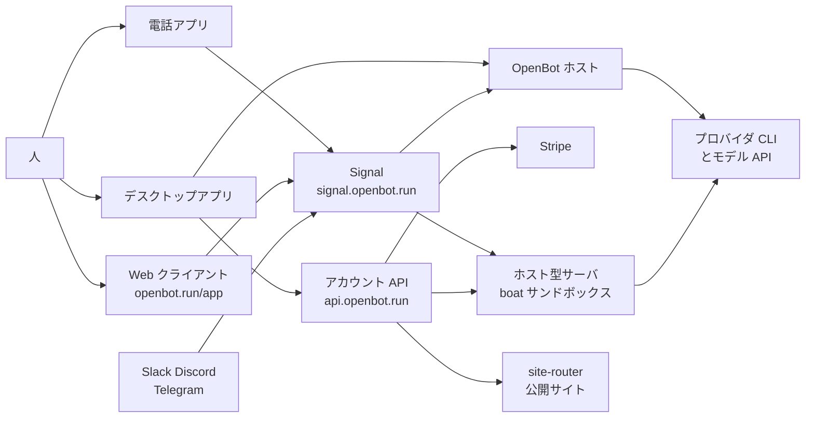
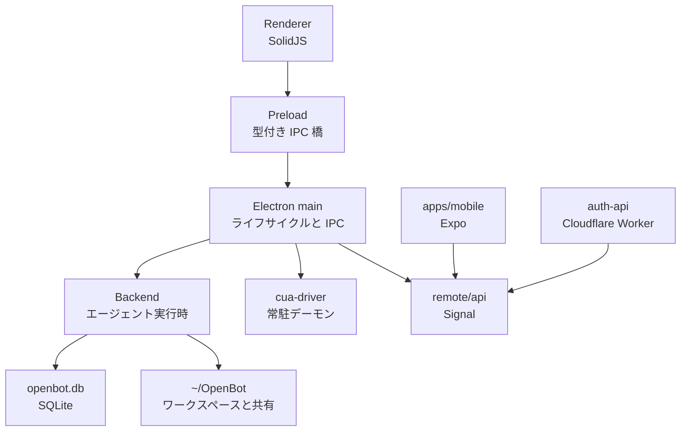
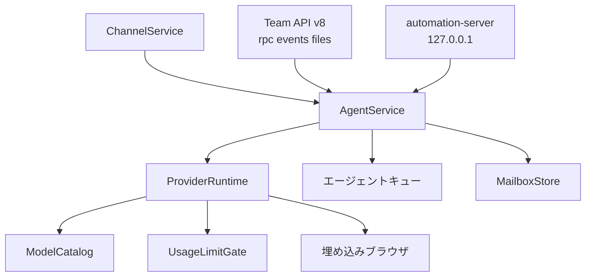
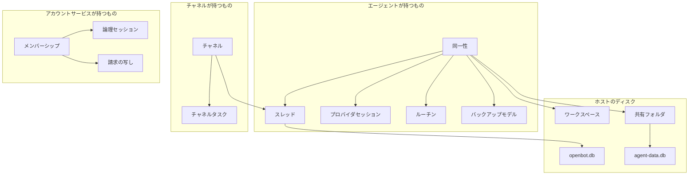
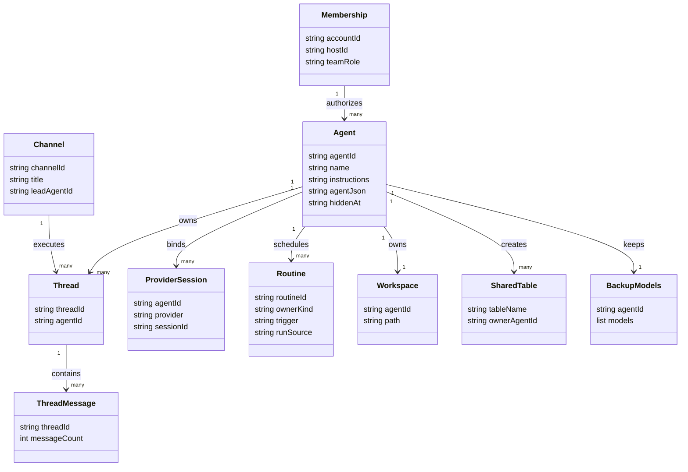

OpenBot は、Codex や Claude Code などの AI CLI を「名前と仕事場を持つ常駐のチームメイト」として束ねる、ローカルファーストなデスクトップワークスペースです。この記事では、OpenBot の構成要素とデータの持ち方を図で整理し、導入・利用・運用で押さえる設定値と、資料ごとの記載の差をまとめます。版・件数は 2026-10-30 時点で GitHub API と `main` ブランチの文書を確認した値です。


*この記事の全体像。以下、順に解説します。*

## OpenBot とは

OpenBot は、手元のコンピュータで動き続ける AI チームメイトのためのデスクトップワークスペースです。自前の基盤モデルは持ちません。利用者が既に契約している Codex、Claude Code、Grok、OpenCode、Gemini、Cursor、Cline などの CLI を、エージェントごとのワークスペースと会話の外側に置いて動かします。ここでいう「エージェント」は、名前・指示・作業フォルダ・会話履歴を持つ OpenBot 上の 1 人のチームメイトのことです。

リポジトリ [nightly-labs/openbot](https://github.com/nightly-labs/openbot) は 2026-08-12 に作成されました。2026-10-30 時点で star 3809、fork 353、pull request を除く open issue は 299 です。最新リリースは [v0.54.0](https://github.com/nightly-labs/openbot/releases/tag/v0.54.0)（2026-10-29T14:47:49Z 公開）で、設計の正本は [docs/ARCHITECTURE.md](https://github.com/nightly-labs/openbot/blob/main/docs/ARCHITECTURE.md) です。

製品は開発プレビューです。エージェントの仕事、会話、添付、ブラウザデータは、OpenBot を動かしているコンピュータに残ります。会話やキューなどは SQLite の `openbot.db`、埋め込みブラウザのタブ状態は JSON ファイル、ワークスペースやダウンロードのファイル実体はディスク上のフォルダに置きます。選んだ AI 提供者には、そのエージェントが送るプロンプトが届きます。任意で作るアカウントは、メールのワンタイムコード、ホスト設定、メンバーシップ、招待、論理セッションのために使います。

ライセンスは [PolyForm Noncommercial License 1.0.0](https://polyformproject.org/licenses/noncommercial/1.0.0) です。非商用の変更と実行は認められ、商用利用には別契約が要ります。[LICENSE](https://github.com/nightly-labs/openbot/blob/main/LICENSE) が許可される目的として挙げるのは、商用の応用を見込まない個人の研究・学習・趣味などと、非営利団体・教育機関・公的機関による利用です。それ以外の業務で使うときは、[README](https://github.com/nightly-labs/openbot/blob/main/README.md) によれば Settings → Billing から商用ライセンス（1 人向けの Starter、2〜10 人向けの Team）を購入するか、licenses@openbot.run へ問い合わせます。0.1.11 までの版は Apache-2.0 のままです。

## 特徴

- エージェントごとに名前、指示、ワークスペース、スレッド、プロバイダの再開状態を持ちます。プロバイダ（裏で動かす AI CLI）を替えても、ワークスペースとスレッドは残ります。
- メッセージは FIFO キューに入ります。一時停止、再開、キャンセルができ、クラッシュ後もキューは残ります。
- エージェント同士はメッセージ、返信、リアクション、画像、管理されたファイル転送を送れます。
- チャネルは複数エージェントの共有チャットです。ホスト上に正本のトランスクリプトを持ち、エージェントごとの実行スレッドとは分かれています。
- 埋め込みブラウザをエージェントが開き、読み、操作できます。Computer Use（画面を読み、マウスとキーボードを操作する機能）は、同梱の `cua-driver` を OpenBot の子プロセスとして起動します。
- プロバイダ CLI は、明示パス、管理コピー、システムの CLI の順で探します。起動時と 1 時間ごとに新しい上流リリースを確認します。
- プラン上限や一部のプロバイダ障害では、最大 8 個のバックアップモデルへ移せます。チャットとワークスペースは維持されます。
- デスクトップに加え、同一アカウントの電話アプリと `openbot.run/app` から、暗号化されたホスト接続で同じサーバを操作できます。
- 画面のない Linux では、`openbot` コマンドのセルフホスト、Docker イメージ、boat 上のホスト型サーバを選べます。boat は OpenBot のホスト型サーバが動くサンドボックス基盤です。
- ローカルスキルは共有ライブラリに保存します。マーケットプレイスへ出すには、別途フォルダを提出します。

### 似た実行形態との違い

| 項目 | OpenBot（自分のホスト） | 単体の Codex または Claude Code | OpenBot のホスト型サーバ |
|---|---|---|---|
| 実行単位 | 1 台のホスト上の複数エージェント | 1 つの CLI セッションが中心 | アカウントのサーバごとに boat サンドボックス 1 つ |
| 会話の保存 | ホストの `openbot.db` | 各 CLI のホームが再開状態を持つ | そのサンドボックスのディスク。停止後もスナップショットが残る |
| 人が離れたあと | ホストの電源とプロセスが要る | 同じ | 無操作が続くと停止し、次の利用で起動する |
| ライセンス | PolyForm Noncommercial 1.0.0 | 各 CLI の条件 | OpenBot の条件に加え boat と Stripe |

### 向く場面

| 場面 | 向く置き方 |
|---|---|
| 自分の Mac で複数役割を並行させる | デスクトップアプリ。ワークスペースは `~/OpenBot` |
| ノート PC を閉じても仕事を続けたい | Ubuntu のセルフホスト、または Docker |
| 自分の機械を常時起動したくない | ホスト型サーバ。1 サーバが 1 つの boat サンドボックス |
| 同僚が同じエージェント群を使う | 1 台のホストに参加する。会話とファイルの正本はそのホスト |
| 会社の業務で使う、商用プロダクトへ組み込む | 非商用ライセンスの範囲外。商用ライセンスが要る |

## 構造

### システムコンテキスト図

OpenBot の中心は「ホスト」です。ホストはエージェントと会話の正本を持つコンピュータで、デスクトップアプリ自身がホストになるほか、セルフホストサーバやホスト型サーバもホストになれます。ホスト型サーバは、OpenBot のアカウントサービスが有料プランで用意する実行ホストです。クライアントがホストを操作するときに使う OpenBot 独自のプロトコルを Team API と呼びます。図中の Signal は接続準備用の OpenBot のサーバで、メッセージアプリの Signal とは別物です。



| 要素名 | 説明 |
|---|---|
| 人 | デスクトップ、電話、ブラウザから同じアカウントのホストを操作する |
| デスクトップアプリ | Electron 製。ローカルホストにも、参加先のリモートホストのクライアントにもなれる |
| 電話アプリ | Expo 製。Signal 経由で Team API に接続する |
| Web クライアント | `/app`。会話本文はアカウント Worker を通さず、暗号化ホスト接続を使う |
| OpenBot ホスト | エージェント、SQLite、ワークスペース、埋め込みブラウザの正本 |
| プロバイダ CLI とモデル API | Codex、Claude、Grok、OpenCode、Gemini、Cursor、Cline など。ログイン状態は各 CLI のホームにある |
| アカウント API | Cloudflare Workers と D1。メールログイン、メンバー、招待、論理セッション、請求 |
| Signal | 接続準備用のシグナリングサーバ。SDP と ICE、および Slack、Discord、Telegram、Webhook を中継する |
| Stripe | 有料プランの正本。D1 の購読行は Webhook が追従する写し |
| ホスト型サーバ | アカウント API が作る実行ホスト。クライアントは Signal 経由で、ローカルホストと同じ Team API で操作する |
| site-router | 公開サイトを私有の R2 から配信する Cloudflare Worker |
| Slack Discord Telegram | 外部の会話。ホスト上のエージェントが応答する |

### コンテナ図



| 要素名 | 説明 |
|---|---|
| Renderer | 画面状態だけを持つ。`src/main` と `src/backend` を import しない |
| Preload | 業務ルールを持たない。型付き呼び出しを IPC チャネルへ写す |
| Electron main | 信頼できない IPC を検証してからサービスを呼ぶ。ホストサーバもここにある |
| Backend | プロバイダアダプタ、キュー、イベント、ブラウザホスト |
| openbot.db | エージェント、会話、キュー、リアクション、添付、セッション束縛の正本 |
| ~/OpenBot | エージェントのワークスペース、共有フォルダ、ダウンロード |
| cua-driver | 画面読取と入力。main が直接起動し、各 CLI からはソケット経由の短い MCP プロキシで使う |
| auth-api | デスクトップ実装を import しない。中央アカウントの正本 |
| Signal | リモート接続のシグナリングと外部チャットのリレー |
| apps/mobile | リモートのチームホスト用クライアント |

図の矢印は実行時の呼び出しです。画面は preload を経由して main へ IPC します。import の依存は逆向きで、main が preload と backend を向き、renderer、preload、auth-api が共通の型定義パッケージ `@openbot/contracts` を向きます。contracts は Electron、Node.js、SolidJS、プロバイダ SDK、Cloudflare に依存しません。

### コンポーネント図

Backend と main のうち、仕事の流れに出る構成要素です。



| 要素名 | 説明 |
|---|---|
| AgentService | プロバイダイベントを受け、SQLite の投影を書いてから画面へ伝える |
| ProviderRuntime | CLI の起動、使用量読取、無効化したプロバイダの除外 |
| ModelCatalog | 起動中の各 CLI の `model/list` を同じ手順で読む。プロバイダごとの分岐はドライバ側に置く |
| UsageLimitGate | プラン上限の判定と、作業前に失敗したターンのバックアップ移動 |
| エージェントキュー | FIFO。手動メッセージとルーチン実行が同じキューを使う |
| MailboxStore | 添付、生成物のステージ、削除のアウトボックス。ファイル実体は AttachmentFiles が持つ |
| ChannelService | チャネル依頼の担当を、モデルを使わず規則で選ぶ。残りはリードエージェントの別セッションが扱う |
| 埋め込みブラウザ | タブ状態は `browser-tabs.json`。`openbot.db` のマイグレーション対象外 |
| Team API v8 | WebRTC の DataChannel が `rpc`、`events`、`files` の 3 本。デスクトップは隠し Chromium、電話の Expo Go は隠し WebView が PeerConnection を持つ |
| automation-server | `allowAutomation` を持つエージェントがいるときだけループバックで待ち受ける |

ここでいう「投影」は、イベントから組み立てた読取用のテーブルのことで、テーブル名に `projection_` が付きます。

## データ

### 概念モデル

所有は入れ子、利用は矢印で表します。



| 要素名 | 説明 |
|---|---|
| 同一性 | 名前、アバター、役割、指示。ID は `agent-` に UUID を付けた形。型名に teammate は使わない |
| スレッド | `projection_threads` の耐久行。画面の conversation は別テーブルを持たない読取投影 |
| プロバイダセッション | CLI の再開状態。スレッドとは分けて `projection_provider_sessions` に置く |
| ルーチン | スケジュールまたは Webhook で起動する定型の仕事。エージェント用とチャネル用がある |
| バックアップモデル | `agent_json` の順序リスト。最大 8 |
| openbot.db | アプリの正本。エージェントが作る共有テーブルは入れない |
| ワークスペース | `~/OpenBot/Agents/<id>`。用語集がこのパスをエージェントの識別子に紐づける |
| 共有フォルダ | `~/OpenBot/Shared`。エージェント間のファイル受渡し |
| agent-data.db | `~/OpenBot/Shared/Data/agent-data.db`。全エージェントが読み書きし、作成者だけが DROP と ALTER できる |
| チャネル | `projection_channels`。人間のアクセスはメンバーシップで決まり、エージェントの所属とは別 |
| チャネルタスク | チャネルへの依頼を、担当エージェントごとの作業（ルートタスク）として持つ。通常スレッドは置き換えない |
| メンバーシップ | D1 が正本。ローカルホストは Team API 用のメンバー投影を持つ |
| 論理セッション | 端末同士が同じ人だと合意するためのアカウント側状態。チャット本文は含まない |
| 請求の写し | D1 の `billing_subscriptions`。正本は Stripe |

会話の単位は次のように分かれます。スレッドは 1 エージェントとの会話で、ふだんの会話をメインスレッド、その横に開く 2 本目以降の会話をサイドスレッドと呼びます（画面ではどちらも thread）。チャネルでは、チャネルとエージェントの組ごとに 1 本の実行スレッドを持ちます。1 つの依頼は、担当に選ばれたエージェントごとに 1 つのルートタスクになり、各エージェントの実行スレッド上で進みます。ターンは、スレッド内の 1 回のやり取りです。

### 情報モデル



| 要素名 | 説明 |
|---|---|
| Agent | `projection_agents`。表示と設定の多くは `agent_json` に入り、`hiddenAt` もその中にある |
| Thread | 耐久スレッド。サイドスレッドはコードとケイパビリティ `agent-tasks-v1` では今も task と呼ばれる |
| ThreadMessage | `projection_thread_messages`。公式の復旧 SQL はスレッド単位の件数を数える |
| ProviderSession | プロバイダのプライベートな再開状態。OpenBot の会話本文の複製ではない |
| Channel | 共有チャット。ケイパビリティ名は `channel-chats-v1` |
| Routine | エージェント用は `projection_agent_routines`。実行元を表す `run_source` は `test`、`script`、`webhook` |
| Workspace | ディスク上のディレクトリ。DB 行そのものではない |
| SharedTable | `openbot_metadata` が所有者を記録する。他エージェントも行の読み書きはできる |
| BackupModels | `AgentBackupModels`。設定画面、`agent-backup-models-v1`、`update_profile` が更新する |
| Membership | サーバ役割は owner、admin、member。エージェントへのアクセスレベルとは別の語 |

「ケイパビリティ」は、ホストとクライアントが対応機能を名前と版で示し合うための識別子です。

用語集が区別している隣接概念は次のとおりです。

| 要素名 | 説明 |
|---|---|
| ワークフロー | Workflows ページのグラフ。`workflows-v1`。1 エージェントの答えを次へ渡す routine flow とは別 |
| メッセージング接続 | Slack ワークスペース、Discord ギルド、Telegram チャット。Slack の channel は `platformChannelId` であり、製品のチャネルではない |
| コネクタ | OpenBot が用意する外部サービスへのサインイン。利用者が足す MCP サーバやマーケットプレイスのプラグインとは別 |
| ブラウザプロファイル | ホスト上の名前付きブラウザセッション。エージェントの表示用 AgentProfile やアカウントプロフィールとは別 |
| エージェントテンプレート | 指示とスキルとルーチンの公開コピー。ワークスペースのファイルもメモリも持たない |

プロバイダ自身のログイン情報は OpenBot の表にコピーしません。置き場所は `~/.codex`、`~/.claude`、`~/.grok`、`~/.gemini`、`~/.cursor`、`~/.cline`、`~/.pi`、および OpenCode と Muse の XDG フォルダです。

`openbot-approval-automation-v3.json` が持つのは、後述する Permissions のうち Full access の側（`autoApprove`）だけです。三段階の列挙そのものは持ちません。このファイルはエージェントを動かすコンピュータに属し、Team API を越えて同期されません。

## 導入

### 対応 OS と開発プレビュー

- デスクトップは macOS 13 以降（Apple silicon と Intel）、Windows 10 以降の x64、Linux の x64 または arm64 AppImage に対応します。
- リリース版の利用に Bun と Node.js は不要です。ソースから起動するときだけ Bun 1.4.2 と Node.js 24 が要ります。Node の版は `.nvmrc` が Electron 同梱版に合わせています。
- 初回起動では、エージェントがファイル、コマンド、ネットワーク、埋め込みブラウザを確認なしで使えることを説明し、明示の同意があるまでエージェントサービスを始めません。同意記録はアプリサポートディレクトリに残ります。

### macOS と Windows のインストール

- GitHub Releases から OS に合う成果物を取ります。macOS は `OpenBot-*-arm64.dmg` または Intel 用の `OpenBot-*-x64.dmg`、Windows は `OpenBot-*-x64.exe` です。
- macOS は Applications へ移して開きます。Windows はインストーラを実行します。
- Windows の署名者は `SYNTHETIFY LABS SPÓŁKA Z OGRANICZONĄ ODPOWIEDZIALNOŚCIĄ` です。新しいリリースでは SmartScreen が警告することがあります。チェックサムまたは GitHub のビルド証明を確認してから実行します。

### Linux デスクトップ

`OpenBot-*-x86_64.AppImage` または arm64 用 AppImage に実行権を付けて起動します。libfuse2 は不要で、`fuse3` の `fusermount3` で自身をマウントします。

```bash
chmod +x OpenBot-*.AppImage
```

Ubuntu 23.10 以降と Debian 13 では、非特権ユーザ名前空間が AppArmor で制限されており、プロファイルを入れるまで起動直後に終了します。プロファイルはリポジトリの [build/linux/openbot.apparmor](https://github.com/nightly-labs/openbot/blob/main/build/linux/openbot.apparmor) にあるので、取得してから入れます。

```bash
curl -fsSLO https://raw.githubusercontent.com/nightly-labs/openbot/main/build/linux/openbot.apparmor
sudo install -m 0644 openbot.apparmor /etc/apparmor.d/openbot
sudo systemctl reload apparmor
```

- 同じファイルは AppImage 内の `resources/linux/openbot.apparmor` にもあります。
- プロファイルが対象にするのは、`~/Applications`、`~/Desktop`、`~/Downloads`、`~/.local/bin`、`/opt/OpenBot` に置いた `OpenBot*.AppImage` です。それ以外の場所に置くときは、プロファイル内のパスを編集します。
- 初回起動は `~/.local/share/applications/openbot.desktop` と `~/.local/share/icons/openbot.png` を書き、`openbot://` リンクを開けるようにします。
- `--no-sandbox` はサポートされる回避策ではありません。レンダラとコンピュータの境界を外してしまいます。

### セルフホストサーバ

Ubuntu 24.04 または 26.04、x86_64 または arm64、systemd が前提です。インストールは次のコマンドで、データはサービスユーザのホームに残ります。

```bash
curl -fsSL https://raw.githubusercontent.com/nightly-labs/openbot/main/scripts/install-server.sh | sudo bash
sudo openbot login
```

- `openbot login` はメールと、OpenBot が送るコードを尋ねます。サーバの表示名は 6 文字から 32 文字で、`sudo openbot login --name <name>` または `sudo openbot name <name>` で付けます。
- インストールスクリプトの再実行は再インストールまたは更新になります。より古いリリースは拒否します。新しい OpenBot がマイグレーションした DB を古い版は開けないためです。ホスト型サーバの機械へのインストールも拒否します。

他人のアカウント用にサーバを用意する操作者は、`POST https://api.openbot.run/v2/admin/server-claims` で 15 分有効の一回限りのクレームを作り、`sudo openbot login --claim` に渡します。アカウントサービスが保持するのはクレームのハッシュだけです。管理者トークンはプロセス引数に置かず、`Authorization: Bearer <token>` の 1 行だけを書いたヘッダファイル `server-claims.header` で渡します。

```bash
printf '{"email":"%s"}' owner@example.com |
  curl --fail -sS -X POST https://api.openbot.run/v2/admin/server-claims \
    -H @server-claims.header -H 'content-type: application/json' --data-binary @- |
  sed -n 's/.*"claim":"\([A-Za-z0-9_-]*\)".*/\1/p' |
  sudo openbot login --claim --name <name>
```

### Docker

イメージは `ghcr.io/nightly-labs/openbot` で、`linux/amd64` と `linux/arm64` があります。コンテナはポートを公開せず、外向きにだけ接続します。次のオプションは必須です。Electron のサンドボックスがユーザ名前空間を作るため、既定の seccomp では止まります。

```bash
curl -fsSLO https://raw.githubusercontent.com/nightly-labs/openbot/main/docker/seccomp.json
docker run -d --name openbot --restart unless-stopped \
  --security-opt seccomp=seccomp.json --security-opt no-new-privileges:true \
  --shm-size 1g --stop-timeout 60 -v openbot-data:/data \
  ghcr.io/nightly-labs/openbot:latest
docker exec -it openbot openbot login
```

Compose を使うときは次の 2 ファイルを取り、`docker compose up -d` のあと `docker compose exec openbot openbot login` を実行します。

```bash
curl -fsSLO https://raw.githubusercontent.com/nightly-labs/openbot/main/docker/compose.yaml
curl -fsSLO https://raw.githubusercontent.com/nightly-labs/openbot/main/docker/seccomp.json
```

- `/data` は UID 1000 の `openbot` ユーザのホームです。DB とランタイムは `/data/.config/OpenBot`、ワークスペースは `/data/OpenBot`、鍵束は `/data/.local/share/keyrings` と `/data/.config/openbot-container` です。暗号化データは鍵束なしでは開けません。
- タグ `latest` は最新リリースです。`0.30.0` のような版タグと、0.31.0 より後の `v<version>` 別名もあります。

### Nix とソースからの起動

Linux x64、arm64、Apple silicon では Nix でデスクトップ版を起動できます。OpenBot は非フリー扱いなので、nixpkgs で次の述語を許可します。Nix で入れた版は自己更新せず、Linux の Nix パッケージはリモートデスクトップランタイムを含みません。

```nix
nixpkgs.config.allowUnfreePredicate = pkg: lib.getName pkg == "openbot";
```

```bash
nix run github:nightly-labs/openbot
```

開発用の Bun 1.4.2 は、macOS と Linux では次で入ります。

```bash
curl -fsSL https://bun.com/install | bash -s "bun-v1.4.2"
```

ソースからの開発起動は次のとおりです。`codex:doctor` はモデルのターンを始めずに、CLI の版、App Server とのハンドシェイク、ChatGPT ログインを確認します。

```bash
git clone https://github.com/nightly-labs/openbot.git
cd openbot
bun install --frozen-lockfile
bun run codex:doctor
bun run dev
```

Windows の開発用 Bun は、PowerShell で `iex "& {$(irm https://bun.com/install.ps1)} -Version 1.4.2"` を実行します。

## 利用

### プロバイダの接続

- オンボーディング、設定、エージェント作成、モデルピッカーの Download で、対応 CLI を管理コピーとして取得できます。README は、カスタムの OpenAI 互換エンドポイント、カスタム ACP エージェント、Ollama と LM Studio の検出も動く機能に含めています。ACP（Agent Client Protocol）は、エディタなどのクライアントがコーディングエージェントを外部から操作するためのプロトコルです。
- 解決順は、明示の `OPENBOT_*_PATH`、管理コピー、互換性のあるシステム CLI です。明示パスがあると管理更新の提案は出ません。
- システム CLI の更新機能は使いません。OpenBot が入れるのは管理ストアの上流リリースです。初回のフォールバック版だけが `native-runtime.lock.json` で固定されています。
- 管理ストアはコンピュータに 1 つで、パスは `appData/OpenBot/provider-runtimes` です。パッケージ版の `userData` はその親の `appData/OpenBot` です。`--user-data-dir` を明示したプロファイルだけが、そのディレクトリの中にストアを持ちます。

| プロバイダ | 起動と認証の要点 |
|---|---|
| Codex | 既存の CLI ログインを使う。認証情報は OpenBot にコピーしない |
| Claude Code | 既存の CLI ログインを使う。Windows では Git for Windows も要る |
| Grok | `grok login` または起動環境の `XAI_API_KEY`。キーは保存もログもしない |
| OpenCode | 管理ランタイム上で `opencode acp` を起動する。無料モデルはアカウント不要。有料プラン OpenCode Go のモデルは opencode.ai/auth のキーをこのコンピュータで暗号化して持つ |
| Gemini | Google AI Pro または Ultra が前提。Antigravity ACP サーバを Download で取る。PATH 上の `antigravity` はエディタ用なので使わない |
| Cursor | `cursor-agent acp`。`cursor` コマンドはエディタ起動なので使わない。`CURSOR_API_KEY` も使える |
| Cline | `cline --acp`。起動環境の `CLINE_API_KEY` でも CLI にサインインできる。自分で入れる版は、管理コピーができるまで 3.0.68 以降を使う |

Gemini の実行ファイルを自分で指定する例として、設計文書は次の形を示しています。

```bash
OPENBOT_ANTIGRAVITY_PATH=/var/lib/openbot/antigravity-acp-1.3.0/bin/agy_acp_server.par
```

このパスを置いたときは、その実行ファイルだけを使います。同じ `bin/` に `localharness_external` が、その 2 段上（`bin/` の親）に `version` を持つ `antigravity-package.json` が必要です。

### エージェント、キュー、チャネル

- 1 つのプロンプトでエージェントを作り、指示と節を確認してから保存します。忙しいエージェントへの追加メッセージはキューで待ちます。
- キューは一時停止、再開、キャンセルができます。
- チャネルはサイドバーの節とは別物です。チャネルの参加エージェントは「仕事を受け取る相手」の選択であり、人間の閲覧制限ではありません。認証されたサーバメンバーはチャネルを読めます。
- チャネルのアーカイブは仕事を止め、記録は残します。サイドバー上の表示名は Delete です。復元してもエージェントや紐づく会話は消えません。
- 1 つの依頼は、担当に選ばれたエージェントごとに別のルートタスクとして、そのエージェントの実行スレッドで動きます。通常のエージェントスレッドは置き換えません。
- プロバイダを変えても、ワークスペース、スレッド、同一性は残ります。プロバイダセッションだけが、その CLI のプライベートな再開状態です。

### 権限レベルと追加フォルダ

- Permissions は Workspace only、Ask first、Full access の三段階です。`openbot-approval-automation-v3.json` が記録するのは、そのうち Full access（`autoApprove`）の側です。v3 が無いときだけ古い v2 または v1 のファイルを読み、その古いファイルで Turbo モードがオンになっていると、全エージェントが Full access になります。
- 新しいエージェントは、それを作ったエージェントのアクセスと Computer Use の制限を引き継ぎます。エージェントは自分や同僚の権限を狭めることしかできず、広げることや Ask first と Full access の切り替えは人だけが行えます。
- Workspace only は、自分のワークスペース、共有フォルダ、利用者が追加したフォルダだけを変更できます。追加フォルダは `agent_json` に実パスで最大 32 個です。ディスクルート、ホーム、OpenBot のデータがあるフォルダは main が拒否します。エージェント自身はこの一覧を増やせず、承認カードは残ります。
- Ask first と Workspace only は、Computer Use の同意カードを出します。Full access は Computer Use を含む MCP ツールの同意を一度受け入れ、その決定は保存しません。MCP のフォーム、サインイン、ブラウザの takeover は、どの段階でも対話のままです。
- Full access のエージェントは、公開ホストサイトの公開、更新、削除を追加確認なしで行えます。Workspace only と Ask first では、サイト変更に確認が要ります。所有とソースの検証はどの段階でも残ります。
- Computer Use は、macOS では画面収録とアクセシビリティの許可を OpenBot に付与します。Windows と Linux はその許可を尋ねません。ドライバは OpenBot が起動するコピーに限り、`CUA_DRIVER_RS_TELEMETRY_ENABLED=0` と `CUA_DRIVER_RS_UPDATE_CHECK=0` でベンダへの送信と更新確認を止めます。

### ローカルスクリプトとスキル

- automation-server は、手元のスクリプトが HTTP で、有効にしたエージェントへメッセージを送り、ルーチンを実行し、保留中の質問や承認に答えるためのループバックの待ち受け口です。実装の `src/main/automation-server.ts` は、この操作を許可（`allowAutomation`）したエージェントが 1 つでもいるときだけ、`127.0.0.1` の空きポートで待ち受けます。URL とベアラトークンは `<userData>/automation/` に、ディレクトリ `0700`、ファイル `0600` で書き、停止時に消します。
- `Origin` ヘッダ付きの要求や、他ホストを指す `Host` の要求は、トークン確認の前に拒否します。
- スキルは、エージェントが `SKILL.md` を含むフォルダを作り、`create_skill` で共有ライブラリへ保存します。他のエージェントは Settings、Skills、Local skills から追加します。
- フロントマターの `example-prompt` は、トリム後 1000 文字までです。Try skill はその文とスキル参照を下書きへ足すだけで、送信はしません。

```yaml
example-prompt: Turn the latest commits into release notes.
```

### 必須に近い操作上のパラメータ

| 操作 | 必須の入力 | 置かないもの |
|---|---|---|
| セルフホストのログイン | メールとメールコード、または一回限りのクレーム | パスワード |
| サーバ表示名 | 6 から 32 文字 | 空文字 |
| Docker 起動 | `seccomp.json`、`--shm-size 1g`、データボリューム | 公開ポート |
| Gemini の手動パス | `OPENBOT_ANTIGRAVITY_PATH` と隣のファイル配置 | PATH の `antigravity` |
| サーバクレーム API | `Authorization: Bearer` をヘッダファイルで渡す | プロセス引数へのトークン |

## 運用

### デスクトップの起動と終了

- デスクトップ版は、アプリを開いているあいだエージェントが動きます。終了時はエージェントを止めてから DB を閉じます。Docker の `--stop-timeout 60` はこの停止時間のためです。
- macOS と Windows の Settings、General、Keep this computer awake は、電源接続中のアイドルスリープを止めます。ディスプレイの消灯は続きます。蓋を閉じたときや自分で選んだスリープでは、外部ディスプレイ付きのクローズドディスプレイモード以外はスリープします。バッテリー時は、Also on battery を別にオンにしない限り通常どおりスリープします。
- `pmset -g assertions` に `WebRTC has active PeerConnections` と出るのは、他デバイスが接続しているあいだだけです。常時起動の設定中は項目名が `Electron` になります。

### セルフホストの状態確認と更新

アカウント操作は `sudo` またはサービスユーザで実行します。他のユーザは制御ソケットを開けません。

```bash
openbot status
openbot logs -f
sudo openbot restart
sudo openbot update
openbot version
```

- `openbot status` は、版、アカウント、サーバ状態、メモリ、ステージ済みの更新を出します。
- `openbot logs` は `openbot.service` の journal を表示します。
- `sudo openbot update` は最新リリースを取得し、検証してから入れます。
- `sudo openbot uninstall` はサインアウトしてプログラムを外します。データは残します。
- 空きメモリが少ないとき、新しいターンはキューで待ちます。人からのメッセージが優先されます。同時ターン数は、メモリ天井が 5 GiB までなら 2、10 GiB までなら 8、それを超えると 16 です。天井は機械のメモリと `MemoryMax=90%` の小さい方です。ガードは cgroup v2 を読み、cgroup v1 では機械のメモリを使ってログに警告を 1 つ出します。

```bash
sudo systemctl edit openbot.service
```

例として `MemoryMax=2G` を書いて再起動すると、ターン上限と低メモリ判定がその天井を使います。`openbot status` のメモリレベルは `ok`、`low`、`critical` です。

### ホスト型サーバの寿命

- 1 つのホスト型サーバは 1 つの boat サンドボックスです。アカウントあたり、削除されていないサーバは 50 までです。
- プランごとの機械サイズは、Starter が boat `small`、Standard が `default`、Pro が `large` です。このホスト型サーバのプランは、冒頭で触れた商用ライセンス（Starter、Team）とは別の購読です。購入画面で両方を 1 回の支払いでまとめて買うこともできますが、ライセンスはその後、独立した購読として更新されます（[Hosted servers](https://github.com/nightly-labs/openbot/blob/main/docs/hosted-servers.md)）。
- 15 分のあいだ活動も状態変化も無い実行中サーバは cron が止め、boat がディスクを保存します。次のルーチン実行が 10 分未満なら止めません。接続中のクライアントは、データを変える操作か入力イベントのあと 5 分を利用として数えます。ポーリングや既読だけでは利用になりません。
- フォーカスのあるアプリは、最後の操作または再フォーカスから最大 30 分まで利用として数えます。その 30 分のあと、サーバはさらに 15 分から 30 分で止まります。フォーカスのない起動中のアプリはサーバを維持せず、最後の操作から 15 分から 30 分で止まります。
- boat は停止から 14 日でディスクを消します。11 日目にメールを送り、消えたディスクの再開は `snapshot_data_expired` で失敗します。停止のたびに新しいディスクを保存します。最終利用から 10 日から 14 日のアイドルサーバは、ディスクを残すための起動を受け、クライアントが無ければ 15 分から 25 分後に再び止まります。プラン終了、削除予定、またはディスクが 14 日より古いサーバは起動しません。
- サンドボックスの環境変数は `OPENBOT_HOSTED_HOST_ID` と `OPENBOT_HOSTED_CLAIM` だけです。
- 本番環境では、どのアカウントでもホスト型サーバを購入できます。

### リモート接続

- 現行のリモート接続は Team API プロトコル v8 です。DataChannel は `rpc`、`events`、`files` の順に張られます。
- Signal は原則として SDP と ICE だけを運びます。例外として、エージェントの Slack アプリの要求も Signal が運びます。
- ホストの `openbot-remote-network-route-v1.json` が `private` のとき、WebRTC に ICE サーバを渡さず、私設アドレスの host 候補だけを残します。変更時は既存のピアを閉じ、リレーなしで繋ぎ直します。
- アプリに戻って 30 秒未満なら経路を維持します。30 秒以上では ICE をやり直し、160 秒以上では同じセッションでピアを作り直します。
- 一時的な RTC の disconnected には 15 秒の回復窓があります。Signal の `rate_limited`、またはコード 1008 でエラーフレームの無い切断が起きたあとの次のソケットは 60 秒待ちます。
- ファイアウォールでは、次のホストを HTTPS の TCP 443 と WebSocket で許可します。チーム接続は、Signal が示す TURN の UDP と TCP も使います。

| ホスト | 用途 |
|---|---|
| `api.openbot.run` | アカウント、サインイン、チーム、ホスト型サーバ |
| `signal.openbot.run` | チームとリモートの接続準備 |
| `openbot.run` | 公開サイトと招待メールの画像 |
| `*.openbot.run` | ホスト型サーバ、サイト、`analytics.openbot.run` |
| `github.com` と `*.githubusercontent.com` | アプリ更新 |

### データの置き場

| 置き場所 | 中身 |
|---|---|
| macOS `~/Library/Application Support/OpenBot/openbot.db` | アプリ DB。公式の復旧 SQL がこのパスを使う |
| Windows `%APPDATA%\OpenBot\openbot.db` | 同じ DB の Windows パス |
| Docker `/data/.config/OpenBot` | コンテナ内の DB、ログ、プロバイダランタイム、ブラウザデータ |
| `~/OpenBot` またはコンテナの `/data/OpenBot` | ワークスペース、共有、ダウンロード |
| `openbot-approval-automation-v3.json` | Full access の `autoApprove` だけ。Team API には載らない |
| `browser-tabs.json` | 埋め込みブラウザのタブ。マイグレーションの対象外 |
| D1 | アカウント、リモートメンバー、招待、論理セッション、Webhook ルートのメタデータ |
| コンテナ内の `~/.codex` と `~/.claude` | プロバイダのログイン。コンテナのホームは `/data` なので、ホスト OS の同名ディレクトリではない |
| ホストの `~/.codex` と `~/.claude` など | デスクトップ版のプロバイダログイン。OpenBot のリセットでは消さない |
| `/data/.local/share/keyrings` と `/data/.config/openbot-container` | コンテナの鍵束とパスワード。暗号化データはこの組が揃わないと開かない |

### 観測と診断

- 本番のデスクトップ、`/app`、設定済みのモバイル、ウェブサイトは、自己ホストの OpenPanel（製品分析ツール）へ製品イベントを送ります。開発ビルド、プレビュー、テスト、Storybook は送りません。
- 診断エクスポートは、版、能力の状態、キュー件数、IPC とターンの集計、リソース要約を含みます。会話、訪問 URL、メール、ファイル内容、ローカルパスは含みません。
- アカウントメニューから出す ZIP は、プロファイル、会話スナップショット、キュー、管理添付を含み、CLI の資格情報、ブラウザのクッキー、ワークスペースのファイルは省きます。
- デスクトップが自分で閉じたときは、ユーザデータの `logs` を見ます。トラブルシューティング文書によれば、常時起動の記録は `logs/main/main.log` に出ます。

### 課金イベントの境界

- 有料プランとホスト型サーバの変化は、アカウントサービスが OpenPanel へ送ります。デスクトップの分析設定ではこの送信は止まりません。
- イベントに含むのはアカウント ID と固定値だけです。メール、名前、Stripe ID、サーバ ID は含めないと [PRIVACY.md](https://github.com/nightly-labs/openbot/blob/main/PRIVACY.md) が書いています。
- 使用量の表示は、プロバイダごとのローカル読み取りです。Codex はローカルの App Server、OpenCode Go は `opencode.ai/zen/go/v1/usage`、Cursor は CLI のトークンで Cursor の API、Gemini は ACP の `/usage` を読みます。いずれも OpenBot のメンテナへは送りません。

## ベストプラクティス

### 渡す仕事をホスト権限に合わせる

- 開発プレビューでは、同意のあとエージェントがローカルコマンドを実行できます。渡すタスクは、そのホストで許可できるものに限ります。
- バックアップは利用者が取ります。OpenBot は会話をクラウドへ複製しません。
- 外部チャットに投稿できる人は、エージェントへ仕事を渡せます。その仕事が届く範囲を決めるのは、ホスト側の Permissions です。

### フォルダとプロバイダの境界

- ワークスペースの外を触らせるときは、追加フォルダを人が登録します。ホーム全体やディスクルートは拒否されます。
- プロバイダのホームは OpenBot とは別にバックアップし、アンインストール時にまとめて消さないようにします。
- `XAI_API_KEY` とセッション単位の MCP ベアラは、OpenBot の保存とログに乗りません。キーを載せる環境は起動環境に限定します。

### 上限とフェイルオーバー

- バックアップは最大 8 個です。自動リストでは、ホールドに掛かっていない最初の準備済みモデルへ移ります。
- プラン上限は、そのプロバイダアカウントとモデルのキューをリセットまで止めます。
- プロバイダエラーはキューを止めません。バックアップへ移るのは、そのターンがまだ作業していないときだけです。失敗したモデルは 10 分見送り（ホールド）、次の取り出しでバックアップが再実行します。ホールドは、そのモデル上のターン完了か再起動でも終わります。文章出力やツール実行のあとの失敗は、そのエラーのまま終わります。
- 同じメッセージの再実行は、失敗したモデルごとに 1 回です。タスク（サイドスレッド）、チャネルタスク、拒否された `turn/start`、起動に失敗したプロバイダはフェイルオーバーしません。
- 使用量の読取は、同じサインインに対して結果を約 4 分再利用します。失敗後は 5 分、10 分、20 分、40 分、最長 1 時間と間隔を広げます。Claude の使用量エンドポイントは Claude Code と共有で、頻繁に読むと 1 時間以上の HTTP 429 になります。

### 常時起動の選び方

- ルーチンは、コンピュータが起きていて OpenBot が開いているときだけ実行します。スリープ中に逃した回は、復帰後に 1 回だけ実行し、逃した回数分は埋めません。
- OpenBot を閉じていたあいだの扱いは、設定「If OpenBot was closed at the scheduled time」で、スキップするか次回起動時に 1 回実行するかを選びます。
- 自分のどのコンピュータも起きていない時間に走らせるなら、ホスト型サーバかセルフホストを使います。
- Docker でホストネットワークを使うと、ホスト上の他のプロセスが `127.0.0.1` のトークン付きリスナーへ届きます。信頼できる単一テナントの機械に限って使います。

### 更新と秘密

- セルフホストの更新は、インストール済みより古い版を拒否する経路に乗せます。DB を手で古いアプリに向けません。
- クレーム用の管理者トークンは、操作者のコンピュータだけに置きます。このトークンは任意のメールのセッションを取れます。
- トークンはプロセス引数に置かず、ヘッダファイル経由で `curl` に渡します。`openbot login --claim` はクレームを標準入力から読みます。

## 注意点

公式文書の中でも、書かれている内容に差がある箇所があります。手順や設定を書くときは次の点に気をつけます。

| 対象 | 資料の記載 | 一次資料で確認できる内容 | 読者への影響 |
|---|---|---|---|
| 承認ポリシー | README、SECURITY.md、PRIVACY.md は、エージェントが `danger-full-access` と `approvalPolicy: never` で動くと書く | `docs/architecture/structure.md` は、Codex の `approvalPolicy` を `on-request` のままにすると書く。`never` は MCP ツール呼び出しと elicitation を拒むため | グローバルな「確認なし」と、Codex の MCP 承認は別の設定。設定例で `never` を Codex の唯一の値にしない |
| リモートのプロトコル版 | README は WebRTC protocol v3 が RPC、events、binary files を運ぶと書く。チャネル名は README に無い | `docs/architecture/team-api.md` は現行を Team API protocol v8 とし、DataChannel 名を `rpc`、`events`、`files` の順と書く | 版番号は Team API 文書の v8 を現行とする。README の “binary files” を `files` という識別子とは読まない |
| 権限の段階 | 上記の三文書は、確認ダイアログなしでファイルとコマンドを実行できるとまとめる | structure.md は三段階を区別し、自動承認ファイルには Full access の `autoApprove` だけを書く。Ask first と Workspace only は Computer Use のカードを出し、サイト変更も確認する。ファイルやコマンドのたびに Ask first が何を聞くかは、同文書でも言い切っていない | 自動承認ファイルを三段階の保存先と読まない。Ask first をファイル操作の都度確認とは決めつけない |
| チャネルの操作名 | README の What works は Stop、Resume、Reassign、Archive、Restore を挙げる | `docs/architecture/channels-and-messaging.md` は、Pause と Resume は無く、アーカイブの表示名は Delete で、復元は Deleted channels の行メニューからと書く | ボタン名を README の英単語のまま手順にしない。画面の Delete はレコード削除ではない |
| ライセンスの機械可読名 | リポジトリの LICENSE は PolyForm Noncommercial 1.0.0 | 2026-10-30 時点の GitHub API の `license.spdx_id` は `NOASSERTION` | API の SPDX だけで「ライセンス無し」と判断しない |
| star 数と版 | 公開ページや検索結果の抜粋は時点で変わる | 2026-10-30 の API では star 3809、fork 353、最新リリースは v0.54.0。古い抜粋には 3.3k や v0.53.2 が残っている | star はライブ指標であり固定値ではない |
| issue 件数 | GitHub API の `open_issues_count` は 350 | `is:issue is:open` の検索では 299。差分は pull request | 課題の滞留を数えるときは pull request を除く |
| 隔離単位 | 紹介文はエージェントごとのワークスペースを強調する | ホスト型の隔離はサーバあたり 1 サンドボックス。同一ホストのエージェントは OS を共有し、共有 DB は相互に読み書きできる | 「エージェントごとに独立したコンピュータがある」とは読まない |
| コンテナ検証の範囲 | Docker 手順は本番イメージの起動を示す | docker.md の確認環境は Docker Desktop 4.45、Engine 28.3、`linux/arm64`、0.29.0 の AppImage と起動スクリプト。リリース workflow は各イメージを一度起動する。未試験はコンテナ内の `openbot login`、アプリからのリモート利用、Podman、Kubernetes、rootless Docker、AppArmor がユーザ名前空間を制限するホスト | 手順があることと、その組み合わせが試験済みであることを分けて考える |
| 使用量の読み先 | PRIVACY.md は、表示中のアカウント使用量をローカルの Codex App Server 経由と一文で書く | 同じ PRIVACY.md のプロバイダ別の節は、OpenCode Go、Cursor、Gemini を別のローカル読み取りとする。メンテナへ送らない点は共通 | Codex の一文を、全プロバイダの経路とは読まない |
| デスクトップ Linux の DB パス | macOS と Windows の sqlite 例はトラブルシューティング文書にある | Linux デスクトップの絶対パスは同じ節に無い。コンテナは `/data/.config/OpenBot` | Linux デスクトップは Electron の `appData/OpenBot` という設計記述までに留め、記載の無い絶対パスを推測で補わない |

## トラブルシューティング

公式のトラブルシューティング文書が名前を付けている症状をまとめます。

| 症状 | 原因 | 対処 |
|---|---|---|
| エージェント CLI のセットアップが要ると出る | 管理コピーもシステム CLI も使えない | Download するか、`OPENBOT_*_PATH` で実行ファイルを指定する。Gemini では PATH の `antigravity` を期待しない |
| Linux AppImage が起動直後に終了する | Ubuntu 23.10 以降や Debian 13 の AppArmor がユーザ名前空間を制限する | リポジトリの `build/linux/openbot.apparmor`（または AppImage 内の同名ファイル）を `/etc/apparmor.d/openbot` へ入れ、AppArmor を再読込する。`--no-sandbox` は使わない |
| fusermount が無い | `fuse3` が入っていない | Ubuntu と Debian は `sudo apt install fuse3`、Arch と Omarchy は `sudo pacman -S fuse3`。FUSE が無いコンテナでは `--appimage-extract-and-run` |
| Linux でリモートデスクトップが無い | arm64 AppImage はランタイムを含まない。Wayland では動かない | x64 の X11 セッションで使う。Nix パッケージもこのランタイムを含まない |
| Computer Use が使えない | リリース同梱の `cua-driver` が欠けている、または macOS の画面収録とアクセシビリティの許可が無い | リリース版はデータを残してパッケージを入れ直す。開発チェックアウトは `bun run prepare:cua-driver` と `bun run cua-driver:doctor`。導入済みアプリは `OPENBOT_CUA_DRIVER_PATH` を無視する |
| Linux で音声入力が失敗する | x64 は glibc 2.32 未満、arm64 は 2.17 未満だとランタイムが載らない | より新しいディストリビューションを使う。モデルのダウンロード成功とランタイムの読込は別 |
| Linux で描画が遅い、または起動直後に止まる | GPU プロセスのクラッシュ、または起動 30 秒以内の停止で `~/.config/OpenBot` に `gpu-crash.json` か `gpu-start.json` が残る | ファイルがあると CPU 描画になる。再試行はファイルを消す。常に GPU は `OPENBOT_DISABLE_GPU=0`、常に CPU は `OPENBOT_DISABLE_GPU=1`。`OPENBOT_SERVER=1` とホスト型は常に CPU |
| 更新後にチャットが見当たらない | エージェントとスレッドの対応が外れた。アップグレード前に DB はコピーされない | リセットやフォルダ移動をせず、一度再起動する。まだ無ければ下記の SQL で未所属スレッドを見る |
| 起動が `Stored agent profile <id> has an unreadable "<field>" value` で止まる | 保存済み `agent_json` のフィールドを読めない。データは未改変のまま止まっている | 現行版は修復して起動する。古い版は同じプロファイルで起動を拒否する。フォルダは動かさない |
| ルーチンがスリープ中に走らない | 実行条件は、コンピュータが起きていて OpenBot が開いていること | 復帰後に 1 回だけ実行される。常時実行が要るならホスト型かセルフホスト |
| サインインがファイアウォールやプロキシでブロックされる | フィルタが OpenBot の応答を差し替えている、または検査用ルート証明書を OS が信頼していない | 証明書検査を無効化しない。運用の節のホスト表を許可する。Codex と Claude は独自の証明書規則を使う |
| Docker が seccomp のメッセージで止まる | 既定プロファイルがユーザ名前空間を拒否する | 同梱の `seccomp.json` を付ける。`seccomp=unconfined` や `--privileged` へ逃がさない |
| `/dev/shm` が小さくブラウザが遅い | Docker の共有メモリ既定は 64 MB | `--shm-size 1g` を付ける |
| コンテナのローカル接続だけが遅い | ブリッジネットワークからはホストの LAN や tailscale0 が見えない | Linux の Docker Engine に限り `network_mode: host` を検討する。複数インスタンスのファイアウォールはブリッジ前提 |

### CLI が見つからない

- ターミナルで `codex --version` を確認します。無ければ公式インストーラのあと `codex login` を実行し、OpenBot を完全に終了して開き直します。
- 標準以外の場所に置いたときは、起動環境の `OPENBOT_CODEX_PATH` に実行ファイルの絶対パスを設定します。Claude は `OPENBOT_CLAUDE_PATH` です。

```bash
curl -fsSL https://chatgpt.com/codex/install.sh | sh
curl -fsSL https://claude.ai/install.sh | bash
claude auth login
```

### スリープの記録を見る

Mac がいつスリープしたかは次のコマンドで確認できます。常時起動をバッテリー時も続ける設定名は Also on battery です。

```bash
pmset -g log | grep -E " Sleep | Wake "
```

### 未所属のチャットを数える

再起動しても会話が戻らないとき、macOS では OpenBot を終了してから次を実行します。行が出れば、メッセージはディスク上に残っています。出力には自分のパスが含まれるので、共有する前に確認します。

```bash
sqlite3 "$HOME/Library/Application Support/OpenBot/openbot.db" \
  "SELECT t.thread_id, t.agent_id, (SELECT count(*) FROM projection_thread_messages m
     WHERE m.thread_id = t.thread_id) AS messages
   FROM projection_threads t
   LEFT JOIN projection_agents a ON a.agent_id = t.agent_id
   WHERE a.agent_id IS NULL;"
```

### 読めないプロファイルを見る

現行版でも起動が止まるときは、エラーメッセージが名指す ID の `agent_json` を読みます。Windows では DB が `%APPDATA%\OpenBot\openbot.db` にあります。

```bash
sqlite3 "$HOME/Library/Application Support/OpenBot/openbot.db" \
  "SELECT agent_json FROM projection_agents WHERE agent_id = '<id>';"
```

### リセットとアンインストール

- リセットの前に OpenBot を終了します。アプリ状態と共有ブラウザプロファイルだけを外すには、macOS では `~/Library/Application Support/OpenBot` を安全な場所へ移します。
- ワークスペース、転送、ダウンロードも外すには `~/OpenBot` も移します。`~/.codex` と `~/.claude` は対象外です。
- macOS のアンインストールは Applications から `OpenBot.app` を消します。Windows はインストーラ付属のアンインストーラを使います。
- Linux では AppImage、`~/.local/share/applications/openbot.desktop`、`~/.local/share/icons/openbot.png`、入れた場合は `/etc/apparmor.d/openbot` を消します。
- 不具合の報告は GitHub の bug report フォームから行います。トークン、`~/.codex`、`~/.claude`、会話、非公開ファイル、中身を確認していない診断全文は貼りません。

## まとめ

- OpenBot は、既存の AI CLI をエージェントとして束ね、会話・キュー・ワークスペースをホストの SQLite と `~/OpenBot` に置くローカルファーストなワークスペースです。
- 構造の背骨は、Electron の main と Backend がエージェント実行を担い、電話や Web からは Signal で接続準備をして WebRTC の Team API v8 でホストを操作する形です。
- データは、エージェントの同一性・スレッド・プロバイダセッションを分けて持つため、プロバイダを替えても会話とワークスペースが残ります。プロバイダのログインは各 CLI のホームに置いたままです。
- 常時起動したいならセルフホスト、Docker、ホスト型サーバから選びます。ホスト型は無操作で止まります。保存したディスクは 14 日で失効しますが、条件を満たすアイドルサーバは期限前の自動起動で保存期間が更新されます。
- Permissions の三段階、Codex の `approvalPolicy`、Team API の版などは文書ごとに記載がずれているため、設定を書くときは設計文書側を基準にします。
- ライセンスは PolyForm Noncommercial 1.0.0 で、商用利用には別契約が要ります。

この記事が少しでも参考になった、あるいは改善点などがあれば、ぜひリアクションやコメント、SNSでのシェアをいただけると励みになります！

## 参考リンク

### 製品とライセンス

- [OpenBot](https://openbot.run/)
- [PolyForm Noncommercial 1.0.0](https://polyformproject.org/licenses/noncommercial/1.0.0)
- [LICENSE](https://github.com/nightly-labs/openbot/blob/main/LICENSE)
- [OpenBot v0.54.0](https://github.com/nightly-labs/openbot/releases/tag/v0.54.0)

### リポジトリの設計

- [nightly-labs/openbot](https://github.com/nightly-labs/openbot)
- [README](https://github.com/nightly-labs/openbot/blob/main/README.md)
- [ARCHITECTURE.md](https://github.com/nightly-labs/openbot/blob/main/docs/ARCHITECTURE.md)
- [Repository structure](https://github.com/nightly-labs/openbot/blob/main/docs/architecture/structure.md)
- [Agents](https://github.com/nightly-labs/openbot/blob/main/docs/architecture/agents.md)
- [Providers](https://github.com/nightly-labs/openbot/blob/main/docs/architecture/providers.md)
- [Team API](https://github.com/nightly-labs/openbot/blob/main/docs/architecture/team-api.md)
- [Channels and messaging](https://github.com/nightly-labs/openbot/blob/main/docs/architecture/channels-and-messaging.md)
- [Computer Use](https://github.com/nightly-labs/openbot/blob/main/docs/architecture/computer-use.md)
- [Glossary](https://github.com/nightly-labs/openbot/blob/main/docs/glossary.md)

### セキュリティと運用

- [SECURITY.md](https://github.com/nightly-labs/openbot/blob/main/SECURITY.md)
- [PRIVACY.md](https://github.com/nightly-labs/openbot/blob/main/PRIVACY.md)
- [Troubleshooting](https://github.com/nightly-labs/openbot/blob/main/docs/TROUBLESHOOTING.md)
- [Self-hosted servers](https://github.com/nightly-labs/openbot/blob/main/docs/self-hosted-server.md)
- [Docker](https://github.com/nightly-labs/openbot/blob/main/docs/docker.md)
- [Hosted servers](https://github.com/nightly-labs/openbot/blob/main/docs/hosted-servers.md)
